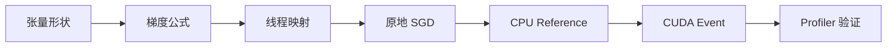
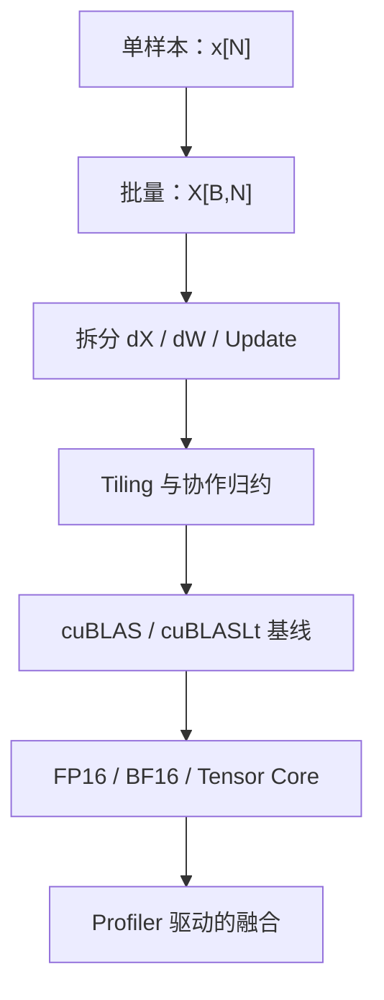

# 反向传播不是魔法：用 PyCUDA 拆开全连接层的 `dX`、`dW` 与 SGD

> **副标题**：从一组矩阵公式，走到线程映射、合并访存、原地更新、数值校验与 kernel-only Benchmark
>
> **工程深度**：L2，可继续优化 ｜ **验证状态**：未实测
>
> **关键词**：PyCUDA / CUDA Kernel / 全连接层 / Backpropagation / SGD / CUDA Event / Numerical Validation

> **工程深度｜验证状态：** L1–L2 入门进阶｜静态复核 + CPU 侧逻辑验证（未在本机实测 GPU）
---

## 开篇：一个看似合理的二维输入，为什么会让模型悄悄变样？

第一次手写全连接层反向传播时，人很容易把所有数据都做成二维矩阵：

```python
input_data = np.random.rand(M, N)
weights = np.random.rand(M, N)
```

然后在 CUDA 内核中写：

```cpp
input[i * N + j]
```

代码不越界，程序也可能正常运行。但它计算的已经不是通常意义上的单样本全连接层：

$$y_i=\sum_j W_{i,j}X_{i,j}$$

它让第 `i` 个输出使用第 `i` 行输入，本质是 `M` 组逐行点积。

标准单样本全连接层只有一份输入：

$$y_i=\sum_jW_{i,j}x_j$$

所有输出神经元共享同一个 `x[N]`，区别只在于各自使用不同的一行权重。

这一维之差，会继续影响 `dX`、`dW`、线程映射和验证代码。更麻烦的是，很多错误不会触发 CUDA 越界，只会让程序**稳定地算错另一个模型**。

所以反向传播真正的门坎不在公式，而在把公式翻译成执行事实：**谁读、谁写、什么时候读、什么时候写，以及怎么用证据证明它算对了**。形状 → 数学 → 线程所有权 → 读写冲突 → 访存模式 → CPU Reference → 可信计时 → Profiler 定性，这一整条链路才是本文的主线。

这篇文章不把反向传播当黑盒，而是沿着这条完整工程链路拆开它。需要提前说清的一点是：本文 kernel 把反向传播和第一步 SGD 参数更新**融合在同一个 kernel 里**——反传与参数更新的融合（backward + update fusion），这不是绕路，而是理解「权重原地更新为什么安全」的一把钥匙。



最终得到一份可以直接运行的 PyCUDA 示例，同时回答五个关键问题：

1. 为什么单样本输入是 `[N]`，而不是 `[M,N]`？
2. 为什么 `dX` 要遍历 `M` 个输出神经元？
3. 为什么权重梯度必须乘输入？
4. 原地更新权重时，如何保证 `dX` 使用的是旧权重？
5. 为什么一个看起来正确的 Benchmark，可能比较的是 `W20` 和 `W1`？

---

## 一、先把形状钉死：代码的第一道单元测试

设这一层有：

- `N` 个输入特征；
- `M` 个输出神经元；
- 一个输入样本。

那么张量形状应该是：

| 含义 | 数学符号 | 代码变量 | 形状 |
|---|---:|---|---:|
| 输入 | $x$ | `input` | `[N]` |
| 权重 | $W$ | `weights` | `[M,N]` |
| 输出 | $y$ | `output` | `[M]` |
| 输出梯度 | $dY$ | `grad_output` | `[M]` |
| 输入梯度 | $dX$ | `grad_input` | `[N]` |
| 权重梯度 | $dW$ | 内核中隐式计算 | `[M,N]` |

前向传播是：

$$\boxed{y=Wx}$$

展开第 `i` 个输出：

$$y_i=\sum_{j=0}^{N-1}W_{i,j}x_j$$

可以把它理解为：

```text
                         W[M,N]

                  x0    x1    x2   ...  xN-1
               ┌────────────────────────────┐
输出神经元 0   │ W00   W01   W02   ...     │ → y0
输出神经元 1   │ W10   W11   W12   ...     │ → y1
      ...      │ ...                        │
输出神经元 M-1 │ ...                 W(M-1) │ → yM-1
               └────────────────────────────┘

所有行都读取同一个 x[N]，每一行使用自己的权重。
```

### `[M,N]` 输入到底代表什么？

`X[M,N]` 本身不是非法形状。问题不在形状，而在于同一个第一维被同时当成「输出神经元数量」和「样本数量」，两个语义挤在同一根轴上。

如果它表示批量输入，第一维应该命名为批大小 `B`：

```text
X[B,N] @ W[K,N]ᵀ → Y[B,K]
```

其中 `K` 才是输出神经元数量。批大小和输出维度是两个独立概念，不能都叫 `M`。

如果继续使用：

```text
X[M,N]
W[M,N]
Y[M]
```

并计算：

$$Y_i=\operatorname{dot}(X_{i,:},W_{i,:})$$

从纯数学角度，`sum_j X[i,j]*W[i,j]` 是一个完全合法的计算——它是 `M` 组逐行向量点积。但在**本文定义的单样本 Linear 语义下**，它不是同一个计算：所有输出神经元应该共享同一份输入 `x[N]`，而这里的第 `i` 个输出只拿到第 `i` 行输入。

因此本文选择最清晰的单样本模型：

```text
x[N] + W[M,N] → y[M]
```

---

## 二、反向传播从哪里开始？

假设后续网络或损失函数已经给出了：

$$dY=\frac{\partial L}{\partial y}$$

它在代码中叫 `grad_output`，因为它是“当前层输出对应的梯度”，不是前向输出 `y` 本身。

反向传播需要得到两样东西：

$$dX=\frac{\partial L}{\partial x}$$

用于继续传给上一层；以及：

$$dW=\frac{\partial L}{\partial W}$$

用于更新当前层参数。

整体关系如下：

```text
Forward

x[N] ─────────────→ Linear(W[M,N]) ─────────────→ y[M]


Backward

dX[N] ←──────────── Linear(W[M,N]) ←──────────── dY[M]
                           │
                           └────────────→ dW[M,N]
```

---

## 三、为什么 `dX = WᵀdY`？

从第 `i` 个输出开始：

$$y_i=\sum_jW_{i,j}x_j$$

要求第 `j` 个输入的梯度：

$$\frac{\partial L}{\partial x_j} = \sum_i \frac{\partial L}{\partial y_i} \frac{\partial y_i}{\partial x_j}$$

由于：

$$\frac{\partial y_i}{\partial x_j}=W_{i,j}$$

所以：

$$\boxed{dX_j=\sum_{i=0}^{M-1}W_{i,j}dY_i}$$

写成矩阵形式：

$$\boxed{dX=W^TdY}$$

这也解释了为什么计算一个 `dX[j]` 时必须遍历 `M` 个输出神经元：输入特征 `x[j]` 同时影响了全部 `M` 个输出，反向传播必须把这 `M` 条路径的贡献加起来。

注意，准确说法不是“输入梯度等于权重乘权重梯度”，而是：

> 输入梯度等于权重矩阵的转置乘输出梯度。

`dY` 与 `dW` 是两个完全不同的量。

---

## 四、为什么 `dW` 必须乘输入？

继续对权重 `W[i,j]` 求导：

$$\frac{\partial L}{\partial W_{i,j}} = \frac{\partial L}{\partial y_i} \frac{\partial y_i}{\partial W_{i,j}}$$

而：

$$\frac{\partial y_i}{\partial W_{i,j}}=x_j$$

因此：

$$\boxed{dW_{i,j}=dY_i x_j}$$

矩阵形式是一个外积：

$$\boxed{dW=dYx^T}$$

这就是权重更新里必须乘 `input[j]` 的原因：权重对当前输出的影响，与流过这条连接的输入值成正比。

如果 `x[j]=0`，这一权重对当前样本的输出没有贡献，因此当前样本产生的 `dW[i,j]` 也为零。

SGD 更新为：

$$\boxed{W_{i,j}\leftarrow W_{i,j}-\eta dY_i x_j}$$

对应 CUDA：

```cpp
weights[i * N + j] =
    old_weight - learning_rate * grad_output[i] * input[j];
```

### 这不是纯 backward：它融合了参数更新

先做一个重要的边界定义。标准训练流程里，backward 和参数更新在时间上是分开的两步：

```text
标准训练流程：

Forward
    ↓
Backward
    ├── dX   （传给上一层）
    └── dW   （这一层自己的权重梯度）
          ↓
      Optimizer
          ↓
      W ← W - η·dW
```

而本文为了教学，把 **Backward + SGD Update 融合成一个 kernel**：

```text
              ┌───────────────┐
dY ──────────→│               │
x ───────────→│ fused kernel  │──→ dX
W ───────────→│               │
              └───────┬───────┘
                      │
                      ↓
                 updated W
```

因此有一个必须说清的定义：

> 本文 kernel 的输出不是传统意义上的 `(dX, dW)`，而是 `(dX, W_new)`。`dW` 只在数学推导中隐式存在，并没有单独写入显存——它被消费、应用进了 `W_new`。

这也是为什么文章开头强调「thread j 负责 `dX[j]` 以及整列 `W[:,j]` 的更新」：列归属既服务 `dX` 的累加，也服务权重更新。后面看代码时，请记住这个 kernel 同时扮演了 backward 和 optimizer 两个角色。

这里也要收敛一下边界：本文融合的是**最简单的 SGD（随机梯度下降）**更新 `W ← W − η·dW`。Momentum、Adam/AdamW 等优化器需要额外的 optimizer state（动量、一阶/二阶矩），不能直接用这一条公式替代——它们要么把这些 state 也搬进 kernel，要么让 backward 仍然显式输出 `dW`。

同理，`dW` 只存在于数学推导、不落显存，这个接口只适合「算完梯度立刻用它更新」的场景。如果上层训练框架还需要梯度裁剪、梯度累积、梯度检查、梯度通信，或者需要把 `dW` 保存下来，那么 fused kernel 的接口就不够用了，需要显式输出 `dW`，或把这些操作一起融合进 kernel。

再补一个小矩阵例子，把 `dW=dYx^T` 钉死。设：

```text
x  = [ x0  x1  x2 ]
dY = [ g0  g1 ]

W =
[ W00  W01  W02
  W10  W11  W12 ]
```

那么：

```text
dW = dY x^T =
[ g0*x0   g0*x1   g0*x2
  g1*x0   g1*x1   g1*x2 ]
```

对应到 kernel 里「一个线程拥有一列」：

```text
thread j=0：W00 ← W00 - lr*g0*x0      W10 ← W10 - lr*g1*x0
thread j=1：W01 ← W01 - lr*g0*x1      W11 ← W11 - lr*g1*x1
thread j=2：W02 ← W02 - lr*g0*x2      W12 ← W12 - lr*g1*x2
```

每个权重元素更新的缩放因子恰好是 `dY[i] * x[j]`——外积公式和线程所有权就这样对上了。

---

## 五、线程怎么分工：一个线程承包一列

本文选择：

$$\boxed{\text{thread }j\rightarrow dX_j+W_{:,j}\text{ 的更新}}$$

也就是：

```text
Thread 0 → dX[0] → 更新 W[0,0], W[1,0], ..., W[M-1,0]
Thread 1 → dX[1] → 更新 W[0,1], W[1,1], ..., W[M-1,1]
Thread 2 → dX[2] → 更新 W[0,2], W[1,2], ..., W[M-1,2]
...
```

不同线程拥有不同的列 `j`，因此不会写入同一个权重元素：

```text
                 W[M,N]

              列0       列1       列2
               │         │         │
               ▼         ▼         ▼
            Thread 0  Thread 1  Thread 2
               │         │         │
               ▼         ▼         ▼
             dX[0]     dX[1]     dX[2]
```

所以这个特定映射不需要：

```cpp
atomicAdd()
```

也不需要线程块内屏障：

```cpp
__syncthreads()
```

### 为什么跨行循环仍能形成合并访问？

单个线程确实沿着一列访问：

```cpp
weights[i * N + j]
```

但 GPU 是否合并访存，要从 warp 的同一条指令看。

当某一轮 `i` 固定时：

```text
Thread 0  → W[i,0]
Thread 1  → W[i,1]
Thread 2  → W[i,2]
...
Thread 31 → W[i,31]
```

相邻线程读取相邻 `float`，因此这里的**合并结论有条件**：在 `N` 足够大（至少覆盖一个 warp）、线程沿 `j` 连续映射、数据布局为 C-order `[M,N]` 的前提下，每一轮 `i` 都会形成典型的连续 warp 访问；如果 `N` 小于 warp size（32），或 warp 恰好跨越行边界，事务数量与对齐方式就会变化。本文实验 `N=1024, BLOCK_SIZE=256` 正好落在前一种情况。

再收紧一层：具体到本文 `N=1024`、C-order `[M,N]`、线程沿 `j` 连续映射的条件下，**每一轮 `i`** 中，一个 warp 的 32 个 lane 读取连续 32 个 `float`，即 **128 字节的有效数据访问**——注意这里强调「每一轮 `i`」，因为合并访问的判定对象是某一条内存指令上 warp 的地址集合，而不是单个线程的整个生命周期。

对于满足对齐条件的典型场景，这组访问**通常由 4 个 32-byte global-memory transactions 服务**，而非一个 128-byte transaction。CUDA Programming Guide 对全局内存合并的表述正是以 32-byte transaction 为基础：一个 warp 的内存请求会被合并为满足其地址集合所需的一组 transaction。实际数量仍取决于地址分布、对齐、cache 路径与具体架构——所以 **合并访问 ≠ 「一个 warp 恒为一个 transaction」**。[NVIDIA：Global Memory Coalescing](https://docs.nvidia.com/cuda/cuda-c-best-practices-guide/index.html#coalesced-access-to-global-memory)

这里藏着一个很反直觉的点：单线程视角和 GPU 视角看到的是完全不同的图景。

```text
CPU 视角（逐线程看）：
Thread 0  → W[0,0], W[1,0], W[2,0], ...     一串同列
Thread 1  → W[0,1], W[1,1], W[2,1], ...     一串同列

GPU 视角（同一轮指令看）：
Thread 0  → W[i,0]
Thread 1  → W[i,1]
Thread 2  → W[i,2]
...        同一行、地址连续、32 个 lane 一起发射
```

GPU 不关心「一个线程历史上访问过哪些地址」，它只关心**一个 warp 在同一条内存指令上访问了哪些地址**。CUDA 合并访存的定义对象是 warp 的指令，不是单个线程的轨迹。

---

## 六、原地更新最大的陷阱：`dX` 必须使用旧权重

输入梯度的定义是：

$$dX=W_{old}^TdY$$

如果先更新权重，再读取它计算 `dX`，得到的会是：

$$W_{new}^TdY$$

这与反向传播公式不一致。

最直观的修复是分两个循环：第一个循环计算 `dX`，第二个循环更新权重。但这会让同一个线程再次读取整列权重。

实际上可以进一步合成一个循环：

```cpp
float old_weight = weights[index];

dx += old_weight * dy;

weights[index] = old_weight - learning_rate * dy * xj;
```

关键是先把当前权重读入 `old_weight`，用它累加 `dX`，再覆盖该位置。

`old_weight` 在这里不只是一个优化变量，而是**语义上的快照**：它把「梯度计算使用旧参数」和「参数更新产生新参数」两个时间点，在同一个线程里显式隔离开。读进来一个 `W_old`，`dX` 用 `W_old`，写回去的是 `W_new`——旧值没有在任何地方被覆盖，直到它的梯度贡献被消费完。

这个时机关系可以画成一张「旧权重 → dX / 新权重」的时间语义图：

```text
              W[i,j]
                │
                │ load
                ▼
         ┌────────────┐
         │ old_weight │
         └─────┬──────┘
               │
        ┌──────┴──────┐
        │             │
        ▼             ▼
old_weight × dY[i]   old_weight - lr × dY[i] × x[j]
        │             │
        ▼             ▼
      dX[j]        W_new[i,j]
```

关键不是「先算还是先写」这种表面顺序，而是：**`W_old` 必须在被 `dX` 消费完之后，才能被覆盖成 `W_new`**。这条依赖被 `old_weight` 这个局部变量显式保存，正是本 kernel 不需要 `__syncthreads()` 也能语义正确的原因。

为什么安全？

- 当前线程以后不会再次读取这个 `W[i,j]`；
- 其他线程负责不同的列，不会读取或写入这个元素；
- CUDA 线程内指令遵循程序定义的数据依赖。

这里一定要抓住真正的原因：**安全，不是因为「原地更新天然安全」，而是因为线程所有权**。这个 kernel 里每个权重元素 `W[i,j]` 恰好只被一个线程 `j` 拥有——读它、写它、更新它，全程没有第二个线程碰它。所以根本没有跨线程的数据竞争可担心。

把这一节抽象成一个可复用的判断：

```text
原地更新是否安全？
        │
        ├─ 是否存在其他线程读取/写入同一元素？
        │          │
        │          ├─ 是 → 不能直接这么做，
        │          │        需要锁/原子/或拆分读写阶段
        │          │
        │          └─ 否 → 继续问
        │
        └─ 一个元素是否只被一个线程拥有？
                   │
                   ├─ 是 → 当前模式可行（本文场景）
                   │
                   └─ 否 → 与上面合并判断：谁先读、谁后写？
```

有了这个框架，「能不能就地更新」就不再是对每个 kernel 重新猜一次，而是每次先回答一个问题：**这个元素有几个主人？**

于是一次循环同时完成：

```text
读取旧 W[i,j]
      │
      ├──→ 累加 dX[j]
      │
      └──→ 计算 dW[i,j] 并更新 W[i,j]
```

相比「先遍历一遍权重算 `dX`、再单独遍历一遍更新 `W`」的朴素双循环版本，融合后可以**避免第二次对权重矩阵的逻辑读取**，也让代码更接近真正的 kernel fusion。要强调“逻辑”——编译器、缓存、寄存器与生成指令都会影响硬件层面的 load / transaction / traffic，最终收益应以实测为准。

---

## 七、最容易被忽略的 Benchmark 错误：你测了 20 次，也更新了 20 次

如果内核会原地修改 `W`，下面这段循环并不是对同一个任务测量 20 次：

```python
for _ in range(20):
    gradient_update(...)
```

它实际执行的是：

```text
W0 → W1 → W2 → ... → W20
```

如果 CPU Reference 只计算了一次更新：

```text
W0 → W1
```

最后拿 GPU 的 `W20` 和 CPU 的 `W1` 比较，失败是必然的。

正确 Benchmark 应让每轮都从同一个初始状态开始：

```text
第 1 轮：W0 → kernel → W1
第 2 轮：W0 → kernel → W1
第 3 轮：W0 → kernel → W1
...
```

因此程序保留一份只读的 `W0_gpu`，每轮计时前执行设备到设备复制：

```python
cuda.memcpy_dtod(W_gpu, W0_gpu, W0.nbytes)
```

权重恢复放在 Event 区间之外，因此统计值只表示 kernel 执行时间，不包含状态重置成本。

所以要精确回答一个读者一定想问的问题：**这里到底测的是什么？** 答案是——**kernel-only timing**（kernel 本身的执行耗时）。真实的一次训练 step 长这样：

```text
H2D / 预处理
    ↓
Forward
    ↓
Backward
    ↓
Optimizer
    ↓
D2H / 下一 stage
```

本文的计时窗口刻意落在：

```text
W0_gpu ──D2D（不计时）──→ W_gpu
                              │
                            Event
                              ↓
                       kernel only（计时）
                              │
                              ▼
                            W1
```

因此它回答的是「**这个 kernel 单独跑一遍要多久**」，而不是「完成一次训练 step 要多久」——后者还包括前后两端的数据搬运、forward、optimizer，以及它们之间的调度间隙。更准确地说，本文把状态恢复排除在计时之外，是为了测量**固定初始状态（同一 `W0`）下的 kernel 执行成本**——这不是完整训练循环的端到端吞吐指标。这个边界和全文「证据链」的思想一致：把被测对象拆到最小、口径最干净，才能拿到可解释的数字。

再补充一条通用原则：**Benchmark 的问题不是「测几次」，而是「每一次测量是否代表同一个 workload」**。本文只测了一个 workload（`N=1024, M=512`），所以定位要诚实——它是单 workload 的 kernel-only benchmark，用于验证方法论；要回答「这个 kernel 在不同尺寸下表现如何」，还需要再跑一组尺寸扫描。

NVIDIA Best Practices Guide 将 CUDA Event 列为 GPU 端计时的标准机制之一；PyCUDA 的 `Event.record()`、`synchronize()` 和 `time_till()` 对应这一机制。[NVIDIA：CUDA Event Timing](https://docs.nvidia.com/cuda/cuda-c-best-practices-guide/index.html#using-cuda-gpu-timers) [PyCUDA：Event API](https://documen.tician.de/pycuda/driver.html#pycuda.driver.Event)

---

## 八、完整可运行代码

下面的代码完成：

- 单样本全连接层反向传播；
- `dX=WᵀdY`；
- 隐式计算 `dW=dYxᵀ`；
- 原地 SGD 更新；
- warmup；
- 每轮恢复初始权重的 CUDA Event Benchmark；
- NumPy CPU Reference；
- 最大绝对误差、相对误差和 `np.allclose()` 验证。

看代码之前，先把「为什么这样做是对的」钉死。这个 kernel 的正确性来自三个不变量：

```text
Invariant 1  每个 thread j 只写 dX[j] 与 W[0,j], W[1,j], ..., W[M-1,j]
Invariant 2  每个 W[i,j] 只被 thread j 写一次
Invariant 3  每个 W[i,j] 更新前先保存 old_weight：
             dX 使用 old_weight（W_old）
             更新结果使用 old_weight（W_old → W_new）
```

三条合起来的含义是：

```text
无 W 写冲突
        +
dX 使用 W_old
        +
W 得到 W_new
        ↓
kernel 与数学定义一致
```

第一、二条保证没有数据竞争，第三条保证「梯度算在旧参数上、更新落成新参数」——也就是上一节说的 `old_weight` 快照语义。读代码时你可以逐个核对这三个 Invariant 是否被严格守住。

Kernel 参数里的 `__restrict__` 先说明一下：它**不是一个「让内存更快」的开关**，而是一个**关于指针访问别名关系的编译器契约**——通过这四个指针发出的访问彼此不会违反 restrict contract，编译器因此可以做重排、公共子表达式消除等更激进的优化；违反契约的结果是未定义行为。

这里要分清两个独立概念：

- **线程所有权**回答的是「`W[i,j]` 被哪个线程写」——本文的列映射保证不同线程不会同时修改同一个元素；
- **`__restrict__`** 回答的是「`input`、`weights`、`grad_output`、`grad_input` 各自指向的访问区域是否可能重叠」。

线程映射再干净，`restrict` 契约也要单独兑现。只要调用方将来允许其中任意两个数组发生重叠，就不能随意加 `__restrict__`。比如若有人让 `grad_input` 与 `input` 指向同一块内存，编译器会基于「不别名」承诺做出激进重排，结果就是未定义行为。**本文代码假设四个 buffer 相互独立**——这个前提由调用方负责维护。

```python
"""反向传播不是魔法：用 PyCUDA 拆开全连接层的 `dX`、`dW` 与 SGD（第1章 · GPU 编程基础）。

本文件是对应博文代码块的实现/演示，直接运行可见效果；运行依赖：PyCUDA、NumPy。
"""
import numpy as np

import pycuda.driver as cuda
import pycuda.autoinit  # noqa: F401：创建并持有默认 CUDA 上下文

from pycuda.compiler import SourceModule


# ============================================================
# 1. CUDA Kernel
#
# 单样本全连接层：
#
#   x   : [N]
#   W   : [M,N]
#   dY  : [M]
#   dX  : [N]
#
# 数学关系：
#
#   dX = W^T dY
#   dW = dY x^T
#   W  = W - learning_rate * dW
#
# 线程映射：
#
#   thread j -> dX[j] + W[:,j] update
# ============================================================

kernel_code = r"""
__global__ void gradient_update(
    const float* __restrict__ input,       // x[N]；__restrict__ 承诺该指针不与其余三个数组重叠
    float* __restrict__ weights,           // W[M,N]
    const float* __restrict__ grad_output, // dY[M]
    float* __restrict__ grad_input,        // dX[N]
    int N,
    int M,
    float learning_rate)
{
    // 一个线程负责一个输入特征 j
    int j = blockIdx.x * blockDim.x + threadIdx.x;

    if (j >= N) {
        return;
    }

    // 同一个线程在整列计算中反复使用 x[j]，
    // 显式读入局部变量，便于编译器保存在寄存器中。
    const float xj = input[j];

    // dX[j] 的累加器
    float dx = 0.0f;

    // 遍历 M 个输出神经元
    for (int i = 0; i < M; ++i) {
        const int index = i * N + j;

        // 先保存旧权重：dX 必须使用更新前的 W。
        const float old_weight = weights[index];
        const float dy = grad_output[i];

        // dX[j] += W_old[i,j] * dY[i]
        dx += old_weight * dy;

        // dW[i,j] = dY[i] * x[j]
        // W[i,j]  = W_old[i,j] - lr * dW[i,j]
        weights[index] =
            old_weight - learning_rate * dy * xj;
    }

    // 当前线程独占 grad_input[j]，不存在写冲突。
    grad_input[j] = dx;
}
"""


# 编译并获取 Kernel
module = SourceModule(
    kernel_code,
    options=["-O3"],
)

gradient_update = module.get_function("gradient_update")


# ============================================================
# 2. 实验参数
# ============================================================

N = 1024              # 输入特征数
M = 512               # 输出神经元数
BLOCK_SIZE = 256      # 合理起点，不宣称是所有 GPU 上的最优值
WARMUP = 5
ITERATIONS = 50
LEARNING_RATE = np.float32(0.01)

assert N > 0 and M > 0
assert BLOCK_SIZE > 0

# launch 配置是 device-dependent fact：同一 BLOCK_SIZE 在不同 GPU 上未必合法
dev = cuda.Context.get_device()
max_threads_per_block = dev.get_attribute(
    cuda.device_attribute.MAX_THREADS_PER_BLOCK
)
assert BLOCK_SIZE <= max_threads_per_block, (
    f"BLOCK_SIZE={BLOCK_SIZE} 超过该设备上限 {max_threads_per_block}"
)

grid_size = (N + BLOCK_SIZE - 1) // BLOCK_SIZE


# ============================================================
# 3. 构造输入
# ============================================================

rng = np.random.default_rng(42)

# 单样本输入 x[N]
x = rng.random(N, dtype=np.float32)

# 初始权重 W0[M,N]
W0 = rng.random((M, N), dtype=np.float32)

# 来自后一层或损失函数的输出梯度 dY[M]
dY = rng.random(M, dtype=np.float32)

assert x.shape == (N,)
assert W0.shape == (M, N)
assert dY.shape == (M,)
assert x.flags.c_contiguous
assert W0.flags.c_contiguous
assert dY.flags.c_contiguous
assert x.dtype == np.float32
assert W0.dtype == np.float32
assert dY.dtype == np.float32


# ============================================================
# 4. CPU Reference：只计算一次更新
# ============================================================

# dX = W0^T @ dY
expected_dX = (W0.T @ dY).astype(np.float32)

# dW = dY[:,None] * x[None,:]
expected_dW = (
    dY[:, np.newaxis] * x[np.newaxis, :]
).astype(np.float32)

# W1 = W0 - lr * dW
expected_W = (
    W0 - LEARNING_RATE * expected_dW
).astype(np.float32)


# ============================================================
# 5. Host -> Device
# ============================================================

x_gpu = cuda.to_device(x)
dY_gpu = cuda.to_device(dY)

# W_gpu 是内核原地修改的工作副本。
W_gpu = cuda.to_device(W0)

# W0_gpu 永远保留初始权重，用于每轮恢复状态。
W0_gpu = cuda.to_device(W0)

# mem_alloc 返回 DeviceAllocation，不是 GPUArray。
dX_gpu = cuda.mem_alloc(x.nbytes)


# ============================================================
# 6. Kernel Launch Helper
# ============================================================

def launch_gradient_update():
    gradient_update(
        x_gpu,
        W_gpu,
        dY_gpu,
        dX_gpu,
        np.int32(N),
        np.int32(M),
        LEARNING_RATE,
        block=(BLOCK_SIZE, 1, 1),
        grid=(grid_size, 1, 1),
    )


# ============================================================
# 7. Warmup
#
# Warmup 会修改 W_gpu。
# 正式 benchmark 的每一轮都会先恢复 W0_gpu，
# 因此 warmup 造成的状态不会进入正式测量。
# ============================================================

for _ in range(WARMUP):
    launch_gradient_update()

cuda.Context.synchronize()


# ============================================================
# 8. Benchmark
#
# 每轮：
#
#   reset W0（不计时） -> kernel（计时） -> W1
# ============================================================

times_ms = []
start_event = cuda.Event()
end_event = cuda.Event()

for _ in range(ITERATIONS):
    # 非异步 D2D 复制；恢复操作位于 Event 计时区间之外。
    cuda.memcpy_dtod(W_gpu, W0_gpu, W0.nbytes)

    start_event.record()
    launch_gradient_update()
    end_event.record()

    # time_till() 前必须确保结束事件已经到达。
    end_event.synchronize()

    times_ms.append(
        start_event.time_till(end_event)
    )

times_ms = np.asarray(times_ms, dtype=np.float64)


# ============================================================
# 9. 独立执行一次，用于 Correctness Validation
# ============================================================

cuda.memcpy_dtod(W_gpu, W0_gpu, W0.nbytes)
launch_gradient_update()
cuda.Context.synchronize()


# ============================================================
# 10. Device -> Host
#
# W_gpu 和 dX_gpu 是 Driver API 的 DeviceAllocation，
# 不是 pycuda.gpuarray.GPUArray，因此这里使用 cuda.memcpy_dtoh()。
# 如果改用 GPUArray，则可用其 .get() 方法取回数据。
# ============================================================

dX = np.empty_like(x)
W_result = np.empty_like(W0)

cuda.memcpy_dtoh(dX, dX_gpu)
cuda.memcpy_dtoh(W_result, W_gpu)


# ============================================================
# 11. 数值验证
# ============================================================

RTOL = 2e-5
ATOL = 2e-5

dx_ok = np.allclose(
    dX,
    expected_dX,
    rtol=RTOL,
    atol=ATOL,
)

w_ok = np.allclose(
    W_result,
    expected_W,
    rtol=RTOL,
    atol=ATOL,
)

dx_abs_error = np.max(np.abs(dX - expected_dX))
w_abs_error = np.max(np.abs(W_result - expected_W))

# 分母设置下限，避免参考值接近 0 时相对误差失真或除零。
dx_rel_error = np.max(
    np.abs(dX - expected_dX)
    / np.maximum(np.abs(expected_dX), np.float32(1e-6))
)

w_rel_error = np.max(
    np.abs(W_result - expected_W)
    / np.maximum(np.abs(expected_W), np.float32(1e-6))
)


# ============================================================
# 12. Benchmark 统计
# ============================================================

min_ms = float(np.min(times_ms))
median_ms = float(np.median(times_ms))
p95_ms = float(np.percentile(times_ms, 95))
max_ms = float(np.max(times_ms))


# ============================================================
# 13. 输出环境与结果
# ============================================================

device = cuda.Context.get_device()

print("=" * 72)
print("PyCUDA 单样本全连接层反向传播 + 原地 SGD")
print("=" * 72)
print(f"GPU               : {device.name()}")
print(f"Compute Capability: {device.compute_capability()}")
print(f"N                 : {N}")
print(f"M                 : {M}")
print(f"Block Size        : {BLOCK_SIZE}")
print(f"Grid Size         : {grid_size}")
print(f"Learning Rate     : {float(LEARNING_RATE)}")

print()
print("Tensor Shapes")
print("-" * 72)
print(f"x                 : {x.shape}")
print(f"W                 : {W0.shape}")
print(f"dY                : {dY.shape}")
print(f"dX                : {dX.shape}")

print()
print("Kernel Mapping")
print("-" * 72)
print("thread j -> dX[j] + W[:,j] update")

print()
print("Benchmark: kernel only, reset excluded")
print("-" * 72)
print(f"Warmup            : {WARMUP}")
print(f"Iterations        : {ITERATIONS}")
print(f"Min               : {min_ms:.6f} ms")
print(f"Median            : {median_ms:.6f} ms")
print(f"P95               : {p95_ms:.6f} ms")
print(f"Max               : {max_ms:.6f} ms")

print()
print("Correctness")
print("-" * 72)
print(f"dX                : {'PASS' if dx_ok else 'FAIL'}")
print(f"dX max abs error  : {dx_abs_error:.8e}")
print(f"dX max rel error  : {dx_rel_error:.8e}")
print(f"W update          : {'PASS' if w_ok else 'FAIL'}")
print(f"W max abs error   : {w_abs_error:.8e}")
print(f"W max rel error   : {w_rel_error:.8e}")

print()
print("Samples")
print("-" * 72)
print("dX[:5] =", dX[:5])
print("W_result[0, :5] =", W_result[0, :5])

if not (dx_ok and w_ok):
    raise RuntimeError(
        "CUDA result does not match the NumPy reference."
    )

print()
print("Validation: PASS")
```

### 这版代码修复了什么？

| 问题 | 修复方式 |
|---|---|
| 把单样本输入误写成 `[M,N]` | 改为标准 `x[N]` |
| 把输出梯度误叫作权重梯度 | 使用 `grad_output[M]` |
| 使用 `grad_input[j] * input[...]` 更新权重 | 改为 `dY[i] * x[j]` |
| 先更新权重再计算 `dX` | 每个元素先读取 `old_weight` |
| 两次循环重复读取权重 | 合并为一次循环 |
| Benchmark 连续更新 20 次 | 每轮计时前恢复 `W0` |
| `DeviceAllocation.get()` | 改为 `cuda.memcpy_dtoh()` |
| CPU 墙钟只测到 launch | 使用 CUDA Event |
| 要求浮点结果完全相等 | 使用明确容差与误差报告 |

PyCUDA 文档明确指出，`mem_alloc()` 与 `to_device()` 返回的是 `DeviceAllocation`，不是 `GPUArray`；从这类线性设备内存回传数据，可以使用 `memcpy_dtoh()` 或 `from_device()`。如果改用 `pycuda.gpuarray.GPUArray`，则可以用 `.get()` 方法取回数据。[PyCUDA：Global Device Memory](https://documen.tician.de/pycuda/driver.html#global-device-memory) [PyCUDA：Memory Transfers](https://documen.tician.de/pycuda/driver.html#unstructured-memory-transfers)

---

## 九、为什么不能要求 CPU 与 GPU 逐 bit 相同？

CPU Reference 使用：

```python
W0.T @ dY
```

CUDA 内核使用循环累加：

```cpp
dx += old_weight * dy;
```

即使数学表达式相同，也可能因为以下原因产生末位差异：

- 浮点加法不满足结合律；
- CPU BLAS 与 CUDA 内核的累加顺序可能不同；
- 编译器可能生成融合乘加；
- 不同执行路径具有不同的舍入过程。

展开说其中最关键的一条「累加顺序」。本文 kernel 里 `dX[j]` 是串行 `M` 次累加：

```cpp
dx += old_weight * dy;   // 顺序固定，i 从小到大
```

而 CPU 侧 `W0.T @ dY` 走的是 BLAS 实现，它可能用分块（tiling）、SIMD 向量化、甚至并行归约把 `M` 项拆成多个部分和再合并。数学上两个结果相同，舍入路径却完全不同。再加上 FMA（融合乘加）会把「一次乘、一次加」融合为一次运算，中间结果不单独舍入，最终结果通常只经历一次舍入——这些差异叠加，最终表现为最后几位 bit 不同。

说人话就是：**GPU 没有义务按 CPU 的顺序加这几个浮点数**。数学公式相同，不代表最后几位 bit 也必须相同。NVIDIA Best Practices Guide 也明确提醒：并行化可能改变运算顺序，因此结果不一定与串行执行完全相同，应在相同精度下使用合适容差验证。[NVIDIA：Numerical Accuracy](https://docs.nvidia.com/cuda/cuda-c-best-practices-guide/index.html#numerical-accuracy-and-precision)

NumPy 的 `allclose(a, b)` 判定规则是：

$$|a-b|\leq atol+rtol\times|b|$$

它关注的是「按参考值缩放后的相对差」，而且以第二个参数 `b` 为参考，不是严格对称的；`atol` 也应该结合数据量级选择，而不是机械使用默认值。[NumPy：`allclose`](https://numpy.org/doc/stable/reference/generated/numpy.allclose.html)

这里的三个指标各管一件事，不要混为一谈：

```text
np.allclose()
    ↓  最终 PASS/FAIL 判定（atol + rtol*|b|）

np.max(abs(got - expected))
    ↓  绝对误差诊断（不缩放）

np.max(abs(got - expected) / max(|expected|, eps))
    ↓  尺度归一化诊断（本文自定义，非 NumPy allclose 口径）
```

后两个是诊断指标，只看量级是否可接受；`allclose` 才是「合不合格」的判定。

另外还有一个容易被忽略的事实：`dX[j]` 是 `M` 次 float 累加的结果。**`M` 越大，累加项越多，舍入误差的空间越大**。所以代码里的 `RTOL=2e-5, ATOL=2e-5` 不是「标准答案」，而是**本文参数规模下（`N=1024, M=512`）的示例容差**。实际项目要结合 dtype、归约长度、数据量级和 reference 实现重新选择容差——FP16 下同一套阈值就完全不适用。

---

## 十、`BLOCK_SIZE=256` 是答案，还是起点？

是起点，不是答案。

NVIDIA Best Practices Guide 将 warp-size 的整数倍作为重要启发式，并可将 128～256 个线程作为一个常见的初始实验范围；最终 block size 仍应根据具体 GPU、寄存器使用、shared memory、occupancy 和 workload 实测确定。[NVIDIA：Execution Configuration Optimizations](https://docs.nvidia.com/cuda/cuda-c-best-practices-guide/index.html#execution-configuration-optimizations)

可以继续测试：

```text
BLOCK_SIZE = 128
BLOCK_SIZE = 256
BLOCK_SIZE = 512
```

然后比较：

- Median 与 P95；
- Achieved Occupancy；
- DRAM/L2 吞吐；
- SM Throughput；
- 寄存器使用量；
- Warp Stall 原因。

但 occupancy 并非越高越快。它主要决定 GPU 隐藏延迟的能力，最终仍要结合内存与计算管线利用率判断。Nsight Compute 的 `SpeedOfLight`、`MemoryWorkloadAnalysis`、`LaunchStats` 和 `Occupancy` 分区正是为这些问题服务。[NVIDIA Nsight Compute：Profiling Guide](https://docs.nvidia.com/nsight-compute/ProfilingGuide/index.html)

还有一个容易被忽略的边界：**当 `N < BLOCK_SIZE` 时，一个 block 内部会出现大量 inactive threads**。本文 kernel 的并行度等于 `N`，grid 里的实际线程就是 `N` 个，多出的线程不能自己找活干。比如 `N=64, BLOCK_SIZE=256`：前 64 个 thread 干活，其余 192 个线程被空转地“占着位子”。这会让 `Achieved Occupancy`、`SM Efficiency` 等指标异常偏低，却**不代表 kernel 本身写得差**——纯粹是并行度不够。处理方式通常是缩小 `BLOCK_SIZE`（使其 ≤ `N`），或换一种线程映射让某些线程也能利用 `M` 方向的并行度。

---

## 十一、它到底在算，还是在搬？

每个权重元素执行的核心工作大致是：

```text
读取 old_weight
读取 dy
累加 old_weight * dy
计算 dy * xj
写回 new_weight
```

也就是说，单个元素上的浮点运算并不多，却必须读写权重矩阵。代码检查可以提示它具有较低算术强度、可能偏向带宽受限，但不能仅凭源码宣布“它就是 DRAM-bound”。

从「看到源码」到「说出瓶颈」，中间隔着四层证据，一层都不能跳：

```text
源码
 ↓
算法结构（算术强度低 → "可能"带宽受限）
 ↓
Nsight Compute（实际 memory / compute / occupancy 指标）
 ↓
真正的 bottleneck（DRAM？L2？指令发射？并行度？）
```

原因是实际流量还会受到：

- `dY` 的缓存命中；
- `x[j]` 是否保存在寄存器；
- L1/L2 行为；
- 内存事务合并；
- 写策略；
- 编译器生成指令；
- 问题规模是否足以占满 GPU。

严谨结论应该是：

> 从算法结构看，它具有内存密集倾向；是否真正受 DRAM、L2、指令发射或并行度限制，需要 Nsight Compute 证据。

这比直接拿“逻辑访问字节数”冒充“实际 DRAM 流量”更准确。

顺带说一个重要的工程事实：这个映射把**并行度绑死在 `N` 上**——`N` 决定线程数量，`M` 决定每个线程要串行执行的循环次数。

```text
N 大 + M 小 → 线程充足、每线程很闲
N 小 + M 大 → 线程稀疏、每线程拖着很长的串行循环
                     ↓
         GPU 并行度不足，SM 吃不饱
```

换句话说，同样的 kernel 在 `N=1024, M=512` 和 `N=32, M=65536` 上，瓶颈可能从「内存」变成「并行度不足」。这解释了为什么它**非常适合教学，但并不是所有矩阵尺寸下都好用**，也自然引出下一阶段的优化方向：换一种线程映射，把并行度从 `N` 上解放出来。

把数字摆出来会更直观。本文 `N=1024, M=512`：

```text
权重元素总数 = M × N = 512 × 1024 = 524,288
并行工作单元 =  N = 1024 个线程
平均每线程  =  M = 512 个 W 元素
```

也就是 **524,288 个权重元素被映射到 1,024 个逻辑线程，每线程串行处理 512 个元素**。注意这里是「逻辑线程数等于 `N`」，不是说 GPU 同时只能运行 1,024 个线程——这 1,024 个逻辑线程会组成 32 个 warp，由若干 SM 分时调度执行；真正的问题在于每个逻辑线程承担的串行工作太长。这就是当前 kernel 最大的结构性限制。对比生产级 GEMM：

```text
本文映射：

并行空间 = N 个线程
串行量   = 每线程 M 个 W 元素

生产级 GEMM：

并行工作空间 → 沿 M × N 输出维度充分展开
归约维度     → 在 tile / warp / thread 层级协作完成

              ↓

比「一个线程负责整列」的映射暴露更多并行度
```

所以后续优化的本质，是**把 `M × N` 个元素都变成并行工作单元**，而不是让少数线程去「扛」整列。这正是 Tiling → GEMM → Tensor Core 这一路演进要解决的问题。

---

## 十二、为什么不用 shared memory？

`dY[M]` 会被多个线程重复读取，看上去似乎适合搬入 shared memory。但“存在复用”只是必要条件之一，不是使用 shared memory 的充分条件。

先看一组容易被忽略的细节：固定某一轮 `i`，一个 warp 里 32 个线程读的是**同一个 `dY[i]`**：

```text
固定 i：

Thread 0  ─┐
Thread 1  ─┤
Thread 2  ─┤──→ dY[i]
...        │
Thread 31 ─┘

             同一个地址
```

这不是传统意义上「32 个线程 → 32 个不同的全局地址」，而是「32 个线程 → 同一个地址」。现代 GPU 的缓存与广播机制对这种「全部 lane 同地址」的访问很友善，不一定需要显式搬进 shared memory 去「救火」。换句话说：**「多个线程重复读取」并不自动等于「必须上 shared memory」**，先让 Profiler 告诉我们缓存到底处理得怎么样。

在本文规模下，`x` 和 `dY` 的工作集很小：

```text
dY：512 × 4 byte = 2 KiB
x ：1024 × 4 byte = 4 KiB
```

工作集小意味着**理论上具有较好的缓存复用潜力**；但实际命中情况不能仅从源码确定，应由 Nsight Compute 的 L1/L2 指标验证。即使命中率不错，是否值得为此引入 shared memory，还要权衡它带来的额外成本：

- 协作加载；
- 屏障；
- 代码复杂度；
- 每个 block 的资源占用；
- occupancy 约束。

NVIDIA Best Practices Guide 也指出，shared memory 可以帮助合并访问或消除冗余全局访问，但同时可能约束 occupancy。[NVIDIA：Shared Memory and Block Size](https://docs.nvidia.com/cuda/cuda-c-best-practices-guide/index.html#effects-of-shared-memory)

正确顺序不是：

```text
看到重复读取 → 立刻上 shared memory
```

而是：

```text
看到重复读取
      ↓
Profiler 判断缓存与带宽行为
      ↓
设计 shared-memory 版本
      ↓
重新验证正确性
      ↓
同口径 Benchmark
```

---

## 十三、为什么它不是生产级全连接层实现？

当前内核只有 `N` 个线程，每个线程串行循环 `M` 次。它非常适合讲清：

- 梯度公式；
- 张量形状；
- 线程所有权；
- 合并访问；
- 原地更新；
- kernel fusion；
- 数值验证；
- GPU 计时。

但生产训练还需要面对：**前向 `y=Wx` 演变成 batch 矩阵乘法，反向 `dX=dY·W` 与 `dW=dYᵀ·X` 同样变成两个 GEMM**，随后还有 bias 与 activation 的梯度、FP16/BF16/TF32 与混合精度缩放、Tensor Core、optimizer state、分布式梯度同步、stream/CUDA Graph 调度与更复杂的融合策略。

一旦加入 batch，本文的线程映射就失去了优势：

```text
本文 kernel：
N 个 thread × 每线程 M 次循环
        ↓
        O(MN)

batch 版本：
dX = dY · W
dW = dYᵀ · X
        ↓
        两个 GEMM，在 B×M×N 维度上天然并行
        ↓
        Tensor Core / cuBLAS / cuBLASLt
```

这里有一个值得记住的结论：**手写 CUDA kernel 把「形状、公式、线程所有权、合并访存、原地更新」讲透的能力极强，却几乎不可能替代生产级 Linear backward**——因为后者在 GEMM 维度上获得的数量级并行度，单线程串扫一列的结构天生给不了。教学的价值和生产的价值，在这里分道扬镳。

所以本文的准确定位是：

> 一个最小、可解释、可验证的单样本全连接层反向传播 Kernel，而不是 PyTorch backward 或高性能 GEMM 的替代品。

---

## 十四、从这个 Kernel 继续向前走

如果要把它发展成一条完整 CUDA 学习路线，可以按以下顺序推进：



每一步都坚持同一个闭环：

```text
先定义形状
    ↓
推导公式
    ↓
确定线程所有权
    ↓
写 CPU Reference
    ↓
验证数值
    ↓
建立同口径、可复现的 Benchmark
    ↓
Profiler 找瓶颈
    ↓
再优化
```

把整篇文章串起来，其实只有一张图——两条梯度，一个线程所有权：

```text
                单样本 Linear

         x[N]                dY[M]
          │                    │
          │                    │
          ▼                    ▼
    ┌──────────────────────────────┐
    │           W[M,N]             │
    │                              │
    │  W[0,:] ─────────────→ y0    │   forward
    │  W[1,:] ─────────────→ y1    │
    │    ...                       │
    │  W[M-1,:] ───────────→ yM-1  │
    └──────────────────────────────┘
                │
                │ backward
                ▼

   thread j（拥有整列 W[:,j]）
       │
       ├── 读取 x[j]
       │
       ├── for i in [0, M)：
       │       old_w = W[i,j]
       │       dX[j] += old_w × dY[i]
       │       W[i,j] = old_w - lr × dY[i] × x[j]
       │
       └── 写回 dX[j]

双向梯度归到同一个线程列上，
dX 用旧权重、权重原地更新，都因此成立。
```

看完这张图再回到开头那句话：反向传播真正的门坎不是公式，而是**把公式翻译成谁读、谁写、什么时候读、什么时候写，并用证据证明它算对**。

---

## 十五、最后记住这四行

标准单样本全连接层：

$$
\boxed{
\begin{aligned}
y  &= Wx \\
dX &= W^TdY \\
dW &= dYx^T \\
W  &\leftarrow W-\eta dW
\end{aligned}}
$$

映射到 CUDA：

```text
thread j
   │
   ├── 读取 x[j]
   │
   ├── for i in [0, M)
   │      old_w = W[i,j]
   │      dX[j] += old_w * dY[i]
   │      W[i,j] = old_w - lr * dY[i] * x[j]
   │
   └── 写回 dX[j]
```

而真正的工程纪律是：

```text
形状先于代码
所有权先于并发
旧值语义先于原地更新
正确性先于性能
Benchmark 必须控制状态
优化必须由证据驱动
```

这六句话，比记住某个固定的 block size 更重要。它们正好对应这篇文章的推进顺序：先立形状，再用「每个元素的主人是哪个线程」回答问题，然后确认「旧值先被消费、再被覆盖」的快照语义，最后才谈正确性、受控计时与 Profiler 驱动的优化。

---

## 参考资料

1. NVIDIA, [CUDA C++ Programming Guide](https://docs.nvidia.com/cuda/cuda-programming-guide/)，CUDA 编程模型、执行模型与内存体系。
2. NVIDIA, [CUDA C++ Best Practices Guide](https://docs.nvidia.com/cuda/cuda-c-best-practices-guide/)，CUDA Event 计时、合并访存、浮点验证、线程块配置与性能方法论。
3. PyCUDA, [Device Interface](https://documen.tician.de/pycuda/driver.html)，`DeviceAllocation`、内存复制、Event、Stream 等 Driver API。
4. PyCUDA, [Just-in-time Compilation](https://documen.tician.de/pycuda/compiler.html)，`SourceModule` 与运行时编译接口。
5. NumPy, [`numpy.allclose`](https://numpy.org/doc/stable/reference/generated/numpy.allclose.html)，容差判定公式与适用边界。
6. NVIDIA, [Nsight Compute Profiling Guide](https://docs.nvidia.com/nsight-compute/ProfilingGuide/)，Memory Workload、Occupancy、Launch Statistics 与 Roofline 分析。

> **验证边界**：本文遵循当前 NVIDIA CUDA 官方文档（CUDA Programming Guide / Best Practices Guide）与 PyCUDA 文档所述的通用执行与内存模型来核验数学关系和 API 用法。这些核心知识是跨 CUDA 版本成立的，具体性能行为仍依赖 GPU Compute Capability、CUDA Toolkit、驱动与编译器生成代码；本文不预设任何“GPU 一定快多少”的结论，具体性能数字必须在实际 GPU、驱动、CUDA Toolkit、PyCUDA 版本及功耗/频率状态下实测。
