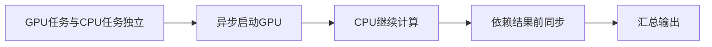
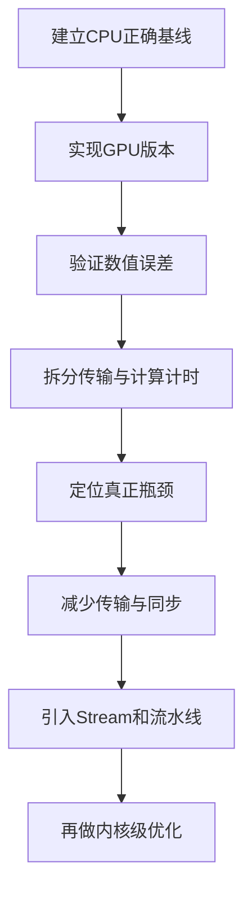

# GPU 明明很快，程序为什么还在等？一次讲透 CPU–GPU 协同计算

> **GPU 核函数快，不等于整个程序快。**真正的异构计算，不是“CPU 算一点、GPU 算一点”，而是让任务划分、数据移动和同步边界共同构成一条高效流水线。

> **工程深度｜验证状态：** L1 入门｜概念验证（CPU/GPU 对比以逻辑为主）
---

## 一、GPU 很快，程序为什么不快

假设你刚写完一个矩阵乘法 CUDA 内核。

计时结果令人振奋：GPU 只用了很短时间。可是从输入数据到最终结果，整个程序依旧不快。

时间去哪了？

```text
读取数据 → CPU预处理 → 复制到GPU → GPU计算 → 复制回CPU → 校验与保存
            ↑            ↑                    ↑
         CPU时间       传输时间             传输时间
```

GPU 只加速了中间的一段。其余环节并不会因为换了一块更快的显卡而自动消失。

这就是 CPU–GPU 协同计算真正要回答的问题：

> 不只是让 GPU 跑得快，而是让 CPU、GPU 和数据通路尽量少等待。

为了更好地展开，我们把整条链路拆成三个问题：

- **任务怎么划分**：哪些工作给 CPU，哪些给 GPU？
- **数据怎么移动**：两端如何交换数据，代价有多大？
- **何时必须同步**：CPU 什么时候必须停下来等 GPU？

三者共同决定端到端性能。下面的实验会逐个把这三个问题放到代码里验证。

---

## 二、CPU 和 GPU 到底如何分工

一种流行但不够准确的说法是：

```text
CPU 擅长串行
GPU 擅长并行
```

这句话适合入门，却不能当作绝对边界。CPU 同样可以利用多核并行；GPU 也能够执行分支与控制代码。两者真正的差异，在于硬件资源如何分配，以及分别为哪类工作负载做了优化。

**CPU：少而强。**更强的单线程能力、更复杂的缓存与分支预测，适合操作系统与 I/O、任务调度与控制逻辑、分支较多的算法和不规则数据结构。

**GPU：多而密。**大量并行执行资源和较高显存带宽，适合矩阵乘法与卷积、图像视频处理、粒子模拟、深度学习张量运算等大量元素执行相似操作的任务。

把两者想成两种工位：

```text
CPU：少量“全能工位”，擅长复杂、多变、判断多的任务
GPU：大量“并行工位”，擅长结构相似、规模庞大的计算
```

协同不是把所有任务推给 GPU，而是把任务送到更适合它的处理器上。

### 顺带纠正一个误区：线程池不是 OpenMP

有些 Python 教程用 `ThreadPoolExecutor` 跑一个双重循环，然后称其为“模拟 OpenMP”。这不准确：

1. `ThreadPoolExecutor` 是 Python 线程池，不是 OpenMP；
2. 如果只提交一个任务，线程池里根本没有拆分并行负载；
3. 普通 Python 数值循环还受解释器开销和 GIL 影响。

在 Python 里，我们可以用 Numba 编译 CPU 数值循环：

```python
from numba import njit, prange

@njit(parallel=True)
def matrix_addition_cpu(A, B, C):
    for row in prange(A.shape[0]):
        for col in range(A.shape[1]):
            C[row, col] = A[row, col] + B[row, col]
```

`njit` 会在函数第一次调用时，根据实际参数类型特化，并通过 LLVM JIT 编译为本地机器码。

> 第一次调用 = JIT 编译时间 + 执行时间；后续调用 ≈ 已编译机器码的执行时间。所以`njit`并不是“编译也更快”，优势体现在编译完成后的数值循环。

`parallel=True + prange` 表示 Numba 可用本地工作线程并行处理循环，但它不应被直接称为标准 OpenMP 代码。真正的 OpenMP 通常面向 C、C++ 或 Fortran：

```cpp
#pragma omp parallel for
for (int row = 0; row < N; ++row) {
    for (int col = 0; col < N; ++col) {
        C[row * N + col] = A[row * N + col] + B[row * N + col];
    }
}
```

> **旁注（前沿）**：OpenMP 6.0 已发布，标准本身也不再只面向 CPU 共享内存并行，包含设备卸载、统一共享内存等能力；但标准发布不等于所有编译器已完整实现，实际使用时仍须核对编译器支持矩阵。

本文的定位是：**使用 Numba CPU 并行与 Numba CUDA，理解 CPU–GPU 异构协同。**

---

## 三、线程如何找到矩阵元素

CUDA 启动的线程分两个层级：

```text
Grid
├── Block(0, 0)
│   ├── Thread(0, 0)
│   ├── Thread(1, 0)
│   └── ...
├── Block(1, 0)
└── Block(0, 1)
```

`threadIdx` 是线程在当前 Block 内的局部坐标；`blockIdx` 是 Block 在整个 Grid 中的坐标。在 Numba CUDA 中：

```python
col, row = cuda.grid(2)
```

拿到的是当前线程在整个二维 Grid 中的全局坐标，等价于：

```python
col = cuda.blockIdx.x * cuda.blockDim.x + cuda.threadIdx.x
row = cuda.blockIdx.y * cuda.blockDim.y + cuda.threadIdx.y
```

为什么让 `x` 对应列、`y` 对应行？因为 NumPy 和 C 风格二维数组是行优先存储，同一行相邻列的地址连续：

```text
C[0,0] C[0,1] C[0,2] C[0,3] ...
```

当相邻的 `x` 方向线程读取 `C[row, 0]`、`C[row, 1]`、`C[row, 2]`…时，访问的是连续地址，更有利于形成合并访存（coalesced memory access）。

```
线程坐标 → 矩阵元素 → 内存连续性
```

矩阵乘法中，每个线程负责输出矩阵的一个元素：

$$C_{row,col}=\sum_{k=0}^{N-1}A_{row,k}\cdot B_{k,col}$$

也就是用 A 的一行与 B 的一列做点积。

---

## 四、从串行等待到计算重叠

下面这个程序包含两项彼此独立的工作：

- CPU 多线程计算 `C_add = A + B`；
- GPU 计算 `C_multiply = A × B`。

正文只保留理解它所需的三段核心代码，完整可运行版本见附录 A。

### 第一段：CPU 并行加法

```python
from numba import njit, prange

@njit(parallel=True)
def matrix_addition_cpu(A, B, C):
    for row in prange(A.shape[0]):     # prange 让行可并行执行
        for col in range(A.shape[1]):
            C[row, col] = A[row, col] + B[row, col]
```

### 第二段：GPU 线程映射核心

每个线程负责一个输出元素：

```python
@cuda.jit
def matrix_multiply_kernel(A, B, C):
    col, row = cuda.grid(2)                # 全局线程坐标 → (列, 行)
    if row < C.shape[0] and col < C.shape[1]:
        value = float32(0.0)               # 线程私有累加器
        for k in range(A.shape[1]):
            value += A[row, k] * B[k, col]
        C[row, col] = value
```

### 第三段：重叠调度核心

差异性在这三行：**先异步启动 GPU，再让 CPU 干自己的活**：

```python
# 提交 GPU 内核；完成 JIT 预热后，启动通常不会等待内核执行结束，
# 控制权随即返回给主机线程
matrix_multiply_kernel[blocks_per_grid, threads_per_block, stream](
    A_device, B_device, C_device)

# GPU 工作期间，CPU 同时执行矩阵加法
matrix_addition_cpu(A, B, C_add)

# 只有在确实需要 GPU 结果时才同步
stream.synchronize()
```

用时间线看两者的差别：

```text
串行版本：
时间 ───────────────────────────→
CPU：████████ 矩阵加法
GPU：        ████████████████ 矩阵乘法

重叠版本：
时间 ───────────────────────────→
CPU：  ████████ 矩阵加法
GPU：████████████████ 矩阵乘法
                          ↑
                     最后统一同步
```

把两种执行方式画在同一张时间轴上，差距更直观：


如上图所示，串行版本里 CPU 和 GPU 两段首尾相接，总时长是两段之和；重叠版本则让 GPU 段覆盖 CPU 段，总时长被较长的那一段主导。观察的重点是“总长度差”，这正是下一节重叠收益公式的图形直觉。

若 CPU 计算耗时为 $T_{CPU}$、GPU 计算耗时为 $T_{GPU}$，忽略调度开销：

$$T_{serial}\approx T_{CPU}+T_{GPU},\qquad T_{overlap}\approx\max(T_{CPU},T_{GPU})$$

因此理想加速比为：

$$S=\frac{T_{CPU}+T_{GPU}}{\max(T_{CPU},T_{GPU})}$$

这项任务完全独立且能完美重叠时，$S$ 的上限是 2。如果一边远短于另一边，收益会迅速逼近 1。

举例：CPU 加法约 1 ms、GPU 乘法约 20 ms，串行约 21 ms，理想重叠约 20 ms：

$$S=\frac{1+20}{20}=1.05$$

即使重叠完全成功，也只有约 5% 的收益。

> **关键洞察：能重叠，不代表重叠之后一定明显加速。**收益取决于两边工作量是否匹配。所以协同计算不仅要问“CPU 和 GPU 能否同时工作”，还要问“两边的工作量是否匹配，值得重叠”。

还有两个重要前提：

1. 两项任务必须相互独立——CPU 任务不能读取当前 GPU 内核尚未生成的结果；
2. 本例是一个最小化的“执行重叠实验”，用于隔离并观察 CPU–GPU 并发机制，还不是完整的生产协同流水线（第 6 章给出真实场景）。



**关于 Stream 的澄清**：本例使用非默认 CUDA Stream，是为了明确表达异步任务边界。GPU 内核启动相对主机通常是异步的，CPU 提交内核后本就可以继续执行独立的主机工作——非默认 Stream 并不是“CPU 与 GPU 异步并行的唯一前提”。它的更大价值在别处：表达独立的设备任务序列、控制设备侧依赖、实现多 Stream 并发，以及配合页锁定内存实现传输与计算重叠。

---

## 五、一次可信的性能实验

看完代码，运行后只看四个指标，其余输出只是辅助：

```text
CPU 单独计算时间
GPU 单独计算时间（纯内核）
串行计算阶段时间
重叠计算阶段时间
```

预期关系：

```text
串行时间 ≈ CPU时间 + GPU时间
重叠时间 ≈ max(CPU时间, GPU时间)
```

带着这个预期去跑，才不会被一大堆打印淹没。

### 先分清楚两个性能问题

很多人拿“CPU 加法和 GPU 乘法”比大小，然后得出结论。这不可比：加法 $O(N^2)$，朴素乘法 $O(N^3)$，不是同一个任务。

两个必须分开的问题：

| 问题 | 实验设计 |
|---|---|
| GPU 能否加速矩阵乘法？ | 比较 CPU 与 GPU 执行**同一个矩阵乘法** |
| CPU 和 GPU 能否协同？ | 比较两个独立任务**串行执行 vs 重叠执行** |

本文要验证的是第二行，不是第一行。不要用本文数据回答“GPU 比 CPU 快几倍”。

### 别只测 Kernel：四种时间分开测

很多“GPU 加速几百倍”的结论，只测了核函数时间，把数据准备与传输成本排除在外。至少区分：

```text
T_H2D     CPU → GPU 输入传输
T_kernel  GPU 核函数执行
T_D2H     GPU → CPU 结果传输
T_e2e     从输入准备到结果可用的端到端时间
```

对一次简单任务：

$$T_{e2e}=T_{H2D}+T_{kernel}+T_{D2H}+T_{other}$$

如果输入和中间结果能长期驻留在 GPU，多个核函数共享同一份设备数据，传输成本就能被多次计算摊薄。这也是成熟 GPU 程序尽量避免“传一次 → 算一次 → 传回来”循环，而倾向于“一次传入 → 多个 GPU 阶段连续计算 → 最后一次传回”的原因。

### 计时方法：主机计时器 vs CUDA Event

- **主机计时器**（`perf_counter` + `synchronize()`）适合测量端到端阶段与重叠实验——它反映主机观察到的完整阶段时间；
- **CUDA Event** 在设备端时间线上打点，适合测量纯 GPU 内核时间，不受主机调度噪声影响。

正文之外，我们还需要诚实对待计时本身：

1. **先预热**：Numba CPU 函数与 CUDA 内核第一次调用都会触发 JIT 编译，先各跑一遍再开始计时；
2. **多次采样取中位数**：GPU 功耗状态、CPU 调度、缓存和系统噪声都会影响单次结果。附录 A 中每个实验重复 $S=15$ 次取中位数，并交替执行串行与重叠版本，减少固定顺序偏差；
3. **容差不是固定模板**：附录用 `rtol=1e-3, atol=1e-2` 校验 GPU 乘法，这个阈值需要依据数据规模、数值范围和累加顺序确定。不要把它照抄到所有任务里，把较大的误差也判成正确。附录同时输出相对 Frobenius 误差，比单一 `True/False` 更有解释力。

### 本机是 Apple Silicon，无法给出 GPU 实测数字

> 本文写作环境为 Apple Silicon，没有 NVIDIA GPU 及可用的 CUDA 驱动环境，因此无法执行 GPU 实测。所有 GPU 性能数字留作表格占位，发布前必须在 N 卡环境验证，并把实际中位数填入下表。

| 指标 | 占位（未实测） |
|---|---|
| 矩阵规模 N | 1024×1024 |
| CPU 单独计算（中位数） | — |
| GPU 单独计算·纯内核（Event，中位数） | — |
| H2D 输入传输（设备数组已预分配，仅纯复制） | — |
| D2H 结果传输 | — |
| 串行计算阶段（中位数） | — |
| 重叠计算阶段（中位数） | — |
| 重叠实际加速比 | — |
| 重叠理论上限 $\frac{T_{CPU}+T_{GPU}}{\max(T_{CPU},T_{GPU})}$ | — |

在 N 卡上跑通后，还应同时记录 CPU/GPU 型号、驱动与 CUDA 版本、Numba 版本、数据类型、预热方式与计时边界——缺失这些，任何性能数字都无法被他人复现。计算类指标（CPU/GPU/串行/重叠）多次采样取中位数；H2D/D2H 是固定大小的传输，单次即可，重负荷网络下如需更稳可同样取中位数。

---

## 六、真正的瓶颈可能是数据移动

前面验证的是 CPU 计算与 GPU 计算重叠。进一步优化时，还可以让**数据传输与 GPU 计算重叠**。

典型方法：

1. 把大数据拆成多个 Chunk；
2. 使用 `cuda.pinned_array()` 分配页锁定主机缓冲区，通过 `cuda.to_device(..., stream=stream)`、`copy_to_device(..., stream=stream)` 或 `copy_to_host(..., stream=stream)` 将传输排入指定 Stream，发起异步传输；
3. 将不同 Chunk 放在不同的非默认 CUDA Stream 中，形成流水线。

```text
时间 ─────────────────────────────────────────→
Stream 1：H2D块1 → 计算块1 → D2H块1
Stream 2：        H2D块2 → 计算块2 → D2H块2
Stream 3：                H2D块3 → 计算块3 → D2H块3
```

能不能真正重叠，取决于一组硬件与软件前提：主机缓冲区使用页锁定内存、使用合适的非默认 Stream 并正确设置依赖、设备支持并发复制与计算、复制引擎的数量足以并行调度，以及任务规模足以覆盖调度与同步开销。只有当这些条件同时成立时，阶梯式排布才能让复制引擎与计算单元减少互相等待。

把这些前提放在一边，先从逻辑上看它追求什么：**CPU 准备第 N+1 批数据，GPU 同时计算第 N 批**。

```text
第1批：CPU准备 → GPU计算
第2批：        CPU准备 → GPU计算
第3批：                 CPU准备 → GPU计算
```


CPU 读取下一批、GPU 计算当前批、数据传输在前端交错——这才是深度学习、图像处理和科学计算里真正的 CPU–GPU 协同。前面“CPU 加法 + GPU 乘法”更像是显微镜下的机制切片。

不过技术上有两个边界：

- CUDA 官方文档强调：涉及 CPU 内存的异步传输要真正获得重叠能力，主机缓冲区需要使用页锁定内存；同时需确认设备支持并发复制与计算，并正确使用 Stream；
- 页锁定内存不是越多越好。它不能被操作系统随意换出，过量使用可能影响系统整体内存管理。正确做法仍是测量、验证、再决定。

---

## 七、从 Stream 到一致性内存

上一节用 Stream 把传输与计算错开重叠，那是**软件侧的并发编排**。这一节看硬件侧：设备边界如何被一步步拉近。

### 统一内存并没有让传输“消失”

统一内存（Unified Memory）让 CPU 和 GPU 用更统一的地址模型访问数据，降低编程复杂度，但并没有消灭物理数据移动。在许多系统中，页面仍会按访问位置在 CPU 与 GPU 间迁移；访问模式不合理时，缺页和页面抖动照样拖慢程序。

```text
显式复制：程序员明确安排数据何时移动
统一内存：运行时帮助管理数据可见性与迁移
```

统一内存首先是一种编程与内存管理模型，不是“自动获得最高性能”的按钮。对可预测的工作负载，预取与数据放置策略仍然重要。

### 硬件：从分离显存到一致性内存

CPU–GPU 硬件正在走向更紧密的内存协同：在 Grace Hopper、Grace Blackwell 等平台，CPU 与 GPU 通过 NVLink-C2C 获得更紧密的统一内存与硬件一致性能力，降低了传统分离内存的部分摩擦。但算法的数据局部性、带宽与同步成本依然存在。

### 异构计算的三层演进

```text
第一层：任务卸载
CPU控制，GPU负责大规模并行计算

第二层：执行重叠
CPU计算、GPU计算、数据传输形成流水线

第三层：系统协同
一致性内存、更高速互连和运行时调度降低设备边界
```

无论硬件如何演进，一个事实不变：**性能取决于整条计算链路，而不是某个部件的峰值参数。**

---

## 八、从能运行到高性能

### 朴素矩阵乘法为什么还不够快

当前内核的教学价值很高：一条线程负责一个输出元素，映射关系清楚。但它不是生产级高性能矩阵乘法。

```python
for k in range(A.shape[1]):
    value += A[row, k] * B[k, col]
```

每个线程都反复从全局显存读取 A 和 B。相邻线程之间本可以复用的数据，并没有被放入共享内存协作复用。更成熟的优化路线通常是：

```text
朴素全局内存实现
        ↓
shared memory 分块
        ↓
合并访存与减少 bank conflict
        ↓
寄存器分块 / 双缓冲 / 异步拷贝
        ↓
调用 cuBLAS 等高度优化库
```

教学时先手写内核理解线程映射；生产中优先考虑经过长期优化的库。“会写一个矩阵乘法内核”和“写出比 cuBLAS 更快的通用矩阵乘法”，是两件完全不同的事。

### 协同最常见的五个错误

| 错误 | 简单版本 |
|---|---|
| 第一次运行就开始计时 | Numba CPU 函数和 CUDA 内核首次调用都可能触发 JIT 编译，先预热再测稳定阶段 |
| 内核启动后立刻停止计时 | 启动通常异步返回，没同步就结束，测到的可能只是提交时间 |
| 只打印前几个元素就宣布正确 | 打印只能辅助观察，应用 `np.allclose` 并查看最大绝对误差 |
| 网格大小用整除 | `blocks = N // threads` 会漏掉边缘元素，应向上取整并在内核里做边界判断 |
| 同步越多越安全 | 同步会重新串行化本可并发的任务，应在数据依赖真正需要的位置同步 |

正确原则是：**在数据依赖真正需要的位置同步，而不是每提交一个任务就同步。**

### 更可靠的优化路线

不要一开始就堆叠所有高级技术：



1. **先正确，再并行。**
2. **先测量，再优化。**
3. **先看端到端，再看局部峰值。**
4. **先减少不必要的数据移动，再追求更快的核函数。**
5. **优先使用成熟库，手写内核用于学习或明确的定制需求。**

### 哪些场景真正适合 CPU–GPU 协同？

| 场景 | CPU 侧 | GPU 侧 | 关键点 |
|---|---|---|---|
| 深度学习训练与推理 | 数据读取、解码、任务编排 | 张量计算、优化器更新 | 输入流水线供给不足，GPU 利用率就会下降 |
| 科学计算与仿真 | 网格管理、边界条件、I/O | 大规模规则数值计算 | 时间步之间的依赖决定同步位置 |

图像/视频流水线、数据分析与特征工程遵循同样的思路：CPU 负责数据准备与流程控制，GPU 负责密集计算，设计重点都在于减少跨设备往返。

## 结语：最好的协同，是彼此少等一会儿

CPU–GPU 协同计算并不是一句“CPU 做控制、GPU 做计算”就能概括。它至少包含四层能力：

```text
任务放对地方
    ↓
数据少走弯路
    ↓
可以并发的工作真正重叠
    ↓
只在必要的位置同步
```

回顾本文最重要的几条结论：

- CPU 多线程并行不等于“线程池随便包一层”；
- `cuda.grid(2)` 获取的是线程在二维 Grid 中的全局坐标，它把线程映射到矩阵元素，再把连续地址交给了内存合并；
- GPU 核函数很快，不代表端到端程序很快——数据移动与同步往往才是瓶颈；
- 能重叠不等于一定明显加速，收益取决于两边工作负载是否匹配；
- 分别使用 CPU 和 GPU，不等于二者已经协同；真正的协同是任务、数据与时间线的共同设计。

当 CPU 不再等 GPU，GPU 也不再等数据，异构计算才真正开始。

### 收藏：五条可以截图保存的优化清单

1. **预热后再计时**，JIT 编译和首次启动不进统计；
2. **至少测四段时间**：H2D、Kernel、D2H、端到端，并用中位数而不是单次结果；
3. **把数据留在 GPU**，避免“传一次算一次传回一次”的反复往返；
4. **依赖在哪，同步就在哪**，不要每提交一个任务就 `synchronize()`；
5. **先建 CPU 正确基线，再优化 GPU**，每个优化步骤都用数值对照验证。

最后留一个开放问题：你在实际项目中遇到过“GPU 忙、CPU 闲”或“数据搬运比计算还久”的情况吗？当时是怎么定位出瓶颈的？欢迎在评论区聊聊。

---

## 附录 A：可直接运行的完整代码

正文只保留了理解所需的三段核心代码。下面是包含关键修正（分配与计时分离、CPU/GPU 独立基线、多次采样中位数、CUDA Event 纯内核计时、相对误差输出）的完整可运行版本。

```python
"""GPU 明明很快，程序为什么还在等？一次讲透 CPU–GPU 协同计算（第1章 · GPU 编程基础）。

本文件是对应博文代码块的实现/演示，直接运行可见效果；运行依赖：Numba、NumPy。
"""
from time import perf_counter

# 导入 NumPy，用于创建矩阵、生成参考结果和验证数值正确性
import numpy as np

# cuda：编写和启动 GPU 核函数
# njit：将 CPU 数值函数 JIT 编译为本地机器码
# prange：表达可以并行执行的 CPU 循环
# get_num_threads：查询 Numba 当前使用的 CPU 工作线程数量
# float32：在 CUDA 内核中显式创建单精度累加器
from numba import cuda, njit, prange, get_num_threads, float32

# 每个实验重复取样的次数：多次采样取中位数，降低系统噪声
SAMPLES = 15


# 使用 Numba 将 CPU 矩阵加法编译为本地机器码
# parallel=True 允许 prange 循环由多个 CPU 工作线程执行
# cache=True 尝试缓存编译结果，减少后续启动时的编译成本
@njit(parallel=True, cache=True)
def matrix_addition_cpu(A, B, C):
    # 获取矩阵行数
    rows = A.shape[0]

    # 获取矩阵列数
    cols = A.shape[1]

    # 不同工作线程可以并行处理不同的矩阵行
    for row in prange(rows):
        # 遍历当前行中的所有列
        for col in range(cols):
            # 对应元素相加，并写入输出矩阵
            C[row, col] = A[row, col] + B[row, col]


# 使用 Numba CUDA 定义 GPU 矩阵乘法核函数
@cuda.jit
def matrix_multiply_kernel(A, B, C):
    # 获取当前线程在整个二维 Grid 中的全局坐标
    # x 方向映射到矩阵列，y 方向映射到矩阵行
    col, row = cuda.grid(2)

    # 获取输出矩阵的行数和列数
    rows_c = C.shape[0]
    cols_c = C.shape[1]

    # 网格采用向上取整，边缘线程可能越界，因此必须判断
    if row < rows_c and col < cols_c:
        # 创建线程私有的 float32 累加器
        value = float32(0.0)

        # A 的列数等于 B 的行数，即矩阵乘法的公共维度
        for k in range(A.shape[1]):
            # 计算 A 第 row 行与 B 第 col 列的点积
            value += A[row, k] * B[k, col]

        # 每个线程只写一个输出元素，不会发生写冲突
        C[row, col] = value


def main():
    # 设置固定随机种子，使实验可以复现
    np.random.seed(42)

    # 设置方阵维度；可根据显存和实验需求调整
    N = 1024

    # 创建两个 float32 随机输入矩阵
    A = np.random.rand(N, N).astype(np.float32)
    B = np.random.rand(N, N).astype(np.float32)

    # 为 CPU 矩阵加法分配输出数组
    C_add = np.empty_like(A)

    # 如果 CUDA 不可用，给出明确提示并结束程序
    if not cuda.is_available():
        print("CUDA 不可用，请检查 NVIDIA GPU、驱动和 CUDA 环境。")
        return

    # --------------------------------------------------------
    # 1. CPU JIT 预热
    # --------------------------------------------------------

    # 第一次调用触发类型推断和 JIT 编译，不计入正式测试
    matrix_addition_cpu(A, B, C_add)

    # --------------------------------------------------------
    # 2. 配置二维线程块和网格
    # --------------------------------------------------------

    # 每个 Block 包含 16×16=256 个线程
    threads_per_block = (16, 16)

    # x 方向覆盖矩阵列，采用向上取整
    blocks_x = (N + threads_per_block[0] - 1) // threads_per_block[0]

    # y 方向覆盖矩阵行，同样采用向上取整
    blocks_y = (N + threads_per_block[1] - 1) // threads_per_block[1]

    # 组成二维 Grid
    blocks_per_grid = (blocks_x, blocks_y)

    # 创建非默认 CUDA Stream，用于表达独立的异步任务序列
    stream = cuda.stream()

    # --------------------------------------------------------
    # 3. 预分配三个设备数组（不计入传输计时）
    # --------------------------------------------------------

    # 先为 A、B、C 在显存中分配空间
    # 分配是设备内存操作，统计进“输入传输时间”会高估纯复制成本
    A_device = cuda.device_array_like(A)
    B_device = cuda.device_array_like(B)
    C_device = cuda.device_array((N, N), dtype=np.float32)

    # 确保分配完成，让后续 H2D 计时起点干净
    cuda.synchronize()

    # --------------------------------------------------------
    # 4. 测量 H2D 输入传输时间（只包含纯复制）
    # --------------------------------------------------------

    # 记录主机到设备传输的开始时间
    h2d_start = perf_counter()

    # 将 A 和 B 从 CPU 主存复制到已分配的 GPU 显存
    A_device.copy_to_device(A)
    B_device.copy_to_device(B)

    # 确保前面的设备操作完成，使计时边界明确
    cuda.synchronize()

    # 记录主机到设备传输完成时间
    h2d_end = perf_counter()

    # --------------------------------------------------------
    # 5. GPU JIT 预热
    # --------------------------------------------------------

    # 第一次启动 GPU 内核会触发 CUDA JIT 编译
    matrix_multiply_kernel[
        blocks_per_grid,
        threads_per_block,
        stream
    ](A_device, B_device, C_device)

    # 等待预热任务完成，避免把编译开销计入正式结果
    stream.synchronize()

    # --------------------------------------------------------
    # 6. CPU 单独计算基线（多次采样取中位数）
    # --------------------------------------------------------

    # 存放每次 CPU 加法的耗时
    cpu_times = []

    for _ in range(SAMPLES):
        cpu_start = perf_counter()

        # CPU 多线程矩阵加法
        matrix_addition_cpu(A, B, C_add)

        cpu_times.append(perf_counter() - cpu_start)

    # 使用中位数而不是单次结果，降低系统噪声影响
    cpu_time = float(np.median(cpu_times))

    # --------------------------------------------------------
    # 7. GPU 单独计算基线（CUDA Event 测纯内核时间）
    # --------------------------------------------------------

    # 事件对象在循环外创建一次并重复记录，避免每轮新建对象
    # timing=True 显式声明该事件用于计时（也是默认行为）
    event_start = cuda.event(timing=True)
    event_end = cuda.event(timing=True)

    # 存放每次 GPU 纯内核耗时（秒）
    gpu_times = []

    for _ in range(SAMPLES):
        # 在设备端时间线打点：内核前的起点事件
        event_start.record(stream)

        # 被计时的内核
        matrix_multiply_kernel[
            blocks_per_grid,
            threads_per_block,
            stream
        ](A_device, B_device, C_device)

        # 内核后的终点事件
        event_end.record(stream)

        # 等待终点事件完成，再读取设备端耗时
        event_end.synchronize()

        # 官方计时接口 event_elapsed_time 返回毫秒，换算为秒
        gpu_times.append(cuda.event_elapsed_time(event_start, event_end) / 1000.0)

    # 使用中位数作为纯内核典型耗时
    gpu_time = float(np.median(gpu_times))

    # --------------------------------------------------------
    # 8. 串行 vs 重叠：交替采样取中位数
    # --------------------------------------------------------

    # 分别存放串行阶段和重叠阶段的耗时
    serial_times = []
    overlap_times = []

    for _ in range(SAMPLES):
        # --- 串行版本：先 CPU 加法，再 GPU 乘法 ---
        serial_start = perf_counter()

        # CPU 多线程矩阵加法
        matrix_addition_cpu(A, B, C_add)

        # GPU 矩阵乘法
        matrix_multiply_kernel[
            blocks_per_grid,
            threads_per_block,
            stream
        ](A_device, B_device, C_device)

        # 等待 GPU 计算完成
        stream.synchronize()

        serial_times.append(perf_counter() - serial_start)

        # --- 重叠版本：先提交 GPU，再让 CPU 干自己的活 ---
        overlap_start = perf_counter()

        # 提交 GPU 内核；完成 JIT 预热后，
        # 启动通常不会等待内核执行结束，控制权随即返回
        matrix_multiply_kernel[
            blocks_per_grid,
            threads_per_block,
            stream
        ](A_device, B_device, C_device)

        # GPU 工作期间，CPU 同时执行矩阵加法
        matrix_addition_cpu(A, B, C_add)

        # 只有在确实需要 GPU 结果时才同步
        stream.synchronize()

        overlap_times.append(perf_counter() - overlap_start)

    # 取中位数作为典型耗时
    serial_time = float(np.median(serial_times))
    overlap_time = float(np.median(overlap_times))

    # --------------------------------------------------------
    # 9. 将 GPU 结果复制回 CPU
    # --------------------------------------------------------

    # 在主机端分配接收数组
    C_multiply = np.empty((N, N), dtype=np.float32)

    # 记录设备到主机复制开始时间
    d2h_start = perf_counter()

    # 将 GPU 结果复制回 CPU（该 API 同步完成）
    C_device.copy_to_host(C_multiply)

    # 记录复制结束时间
    d2h_end = perf_counter()

    # --------------------------------------------------------
    # 10. 正确性验证
    # --------------------------------------------------------

    # 使用 NumPy 生成矩阵加法参考结果
    C_add_reference = A + B

    # 使用 NumPy/BLAS 生成矩阵乘法参考结果
    C_multiply_reference = A @ B

    # 检查 CPU 并行矩阵加法是否正确（加法误差很小，容差紧）
    add_correct = np.allclose(
        C_add,
        C_add_reference,
        rtol=1e-6,
        atol=1e-6
    )

    # 检查 GPU 矩阵乘法是否在允许的浮点误差范围内
    # 容差不是固定模板，应按数据规模、数值范围和累加顺序确定
    multiply_correct = np.allclose(
        C_multiply,
        C_multiply_reference,
        rtol=1e-3,
        atol=1e-2
    )

    # 计算 GPU 结果的最大绝对误差
    max_error = np.max(
        np.abs(C_multiply - C_multiply_reference)
    )

    # 计算相对 Frobenius 误差：整体误差水平的归一化度量
    relative_error = (
        np.linalg.norm(C_multiply - C_multiply_reference, ord="fro")
        / np.linalg.norm(C_multiply_reference, ord="fro")
    )

    # --------------------------------------------------------
    # 11. 输出测量结果
    # --------------------------------------------------------

    h2d_time = h2d_end - h2d_start
    d2h_time = d2h_end - d2h_start

    print(f"Numba CPU 工作线程数：{get_num_threads()}")
    print(f"H2D 输入传输时间：{h2d_time:.6f} 秒")
    print(f"D2H 结果传输时间：{d2h_time:.6f} 秒")
    print(f"CPU 单独计算时间：{cpu_time:.6f} 秒")
    print(f"GPU 单独计算时间：{gpu_time:.6f} 秒")
    print(f"串行计算阶段时间：{serial_time:.6f} 秒")
    print(f"重叠计算阶段时间：{overlap_time:.6f} 秒")

    # 验证理论关系：串行 ≈ CPU + GPU，重叠 ≈ max(CPU, GPU)
    print(f"[验证] CPU+GPU = {cpu_time + gpu_time:.6f} 秒 vs 串行 {serial_time:.6f} 秒")
    print(f"[验证] max(CPU,GPU) = {max(cpu_time, gpu_time):.6f} 秒 vs 重叠 {overlap_time:.6f} 秒")

    # 计算实际加速比与理论上限
    if overlap_time > 0.0:
        achieved = serial_time / overlap_time
        theoretical = (cpu_time + gpu_time) / max(cpu_time, gpu_time)
        print(f"重叠实际加速比：{achieved:.3f}x")
        print(f"重叠理论上限：{theoretical:.3f}x")

    print(f"CPU 加法结果正确：{add_correct}")
    print(f"GPU 乘法结果正确：{multiply_correct}")
    print(f"GPU 乘法最大绝对误差：{max_error:.6e}")
    print(f"GPU 乘法相对 Frobenius 误差：{relative_error:.6e}")

    # 展示结果矩阵左上角的小块区域，便于人工观察
    print("\n矩阵加法结果前 5 行、前 5 列：")
    print(C_add[:5, :5])

    print("\n矩阵乘法结果前 5 行、前 5 列：")
    print(C_multiply[:5, :5])


# 仅在直接运行当前脚本时调用 main
if __name__ == "__main__":
    main()
```

几个设计点说明：

- **设备分配与计时分离**：`A_device`/`B_device`/`C_device` 三个设备数组都在 H2D 计时开始前分配并用 `cuda.synchronize()` 收尾，`copy_to_device` 只负责把数据复制进已分配空间，不再把 `device_array` 的开销混进“输入传输时间”；
- **两组独立基线**：`CPU_T` 用主机计时器测 `matrix_addition_cpu` 反复执行的中位数；`GPU_T` 用 CUDA Event 测纯内核设备端耗时——前者是端到端主机视角，后者是设备时间线；
- **多次采样取中位数**：每个阶段重复 `SAMPLES=15` 次，串行与重叠在同一个循环里交替执行，避免固定顺序带来的偏差；
- **理论关系可复核**：程序直接打印 `CPU+GPU` 与 `串行` 的对照、`max(CPU,GPU)` 与 `重叠` 的对照，读者可以当场验证正文里的两个近似公式。

> **未实测**：本文写作环境为 Apple Silicon，没有 NVIDIA GPU 及可用的 CUDA 驱动环境，无法在本机运行附录 A。发布前需在 N 卡环境编译运行，将实际中位数回填第 5 章表格，并确认 GPU↔CPU 数值校验通过。注：Numba-CUDA 由 Python 侧发起编译，本文代码不直接调用 `nvcc`，但对 GPU 驱动、CUDA 运行时及相应编译组件仍有依赖。

---

## 参考资料

1. NVIDIA, *CUDA Programming Guide — Asynchronous Execution*  
   <https://docs.nvidia.com/cuda/cuda-programming-guide/02-basics/asynchronous-execution.html>

2. NVIDIA, *CUDA C++ Best Practices Guide*  
   <https://docs.nvidia.com/cuda/cuda-c-best-practices-guide/contents.html>

3. NVIDIA, *Numba-CUDA Installation*  
   <https://nvidia.github.io/numba-cuda/user/installation.html>

4. NVIDIA, *Numba-CUDA User Guide*  
   <https://nvidia.github.io/numba-cuda/user/>

5. OpenMP Architecture Review Board, *OpenMP API Specifications*  
   <https://www.openmp.org/specifications/>

6. NVIDIA, *CUDA Programming Guide — Unified and System Memory*  
   <https://docs.nvidia.com/cuda/cuda-programming-guide/02-basics/understanding-memory.html>

7. NVIDIA, *Numba-CUDA CUDA Host API*（`cuda.pinned_array()`、`cuda.event()`、`cuda.event_elapsed_time()` 等接口）  
   <https://nvidia.github.io/numba-cuda/reference/host.html>

8. NVIDIA, *Numba-CUDA Memory Management*（`cuda.device_array_like()`、`copy_to_device(..., stream=...)` 等接口）  
   <https://nvidia.github.io/numba-cuda/reference/memory.html>

---

> **实验提示**：不同 CPU、GPU、驱动、CUDA、Numba、BLAS 和功耗配置会产生不同结果。任何性能数字都应同时记录软硬件环境、矩阵规模、数据类型、预热方法和计时边界，避免将单机结果泛化为普遍结论。本文性能表格在写作时仍为占位，必须在 N 卡实测后回填。