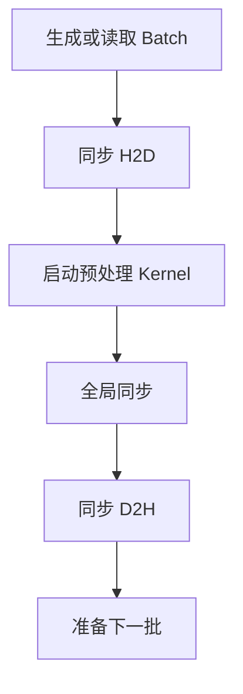
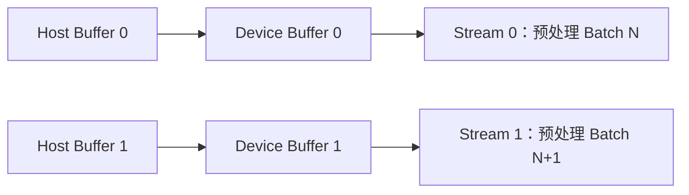
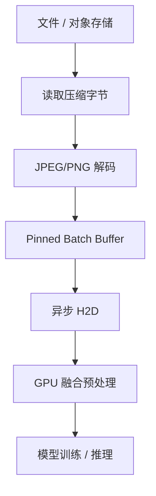
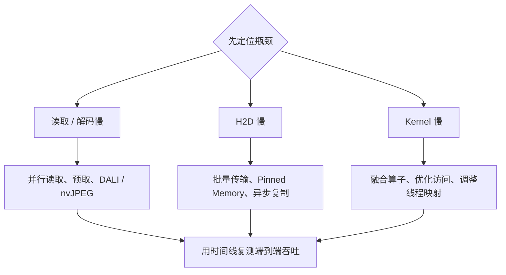

# Kernel 已经很快，GPU 为什么还在等？用 PyCUDA 搭建批量数据流水线

> **副标题**：从页锁定内存、异步 H2D 到双缓冲——让数据传输与 GPU 预处理真正重叠  
> **工程深度**：L2 ｜ **验证状态**：未实测 ｜ **预计阅读**：18 分钟  
> **适用读者**：掌握 Python/NumPy 基础，正在学习 CUDA、PyCUDA 或深度学习输入流水线的开发者

> **工程深度｜验证状态：** L2 工程｜静态复核 + 逻辑验证（GPU 性能重叠需上机实测）
---

## 开场：0.3 毫秒的 Kernel，为什么救不了 20 毫秒的 Batch？

你已经把图像中心裁剪和归一化写进了一个 CUDA Kernel。

一次启动，32 张图片并行处理；没有 Python 循环，也没有裁剪结果在显存中来回落地。单看 Kernel，这段程序已经很像一次成功的 GPU 优化。

可一旦把它接到真实训练或推理任务里，GPU 利用率仍可能忽高忽低：算一会儿，停一会儿；显存里没有下一批数据，只能等 CPU 读取文件、解码图片、整理 Batch，再把数据搬过 PCIe。

问题不一定出在“算得慢”，而可能出在“送得慢”。

这也是 CUDA 性能优化里最容易被忽略的一层：

> **最快的 Kernel，也救不了一条不断断粮的数据流水线。**

> **前置阅读**：本文的「预处理」段复用第 09 篇《两个 Kernel，为什么可以合成一个？》中的融合内核（第 09 篇讲它的设计动机，本文第三节修正它的工程问题）。该内核的核心约定是：输入为连续存储的单通道 `float32` 批量图像 `[batch][height][width]`，一次 Kernel Launch 完成「中心裁剪 → 归一化」，输出 `[batch][crop_size][crop_size]`；它不做 `uint8 → float32`、`0～255 → 0～1` 与 HWC/NCHW 布局转换。如果还没读过第 09 篇，建议先补读再回到本文——本文要回答的是「这批数据怎样提前到达 GPU」，而不是「裁剪与归一化怎么写」。

本文在批量中心裁剪与归一化内核的基础上，继续向外走一层：不只研究一批数据怎样计算，还要研究下一批数据怎样在当前批次计算时提前到达。

但先钉死一个技术边界：本文构建的是一个 **PyCUDA 批量输入与预处理流水线原型**。示例用内存中的模拟数据代替文件读取和 JPEG 解码；它覆盖 Batch 组装、页锁定主机内存、异步 H2D、CUDA Stream、双缓冲和 GPU 预处理，但不是完整的生产级图像加载器。

---

## 一、别急着优化：先分清“加载、传输、预处理”

很多文章把下面几件事统称为“数据加载”：

| 阶段 | 发生了什么 | 常见执行位置 |
|---|---|---|
| 文件读取 | 从本地磁盘、对象存储或网络读取压缩字节 | CPU / 存储系统 |
| 图像解码 | 把 JPEG、PNG 等压缩格式还原为像素 | CPU、GPU 或专用硬件 |
| Batch 组装 | 将多个样本整理为连续内存 | CPU |
| H2D 传输 | 将主机内存复制到 GPU 显存 | DMA / CUDA Copy Engine |
| GPU 预处理 | 裁剪、缩放、归一化、布局转换 | GPU Kernel |
| 模型计算 | 前向、反向或推理 | GPU |

原始代码从 `np.random.rand()` 开始，意味着数据已经存在于 NumPy 内存中；`cuda.to_device()` 完成的是主机到设备的数据复制，而不是磁盘读取或图像解码。

所以，更准确的链路是：


这一区分不是咬文嚼字。因为不同阶段的瓶颈、测量方法和优化工具完全不同：

- 磁盘慢，要看存储吞吐、文件数量和缓存命中；
- 解码慢，要看 CPU 线程、nvJPEG 或 DALI；
- H2D 慢，要看传输大小、页锁定内存、PCIe/NVLink 和 Copy Engine；
- Kernel 慢，才轮到线程映射、内存访问和算术强度。

如果连瓶颈在哪一段都没有分清，优化就很容易变成“哪里有 CUDA，哪里就加 CUDA”。

---

## 二、原始版本做对了什么，又把时间花在了哪里？

原始内核采用三维 Grid：

- `x` 维负责裁剪图像的列；
- `y` 维负责裁剪图像的行；
- `z` 维负责 Batch 中的图片编号。

```text
blockIdx.z = 第几张图片
ty         = 输出像素所在行
tx         = 输出像素所在列
```

每个线程只完成一个输出像素：找到原图的中心裁剪坐标，读取像素，再执行归一化。

$$y = \frac{x-\mu}{\sigma}$$

相邻线程沿 `tx` 方向访问相邻像素，输入读取和输出写入都天然具有连续性。裁剪与归一化放进同一个 Kernel，也避免了中间裁剪结果再次写回、读取显存。

这部分设计是合理的。真正的问题在主机侧：



CPU 与 GPU 像两个人共用一只碗：一个人吃完，另一个人才开始盛下一碗。任何一个阶段变慢，后面的阶段都只能等待。

原始代码还藏着几个工程问题：

1. `crop_size // 16` 是向下取整，只在 `crop_size` 恰好能被 16 整除时正确；
2. 内核使用了 `batch_size` 参数，却没有检查 `b < batch_size`；
3. `cuda.to_device(output_data)` 把一块全零输出上传到 GPU，随后又被内核覆盖，这次 H2D 没有必要；
4. `cuda.to_device()` 返回 `DeviceAllocation`，回传应使用 `cuda.memcpy_dtoh()`；`.get()` 是 `GPUArray` 常用接口，不能混用两套抽象；
5. 计时从 H2D 之后开始、到 D2H 之后结束，既不是纯 Kernel 时间，也不是完整端到端时间；
6. 示例数据布局是 `[N,H,W]`，本质是单通道图像，不是常见的 RGB `[N,H,W,C]` 或 `[N,C,H,W]`。

这些问题不会让“224 ÷ 16”的演示立即报错，却会在尺寸变化、API 替换或真实数据接入后变成隐蔽故障。

---

## 三、第一步：把内核改到“尺寸变化也正确”

下面是修正后的裁剪归一化内核：

```cpp
__global__ void preprocess_batch(
    const float *__restrict__ input,
    float *__restrict__ output,
    int batch_size,
    int height,
    int width,
    int crop_size,
    float mean,
    float inv_std)
{
    // 当前线程负责的输出列坐标
    const int tx = threadIdx.x + blockIdx.x * blockDim.x;
    // 当前线程负责的输出行坐标
    const int ty = threadIdx.y + blockIdx.y * blockDim.y;
    // Grid 的 z 维映射到 Batch 中的图片编号
    const int b = blockIdx.z;

    // 同时检查图片编号和输出像素坐标，防止越界
    if (b >= batch_size || tx >= crop_size || ty >= crop_size) {
        return;
    }

    // 计算中心裁剪左上角在原图中的偏移
    const int offset_x = (width  - crop_size) / 2;
    const int offset_y = (height - crop_size) / 2;

    // 从输出坐标映射回原图坐标
    const int crop_x = offset_x + tx;
    const int crop_y = offset_y + ty;

    // 使用 size_t 计算线性下标，降低大尺寸 Batch 下整数溢出的风险
    const size_t input_idx =
        ((size_t)b * height + crop_y) * width + crop_x;
    const size_t output_idx =
        ((size_t)b * crop_size + ty) * crop_size + tx;

    // 预先传入标准差的倒数，用乘法替代每像素除法
    output[output_idx] = (input[input_idx] - mean) * inv_std;
}
```

Host 侧的 Grid 必须向上取整：

```python
grid_size = (
    (crop_size + block_size[0] - 1) // block_size[0],
    (crop_size + block_size[1] - 1) // block_size[1],
    batch_size,
)
```

边界线程会进入 Kernel，但会被条件判断安全地挡在有效区域之外。多启动少量线程的代价，通常远小于漏算边缘像素的代价。

在调用之前，还应验证：

```python
if crop_size > min(height, width):
    raise ValueError("crop_size 不能大于原图的高或宽")

if not np.isfinite(stddev) or stddev <= 0:
    raise ValueError("stddev 必须是有限的正数")
```

---

## 四、第二步：让主机内存真正支持异步传输

普通 NumPy 数组通常位于 **可分页内存**（pageable memory）。操作系统可以移动或换出这些页面；GPU 的 DMA 不能把它直接当成稳定的数据源长期使用。

于是，异步 H2D 需要另一类内存：**页锁定内存**（page-locked / pinned memory）。

PyCUDA 的官方接口文档明确要求：`memcpy_htod_async()` 的源缓冲区必须是页锁定内存，可由 `pagelocked_empty()` 分配。[PyCUDA Device Interface](https://documen.tician.de/pycuda/driver.html#pycuda.driver.memcpy_htod_async)

```python
host_input = cuda.pagelocked_empty(
    (batch_size, height, width),
    dtype=np.float32,
)
```

然后才能安全地发起异步传输：

```python
stream = cuda.Stream()
cuda.memcpy_htod_async(device_input, host_input, stream)
```

但“异步”不等于“必然重叠”。它只表示调用可以较早把控制权交还给 CPU。传输和 Kernel 是否真的同时运行，还取决于：

- GPU 是否支持 copy/compute 并发；
- 操作是否位于合适的非默认 Stream；
- 不同批次是否使用互不冲突的缓冲区；
- 任务之间是否存在必须等待的数据依赖；
- 主机内存是否为 pinned memory。

NVIDIA 的最佳实践文档指出，异步传输要求 pinned memory；传输与设备计算重叠还需要硬件具备 concurrent copy/compute 能力，并合理使用非默认 Stream。[CUDA C++ Best Practices Guide](https://docs.nvidia.com/cuda/cuda-c-best-practices-guide/index.html#asynchronous-and-overlapping-transfers-with-computation)

还有一条经常被忽略的限制：pinned memory 是稀缺资源。锁得太多会挤压系统可分页内存，频繁申请和释放本身也很重。因此正确做法不是“把所有数据都 pin 住”，而是预分配少量可复用缓冲区，并通过实测决定容量。

---

## 五、第三步：双缓冲，让“搬下一批”和“算这一批”同时发生

只有一个输入缓冲区时，CPU 不能在 GPU 尚未读完之前覆盖它。解决方法很朴素：准备两套缓冲区。



时间线上，它更像两条交错的传送带：

```mermaid
gantt
    title 双缓冲的稳态流水线（示意，非实测比例）
    dateFormat X
    axisFormat %L
    section CPU
    准备 Batch 0 :a0, 0, 3
    准备 Batch 1 :a1, 3, 3
    准备 Batch 2 :a2, 6, 3
    section Stream 0
    H2D 0 :b0, 3, 2
    预处理 0 :b1, 5, 3
    H2D 2 :b2, 9, 2
    section Stream 1
    H2D 1 :c0, 6, 2
    预处理 1 :c1, 8, 3
```



同一条 Stream 内仍然保持顺序：先 H2D，再执行依赖这批数据的 Kernel；不同 Stream 的独立任务则有机会被硬件交错或重叠。

这里的关键词是“有机会”。图中是机制示意，不是对任意 GPU 的性能承诺。

---

## 六、完整代码：PyCUDA 双缓冲批量输入与预处理

下面给出一个可运行的教学版原型。它使用随机数模拟“上游读取与解码后的 Batch”，重点演示 pinned memory、异步 H2D、非默认 Stream、双缓冲、正确的显存分配和结果校验。

> 环境要求：已正确安装 NVIDIA 驱动、CUDA Toolkit、NumPy 与 PyCUDA。本文不锁定具体版本，部署时应以 PyCUDA 与本机 CUDA/Python 的兼容矩阵为准。

```python
"""Kernel 已经很快，GPU 为什么还在等？用 PyCUDA 搭建批量数据流水线（第1章 · GPU 编程基础）。

本文件是对应博文代码块的实现/演示，直接运行可见效果；运行依赖：PyCUDA、NumPy。
"""
import time

import numpy as np
import pycuda.autoinit  # 创建并管理当前进程的 CUDA Context
import pycuda.driver as cuda
from pycuda.compiler import SourceModule


KERNEL_CODE = r"""
#include <stddef.h>

__global__ void preprocess_batch(
    const float *__restrict__ input,
    float *__restrict__ output,
    int batch_size,
    int height,
    int width,
    int crop_size,
    float mean,
    float inv_std)
{
    const int tx = threadIdx.x + blockIdx.x * blockDim.x;
    const int ty = threadIdx.y + blockIdx.y * blockDim.y;
    const int b = blockIdx.z;

    if (b >= batch_size || tx >= crop_size || ty >= crop_size) {
        return;
    }

    const int offset_x = (width  - crop_size) / 2;
    const int offset_y = (height - crop_size) / 2;
    const int crop_x = offset_x + tx;
    const int crop_y = offset_y + ty;

    const size_t input_idx =
        ((size_t)b * height + crop_y) * width + crop_x;
    const size_t output_idx =
        ((size_t)b * crop_size + ty) * crop_size + tx;

    output[output_idx] = (input[input_idx] - mean) * inv_std;
}
"""


def ceil_div(value, divisor):
    """整数向上取整，确保 Grid 覆盖全部输出像素。"""
    return (value + divisor - 1) // divisor


def fill_batch(destination, rng):
    """
    模拟真实的数据读取与解码阶段。

    生产环境可以把这里替换成：
    读取文件 -> 解码 -> resize/颜色转换 -> 写入 destination。
    关键是最终数据直接落入复用的 pinned buffer，避免额外中间副本。
    """
    rng.random(destination.shape, dtype=np.float32, out=destination)


def cpu_reference(input_batch, crop_size, mean, stddev):
    """使用 NumPy 生成同一数学定义下的参考结果。"""
    _, height, width = input_batch.shape
    offset_y = (height - crop_size) // 2
    offset_x = (width - crop_size) // 2
    cropped = input_batch[
        :,
        offset_y : offset_y + crop_size,
        offset_x : offset_x + crop_size,
    ]
    return (cropped - mean) / stddev


def main():
    # ------------------------- 参数与合法性检查 -------------------------
    batch_size = 32
    height, width = 256, 256
    crop_size = 224
    mean = np.float32(0.5)
    stddev = np.float32(0.25)
    inv_std = np.float32(1.0 / stddev)

    if crop_size > min(height, width):
        raise ValueError("crop_size 不能大于原图的高或宽")
    if not np.isfinite(stddev) or stddev <= 0:
        raise ValueError("stddev 必须是有限的正数")

    input_shape = (batch_size, height, width)
    output_shape = (batch_size, crop_size, crop_size)
    input_nbytes = int(np.prod(input_shape)) * np.dtype(np.float32).itemsize
    output_nbytes = int(np.prod(output_shape)) * np.dtype(np.float32).itemsize

    # ------------------------------ 编译内核 ------------------------------
    module = SourceModule(KERNEL_CODE)
    preprocess_batch = module.get_function("preprocess_batch")

    block = (16, 16, 1)
    grid = (
        ceil_div(crop_size, block[0]),
        ceil_div(crop_size, block[1]),
        batch_size,
    )

    # ------------------------------ 双缓冲 ------------------------------
    buffer_count = 2
    streams = [cuda.Stream() for _ in range(buffer_count)]

    # 两块页锁定主机内存：支持异步 H2D，并避免循环中反复申请
    host_inputs = [
        cuda.pagelocked_empty(input_shape, dtype=np.float32)
        for _ in range(buffer_count)
    ]

    # 两组独立设备输入/输出，防止不同 Stream 读写同一块缓冲区
    device_inputs = [
        cuda.mem_alloc(input_nbytes)
        for _ in range(buffer_count)
    ]
    device_outputs = [
        cuda.mem_alloc(output_nbytes)
        for _ in range(buffer_count)
    ]

    rng = np.random.default_rng(20260918)

    # ------------------------------ 预热 ------------------------------
    fill_batch(host_inputs[0], rng)
    cuda.memcpy_htod_async(device_inputs[0], host_inputs[0], streams[0])
    preprocess_batch(
        device_inputs[0],
        device_outputs[0],
        np.int32(batch_size),
        np.int32(height),
        np.int32(width),
        np.int32(crop_size),
        mean,
        inv_std,
        block=block,
        grid=grid,
        stream=streams[0],
    )
    streams[0].synchronize()

    # --------------------------- 流水线吞吐测试 ---------------------------
    num_batches = 100
    wall_start = time.perf_counter()

    for batch_id in range(num_batches):
        slot = batch_id % buffer_count
        stream = streams[slot]

        # 复用 slot 前，等待它上一次承担的任务完成。
        # 另一个 slot 仍可在 GPU 上工作。
        stream.synchronize()

        # 模拟准备当前 Batch；真实系统可替换为读取和解码。
        fill_batch(host_inputs[slot], rng)

        # 在同一 Stream 中先传输、再计算，数据依赖顺序由 Stream 保证。
        cuda.memcpy_htod_async(
            device_inputs[slot],
            host_inputs[slot],
            stream,
        )
        preprocess_batch(
            device_inputs[slot],
            device_outputs[slot],
            np.int32(batch_size),
            np.int32(height),
            np.int32(width),
            np.int32(crop_size),
            mean,
            inv_std,
            block=block,
            grid=grid,
            stream=stream,
        )

    # 等待所有仍在飞行中的 Batch 完成，端到端计时才闭合。
    for stream in streams:
        stream.synchronize()

    wall_seconds = time.perf_counter() - wall_start
    images_per_second = num_batches * batch_size / wall_seconds

    print(f"模拟端到端耗时: {wall_seconds:.6f} 秒")
    print(f"稳态吞吐量: {images_per_second:.2f} images/s")

    # --------------------------- 独立正确性校验 ---------------------------
    # 校验不混入上面的吞吐计时，也不要求每个生产 Batch 都回传 CPU。
    check_input = host_inputs[0]
    fill_batch(check_input, rng)
    expected = cpu_reference(check_input, crop_size, mean, stddev)
    actual = np.empty(output_shape, dtype=np.float32)

    cuda.memcpy_htod(device_inputs[0], check_input)
    preprocess_batch(
        device_inputs[0],
        device_outputs[0],
        np.int32(batch_size),
        np.int32(height),
        np.int32(width),
        np.int32(crop_size),
        mean,
        inv_std,
        block=block,
        grid=grid,
    )
    cuda.Context.synchronize()
    cuda.memcpy_dtoh(actual, device_outputs[0])

    np.testing.assert_allclose(actual, expected, rtol=1e-6, atol=1e-6)
    print("正确性校验通过：GPU 结果与 NumPy 参考结果一致。")


if __name__ == "__main__":
    main()
```

这段代码刻意把“性能测试”和“正确性校验”分开：

- 吞吐测试不把每批结果复制回 CPU，因为真实模型通常会在 GPU 上直接消费预处理结果；
- 校验阶段单独执行一次 D2H，并用 `assert_allclose()` 比较整个输出，而不是肉眼观察前 5 行 5 列；
- 第一次运行包含 Context 建立、JIT 编译和缓存预热，因此不计入稳态吞吐；
- `time.perf_counter()` 测的是这段模拟流水线的主机端端到端时间，不冒充纯 Kernel 时间。

---

## 七、为什么两条 Stream 不是“两倍加速按钮”？

双缓冲降低的是等待，不是凭空创造带宽。

把一批数据的主要阶段记为：

- CPU 准备时间：$T_{cpu}$
- H2D 传输时间：$T_{copy}$
- GPU 预处理时间：$T_{kernel}$

串行执行时，单批耗时近似为：

$$T_{serial} \approx T_{cpu}+T_{copy}+T_{kernel}$$

理想稳态流水线更接近：

$$T_{pipeline} \approx \max(T_{cpu},\ T_{copy},\ T_{kernel})$$

但这个公式只是上界直觉，不是性能承诺。真实结果还会受到以下因素影响：

- H2D 和 Kernel 是否能在硬件上并发；
- 数据传输与计算是否争用同一内存子系统；
- Batch 是否足够大，能摊薄提交和同步开销；
- CPU 是否能持续供给数据；
- Python 调度、文件系统和解码器是否成为新瓶颈；
- 后续模型是否需要同一输出缓冲区。

如果 `T_cpu` 占了 90%，优化 Kernel 几乎没有意义；如果 `T_copy` 极短，多一条 Stream 也未必可见；如果每提交一个异步操作就立即 `synchronize()`，所谓异步又会被写回串行。

因此，不要问“Stream 能加速多少倍”，而要问：

> **时间线上原本互相等待的阶段，究竟有没有被重叠？**

---

## 八、怎样测，才不会得到一个漂亮但错误的数字？

一篇可信的性能文章至少要给出四种指标：

| 指标 | 推荐工具 | 回答的问题 |
|---|---|---|
| Kernel 时间 | CUDA Event | 预处理计算本身用了多久 |
| H2D 时间 | CUDA Event | 数据跨主机与设备用了多久 |
| 端到端延迟 | `time.perf_counter()` | 用户提交一批到完成一批要多久 |
| 稳态吞吐 | images/s 或 batches/s | 流水线持续运行时每秒处理多少数据 |

CUDA Kernel 启动通常是异步的。只在调用前后各执行一次 `time.time()`，很可能测到的是“提交任务”的时间；若把 `Context.synchronize()`、D2H 和日志打印一股脑放进窗口，又会得到一个含义混杂的数字。

CUDA Event 更适合测设备时间。NVIDIA 最佳实践文档也将 Event API 作为 GPU 计时方式，并提醒 CPU-GPU 同步会造成流水线停顿，不应在热路径中滥用。[CUDA C++ Best Practices Guide：Timing](https://docs.nvidia.com/cuda/cuda-c-best-practices-guide/index.html#using-cuda-gpu-timers)

建议采用下面的基准矩阵，而不是只跑一次 `batch_size=32`：

| 变量 | 建议取值 |
|---|---|
| Batch Size | 1、8、32、64 |
| 输入尺寸 | 256²、512²、1024² |
| 主机内存 | Pageable、Pinned |
| 传输方式 | 同步、异步 |
| Stream 数 | 1、2、4 |
| 输出去向 | D2H、GPU 常驻并接模型 |
| 数据来源 | 随机内存、真实文件、缓存命中、冷缓存 |

每种组合都应：

1. 先预热；
2. 重复多轮；
3. 报告中位数和高分位，而不只报“最好的一次”；
4. 固定软件版本、GPU 型号、PCIe/NVLink 拓扑和电源状态；
5. 用 Nsight Systems 检查时间线，而不是只根据总耗时猜测发生了重叠。

本文没有提供一组虚构的“提升 3.7 倍”。因为在没有指定 GPU、驱动、CUDA、数据源与测试口径时，这种数字没有可迁移性。真正专业的结论应当来自读者自己的硬件与负载。

---

## 九、从教学原型走向真实图像流水线，还缺什么？

当前内核处理的是单通道 `float32 [N,H,W]` 数据。真实视觉任务更常见的输入可能是：

- JPEG/PNG 压缩字节；
- `uint8 [N,H,W,C]`；
- RGB/BGR 三通道；
- 模型期望的 `float16/float32 [N,C,H,W]`。

因此，生产版预处理通常还要融合：

1. 解码；
2. resize 或随机裁剪；
3. 通道顺序转换；
4. `uint8 → float16/float32` 类型转换；
5. 每通道 mean/std；
6. HWC → CHW 布局转换；
7. 数据增强；
8. 直接交给模型，避免无意义 D2H。

完整链路更像这样：



当工程目标从“理解 CUDA”变成“稳定生产吞吐”时，不应执着于所有部件都手写。NVIDIA DALI 已把读取、解码、裁剪、缩放和增强组织为多阶段输入流水线，并提供预取、并行执行和 Batch 处理；它尤其适合图像、视频和音频等密集数据。[NVIDIA DALI Documentation](https://docs.nvidia.com/deeplearning/dali/user-guide/docs/index.html)

DALI 的官方 FAQ 也把目标描述得很清楚：它面向深度学习数据处理，并尝试让预处理与网络前向/反向过程重叠。[NVIDIA DALI FAQ](https://docs.nvidia.com/deeplearning/dali/user-guide/docs/FAQ.html)

这不意味着 PyCUDA 方案没有价值。两者解决的问题层次不同：

| 场景 | 更合适的选择 |
|---|---|
| 学习线程映射、内存与 Stream | PyCUDA 原型 |
| 自定义算子、特殊数据格式 | PyCUDA / CUDA C++ |
| 标准视觉训练输入流水线 | 优先评估 DALI |
| 已在 PyTorch 生态内 | 先优化 DataLoader、pinned memory、prefetch，再决定是否引入 DALI |
| 极致存储到 GPU 路径 | 评估 GPUDirect Storage，但同时核算解码与文件系统瓶颈 |

GPUDirect Storage 能减少存储与 GPU 数据路径中不必要的 CPU bounce buffer，但它不会自动消除压缩格式解码、碎片化小文件或上游网络瓶颈。[NVIDIA GPUDirect Storage Documentation](https://docs.nvidia.com/gpudirect-storage/)

前沿技术不是把更多名词堆进架构图，而是知道每项技术具体消除了哪一次等待。

---

## 十、五个容易写错的结论

### 误区一：`cuda.to_device()` 就是 CUDA 数据加载

它完成的是主机到设备的数据复制。上游文件读取、解码和 Batch 组装仍然可能是最大瓶颈。

### 误区二：用了 `memcpy_htod_async()` 就一定异步重叠

没有 pinned memory、独立缓冲区、合适的 Stream 和硬件支持，调用名里有 `async` 也不代表时间线上必然重叠。

### 误区三：Stream 越多越快

Stream 是调度与依赖表达工具，不是计算资源。过多 Stream 会增加管理成本，也可能加剧资源竞争。双缓冲通常是清晰的起点，最优数量必须实测。

### 误区四：Pinned Memory 越多越好

页锁定内存是有限资源，过量使用会损害整个系统。应预分配、复用，并限制总量。

### 误区五：GPU 结果必须先拷回 CPU 才能给模型

如果下一阶段仍在 GPU 上，最佳路径通常是让预处理输出继续留在显存，直接交给框架 Tensor 或下一个 Kernel。

---

## 十一、真正的优化顺序

当输入流水线变慢时，可以按下面的顺序排查：



这张图最重要的不是工具，而是顺序：

> **先测量，再定位；先消除最大等待，再优化局部细节。**

NVIDIA 的最佳实践还强调，应尽量减少 Host 与 Device 之间的数据传输，并把多个小传输合并为更大的批量传输；中间数据最好在设备端创建、处理和销毁。[CUDA C++ Best Practices Guide：Data Transfer](https://docs.nvidia.com/cuda/cuda-c-best-practices-guide/index.html#data-transfer-between-host-and-device)

这正是 Batch、算子融合与 GPU 常驻数据能够产生价值的根本原因。

---

## 结语：别只盯着那一段绿色 Kernel

CUDA 优化最迷人的地方，是你很容易看见成千上万个线程同时工作；最容易误判的地方，也是你因此只看见 Kernel。

一条真实的数据链路里，GPU 计算只是其中一段：

```text
读取 → 解码 → 组 Batch → H2D → 预处理 → 模型
```

原始代码已经迈出了重要一步：用三维 Grid 把 32 张图片映射到 GPU，并把中心裁剪和归一化融合为一次 Kernel 启动。

下一步不再是把同一个 Kernel 写得更花哨，而是把它放进一条不会断粮的流水线：

- 用 pinned memory 建立可靠的异步传输入口；
- 用非默认 Stream 表达独立任务；
- 用双缓冲避免 CPU 与 GPU 争用同一块内存；
- 用正确计时区分传输、计算与端到端吞吐；
- 让预处理结果留在 GPU，直接流向模型；
- 当问题升级到读取和解码时，评估 DALI、nvJPEG 或更完整的输入系统。

最后记住一句话：

> **GPU 性能不是某个 Kernel 的速度，而是整条时间线上最慢、最难被隐藏的那一段。**

---

## 参考资料

1. [NVIDIA CUDA C++ Best Practices Guide](https://docs.nvidia.com/cuda/cuda-c-best-practices-guide/index.html)
2. [NVIDIA CUDA Programming Guide](https://docs.nvidia.com/cuda/cuda-programming-guide/index.html)
3. [PyCUDA Device Interface](https://documen.tician.de/pycuda/driver.html)
4. [PyCUDA Tutorial](https://documen.tician.de/pycuda/tutorial.html)
5. [NVIDIA DALI Documentation](https://docs.nvidia.com/deeplearning/dali/user-guide/docs/index.html)
6. [NVIDIA DALI FAQ](https://docs.nvidia.com/deeplearning/dali/user-guide/docs/FAQ.html)
7. [NVIDIA GPUDirect Storage Documentation](https://docs.nvidia.com/gpudirect-storage/)

---

## 发布摘要

一个 CUDA Kernel 只用几百微秒，GPU 却仍在等数据，问题可能根本不在计算。本文从一段 PyCUDA 批量中心裁剪与归一化代码出发，拆解“读取、解码、H2D 与预处理”的技术边界，并用页锁定内存、异步传输、CUDA Stream 和双缓冲搭建批量输入流水线。没有脱离环境的虚假倍数，只有能被验证的时间线、完整代码与工程边界。

## 推荐标签

`CUDA` `PyCUDA` `GPU性能优化` `Pinned Memory` `CUDA Stream` `异步传输` `双缓冲` `深度学习` `数据流水线` `图像预处理`
