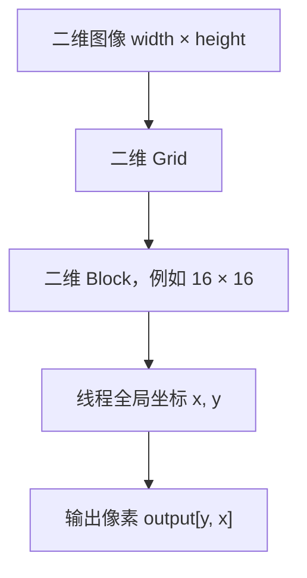
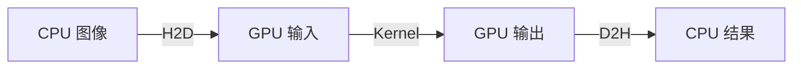

# 一个线程处理一个像素：用 PyCUDA 手写图像水平翻转

> **副标题**：从二维坐标到一维显存：拆开一个最小但完整的 CUDA 图像内核  
> **工程深度**：L1→L2｜**预计阅读**：15 分钟  
> **关键词**：PyCUDA、图像水平翻转、二维线程映射、线性索引、合并访问、CUDA Event
>
> **验证状态**：静态复核 + CPU 对比验证（建议上机跑通）
---

## 一张图，为什么可以交给 GPU 上的海量线程

把一张图片左右翻转，用 NumPy 只要一行：

```python
flipped = np.fliplr(image)
```

但如果我们不调用现成函数，而是亲手把这件事交给 GPU，会立即撞上三个更底层的问题：

1. 一张二维图片，怎样分给成千上万个 CUDA 线程？
2. 图片明明有行和列，为什么这个最小 Kernel 里却可以只用一个 `float*`？
3. 水平翻转到底是在“搬整张图”，还是每个线程各自找一个像素？

答案比想象中简单：

> **让一个线程负责一个输出像素，再让它去输入图像中找到左右镜像位置。**

于是，翻转一张图不再是一场“大搬家”，而是大量互不依赖的小任务：每个线程只读一个值、写一个值。全文的主线可以提前压成一句话，后面每一个环节都是在为它服务：

> **先确定每个线程拥有哪个输出，再定义它为了生成这个输出应该读取哪里。**

这句话同样适用于卷积、缩放、旋转等几乎所有图像算子。

```text
输出像素 (x, y)
      │
      │ 计算镜像坐标
      ▼
输入像素 (width - 1 - x, y)
```

本文用 PyCUDA 完整实现这个过程。重点不是背代码，而是建立一个可以继续迁移到卷积、缩放、颜色变换和图像增强的坐标模型。

先把一个数字钉在心上：`4096 × 4096` 的图像意味着 16,777,216 个像素任务，程序确实会为每个像素启动一个逻辑线程；但 GPU 不会一次性把这 1677 万个线程全部驻留在 SM 上——这些线程组成的 Block 会被调度到数量有限的 SM 上分批执行。

> **逻辑线程数量 ≠ 同时驻留/执行的线程数量。** 这个区分在后面解释"什么时候才值得上 GPU"时会反复用到。

---

## 先看结果：水平翻转到底改变了什么

假设原图只有两行四列：

```text
输入：
1  2  3  4
5  6  7  8

水平翻转后：
4  3  2  1
8  7  6  5
```

行号没有变化，只有列号反向：

| 输出列 `x` | 对应输入列 `width - 1 - x` |
|---:|---:|
| 0 | 3 |
| 1 | 2 |
| 2 | 1 |
| 3 | 0 |

因此，宽度为 `width` 时，镜像坐标就是：

```cpp
int src_x = width - 1 - x;
```

注意，本文实现的是**左右翻转（horizontal flip / left-right flip）**，不是上下翻转，也不是旋转 180°。

---

## 第一层映射：一个线程对应一个输出像素

CUDA 把线程组织成 Thread、Block 和 Grid。`threadIdx`、`blockIdx` 与 `blockDim` 都是多分量坐标，因此可以用二维布局自然覆盖二维图像。CUDA 官方也把一维、二维和三维线程索引作为线程层次的基本表达方式，并明确说明多维 Block/Grid 主要为了把数据映射关系表达得更方便。[CUDA Programming Guide：Programming Model](https://docs.nvidia.com/cuda/cuda-programming-guide/01-introduction/programming-model.html#thread-blocks-and-grids)



线程自己的全局坐标由下面两行得到：

```cpp
int x = blockIdx.x * blockDim.x + threadIdx.x;
int y = blockIdx.y * blockDim.y + threadIdx.y;
```

可以把它理解成：

```text
线程块的起点 + 线程在块内的偏移 = 线程在整张图中的位置
```

比如 Block 配置成 `16×16`：采用"一线程一像素"的映射时，256 个线程就分别负责一块 `16×16` 输出区域中的像素。注意，Block 与数据 Tile 的对应是**程序员选择的映射关系**，不是 CUDA 的硬性语义——没有任何硬件概念保证存在一个"二维像素块"。整张图片需要多少个 Block，不由 GPU 的 SM 数直接决定，而由图片尺寸是否被完整覆盖决定。

> `16×16`（256 线程/Block）是适合教学的起点，也满足 32 线程 Warp 的整倍数要求；它不是固定答案，实际 block size 仍应结合具体 GPU 与 workload 实测。

---

## 第二层映射：二维像素为什么变成一维地址

在 Python 中，我们习惯写：

```python
image[y, x]
```

但这个示例传给 CUDA 内核的是连续存放的 `float32` 数组。内核看到的是一段线性显存。严格说，CUDA 并没有“看见”一张二维图片——它看到的是一段连续的 device memory，**二维性来自你的索引约定**：

```text
图片是二维的
显存本质上是一维地址空间
二维只是我们对地址的一种解释方式
```

```cpp
const float *input;
float *output;
```

对于按行连续存储的二维数组，像素 `(x, y)` 的线性下标为：

```cpp
index = y * width + x;
```

以 `4×3` 图像为例：

```text
二维坐标：
(0,0) (1,0) (2,0) (3,0)
(0,1) (1,1) (2,1) (3,1)
(0,2) (1,2) (2,2) (3,2)

线性下标：
   0     1     2     3
   4     5     6     7
   8     9    10    11
```

于是水平翻转的读写关系可以压缩成一行：

```cpp
output[y * width + x] = input[y * width + (width - 1 - x)];
```

这也是全文最重要的公式。

---

## 完整 CUDA 内核：输出坐标不动，输入坐标反着找

```cpp
__global__ void flip_horizontal(
    const float *input,
    float *output,
    int width,
    int height)
{
    // 当前线程负责的输出像素列坐标
    int x = blockIdx.x * blockDim.x + threadIdx.x;

    // 当前线程负责的输出像素行坐标
    int y = blockIdx.y * blockDim.y + threadIdx.y;

    // Grid 通常向上取整，多出来的线程必须在这里退出
    if (x >= width || y >= height) {
        return;
    }

    // 当前输出列在输入图像中的左右镜像列
    int src_x = width - 1 - x;

    // 二维坐标转换为行优先的一维线性下标
    int dst_index = y * width + x;
    int src_index = y * width + src_x;

    // 每个线程读取一个输入像素，并写入一个输出像素
    output[dst_index] = input[src_index];
}
```

这里没有线程之间的数据依赖：每个线程写入唯一的 `dst_index`，所以不需要原子操作，也不需要 `__syncthreads()`。

### 为什么不直接原地翻转

本文采用 out-of-place 翻转：输入与输出使用独立显存，每个线程只负责一个唯一的输出位置，不需要处理数据覆盖问题。原地翻转（交换两端像素）也可以做，但涉及线程间的同步与数据所有权，属于另一个主题。教学版本先用 out-of-place 把主线讲完。

---

## Grid 为什么要向上取整

假设图片宽度是 100，而 Block 的 x 方向有 16 个线程：

```text
100 // 16 = 6
6 × 16 = 96
```

如果直接使用整数除法，最后 4 列没有任何线程负责。正确做法是整数向上取整：

```python
def ceil_div(value, divisor):
    return (value + divisor - 1) // divisor
```

于是：

```text
ceil(100 / 16) = 7
7 × 16 = 112
```

多出来的 12 个线程由内核中的边界判断过滤。这里有一个常被混淆的因果关系：

> 边界判断能拦住多余线程，却不能补回从未启动的线程。

---

## 完整 PyCUDA 程序：运行、验证、Benchmark

下面的版本可直接运行：用 `SourceModule` 编译 CUDA C 内核，用显式 H2D/D2H 复制管理数据。PyCUDA 官方教程同样采用 `SourceModule → get_function → memcpy_htod/memcpy_dtoh` 这条基础路径。选择 PyCUDA，不是因为它代表 CUDA Python 生态唯一主流路线（还有 Numba、CuPy、PyTorch CUDA Extension），而是因为这条路线把 Python 与原生 CUDA C 内核之间的每一步边界都摊开在眼前。

计时口径先说清：内核时间用 CUDA Event、跑 warmup×5 + repeat×20、取 median 与 P95；端到端时间用主机时钟单独测。**这些数值只用于演示测量方法，不作为跨 GPU 的性能结论。**

```python
"""一个线程处理一个像素：用 PyCUDA 手写图像水平翻转（第1章 · GPU 编程基础）。

本文件是对应博文代码块的实现/演示，直接运行可见效果；运行依赖：PyCUDA、NumPy。
"""
import time

import numpy as np
import pycuda.autoinit
import pycuda.driver as cuda
from pycuda.compiler import SourceModule


# CUDA C 内核：一个线程生成一个水平翻转后的输出像素
KERNEL_CODE = r"""
__global__ void flip_horizontal(
    const float *input,
    float *output,
    int width,
    int height)
{
    int x = blockIdx.x * blockDim.x + threadIdx.x;
    int y = blockIdx.y * blockDim.y + threadIdx.y;

    if (x >= width || y >= height) {
        return;
    }

    int src_x = width - 1 - x;
    int dst_index = y * width + x;
    int src_index = y * width + src_x;

    output[dst_index] = input[src_index];
}
"""


def ceil_div(value, divisor):
    """对正整数执行除法并向上取整。"""
    return (value + divisor - 1) // divisor


def benchmark_kernel(kernel, *args, block, grid, warmup=5, repeat=20):
    """非计时的预热 + 连续测量，返回 (median_ms, p95_ms)，单位毫秒。"""
    # warmup 全程不计时，避免把首次执行的额外开销混入正式测量
    for _ in range(warmup):
        kernel(*args, block=block, grid=grid)
    cuda.Context.synchronize()

    times = []
    start = cuda.Event()
    end = cuda.Event()
    for _ in range(repeat):
        start.record()
        kernel(*args, block=block, grid=grid)
        end.record()
        end.synchronize()
        times.append(start.time_till(end))

    return float(np.median(times)), float(np.percentile(times, 95))


# 编译 CUDA 代码并获取内核函数
module = SourceModule(KERNEL_CODE)
flip_kernel = module.get_function("flip_horizontal")

# 生成连续的 float32 灰度图像
width, height = 4096, 4096
rng = np.random.default_rng(42)
input_image = rng.random((height, width), dtype=np.float32)
gpu_result = np.empty_like(input_image)

# 分配输入、输出显存；分配本身不放入内核计时窗口
input_gpu = cuda.mem_alloc(input_image.nbytes)
output_gpu = cuda.mem_alloc(gpu_result.nbytes)

block = (16, 16, 1)
grid = (
    ceil_div(width, block[0]),
    ceil_div(height, block[1]),
)

# 统一的内核参数，预热与正式测量共用
kernel_args = (
    input_gpu,
    output_gpu,
    np.int32(width),
    np.int32(height),
)

# H2D 传输不属于内核计时；随后的 benchmark_kernel 自带 warmup×5 非计时运行，
# 首次执行相关运行时开销不会进入正式测量
cuda.memcpy_htod(input_gpu, input_image)

# CUDA Event 测量：warmup×5 + repeat×20，取 median 与 P95
median_ms, p95_ms = benchmark_kernel(
    flip_kernel,
    *kernel_args,
    block=block,
    grid=grid,
    warmup=5,
    repeat=20,
)

# 将 GPU 结果复制回主机
cuda.memcpy_dtoh(gpu_result, output_gpu)

# 使用 NumPy 作为参考实现
cpu_reference = np.fliplr(input_image)

# effective bandwidth：按逻辑读写字节数 / 内核时间，这不是 DRAM 带宽
bytes_moved = input_image.nbytes + gpu_result.nbytes
bandwidth_gbps = bytes_moved / (median_ms / 1000) / 1e9

print(f"Grid: {grid}, Block: {block}")
print(f"Kernel 时间（median / P95）: {median_ms:.3f} / {p95_ms:.3f} ms")
print(f"Effective bandwidth（逻辑字节）: {bandwidth_gbps:.2f} GB/s")
print("结果正确:", np.allclose(gpu_result, cpu_reference))

# 单独演示一次端到端计时：H2D + Kernel + D2H（主机时钟，仅作演示）
e2e_start = time.perf_counter()
cuda.memcpy_htod(input_gpu, input_image)
flip_kernel(*kernel_args, block=block, grid=grid)
cuda.memcpy_dtoh(gpu_result, output_gpu)
e2e_ms = (time.perf_counter() - e2e_start) * 1000

print(f"端到端时间（H2D + Kernel + D2H）: {e2e_ms:.3f} ms")
```

程序中的 `np.allclose()` 不是装饰。并行代码首先要证明“算对了”，才有资格讨论“跑快了”。

---

## Timing 不是一个数字，而是一个边界

CUDA 内核启动通常是异步的：CPU 发出任务后可能立即继续执行。因此，用 CPU 计时器包住一次 Kernel 调用，却不做同步，测到的往往只是提交开销。NVIDIA Best Practices Guide 明确提醒：使用 CPU 计时时，需要处理 CUDA API 的异步行为；测量 GPU 内核更适合使用 CUDA Event。

本文把两个问题分开：

| 指标 | 计时窗口 | 回答的问题 |
|---|---|---|
| Kernel 时间 | CUDA Event 包围 Kernel | 这个 Kernel 在 GPU 时间线上经过了多久？ |
| 端到端时间 | H2D + Kernel + D2H | 这次完整调用花了多久？ |



如果数据本来就由上一个 GPU 算子产生，并继续交给下一个 GPU 算子，H2D/D2H 可以不发生。两种对比一目了然：

```text
CPU → GPU → CPU    每处理一步都需要发生 Host ↔ Device 数据传输
GPU → GPU → GPU    数据持续驻留 Device Memory，可绕过传输墙
```

GPU 算子是否值得做，不能只看 Kernel 有多快，还要看数据是不是已经在 GPU 上。

---

## 这段内核快在哪里，又受限在哪里

每个像素只执行少量整数运算，并搬运一个 `float32`。它的算术强度很低，从工作量模型看更偏向 **memory-bound（内存带宽受限）**；是否真正受内存系统限制，最终仍以实测与 profiler 判断。

### 写入模式

相邻线程写入：

```text
output[y, x]
output[y, x+1]
output[y, x+2]
...
```

相邻线程写入连续地址，因此形成典型的 coalesced global store 模式。注意“连续”不等于“必然最优”：实际事务数仍受地址对齐、元素大小、Warp 中参与线程和内存段影响，最终以 profiler 为准。

### 读取模式：地址是反着读的，为什么仍然可以合并

相邻线程读取：

```text
input[y, width-1-x]
input[y, width-2-x]
input[y, width-3-x]
...
```

方向虽然相反，但线程访问的**地址集合**仍然是连续的：

```text
随机访问      ❌
跨大步长访问   ❌
反向连续访问   ✅
```

用一个 Warp 的例子落地：假设一个 Warp（32 个线程）负责同一行的一段，那么

```text
T0  → input[31]
T1  → input[30]
T2  → input[29]
...
T31 → input[0]
```

地址是递减的，但这 32 个线程访问的仍是一段连续的 `float32` 数据——合并访问不要求线程按地址递增。

原因在于：合并访问（coalesced access）关心的是一个 Warp 最终触及哪些对齐内存段，并不要求线程按地址递增排列——只要整个 Warp 请求的地址集合能由尽可能少的内存事务满足即可。不过，每行起点的对齐、元素大小和图像步长仍会影响实际事务数，最终应以 profiler 为准。

### 一个公式看懂它为什么是“搬数据”内核

假设有 N 个 `float32` 像素，**理论逻辑读写量**为：

```text
读取：N × 4 bytes
写入：N × 4 bytes

理论逻辑数据量 ≈ 8N bytes
```

因此可以用 Kernel 时间估算有效带宽：

```text
Effective Bandwidth ≈ 8N / Kernel Time
```

以 `4096 × 4096` 为例：`8 × 16,777,216 ≈ 128 MiB`，结合上面测出的 Kernel 中位数即可算出有效带宽（下面的代码会直接打印）。这也是为什么水平翻转很适合作为第一个 memory-bound 内核：它几乎没有计算，主要工作就是把数据读出来、再写回去。

注意 **effective bandwidth（有效带宽）** 是按**逻辑读写字节数**算出的工程指标，不是 DRAM 带宽——后者是 profiler 报告的另一层数据。这和系列一贯原则一致：逻辑数据量 ≠ 硬件流量。

### 为什么小图可能不如 NumPy

对于小尺寸、单张、只做一次的图像：

- 内核启动有固定成本；
- 主机与设备之间传输有成本；
- NumPy/OpenCV 的 CPU 实现可能已经使用 SIMD；
- 翻转本身计算量太小，GPU 很难“摊薄”上述成本。

所以更准确的说法不是“GPU 翻转一定更快”，而是：

> 当图像足够大、批量足够多，或者数据已经常驻显存时，像素级并行才更容易转化为端到端收益。

---

## 从灰度到彩色：索引多了一层

本文代码处理形状为 `height × width` 的单通道 `float32` 图像。若数据采用 HWC 布局：

```text
height × width × channels
```

像素与通道 `(x, y, c)` 的下标为：

```cpp
(y * width + x) * channels + c
```

灰度只有一层 `[y, x]`，彩色多了一层 `[y, x, c]`——坐标模型没有变，只是每个位置又多乘了一个 `channels`。

> **工程提醒**：真实图像通常不只是一个 `height × width` 的连续数组，还可能有 stride、pitch、ROI、padding，甚至 `uint8`/半精度。本文为了讲清线程映射，故意使用连续的 NumPy 数组；生产接口应显式传入 `stride` 或 `pitch`，不能把 `width` 默认当作每行实际跨度。

---

## 常见错误清单：四个最容易翻车的点

### 1. Grid 使用向下取整

```python
# 错误：边缘像素可能永远没有线程处理
grid_x = width // block_x
```

### 2. 没有边界判断

Grid 向上取整后，边缘 Block 中一定可能存在越界线程，没有 `if (x >= width ...)` 过滤就会写入越界地址。

### 3. 把 CPU 墙钟时间叫作“纯内核时间”

必须说明是否包含同步、H2D、D2H、显存分配和首次编译；纯 Kernel 时间请用 CUDA Event。

### 4. 宣布“算对了”却没有验证

只打印前几行就宣称正确是不够的。使用完整数组对比并给出容差策略：整数图像可以精确比较，浮点流水线通常使用 `allclose`。

---

## 再往前一步：这段代码能通向哪里

把整篇文章的认知叠起来，其实是五层，这也是以后分析任何 CUDA 算子时的视角：

```text
逻辑层   一个线程 → 一个输出像素
地址层   (x, y) → y * width + x
内存层   global load / global store
硬件层   warp → 内存事务 → cache → DRAM
测量层   CUDA Event → effective bandwidth → profiler
```

水平翻转是一个很小的内核，但它已经包含了 CUDA 图像处理的基本骨架：

```text
线程映射
   ↓
输出坐标
   ↓
输入坐标变换
   ↓
线性地址
   ↓
边界判断
   ↓
正确性与性能验证
```

沿着同一套模型，可以继续实现：

- 上下翻转：改变 `y`；
- 90° 旋转：交换坐标并处理输出尺寸；
- 最近邻缩放：输出坐标映射回输入坐标；
- 仿射变换：使用矩阵计算源坐标；
- 卷积：从一个输入坐标扩展为一个邻域；
- 批量数据增强：增加 batch 与 channel 维度。

真正值得带走的不是 `width - 1 - x`，而是这句话：

> **先确定每个线程拥有哪个输出，再定义它为了生成这个输出应该读取哪里。**

这条思路，比任何单个图像算子的代码都更耐用。最后回到这个例子本身——水平翻转只有一行：

```text
output[y, x] = input[y, width - 1 - x]
```

背后是一整套通用的判断链：

```text
输出坐标 → 输入坐标 → 线性地址 → 内存访问 → 性能测量
```

下次遇到 resize、rotate、normalize 或颜色变换，先问三件事：**这个线程负责哪个输出？这个输出要读哪个输入？这些读写对内存效率意味着什么？** 想清楚这三问，flip 就不再只是一个例子，而是一套可以复用到任何图像算子的 CUDA 思维方法。

---

## 参考资料

1. [NVIDIA CUDA C++ Programming Guide：Programming Model（Thread Blocks and Grids / Thread Hierarchy）](https://docs.nvidia.com/cuda/cuda-programming-guide/01-introduction/programming-model.html)
2. [NVIDIA CUDA C++ Programming Guide：Writing SIMT Kernels（合并访问与地址段语义）](https://docs.nvidia.com/cuda/cuda-programming-guide/02-basics/writing-cuda-kernels.html)
3. [NVIDIA CUDA Best Practices Guide：Coalesced Access、Effective Bandwidth 与 Thread Block Size](https://docs.nvidia.com/cuda/cuda-c-best-practices-guide/)
4. [PyCUDA 2026.1 Tutorial：初始化、SourceModule 与显式数据传输](https://documen.tician.de/pycuda/tutorial.html)
5. [PyCUDA Device Interface：Event、内存复制与驱动接口](https://documen.tician.de/pycuda/driver.html)

