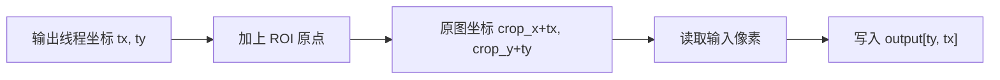

# 裁剪不是“切一刀”：用 PyCUDA 讲透 ROI 坐标映射

> **副标题**：从局部坐标、原图坐标到 Grid 向上取整，手写一个正确的 CUDA 图像裁剪内核  
> **工程深度**：L1→L2｜**预计阅读**：16 分钟  
> **关键词**：PyCUDA、CUDA 图像裁剪、ROI、坐标映射、边界检查、Grid 向上取整

> **工程深度｜验证状态：** L1 入门｜静态复核 + CPU 对比验证（建议上机跑通）
---

## 裁剪真正难的，不是复制像素

从一张 `512×512` 的图像中，取出左上角位于 `(100,100)`、大小为 `100×100` 的区域。用 NumPy 写，只有一行：

```python
crop = image[100:200, 100:200]
```

把它改写成 CUDA 内核后，问题突然多了起来：

- 线程坐标属于原图，还是属于裁剪结果？
- `crop_x` 与 `crop_y` 应该加在哪里？
- 裁剪区域贴着边缘甚至越界时，应该报错、截断还是补零？
- 为什么 `100×100` 的输出配上 `16×16` 的 Block，会悄悄漏掉最后 4 行和 4 列？

这些问题的共同根源是：**裁剪同时存在两套坐标系。**

```text
裁剪结果中的局部坐标：(tx, ty)
              │
              │ 加上 ROI 左上角
              ▼
原图中的绝对坐标：(crop_x + tx, crop_y + ty)
```

一旦两套坐标系分清，内核本身反而很短。

---

## 先定义 ROI：边界语义必须说清楚

本文采用与 Python/NumPy 切片一致的半开区间：

```text
x ∈ [crop_x, crop_x + crop_width)
y ∈ [crop_y, crop_y + crop_height)
```

左边界包含，右边界不包含。因此：

```python
image[
    crop_y:crop_y + crop_height,
    crop_x:crop_x + crop_width,
]
```

当 `crop_x=100`、`crop_width=100` 时，实际读取的列是 `100～199`，共 100 列，而不是 101 列。

这不是语法细节，而是 API 契约。如果调用方和内核对边界是否包含的理解不同，就会出现典型的 off-by-one 错误。

---

## 两套坐标系：输出从零开始，输入从 ROI 原点开始

裁剪输出是一张新图，它的左上角永远是 `(0,0)`。假设 ROI 在原图中的起点为 `(crop_x,crop_y)`：

| 输出坐标 | 原图坐标 |
|---|---|
| `(0,0)` | `(crop_x,crop_y)` |
| `(1,0)` | `(crop_x+1,crop_y)` |
| `(0,1)` | `(crop_x,crop_y+1)` |
| `(tx,ty)` | `(crop_x+tx,crop_y+ty)` |



这也是裁剪和翻转最本质的区别：

```text
水平翻转：输出坐标 → 镜像输入坐标
图像裁剪：输出局部坐标 → 原图绝对坐标
```

---

## 从二维坐标落到线性显存

对于连续、行优先存储的单通道图像：

```cpp
input_index = input_y * width + input_x;
```

裁剪输出同样是连续数组：

```cpp
output_index = ty * crop_width + tx;
```

代入坐标映射：

```cpp
int input_x = crop_x + tx;
int input_y = crop_y + ty;

output[ty * crop_width + tx] =
    input[input_y * width + input_x];
```

一个线程仍然只做一件事：生成一个输出像素。

---

## 完整 CUDA 裁剪内核

```cpp
__global__ void crop_image(
    const float *input,
    float *output,
    int width,
    int height,
    int crop_x,
    int crop_y,
    int crop_width,
    int crop_height)
{
    // 线程坐标属于裁剪结果，不属于原图
    int tx = blockIdx.x * blockDim.x + threadIdx.x;
    int ty = blockIdx.y * blockDim.y + threadIdx.y;

    // 过滤 Grid 向上取整产生的多余线程
    if (tx >= crop_width || ty >= crop_height) {
        return;
    }

    // 把输出局部坐标映射到原图绝对坐标
    int input_x = crop_x + tx;
    int input_y = crop_y + ty;

    // 设备端安全兜底：即使参数异常，也不让线程访问非法地址
    if (input_x < 0 || input_x >= width ||
        input_y < 0 || input_y >= height) {
        return;
    }

    int input_index = input_y * width + input_x;
    int output_index = ty * crop_width + tx;

    output[output_index] = input[input_index];
}
```

这里有两层边界判断：

1. `tx/ty` 是否落在输出图像范围内；
2. 映射后的 `input_x/input_y` 是否落在原图范围内。

它们解决的是不同问题，不能互相替代。第 2 层在正常调用路径下不会触发，但仍应保留在 Kernel 中作为**设备端安全兜底**——这样即使调用方出现参数错误，Kernel 也不会把错误参数变成非法显存访问。

---

## 最隐蔽的 Bug：100×100 为什么只算了 96×96

原始写法如果使用：

```python
grid_x = crop_width // block_x
grid_y = crop_height // block_y
```

当 ROI 为 `100×100`、Block 为 `16×16` 时：

```text
grid_x = 100 // 16 = 6
grid_y = 100 // 16 = 6

实际覆盖：
6 × 16 = 96
```

最终结果右侧 4 列、底部 4 行没有任何线程处理。如果输出数组初始化为零，这个错误甚至不会崩溃，只会留下安静的零值边框。

正确写法是向上取整：

```python
grid_x = (crop_width + block_x - 1) // block_x
grid_y = (crop_height + block_y - 1) // block_y
```

本质上是图像类 Kernel 的通用模板：

```text
GridDim = ceil(OutputSize / BlockDim)
```

向上取整保证**至少覆盖**，多余线程由 Kernel 过滤；少算一个 Block 都无法靠边界判断补救。

```text
ceil(100 / 16) = 7
7 × 16 = 112
```

多启动线程没有问题，因为内核会过滤 `tx>=100` 或 `ty>=100` 的线程；少启动线程却无法由任何边界判断补救。

> **CUDA 覆盖原则：Grid 负责“至少覆盖”，Kernel 负责“严格收口”。**

到这里，「坐标系 → 地址 → 覆盖」这条链已经闭合，后面的每节都在给其中一环补细节：

```text
ROI 语义 → 输出局部坐标 → 输入绝对坐标 → 线性地址 → Grid 覆盖 → 边界安全 → Benchmark
```

---

## 越界 ROI 到底应该怎么处理

假设输入宽度为 512，却请求：

```text
crop_x = 480
crop_width = 100
```

ROI 会越过右边界。此时不存在唯一正确答案，只有不同的 API 语义。

### 策略 A：严格拒绝

在 CPU 端校验，只接受完全位于原图内的 ROI：

```python
if (
    crop_x < 0
    or crop_y < 0
    or crop_x + crop_width > width
    or crop_y + crop_height > height
):
    raise ValueError("裁剪区域超出原图边界")
```

优点是结果尺寸和数据语义确定，最适合教学代码与大多数预处理流水线。

### 策略 B：裁到交集

把 ROI 限制在原图范围内，输出尺寸随实际交集变化。这更像“安全截断”，但调用方必须接受动态尺寸。

### 策略 C：保持尺寸并补零

输出始终是请求尺寸，越界位置写零或其他边界值。需要固定形状的输入张量、又不愿丢弃信息的场景会采用类似语义。

本文完整代码采用**策略 A**。一句话分工：**CPU 校验负责 API 契约（非法 ROI 直接拒绝），内核的输入边界检查负责设备端安全兜底（即使参数异常，线程也不会访问非法地址）**。另外注意：`return` 不会自动写零，未命中的输出像素可能保持未初始化值；如果选择补零语义，必须显式写零。

---

## 完整 PyCUDA 程序：严格 ROI、正确 Grid、CPU 验证

PyCUDA 官方教程展示了从 NumPy 主机数组到设备显存、运行 `SourceModule` 内核，再通过 `memcpy_dtoh` 取回结果的基本流程。下面沿用这条显式路径，让每一次内存移动都可见。

计时口径：Kernel 用 CUDA Event、端到端用主机时钟，都跑 warmup×5 + repeat×20，取 median 与 P95；环境信息一并打印，便于复现。**这些数值只用于演示测量方法，不作为跨 GPU 的性能结论。**

```python
"""裁剪不是“切一刀”：用 PyCUDA 讲透 ROI 坐标映射（第1章 · GPU 编程基础）。

本文件是对应博文代码块的实现/演示，直接运行可见效果；运行依赖：PyCUDA、NumPy。
"""
import time

import numpy as np
import pycuda
import pycuda.autoinit
import pycuda.driver as cuda
from pycuda.compiler import SourceModule


KERNEL_CODE = r"""
__global__ void crop_image(
    const float *input,
    float *output,
    int width,
    int height,
    int crop_x,
    int crop_y,
    int crop_width,
    int crop_height)
{
    int tx = blockIdx.x * blockDim.x + threadIdx.x;
    int ty = blockIdx.y * blockDim.y + threadIdx.y;

    if (tx >= crop_width || ty >= crop_height) {
        return;
    }

    int input_x = crop_x + tx;
    int input_y = crop_y + ty;

    if (input_x < 0 || input_x >= width ||
        input_y < 0 || input_y >= height) {
        return;
    }

    int input_index = input_y * width + input_x;
    int output_index = ty * crop_width + tx;

    output[output_index] = input[input_index];
}
"""


def ceil_div(value, divisor):
    """整数除法向上取整。"""
    return (value + divisor - 1) // divisor


def kernel_median_p95(kernel, *args, block, grid, warmup=5, runs=20):
    """CUDA Event 测纯内核时间：warmup 不计时，repeat 取 median/P95。"""
    for _ in range(warmup):
        kernel(*args, block=block, grid=grid)
    cuda.Context.synchronize()

    times = []
    start = cuda.Event()
    end = cuda.Event()
    for _ in range(runs):
        start.record()
        kernel(*args, block=block, grid=grid)
        end.record()
        end.synchronize()
        times.append(start.time_till(end))

    return float(np.median(times)), float(np.percentile(times, 95))


def e2e_median_p95(host_input, host_output, device_input, device_output,
                   kernel, *args, block, grid, warmup=5, runs=20):
    """主机时钟测 H2D + Kernel + D2H 的完整调用窗口（显式同步，
    只用于展示完整调用成本，不作为高性能异步流水线的实现模板）。"""
    for _ in range(warmup):
        cuda.memcpy_htod(device_input, host_input)
        kernel(*args, block=block, grid=grid)
        cuda.memcpy_dtoh(host_output, device_output)
    cuda.Context.synchronize()

    times = []
    for _ in range(runs):
        # 显式同步：让 GPU 侧上个窗口收尾，计时边界明确
        cuda.Context.synchronize()
        t0 = time.perf_counter()
        cuda.memcpy_htod(device_input, host_input)
        kernel(*args, block=block, grid=grid)
        cuda.memcpy_dtoh(host_output, device_output)
        cuda.Context.synchronize()
        times.append((time.perf_counter() - t0) * 1000)

    return float(np.median(times)), float(np.percentile(times, 95))


def validate_roi(
    width,
    height,
    crop_x,
    crop_y,
    crop_width,
    crop_height,
):
    """采用严格语义：ROI 必须完整位于输入图像内。"""
    if crop_width <= 0 or crop_height <= 0:
        raise ValueError("裁剪宽度和高度必须大于 0")

    if (
        crop_x < 0
        or crop_y < 0
        or crop_x + crop_width > width
        or crop_y + crop_height > height
    ):
        raise ValueError("裁剪区域超出原始图像边界")


# 编译并获取 CUDA 内核
module = SourceModule(KERNEL_CODE)
crop_kernel = module.get_function("crop_image")

# 生成连续的 float32 单通道图像
width, height = 512, 512
rng = np.random.default_rng(42)
input_image = rng.random((height, width), dtype=np.float32)
assert input_image.flags["C_CONTIGUOUS"], "内核假设行优先连续存储"

# ROI 左上角与尺寸
crop_x, crop_y = 100, 100
crop_width, crop_height = 100, 100

validate_roi(
    width,
    height,
    crop_x,
    crop_y,
    crop_width,
    crop_height,
)

# 输出是独立、连续的 100×100 数组
gpu_crop = np.empty((crop_height, crop_width), dtype=np.float32)

# 显式分配设备内存并上传输入
input_gpu = cuda.mem_alloc(input_image.nbytes)
output_gpu = cuda.mem_alloc(gpu_crop.nbytes)
cuda.memcpy_htod(input_gpu, input_image)

# 256 线程/Block：二维映射直观、又是 32 的倍数；教学起点，而非所有 GPU 上的最优配置
block = (16, 16, 1)
grid = (
    ceil_div(crop_width, block[0]),
    ceil_div(crop_height, block[1]),
)

# 统一的内核参数，预热、Kernel 计时与 E2E 计时共用
kernel_args = (
    input_gpu,
    output_gpu,
    np.int32(width),
    np.int32(height),
    np.int32(crop_x),
    np.int32(crop_y),
    np.int32(crop_width),
    np.int32(crop_height),
)

# CUDA Event 测纯内核时间：warmup×5 + repeat×20，取 median 与 P95
kernel_median, kernel_p95 = kernel_median_p95(
    crop_kernel, *kernel_args, block=block, grid=grid
)

# 设备到主机复制
cuda.memcpy_dtoh(gpu_crop, output_gpu)

# NumPy 基准结果；copy() 明确物化为独立连续数组
cpu_crop = input_image[
    crop_y:crop_y + crop_height,
    crop_x:crop_x + crop_width,
].copy()

# 纯复制没有浮点计算，应逐字节一致；array_equal 比 allclose 语义更强
ok = np.array_equal(gpu_crop, cpu_crop)

# 打印环境信息，便于复现
device = cuda.Device(0)
print(f"GPU: {device.name()}")
print(f"PyCUDA: {pycuda.VERSION_TEXT}, NumPy: {np.__version__}")
print(
    f"dtype: {input_image.dtype}, Input: {width}x{height}, "
    f"ROI: {crop_width}x{crop_height} @ ({crop_x},{crop_y})"
)
print(f"Block: {block}, Grid: {grid}")
print(f"Kernel latency (median / P95): {kernel_median:.3f} / {kernel_p95:.3f} ms")
print("结果正确（逐字节一致）:", ok)
assert ok

# 端到端时间：H2D + Kernel + D2H（主机时钟，warmup×5 + repeat×20）
e2e_median, e2e_p95 = e2e_median_p95(
    input_image,
    gpu_crop,
    input_gpu,
    output_gpu,
    crop_kernel,
    *kernel_args,
    block=block,
    grid=grid,
)

print(f"End-to-end (H2D+Kernel+D2H, median / P95): {e2e_median:.3f} / {e2e_p95:.3f} ms")
```

这里使用 `cuda.memcpy_dtoh()`，因为 `cuda.to_device()` 或 `cuda.mem_alloc()` 得到的是驱动层设备内存对象；PyCUDA 官方基础示例也使用 `memcpy_dtoh` 把结果写回 NumPy 数组。

---

## NumPy 切片和 CUDA 裁剪，不一定是同一种工作

NumPy 的基本切片返回原数组的**视图**，通常并不复制像素（官方文档：基本 slicing 返回 view）：

```python
roi_view = input_image[100:200, 100:200]        # 视图：只有 shape/stride 元数据
cpu_crop = input_image[100:200, 100:200].copy() # 物化：独立连续数组
```

本文这个 CUDA Kernel 做的是后者——读取原图 ROI、复制像素，生成一块独立连续的输出显存。OpenCV 的 `cv::Mat` ROI 同样只是子矩阵头，`clone()` 才会产生独立数据。

> **“取得 ROI”与“物化一份连续 ROI 副本”是两个不同的性能问题。**

在 GPU 流水线里，如果下游算子能接收指针偏移和原图 stride，完全可以不启动裁剪 Kernel；只有下游要求紧凑、固定尺寸的连续输入时，物化裁剪结果才有意义。

---

## 为什么这个内核更偏向内存性能

每个线程只做：

- 两次坐标加法；
- 几次边界比较；
- 一次全局内存读取；
- 一次全局内存写入。

没有复杂浮点计算，算术强度很低。从工作量模型看，它属于低算术强度的内存访问型内核，性能通常更容易受内存访问效率和数据搬运成本影响——**最终是否真的受带宽限制，仍应以 Benchmark 和 profiler 实测为准，不要用性能模型代替实测**。

用一个 Warp 的视角看访问模式。假设一个 Warp（32 个线程）负责某一行内连续的一段：

```text
T0  → input[x + 0]     output[0]
T1  → input[x + 1]     output[1]
T2  → input[x + 2]     output[2]
...
T31 → input[x + 31]    output[31]
```

相邻线程访问相邻元素，因此这种访问模式天然适合合并访问（coalescing）。具体效率还要结合数据类型、地址分布和实际 GPU 测量判断。

但不要由此推出“裁剪一定适合单独用 GPU 加速”。小 ROI 的 Kernel 启动和传输成本可能高于复制本身。更现实的收益通常来自：

- 输入图像已经在 GPU；
- 一次处理很多 ROI；
- 裁剪与归一化、缩放、颜色变换融合进同一个 Kernel；
- 输出直接交给 GPU 推理，不再下载回 CPU。

---

## Timing：不要把一次 `time.time()` 当成性能结论

CUDA Kernel 启动通常是异步的。CPU 计时器若没有明确同步，可能只测到任务提交；如果紧接着执行同步 D2H，又会把数据传输算入同一个窗口。NVIDIA 的最佳实践文档建议明确计时边界，并可使用 CUDA Event 测量 GPU 工作。

建议把三个概念分开报告：

| 指标 | 含义 | 回答的问题 |
|---|---|---|
| Kernel latency | GPU 上这个 Kernel 的执行时间 | 这个 CUDA Kernel 本身多快？ |
| End-to-end latency | 本文 Benchmark 定义：H2D + Kernel + D2H | CPU↔GPU 一次调用多快？ |
| Pipeline impact | 该步骤在真实流水线中的综合影响（不止是时间） | 这一步是否值得存在？ |

第三个（Pipeline impact）最有工程价值：真正的优化有时候是**直接不做 crop**——让下游算子接受指针偏移和 stride，省掉一次 Kernel 启动和一次复制。

正式 Benchmark 还应具备：预热、重复取 median/P95、多尺寸扫描，以及环境信息（GPU/CUDA/PyCUDA/NumPy/dtype）与「数据是否常驻显存」的说明。

另外把「功能测试」和「性能测试」分开：功能测试用 `512×512` 原图裁 `100×100` ROI 验证正确性；性能测试建议换一张更大的原图（如 `2048×2048`），ROI 扫 `64² → 128² → 256² → 512² → 1024²`——注意性能测试的 ROI 同样必须通过 `validate_roi`，否则严格语义会直接拒绝。小 ROI 的启动与 Host↔Device 传输占比高，大 ROI 才更接近内核本身的显存吞吐特征。

---

## 从 width 到 stride：教学代码与真实图像的分界线

### 1. 显式传入 stride，而不是默认连续

教学代码使用：

```cpp
input_y * width + input_x
```

它假设每行恰好有 `width` 个元素。真实图像可能包含行对齐、pitch 或来自更大图像的非连续视图，通用接口应使用：

```cpp
input_y * input_stride + input_x
```

stride 以元素还是字节为单位要统一约定。**这段分界线值得记住：一旦引入 stride，同样的代码就能处理对齐内存、子矩阵视图，而不只是“刚好一张连续图”。**

### 2. 支持通道与数据类型

真实图像还会引入 channels、layout 与 dtype：HWC、CHW、NCHW 对线性地址的定义各不相同（灰度用 `input_y * width + input_x`，RGB 通常是 `(input_y * width + input_x) * channels + channel`），所以工程接口必须明确 layout，不能只增加一个 `channels` 参数。

### 3. 批量 ROI，而不是逐个启动 Kernel

目标检测后经常要从一张图裁出多个候选框，逐 ROI 启动内核会放大启动开销：

```text
单 ROI → 批量 ROI（一个 Grid 覆盖多个框）→ +缩放 → +归一化 → 融合预处理
```

工程优化通常不是把一个 crop kernel 写得更复杂，而是**减少启动次数和中间结果**。这里点到为止，不展开成一个预处理流水线专题。

### 4. 明确是否真的需要复制

如果下游支持原图指针、偏移和 stride，传递 ROI 描述可能比复制更便宜；如果下游要求固定尺寸连续张量，则裁剪或融合预处理更合适。

---

## 常见错误 + 一组必须测试的边界

先把最容易翻车的六点压成清单：

- **把 x 和 y 写反**：NumPy 访问顺序是 `[row, column]`（即 `[y, x]`），ROI 参数却常写成 `(x,y,width,height)`，命名必须明确。
- **Grid 按原图尺寸启动**：裁剪线程拥有的是输出像素，Grid 应按 `crop_width × crop_height` 计算。
- **使用向下取整**：会让边缘像素没有线程负责，而且程序未必报错。
- **越界线程直接 `return`，却把输出称为补零**：`return` 不写零，输出可能是未定义数据。
- **拿 NumPy view 与 CUDA copy 直接比速度**：比较对象不同，结论失真。
- **用随机抽样代替完整验证**：应对整个输出执行 `array_equal`/`allclose`，并补齐下面这些边界用例。

对应的边界测试，每个只回答「验证什么」：

| 用例 | 验证什么 |
|---|---|
| `100×100` ROI，`16×16` Block | 非整除尺寸不会漏算 |
| ROI 等于整张图 | 坐标映射退化为完整复制 |
| `1×1` ROI | 最小合法尺寸 |
| `0×0` / 负尺寸 | 参数契约拒绝非法尺寸 |
| ROI 紧贴右下角 | 半开区间与边界条件 |
| ROI 超出右边界 1 像素 | off-by-one |
| `crop_x=-1` | 严格模式拒绝负坐标 |
| 非连续或带 stride 输入 | 工程化索引接口 |

性能优化可以晚一点，边界测试不能晚。

---

## 裁剪内核真正教会我们的是什么

裁剪看起来只是复制一个矩形，实际却浓缩了 GPU 图像处理最常见的工程问题：

```text
先定义 ROI 语义
       ↓
线程拥有输出局部坐标
       ↓
映射到输入绝对坐标
       ↓
二维坐标转线性地址
       ↓
Grid 至少覆盖，Kernel 严格收口
       ↓
用 CPU 参考结果验证
       ↓
分开测 Kernel 与端到端成本
```

最值得记住的是两句话：

> **裁剪不是在原图上“切一刀”，而是在输出坐标系中重新生成一张图。**

> **Grid 决定有没有线程负责，边界判断决定线程能不能安全工作。**

理解这两个边界，后续再写 resize、warp、ROI Align、patch extraction 或融合预处理 Kernel，就不再只是照着公式抄代码。

---

## 参考资料

1. [NVIDIA CUDA C++ Programming Guide：Thread Hierarchy 与内存模型](https://docs.nvidia.com/cuda/cuda-c-programming-guide/)
2. [NVIDIA CUDA Best Practices Guide：CUDA Event 计时与合并内存访问](https://docs.nvidia.com/cuda/cuda-c-best-practices-guide/)
3. [PyCUDA 2026.1 Tutorial：SourceModule、显存分配与数据复制](https://documen.tician.de/pycuda/tutorial.html)
4. [PyCUDA Device Interface：Event 与 Driver API](https://documen.tician.de/pycuda/driver.html)
5. [NumPy Quickstart：基本切片返回 View](https://numpy.org/doc/stable/user/quickstart.html)
6. [OpenCV cv::Mat：ROI、Submatrix 与 Clone 语义](https://docs.opencv.org/4.x/d3/d63/classcv_1_1Mat.html)

