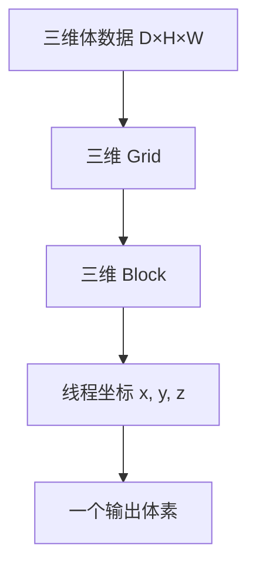
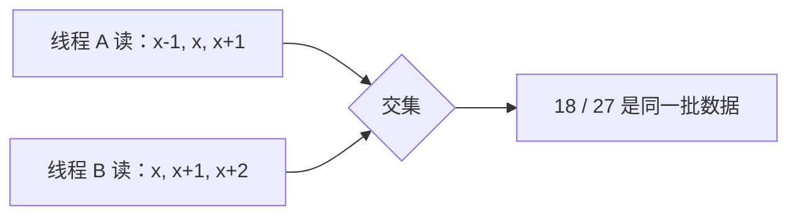

# PyCUDA 手写 3D 卷积：26 万个输出线程，为什么同一批输入被反复访问？

> **一句话理解**：GPU 不会派一个线程把三维空间从头算到尾，而是把空间切成小格、让大量线程同时开工——程序会为每个输出体素启动一个逻辑线程；而相邻线程的邻域高度重叠，反复请求同一批输入。

> **工程深度｜验证状态：** L2 工程｜静态复核 + CPU 对比验证（GPU 性能需上机实测）
回到普通二维图片，我们很容易想象卷积：一个小窗口在画面上滑动，每到一个位置就把周围像素加权求和。

但把输入从照片换成 CT 切片堆成的三维体数据，事情就变了。

窗口不再只看"上下左右"，还要看"前后"。一个 `3×3` 的小方格，变成了 `3×3×3` 的小立方体；一次加权求和，从 9 个数变成 27 个数。

更值得展开的是后面这件事：对一个 `64×64×64` 的输出，程序会启动 262,144 个逻辑线程，每个线程从头到尾只负责**一个输出体素**——它被派去遍历的，依然是一个完整的 `3×3×3` 邻域。这些线程不会同时驻留，而是以 Block 为单位分批调度到有限的 SM 上。而这种"一人做事"的简单分工，也让相邻线程反复请求同一批输入。

下面我们不动 PyTorch 的 `Conv3d`，也不躲进 cuDNN 黑盒，用 PyCUDA 手写一个最朴素的三维卷积核，把四个最容易被忽视的技术点一次讲清。

---

## 术语边界："3D 卷积"实际计算的是互相关

拿起一个随机卷积核，你几乎一定会错过一个术语陷阱：代码没有沿深度、高度和宽度三个空间轴反转卷积核，因此严格来说，计算的是**互相关（cross-correlation）**，而不是数学定义下的三维卷积。对形状为 `K_d × K_h × K_w` 的卷积核，数学卷积需要把索引从 `(k_z, k_y, k_x)` 映射为 `(K_d−1−k_z, K_h−1−k_y, K_w−1−k_x)`。

```text
工程名称：3D Convolution
实际运算：3D Cross-correlation
```

这不是哪个示例的偷懒。PyTorch 的 `Conv3d` 官方文档也白纸黑字把运算符称为有效三维互相关——深度学习框架沿用了"卷积层"这个名字，但干的是相关运算。[PyTorch Conv3d](https://docs.pytorch.org/docs/stable/generated/torch.nn.Conv3d.html)

为什么没人抱怨？因为对固定的非对称卷积核，数学卷积（先翻转核）和互相关（不翻转核）通常会得到明显不同的输出——核"小"或"随机"并不会让差异消失。深度学习框架沿用它叫"卷积层"，是因为训练过程直接学习符合互相关定义的权重，模型表达能力通常不受这个命名差异影响；但在固定权重推理、跨框架迁移和数值验证时，两种语义必须严格对齐。

> 验证时先问一句：目标参考实现算的是哪一个？两边对齐同一语义，别让翻转问题变成玄学。

---

## GPU 怎么分地：一个线程，一个体素

把数据看成三维空间后，CUDA 的线程组织天然支持三维：线程（thread）组成 Block，Block 再组成 Grid；而 Grid 可以包含远超硬件并发容量的线程与 Block，由调度器逐批映射到有限的 SM 上。[CUDA Programming Guide](https://docs.nvidia.com/cuda/cuda-programming-guide/01-introduction/programming-model.html#thread-blocks-and-grids) 最直观的映射是：

```text
CUDA x 轴 → 宽度  width
CUDA y 轴 → 高度  height
CUDA z 轴 → 深度  depth
```

每个线程用下面三行找到自己的全局坐标：

```cpp
int x = blockIdx.x * blockDim.x + threadIdx.x;   // 全局列号
int y = blockIdx.y * blockDim.y + threadIdx.y;   // 全局行号
int z = blockIdx.z * blockDim.z + threadIdx.z;   // 全局层号
```



一个线程只写自己的输出点，不碰别人的结果。这让朴素版本拥有一个珍贵的教学特性：

> 每个输出地址只有一个写入者，不需要原子操作，也没有写冲突。

所以 `64×64×64` 的输入，`3×3×3` 的核，内部区域的每个输出体素只问三件事：我在哪、我周围那 27 个值是多少、结果写到哪里。

---

## Grid 少算一个 Block，边界数据就会失去线程

很多示例代码会这样算 Grid：

```python
grid_x = width // block_x
```

`width=64`、`block_x=8` 时恰好整除，跑得很正常。直到某天你的输入宽变成 65：

```text
65 // 8 = 8
8 × 8 = 64   ← 第 65 个元素无人认领
```

程序不报错，结果也不崩——只是最右边一列悄悄全是初始值。卷积就是这样静默失败、最难排查的坑之一。

通用写法必须向上取整：

```python
grid_x = (width + block_x - 1) // block_x
```

三个维度都这样做。代价是边缘 Block 会多出少量越界线程，于是 Kernel 里还要配一道守门：

```cpp
if (x >= width || y >= height || z >= depth) {
    return;   // 超出输入范围的线程在边界判断后直接返回
}
```

```text
Grid 向上取整，保证覆盖全部数据
                ↓
Kernel 检查边界，过滤多出来的线程
```

---

## 三维坐标如何落到线性显存

即使数组在 NumPy 里长着三维的样子 `input[z][y][x]`，GPU 全局内存（global memory）依然是一段线性地址。Kernel 拿到三个坐标，第一件事是把它们压成一个下标：

```cpp
index = (z * height + y) * width + x;
```

```text
index = z × height × width   // 跳过前面 z 层完整切片
      + y × width            // 跳过当前层里前面的完整行
      + x                    // 落到这一行的目标列
```

C-order 布局下 `x` 是连续存放的。这是一句很容易被忽略、却埋着性能伏笔的话：同一个线程束（warp）里的线程如果尽量沿 `x` 方向访问相邻地址，全局内存就能更好地合并访存（coalesced access）——把 32 个线程的访问合并成尽可能少的内存事务。以 32 个相邻的 `float32` 为例，在 Compute Capability 6.0 及以上的架构中，典型情况需要约四个 32 字节事务，而不是单一事务。[CUDA Best Practices：Coalesced Access](https://docs.nvidia.com/cuda/cuda-c-best-practices-guide/index.html#coalesced-access-to-global-memory)

这也是后面优化章节反复出现的主题：**线程的邻居关系，要顺着内存的邻居关系排**。

---

## 异步执行下，CPU 计时为什么会失真

Kernel 启动对 CPU 默认是异步的——Python 发出调用后就立刻返回，但那一刻 GPU 可能才刚开始干活。如果这样计时：

```python
start = time.time()
conv3d_kernel(...)   # 只是"提交"，不等它算完
end = time.time()
```

你测到的大概率是"CPU 把活递给 GPU 花了多久"，而不是 GPU 真正跑了多久。对一个小 `64³` 任务，这段计时主要反映主机侧的调用与提交开销，不能代表 Kernel 在 GPU 上的实际执行时间。

正确做法是用 CUDA Event，把时间戳记在 GPU 自己的时间线上：

```text
start_event
    ↓
重复执行 Kernel
    ↓
end_event
    ↓
等待 end_event 完成
    ↓
总时间 ÷ 重复次数
```

PyCUDA 里 `start.time_till(end)` 返回两个已完成事件之间的毫秒数——这也是 NVIDIA 官方推荐的 GPU 计时方式之一。[CUDA Best Practices：GPU Timers](https://docs.nvidia.com/cuda/cuda-c-best-practices-guide/index.html#using-cuda-gpu-timers) 发挥一下细节：先预热一轮避免首次调用开销污染，再重复多轮取平均；同时把**纯 Kernel 时间**和**端到端时间**（含 H2D、Kernel、D2H）当成两个指标分开报告——混淆这两者，是"宣称加速 N 倍"最常见的翻车方式。

> 别拿着一份单次计时去发布会："我 GPU 加了 100 倍"。先把几百万浮点运算的"提交时间"和"执行时间"分清楚。

---

## 相邻线程为什么反复请求同一批输入

朴素实现里，每个线程独立从全局内存读取自己的 `3×3×3` 邻域。问题很直接：**相邻输出体素的邻域高度重叠**。



沿 `x`、`y`、`z` 任一方向相邻的两个输出体素，它们的 `3×3×3` 邻域都会重叠 18 个输入位置（`2×3×3`、`3×2×3`、`3×3×2`）。多个线程组成二维或三维输出块后，重叠会进一步累积。

这份重叠其实可以严谨地算出来。对于输入内部、无需处理零填充边界的 Block，在 `block = (8, 8, 4)` 与 `3×3×3` 卷积核的条件下，只看该 Block 的**第一个 Warp**（一个 Warp 固定为 32 个线程）：CUDA 线性化时 `x` 维变化最快，这 32 个线程恰好覆盖 `8×4×1` 个输出体素；每个体素发起 27 次邻域采样，合计 `32 × 27 = 864` 次请求；而这批线程联合需要覆盖的输入区域只有：

```text
(8 + 2) × (4 + 2) × (1 + 2) = 10 × 6 × 3 = 180 个不同位置
```

因此其**逻辑采样地址**的重叠比例为：

```text
1 − 180 / 864 ≈ 79.2%
```

但这是**逻辑采样地址**的重叠比例，不等于实际的 DRAM 流量减少空间。编译器优化、Warp 内访存合并、L1/L2 缓存都可能吸收一部分重复请求；真实的内存事务数、缓存命中率与 DRAM 吞吐量，可以借助 Nsight Compute 等性能分析工具验证。[Nsight Compute Profiling Guide](https://docs.nvidia.com/nsight-compute/ProfilingGuide/index.html) 所以正确的工程闭环是：

```text
理论重叠
    ↓
Nsight Compute 确认实际缓存与 DRAM 流量
    ↓
实现 Shared Memory Tile
    ↓
重新测量 Kernel 时间与内存指标
    ↓
确认收益后合入
```

重点观察五类指标：DRAM 实际读取量、L1/L2 命中率、全局 Load 合并效率、Shared Memory Bank Conflict、Achieved Occupancy 与 Warp Stall 原因。

GPU 的 L1/L2 缓存可能吸收一部分重复访问，但朴素 Kernel 没有显式组织 Block 内的数据复用，坐失良机。三条优化路线，按投入产出排序：

**第一步：把小卷积核塞进常量内存（constant memory）**
`3×3×3` 的 `float32` 权重只有 108 字节。内层循环里一个 Warp 的线程几乎总在读同一个系数，正好命中常量缓存的广播模式。对这份直接卷积 Kernel 而言，同一 Warp 中的活动线程在每轮循环里读取的是同一个卷积核系数，因此 Constant Memory 的广播机制具有潜在优势。但当权重规模增大、访问模式不再保持 Warp-uniform，或常量缓存容量与工作集不匹配时，收益可能下降。是否值得采用，仍需通过基准测试确认——不是"放进去就一定快"。

**第二步：用共享内存（shared memory）装瓦片和边界余量（Tile 与 Halo）**
一个 Block 先协作把输入小块连同边缘 Halo 搬进片上共享内存，线程再从共享内存反复取数；NVIDIA 也明确建议在多个线程重复使用同一批全局内存数据时用 Shared Memory 消除冗余传输，同时注意它可能限制 Occupancy。[CUDA Best Practices：Shared Memory](https://docs.nvidia.com/cuda/cuda-c-best-practices-guide/index.html#shared-memory) 算一笔账：输出 Tile 若为 `8×8×4`，半径 1，需要的输入区域是 `10×10×6=600` 个 float，约 2.34 KiB——完全可以接受。

```text
Global Memory
      ↓ 协作搬运一次
Shared Memory：Tile + Halo
      ↓ 邻域反复复用
每个线程算一个输出体素
```

代价也很诚实：Halo 协作负载、`__syncthreads()` 同步、存储体冲突（Bank Conflict）、共享内存容量占用，一个都不少。所以正确顺序是先建基线 → Benchmark 确认瓶颈确实是访存 → 再重写 Tile——而不是开局就秀 Shared Memory。

**第三步：把生产交给库**
完整 `Conv3d` 通常要处理 `N×Cin×D×H×W`、Cout、groups、bias、stride、dilation、混合精度……到了这一层，手写 Kernel 的价值是读懂索引与访存，而不是重复造一个通用卷积库。理解底层（让我们干）与生产造轮子（让 cuDNN 干），是两件事。

> 具体加速倍数必须在 N 卡机器上实测——作者环境无法运行 GPU，本篇只推导机制，不做数字承诺。这不是敷衍，是对数据负责。

> **继续向前**：更现代的路径里，Tile 搬运可以改用异步 Global-to-Shared Copy 与 Pipeline，把数据加载和计算重叠起来；在 Hopper 及后续支持 TMA 的架构上，还可以通过 TMA（Tensor Memory Accelerator）搬运多维数据块，进一步降低地址计算和数据搬运的指令负担。多通道生产级卷积则常转化为隐式 GEMM，依托 cuDNN、CUTLASS/CuTe 与 Tensor Core。[CUDA Programming Guide：Asynchronous Data Copies](https://docs.nvidia.com/cuda/cuda-programming-guide/04-special-topics/async-copies.html) 但对当前这个单通道、小卷积核示例而言，还没有证据表明引入这些机制能够带来净收益。

---

## 收藏这一节就够了：三段速查清单

**运行前，环境要齐**
```text
[ ] NVIDIA GPU + 驱动
[ ] CUDA Toolkit（含 nvcc）
[ ] 与 Python/CUDA 兼容的 PyCUDA + NumPy
[ ] SourceModule 运行时编译失败 → 先查 nvcc/驱动/编译器路径
```

**结果对不对，按这个查**
```text
[ ] 输入与卷积核均为 float32，NumPy 为 C-order 连续内存
[ ] kernel_size 强制正奇数
[ ] Grid 三个维度全部向上取整
[ ] Kernel 有输出坐标边界判断
[ ] CPU / GPU 采用同一语义（互相关 or 卷积，二选一）
[ ] 用 assert_allclose 而非逐位相等
```

**快不快，按这个查**
```text
[ ] 先预热再计时
[ ] Kernel 时间用 CUDA Event
[ ] 端到端时间单独统计
[ ] 重复多轮取中位数/平均值
[ ] 比较多个 Block 形状（别只看 8×8×8）
[ ] 记录 GPU 型号、驱动、CUDA、PyCUDA 版本
```

---

## 结尾：三维只是多了一个 z，坑却多了一整层

从二维走到三维，表面只是 `(y, x) → (z, y, x)`。真正增加的是整层工程复杂度：数据量按体积增长、邻域从平面变立方、边界更多、重复读取翻倍、Block 形状和内存布局的关系更微妙。

好在 CUDA 的思路没变：

> 把彼此独立的输出位置分给不同线程，让每个线程只回答一个小问题。

手写 CUDA Kernel 的最大价值，从来不是替代成熟库，而是看清成熟库替我们藏住了什么——顺带看清框架一行调用背后发生的机制。

**留个开放问题给你**：你手写过 3D 卷积吗？踩到的最难缠的坑是哪一个——术语边界、Grid 取整、地址展平，还是计时？欢迎在评论区补充，我们缺的可能不只是这几个点。

下一篇预告：同样是这个 `3×3×3` 核，用共享内存 Tile + Halo 改写后，在真实 GPU 上到底能省多少内存流量？届时会附上 Nsight Compute 实测对比。

如果你觉得这篇对你有用，建议收藏速查清单那段——上手写 Kernel 时直接对照打勾。

---

## 附录：在满足环境条件下可运行的完整代码

正文只拆机制，这节给一份完整实现，但它有明确边界：它基于 PyCUDA，需要在 NVIDIA 驱动、CUDA Toolkit 与 PyCUDA 兼容的环境下运行；本文已完成静态检查（语法、链接与接口语义），具体编译与性能结果仍需在目标 GPU 环境验证。它已经处理好那些"看起来对、跑起来才露馅"的细节——Grid 三维全部向上取整、`DeviceAllocation` 用 `memcpy_dtoh` 回传、奇数核显式校验、CUDA Event 计时、预热后再测、以及用 NumPy 参考实现做全量校验而不是打印几个数字。

先看清这份代码的能力边界，别把它当成生产级 `Conv3d`：

| 能力 | 当前代码 |
|---|---|
| Batch | 单样本 |
| 输入通道 | 单通道 |
| 输出通道 | 单通道 |
| Kernel | 立方体、正奇数边长 |
| Padding | 零填充 Same |
| Stride | 1 |
| Dilation | 1 |
| Groups | 不支持 |
| Bias | 不支持 |
| 数据类型 | FP32 |
| 计算语义 | 三维互相关 |

教学 Kernel 的有限边界不是缺点——它让这篇只讲一层的代码能把索引、访存与验证讲透；要承担多通道、多输出的生产负载，请交给 cuDNN。

```python
"""PyCUDA 手写 3D 卷积：26 万个输出线程，为什么同一批输入被反复访问？（第1章 · GPU 编程基础）。

本文件是对应博文代码块的实现/演示，直接运行可见效果；运行依赖：PyCUDA、NumPy。
"""
import time

import numpy as np
import pycuda.autoinit  # 自动初始化 CUDA 设备、上下文与清理流程
import pycuda.driver as cuda
from pycuda.compiler import SourceModule


KERNEL_CODE = r"""
__global__ void conv3d_same(
    const float *__restrict__ input,
    const float *__restrict__ kernel,
    float *__restrict__ output,
    int width,
    int height,
    int depth,
    int kernel_size)
{
    // 当前线程对应的输出体素坐标
    const int x = blockIdx.x * blockDim.x + threadIdx.x;
    const int y = blockIdx.y * blockDim.y + threadIdx.y;
    const int z = blockIdx.z * blockDim.z + threadIdx.z;

    // Grid 向上取整后，边缘 Block 可能包含越界线程
    if (x >= width || y >= height || z >= depth) {
        return;
    }

    const int radius = kernel_size / 2;
    float value = 0.0f;

    // 遍历卷积核的深度、高度和宽度
    for (int kz = 0; kz < kernel_size; ++kz) {
        const int iz = z + kz - radius;

        for (int ky = 0; ky < kernel_size; ++ky) {
            const int iy = y + ky - radius;

            for (int kx = 0; kx < kernel_size; ++kx) {
                const int ix = x + kx - radius;

                // 越界位置视为 0，即零填充
                if (ix >= 0 && ix < width &&
                    iy >= 0 && iy < height &&
                    iz >= 0 && iz < depth) {

                    const int input_index =
                        (iz * height + iy) * width + ix;

                    const int kernel_index =
                        (kz * kernel_size + ky) * kernel_size + kx;

                    value += input[input_index] * kernel[kernel_index];
                }
            }
        }
    }

    const int output_index = (z * height + y) * width + x;
    output[output_index] = value;
}
"""


def generate_data(width, height, depth, rng):
    """生成 C-order、float32 三维体数据，形状为 [D, H, W]。"""
    data = rng.random((depth, height, width), dtype=np.float32)
    return np.ascontiguousarray(data)


def generate_kernel(kernel_size, rng):
    """生成正奇数尺寸的三维卷积核。"""
    if kernel_size <= 0 or kernel_size % 2 == 0:
        raise ValueError("kernel_size 必须是正奇数")

    weights = rng.random(
        (kernel_size, kernel_size, kernel_size),
        dtype=np.float32,
    )

    # 归一化不是卷积的必要条件，只是让示例输出数值更平稳
    weights /= weights.sum(dtype=np.float32)
    return np.ascontiguousarray(weights)


def conv3d_reference(input_data, kernel):
    """NumPy 参考实现：零填充、步长 1、三维互相关。"""
    depth, height, width = input_data.shape
    kernel_size = kernel.shape[0]

    if kernel.shape != (kernel_size, kernel_size, kernel_size):
        raise ValueError("kernel 必须是立方体")
    if kernel_size % 2 == 0:
        raise ValueError("kernel_size 必须是奇数")

    radius = kernel_size // 2
    padded = np.pad(
        input_data,
        ((radius, radius), (radius, radius), (radius, radius)),
        mode="constant",
    )
    output = np.zeros_like(input_data)

    # 外层只遍历较小的卷积核，体数据计算交给 NumPy 切片
    for kz in range(kernel_size):
        for ky in range(kernel_size):
            for kx in range(kernel_size):
                output += (
                    padded[
                        kz:kz + depth,
                        ky:ky + height,
                        kx:kx + width,
                    ]
                    * kernel[kz, ky, kx]
                )

    return output


def main():
    width, height, depth = 64, 64, 64
    kernel_size = 3
    repeats = 100
    rng = np.random.default_rng(42)

    input_data = generate_data(width, height, depth, rng)
    kernel = generate_kernel(kernel_size, rng)
    output_gpu = np.empty_like(input_data)

    # 编译 CUDA C Kernel 并获取函数句柄
    module = SourceModule(KERNEL_CODE)
    conv3d_kernel = module.get_function("conv3d_same")

    # H2D：输入和权重复制到 GPU；输出只分配，不需要预先复制零值
    input_device = cuda.to_device(input_data)
    kernel_device = cuda.to_device(kernel)
    output_device = cuda.mem_alloc(output_gpu.nbytes)

    # 256 线程作为起始实验点；最佳形状需要基准测试确定
    block_size = (8, 8, 4)
    grid_size = (
        (width + block_size[0] - 1) // block_size[0],
        (height + block_size[1] - 1) // block_size[1],
        (depth + block_size[2] - 1) // block_size[2],
    )

    args = (
        input_device,
        kernel_device,
        output_device,
        np.int32(width),
        np.int32(height),
        np.int32(depth),
        np.int32(kernel_size),
    )

    # 预热：避免首次调用开销污染正式计时
    conv3d_kernel(*args, block=block_size, grid=grid_size)
    cuda.Context.synchronize()

    # CUDA Event 测量 GPU 时间
    start_event = cuda.Event()
    end_event = cuda.Event()

    start_event.record()
    for _ in range(repeats):
        conv3d_kernel(*args, block=block_size, grid=grid_size)
    end_event.record()
    end_event.synchronize()

    average_kernel_ms = start_event.time_till(end_event) / repeats

    # D2H：DeviceAllocation 使用 memcpy_dtoh 复制回 NumPy 数组
    cuda.memcpy_dtoh(output_gpu, output_device)

    # CPU 参考结果与耗时
    cpu_start = time.perf_counter()
    output_cpu = conv3d_reference(input_data, kernel)
    cpu_ms = (time.perf_counter() - cpu_start) * 1000.0

    # 浮点并行计算不应使用逐位相等判断
    np.testing.assert_allclose(
        output_gpu,
        output_cpu,
        rtol=1e-5,
        atol=1e-6,
    )

    max_abs_error = np.max(np.abs(output_gpu - output_cpu))

    print(f"输入形状[D,H,W]：{input_data.shape}")
    print(f"Block：{block_size}，Grid：{grid_size}")
    print(f"平均 Kernel 时间：{average_kernel_ms:.4f} ms")
    print(f"NumPy 参考实现时间：{cpu_ms:.4f} ms")
    print(f"最大绝对误差：{max_abs_error:.8e}")
    print("输出左上前方的 2×3×3 子区域：")
    print(output_gpu[:2, :3, :3])


if __name__ == "__main__":
    main()
```

**运行方式**：把上面的 `KERNEL_CODE` 中文注释去掉也不需要——注释在 CUDA C 字符串里不影响编译。直接在装有 PyCUDA 的 N 卡机器上 `python 本文件.py` 即可；`SourceModule` 会在运行时调用 `nvcc` 编译，若报错优先检查驱动、`nvcc --version` 和 CUDA/PyCUDA 版本匹配。

**两个提醒（都是踩过的人才懂的）**：
1. 这份代码的基准数字**必须在 N 卡实测**才有意义——本机没有独显，作者不给你一个假的加速倍数。
2. 它实现的是三维**互相关**（与 PyTorch Conv3d 同一语义），想验证"数学卷积"请自行翻转卷积核——对应正文"术语边界"一节等你。

---

## 参考资料

1. NVIDIA, [CUDA Programming Guide：Programming Model（Thread Blocks and Grids）](https://docs.nvidia.com/cuda/cuda-programming-guide/01-introduction/programming-model.html#thread-blocks-and-grids)
2. NVIDIA, [CUDA C++ Best Practices Guide：Coalesced Global Memory Access](https://docs.nvidia.com/cuda/cuda-c-best-practices-guide/index.html#coalesced-access-to-global-memory)
3. NVIDIA, [CUDA C++ Best Practices Guide：Using CUDA GPU Timers](https://docs.nvidia.com/cuda/cuda-c-best-practices-guide/index.html#using-cuda-gpu-timers)
4. NVIDIA, [CUDA C++ Best Practices Guide：Shared Memory](https://docs.nvidia.com/cuda/cuda-c-best-practices-guide/index.html#shared-memory)
5. NVIDIA, [CUDA Programming Guide：Asynchronous Data Copies](https://docs.nvidia.com/cuda/cuda-programming-guide/04-special-topics/async-copies.html)
6. [PyCUDA Tutorial](https://documen.tician.de/pycuda/tutorial.html)
7. [PyCUDA Driver API（Device Interface）](https://documen.tician.de/pycuda/driver.html)
8. PyTorch, [Conv3d Documentation](https://docs.pytorch.org/docs/stable/generated/torch.nn.Conv3d.html)
9. NVIDIA, [Nsight Compute Profiling Guide](https://docs.nvidia.com/nsight-compute/ProfilingGuide/index.html)