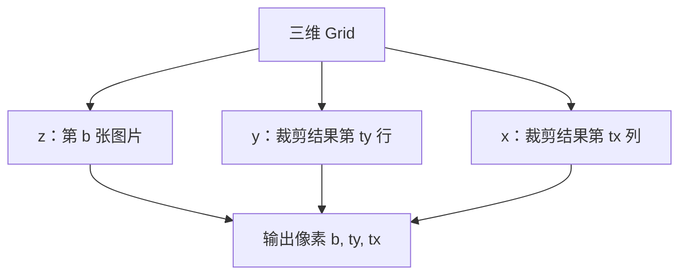
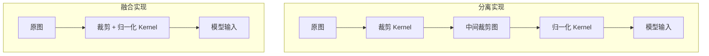

# 两个 Kernel，为什么可以合成一个？

## 用 PyCUDA 讲透批量中心裁剪与归一化的 Kernel Fusion

> **一句话理解**：让每个线程直接负责最终输出像素，把“读取、裁剪、归一化、写回”压进一次 Kernel Launch，中间 Tensor 就不必绕一圈全局显存。  
> **工程深度**：L2 ｜ **验证状态**：未实测 ｜ **预计阅读**：16 分钟  
> **关键词**：CUDA、PyCUDA、Kernel Fusion、GPU 图像预处理、数据布局、中心裁剪、归一化

> **工程深度｜验证状态：** L2 工程｜静态复核 + CPU 对比验证（GPU 性能需上机实测）
---

## 一批图像，为什么要在显存里来回倒两次

模型推理前，我们经常做两件小事：

1. 从每张图片中央裁出一个固定大小的区域；
2. 对裁剪结果执行归一化：

$$y=\frac{x-\mu}{\sigma}$$

如果按功能拆分，最自然的 GPU 实现是两个 Kernel：

```text
Kernel A：中心裁剪
原图 → 中间裁剪图

Kernel B：归一化
中间裁剪图 → 模型输入
```

逻辑没有错，问题在于那张“中间裁剪图”。

它刚被 Kernel A 写进全局显存，紧接着又被 Kernel B 读出来。每个像素只为做一次减法和一次除法，却多经历了一次写入、一次读取，还多启动了一个 Kernel。

如果把两步融合：

```text
输入像素 → 找到中心裁剪坐标 → 立即归一化 → 写入最终输出
```

中间图就消失了。**这次融合真正消掉的不是计算，而是数据旅程。**

这篇文章要拆开的，正是这样一个很短、却很有代表性的 CUDA 内核：**批量中心裁剪 + 归一化融合预处理**。

它表面上只有几行索引计算，背后却同时涉及：

- 三维 Grid 如何映射 Batch、行与列；
- 中心裁剪为什么可能多出一个像素；
- Kernel Fusion 到底省了什么——以及它不省什么；
- 为什么融合的正确性，比融合本身更容易出错；
- 什么时候手写 Kernel 值得，什么时候应该交给成熟预处理库。

---

## 先把边界说清楚：这段代码处理的是什么

原始内核接收的输入布局是：

```text
[batch][height][width]
```

也就是一个单通道、连续存储的 `float32` 批量图像张量：

```text
N × H × W
```

输出布局是：

```text
[batch][crop_size][crop_size]
```

即：

```text
N × crop_size × crop_size
```

因此，这段代码目前不是完整的 RGB 预处理器。它没有通道维度，也没有完成 `uint8 → float32`、`0～255 → 0～1` 或 HWC/NCHW 布局转换。

这一点必须在文章开头钉死。否则一句“批量图像预处理”，很容易让读者误以为代码可以直接接收任意彩色图片。

---

## 真正的设计：一个线程负责一个输出像素

这段 Kernel 的并行单位不是“一张图”，而是“一张图里的一个裁剪后像素”。

线程需要回答三个问题：

```text
我处理第几张图？  → b
我处理输出的哪一列？→ tx
我处理输出的哪一行？→ ty
```

原代码使用：

```cpp
int tx = threadIdx.x + blockIdx.x * blockDim.x;
int ty = threadIdx.y + blockIdx.y * blockDim.y;
int b  = blockIdx.z;
```

于是三维 Grid 被赋予了非常自然的业务语义：

```text
Grid.z → Batch 中的图片编号
Grid.y → 裁剪结果的行方向
Grid.x → 裁剪结果的列方向
```



这里需要修正一句常见但不够准确的描述：

> `blockIdx.z=b` 不是“一个 Block 处理一张图”，而是“Grid 的第 b 个 z 切片处理第 b 张图”。

对于一张 `224×224` 的输出，如果 Block 是 `16×16`，单张图需要：

```text
ceil(224 / 16) × ceil(224 / 16)
= 14 × 14
= 196 个 Block
```

这一整层 `196` 个 Block 共享同一个 `blockIdx.z=b`，共同处理第 `b` 张图。

---

## 中心裁剪，不是“从中间切一下”

对于宽度为 `width`、裁剪边长为 `crop_size` 的图片，左上角横坐标为：

```cpp
int offset_x = (width - crop_size) / 2;
```

纵坐标同理：

```cpp
int offset_y = (height - crop_size) / 2;
```

当前线程负责裁剪结果中的 `(tx,ty)`，那么它在原图中的坐标就是：

```cpp
int crop_x = offset_x + tx;
int crop_y = offset_y + ty;
```


### 当两侧不能平分时，多出来的像素去哪了

假设：

```text
width = 256
crop_size = 223
```

两者相差 33：

```text
offset_x = 33 / 2 = 16
```

整数除法向下取整，于是：

```text
左侧裁掉 16 像素
右侧裁掉 17 像素
```

也就是说，当差值为奇数时，这段代码把无法平分的那个像素留给右侧和下侧。**本文实现的是“整数除法向下取整”的中心裁剪约定，它不是宇宙中唯一的约定。**

如果输出必须逐像素对齐 Torchvision、OpenCV、ONNX Runtime 或某个训练流水线，**奇数差值的取整规则必须和训练框架一致**——不能只看函数名都叫 `CenterCrop`，而要核对具体实现，并用边界样例验证每个坐标。Torchvision 的官方文档将 `CenterCrop` 定义为从图像中心裁剪，并约定张量末两维为 `H,W`。

---

## Batch 张量如何变成一维显存

虽然我们把输入理解为三维张量：

```text
[b][y][x]
```

但传给内核的仍然是：

```cpp
const float *input
```

对于连续的 `[N,H,W]` 布局，线性索引为：

```cpp
input_index = b * height * width
            + crop_y * width
            + crop_x;
```

可以从三段距离理解：

```text
b * H * W       → 跳过前 b 张完整图片
crop_y * W      → 跳到当前图片的第 crop_y 行
crop_x          → 跳到这一行的第 crop_x 列
```

输出索引同理：

```cpp
output_index = b * crop_size * crop_size
             + ty * crop_size
             + tx;
```

更适合大张量的写法是使用 `size_t`：

```cpp
size_t input_index =
    ((size_t)b * height + crop_y) * width + crop_x;
```

原因不是代码更漂亮，而是多个 `int` 相乘可能先在 32 位整数范围内溢出，然后才被赋给更大的变量。把 `b` 显式转换为 `size_t`，可以让后续算术在足够宽的无符号类型中完成。

---

## 归一化不是“把值变到 0～1”

这段代码使用：

$$output=\frac{pixel-mean}{stddev}$$

它做的是按均值和标准差标准化，不等同于 Min-Max 缩放。

Torchvision 官方 `Normalize` 文档给出的逐通道定义也是：

$$output_c=\frac{input_c-mean_c}{std_c}$$

对于本文的单通道标量版本，`mean` 和 `stddev` 对整批图片、所有像素都相同。

这里有四个必须提前确定的问题——任何一个写错，结果都会“正常地”错，而且不会报错：

| 问题 | 必须确认 |
|---|---|
| 输入尺度 | 像素是 0～255 还是 0～1 |
| 参数尺度 | mean/std 是否与输入、训练阶段同尺度 |
| 多通道 | 是否需要逐通道 mean/std |
| stddev | 是否大于 0 且有限 |

例如同一份语义下，输入 `0～255` 对应 `mean=127.5, std=127.5`，输入 `0～1` 对应 `mean=0.5, std=0.5`。如果输入仍是 `0～255`，却使用针对 `0～1` 统计得到的参数，代码会稳定地产生错误结果，而且不会报错。

- `stddev=0` 会产生无穷大或 NaN，最好在 CPU 端启动 Kernel 前拒绝，而不是让每个 GPU 线程重复判断；
- RGB 模型通常是 `mean=[r,g,b]`、`std=[r,g,b]` 逐通道各自的参数，当前内核只有一个标量 `mean/stddev`，不能假装已经覆盖多通道预处理。

---

## 为什么要融合：少的不是数学，而是中间显存流量

假设裁剪后共有 `P` 个像素，只看程序语义上的全局内存元素访问。

### 两个 Kernel

```text
裁剪：    读输入 P + 写中间结果 P
归一化：  读中间结果 P + 写最终输出 P

合计：4P 次元素读写
```

从 4P 到 2P，中间结果的一写一读被消除了，Kernel 启动也从两次变成一次。

> **注意：4P → 2P 是“逻辑内存访问”层面的变化，不是 DRAM 流量保证减半。** 逻辑访问量、memory transactions、L2 流量、DRAM 流量是四级不同的数字，Cache 本身也会吸收一部分中间访问。真实收益必须交给 Nsight Compute / Nsight Systems 和端到端 Benchmark 验证。



按字节数换一种更直观的算法：

```text
融合后，每个输出像素：
  读输入 float32   = 4 Bytes
  写输出 float32   = 4 Bytes
  合计             = 8 Bytes / 像素

分离实现还要多：
  写中间 Tensor 4B + 读中间 Tensor 4B
```

Fusion 的这一笔账等于：**少掉中间 Tensor 的一次写入、一次读取**。本例归一化只有一次减法和一次乘法，计算量极小；每个输出像素都绑定一次输入读取和一次输出写入，更接近一个 memory-bound（内存受限）的小算子。这正是为什么“少走一趟中间显存”，比“优化一两条算术指令”更值得关注。

但仍不能偷换成“性能一定翻倍”。原因包括：

- Kernel 启动开销占比随规模而变化；
- 实际瓶颈可能在 H2D、解码或后续推理；
- 融合后如果寄存器压力、分支或索引复杂度显著增加，也可能降低并发度；
- Cache 可能让少量短流程下的中间访问近乎免费。

更准确的结论是：

> **融合减少的是可证明的中间全局内存访问和一次 Kernel 启动；最终加速比例必须由 Benchmark 和 Profiler 给出。**

---

## 原始内核能跑，但还缺几道工程护栏

原始代码的主干逻辑正确，不过正式使用前至少应补上四点：

- **检查 `b < batch_size`**：Grid 的 `z` 维严格等于 `batch_size` 时 `blockIdx.z` 不会越界，但内核既然收了 `batch_size`，就应该用它做防御性判断，否则这个参数在原代码中实际上没有被使用；
- **主机端校验 `crop_size`**：必须满足 `0 < crop_size <= min(height, width)`，否则中心偏移会变成负数，访问输入数组之前的位置；
- **主机端校验 `stddev`**：至少确保 `stddev > 0` 且为有限数；
- **大数组索引用 `size_t`**：避免 `b*height*width` 在 32 位中间表达式中溢出（机制见上文 Batch 张量一节）。

---

## 更稳妥的融合内核

下面在原始设计上做了五个改动：

1. 输入指针声明为 `const`；
2. 加入 `__restrict__`，明确输入输出不别名；
3. 补充 batch 边界；
4. 使用 `size_t` 计算线性地址；
5. 主机预先计算 `inv_std=1/stddev`，像素线程用乘法代替重复除法。

第 2 点（`__restrict__`）值得单独说明：它是“输入输出指针互不别名”的额外契约，能给编译器更多优化空间，但不是“加上就一定更快”的性能开关——本例更接近内存受限，编译器能发挥的空间有限。

第 5 点同理：把不变的 `1/stddev` 提前算好，是一次低成本的小优化；真正的大头仍然是是否消除了中间 Tensor。别把这两点当成这篇文章的主要性能来源。

```cpp
extern "C" __global__ void preprocess_batch(
    const float *__restrict__ input,
    float *__restrict__ output,
    int batch_size,
    int height,
    int width,
    int crop_size,
    float mean,
    float inv_std)
{
    // 输出裁剪图中的列坐标
    int tx = blockIdx.x * blockDim.x + threadIdx.x;

    // 输出裁剪图中的行坐标
    int ty = blockIdx.y * blockDim.y + threadIdx.y;

    // Grid 的 z 切片对应 Batch 中的图片编号
    int b = blockIdx.z;

    // 同时保护 Batch、输出行和输出列
    if (b >= batch_size || tx >= crop_size || ty >= crop_size) {
        return;
    }

    // 中心裁剪区域左上角；奇数差值时额外像素位于右侧/下侧
    int offset_x = (width - crop_size) / 2;
    int offset_y = (height - crop_size) / 2;

    // 把输出局部坐标映射到原图绝对坐标
    int crop_x = offset_x + tx;
    int crop_y = offset_y + ty;

    // 使用 size_t，避免大 Batch/大图像下的 32 位索引溢出
    size_t input_index =
        ((size_t)b * height + crop_y) * width + crop_x;

    size_t output_index =
        ((size_t)b * crop_size + ty) * crop_size + tx;

    // 裁剪和归一化在一次读取、一次写入之间完成
    float pixel = input[input_index];
    output[output_index] = (pixel - mean) * inv_std;
}
```

为什么不在 Kernel 中检查 `stddev`？因为它对整次启动都是同一个标量。把非法参数在 CPU 端拦截，只需判断一次；在 Kernel 里判断则会让每个像素线程重复执行。

---

## Grid 怎么配：x/y 覆盖裁剪图，z 覆盖 Batch

使用 `16×16` 的二维 Block：

```cpp
dim3 block(16, 16, 1);

dim3 grid(
    (crop_size + block.x - 1) / block.x,
    (crop_size + block.y - 1) / block.y,
    batch_size
);
```

对应关系为：

```text
block.x × block.y = 256 个线程
grid.x             = 横向至少覆盖 crop_size
grid.y             = 纵向至少覆盖 crop_size
grid.z             = 覆盖 batch_size 张图片
```

Grid 的 x/y 必须向上取整。否则当 `crop_size` 不是 16 的整数倍时，右侧和底部像素没有任何线程负责。

三维 Grid 的各维上限属于设备能力，常规推理 Batch 远小于这些限制，无需为论文级规模预先设计任务展开方案。

PyCUDA 的 `Function.__call__()` 支持最多三维的 `grid` 元组，因此下面直接写 `(grid_x, grid_y, batch_size)` 即可启动。

---

## 完整 PyCUDA 示例：运行、计时、验收

下面给出一份独立可读的 PyCUDA 示例。它使用 `[N,H,W]` 连续 `float32` 输入，并通过 NumPy 参考结果验证 GPU 输出。

```python
"""两个 Kernel，为什么可以合成一个？（第1章 · GPU 编程基础）。

本文件是对应博文代码块的实现/演示，直接运行可见效果；运行依赖：PyCUDA、NumPy。
"""
import time

import numpy as np
import pycuda.autoinit
import pycuda.driver as cuda
from pycuda.compiler import SourceModule


KERNEL_CODE = r"""
extern "C" __global__ void preprocess_batch(
    const float *__restrict__ input,
    float *__restrict__ output,
    int batch_size,
    int height,
    int width,
    int crop_size,
    float mean,
    float inv_std)
{
    int tx = blockIdx.x * blockDim.x + threadIdx.x;
    int ty = blockIdx.y * blockDim.y + threadIdx.y;
    int b = blockIdx.z;

    if (b >= batch_size || tx >= crop_size || ty >= crop_size) {
        return;
    }

    int offset_x = (width - crop_size) / 2;
    int offset_y = (height - crop_size) / 2;
    int crop_x = offset_x + tx;
    int crop_y = offset_y + ty;

    size_t input_index =
        ((size_t)b * height + crop_y) * width + crop_x;

    size_t output_index =
        ((size_t)b * crop_size + ty) * crop_size + tx;

    float pixel = input[input_index];
    output[output_index] = (pixel - mean) * inv_std;
}
"""


def ceil_div(value, divisor):
    """整数除法向上取整。"""
    return (value + divisor - 1) // divisor


def validate_args(batch_size, height, width, crop_size, mean, stddev):
    """在启动 GPU 前统一校验标量参数。"""
    if batch_size <= 0:
        raise ValueError("batch_size 必须大于 0")

    if height <= 0 or width <= 0:
        raise ValueError("height 和 width 必须大于 0")

    if crop_size <= 0 or crop_size > min(height, width):
        raise ValueError("crop_size 必须位于 (0, min(height, width)]")

    if not np.isfinite(mean):
        raise ValueError("mean 必须是有限数")

    if not np.isfinite(stddev) or stddev <= 0:
        raise ValueError("stddev 必须是大于 0 的有限数")


# 示例参数：8 张 256×256 单通道 float32 图像，中心裁为 224×224
batch_size = 8
height, width = 256, 256
crop_size = 224
mean = 0.5
stddev = 0.25

validate_args(
    batch_size,
    height,
    width,
    crop_size,
    mean,
    stddev,
)

# 输入数据已经位于 0～1；mean/stddev 也基于相同尺度
rng = np.random.default_rng(42)
input_batch = rng.random(
    (batch_size, height, width),
    dtype=np.float32,
)

gpu_output = np.empty(
    (batch_size, crop_size, crop_size),
    dtype=np.float32,
)

# KERNEL_CODE 已显式声明 extern "C"，因此关闭 SourceModule 的自动包装
module = SourceModule(KERNEL_CODE, no_extern_c=True)
preprocess_kernel = module.get_function("preprocess_batch")

# 分配显存；显存分配不放入纯 Kernel 计时窗口
input_gpu = cuda.mem_alloc(input_batch.nbytes)
output_gpu = cuda.mem_alloc(gpu_output.nbytes)

block = (16, 16, 1)
grid = (
    ceil_div(crop_size, block[0]),
    ceil_div(crop_size, block[1]),
    batch_size,
)

inv_std = np.float32(1.0 / stddev)

# 上传输入
cuda.memcpy_htod(input_gpu, input_batch)

# 预热，避免首次启动开销污染正式测量
preprocess_kernel(
    input_gpu,
    output_gpu,
    np.int32(batch_size),
    np.int32(height),
    np.int32(width),
    np.int32(crop_size),
    np.float32(mean),
    inv_std,
    block=block,
    grid=grid,
)
cuda.Context.synchronize()

# 使用 CUDA Event 测量纯 GPU Kernel 时间
start_event = cuda.Event()
end_event = cuda.Event()

start_event.record()
preprocess_kernel(
    input_gpu,
    output_gpu,
    np.int32(batch_size),
    np.int32(height),
    np.int32(width),
    np.int32(crop_size),
    np.float32(mean),
    inv_std,
    block=block,
    grid=grid,
)
end_event.record()
end_event.synchronize()

kernel_ms = start_event.time_till(end_event)

# 下载最终输出
cuda.memcpy_dtoh(gpu_output, output_gpu)

# NumPy 参考实现：同样的中心偏移、同样的输入尺度
offset_x = (width - crop_size) // 2
offset_y = (height - crop_size) // 2

cpu_reference = input_batch[
    :,
    offset_y:offset_y + crop_size,
    offset_x:offset_x + crop_size,
]
cpu_reference = (cpu_reference - mean) / stddev

print(f"Block: {block}")
print(f"Grid:  {grid}")
print(f"Kernel 时间: {kernel_ms:.3f} ms")
print(
    "结果正确:",
    np.allclose(gpu_output, cpu_reference, rtol=1e-5, atol=1e-6),
)

# 端到端示例：H2D + Kernel + D2H
e2e_start = time.perf_counter()
cuda.memcpy_htod(input_gpu, input_batch)
preprocess_kernel(
    input_gpu,
    output_gpu,
    np.int32(batch_size),
    np.int32(height),
    np.int32(width),
    np.int32(crop_size),
    np.float32(mean),
    inv_std,
    block=block,
    grid=grid,
)
cuda.memcpy_dtoh(gpu_output, output_gpu)
e2e_ms = (time.perf_counter() - e2e_start) * 1000

print(f"端到端时间: {e2e_ms:.3f} ms")
```

PyCUDA 官方教程采用同样的基本路线：初始化 CUDA、使用 `SourceModule` 编译内核、显式把 NumPy 数据复制到设备、运行 Kernel，再把结果复制回主机。

---

## 为什么 `x` 放列方向，有利于显存访问

在 `[N,H,W]` 连续布局中，最内层 `W` 方向的像素地址连续。

当一个 warp 中相邻线程拥有连续的 `tx` 时，它们读取：

```text
input[b, crop_y, crop_x + 0]
input[b, crop_y, crop_x + 1]
input[b, crop_y, crop_x + 2]
...
```

同时写入：

```text
output[b, ty, tx + 0]
output[b, ty, tx + 1]
output[b, ty, tx + 2]
...
```

读写都沿连续列方向推进，符合全局内存合并访问的基本原则。NVIDIA Best Practices Guide 将合并全局内存访问列为 CUDA 性能的重要考虑因素。

这也解释了为什么线程映射通常让 `threadIdx.x` 对应内存中的连续维度。不是因为数学规定 x 必须是列，而是因为布局决定了哪一维最连续。

---

## 为什么这个 Kernel 反而不需要 Shared Memory

Shared Memory 最有价值的场景之一，是多个线程重复使用同一批输入数据，例如卷积、矩阵乘法和分块转置。

本内核中，每个输入像素只被一个输出线程读取一次：

```text
一个输入像素 → 一个输出像素
```

没有明显的块内复用，把像素先搬到 Shared Memory，反而会增加一次拷贝和一次同步。

因此，这个内核的第一优化方向不是“上共享内存”，而是：

1. 保持连续访问；
2. 消除中间缓冲区；
3. 减少 Kernel 启动；
4. 让数据尽量常驻 GPU；
5. 再用 profiler 判断瓶颈。

> **优化手段不是越高级越好，而是要匹配数据复用模式。**

---

## GPU 时间和端到端时间，是两个问题

CUDA Kernel 启动通常具有异步语义。只用 CPU 计时器包住 Kernel 调用，却不等待 GPU 完成，测到的可能主要是提交开销。NVIDIA Best Practices Guide 建议在 GPU 工作计时中使用 CUDA Event，或在 CPU 计时边界内做正确同步。

本文代码分别测量：

| 指标 | 包含内容 | 回答的问题 |
|---|---|---|
| Kernel 时间 | 融合内核本身 | GPU 上这段计算用了多久？ |
| 端到端时间 | H2D + Kernel + D2H | 单独调用这条预处理链是否划算？ |

融合 Kernel 消除的是设备端中间图和一次启动，不会自动消除：

- CPU 解码图片；
- CPU 到 GPU 的输入传输；
- GPU 到 CPU 的结果回传；
- 显存分配；
- 首次 CUDA Context 初始化；
- `SourceModule` 首次编译。

真正理想的推理路径往往是：

```text
解码/采集
   ↓
数据进入 GPU
   ↓
融合预处理
   ↓
模型推理
   ↓
后处理
```

如果预处理结果立刻下载回 CPU，随后又上传给 GPU 模型，前面省下的中间访问很容易被 PCIe 往返抵消。

---

## Benchmark 应该怎样设计，才不制造假结论

不要只运行一次，然后打印：

```text
GPU 比 CPU 快 100 倍
```

至少要控制以下变量。

### 测试维度

| 维度 | 建议取值 |
|---|---|
| Batch | 1、8、32、64 |
| 原图尺寸 | 256²、512²、1024² |
| 裁剪尺寸 | 224²、384²、原图大小 |
| 数据位置 | CPU 起点 / GPU 常驻 |
| 对比实现 | NumPy、分离 CUDA、融合 CUDA |
| 指标 | Kernel、端到端、吞吐量（micro 重点看 median） |

### 三组最有价值的对比

```text
A. CPU：切片 copy + Normalize
B. GPU：Crop Kernel + Normalize Kernel
C. GPU：Fused Crop + Normalize Kernel
```

两组比较各回答一个问题:

```text
A vs C　→　整个 GPU 方案值不值得？
B vs C　→　Fusion 值不值得？
```

只有 B 与 C 同样是 GPU、同样是连续输入，才测得 Fusion 的净收益。

关于统计口径：Kernel microbenchmark 重点看 median（P50），比单次运行稳定得多；P95 属于服务端尾延迟口径，小样本跑几次算出的 P95 很容易被偶发调度抖动支配，不要让它看起来像生产尾延迟。

还应记录：

- GPU 型号与计算能力；
- CUDA、驱动和 PyCUDA 版本；
- 是否预热；
- 是否包含编译、分配和数据传输；
- 输入是否连续；
- 时钟、功耗与其他 GPU 负载。

---

## 从单通道 Demo 走向真实模型，还差什么

上面这段 Kernel 只覆盖“单通道 float32、紧凑 `[N,H,W]`、标量参数”这一层。真实生产预处理至少还要处理：

- **布局**：NCHW 与 NHWC 的线性索引不同，线程映射和连续方向也不同，布局必须成为接口契约，不能靠注释猜测；
- **逐通道参数**：RGB 归一化通常是 `(pixel - mean[channel]) * inv_std[channel]`，三个通道参数很小，可经值传递或常量内存提供；
- **类型与尺度**：解码结果常为 `uint8`，更完整的预处理链是 `uint8 读取 → 中心裁剪 → 转换 float/half → 缩放 → 逐通道归一化`，这类融合比只合并两个简单 `float32` 算子更接近生产形态；
- **stride**：真实图像未必紧凑连续，摄像头缓冲或 ROI 视图带行对齐时，索引要按真实 stride 计算，而不是 `crop_y * width + crop_x`；
- **异步流水线**：批量吞吐会叠加 Pinned Host Memory、异步拷贝与 CUDA Stream，但异步不是“多加一个 Stream 参数”就完成，依赖与同步边界必须同时正确。

这些都属于下一层工程问题。理解本文这条主线——一次读取、一次计算、一次写入——之后再逐项补齐，方向就不会错。

---

## 什么时候不该手写这个 Kernel

手写 Kernel 很适合学习、验证数据流和构建特殊融合算子，但并不意味着所有项目都应该维护一份自定义预处理代码。

以下情况更适合优先评估成熟实现：

- 标准 Resize/Crop/Normalize 流程；
- 需要大量颜色空间和插值算法；
- 需要与框架 Autograd、动态 Shape 或多后端兼容；
- 团队缺少 CUDA 测试与性能回归基础设施；
- 现有推理框架已经支持预处理融合。

自定义 Kernel 是不是值得写，用一棵小决策树判断：

```text
数据已经常驻 GPU？
    ↓ 是
存在不必要的中间 Tensor？
    ↓ 是
Profiler 证明它是瓶颈？
    ↓ 是
值得考虑 Fusion
```

走到任何一格为“否”，就先不要动 Kernel。

工程上最稳妥的顺序是：

```text
先保证语义一致
      ↓
再建立可重复 Benchmark
      ↓
用 Profiler 确认瓶颈
      ↓
最后决定是否维护自定义 Kernel
```

如果整条预处理链会被高频重复执行，另一个可能的优化方向不是继续减少 Kernel 数量，而是用 CUDA Graph 把固定的 Kernel 序列预先组织起来，降低重复提交的 CPU 开销。今天的“两个 Kernel → 一个融合 Kernel”，也就自然衔接成“固定工作流 → CUDA Graph”。

---

## 上线前应该跑过的测试

| 测试 | 要验证的问题 |
|---|---|
| `batch_size=1` | 最小 Batch 是否正确 |
| `crop_size=width=height` | 无裁剪时是否退化为纯归一化 |
| 奇数尺寸差 | 中心取整是否与训练框架一致 |
| `crop_size>min(H,W)` | Host 是否拒绝非法参数 |
| `stddev=0` | 是否在启动 Kernel 前失败 |
| 非 16 整除裁剪尺寸 | Grid 向上取整是否覆盖边缘 |
| 多 Batch 随机输入 | `blockIdx.z` 映射是否串图 |
| 大尺寸索引 | 是否存在 32 位溢出 |
| NaN/Inf 输入 | 输出策略是否符合模型契约 |
| CPU 参考对比 | 全量结果是否在容差内一致 |

对于预处理 Kernel，最危险的错误往往不是崩溃，而是“数值看起来正常，但与训练阶段差一个坐标或一个尺度”。这种错误会直接侵蚀模型精度，却很难从运行日志中发现。

---

## 收束：这段短 Kernel，真正压缩了什么

再回头看整个流程：

```text
Batch 中第 b 张图
        ↓
Grid.z 选择图片
        ↓
Grid.x / Grid.y 覆盖裁剪输出
        ↓
局部坐标映射到原图中心区域
        ↓
读取一个输入像素
        ↓
立即执行归一化
        ↓
写入最终模型输入
```

它压缩的不是业务步骤，而是数据旅程：

```text
原图 → 中间裁剪图 → 归一化输出
```

被压成：

```text
原图 → 归一化输出
```

这正是 Kernel Fusion 最朴素也最重要的价值：

> **能在寄存器里接着算的结果，就不要急着写回全局显存。**

不过，融合从来不是免费的魔法。坐标约定、数据布局、输入尺度、数值参数、计时边界和框架一致性，任何一个环节不明确，都可能让“更快的预处理”变成“更快地产生错误结果”。

所以这篇文章最后留下的，不应只是一段可复制的代码，而是一条更可复用的工程判断：

> **先沿着数据流寻找不必要的中间结果，再用正确性测试和 Profiler 决定是否融合。**

---

## 参考资料

1. [NVIDIA CUDA C++ Programming Guide：Thread Hierarchy、Grid 与内存模型](https://docs.nvidia.com/cuda/cuda-c-programming-guide/)
2. [NVIDIA CUDA Best Practices Guide：合并访问、计时与性能验证](https://docs.nvidia.com/cuda/cuda-c-best-practices-guide/)
3. [NVIDIA Developer Blog：Global Memory Access 优化](https://developer.nvidia.com/blog/unlock-gpu-performance-global-memory-access-in-cuda/)
4. [PyCUDA 2026.1 Tutorial：SourceModule 与显式数据传输](https://documen.tician.de/pycuda/tutorial.html)
5. [PyCUDA Device Interface：Event 与 Kernel 调用接口](https://documen.tician.de/pycuda/driver.html)
6. [Torchvision CenterCrop 官方文档](https://docs.pytorch.org/vision/stable/generated/torchvision.transforms.CenterCrop.html)
7. [Torchvision Normalize 官方文档](https://docs.pytorch.org/vision/main/generated/torchvision.transforms.Normalize.html)
