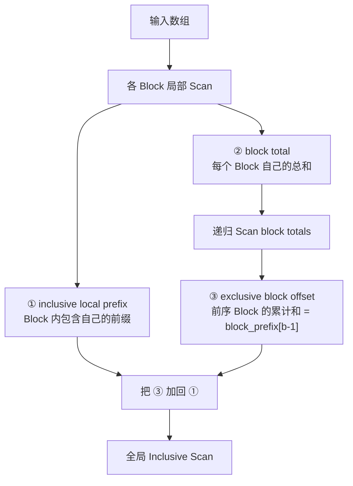

# GPU 不只是“同时算”：为什么线程越多，归约和前缀和反而越难？

> **副标题**：从一个 Block 的局部协作，到跨 Block 的全局信息传播，用 PyCUDA 拆开 Reduction 与 Scan
>
> **工程深度**：L2，原理可验证、生产边界明确 ｜ **验证状态**：未实测  
> **预计阅读**：22 分钟  
> **关键词**：PyCUDA、Parallel Reduction、Prefix Sum、Scan、Shared Memory、同步、CUDA Event

> **工程深度｜验证状态：** L2 工程｜静态复核 + CPU 对比验证（GPU 性能需上机实测）
---

## 一个反直觉的问题：线程越多，为什么反而越难算？

把一百万个数分别乘以 2，很适合 GPU：每个线程拿一个元素，彼此不说话，各算各的。

可如果任务变成“把这一百万个数加起来”，事情突然变了。

线程越多，并不意味着答案会自动出现。它们需要先把局部结果合并，再把合并后的信息继续传向更大的范围。

注意麻烦的来源：不是线程数量本身，而是线程之间的**依赖**。线程越多，依赖关系越复杂，需要协调的范围也越大。

再往前一步，如果要求每个位置之前所有元素的和：

```text
输入：[1, 2, 3, 4]
输出：[1, 3, 6, 10]
```

问题就更进一步了：输出不但没有缩小，每个位置不仅依赖自己的输入，还依赖它前面的数据。

这篇文章真正想拆开的，不是两个求和 Kernel，而是 GPU 编程里反复出现的一个问题：

> **哪些信息可以局部解决？哪些信息必须全局传播？同步发生在哪里，又要付出什么代价？**

Reduction 把多个输入聚合成一个结果；Scan 则把聚合信息传播回多个位置。

一句话概括这篇想说的话：**GPU 并不怕依赖，怕的是你没有把依赖拆成合适的作用域。**

本文不用 CUB 隐藏过程，而是用 PyCUDA 手写一个教学版实现：先用 Shared Memory、Block 同步和多 Kernel 写出一个能够验证的版本，再把它与现代 CUDA 里的成熟 Primitive 对照，看看为什么“能跑”的算法和“跑得快”的算法之间，隔着同步、数据移动和工作量。

目标不是重新发明生产级 Scan，而是让你理解这些 Primitive 背后的计算结构。

---

## 1. 真正的问题：局部信息怎样变成全局信息？

本文的两个主角是 Reduction 与 Scan。先把它们放在一起看——它们是同一类依赖的两个方向。

### 1.1 Reduction：很多输入，留下一个结果

以求和为例：

$$S = \sum_{i=0}^{N-1}x_i$$

串行程序有一条明显的依赖链：

```python
total = 0.0
for x in data:
    total += x
```

如果让所有 GPU 线程都对同一个 `total` 执行 `atomicAdd`，结果可以正确，但同一地址上的大量原子更新会被串行化。原子更新并非不能用，只是它的代价集中在“冲突域”上，我们在第 9 节再讨论。更典型的 GPU 解法是四个字：

> **先局部，后全局。**

```text
输入数据
  ├── Block 0 → partial_sum_0
  ├── Block 1 → partial_sum_1
  ├── Block 2 → partial_sum_2
  └── ...
                    ↓
              再归约 partial sums
                    ↓
                global_sum
```

### 1.2 Scan：一个输入，保留所有前缀

Scan 不是只要总和，而是保留每一个中间聚合结果。

Inclusive Scan 包含当前位置：

$$y_i = \sum_{j=0}^{i}x_j$$

```text
input     : [1, 2, 3, 4]
inclusive : [1, 3, 6, 10]
```

Exclusive Scan 不包含当前位置：

$$y_i = \sum_{j=0}^{i-1}x_j$$

```text
input     : [1, 2, 3, 4]
exclusive : [0, 1, 3, 6]
```

本文实现的是 **Global Inclusive Prefix Sum**。

### 1.3 两种算法，其实是同一件事的两个方向

Reduction 把“多”变成“少”，Scan 把“少”的信息重新摊回“多”。换成依赖的视角，就是：**Reduction 压缩依赖，Scan 传播依赖。**

把它们放在一起看，抽象会突然清晰：

```text
                同一个问题：
         局部信息如何变成全局信息？

                       │
             ┌─────────┴─────────┐
             │                   │
         Reduction              Scan
             │                   │
         局部聚合             局部前缀
             │                   │
       Block partial sum      Block sums
             │                   │
        继续聚合             Scan Block sums
             │                   │
          一个结果          Block offsets
                                 │
                           加回局部结果
                                 │
                            全局 Scan
```

这张图就是全文的主线。可以把它记成一句话：

> **Reduction 聚合信息，Scan 传播聚合信息。**

需要补一句限定：“Scan 是 Reduction 的反方向”只是帮助建立直觉的比喻，不是形式化定义。严格来说，Scan 是对序列的**每一个前缀**应用同一个满足结合律的运算；本文讨论的只是以加法为运算符的 inclusive prefix sum。之所以强调这一点，是因为后面所有的复杂度、补零语义和数值误差分析，都建立在“加法”这个具体算子上。

后面的代码，不过是这条主线在两种作用域（Block 内、跨 Block）上的两次落地。

---

## 2. 先看同步边界：为什么 `__syncthreads()` 管不了普通 Grid？

先说清楚边界：线程之间能直接协作的范围，到底有多大。

`__syncthreads()` 是 **Thread Block 级屏障**：它要求 Block 中参与该同步路径的线程到达同一屏障，并为屏障前的内存访问提供 Block 内的可见性保证。它不是普通 Kernel 中的全 Grid 同步机制。[CUDA Programming Guide](https://docs.nvidia.com/cuda/cuda-programming-guide/03-advanced/advanced-kernel-programming.html) 对线程作用域与 Block 同步有明确说明。

这里说“参与该同步路径的线程”，而不是笼统的“Block 内所有线程”，是因为屏障的正确性依赖控制流一致：如果一部分线程走了别的分支、永远到不了这个屏障，整个 Block 就会卡住。本文第 3 节“尾块线程不能提前 return”的根源，就在这条原则。

```text
Block 0 内：thread 0 ↔ thread 1 ↔ ...  可以用 __syncthreads()

Block 0 与 Block 1：普通 __syncthreads() 无法跨越这条边界
```

需要把这张图读准：`__syncthreads()` 只同步当前 Thread Block 内的线程。**普通 Kernel 没有可供任意 Grid 中所有 Block 直接使用的全局屏障**——需要跨 Block 的阶段依赖时，通常靠 Kernel 完成边界，或在满足条件时采用支持 Grid 协作的机制。

注意这里的措辞：不能说成“CUDA 无法做 Grid 同步”。是**普通 Kernel 的 `__syncthreads()` 不做这件事**，不是 CUDA 做不到。

这不是限制或缺陷，而是 CUDA 能够任意调度 Block、扩展到不同规模 GPU 的重要前提。

> **现代 CUDA 视角**
>
> 本文先使用经典的 Block 模型。现代 CUDA 还提供 Warp 级原语、Cooperative Groups、Thread Block Cluster（Compute Capability 9.0 及以上，含 Distributed Shared Memory）等更丰富的协作方式。
>
> 但它们各自有不同的支持条件、同步语义和性能约束，不能简单视为“普通 Block 同步的替代品”。本文的重点是看清同步边界本身，因此把这些机制放到第 10 节统一对照，这里不展开 API 细节。

跨 Block 依赖当然并非只有一种解法。Cooperative Groups 可以表达更大范围的协作，但全 Grid 同步要求 cooperative launch，也有驻留资源等约束。对于本文这种教学实现，最清楚、最稳妥的办法是用 Kernel 边界把阶段切开：

```text
Kernel A：产生局部结果
    ↓
Kernel B：处理局部结果
    ↓
Kernel C：把全局信息传播回去
```

同一 Stream 中的操作按入队顺序执行。因此，Kernel 边界既是执行阶段的边界，也是我们组织全局依赖的边界。PyCUDA 的 `Stream` 文档也将其定义为“按顺序执行操作的队列”。

---

## 3. Block 内归约：让 256 个数逐层汇成 1 个数

先看最小的一块拼图——一个 Block 内部的归约。

假设一个 Block 有 8 个线程，每个线程先把一个元素搬进 Shared Memory：

```text
第 0 轮：x0  x1  x2  x3  x4  x5  x6  x7
           ↘ ↙      ↘ ↙      ↘ ↙      ↘ ↙
第 1 轮： x0+x1    x2+x3    x4+x5    x6+x7
              ↘       ↙          ↘       ↙
第 2 轮：   sum(0..3)            sum(4..7)
                     ↘          ↙
第 3 轮：             sum(0..7)
```

每一轮把参与线程数减半，树的深度是 $O(\log_2 B)$，其中 `B` 是 Block 大小。

但注意一件事：**活跃计算线程数在减少，同步参与范围却没有缩小。** 第 1 轮有 $B/2$ 个线程做加法，第 2 轮只剩 $B/4$ 个，最后一轮只有 1 个；而每一轮的 `__syncthreads()` 仍然要求整个 Block 到场。也就是说，并行深度是对数级，但“到场人数”始终是 $B$。

这正是“线程越多反而越难算”在代码里的具体形状：多出来的线程没能继续加速计算，却仍要参与每一次同步。理解这一点，第 9 节的性能分析和第 10 节的 Warp 级优化方向才有落脚处。

```cpp
extern "C" __global__ void block_reduce_sum(
    const float* input,
    float* partial_sums,
    int n)
{
    extern __shared__ float sdata[];

    const unsigned int tid = threadIdx.x;
    const unsigned int index = blockIdx.x * blockDim.x + tid;

    // 尾块不足时补 0；所有线程仍须参加后续屏障。
    sdata[tid] = (index < n) ? input[index] : 0.0f;
    __syncthreads();

    // 折半树要求 blockDim.x 为 2 的幂。
    for (unsigned int stride = blockDim.x / 2;
         stride > 0;
         stride >>= 1)
    {
        if (tid < stride)
            sdata[tid] += sdata[tid + stride];

        __syncthreads();
    }

    if (tid == 0)
        partial_sums[blockIdx.x] = sdata[0];
}
```

这里有三个正确性条件：

1. 所有线程先写 Shared Memory，再进入第一轮归约；
2. 每一轮结束后必须同步，下一轮才能读取完整的新状态；
3. 尾块越界线程写 0，但不能提前退出，否则其他线程可能永远等不到它抵达屏障。

> **“2 的幂”是实现前提，不是通用规律**
>
> 这份折半树实现要求 `blockDim.x` 为 2 的幂，因为它每一轮都把步长减半。这是当前 Kernel 的约束，不代表所有 CUDA Reduction 算法都必须使用 2 的幂大小——补齐、谓词化或改变分段策略都能解除它。本文的 `validate_config()` 对这个前提做了显式检查。

补零是这套设计里最容易被忽略的一步。假设 `BLOCK_SIZE = 8`，但这一块只有 3 个真实元素：

```text
真实输入：[1, 2, 3]

补零后：  [1, 2, 3, 0, 0, 0, 0, 0]

归约结果：6
```

补进来的 `0` 是加法的单位元，既不会改变总和，又让每个线程都有确定的初始值。代价是所有线程必须一起走完整棵树——这正是上面第 3 条正确性条件的由来。

第一轮只能得到“每个 Block 一个和”。如果仍有多个局部和，就继续归约：

```text
N
↓
ceil(N / B)
↓
ceil(N / B²)
↓
...
↓
1
```

这就是多阶段 Global Reduction：先局部聚合，再对更少的局部结果继续聚合。

---

## 4. Block 内 Scan：为什么每个线程都需要“过去的信息”？

Reduction 只需要别人“汇总后的结果”，Scan 却要求每个线程都拿到“它左边的全部信息”。

为了便于观察，本文使用 Hillis–Steele 风格的 inclusive scan：每一轮，每个线程去读它左边固定距离的旧值，然后加到自己身上。

```text
初始          [1, 2, 3, 4]

stride = 1   [1, 3, 5, 7]

stride = 2   [1, 3, 6, 10]
```

第 1 轮看左边 1 个位置，第 2 轮看左边 2 个位置，第 3 轮看左边 4 个位置。经过 $\lceil\log_2 B\rceil$ 轮，每个线程就获得了自己的 Block 内前缀。

```cpp
extern "C" __global__ void block_inclusive_scan(
    const float* input,
    float* output,
    float* block_sums,
    int n)
{
    extern __shared__ float sdata[];

    const unsigned int tid = threadIdx.x;
    const unsigned int index = blockIdx.x * blockDim.x + tid;

    sdata[tid] = (index < n) ? input[index] : 0.0f;
    __syncthreads();

    // 倍增步长同样要求 blockDim.x 为 2 的幂。
    for (unsigned int stride = 1;
         stride < blockDim.x;
         stride <<= 1)
    {
        float left = 0.0f;

        // 先把本轮需要的旧值读进寄存器。
        if (tid >= stride)
            left = sdata[tid - stride];

        __syncthreads();

        if (tid >= stride)
            sdata[tid] += left;

        __syncthreads();
    }

    if (index < n)
        output[index] = sdata[tid];

    // 尾块以加法单位元 0 补齐，完整 inclusive scan 会把所有真实元素
    // 累积到最后一个槽位，因此它等于该 Block 的真实总和。
    if (tid == blockDim.x - 1)
        block_sums[blockIdx.x] = sdata[tid];
}
```

为什么要先读进 `left`？

因为一轮 Scan 必须统一读取“上一轮”的状态。如果一些线程已经写入、另一些线程才开始读，就会把同一轮的新旧数据混在一起。这里的两个屏障分别负责：

- 所有线程先完成旧值读取；
- 所有线程再完成新值写入。

第二个屏障不是为了“让代码看起来更安全”，而是为了挡住一种具体错误：如果省掉它，下一轮开始时部分线程已经写入新状态、部分线程还在读旧状态，两者一相加就是错的。

> **为什么 `sdata[blockDim.x - 1]` 可以当作 Block 总和**
>
> 这个结论**依赖两个前提**：尾部越界位置用加法单位元 `0` 填充，且算子是加法。
>
> ```text
> BLOCK_SIZE = 8
> 真实输入：[1, 2, 3]
> 补零后：  [1, 2, 3, 0, 0, 0, 0, 0]
> Inclusive scan：[1, 3, 6, 6, 6, 6, 6, 6]
> Block 总和 = 6
> ```
>
> 因为补齐的 0 不贡献数值，所有真实元素都会被累加进最后一个槽位。换成乘法 Scan 就不成立（单位元应为 1）；换成最大值 Scan 也不成立（单位元应为该类型最小值）。所以尾块不需要额外的 `valid_count`，是**加法 + 补零**这一组合带来的便利，而不是 Scan 的普遍性质。

> **复杂度要分层看**
>
> | 维度 | Hillis–Steele Block Scan |
> |---|---|
> | 单 Block 工作量 | $O(B\log B)$ |
> | 单 Block 并行深度 | $O(\log B)$ |
> | 同步方式 | 每轮需要协调“旧状态读取”与“新状态写入” |
> | 整个 Global Scan | 还要处理 Block sums 的递归与 offset 回填 |
>
> 两种 Scan 风格的取舍放在一起看更清楚：
>
> | Scan 风格 | 工作量 | 教学侧重点 |
> |---|---|---|
> | Hillis–Steele（本文） | $O(B\log B)$ | 信息传播路径最直观 |
> | Blelloch（upsweep/downsweep） | $O(B)$ | work-efficient 的分阶段结构 |
>
> 别把“并行深度低”读成“整体一定快”。$B=256$ 时 $\log_2 B = 8$，但这不意味着成本只有 8 次加法：每一轮仍有大量线程在读写 Shared Memory 并等待屏障，真正的开销藏在同步和访存里。
>
> 还要加一句限定：**工作量分析不直接决定设备级吞吐。** 实际性能还受访存模式、同步开销、寄存器、occupancy、Kernel 启动次数和具体架构影响。$O(B\log B)$ 与 $O(B)$ 是算法层面的比较，不是性能结论。
>
> 本文选 Hillis–Steele，是**教学取舍**——它的传播路径一目了然，便于把“前缀如何逐层扩散”讲清楚。Blelloch 的流程更复杂，适合作为下一篇的扩展阅读，而不是塞进本文。同时实现两种 Scan，只会把“看懂依赖”变成“同时读两套算法”。

---

## 5. 局部 Scan 为什么还不是全局 Scan？

> **本文实现边界**
>
> 本文采用**多阶段、分层**的 Global Inclusive Scan：每个 Block 先算局部前缀，再递归处理 Block sums，最后回填前序 Block 的偏移。
>
> 这个结构便于把跨 Block 依赖一步步拆开看，但它**不是 Global Scan 的唯一组织方式**。生产级实现会在单遍之内完成前缀传播，不按这种多次读写全局数据的方式组织。第 10 节会对照说明。

假设 `BLOCK_SIZE = 4`：

```text
输入：
[1, 2, 3, 4 | 5, 6, 7, 8]

两个 Block 各自 Scan：
[1, 3, 6, 10 | 5, 11, 18, 26]
```

后半段明显错了，因为 Block 1 不知道 Block 0 的总和是 10。

第一阶段除了局部 Scan，还会产生每个 Block 的总和：

```text
block_sums = [10, 26]
```

这里要小心语义：`block_sums[b]` 是**第 b 个 Block 自己的总和**，不含它前面的任何 Block。对它再做一次 inclusive scan，才得到“到第 b 个 Block 为止的累计和”：

```text
block_prefix = [10, 36]

block_prefix[0] = 10
block_prefix[1] = 10 + 26 = 36
```

于是第 `b` 个 Block 需要加上的偏移，是它**前面所有 Block 的总和**，也就是 `block_prefix[b-1]`：

$$
offset(b) =
\begin{cases}
0, & b=0 \\
block\_prefix[b-1], & b>0
\end{cases}
$$

```text
Block 0：[1, 3, 6, 10]  + 0
Block 1：[5, 11, 18, 26] + 10

最终结果：[1, 3, 6, 10, 15, 21, 28, 36]
```

这也解释了最后一层 Kernel 里的 `block_prefix[blockIdx.x - 1]`：它取的是**不含自己**的 inclusive 前缀的前一项。如果误用 `block_prefix[blockIdx.x]`，Block 0 之外的每个块都会多加一遍自己的总和。

如果 `block_sums` 自己也超过一个 Block，就递归做同样的事。

整条数据流里有三种容易混淆的量，先把它们标清楚：



- ① **inclusive local prefix**：Block 内包含当前元素的前缀和；
- ② **block total**：该 Block 自己的总和，不含前序 Block；
- ③ **exclusive block offset**：前序 Block 的累计和，正是要回填给 ① 的量。

搞混 ② 和 ③，最典型的后果就是多加一遍自己的总和——上面那句 `block_prefix[blockIdx.x - 1]` 防的就是这件事。

以 `N = 1 << 20`（1,048,576）、`BLOCK_SIZE = 256` 为例，递归计划展开成：

| 层级 | 输入长度 | Block 数量 | 作用 |
|---|---|---|---|
| Level 0 | 1,048,576 | 4,096 | 原始数据的局部 Scan，产出 ① 与 ② |
| Level 1 | 4,096 | 16 | 对 Level 0 的 block totals 做局部 Scan |
| Level 2 | 16 | 1 | 计算顶层 block prefix（这一层只占一个 Block） |
| 回填 | — | — | 每层用 ③ 修正该层的 ① |

这张表把“递归”变成可数的数据流，第 9 节讨论 Kernel 数量时直接引用它。

最后一步的 Kernel 很简单：

```cpp
extern "C" __global__ void add_block_offsets(
    float* output,
    const float* block_prefix,
    int n)
{
    const unsigned int index = blockIdx.x * blockDim.x + threadIdx.x;
    if (index >= n)
        return;

    if (blockIdx.x > 0)
        output[index] += block_prefix[blockIdx.x - 1];
}
```

每个线程只写自己的 `output[index]`，因此这里不需要 Block 内屏障。

> **复杂度的边界**
>
> 第 4 节说的 $O(B\log B)$ 只是**单个 Block 内 Scan 的工作量**。完整的 Global Scan 还包含对 Block sums 的递归处理，以及最后把偏移回填给每个元素；递归还会重复若干层。因此，不能用 Block 内的复杂度直接描述整条设备级流水线。

---

## 6. 完整 PyCUDA 实现：先跑对，再谈快

算法部分到这里就结束了。接下来**不再引入新的算法**，只依次回答三个工程问题：

1. 这份代码到底算没算对？（第 6～7 节）
2. 计时器测到的，是不是我们以为的那个对象？（第 8 节）
3. 为什么成熟实现会比它快？（第 9～10 节）

### 6.1 运行前提

- **硬件/驱动**：一块可用的 NVIDIA GPU 与对应驱动；
- **工具链**：CUDA Toolkit 与 C/C++ 编译器——`SourceModule` 会在运行时把源码编译成设备代码；
- **Python 侧**：`numpy` 与 `pycuda`。

```bash
python -m pip install numpy pycuda
python reduction_scan.py                        # 最小入口：跑一次 Reduction 与 Scan
python verify_reduction_scan.py --test quick    # 先跑小规模，确认环境可用
python verify_reduction_scan.py --test full     # 再做完整回归
```

实现与验证被拆成两个文件：`reduction_scan.py` 是 §6.3 的 kernel 与启动路径，`verify_reduction_scan.py` 是附录 A 的正确性套件与计时工具。两个文件放在同一目录即可，后者从前者导入。

关于 `SourceModule(CUDA_SOURCE, options=["-O3"], no_extern_c=True)`：`no_extern_c=True` 表示 PyCUDA 不再额外把整段源码包裹进 `extern "C"`；这里 Kernel 自己已经用 `extern "C"` 声明，因此不会在名称修饰上产生歧义。`mem_alloc` 与 `to_device` 分别负责设备内存分配和 Host→Device 复制，具体接口见 [PyCUDA 官方文档](https://documen.tician.de/pycuda/driver.html)。不同 PyCUDA 版本对 `SourceModule` 参数与运行时编译的依赖略有差异，排错时请先固定版本。

### 6.2 设计取舍

下面的版本有意保留教学算法，但补上了几个工程边界：

- 检查 `N >= 1`，并要求归约与 Scan 的 Block 大小都是 2 的幂；
- 使用动态 Shared Memory，不把数组长度写死为 256；
- 预先构建并持有 workspace，避免递归中间显存过早释放；
- Benchmark 复用 workspace，避免把 `mem_alloc` 混进 Kernel 流水线计时；
- 用 `float64` CPU 结果作为数值参照，而非要求浮点结果逐位相等；
- 把正确性套件写成可执行脚本（附录 A）真实运行，而不是只列一张测试清单；
- 区分 `quick` 与 `full` 两档测试，并覆盖多个 `block_size`。

> **关于显存检查：设备上限 ≠ 当前 Kernel 的可用上限**
>
> `validate_config()` 只对比设备报告的**默认**动态 Shared Memory 上限，这是必要条件，不是充分条件：
>
> - 设备支持的每 Block 最大 Shared Memory，和当前 Kernel 默认可用的上限，是两个不同的数；
> - 某些架构允许通过运行时配置申请超过默认上限的动态 Shared Memory，但那需要额外 opt-in，并且要单独验证；
> - 通过检查也不代表 Kernel 能拿到理想的 occupancy，还要看寄存器、线程数与实际资源占用。
>
> 具体的默认值与可选上限随架构、CUDA 版本和 Kernel 配置变化，以运行环境报告为准，不要背一个固定数字。

> **workspace 的边界**
>
> 预分配解决的是“本次教学 Benchmark 里反复分配”的问题，不等于所有业务都该永久保留同样大小的 workspace。真实工程还要考虑输入规模变化、显存占用、并发请求和资源复用策略——如果需要它，最好做成有上限的缓存池，而不是无限增长的常驻块。
>
> 本文用最轻的方案示意：每个用例结束后显式 `del` 掉这一轮的分配，把生命周期意图写清楚。它不保证立刻归还显存，但比完全依赖隐式回收更接近真实项目的做法；真要做成可复用的对象，就应该提供一个显式的 `free()` 并用 `try/finally` 包住使用点。

### 6.3 代码

这里只放**实现本身**：三个 kernel 和它们的启动路径，存成 `reduction_scan.py`。末尾带一个最小 `main()`，保证这一节自己就能跑起来。

正确性套件与计时工具不在这里，它们被拆到**附录 A**（`verify_reduction_scan.py`）。理由很直接：第 7、8 节只需要它们的**结论**，不需要读者在正文里读三百行测试代码。实现和验证本来就是两件事，代码上也该是两件事。

```python
"""GPU 不只是“同时算”：为什么线程越多，归约和前缀和反而越难？（第1章 · GPU 编程基础）。

本文件是对应博文代码块的实现/演示，直接运行可见效果；运行依赖：PyCUDA、NumPy。
"""
import numpy as np

import pycuda.autoinit  # 创建 CUDA Context
import pycuda.driver as cuda
from pycuda.compiler import SourceModule


CUDA_SOURCE = r"""
extern "C" __global__ void block_reduce_sum(
    const float* input,
    float* partial_sums,
    int n)
{
    extern __shared__ float sdata[];

    const unsigned int tid = threadIdx.x;
    const unsigned int index = blockIdx.x * blockDim.x + tid;

    // 尾块不足时补 0；所有线程仍须参加后续屏障。
    sdata[tid] = (index < n) ? input[index] : 0.0f;
    __syncthreads();

    // 折半树要求 blockDim.x 为 2 的幂。
    for (unsigned int stride = blockDim.x / 2;
         stride > 0;
         stride >>= 1)
    {
        if (tid < stride)
            sdata[tid] += sdata[tid + stride];

        __syncthreads();
    }

    if (tid == 0)
        partial_sums[blockIdx.x] = sdata[0];
}


extern "C" __global__ void block_inclusive_scan(
    const float* input,
    float* output,
    float* block_sums,
    int n)
{
    extern __shared__ float sdata[];

    const unsigned int tid = threadIdx.x;
    const unsigned int index = blockIdx.x * blockDim.x + tid;

    sdata[tid] = (index < n) ? input[index] : 0.0f;
    __syncthreads();

    // Hillis–Steele：每轮把可见范围扩大一倍，同样要求 2 的幂。
    for (unsigned int stride = 1;
         stride < blockDim.x;
         stride <<= 1)
    {
        float left = 0.0f;

        // 先把本轮需要的旧值读进寄存器，避免同轮读写混在一起。
        if (tid >= stride)
            left = sdata[tid - stride];

        __syncthreads();

        if (tid >= stride)
            sdata[tid] += left;

        __syncthreads();
    }

    if (index < n)
        output[index] = sdata[tid];

    // 依赖“补加法单位元 0”这一前提：完整 scan 会把它累加到最后一个槽位。
    if (tid == blockDim.x - 1)
        block_sums[blockIdx.x] = sdata[tid];
}


extern "C" __global__ void add_block_offsets(
    float* output,
    const float* block_prefix,
    int n)
{
    const unsigned int index = blockIdx.x * blockDim.x + threadIdx.x;

    if (index >= n)
        return;

    // block_prefix 是 inclusive 的：前序 Block 的累计和是 block_prefix[b-1]。
    if (blockIdx.x > 0)
        output[index] += block_prefix[blockIdx.x - 1];
}
"""


module = SourceModule(CUDA_SOURCE, options=["-O3"], no_extern_c=True)

block_reduce_sum = module.get_function("block_reduce_sum")
block_inclusive_scan = module.get_function("block_inclusive_scan")
add_block_offsets = module.get_function("add_block_offsets")

FLOAT_BYTES = np.dtype(np.float32).itemsize


def ceil_div(a, b):
    return (a + b - 1) // b


def validate_config(n, block_size):
    """检查本文实现的“配置级”前提。

    以下接口前提由调用者保证，本文不代为检查——它们属于 API 契约，
    而不是 Kernel 配置：
    - input 是一维、C-contiguous 的 float32 设备缓冲区；
    - 该缓冲区的实际容量不小于 n 个 float32；
    - block_size 同时满足设备线程上限与本文两个 Kernel 的资源需求。

    递归会产生 Σ ceil(n / B^k) 量级的中间缓冲区；n 很大时要一并考虑显存占用。
    """
    if n < 1:
        raise ValueError("n 必须大于等于 1")

    # 本文两个 Kernel 都依赖 2 的幂：归约的折半树、Scan 的倍增步长。
    if block_size < 1 or (block_size & (block_size - 1)) != 0:
        raise ValueError("本教学版的 reduction 与 scan 都要求 block_size 是 2 的幂")

    device = cuda.Context.get_device()
    max_threads = device.get_attribute(
        cuda.device_attribute.MAX_THREADS_PER_BLOCK
    )
    max_shared = device.get_attribute(
        cuda.device_attribute.MAX_SHARED_MEMORY_PER_BLOCK
    )

    if block_size > max_threads:
        raise ValueError(f"block_size 超过设备上限 {max_threads}")

    # 检查设备报告的每个 Block Shared Memory 上限。
    # 这不等于当前 Kernel 的全部资源约束：它没有算上静态 Shared Memory、
    # 寄存器与 occupancy 的影响。若要用远超默认值的动态 Shared Memory，
    # 还需按运行时要求做额外的 opt-in 配置并单独验证。
    if block_size * FLOAT_BYTES > max_shared:
        raise ValueError("动态 Shared Memory 超过设备报告的每 Block 上限")


# ---------- Reduction：预分配与执行分离 ----------

def build_reduction_workspace(n, block_size):
    """每一级保存一个 partial-sums 缓冲区。"""
    buffers = []
    current_n = n

    while current_n > 1:
        num_blocks = ceil_div(current_n, block_size)
        buffers.append(cuda.mem_alloc(num_blocks * FLOAT_BYTES))
        current_n = num_blocks

    return buffers


def launch_global_reduction(input_gpu, n, block_size, workspace):
    """提交归约 Kernel，返回含最终结果的设备缓冲区。

    注意返回值的语义：当 n > 1 时，返回 workspace 最后一级（只含 1 个元素）；
    当 n == 1 时没有任何归约级，直接返回 input_gpu。
    因此返回值**可能与输入缓冲区相同**，调用者不应假设它总是新分配的结果。
    workspace 必须由调用者持续持有，直到不再读取返回值为止。
    """
    current_input = input_gpu
    current_n = n

    for output_gpu in workspace:
        num_blocks = ceil_div(current_n, block_size)

        block_reduce_sum(
            current_input,
            output_gpu,
            np.int32(current_n),
            block=(block_size, 1, 1),
            grid=(num_blocks, 1, 1),
            shared=block_size * FLOAT_BYTES,
        )

        current_input = output_gpu
        current_n = num_blocks

    # n == 1 时 workspace 为空，直接返回输入指针。
    return current_input


# ---------- Scan：递归 workspace 树 ----------

def build_scan_plan(n, block_size):
    """构建并持有每一级 Scan 的输出、Block sums 和子计划。"""
    num_blocks = ceil_div(n, block_size)

    plan = {
        "n": n,
        "num_blocks": num_blocks,
        "output": cuda.mem_alloc(n * FLOAT_BYTES),
        "block_sums": cuda.mem_alloc(num_blocks * FLOAT_BYTES),
        "child": None,
    }

    if num_blocks > 1:
        plan["child"] = build_scan_plan(num_blocks, block_size)

    return plan


def launch_global_scan(input_gpu, block_size, plan):
    """递归提交：局部 Scan → Block sums Scan → 偏移回填。"""
    n = plan["n"]
    num_blocks = plan["num_blocks"]

    block_inclusive_scan(
        input_gpu,
        plan["output"],
        plan["block_sums"],
        np.int32(n),
        block=(block_size, 1, 1),
        grid=(num_blocks, 1, 1),
        shared=block_size * FLOAT_BYTES,
    )

    if plan["child"] is not None:
        block_prefix_gpu = launch_global_scan(
            plan["block_sums"],
            block_size,
            plan["child"],
        )

        add_block_offsets(
            plan["output"],
            block_prefix_gpu,
            np.int32(n),
            block=(block_size, 1, 1),
            grid=(num_blocks, 1, 1),
        )

    return plan["output"]


def main():
    """最小可运行入口：算一次 Reduction 与 Scan 并打印结果。

    完整的正确性套件与 Benchmark 见 verify_reduction_scan.py（附录 A）。
    """
    n = 1 << 20
    block_size = 256
    validate_config(n, block_size)

    rng = np.random.default_rng(42)
    host_input = rng.uniform(-1.0, 1.0, size=n).astype(np.float32)
    input_gpu = cuda.to_device(host_input)

    reduction_workspace = build_reduction_workspace(n, block_size)
    scan_plan = build_scan_plan(n, block_size)

    reduced_gpu = launch_global_reduction(
        input_gpu, n, block_size, reduction_workspace
    )
    scan_gpu = launch_global_scan(input_gpu, block_size, scan_plan)

    reduced_host = np.empty(1, dtype=np.float32)
    scan_host = np.empty(n, dtype=np.float32)
    cuda.memcpy_dtoh(reduced_host, reduced_gpu)
    cuda.memcpy_dtoh(scan_host, scan_gpu)

    print("GPU:", cuda.Context.get_device().name())
    print("N:", n, "block_size:", block_size)
    print("GPU reduction:", float(reduced_host[0]))
    print("FP64 reference:", float(np.sum(host_input, dtype=np.float64)))
    print("Scan head:", scan_host[:8])


if __name__ == "__main__":
    main()
```

跑通它只说明“能算”；至于“算得对不对”“计时测到了什么”，是下面三节和**附录 A** 的事。

### 6.4 本文代码的验证状态

**附录 A** 的正确性套件会被真实执行，而不是只列一张清单；任何一条 `FAIL` 都会让程序在 Benchmark 之前停下来。`--test` 决定跑哪一档：`quick` 用于快速确认环境，`full` 用于发布前回归。

但需要明确：**文档不能替代实机证据**。请在目标环境运行后，按下面的模板记录结果，再对外引用性能数字。

```text
GPU 型号 / Compute Capability：
Driver / CUDA Toolkit：
PyCUDA / NumPy 版本：
block_size（以及是否有变体）：
正确性套件：quick / full，全部通过 / 失败用例列表
两项自检：N=1 不变量、Kernel 计数，是否通过
Pipeline cost：reduction_kernels / scan_kernels / 缓冲区个数
Reduction：warmup / iterations / median / P95 / min (ms)
Scan：warmup / iterations / median / P95 / min (ms)
CPU 基线：NumPy 版本，float32 与 float64 各一组
计时后抽查：是否复核过结果
环境状态：同一 Stream 是否空闲、有无其他 GPU 负载
```

在完成该环境实测之前，请勿把本文的性能或误差数字当作可复现结论。

---

## 7. 跑完了，不代表算对了：浮点结果同样需要被验证

这一节回答一个问题：**这份实现到底算得对不对，以及“对”是怎么被判定的？**

并行程序最危险的状态不是报错，而是：

> 没报错，也给出了一个看起来像答案的数字。

浮点加法在有限精度下不满足结合律：

$$(a+b)+c \neq a+(b+c)$$

树形归约、分层 Scan 与 NumPy 的串行累加顺序不同，因此不应要求 `float32` 逐位一致。CUDA 官方的[浮点计算说明](https://docs.nvidia.com/cuda/cuda-programming-guide/05-appendices/mathematical-functions.html)也强调，求值顺序会改变舍入误差的累积方式。

**先纠正一个常见误解：`float64` 参考值不是精确真值。** 它只是把参考端的舍入误差压低，仍然是有限精度计算。对本文的 `float32` 输入，这已经足够；但如果输入存在严重抵消、极端动态范围，或者业务精度要求更高，就需要更高精度的参考方法，甚至带误差界的算法，而不是默认 `float64` 就是“正确答案”。

正确的测试策略是：

- 用更高精度参考结果，并明确它只是**参考**；
- 同时报告绝对误差、相对误差与最大误差出现的位置；
- 根据数据规模、动态范围与业务误差预算设定容差；
- 对需要可复现性的场景，固定硬件、编译选项、线程配置与算法路径。

### 7.1 误差不能只报一个数

附录 A 的定义里有这么一行：

```python
ERROR_TOL_SCALE = 5e-5
```

它只是本文示例工作负载下的教学校验参数，锚定在**结果尺度**上：`5e-5 × max(1, |ref|)`。而套件的 `error_metrics()` 会同时报告四件事：

| 指标 | 作用 |
|---|---|
| 最大绝对误差 | 最坏位置的数值偏差，决定“能不能接受” |
| 最大相对误差 | 按参考尺度归一，用来发现小量级位置被淹没 |
| 最大误差位置 | 误差出现在哪个下标，便于回查具体数据 |
| NaN / Inf 计数 | 普通数值用例里应当为 0，非 0 就说明语义出了问题 |

为什么要分开：如果只报“最大误差不超过某个数”，那么当 `ref` 接近 0 时相对误差会失去意义，当结果量级很大时绝对误差又失去约束，两种情况会被同一个数字掩盖。套件把两者并列输出，判断权交回给读结果的人。

还有一个更硬的边界：**抵消占主导的输入，任何相对容差都无法证明结果正确。** 如果大量正负相消、真值远小于中间部分和，`float32` 已经丢掉了有效位，此时放宽阈值只是让测试闭嘴。正确的做法是提高精度（`float64`、Kahan 求和或成对求和），而不是调大容差。

所以，真正的工程动作是：先明确业务能接受多大的误差，再据此反推数据类型与算法，而不是拿一个固定阈值去覆盖所有输入。

> **异常语义与数值误差是两套判据，不能混在一起**
>
> `NaN`、`Inf` 不是“精度差一点”，而是语义问题。它们必须用**期望序列**逐位置比对，而不是套容差——只判断“是不是 NaN / Inf”会漏掉两件事：`NaN` 是否在正确的位置开始传播，以及 `+Inf` 是否被错误地算成了 `-Inf`。
>
> 所以附录 A 把这两类测试完全分开：数值用例只走 `error_metrics()` 与容差；异常用例只走 `special_equal()` 与期望序列。两边不复用判据。异常用例覆盖五种情形：
>
> | 用例 | 期望 Scan 序列 |
> |---|---|
> | `NaN` 在首 | `[NaN, NaN, NaN, NaN]` |
> | `NaN` 在尾 | `[1, 3, 6, NaN]` |
> | 含 `+Inf` | `[1, +Inf, +Inf, +Inf]` |
> | 含 `-Inf` | `[1, -Inf, -Inf, -Inf]` |
> | `+Inf` 与 `-Inf` 相遇 | `[1, +Inf, NaN, NaN]` |
>
> 最后一行是刻意加的：它是浮点语义里最容易被忽略的一类结果——两个无穷相遇不是抵消成 0，而是产生 `NaN`。Reduction 与 Scan 的结果**分开报告**，避免一个合并结论掩盖其中一侧的失败。
>
> 还要说明一个边界：这里验证的是当前编译配置（`-O3` + 本文 kernel）下的传播行为。浮点异常的传播可能受运算顺序与编译器优化影响，不能推广成“所有优化级别、所有设备、所有重排方式都保证一致”。


### 7.2 套件覆盖的维度

| 测试类型 | 取值 | 想抓住的问题 | quick | full |
|---|---|---|---|---|
| 最小边界 | `N = 1` | 递归与空 workspace 边界 | ✓ | ✓ |
| 小于一个 Block | `N = 7` | 补零与尾部线程 | ✓ | ✓ |
| 恰好整除 | `N = 256` | 常规路径 | ✓ | ✓ |
| 非整除 | `N = 257`、`1000` | 最后一个 Block | ✓ | ✓ |
| 多层递归 | `N = 65537`、`1 << 20` | Block sums 自身跨 Block | | ✓ |
| Block 配置 | `bs = 32 / 64 / 128 / 256`，各配 `bs-1`、`bs`、`bs+1`、`1000` | Block 大小对边界与递归的影响 | | ✓ |
| 数据分布 | 全零、全一、正负交替 | 累积与抵消 | ✓ | ✓ |
| 数值范围 | 大小量级混合 | 动态范围与容差选择 | ✓ | ✓ |
| 异常语义 | `NaN` 在首/在尾、`+Inf`、`-Inf`、`+Inf` 与 `-Inf` 相遇 | Scan 与 Reduction 的传播行为是否被定义 | | ✓ |

除上表之外，`full` 还跑两组**不依赖大规模数据**的自检：

| 自检 | 断言内容 |
|---|---|
| `N = 1` 不变量 | 归约 workspace 为空、返回值与输入是同一块缓冲区、输入未被改写、结果等于输入 |
| Kernel 计数 | `(N, block_size) → (reduction_kernels, scan_kernels)` 与 `describe_pipeline()` 一致 |

第二项值得单独说一句：它把“第 9 节要引用的 Kernel 数量”从正文里的手写结论变成了可执行断言。以后一旦调整递归策略，测试会先报警，而不是让文档与代码悄悄分叉。

`quick` 用来确认环境可用（编译、Kernel 启动、基本边界）；`full` 才是发布前的回归套件。第一次上手时先跑 `quick`，能省掉很多“到底是环境问题还是代码问题”的排查时间。

这两档测试的实现都在**附录 A**，正文只列出它们覆盖了什么。

---

## 8. Benchmark：你测到的是 GPU 时间，还是端到端延迟？

正确性讲完，接着讲计时。要弄清楚的是：计时器测到的数字，究竟代表什么。

直接这样测：

```python
t0 = time.time()
launch_kernel()
t1 = time.time()
```

通常只测到了 CPU 提交工作的时间，因为 Kernel Launch 对 Host 往往是异步的。

CUDA Event 是插入 Stream 的时间标记。PyCUDA 文档说明，Event 会在此前入队的任务完成后被记录，`start.time_till(end)` 返回两事件之间的毫秒数。因此本文使用：

```text
预分配 workspace
        ↓
warmup
        ↓
start Event
        ↓
多阶段 Kernel pipeline
        ↓
end Event + synchronize
```

### 8.1 两个必须分开的计量口径

| 口径 | 说明 |
|---|---|
| GPU Event 经过时间 | 两个事件在相关 CUDA Stream 时间线上的间隔 |
| 端到端延迟 | 还可能包含 Python 调度、Kernel Launch、内存分配、数据传输等 Host 侧成本 |

更严谨的说法是：

> CUDA Event 测量的是两个事件在相关 CUDA Stream 时间线上的经过时间。本文的时间区间覆盖所提交的多阶段 Kernel 操作，但不包含计时区间之外的输入准备、显存分配与 Host→Device 数据传输。

请注意，这句话里有两个容易被忽略的限定：

- 事件在同一个默认 Stream 中，后续 Kernel 会按 Stream 顺序执行，所以区间内确实覆盖了整条流水线；
- 但 Host 侧的准备成本发生在 `start.record()` **之前**，因此仍然不在两个事件之间。

所以本文的计时不包含：

- 首次 JIT 编译；
- Host↔Device 传输；
- workspace 显存分配；
- Python 侧准备输入的时间。

### 8.2 每段计时到底覆盖了什么

| 被测对象 | 计时覆盖范围 | 不包含 |
|---|---|---|
| 教学版 Reduction | 多阶段归约 Kernel 流水线（`N = 1 << 20`、`block_size = 256` 时按 `describe_pipeline()` 计为 3 次启动） | 输入准备、传输、分配 |
| 教学版 Scan | 局部 Scan + 递归 Block sums Scan + offset 回填（同一配置下计为 5 次启动） | 同上 |
| 端到端请求 | 数据准备 + 传输 + 计算 + 结果回传 | 首次编译（若已缓存） |
| CPU 基线（`float32`） | 仅 NumPy 的 `sum` / `cumsum`，与 GPU 侧同精度 | 任何 H2D / D2H |
| CPU 基线（`float64`） | 同上，但角色是数值参考 | 任何 H2D / D2H |

这张表是刻意加的：如果只有一个“Scan 耗时”数字，读者很容易把第 4 节的 Block Scan 性能和第 6 节的 Global Scan 性能混为一谈。**本文 Scan 的计时对象从来不是单个 `block_inclusive_scan`，而是整条设备级流水线。**

本文报告的所有时间数字，都由**附录 A** 的 `benchmark()` 产出；正文这一节只负责解释它的口径边界。

### 8.3 CPU 基线为什么要分两组

如果直接用 NumPy 的 `float64` 结果去比 GPU 的 `float32` 耗时，得到的不是加速比——那是两个不同问题的耗时之比。更常见的错误是把它写成“GPU 比 CPU 快 N 倍”，而两边连精度都不一样。

所以附录 A 把基线分成两组：

- `float32`：与 GPU 侧同精度，是**性能对照**的合理起点；
- `float64`：与正确性检查用的参考序列同精度，属于**数值参考**。

两者都不包含 H2D / D2H。要报“端到端加速比”，就必须把传输、分配和编译缓存都算进去，并且保证两边口径一致。

### 8.4 一份 Benchmark 要能自证有效

`benchmark()` 的返回值里带着判断有效性所需的元数据，而不是只给三个时间数字：

```text
warmup / iterations
median / P95 / min (ms)
reuses_input_buffer     是否复用同一块输入
includes_kernel_launch  是否覆盖 Kernel 提交与执行
includes_device_alloc   是否含显存分配
includes_d2h            是否含结果回传
```

这些字段的作用是：当结果被搬到别处引用时，口径不会在搬运途中丢失。

还有一件容易被省略的事：**计时之后再抽查一次结果。** 附录 A 在 Benchmark 结束后会再跑一次 `run_case`——如果输入缓冲区被反复复用、状态被污染，光看时间数字是发现不了的。跑得快但算错了，是并行程序里最坏的一种“通过”。

如果你的业务关心请求端到端延迟，就应另开一组计时，明确包含编译缓存、内存分配和数据传输。不要把两种口径混成一句“GPU 快了多少倍”。

一份可复现的性能记录至少应包括：

```text
GPU 型号 / Compute Capability
Driver / CUDA Toolkit / PyCUDA 版本
N / dtype / block_size
warmup / iterations
计时边界（GPU Event 区间 或 end-to-end）
同一 Stream 是否空闲、是否有其他 GPU 工作负载
median / P95 / min
CPU 基线及其精度（float32 / float64）
计时后是否复核过结果
```


---

## 9. 为什么这份代码“能跑”，却还不够快？

这一节回答一个问题：**既然已经算对了，性能到底损失在哪几个具体的地方？**

到这里，正确性问题已经解决。下一个问题不是“再加点什么”，而是“为什么它还不够快”。答案有四个，它们都指向同一个主题：**同步、数据移动和工作量**。

### 9.1 一个线程只处理一个元素

生产级归约常让每个线程连续处理多个元素（grid-stride 或向量化），减少 Block 数量、提高每次 Launch 的有效工作量。本文为了把“一个线程一个元素”的映射讲清楚，主动放弃了这一优化。

### 9.2 Reduction 全程使用 Shared Memory 与 Block 屏障

现代实现通常会在 Warp 内使用 shuffle 等原语，减少 Shared Memory 往返与全 Block 同步。需要注意的是，Volta 及之后支持独立线程调度，不能随意依赖旧式“隐式 Warp 同步”；CUDA 指南建议为 Warp 协作使用明确的同步语义。本文的折半树每一轮都要一次全 Block `__syncthreads()`，而设备其实能在 Warp 范围内用更便宜的机制完成同样的信息交换。

### 9.3 Hillis–Steele Scan 不是 work-efficient

第 4 节已经算过这笔账：工作量 $O(B\log B)$，因为每个线程在每一轮都做一次加法，其中很多加法对最终前缀而言是重复的。生产实现会把它换成 work-efficient 的分段结构，把工作量压到 $O(B)$。

### 9.4 全局 Scan 需要多次 Launch 与中间读写

本文采用“局部 Scan → Block sums Scan → 偏移回填”的清晰结构：它对每一层都完整读写一遍数据，层与层之间还有 Kernel Launch 的调度间隔。

这四个成本都不是定性的感觉，而是可以数的：**递归层数、Kernel 启动次数、中间缓冲区个数**。附录 A 里的 `describe_pipeline()` 干的就是这件事，而它的计数结果在第 7 节已经被 `check_pipeline_counts()` 断言固定住了——所以下面这些数字不是手写结论，是可执行断言。

对照第 5 节的层级表，`N = 1 << 20`、`block_size = 256` 时：Level 0/1/2 各一次局部 Scan（3 次），加上 Level 0 与 Level 1 之后的两次 offset 回填，正好 5 次。

```text
Reduction：3 次 Kernel 启动 / 3 个中间缓冲区
Scan：     5 次 Kernel 启动 / 6 个中间缓冲区
```

把 `block_size` 换成 64，两者都会再涨一层：

```text
Reduction：4 次 Kernel 启动 / 4 个中间缓冲区
Scan：     7 次 Kernel 启动 / 8 个中间缓冲区
```

它没有增加任何计算量，只是把“局部还是全局”这道题的答案变得可量化。这正是下一节要对照的东西。

> **另一个答案：全局原子更新**
>
> `atomicAdd` 是否合适，取决于更新地址的分布、原子的作用域、数据规模和整体工作负载。如果让所有元素都去更新同一个全局地址：
>
> ```text
> thread 0 ─┐
> thread 1 ─┤
> thread 2 ─┼── atomicAdd(global_sum)
> ...       ─┤
> thread N ─┘
> ```
>
> 这时冲突全部集中在同一个地址上，并行更新退化成排队。更常见的做法是先在 Warp 或 Block 内聚合，再让少量线程提交结果，把竞争范围缩小若干数量级。但对输入很小、或者聚合频率很低的任务，直接原子更新可能已经够简单——最终应通过 profiler 和基准测试判断它是否真的是瓶颈。

---

## 10. 现代 CUDA 怎么做？

最后对照生产实现：成熟版本和这份教学版，差的到底是哪几件事。

### 10.1 先把 CUB 与 decoupled look-back 说准

不要一句“生产环境用 CUB”就带过。至少要分清三个层次：

| 层次 | 应该怎么表述 |
|---|---|
| 算法论文 | 介绍 decoupled look-back 的思想与论文中的复杂度/数据移动分析 |
| CUB 实现 | CUB `DeviceScan` 采用该算法，提供**单遍**的设备级 Scan |
| 实际 Benchmark | 需要实测才能判断特定 GPU、输入规模和配置的吞吐 |

关于它的性能也要精确。decoupled look-back 采用**单遍**设备级 Scan 的组织方式，通过有限的冗余工作重叠局部计算与前缀传播；官方文档给出了约 `2N` 数据移动的分析。但这个分析属于算法与实现层面：

- 它**不等于**本文多阶段实现的实际访存统计——两者是两种不同的组织方式；
- 它不能替代目标 GPU 上的 Benchmark；
- 更不该被读成“一定接近设备内存复制”的性能承诺。

[NVIDIA 技术报告](https://research.nvidia.com/publication/2016-03_single-pass-parallel-prefix-scan-decoupled-look-back)

### 10.2 三层现代视角，位置就清楚了

CUB 本身就是按 Thread、Warp、Block、Device 的层级来组织算法的。把协作层级摊开，本文涉及的现代 CUDA 其实只有三层：

| 层级 | 主要解决的问题 | 典型机制 |
|---|---|---|
| ① 线程 / Warp / Block | 局部计算、Shared Memory、同步与 Shuffle | `__syncthreads()`、Warp shuffle、Block 级 primitive |
| ② 多 Block 的设备级算法 | 多阶段 Scan、Block sums、跨阶段依赖与数据移动 | 多 Kernel、Cooperative Groups（满足条件时） |
| ③ 成熟 Primitive | 设备级通用归约/Scan | CUB `DeviceReduce` / `DeviceScan` |

第 ① 层是第 3、4 节手写的内容；第 ② 层是第 5、9 节拆开的多阶段结构；第 ③ 层是生产环境默认应该先考虑的地方。

**Cluster 不在这个三层里，它是一条额外的协作层级。** Thread Block Cluster 是 Compute Capability 9.0 及以上设备上的可选分组机制，cluster 内的 Block 之间可以通信与同步（含 Distributed Shared Memory）。但它提供的是**受限范围内**的 Block 协作能力，并不会把任意规模的设备级 Scan 自动变成单次 Kernel 就能解决的问题。是否值得用，要结合设备能力、Cluster 配置、数据规模和算法结构一起判断——把它当成跨 Block 同步的万能替代品，是常见的误读。

CUDA 当前的 [Cooperative Groups](https://docs.nvidia.com/cuda/cuda-programming-guide/04-special-topics/cooperative-groups.html) 也提供组级 `reduce`、`inclusive_scan` 与 `exclusive_scan`；文档还说明，部分 4 字节类型的归约在 Compute Capability 8.0 及以上可使用硬件加速。


### 10.3 成熟实现到底减少了哪些工作？

比记住“该用哪个库”更有信息量的，是看清它把工作从哪里搬到了哪里：

| 教学实现的成本 | 现代实现的优化方向 |
|---|---|
| 每个线程只处理一个元素 | 每线程处理多个元素，提升工作密度 |
| 每轮大量 Shared Memory 读写 | Warp Shuffle、寄存器内局部累积 |
| 每轮一次完整 Block 同步 | 减少同步次数，使用更细粒度的协作 |
| 多层 Kernel 边界与中间写回 | 减少全局阶段切换与临时存储 |
| Block sums 递归处理 | 更高效的全局前缀传播（如 decoupled look-back） |
| 固定的教学 Block 配置 | 针对架构、数据类型与负载调优 |

理解底层之后，使用成熟原语不是“偷懒”，而是把性能可移植性、边界处理和维护成本交给更合适的层。

### 10.4 教学实现与生产实现对照

| 问题 | 教学版 | 生产级方向 |
|---|---|---|
| Block 内 Reduction | Shared Memory + `__syncthreads()` | Warp / Block 原语、CUB |
| Block 内 Scan | Hillis–Steele | work-efficient Scan、成熟 Primitive |
| Global Reduction | 多阶段局部归约 | CUB `DeviceReduce` 等 |
| Global Scan | 局部 Scan + Block sums + offset | CUB `DeviceScan`、decoupled look-back |
| 跨范围协作 | 多 Kernel 边界 | Cooperative Groups，适用时用 Cluster |
| 性能验证 | CUDA Event + 误差校验 | 加入基线、环境记录、Profiler 与回归对比 |

所以，教学版与生产版解决的是不同的目标：

| 目标 | 更合适的选择 |
|---|---|
| 看清算法、同步与跨 Block 传播 | 本文手写 PyCUDA 版本 |
| 在自定义 Kernel 内做组级归约/Scan | Cooperative Groups 或 CUB Block 原语 |
| 做设备级通用归约/Scan | CUB `DeviceReduce` / `DeviceScan` |
| Python 数组工作流快速落地 | 优先评估 CuPy 等成熟数组库 |

---

## 11. 最后，把心智模型带走

现在回头看第 1 节那张图，它已经不再抽象：

```text
Reduction                    Scan

很多数据                     很多数据
   ↓                            ↓
局部聚合                     局部聚合
   ↓                            ↓
更少的数据                   保留局部前缀
   ↓                            ↓
继续聚合                     传播 Block 前缀
   ↓                            ↓
一个结果                     每个位置都有结果
```

> **Reduction 聚合信息，Scan 传播聚合信息。**

而 Scan 之所以重要，是因为“前面有多少个”常常就是“当前位置应该写到哪里”。最直观的例子是 Stream Compaction（流压缩）：把满足条件的元素挑出来，紧凑地写进一段连续空间。

```text
values = [7, 0, 5, 0, 9]
flag   = [1, 0, 1, 0, 1]     # 1 表示保留

exclusive prefix(flag) = [0, 1, 1, 2, 2]

  下标 0 的 flag 是 1，写位置 0 → 7
  下标 2 的 flag 是 1，写位置 1 → 5
  下标 4 的 flag 是 1，写位置 2 → 9

输出 = [7, 5, 9]
```

规律只有一行：

```text
if flag[i] == 1:
    output[exclusive_scan(flag)[i]] = values[i]
```

这里没有任何“求和”的语义，但每个线程都靠前缀和知道自己该写到哪儿。这就是 Scan 作为基础原语的真正价值：**它不是把前缀和算出来，而是在为不规则数据分配输出位置。**

同样的结构还会出现在：

- Radix Sort：每个桶的元素从哪里开始；
- 稀疏矩阵：行偏移与压缩存储索引；
- 直方图与分桶：局部计数如何映射到全局位置；
- 图算法：前沿顶点及邻接边的输出分配；
- 动态内存分配与队列：每个线程获得哪段空间。

最后，把三条边界带走：

```text
第一条：数据形状
Reduction：N → 1
Scan：      N → N

第二条：协作作用域
Block 内协作：Shared Memory + Block 同步
跨 Block 协作：多 Kernel、Cooperative Groups 或设备级 Primitive

第三条：工程路径
学习路径：手写正确版本 → 验证 → 计时 → 定位瓶颈
生产路径：优先成熟 Primitive → 只在有证据时定制 Kernel
```

GPU 编程真正困难的地方，从来不是“把线程开得足够多”。

而是把依赖关系拆成合适的作用域：

> **能在局部解决的，就不要过早推向全局；必须全局传播的，就要明确它的同步边界、数据移动和代价。**

Reduction 负责把依赖压缩，Scan 负责把依赖传播。先局部解决，再组织全局传播——它既是本文两个算法的共同结构，也是理解许多并行算法的入口：排序、压缩、稀疏计算与不规则并行，都会一次次回到同一个问题。

---

## 附录 A：正确性套件与 Benchmark 工具

正文讲结论，工具放这里。

下面是 `reduction_scan.py` 的配套脚本 `verify_reduction_scan.py`：它复用 §6.3 的 kernel 与启动函数，把第 7 节的正确性套件和第 8 节的计时工具集中在一起。

```bash
python verify_reduction_scan.py --test quick   # 先跑小规模，确认环境可用
python verify_reduction_scan.py --test full    # 再做完整回归
```

```python
"""附录 A：正确性套件与 Benchmark 工具。

这是 reduction_scan.py 的配套脚本，复用其中的 kernel 与启动函数。
"""

import argparse
import time

import numpy as np

import pycuda.autoinit  # 创建 CUDA Context
import pycuda.driver as cuda

from reduction_scan import (
    build_reduction_workspace,
    build_scan_plan,
    ceil_div,
    launch_global_reduction,
    launch_global_scan,
    validate_config,
)

# 教学校验参数：只对本文示例负载有意义，不是通用误差界。
ERROR_TOL_SCALE = 5e-5


def error_metrics(actual, expected):
    """误差不是一个数：同时给出绝对误差、相对误差、最大误差位置与异常计数。

    - max_abs_err：最坏位置的数值偏差，决定“能不能接受”；
    - max_rel_err：按参考值尺度归一，用来发现小量级位置被淹没；
    - argmax_abs_err：最大误差出现在哪个下标，便于回查具体位置；
    - n_nan / n_inf：普通数值用例里应当为 0，一旦非 0 就说明语义出了问题。

    只报一个“最大误差”会把上面这些信息压扁，因此这里分开报告。
    """
    a = np.asarray(actual, dtype=np.float64)
    e = np.asarray(expected, dtype=np.float64)
    abs_err = np.abs(a - e)
    denom = np.maximum(np.abs(e), np.finfo(np.float64).tiny)
    return {
        "max_abs_err": float(abs_err.max()),
        "max_rel_err": float((abs_err / denom).max()),
        "argmax_abs_err": int(np.argmax(abs_err)),
        "n_nan": int(np.isnan(a).sum()),
        "n_inf": int(np.isinf(a).sum()),
    }


def tolerances(ref_sum, ref_scan):
    """教学校验参数：锚定结果尺度，不是所有输入的通用误差界。"""
    reduction_tol = ERROR_TOL_SCALE * max(1.0, abs(float(ref_sum)))
    scan_tol = ERROR_TOL_SCALE * max(1.0, float(np.max(np.abs(ref_scan))))
    return reduction_tol, scan_tol


# ---------- 正确性套件：真实执行，而不是只列清单 ----------

def run_case(host_input, block_size, label):
    n = int(host_input.size)
    validate_config(n, block_size)

    input_gpu = cuda.to_device(host_input)
    reduction_workspace = build_reduction_workspace(n, block_size)
    scan_plan = build_scan_plan(n, block_size)

    try:
        reduced_gpu = launch_global_reduction(
            input_gpu, n, block_size, reduction_workspace
        )
        scan_gpu = launch_global_scan(input_gpu, block_size, scan_plan)

        reduced_host = np.empty(1, dtype=np.float32)
        scan_host = np.empty(n, dtype=np.float32)
        cuda.memcpy_dtoh(reduced_host, reduced_gpu)
        cuda.memcpy_dtoh(scan_host, scan_gpu)

        # float64 参照降低的是“参考端”的舍入误差，它本身不是数学精确真值。
        ref_sum = float(np.sum(host_input, dtype=np.float64))
        ref_scan = np.cumsum(host_input, dtype=np.float64)
        reduction_tol, scan_tol = tolerances(ref_sum, ref_scan)

        red = error_metrics(reduced_host, np.array([ref_sum], dtype=np.float64))
        scn = error_metrics(scan_host, ref_scan)
        passed = (
            red["max_abs_err"] <= reduction_tol
            and scn["max_abs_err"] <= scan_tol
            and red["n_nan"] == 0 and red["n_inf"] == 0
            and scn["n_nan"] == 0 and scn["n_inf"] == 0
        )
    finally:
        # 显式表达资源生命周期：这一轮的设备缓冲区用完即弃，
        # 而不是完全依赖 Python 垃圾回收的隐式时机。
        del input_gpu, reduction_workspace, scan_plan

    print(
        f"[{'PASS' if passed else 'FAIL'}] {label:<14} N={n:<8} "
        f"abs={scn['max_abs_err']:.3e} rel={scn['max_rel_err']:.3e} "
        f"@idx={scn['argmax_abs_err']:<7} "
        f"reduce_abs={red['max_abs_err']:.3e}"
    )
    return passed


def special_equal(actual, expected):
    """NaN 与自身不相等，所以逐位置比较：同位置要么都是 NaN，要么完全相等。"""
    both_nan = np.isnan(actual) & np.isnan(expected)
    equal = ~np.isnan(actual) & ~np.isnan(expected) & (actual == expected)
    return bool((both_nan | equal).all())


def check_single_element_invariants(block_size):
    """N = 1 的边界：workspace 为空、返回值就是输入缓冲区、输入未被改写。"""
    value = np.float32(-3.5)
    host_input = np.array([value], dtype=np.float32)
    input_gpu = cuda.to_device(host_input)
    # n == 1 时不该产生任何归约级
    reduction_workspace = build_reduction_workspace(1, block_size)
    scan_plan = build_scan_plan(1, block_size)

    try:
        ok = len(reduction_workspace) == 0
        reduced_gpu = launch_global_reduction(
            input_gpu, 1, block_size, reduction_workspace
        )
        # 返回值与输入是同一块设备内存，调用者不能假设它总是新分配的
        ok = ok and reduced_gpu is input_gpu

        scan_gpu = launch_global_scan(input_gpu, block_size, scan_plan)
        reduced_host = np.empty(1, dtype=np.float32)
        scan_host = np.empty(1, dtype=np.float32)
        after = np.empty(1, dtype=np.float32)
        cuda.memcpy_dtoh(reduced_host, reduced_gpu)
        cuda.memcpy_dtoh(scan_host, scan_gpu)
        cuda.memcpy_dtoh(after, input_gpu)      # 输入缓冲区当前的内容
    finally:
        del input_gpu, reduction_workspace, scan_plan

    ok = ok and bool(after[0] == value)          # 输入未被改写
    ok = ok and bool(reduced_host[0] == value)   # 归约结果等于输入
    ok = ok and bool(scan_host[0] == value)      # Scan 结果等于输入
    print(
        f"[{'PASS' if ok else 'FAIL'}] N=1              "
        f"workspace 为空 / 返回输入缓冲区 / 输入未被改写"
    )
    return ok


def check_special_value_semantics(block_size):
    """异常值不是精度问题，而是语义问题：用明确的期望序列断言。

    这里验证的是当前编译配置（-O3 + 本文 kernel）下的传播行为。浮点异常的
    传播可能受运算顺序与编译器优化影响，不能推广为“所有优化级别、所有设备、
    所有重排方式都保证完全一致”。

    覆盖范围：Scan 与 Reduction 分开报告。异常语义与数值误差是两套判据，
    这里只用期望序列比对，不使用任何容差。
    """
    nan, inf = float("nan"), float("inf")
    # 每个用例给出完整期望前缀序列；最后一格同时就是 Reduction 的期望结果。
    checks = [
        ("NaN 在首", [nan, 2.0, 3.0, 4.0], [nan, nan, nan, nan]),
        ("NaN 在尾", [1.0, 2.0, 3.0, nan], [1.0, 3.0, 6.0, nan]),
        ("含 +Inf", [1.0, inf, 3.0, 4.0], [1.0, inf, inf, inf]),
        ("含 -Inf", [1.0, -inf, 3.0, 4.0], [1.0, -inf, -inf, -inf]),
        ("+Inf 与 -Inf 相遇", [1.0, inf, -inf, 4.0], [1.0, inf, nan, nan]),
    ]

    results = []
    for label, values, expected_values in checks:
        host_input = np.array(values, dtype=np.float32)
        expected = np.array(expected_values, dtype=np.float32)
        n = int(host_input.size)
        input_gpu = cuda.to_device(host_input)
        reduction_workspace = build_reduction_workspace(n, block_size)
        scan_plan = build_scan_plan(n, block_size)

        try:
            reduced_gpu = launch_global_reduction(
                input_gpu, n, block_size, reduction_workspace
            )
            scan_gpu = launch_global_scan(input_gpu, block_size, scan_plan)

            reduced_host = np.empty(1, dtype=np.float32)
            scan_host = np.empty(n, dtype=np.float32)
            cuda.memcpy_dtoh(reduced_host, reduced_gpu)
            cuda.memcpy_dtoh(scan_host, scan_gpu)
        finally:
            del input_gpu, reduction_workspace, scan_plan

        scan_ok = special_equal(scan_host, expected)
        # 期望值取 expected 的最后一格：它既是 inclusive scan 的终点，也是总和。
        reduce_ok = special_equal(reduced_host, expected[-1:].astype(np.float32))

        results.append(scan_ok and reduce_ok)
        print(
            f"[{'PASS' if scan_ok and reduce_ok else 'FAIL'}] {label:<16} "
            f"Scan={'PASS' if scan_ok else 'FAIL'} "
            f"Reduce={'PASS' if reduce_ok else 'FAIL'}"
        )

    return all(results)


# 快速套件：确认编译、Kernel 启动与基本边界可用
QUICK_SIZES = (1, 7, 256, 257, 1000)
# 完整回归：追加递归路径，以及多组 Block 配置
FULL_EXTRA_SIZES = (65537, 1 << 20)
FULL_BLOCK_SIZES = (32, 64, 128, 256)


def build_distribution_cases(rand):
    """与规模无关的分布用例：它们专门检查累积、抵消与动态范围。"""
    return [
        ("全零", np.zeros(1000, dtype=np.float32)),
        ("全一", np.ones(1000, dtype=np.float32)),
        (
            "正负交替",
            np.array(
                [1.0 if i % 2 == 0 else -1.0 for i in range(1000)],
                dtype=np.float32,
            ),
        ),
        (
            "大小量级混合",
            np.concatenate([rand(500, 1e6), rand(500, 1e-6)]).astype(np.float32),
        ),
    ]


def run_correctness_suite(block_size, mode="full"):
    """mode='quick' 只跑小规模；mode='full' 追加递归、多 block_size 与异常值。"""
    rng = np.random.default_rng(0)

    def rand(n, scale=1.0):
        return (rng.uniform(-1.0, 1.0, size=n) * scale).astype(np.float32)

    sizes = QUICK_SIZES if mode == "quick" else QUICK_SIZES + FULL_EXTRA_SIZES
    cases = [(f"N={n}", rand(n)) for n in sizes]
    cases += build_distribution_cases(rand)

    print(f"=== 正确性套件（{mode}）===")
    results = [run_case(host_input, block_size, label) for label, host_input in cases]

    if mode == "full":
        # Block 大小是本文的核心变量，同一批边界值换几种配置再跑一遍。
        for bs in FULL_BLOCK_SIZES:
            if bs == block_size:
                continue
            for n in (bs - 1, bs, bs + 1, 1000):
                results.append(run_case(rand(n), bs, f"bs={bs}"))
        results.append(check_single_element_invariants(block_size))
        results.append(check_special_value_semantics(block_size))
        results.append(check_pipeline_counts())

    passed = all(results)
    print("=== 套件结果:", "全部通过" if passed else "存在失败用例", "===")
    return passed


def describe_pipeline(n, block_size):
    """数一数教学实现到底启动了多少 Kernel、占了多少中间缓冲区。

    这张“成本清单”用于第 9 节：为什么教学版不够快，不是感觉，而是可数的。
    """
    reduction_levels = 0
    current_n = n
    while current_n > 1:
        reduction_levels += 1
        current_n = ceil_div(current_n, block_size)

    # Scan 的计划树：每一级一个计划，直到 num_blocks == 1。
    scan_levels = 1
    current_n = ceil_div(n, block_size)
    while current_n > 1:
        scan_levels += 1
        current_n = ceil_div(current_n, block_size)

    return {
        "reduction_kernels": reduction_levels,
        "reduction_buffers": reduction_levels,
        "scan_kernels": 2 * scan_levels - 1,   # 每级 1 次局部 Scan + 每级 1 次回填
        "scan_buffers": 2 * scan_levels,       # 每级 output + block_sums
    }


def check_pipeline_counts():
    """把 Kernel 计数规则固定成断言：以后改递归策略，这里会先报警。

    计数规则（与 describe_pipeline 一致）：
    - Reduction：每一级 1 个 Kernel；n == 1 时没有任何归约级，计 0；
    - Scan：每一级计划 1 个局部 Scan Kernel，最底层之外每级再加 1 个回填，
      因此 scan_levels 层对应 2 * scan_levels - 1 个 Kernel。n == 1 仍会
      有一个局部 Scan Kernel，计 1。
    """
    expected = (
        # (n, block_size, reduction_kernels, scan_kernels)
        (1, 256, 0, 1),
        (256, 256, 1, 1),
        (257, 256, 2, 3),
        (1 << 20, 256, 3, 5),
        (1 << 20, 64, 4, 7),
    )
    results = []
    for n, bs, exp_r, exp_s in expected:
        got = describe_pipeline(n, bs)
        good = got["reduction_kernels"] == exp_r and got["scan_kernels"] == exp_s
        results.append(good)
        print(
            f"[{'PASS' if good else 'FAIL'}] counts  n={n:<8} bs={bs:<4} "
            f"reduction={got['reduction_kernels']}(expect {exp_r}) "
            f"scan={got['scan_kernels']}(expect {exp_s})"
        )
    return all(results)


# ---------- Benchmark：GPU Event 时间 ----------

def benchmark(launch_fn, warmup=5, iterations=30):
    """CUDA Event：测量默认 Stream 中 launch_fn 提交的时间区间。

    注意口径：它反映的是 GPU Stream 时间线上的间隔，
    不等同于包含输入准备、显存分配与数据传输的端到端延迟。
    """
    for _ in range(warmup):
        launch_fn()

    cuda.Context.synchronize()
    times_ms = []

    for _ in range(iterations):
        start = cuda.Event()
        end = cuda.Event()

        start.record()
        launch_fn()
        end.record()
        end.synchronize()

        times_ms.append(start.time_till(end))

    times_ms = np.asarray(times_ms, dtype=np.float64)
    return {
        "warmup": warmup,
        "iterations": iterations,
        "median_ms": float(np.median(times_ms)),
        "p95_ms": float(np.percentile(times_ms, 95)),
        "min_ms": float(np.min(times_ms)),
        # 把计时口径写进返回值：避免结果被搬到别处后失去上下文
        "reuses_input_buffer": True,     # 重复使用同一块输入，不重新分配
        "includes_kernel_launch": True,  # 区间覆盖多阶段 Kernel 的提交与执行
        "includes_device_alloc": False,  # workspace 已预分配
        "includes_d2h": False,           # 结果不在计时区间内回传
    }


def benchmark_cpu_baseline(host_input, warmup=2, iterations=10):
    """CPU 基线分两组，别把“数值参考”和“性能参考”混为一谈。

    - float64：与正确性检查用的参考序列同精度，属于数值参考；
    - float32：与 GPU 侧同数据类型，才是性能对照的合理起点。

    两者都不包含 H2D / D2H 传输。把 GPU 的 float32 时间直接除以 CPU 的
    float64 时间，得到的不是加速比，只是两个不同问题的耗时之比。
    """
    def timeit(fn):
        for _ in range(warmup):
            fn()
        start = time.perf_counter()
        for _ in range(iterations):
            fn()
        return (time.perf_counter() - start) / iterations * 1e3

    return {
        "cpu_f32_sum_ms": timeit(lambda: np.sum(host_input, dtype=np.float32)),
        "cpu_f32_scan_ms": timeit(lambda: np.cumsum(host_input, dtype=np.float32)),
        "cpu_f64_sum_ms": timeit(lambda: np.sum(host_input, dtype=np.float64)),
        "cpu_f64_scan_ms": timeit(lambda: np.cumsum(host_input, dtype=np.float64)),
        "note": "NumPy, 不含 H2D/D2H；float32 才与 GPU 侧同精度",
    }


def main():
    parser = argparse.ArgumentParser(description="PyCUDA Reduction / Scan 教学实现")
    parser.add_argument(
        "--test",
        choices=("quick", "full"),
        default="full",
        help="quick: 小规模快速验证；full: 完整回归（默认）",
    )
    parser.add_argument("--block-size", type=int, default=256)
    args = parser.parse_args()

    block_size = args.block_size

    if not run_correctness_suite(block_size, mode=args.test):
        raise SystemExit("正确性套件未通过，停止 Benchmark")

    n = 1 << 20
    rng = np.random.default_rng(42)
    host_input = rng.uniform(-1.0, 1.0, size=n).astype(np.float32)
    input_gpu = cuda.to_device(host_input)

    # 先分配，后执行：计时阶段稳定复用这些缓冲区。
    reduction_workspace = build_reduction_workspace(n, block_size)
    scan_plan = build_scan_plan(n, block_size)

    # Scan 的计时对象是整条设备级流水线：局部 Scan → 递归 Block sums Scan
    # → offset 回填，而不是单个 block_inclusive_scan kernel。
    reduction_stats = benchmark(
        lambda: launch_global_reduction(
            input_gpu, n, block_size, reduction_workspace
        )
    )
    scan_stats = benchmark(
        lambda: launch_global_scan(input_gpu, block_size, scan_plan)
    )

    device = cuda.Context.get_device()
    print("GPU:", device.name())
    print("N:", n, "block_size:", block_size, "test:", args.test)
    print("Pipeline cost:", describe_pipeline(n, block_size))
    print("Reduction timing:", reduction_stats)
    print("Scan timing:", scan_stats)
    print("CPU baseline:", benchmark_cpu_baseline(host_input))

    # 计时之后再抽查一次结果：确保 Benchmark 没有在错误的缓冲区状态上
    # 跑出漂亮的数字。跑得快但算错了，是并行程序里最坏的一种“通过”。
    run_case(host_input, block_size, "计时后抽查")


if __name__ == "__main__":
    main()
```

---

## 参考资料

1. NVIDIA, [CUDA Programming Guide](https://docs.nvidia.com/cuda/cuda-programming-guide/index.html)
2. NVIDIA, [Advanced Kernel Programming](https://docs.nvidia.com/cuda/cuda-programming-guide/03-advanced/advanced-kernel-programming.html)
3. NVIDIA, [Cooperative Groups](https://docs.nvidia.com/cuda/cuda-programming-guide/04-special-topics/cooperative-groups.html)
4. NVIDIA, [Floating-Point Computation](https://docs.nvidia.com/cuda/cuda-programming-guide/05-appendices/mathematical-functions.html)
5. Duane Merrill, Michael Garland, [Single-pass Parallel Prefix Scan with Decoupled Look-back](https://research.nvidia.com/publication/2016-03_single-pass-parallel-prefix-scan-decoupled-look-back), 2016
6. PyCUDA, [Device Interface Documentation](https://documen.tician.de/pycuda/driver.html)
7. NVIDIA, [CCCL / CUB Documentation](https://nvidia.github.io/cccl/)
