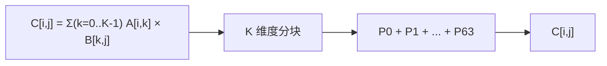
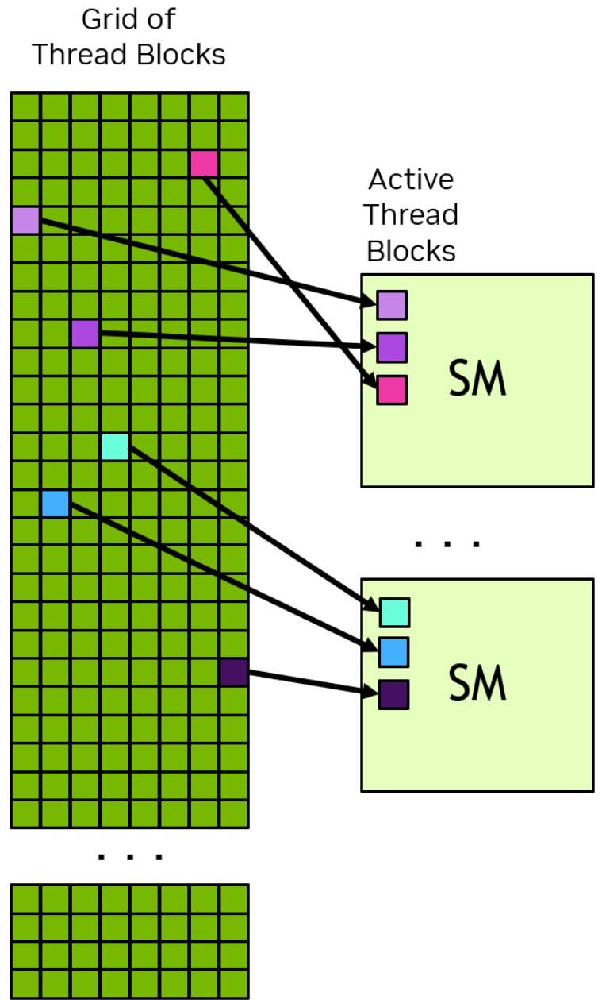
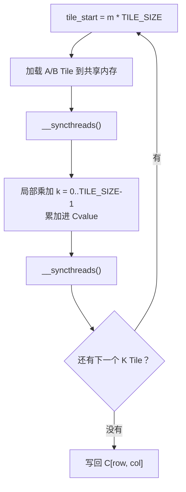

# 从局部乘加到共享内存复用：用 PyCUDA 拆开 GPU 矩阵乘法

> **副标题**：从 K 维度分块、线程映射到共享内存复用，读懂一个教学级 CUDA GEMM 内核
>
> **工程深度**：L2，可继续延伸 ｜ **验证状态**：CPU 侧主机模拟已验证（静态复核 + CPU 对比验证），未实测
>
> **关键词**：PyCUDA / 分块矩阵乘法 / 共享内存 / Tiling / `__syncthreads`
>
> **预计阅读**：20～25 分钟（正文）；动手跑通并读懂代码：另需 30～45 分钟
>
> **适合读者**：会 Python 与 NumPy，想真正看懂 CUDA 线程映射与共享内存的开发者
>
> **本文定位**：
>
> - 一个**教学级 SIMT / Tiling 内核**，不是生产级 GEMM 优化竞赛；刻意采用“一线程一个输出元素”，让 `row` / `col` / Tile / 局部乘加的关系可追踪
> - 代码逻辑可审查；**NVIDIA GPU 上的编译、运行与性能测量待验证，不提供任何未经实测的性能结论**
>
> **本文不实现什么**：非方阵（只支持 `N×N`）、独立 `BM/BN/BK`、一线程多输出、Warp/Register Tile、异步搬运与双缓冲、Tensor Core、与 cuBLAS 的性能对标——这些由第八节展开。

---

## 开篇：一条执行链，两个问题

矩阵乘法的公式本身很简单：

$$C_{i,j}=\sum_{k=0}^{K-1}A_{i,k}B_{k,j}$$

但把它写成 GPU 内核，麻烦立刻出现。**本文只追两个问题：**

1. **一个线程如何计算出它的那个 `C[i,j]`？**
2. **一个 Block 如何让多个线程复用同一份 A、B 数据？**

而全文想让你记住的，其实只有这一条链：

```text
一个线程
    ↓  负责一个 C[row, col]
Block 协作加载 A / B Tile
    ↓
共享内存中复用数据
    ↓
局部 K 维度乘加
    ↓
跨 Tile 累加
    ↓
写回 C[row, col]
```

示例统一使用：

```text
A、B、C：1024 × 1024
TILE_SIZE：16
Block：(16, 16, 1)  →  256 个线程
```

所以 K 方向需要：

$$\left\lceil \frac{1024}{16} \right\rceil = 64 \text{ 轮}$$

**这里的 64 来自 K 维度的分块数量，不来自线程数（256），也不来自输出 Block 数量（64 × 64 = 4096）。** 这三个数在本文里各不相同，正好避免混淆。

### 读完本文，你应该能独立解释这六件事

- 为什么一个 `C[row, col]` 需要沿 K 维度循环
- 为什么 `As[ty][k]` 与 `Bs[k][tx]` 能拼出一个局部点积
- 为什么“加载完成”与“下一轮覆盖前”各需要一道 `__syncthreads()`
- 为什么非整除尺寸必须用向上取整
- 为什么逻辑加载量下降，不代表性能按同样比例提升
- 为什么一个算得对的教学 GEMM，离生产级 GEMM 仍然很远

### 先给结论：七个机制，各管一件事

后面所有的推导，都在回答这张表：

| 机制 | 在本文中的作用 | **不应误解成** |
|---|---|---|
| K 维度分块 | 把完整点积拆成多个局部点积 | 不是额外增加的数学步骤 |
| 共享内存 | 在 Block 内保存并复用 A/B Tile | 不是自动保证性能提升 |
| `__syncthreads()` | 保证 Tile 加载、读取、覆盖之间的顺序 | 不是任意跨线程通信的万能替代 |
| `ceil(N / T)` | 覆盖非整除输入的尾部 K 区间 | 不能只用整除 `/` |
| CPU `float64` 参考 | 评估 GPU `float32` 结果误差 | 不是 GPU 执行路径的逐步复刻 |
| CUDA Event | 测量指定流上的 GPU 执行区间 | 不含未纳入计时的传输与分配成本 |
| `2N³ / T` | 源码层面**显式加载的逻辑元素数**模型 | 不是 DRAM 流量，也不是加速比 |

一句话版：

> **分块改变的是数据怎么组织，不是自动改变性能结果。**

---

## 一、从完整点积到 K 维度分块

矩阵乘法里，`M` 和 `N` 决定输出有多大，而 **`K` 决定每个输出元素要忙多久**。

原始公式是沿 K 维度的一次完整求和：

$$C_{i,j}=\sum_{k=0}^{K-1}A_{i,k}B_{k,j}$$

现在把 K 维度每 `BK` 个元素划成一段。本例 `K = 1024`、`BK = 16`，于是有 64 段：

$$[0,16),\ [16,32),\ \ldots,\ [1008,1024)$$

同一个结果就能改写成 64 个局部结果相加：

$$C_{i,j}=\sum_{m} P_m(i,j)$$

其中第 `m` 段的局部和是：

$$P_m(i,j)=\sum_{r=0}^{BK-1}A_{i,\,mBK+r}\,B_{mBK+r,\,j}$$

代入具体数值：

```text
K  = 1024
BK = 16

轮数 = ceil(1024 / 16) = 64
每轮处理 16 个 K 元素
```



**这就是这条主线的全部数学：分块不改变结果，只改变计算与数据搬运的组织方式。**

### 为什么“拆”这一步关键

分块真正改变的是**数据的使用方式**：不拆时，每个输出元素要一口气读完 A 的整行与 B 的整列，读完即弃；拆开后，每段只有 16 个元素，可以整体搬进片上存储，被 Block 内多个线程反复取用。

**所以分块不只是把求和写短，而是把“一次性读完”改造成“分段读入、分段复用”。**

### 一句提醒

这里用到的轮数公式是 `ceil(K / BK)`，不是 `K / BK`。两者的差别在第六节会用一个具体例子说明——它会让程序静默算错。

---

## 二、一个线程算哪个元素，一个 Block 覆盖哪块输出

先分清三个常被混为一谈的概念：

| 概念 | 在本文实现中的含义 | 本例取值 |
|---|---|---|
| Tile | 一块局部矩阵数据 | `16 × 16` |
| Block | 协作计算一个输出 Tile 的线程组 | `16 × 16` = 256 个线程 |
| Grid | 覆盖整个输出矩阵的 Block 集合 | `64 × 64` = 4096 个 Block |

它们分属三个独立维度：

```text
线程布局：16 × 16 = 256 threads / Block
输出覆盖：64 × 64 = 4096 Blocks
K 方向  ：1024 / 16 = 64 rounds
```

**这三个数在本文里各不相同**——正好说明它们互不派生。

### 当前实现的三条固定契约

这是全文最容易被误读成“CUDA 通用规则”的地方。下面三条**只属于本文的简化实现**，不是 GEMM 的普遍要求：

| 条目 | 本文实现 | 是否通用规则 |
|---|---|---|
| 输出 Tile 高度 | `BM = TILE_SIZE` | ❌ 通用 GEMM 中 `BM` 独立可调 |
| 输出 Tile 宽度 | `BN = TILE_SIZE` | ❌ 通用 GEMM 中 `BN` 独立可调 |
| K Tile 长度 | `BK = TILE_SIZE` | ❌ 通用 GEMM 中 `BK` 独立可调 |
| Block 线程布局 | `blockDim = (T, T, 1)` | ❌ 可与 Tile 解耦 |
| 每线程输出元素数 | 1 | ❌ 生产实现常为多个 |

之所以本文让 `BM = BN = BK = TILE_SIZE` 且 Block 布局等于 Tile 形状，**只是为了让“一个线程 ↔ 一个输出元素”的对应关系在代码里看得见**：

> 在本文的简化实现中，输出 Tile 的形状、K Tile 的长度和 Block 的二维线程布局共用同一个 `TILE_SIZE`。**这不是通用 GEMM 的必要约束**——生产级实现通常把三者拆开，并让一个线程算多个输出元素。

### 线程到输出坐标的映射

```text
row = blockIdx.y * TILE_SIZE + ty
col = blockIdx.x * TILE_SIZE + tx
```

也就是：**`blockIdx.y` 决定行方向的输出区域，`blockIdx.x` 决定列方向的输出区域，`ty`/`tx` 决定 Block 内部的位置。**

举个具体例子：当 `blockIdx.y = 1`、`blockIdx.x = 2` 时，这个 Block 覆盖 `C[16:32, 32:48]`，它需要 A 的第 `16:32` 行、B 的第 `32:48` 列。

下面这张图展示了 Grid、Block 与执行单元之间的关系：左侧是由大量 Thread Block 铺成的 Grid，右侧是真正执行它们的流多处理器（SM，Streaming Multiprocessor）。



> 观察重点：**Grid 是“待执行任务的集合”，SM 是“真正干活的地方”**，而 Block 到 SM 的映射由硬件调度决定，程序不能假设“第 n 个 Block 一定落在第 m 个 SM 上”。

### 为什么默认 `16 × 16`，而不是 `32 × 32`

如果沿用同样的一线程一输出映射，把 `TILE_SIZE` 改成 32：

```text
TILE_SIZE = 32  →  Block = 32 × 32 = 1024 个线程
                   K 方向 = 1024 / 32 = 32 轮
```

**1024 恰好卡在许多设备每 Block 的线程数上限上**，属于边界配置。但更值得注意的是：**即使设备允许这个配置，也不等于它适合这个内核。**

`TILE_SIZE` 同时影响四件事：

```text
TILE_SIZE ↑
   ├── Block 线程数 = TILE_SIZE²        （32 → 1024，33 → 1089 直接报错）
   ├── 每 Block 共享内存 = 2 × T² × 4B  （16 → 2 KiB，32 → 8 KiB）
   ├── 每 Block 寄存器总需求 ≈ 线程数 × 每线程寄存器
   └── 同一 SM 上能驻留的 Block 数量
```

线程、共享内存与寄存器三者会共同限制 Block 的**驻留数量**。所以：

> 本文把 `16 × 16`（256 线程）作为教学默认值，是为了降低启动门槛，**并不意味着它在所有 GPU 上都更快**。真正的性能与最优 Tile 尺寸都要在目标 GPU 上实测。

### 换设备前必须查，不能凭记忆写死

```python
import pycuda.driver as cuda

dev = cuda.Context.get_device()
attr = cuda.device_attribute
max_threads = dev.get_attribute(attr.MAX_THREADS_PER_BLOCK)
max_dim_x   = dev.get_attribute(attr.MAX_BLOCK_DIM_X)
max_dim_y   = dev.get_attribute(attr.MAX_BLOCK_DIM_Y)
max_dim_z   = dev.get_attribute(attr.MAX_BLOCK_DIM_Z)
max_shared  = dev.get_attribute(attr.MAX_SHARED_MEMORY_PER_BLOCK)

print(max_threads, max_dim_x, max_dim_y, max_dim_z, max_shared)

# 启动前显式拦截，而不是等内核报 Illegal configuration
threads_per_block = TILE_SIZE * TILE_SIZE
assert threads_per_block <= max_threads, "TILE_SIZE 超过设备的线程块上限"
assert TILE_SIZE <= max_dim_x and TILE_SIZE <= max_dim_y, "TILE_SIZE 超过 Block 维度限制"
assert 2 * TILE_SIZE * TILE_SIZE * 4 <= max_shared, "两块共享内存 Tile 超过设备上限"
```

但这组检查的**能力边界**要说清楚：

> ✅ 它能排除**明显的越界配置**。
> ❌ 它**不能保证**达到理想 Occupancy、寄存器不溢出、内核一定启动成功——真正的资源占用还取决于寄存器与其他 SM 资源，应以编译输出（如 `nvcc -Xptxas -v`）和 Nsight 的结果为准。

### `TILE_SIZE` 只有一处配置源

早期版本在这里埋着一个坑：Python 端写一遍 `TILE_SIZE`，CUDA 源码里再写一遍 `#define`——**改一处忘另一处，代码照样编译运行，但已经不是你以为的那套参数了。**

解决办法是让 Python 成为**唯一配置源**，编译期宏由它注入：

```python
TILE_SIZE = 16
_KERNEL_TEMPLATE = r"""
#define TILE_SIZE @TILE_SIZE@
...   // 其余 CUDA 源码原样保留
"""
kernel_code = _KERNEL_TEMPLATE.replace("@TILE_SIZE@", str(TILE_SIZE))
```

> 这里用占位符替换而不是 f-string：f-string 会把 CUDA 源码里的每个 `{}` 当成占位符，必须写成 `{{}}`，可读性会明显变差。

另外还有一条固定契约，第四节代码里有 `assert` 守着它：

```text
blockDim.x == blockDim.y == TILE_SIZE
```

内核里 `row = blockIdx.y * TILE_SIZE + ty` 能成立，正是因为这条契约。

---

## 三、共享内存凭什么能复用 A、B 的数据

先看**不用**共享内存时会发生什么。每个线程独立算一个输出元素，直接向全局内存（Global Memory）取数：**同一批数据被重复需要，却各自发了一遍请求**。

用 4×4 的小 Tile 看清方向：**A 的元素沿输出 Tile 的“列方向”复用**（`A[0,0]` 服务 `C[0,0..3]`），**B 的元素沿“行方向”复用**（`B[0,0]` 服务 `C[0..3,0]`）。共享内存做的事，就是把这个复用关系落到片上：

```text
① 不用共享内存：同一批数据被各自读一遍
   线程 (0,0)(0,1)(0,2)(0,3) 都要 A[0, 0..3]   → 同一行读 4 遍
   线程 (0,0)(1,0)(2,0)(3,0) 都要 B[0..3, 0]   → 同一列读 4 遍

② 用共享内存：搬一次，Block 内共享
   Global Memory
        │  ① 协作加载（每个元素只搬一次）
        ▼
   Shared Memory
        │  ② 多个线程反复复用同一份数据
        ▼
   局部乘加  As[ty][k] × Bs[k][tx]
```

量化一下这次复用的规模：在一个 `T × T` 的 Tile 里，**A 的每个元素会被 `T` 个输出列需要，B 的每个元素会被 `T` 个输出行需要**。协作加载让每个元素只从全局内存搬一次，之后由这 `T` 个线程共享使用——复用的全部来源就在这里。

这里先只留一句提醒：**本节讨论的是数据组织层面的复用，不等于实际 DRAM 流量，更不等于性能加速比**——完整的边界放到第七节讲。

---

## 四、完整实现：naive 与 tiled 两个内核

代码之前，只需要知道四件事：

```text
输入形状：A、B、C 均为 N × N，N = 1024
线程配置：Block = (16, 16, 1) = 256 线程，Grid = ceil(N / TILE_SIZE) 的二维网格
配置来源：TILE_SIZE 只有 Python 这一处，编译期宏由它注入
教学目标：naive 建立基线，tiled 展示共享内存复用
```

> **两者的差异不止“有没有共享内存”。** 它们还同时改变了全局内存读取模式、缓存行为、同步开销、指令调度与寄存器分配。所以 naive 在这里的角色是**教学基线**——用来观察“显式 Tile 复用 + 共享内存加载 + 屏障”这一整套机制带来的整体差异，**而不是严格隔离单一因素的微基准，也不代表所有未分块 GEMM 的性能上限**。

```python
"""从局部乘加到共享内存复用：用 PyCUDA 拆开 GPU 矩阵乘法（第1章 · GPU 编程基础）。

本文件是对应博文代码块的实现/演示，直接运行可见效果；运行依赖：PyCUDA、NumPy。
"""
import numpy as np
import pycuda.autoinit          # 负责创建 CUDA Context
import pycuda.driver as cuda
from pycuda.compiler import SourceModule

N = 1024

# 默认使用 16 × 16 = 256 线程的线程块，降低不同设备上的启动门槛。
# 32 × 32 = 1024 线程是"接近资源上限"的扩展实验，不是推荐默认值。
TILE_SIZE = 16
BLOCK_SIZE = (TILE_SIZE, TILE_SIZE, 1)

# ✅ TILE_SIZE 只有这一个配置源：CUDA 源码里的 #define 由下面这行注入。
# 用占位符替换而不是 f-string，是为了避免把 CUDA 源码里的每个 {} 都写成 {{}}。
_KERNEL_TEMPLATE = r"""
#define TILE_SIZE @TILE_SIZE@

// v0：不分块，K 循环里直接读全局内存
__global__ void naive_matmul(
    const float* __restrict__ A,
    const float* __restrict__ B,
    float* __restrict__ C,
    int N
) {
    int col = blockIdx.x * blockDim.x + threadIdx.x;
    int row = blockIdx.y * blockDim.y + threadIdx.y;

    // 本内核没有 __syncthreads()，越界线程可以安全地提前 return
    if (row >= N || col >= N) return;

    float acc = 0.0f;
    for (int k = 0; k < N; ++k) {
        // 在本文的行主序布局 + Block=(T,T) + threadIdx.x 作为 warp 内
        // 变化最快维度的前提下：对固定的 row、k，A 的多个线程可能读到
        // 同一地址（是否广播由硬件的合并/缓存/广播机制决定）；B 的 col
        // 在 warp 内通常连续，有利于形成合并访问。
        // 结论依赖线程线性化方式与目标架构，不能脱离布局推广。
        acc += A[row * N + k] * B[k * N + col];
    }
    C[row * N + col] = acc;
}

// v1：分块 + 共享内存复用
__global__ void tiled_matmul(
    const float* __restrict__ A,
    const float* __restrict__ B,
    float* __restrict__ C,
    int N
) {
    // 两块静态共享内存：尺寸由编译期宏 TILE_SIZE 决定
    __shared__ float As[TILE_SIZE][TILE_SIZE];
    __shared__ float Bs[TILE_SIZE][TILE_SIZE];

    int tx = threadIdx.x;                 // Block 内的列位置
    int ty = threadIdx.y;                 // Block 内的行位置

    // 本实现的固定契约：blockDim.x == blockDim.y == TILE_SIZE。
    // 因此下面直接用 TILE_SIZE 换算输出坐标是成立的（见主机端 assert）。
    int row = blockIdx.y * TILE_SIZE + ty;
    int col = blockIdx.x * TILE_SIZE + tx;

    // 线程私有累加器。
    // 编译器通常会尝试把它分配到寄存器，实际分配结果需结合编译输出检查
    // （寄存器不足时可能发生局部内存溢出 spilling）。
    float Cvalue = 0.0f;

    // 沿 K 维度遍历所有 Tile
    // 向上取整，保证 N 不能被 TILE_SIZE 整除时也覆盖完整 K 维度
    for (int m = 0; m < (N + TILE_SIZE - 1) / TILE_SIZE; ++m) {

        int tile_start = m * TILE_SIZE;   // 本轮 K 起点
        int a_col = tile_start + tx;      // A Tile 的列游标
        int b_row = tile_start + ty;      // B Tile 的行游标

        // 每个线程加载一个 A 元素和一个 B 元素；越界位置填 0
        if (row < N && a_col < N) {
            As[ty][tx] = A[row * N + a_col];
        } else {
            As[ty][tx] = 0.0f;
        }

        if (b_row < N && col < N) {
            Bs[ty][tx] = B[b_row * N + col];
        } else {
            Bs[ty][tx] = 0.0f;
        }

        // 屏障位于所有线程都必经的循环路径上。边界外的线程不提前 return，
        // 而是靠“边界位置填 0 + 最终写回保护”处理。
        // 如果只有部分线程到达该屏障，可能造成挂起或非预期行为。
        __syncthreads();

        // 局部乘加：只读共享内存，不再访问全局内存
        for (int k = 0; k < TILE_SIZE; ++k) {
            Cvalue += As[ty][k] * Bs[k][tx];
        }

        // 第二道屏障：保证本轮对共享内存的**读取阶段结束**后，
        // 才允许进入下一轮并覆盖 As / Bs
        __syncthreads();
    }

    // 只有合法坐标才写回全局内存
    if (row < N && col < N) {
        C[row * N + col] = Cvalue;
    }
}
"""

kernel_code = _KERNEL_TEMPLATE.replace("@TILE_SIZE@", str(TILE_SIZE))

module = SourceModule(kernel_code, options=["-O3"])
naive_matmul = module.get_function("naive_matmul")
tiled_matmul = module.get_function("tiled_matmul")


# ============================================================
# 启动前配置校验
# ============================================================
def validate_launch_config(dev, tile_size, dtype=np.float32):
    """做一组"配置级"检查，排除明显的越界配置。

    能力边界（重要）：
      ✅ 能排除：线程总数、Block 各维度、静态共享内存超过设备上限
      ❌ 不能保证：达到理想 Occupancy、寄存器不溢出、内核一定启动成功
    真正的资源占用还取决于寄存器和其他 SM 资源，
    应以编译输出（如 nvcc -Xptxas -v）与 Nsight 的结果为准。
    """
    attr = cuda.device_attribute
    max_threads = dev.get_attribute(attr.MAX_THREADS_PER_BLOCK)
    max_x = dev.get_attribute(attr.MAX_BLOCK_DIM_X)
    max_y = dev.get_attribute(attr.MAX_BLOCK_DIM_Y)
    max_z = dev.get_attribute(attr.MAX_BLOCK_DIM_Z)
    max_shared = dev.get_attribute(attr.MAX_SHARED_MEMORY_PER_BLOCK)

    threads = tile_size * tile_size
    shared_bytes = 2 * tile_size * tile_size * np.dtype(dtype).itemsize

    if threads > max_threads:
        raise ValueError(f"线程总数 {threads} 超过设备上限 {max_threads}")
    if tile_size > max_x or tile_size > max_y:
        raise ValueError(f"Tile {tile_size} 超过 Block X/Y 维度上限 ({max_x}, {max_y})")
    if max_z < 1:
        raise ValueError("设备 Block Z 维度上限异常")
    if shared_bytes > max_shared:
        raise ValueError(f"静态共享内存 {shared_bytes}B 超过设备上限 {max_shared}B")

    print(f"config OK: {threads} threads/block, {shared_bytes}B shared/block")


# 契约：blockDim.x == blockDim.y == TILE_SIZE（内核用 TILE_SIZE 换算 row/col 的前提）
assert BLOCK_SIZE[0] == TILE_SIZE and BLOCK_SIZE[1] == TILE_SIZE, "Block 维度必须等于 TILE_SIZE"
validate_launch_config(cuda.Context.get_device(), TILE_SIZE)

# 输入契约：这是一个“有明确输入契约”的教学内核，不是自动支持任意矩阵的 API
if N <= 0:
    raise ValueError("N 必须为正整数")
if TILE_SIZE <= 0:
    raise ValueError("TILE_SIZE 必须为正整数")

# ---------- 准备数据 ----------
rng = np.random.default_rng(42)
A = rng.random((N, N), dtype=np.float32)      # 行主序，与 row * N + col 一致
B = rng.random((N, N), dtype=np.float32)

if A.dtype != np.float32 or B.dtype != np.float32:
    raise TypeError("当前内核只接受 float32 输入")
if A.shape != (N, N) or B.shape != (N, N):
    raise ValueError("当前示例只支持 N×N 方阵（非方阵会被明确拒绝）")
C_host = np.empty((N, N), dtype=np.float32)   # 主机端缓冲区

A_dev = cuda.mem_alloc(A.nbytes)              # 设备端显存
B_dev = cuda.mem_alloc(B.nbytes)
C_dev = cuda.mem_alloc(C_host.nbytes)
cuda.memcpy_htod(A_dev, A)
cuda.memcpy_htod(B_dev, B)

# ---------- Grid 尺寸 ----------
g = (N + TILE_SIZE - 1) // TILE_SIZE
GRID_SIZE = (g, g, 1)


def launch(kernel):
    # 不显式传 stream：内核与 Event 都使用 PyCUDA 当前的默认执行流，
    # 因此下面测到的是该内核在这条流上的执行区间。
    # 若改用显式 Stream，应让 Event 与被测内核使用同一条 Stream。
    kernel(A_dev, B_dev, C_dev, np.int32(N), block=BLOCK_SIZE, grid=GRID_SIZE)


def bench(kernel, warmup=5, iterations=20):
    """用 CUDA Event 测量内核耗时（毫秒）。

    测量口径：
      - 只含内核执行时间，不含 H2D/D2H 拷贝与内存分配；
      - 内核与 Event 同在默认执行流上；
      - 20 次采样可以算出一个经验 median / p95，但样本量小，
        统计稳定性有限。本文用它演示统计口径，不作为可靠的尾延迟结论。
    跨实现比较时必须保持口径一致。
    """
    for _ in range(warmup):
        launch(kernel)
    cuda.Context.synchronize()

    start, end = cuda.Event(), cuda.Event()
    samples = []
    for _ in range(iterations):
        start.record()
        launch(kernel)
        end.record()
        end.synchronize()
        samples.append(start.time_till(end))

    samples = np.asarray(samples, dtype=np.float64)
    return samples


# ============================================================
# 正确性校验：每个内核单独校验（先于 Benchmark）
# ============================================================
# 把原始 float32 输入转换为 float64 后在 CPU 上算一个较高精度的参考结果。
# 它用于衡量 GPU float32 结果的误差，但**不复刻 GPU 的累加顺序**，
# 也不等于数学意义上的精确结果。
# 注意：这一步会在主机端额外分配 A/B 的 float64 副本与一个
#      float64 结果矩阵（N=1024 时约 8 MB），并占用 CPU 时间。
#      它只担任“数值验收基准”，**不计入下面 CUDA Event 的 kernel-only 计时**，
#      也不应与 GPU 内核时间做端到端对比。
C_ref = A.astype(np.float64) @ B.astype(np.float64)

# 相对误差定义（全文统一）：
#   rel_err = max(|C_test - C_ref|) / max(|C_ref|)
ref_scale = float(np.max(np.abs(C_ref)))


def validate(kernel, name):
    """跑一次内核并将结果与 C_ref 逐元素比较。

    验收条件说明：
      - np.allclose(rtol=1e-3, atol=1e-3) 是**本文的教学验收条件**，
        不是通用的 GEMM 数值验收标准；
      - rtol 与 atol 叠加生效，结果量级在数百时允许的误差远大于 0.001；
      - 同时报告 max_abs_err / rms_err / rel_err 描述误差规模；
      - 正式工程的阈值应结合数据范围、精度模式与业务容忍度确定。
    """
    launch(kernel)
    cuda.Context.synchronize()

    cuda.memcpy_dtoh(C_host, C_dev)
    C64 = C_host.astype(np.float64)          # 升到 float64 再比较
    abs_err = np.abs(C64 - C_ref)
    max_abs_err = float(np.max(abs_err))
    rms_err = float(np.sqrt(np.mean(abs_err ** 2)))
    rel_err = max_abs_err / max(ref_scale, 1e-30)
    ok = np.allclose(C64, C_ref, rtol=1e-3, atol=1e-3)

    print(f"{name:<10} allclose={ok}  max_abs_err={max_abs_err:.3e}  "
          f"rms_err={rms_err:.3e}  rel_err={rel_err:.3e}")
    if not ok:
        raise RuntimeError(f"{name} 正确性校验失败，先排查正确性再谈性能。")
    return C_host.copy()


# 流程：编译 → 配置校验 → naive 校验 → tiled 校验 → warmup → Benchmark
out_naive = validate(naive_matmul, "naive")
out_tiled = validate(tiled_matmul, "tiled")

# 辅助诊断：两个内核算的是同一道题，结果理应接近。
# 但这不是必要的验收条件——两者的编译优化、FMA 生成与浮点执行路径
# 可能不同，都不必与对方逐位一致。各自的正确性以 C_ref 为准。
agree = np.allclose(out_naive.astype(np.float64), out_tiled.astype(np.float64),
                    rtol=1e-4, atol=1e-4)
print(f"naive vs tiled 近似一致（辅助诊断）: {agree}")

# ============================================================
# Benchmark：只测已验证过的内核
# ============================================================
s_v0 = bench(naive_matmul)
s_v1 = bench(tiled_matmul)

# GFLOPS 用标准 GEMM 工作量模型：每个输出元素 N 次乘加，每次乘加计 2 FLOPs。
# 它是**算法工作量模型**，不是硬件实际执行的指令数，
# 只能用于同一输入、同一精度、同一测量口径下的粗略对照。
flops = 2.0 * N ** 3
to_gflops = lambda ms: flops / (ms * 1e-3) / 1e9


def summarize(samples, name):
    med = float(np.median(samples))
    print(f"{name:<10}{med:>12.4f}{float(np.percentile(samples, 95)):>10.4f}"
          f"{float(samples.min()):>10.4f}{to_gflops(med):>10.1f}")
    return med


print(f"\nDevice: {cuda.Context.get_device().name()}")
print(f"N = {N}, TILE_SIZE = {TILE_SIZE}, FLOPs model = 2 * N^3 = {flops:.3e}")
print(f"{'版本':<10}{'median(ms)':>12}{'p95(ms)':>10}{'min(ms)':>10}{'GFLOPS':>10}")
med_v0 = summarize(s_v0, "v0 naive")
med_v1 = summarize(s_v1, "v1 tiled")
print(f"speedup (v0/v1) = {med_v0 / med_v1:.2f}x")
```

---

## 五、逐行拆解：索引、加载、同步、乘加

**① 线程索引。** 一个线程只负责一个输出元素，所以先把自己的 `(tx, ty)` 换算成全局坐标：

```cpp
int row = blockIdx.y * TILE_SIZE + ty;   // 决定算 C 的哪一行
int col = blockIdx.x * TILE_SIZE + tx;   // 决定算 C 的哪一列
float Cvalue = 0.0f;                     // 私有累加器，通常驻留寄存器
```

`Cvalue` 是整个 K 循环里唯一被反复更新的量——**它承载的正是那个“还没算完的 `C[i,j]`”**。

**② 加载 A、B Tile。** 每个线程在这一轮搬两个元素：

```cpp
As[ty][tx] = A[row * N + tile_start + tx];      // A 的一个元素
Bs[ty][tx] = B[(tile_start + ty) * N + col];    // B 的一个元素
```

注意两块 Tile 的索引参数**角色并不相同**：

> A 用 `ty` 定位**输出行**、`tx` 定位**局部 K**；B 用 `ty` 定位**局部 K**、`tx` 定位**输出列**。两者最终通过 `k` 对齐到同一个共同维度。

Block 有 256 个线程，每轮正好搬完两个 `16 × 16` 的 Tile——**这就是“协作加载”的具体含义**。

但这里要限定范围，否则容易过度理解：

> **“每个元素搬一次”只在一个输出 Tile、一个 K Tile 的加载过程中成立。** 不同输出 Block 之间，仍然可能重复加载相同的全局数据——横向相邻的两个 Block，就会各自把 B 的同一批行再搬一遍。

**③ 两道同步，各守一件事。** 线程之间的执行进度并不一致：线程 A 可能已经开始读 `As`，而线程 B 还没写完它。两道屏障分别拦在两端：

```cpp
__syncthreads();     // 屏障 1：等加载完成，才能读取
for (int k = 0; k < TILE_SIZE; ++k) {
    Cvalue += As[ty][k] * Bs[k][tx];
}
__syncthreads();     // 屏障 2：等读取完成，才能覆盖
```

一个必须点名的细节：

```cpp
// ⚠️ 错误写法
if (row < N && col < N) {
    __syncthreads();     // 只有部分线程会到达这个屏障
}
```

`__syncthreads()` 是**整个 Block 的集体动作**。一句话记住它的规则与必要性：

> **它可以出现在条件代码中，但条件必须对整个 Block 一致**；否则程序可能挂起或产生非预期行为。关键不在“分支里能不能放同步”，而在**屏障是否由整个参与 Block 一致到达**。
>
> 它的必要性取决于“谁写、谁读”：本实现的两道屏障分别保证“Tile 加载完成”与“下一轮覆盖前的读取完成”——它们保护的是这两段**特定的先后关系**，而不是“任何跨线程交换都要用同一种屏障”。

**④ 局部乘加。** 屏障之后，每个线程只在共享内存里做 `TILE_SIZE` 次乘加：

```cpp
for (int k = 0; k < TILE_SIZE; ++k) {
    Cvalue += As[ty][k] * Bs[k][tx];
}
```

**`k` 就是那个“对上号”的轴：A 的第 k 列，必须乘 B 的第 k 行。** 这 `TILE_SIZE` 项合起来，就是当前 K Tile 对 `C[row][col]` 的全部贡献。

把一轮的动作按顺序排开，就是这张表：

| 阶段 | 作用 |
|---|---|
| `tile_start = m * TILE_SIZE` | 定位当前 K Tile |
| 加载 | 将 A Tile、B Tile 放入共享内存（越界填 0） |
| 第一次 `__syncthreads()` | 保证加载完成 |
| 局部乘加 | 更新线程私有累加器 `Cvalue` |
| 第二次 `__syncthreads()` | 防止下一轮覆盖仍在被读取的数据 |



### 轮次跑完之后，回到了最初的公式

```text
第 0 轮 ：Cvalue = P0
第 1 轮 ：Cvalue = P0 + P1
   ...
最后 1 轮：Cvalue = P0 + P1 + ... + P_last   ← 正是最初那个完整点积
```

一句话收束：**外层 `m` 循环遍历完整 K 维度，内层 `k` 循环处理当前 Tile；所有轮次累加之后，得到的仍是矩阵乘法定义里的同一个 `C[row, col]`。**

---

## 六、正确性边界：向上取整、越界填零、CPU 校验

**① K 轮数必须向上取整。** 写成 `m < N / TILE_SIZE` 在整除时恰好正确，但 `N = 1000` 时整数除法只给 62 轮，K 维度的最后一段 `[992, 1000)` **根本没参与计算**——结果悄悄算错，不报任何错。

```cpp
for (int m = 0; m < (N + TILE_SIZE - 1) / TILE_SIZE; ++m)   // ceil(N / TILE_SIZE)
```

对 `N = 1000`、`TILE_SIZE = 16` 得到 63 轮，**最后一轮只有一部分数据有效**。（验证脚本对此有专门的断言，见附录 A。）

**② 越界位置填 0。** `N = 1000` 时最后一轮的起点是 `992`，名义上覆盖 `[992, 1024)`，但有效数据只到 `1000`。索引 `1000 ~ 1023` 全部越界，代码在加载阶段把它们填成 0：

```cpp
if (row < N && a_col < N) {
    As[ty][tx] = A[row * N + a_col];
} else {
    As[ty][tx] = 0.0f;
}
```

填 0 之所以正确，是因为 **0 是加法的单位元**：越界位置贡献的乘积恒为 0，不影响有效结果。同时输出端也做同样的保护——**只有 `row < N && col < N` 的线程才写回 `C`**。

需要说明的是：**填 0 是本文选择的一种易读做法，并非唯一做法。** 在复杂布局下，也常见谓词加载（跳过越界写入）、乘加阶段的掩码置零，或把边界拆成专用内核。

**③ 校验要以 float64 为参考，并且放在计时之后。**

```python
C_ref = A.astype(np.float64) @ B.astype(np.float64)
ok = np.allclose(C_host.astype(np.float64), C_ref, rtol=1e-3, atol=1e-3)
```

三个要点：

- **不要用 `np.array_equal()`。** GPU 用 float32 累加、CPU 参考用 float64 乘法，两者**舍入路径不同**，逐位相等是不合理的要求。
- **`allclose` 的阈值是本文的教学验收条件，不是通用工程标准。** `rtol` 与 `atol` 是叠加判定的——结果量级在数百时，`rtol=1e-3` 允许的误差项远大于 `atol=1e-3`。所以**不要读成“误差必须小于 0.001”**。
- **不要预设一个跨设备稳定的误差数值。** 实际误差受架构、编译器优化、FMA 生成、CPU BLAS 实现、累加顺序与输入分布影响。本文只要求误差满足明确判定标准，并**记录实际误差**。
- **校验要放在计时之后。** 否则内核可能因为越界提前 `return` 而“快得离谱”却什么都没算。

正式工程里，阈值应结合数据范围、精度模式与业务容忍度确定——`rtol/atol = 1e-3` 只是一个宽松的教学门槛。

---

## 七、性能边界：复用比不是加速比

### 先把“读取量”分成三层，别混着说

讨论“分块省了多少读取”时，最容易出错的地方是把三层概念当成一件事：

| 层次 | 说的是什么 | 本文能给出什么 |
|---|---|---|
| 算法需求 | 每个输出元素需要 `N` 个 A 元素和 `N` 个 B 元素 | 可以精确计算 |
| Kernel 的全局加载组织 | tiled 版本在每个输出 Tile 的每轮 K 分块中加载 `2T²` 个元素 | 可以精确计算 |
| 硬件实际流量 | 受合并访问、缓存命中、内存事务、写分配/回写影响 | **只能测量，不能靠公式断言** |

下面所有推导都只属于前两层。

### 理想化模型：按源码统计的 A/B **逻辑加载元素数**

**前提**（缺一条，结论就要打折扣）：方阵 `M = N = K`、`TILE_SIZE = T`、尺寸能被 `T` 整除、每轮只做一次协作加载、不计边界浪费、只统计 A/B 加载。

在这个前提下，不分块模型里每个输出元素都要沿 K 读一整行 A 和一整列 B：

$$N^2 \times 2N = 2N^3$$

tiled 模型里，每个输出 Tile 要走 `N/T` 轮、每轮搬入 `2T²` 个元素，共 `(N/T)²` 个输出 Tile：

$$\frac{N^2}{T^2} \times \frac{N}{T} \times 2T^2 = \frac{2N^3}{T}$$

换成本例的具体数字（`N = 1024`、`T = 16`）看一遍：

```text
输出 Tile 数量   = (1024 / 16)² = 4096
每个输出 Tile 的 K 方向轮数 = 1024 / 16 = 64
每轮加载         = 16² 个 A 元素 + 16² 个 B 元素 = 512 个元素

tiled 逻辑加载元素总数 ≈ 4096 × 64 × 512 = 1.34 × 10⁸

不分块模型中，每个 C 元素要读 1024 + 1024 = 2048 个元素：
naive 逻辑加载元素总数 ≈ 1024² × 2048 = 2.15 × 10⁹

比值 ≈ 16 = T
```

两者相比得 `T`。所以准确的结论应该这样表述：

> **在本文的理想化模型中，统计的是“每个输出 Tile、每轮 K 分块”的 A/B 逻辑加载元素数。** 显式 Tile 复用使这个数量约变为原来的 `1/T`；本例 `T = 16`，对应约 16 倍的差异。
>
> **它不等价于 DRAM 实际流量，更不是 kernel 加速比。**

这个 `2N³ / T` 有三个明确的“不计入项”，请一并记住：

1. **不含 C 的写回**——只统计 A、B 的读取；
2. **不含边界 Tile 的无效加载**——前提里已假设尺寸整除；
3. **不等同于 load 指令数、memory transaction 数、L1/L2 流量或 DRAM 流量**。

还有一条容易过度推广：

> **“每个元素只搬一次”只在一个输出 Block 的某一轮 K Tile 内成立。** 不同输出 Block 之间仍会重复加载相同的 A/B 数据——横向相邻的两个 Block 就会各自把 B 的同一批行再搬一遍。

### 为什么它不能直接变成加速比

四条限制，缺一不可：① 模型统计的是**逻辑元素数**，不是硬件流量；② **缓存可能已吸收部分重复访问**，不分块版本本来就没有那么慢；③ **共享内存有代价**（加载指令 + 两道屏障 + 每 Block 占用）；④ **瓶颈会转移**。

换句话说：**优化是把一个瓶颈换成下一个瓶颈的能力，不是把每个指标都乘 `T`。**

### 进阶边界：哪些因素会把理论值拉走

如果你要继续往下挖，这几个方向值得关注，但每一个都应当**在目标 GPU 上测量**，而不是靠公式断言：

- **全局内存访问是否合并。** 当同一线程束（warp）内的线程访问连续且对齐良好的地址时，通常更容易形成高效的合并访问；具体的内存事务与缓存行为需要结合目标架构和性能分析工具确认。
- **共享内存是否发生存储体冲突（Bank Conflict）。** 对本文实现的典型 warp 访问模式而言，`As[ty][k]` 具有**广播式读取特征**（warp 内多个线程读同一个地址），`Bs[k][tx]` 在常见布局下表现为**连续读取**。它们**没有明显的典型 Bank Conflict 风险**——但“典型模式下的分析”不等于“已在目标架构上验证”，是否产生实际冲突以及对性能的影响，仍应通过该 GPU 上的共享内存相关指标确认。
- **寄存器与占用率。** 每个线程的寄存器用量与每 Block 的共享内存占用，共同决定了一个 SM 上能同时驻留多少 Block。

这三项合在一起说明一件事：**算法级分析与硬件级实测之间，隔着一整层实现细节。**

### 性能验证清单

要让一个性能数字具备可比性，至少把这些字段记全：

```text
GPU 型号
CUDA Toolkit / Driver 版本
输入形状与数据类型
FLOPs 模型（本文：2 * N^3，算法工作量而非硬件指令数）
warmup / iterations 次数
Stream 归属（本文：默认流；Event 与 Kernel 必须同流）
CUDA Event 的测量范围（只测内核，还是含 H2D/D2H）
median / p95 / min
正确性误差（max_abs_err / rms_err / rel_err）
```

**没有测量口径的性能数字，等于没有数字。**

三处容易被忽略的口径细节：

- **Stream 归属**——本文内核与 Event 同在**默认流**；若改用非默认流，**Event 必须与 Kernel 同流**。
- **P95 需要足够采样**——`iterations = 20` 只够演示算法，不足以刻画可靠的尾延迟。
- **GFLOPS 是模型值**——`2 × N³` 是算法工作量，不是硬件指令数，不能无条件对比。

---

## 八、这份实现离生产级 GEMM 还有多远

本文的实现是刻意简化的：

| 本文教学实现 | 生产级 GEMM 常见方向 |
|---|---|
| 一线程一个输出元素 | 一线程多个输出元素（寄存器累加） |
| Block Tile 直接对应线程布局 | Threadblock / Warp / Register 多层 Tile |
| 同步加载 A/B Tile | 软件流水线、双缓冲 |
| 标量 FMA | 向量化指令、Tensor Core |
| 手写基础内核 | cuBLAS / cuBLASLt 等优化库 |

这里有一个容易被误读的地方需要澄清：

> 在当前“一线程对应一个输出元素”的映射下，`TILE_SIZE = 64` 会要求一个 Block 使用 `64 × 64 = 4096` 个线程，因此**不可行**。
>
> 但这**不意味着 `64 × 64` 的输出 Tile 本身不可行**——高性能实现通常让一个线程计算多个输出元素，或采用更复杂的线程块与寄存器 Tile 映射来实现更大的 Tile。

所以，Tile 大小同时影响 K 方向轮数、数据复用、线程数、共享内存容量、寄存器压力和 Block 驻留数量，**不能仅凭“轮数变少”就判断性能收益**。它只能在目标硬件上实测确定。

一句话收束这一节：

> **本文的目标是建立正确的执行模型，而不是与生产级 GEMM 库竞争性能。**

### 再往下一层是什么

本文使用的是**标量 FMA + 显式共享内存**的基础实现。往下走是一条概念上的演进路线：

```text
本文      ：Block Tile + Shared Memory + 标量 FMA
   ↓
线程级    ：Register Tile（一线程算多个输出元素）
   ↓
Warp 级   ：Warp Tile / warp 内协作
   ↓
流水线    ：异步搬运 + 双缓冲，隐藏访存延迟
   ↓
矩阵指令  ：Tensor Core / MMA
   ↓
生产实现  ：cuBLAS / cuBLASLt / CUTLASS 等
```

两点必须一起说清楚，否则这张图会被误读：

> **这是一条概念上的演进路线，不代表所有生产级 GEMM 都按相同顺序实现，也不意味着后一级技术必然在所有输入规模上更快。** 每一级都会改变线程组织、数据布局和同步策略——它们**不是“在当前代码上加一个 API”就能拿到的**。

另外，共享内存也不是所有优化的必经终点：

> 共享内存是一种**可编程的数据复用手段**，不是独立于访问模式、缓存体系和线程布局之外的“性能开关”。某些内核可能依靠缓存、寄存器或其他数据路径获得更合适的性能。

本文先建立基础执行模型，把这些优化留作后续专题。

---

## 九、验证状态与下一步

### 验证状态（分层说明）

诚实地把“验证”拆成四层，每一层的结论强度不同：

| 层级 | 状态 | 说明 |
|---|---|---|
| 索引与边界逻辑 | ✅ 已通过主机端模拟检查 | 用 NumPy 逐元素复刻内核逻辑，含向上取整与越界补零 |
| Python 侧流程 | ✅ 已检查 | Grid 计算、计时封装、校验分支 |
| CUDA 编译与 GPU 运行 | ⏳ **未实测** | 本文写作环境为 Apple Silicon，无 `nvcc` 与 NVIDIA GPU |
| GPU 性能数据 | ⏳ **未提供** | **本文不给出任何未经实测的性能数字** |

> **本文已完成主机端索引逻辑的设计与检查，但本文内核尚未在 NVIDIA GPU 上完成编译、运行与性能测量。除非附带实际运行日志，本文不把主机端模拟结果表述为“GPU 内核已验证”。** 完整的能力边界见附录 A 的“验证边界”框。

#### 误差定义（全文统一）

$$\text{rel\_err} = \frac{\left\| C_{\text{test}} - C_{\text{ref}} \right\|_\infty}{\max\left(\left\| C_{\text{ref}} \right\|_\infty,\ \epsilon\right)}$$

即**最大绝对误差 ÷ 参考矩阵的最大绝对值**。不同文章可能采用不同分母（如逐元素相对误差），所以必须写明定义才能复现同一个数字。

#### 主机端模拟覆盖的边界用例（代表性子集）

| 测试用例 | 覆盖的情形 | 轮数 | rel_err（向上取整） | rel_err（误用 `N//T`） |
|---|---|---:|---:|---:|
| `N=31, TILE=16` | 小于一个 Tile 且不整除 | 2 | 3.2e-16 | 5.5e-01 |
| `N=32, TILE=16` | 恰好一个完整 Tile | 2 | 3.8e-16 | 3.8e-16 |
| `N=33, TILE=16` | 刚超过一个 Tile | 3 | 3.0e-16 | 7.8e-02 |
| `N=63, TILE=16` | 末尾只缺一个元素 | 4 | 6.7e-16 | 3.5e-01 |
| `N=1000, TILE=16` | 较大非整除输入 | 63 | 4.0e-15 | **1.9e-02** |
| `N=33`（全 1 矩阵） | **确定性用例**，误差可手算 | 3 | 精确 33 | 精确 32（少 1） |

（完整 10 个用例与运行环境见 **附录 A**。）

这张表值得横着读两遍：

- **左半边**：只要用向上取整，误差都在 `1e-15` 量级——纯浮点舍入，索引与边界逻辑正确。
- **右半边**：写成 `N // TILE_SIZE`（整除时才碰巧正确）后，**非整除用例全部算错**：`N=31` 时误差 `5.5e-01`（附录实测 `5.53e-01`）——过半的 K 维度贡献被漏算；最极端的是 `N=1`，floor 下一轮都不跑，误差 `1.00e+00`，结果全错。**这些错都不报任何错。**

其中 `31 / 32 / 33` 三个连续案例最有价值——以 `TILE_SIZE = 16` 计，它们正好卡在 `2 × TILE_SIZE = 32` 这条线上：31 差一个到两个整 Tile，32 恰好两个整 Tile（floor 碰巧正确），33 是两个 Tile 多一个。**只要 N 不是 TILE_SIZE 的整数倍，floor 就会漏掉尾块。**

#### 复现入口

```bash
# 1) 主机端索引逻辑验证（不需要 GPU，会打印上表并跑断言）
python validate_tiled_index.py          # 见附录 A

# 2) 在装有 CUDA Toolkit 与 NVIDIA GPU 的机器上
python tiled_matmul.py                  # 第四节完整代码
# 记录 Device、median / p95、GFLOPS、speedup、
# naive 与 tiled 各自的 allclose / max_abs_err / rms_err / rel_err
```

如果你跑出了有意思的结果，欢迎在评论区贴上 **GPU 型号 + 完整测量字段**——带上型号和口径的数字，才有讨论价值。

### 下一步：三个方向

1. **用 Nsight Compute 解释差异。** CUDA Event 只回答“花了多久”。想回答“为什么”，再去观察内存吞吐、缓存命中、共享内存访问、寄存器使用和 Stall 原因。
2. **做一组可复现的 Tile 对照实验。** `TILE_SIZE = 8 / 16 / 32`，控制变量（同一份输入、同一设备、同一编译选项、同一测量范围），记录完整清单。
3. **往“算得更快”走。** 当访存不再是瓶颈，下一个问题是算术强度——从 CUDA Core 走向 Tensor Core，从 `float` 走向 `tf32` / `fp16` / `bf16`。这属于后续专题（下一篇先讲 cuBLAS 与 SGEMM 的工程用法；Register Tile 与 Warp Tile、异步搬运与 Tensor Core 属于更后面的专题）。

### 一句话速查卡

先说明符号边界：下面的 `BM / BK / BN` 是**通用分块的概念抽象**，本文代码**并没有**实现它们作为三个独立参数——本文里 `BM = BN = BK = TILE_SIZE`，且只支持方阵。

```text
本文实现的真实契约（仅属于本文，非通用 GEMM 规则）
  A、B、C     ：N × N（方阵；非方阵会被代码明确拒绝）
  数据类型      ：float32，行主序

  输出 Tile    ：BM × BN = T × T
  K Tile        ：BK = T
  Block 线程布局：blockDim = (T, T, 1)
  每线程输出   ：1 个 C 元素
  ∴ 本文中     ：BM = BN = BK = T   ← 为了让映射看得见，不是必然约束

  本例取值      ：N = 1024，T = 16
                   → 256 threads/Block，64 × 64 = 4096 Blocks，K 方向 64 轮
  K 分块轮数   ：ceil(N / T)
  线程输出     ：row = blockIdx.y * T + ty
                 col = blockIdx.x * T + tx
  每轮动作     ：加载 → __syncthreads() → k 循环乘加 → __syncthreads()
  局部乘加     ：Cvalue += As[ty][k] * Bs[k][tx]
  加载量模型   ：逻辑加载元素数 ≈ 2N³ / T（≠ DRAM 流量 ≠ 加速比）
  配置源       ：只有 Python 的 TILE_SIZE；CUDA #define 由它注入
```

---

## 附录 A：主机端索引验证脚本

**用途**：在**没有 NVIDIA GPU** 的机器上，验证 v1 内核的**索引、分块轮数与越界补零**逻辑。

> ### 验证边界（请先读这一框）
>
> **本脚本能验证**：
>
> - K 分块轮数是否使用了向上取整
> - 尾部 K 区间是否被覆盖
> - 越界位置是否按 0 处理
> - 分块后的数学结果是否与 CPU 参考一致
>
> **本脚本不验证**：
>
> - CUDA C 内核能否编译（无 `nvcc`）
> - GPU 线程同步是否正确
> - GPU 上的 `float32` 累加误差
> - 共享内存访问与并发行为
> - CUDA Event 的测量结果
>
> 它是**索引逻辑的参考实现**（逐元素复刻内核取数方式，不追求速度），在 `float64` 下运行。
> **`1e-15` 级误差是“索引正确”的标志，不是 GPU float32 内核应达到的误差水平。**

除了随机矩阵的回归测试，脚本还包含一个**确定性用例**（全 1 矩阵），它的误差可以手算，不依赖随机数据。

```python
"""validate_tiled_index.py —— 主机端索引与边界逻辑验证（无需 GPU）

职责边界：
  ✅ 验证索引映射、分块轮数（ceil vs floor）、越界补零
  ❌ 不验证 CUDA 编译 / GPU 运行 / float32 数值行为 / 性能

对应第 4 节 tiled_matmul 内核的取数逻辑：
  第 m 轮取 K 维度 [m*T, m*T+T)，
  As[ty][k] = A[row, m*T+k]，Bs[k][tx] = B[m*T+k, col]，
  越界位置填 0。
"""
import numpy as np

# 显式声明 float64：这里验证的是"索引逻辑"，不是 float32 的舍入行为
DTYPE = np.float64


def tiled_matmul_cpu(A, B, tile_size, rounds_mode="ceil"):
    n = A.shape[0]
    # 关键差异就在这一行：
    #   ceil  → (n + T - 1) // T，覆盖不整除的尾部
    #   floor → n // T，丢掉尾部（用来复现错误写法）
    rounds = (n + tile_size - 1) // tile_size if rounds_mode == "ceil" else n // tile_size

    C = np.zeros((n, n), dtype=DTYPE)
    for m in range(rounds):
        tile_start = m * tile_size
        a_tile = np.zeros((n, tile_size), dtype=DTYPE)          # 显式 dtype
        b_tile = np.zeros((tile_size, n), dtype=DTYPE)          # 显式 dtype
        for k in range(tile_size):
            kk = tile_start + k
            if kk < n:                       # 越界填 0（对应内核的 else 分支）
                a_tile[:, k] = A[:, kk]
                b_tile[k, :] = B[kk, :]
        C += a_tile @ b_tile                 # 本轮局部贡献，累加进结果
    return C


def rel_err(C_test, C_ref):
    """全文统一的相对误差定义：inf 范数下的最大绝对误差 / 参考最大绝对值。"""
    scale = max(np.max(np.abs(C_ref)), 1e-30)
    return float(np.max(np.abs(C_test - C_ref)) / scale)


CASES = [(31, 16), (32, 16), (33, 16), (63, 16), (65, 16),
         (257, 16), (1000, 16), (1024, 16), (1024, 8), (1, 16)]


def random_case(n, t):
    """每个用例使用独立 RNG，避免测试顺序影响输入数据。"""
    case_rng = np.random.default_rng(42 + n + t)
    A = case_rng.random((n, n), dtype=DTYPE)
    B = case_rng.random((n, n), dtype=DTYPE)
    return A, B, A @ B


if __name__ == "__main__":
    print(f"{'用例':<16}{'轮数':>5}{'rel_err(ceil)':>16}{'rel_err(floor)':>17}")
    print("-" * 56)
    for n, t in CASES:
        A, B, ref = random_case(n, t)
        rounds = (n + t - 1) // t
        e_ok = rel_err(tiled_matmul_cpu(A, B, t, "ceil"), ref)
        e_bad = rel_err(tiled_matmul_cpu(A, B, t, "floor"), ref)
        print(f"N={n:<5}T={t:<4}{rounds:>9}{e_ok:>16.2e}{e_bad:>17.2e}")

    # --- 断言 1：正确实现必须与参考一致（随机回归） ---
    for n, t in CASES:
        A, B, ref = random_case(n, t)
        assert rel_err(tiled_matmul_cpu(A, B, t, "ceil"), ref) < 1e-12, (n, t)

    # --- 断言 2：确定性用例，误差可手算，不依赖随机数据 ---
    # A、B 全为 1，N=33、T=16 时，C 的每个元素等于 K=33。
    #   ceil  → 3 轮（覆盖 k=0..31 与 k=32）   → 结果 33，正确
    #   floor → 2 轮（只覆盖 k=0..31，漏掉 k=32） → 结果 32，少 1
    n, t = 33, 16
    ones = np.ones((n, n), dtype=DTYPE)
    ref_ones = ones @ ones                                   # 精确等于 33
    got_ceil = tiled_matmul_cpu(ones, ones, t, "ceil")
    got_floor = tiled_matmul_cpu(ones, ones, t, "floor")
    assert np.all(ref_ones == 33.0), "参考值应为精确的 33"
    assert np.all(got_ceil == 33.0), "ceil 版本应为精确的 33"
    assert np.all(got_floor == 32.0), "floor 版本应为精确的 32（漏掉最后一个 K 元素）"
    print(f"\n确定性用例 N={n}, T={t}（全 1 矩阵）：")
    print(f"  参考值 = {ref_ones[0,0]:.1f}  ceil 版 = {got_ceil[0,0]:.1f}  "
          f"floor 版 = {got_floor[0,0]:.1f}  差 = {ref_ones[0,0] - got_floor[0,0]:.1f}")

    # --- 断言 3：错误写法在非整除用例上应暴露（回归护栏，非普适定理） ---
    # 不假设“误差必然超过某个固定阈值”（某些输入可能让被遗漏的尾部接近零），
    # 只断言“结果不再等于参考值”。真正的证明在上面的确定性全 1 用例。
    for n, t in CASES:
        if n % t == 0:
            continue          # 整除时 ceil 与 floor 等价，本用例无法区分
        A, B, ref = random_case(n, t)
        got = tiled_matmul_cpu(A, B, t, "floor")
        assert not np.allclose(got, ref, rtol=1e-12, atol=1e-12), (n, t)

    print("\n全部断言通过：向上取整正确；floor 在非整除用例上与参考不一致。")
```

### 本机运行记录（需与本附录脚本版本、环境对应）

下面这段来自**本机实际运行**上述脚本（退出码 0）。它对应的是上面那份代码版本：如果你修改了 `CASES`、随机种子或误差定义，**请以你本机的实际输出为准**。

**运行环境**

| 项 | 值 |
|---|---|
| Python | 3.14.3 |
| NumPy | 2.4.2 |
| OS | macOS 26.5.1 (arm64) |
| 退出码 | 0（全部断言通过） |

**终端输出**

```text
用例                 轮数   rel_err(ceil)   rel_err(floor)
--------------------------------------------------------
N=31   T=16          2        3.23e-16         5.53e-01
N=32   T=16          2        3.78e-16         3.78e-16
N=33   T=16          3        2.96e-16         7.80e-02
N=63   T=16          4        6.71e-16         3.45e-01
N=65   T=16          5        6.52e-16         4.36e-02
N=257  T=16         17        1.62e-15         1.26e-02
N=1000 T=16         63        4.02e-15         1.90e-02
N=1024 T=16         64        3.68e-15         3.68e-15
N=1024 T=8         128        3.70e-15         3.70e-15
N=1    T=16          1        0.00e+00         1.00e+00

确定性用例 N=33, T=16（全 1 矩阵）：
  参考值 = 33.0  ceil 版 = 33.0  floor 版 = 32.0  差 = 1.0

全部断言通过：向上取整正确；floor 在非整除用例上与参考不一致。
```

> 说明：Python / NumPy / BLAS 版本不同时，`rel_err` 的末几位有效数字可能变化。本文关注的是两件事：**ceil 是否覆盖尾部**、**floor 在非整除输入下是否漏算**——而不是某个固定的末位数值。

### 为什么 `N=1024, T=8` 这一行两边都对？

```text
N=1024 T=8         128        3.70e-15         3.70e-15     ← ceil 与 floor 相同
```

因为 `1024 % 8 == 0`——**当 `N` 能被 `T` 整除时，`ceil(N/T)` 与 `N//T` 结果相同**，两种写法跑出来的是同一份代码。（表中 `N=1024, T=16` 也属于这一类。）

> **这正是“整除时两种写法不分对错”的原因。** 它不能证明 `floor` 写法对非整除输入正确。

所以测试用例必须覆盖四类，缺一类就会漏掉这个 bug：

```text
N < T            小于一个 Tile          →  N = 1（floor 下 0 轮，结果全错）
N 跨在 kT 边界    31/32/33 三连 Cases    →  N = 31 / 32 / 33（kT = 32）
N > T 且不整除    跨 Tile 有尾块         →  N = 63 / 65 / 257 / 1000
N %  T == 0      整除                  →  N = 1024
```

### 为什么加一个“全 1 矩阵”用例

随机矩阵的误差只能说明“出错了”，但不方便解释**错在哪**。全 1 矩阵把这件事变成了可手算的算术：

```text
N = 33, T = 16     A、B 全为 1  →  C[i,j] = K = 33

ceil  (3 轮)：k = 0..31  +  k = 32        → 33  ✓
floor (2 轮)：k = 0..31  （漏掉 k = 32）   → 32  ✗ 少 1
```

断言直接写成 `ceil == 33.0` 与 `floor == 32.0`（**精确相等，不设阈值**），比“误差 > 1e-3”更能说明问题。

**关于随机用例的断言**：脚本里“floor 版本的相对误差 > 1e-3”这条，**只作为回归护栏**——它依赖具体输入数据，不构成“任何输入都必然超过某阈值”的证明。某些输入可能让被遗漏的尾部接近零，误差就会很小。这也是为什么确定性用例更有说服力。

### 这项验证能证明什么、不能证明什么

| | 说明 |
|---|---|
| ✅ 能证明 | 索引映射、向上取整轮数、越界补零的逻辑是自洽的 |
| ❌ 不能证明 | 内核能被 `nvcc` 编译、能在 GPU 上运行、**float32 数值误差水平**、共享内存同步是否正确、性能如何 |

三个层次必须分开看，不要混用：

| 验证对象 | 用什么验证 | 数值类型 |
|---|---|---|
| 索引 / 轮数 / 补零逻辑 | 附录 A 主机端脚本 | `float64`（误差 `~1e-15` 是“索引正确”的标志） |
| GPU 结果的数值误差 | 第四节 `validate()` + float64 参考 | `float32` 累加 vs `float64` 参考，**误差以实际运行结果为准** |
| 性能 | CUDA Event（待 N 卡执行） | — |

**所以附录 A 是“索引逻辑验证”，不是“GPU 内核验证”，也不是“float32 精度验证”。**

---

## 参考资料

1. **NVIDIA CUDA C++ Programming Guide** — 线程层次结构、共享内存、`__syncthreads()` 的同步语义、经典矩阵分块示例、共享内存 Bank 结构与访问模式。本文关于同步语义、共享内存用途、Block 资源限制与分块示例的表述，均以该文档为核对依据。
2. **NVIDIA CUDA C++ Best Practices Guide** — 全局内存合并访问、缓存行为与共享内存复用，以及矩阵乘法作为分块优化的典型案例。它把共享内存的价值与“合并访问 + 缓存行为 + 数据复用”联系起来，而不是把算法中的读取次数直接等同于实际 DRAM 流量。
3. **NVIDIA CUDA Documentation** — 建议结合实际 CUDA Toolkit 版本与 GPU 架构，核对每 Block 线程上限、各维度最大线程数、共享内存容量与设备资源。
4. **cuBLAS / cuBLASLt 文档** — 生产级矩阵乘法的接口契约与性能预期，用于建立“手写内核 vs 库实现”的正确比较口径。

---

## 附：可复现清单

```text
□ 主机端脚本：附录 A 的 validate_tiled_index.py（无需 GPU，含确定性断言）
□ GPU 脚本  ：第四节完整代码，保存为 tiled_matmul.py
□ 误差定义  ：rel_err = max|C_test - C_ref| / max|C_ref|（全文统一，附录 A 与正文一致）
□ 必查字段  ：GPU 型号 / CUDA Toolkit / Driver / 输入规模 / FLOPs 模型
              / warmup / iterations / Stream 归属 / CUDA Event 测量范围
              / naive 与 tiled 各自的 allclose / max_abs_err / rms_err / rel_err
□ 层次区分  ：float64 索引验证 ≠ float32 GPU 误差验证 ≠ GPU 性能实测
□ 未完成项  ：NVIDIA GPU 上的编译、运行与性能测量（尚未进行）
```

