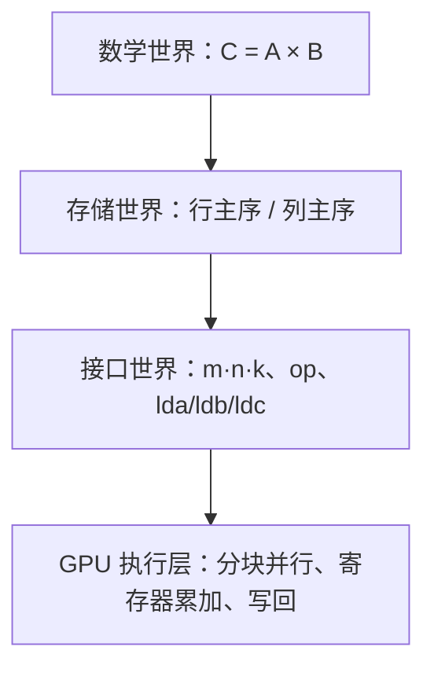
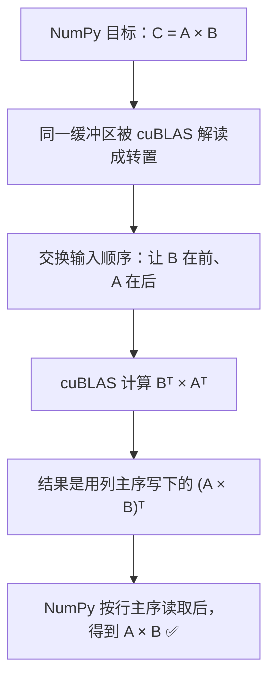
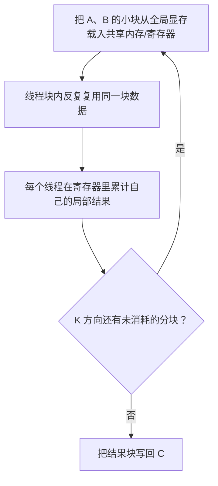

# 一行 `SGEMM`，为什么藏着三套矩阵世界？

> **副标题**：从一句 `C = A @ B`，走到算子接口、内存布局与 GPU 分块——拆开 `cublasSgemm` 的参数模型
>
> **工程深度**：L2，可继续延伸 ｜ **验证状态**：CPU 等价推演已核对，未实测
>
> **关键词**：cuBLAS / SGEMM / 行主序 / 列主序 / Leading Dimension / cuBLASLt
>
> **预计阅读**：15 分钟

> **工程深度｜验证状态：** L2 工程｜静态复核（建议上机跑通 cuBLAS）
---

## 开篇：一句话交给 GPU，为什么变成了一串参数？

你想让 GPU 做的事，看起来只有一句：**C = A × B**。

交给 cuBLAS 之后，却成了这样：

```python
# ⚠️ 教学伪代码：pycuda.driver 本身没有 cublasSgemm()，见下文第一节
driver.cublasSgemm(
    't', 't',      # 转置标志：op(A)=Aᵀ，op(B)=Bᵀ？
    N, N, N,       # m、n、k？同一个 N 写三遍？
    1.0,           # alpha
    A_gpu, N,      # A 的地址，后面怎么还跟个 N？
    B_gpu, N,      # B 的地址 + 一个 N
    0.0,           # beta
    C_gpu, N       # C 的地址 + 一个 N
)
```

几乎每个人都曾在原地卡住：两个 `'t'` 是什么？三个 `N` 能不能合成一个？矩阵地址后面跟的那个 `N`，是不是在重复声明矩阵大小？`1.0` 和 `0.0` 又在控制什么？

**而且这段代码即使不报错，也未必算出了你心里的那个 `A @ B`。**

问题不在矩阵乘法本身，而在三套「矩阵世界」没有对齐：



前三个是描述「矩阵长什么样」的三套世界；最后的 GPU 执行层，是把这三套描述兑现成算力的地方，不属于「矩阵世界」。本文就沿着这一行调用，把三套世界逐层拆开。

读完这条主线，你会得到一个可以复用的提问框架——遇到任何底层算子 API，都能先问「数学是什么、布局是什么、怎么寻址、怎么算」，而不是背参数。

---

## 一、先确认：这不是 `pycuda.driver` 的官方 API

动手之前，先钉死一个容易误导人的事实。

`pycuda.driver` 负责的是 CUDA Driver API、设备内存和 Kernel 启动，它的官方接口里**没有** `cublasSgemm()` 这个入口。当前 cuBLAS 的 C API 形如（首参必须是一个先创建好的句柄 `handle`）：

```c
cublasStatus_t cublasSgemm(
    cublasHandle_t handle,    // 必须先 cublasCreate 创建的句柄
    cublasOperation_t transa, // op(A)：'n' 不转 / 't' 转置 / 'c' 共轭转置
    cublasOperation_t transb, // op(B)：同上
    int m, int n, int k,      // (m×k)·(k×n) → (m×n)
    const float *alpha,       // 缩放系数
    const float *A, int lda,  // A 地址 + 主维度
    const float *B, int ldb,  // B 地址 + 主维度
    const float *beta,        // 旧输出系数
    float *C, int ldc         // C 地址 + 主维度
);
```

一共 **14 个参数**：`handle + transa + transb + m/n/k + alpha + A/lda + B/ldb + beta + C/ldc`。开头示例里的 `driver.cublasSgemm(...)` 少了句柄、也不在 `pycuda.driver` 官方范围内——它适合当作「问题现场」，但不能当作标准 PyCUDA 程序。Python 侧真实入口通常是 scikit-cuda 的 `skcuda.cublas.cublasSgemm(handle, ...)`，或 ctypes 直接调 cuBLAS 动态库。

Python 侧的场景结构其实分三层：

```text
Python 程序 → PyCUDA（CUDA Driver 绑定：上下文/内存/memcpy）
          → scikit-cuda（cuBLAS 的 Python 包装）
          → cuBLAS 库 → GPU 执行
```

先说清这个出身，再分解参数才有意义。顺便补一句背景：SGEMM 属于 BLAS（Basic Linear Algebra Subprograms，基础线性代数子程序）的 Level-3——一个把线性代数按操作对象分为向量级、矩阵-向量级、矩阵-矩阵级的标准接口；cuBLAS 就是 NVIDIA 把这套标准逐级针对 GPU 硬件优化后的实现。GEMM 所在的 Level-3 是算术强度最高的一类，天然适合 GPU 的大规模并行与数据复用。

SGEMM 这个名字本身也在回答「它在算什么」：

- `S`：Single precision，单精度，即 `float32`；
- `GE`：General，普通稠密矩阵；
- `MM`：Matrix-Matrix multiplication，矩阵乘矩阵。

直译成一句话：**单精度通用矩阵乘法**。

---

## 二、SGEMM 到底在描述什么？（α/β 与 m/n/k）

标准 GEMM 做的不是一次乘法，而是**一次调用合并了「缩放 + 乘法 + 累加」三个动作**：

$$C \leftarrow \alpha\cdot\operatorname{op}(A)\,\operatorname{op}(B)+\beta\cdot C$$

`alpha` 和 `beta` 是公式里仅有的两个浮点旋钮（小注：底层 C API 的 `alpha`/`beta` 实际是指向标量的指针 `const float*`，Python 封装层一般直接接收 Python 浮点数）。原代码传的是 `alpha=1.0`、`beta=0.0`：

- `alpha=1`：乘积原样保留；
- `beta=0`：结果不依赖旧的 `C`，因此调用前不需要为了 GEMM 语义额外执行一次 `cudaMemset` 清零——只要分配的缓冲区足够装下结果即可。

这也是「不收旧账」说法的来源：数学上它不读旧 `C`，所以通常不必刻意清零。注意这是**数学语义**的推论——不是说 GPU 一定会跳过对 `C` 的读取，后者是实现细节，不归 API 契约管。旋钮换一换，语义就不一样：

| 旋钮 | 传值 | 含义 | 常见用途 |
|---|---:|---|---|
| `alpha` | 1.0 | 乘积原样保留 | 标准矩阵乘法 |
| `alpha` | 0.5 | 乘积缩放一半 | 加权求和、动量混合 |
| `beta` | 0.0 | 旧 C 不参与，通常无需特意清零 | 首次写入输出 |
| `beta` | 1.0 | 新旧累加 | 累加器、梯度累加 |

接下来是三个维度 `m、n、k`，它们描述这次乘法的**形状**：

$$(m\times k)\;\cdot\;(k\times n)\;\rightarrow\;(m\times n)$$

| 参数 | 控制的维度 | 直观含义 |
|---|---:|---|
| `m` | 输出矩阵的行数 | 输出 `C` 有多少行 |
| `n` | 输出矩阵的列数 | 输出 `C` 有多少列 |
| `k` | 内积长度（reduction 维） | 每个输出元素要累加多少次 |

用非方阵最容易看清三者分工：

```text
A: 2×3        B: 3×4        C: 2×4
[ ▪▪▪ ]   ×   [ ▪▪▪▪ ]  =  [ ▪▪▪▪ ]
[ ▪▪▪ ]       [ ▪▪▪▪ ]     [ ▪▪▪▪ ]
               [ ▪▪▪▪ ]
m = 2（C 的行数）   n = 4（C 的列数）   k = 3（内积长度）
```

原代码里的 `N, N, N`，只是因为 A、B、C 恰好都是 `N×N` 方阵——**并不代表 GEMM 永远只需要一个边长参数**。这也正是教学示例最该小心的地方：`m/n` 都相等的方阵，会悄悄掩盖 `m/n` 写反、A/B 顺序颠倒、主维度设错等问题。程序照常运行，算出来的却是另一道题。

---

## 三、真正的坑：数学矩阵 ≠ 内存里的矩阵

`transa` 与 `transb` 决定 `op(A)` 与 `op(B)`：

| 标志 | 数学含义 | 说明 |
|---|---|---|
| `'n'` / `CUBLAS_OP_N` | `op(A)=A` | 不转置 |
| `'t'` / `CUBLAS_OP_T` | `op(A)=Aᵀ` | 转置 |
| `'c'` / `CUBLAS_OP_C` | `op(A)=Aᴴ` | 共轭转置；实数矩阵下与 `'t'` 等价 |

从纯数学接口看，`'t', 't'` 表示计算 `C=A^T B^T`。真正的坑不在这一层，而在下一层：**cuBLAS 默认按列主序（column-major）解释矩阵，NumPy 默认创建的数组通常是行主序（row-major）的 C 连续布局。**

列主序的意思是「同一列的元素在内存里相邻」，行主序则是「同一行的元素相邻」。同一段内存，两种读法得到完全不同的两张脸：

```text
同一段内存：1  2  3  4  5  6

NumPy 行主序读成：          cuBLAS 列主序读成：
┌───────┐                   ┌───────┐
│ 1 2 3 │                   │ 1 3 5 │
│ 4 5 6 │                   │ 2 4 6 │
└───────┘   2×3             └───────┘   2×3
```

同一个缓冲区，行主序是 `[[1,2,3],[4,5,6]]`，列主序却是 `[[1,3,5],[2,4,6]]`。奇妙的是，后者恰好是前者的转置：

$$A_{\text{cuBLAS 眼中的}}=A_{\text{NumPy 眼中的}}^T$$

也就是说，**把一个行主序的缓冲区交给列主序接口，cuBLAS 看到的就是这个矩阵的转置**。那 `'t', 't'` 在干什么？它是在「追加」两个转置，把被口述解读成转置的 A、B 再转回去，让计算阶段重新看到原始的 A 和 B。

可是事情还没结束：cuBLAS 写出的 `C` 也按列主序存放；NumPy 之后按行主序读取同一个缓冲区时，还会再看到一次转置。如果这串 `'t'`、指针顺序和输出读取方式没有成套设计，你最终得到的很可能是 $(AB)^T$，而不是期望的 $AB$——方阵每次都能「恰好」保住 `N×N` 的形状，却保不住数值方向。这就是布局错位最难排查的原因：不是式子错了，是**读法**错了。

### 一种兼容行主序缓冲区的技巧：交换 A 和 B

转置有一条反直觉的规则：

$$(AB)^T=B^T A^T$$

利用它，可以让列主序的 cuBLAS 去算 $C_{col}=B_{col}A_{col}$。由于 $B_{col}=B_{row}^T$、$A_{col}=A_{row}^T$，于是 $C_{col}=(A_{row}B_{row})^T$，再按行主序读回来，恰好等于 `A_row @ B_row`：



**请注意，这只是一种技巧，不是主线。** 它数学上成立，工程上却极易出错——漏一次交换、写错一个维度，就会从「算对了的巧合」滑向「稳定地算错」。如果你的目标是搞懂 cuBLAS，而不只是让一个示例通过，更稳的路线有两条：

1. 显式创建 Fortran 连续（列主序）布局的数组，再按列主序规则直白调用，不做任何交换；
2. 用 cuBLASLt 的矩阵布局描述符显式声明行主序/列主序（第八节展开）。

---

## 四、`lda/ldb/ldc`：shape 告诉你「有多大」，lda 告诉你「下一列从哪开始」

`lda` 全称 leading dimension，中文常译作**主维度**或**领先维度**。在列主序布局下，可以把它直观理解为：**相邻两列起点之间的元素跨度。**

```text
列主序矩阵 A，lda = 4
第 0 列起点     第 1 列起点     第 2 列起点
   ↓              ↓              ↓
[a00 a10 a20 a30][a01 a11 a21 a31][a02 a12 a22 a32]
   └─── 相邻两列起点间跨 4 个元素 ───┘
```

对没有 padding、不截子矩阵的普通列主序矩阵，`lda` 恰好等于物理存储的行数。那为什么接口不能从 `m、n、k` 直接推导？因为真实程序要处理一堆「不规整」的情况：

- 带 padding 的对齐矩阵；
- 从大矩阵里切出的子矩阵（tile）；
- 非连续 / 带 padding 的物理布局（例如由带 pitch 的二维存储 `cudaMallocPitch` 产生）；
- 转置前后不同的物理形状。

所以原代码里每组「地址 + 数字」：

```python
A_gpu, N
B_gpu, N
C_gpu, N
```

地址后面的 `N` 不是在重复声明矩阵大小，而是在告诉 cuBLAS **怎么跳着跨列寻址**。方阵里三者恰好都等于 `N`，又一次盖住了真实含义——换成 `m≠n` 的矩阵，这个 `N` 立刻变成错的答案。

一句话记住 shape 和 stride 的分工：

> **shape 告诉你矩阵「有多大」，`lda` 告诉你「下一列从哪里开始」。**

---

## 五、把一次 GEMM 调用完整跑起来

用 PyCUDA + scikit-cuda 走一遍真实调用，故意用非方阵让 `m/n/k` 全部露出来：

```python
import numpy as np
import pycuda.driver as cuda
from skcuda import cublas

A = np.array([[1, 2, 3],
              [4, 5, 6]], dtype=np.float32)      # 行主序，2×3
B = np.array([[1, 0, 0, 0],
              [0, 1, 0, 0],
              [0, 0, 1, 0]], dtype=np.float32)   # 行主序，3×4
C = np.zeros((2, 4), dtype=np.float32)
# NumPy 的逻辑形状是 2×4；
# 同一块内存交给列主序 cuBLAS 后，被它看成 4×2 的输出

A_gpu = cuda.mem_alloc(A.nbytes)                 # 分配设备内存
B_gpu = cuda.mem_alloc(B.nbytes)
C_gpu = cuda.mem_alloc(C.nbytes)
cuda.memcpy_htod(A_gpu, A)                       # 主机 → 设备
cuda.memcpy_htod(B_gpu, B)

handle = cublas.cublasCreate()                   # 1. 创建句柄

# 2. 调用。回看第三节的技巧：行主序缓冲被列主序接口解读后 = Aᵀ/Bᵀ，
#    利用 (A@B)ᵀ = BᵀAᵀ，交换输入顺序（X=B，Y=A）。
m, k = A.shape                    # 原始逻辑形状
n = B.shape[1]                    # 输出列数
cublas.cublasSgemm(
    handle, 'n', 'n',                            # 不转置——转置已由“交换”吸收
    n, m, k,                                     # m'=n，n'=m，k'=k（交换后的形状）
    1.0,
    B_gpu, n,                                    # X=B（列主序 n×k），lda=n
    A_gpu, k,                                    # Y=A（列主序 k×m），ldb=k
    0.0,
    C_gpu, n                                     # 输出列主序 n×m，ldc=n
)

cuda.memcpy_dtoh(C, C_gpu)                       # 设备 → 主机（此处隐式同步）
cublas.cublasDestroy(handle)                     # 3. 销毁句柄

ref = A @ B                                          # NumPy golden：全量对账
ok = np.allclose(C, ref, rtol=1e-4, atol=1e-3)
print("一致？", ok, "| 最大绝对误差:", np.max(np.abs(C - ref)))
print("C =", C)
```

在带 NVIDIA GPU 与 CUDA 的环境运行后，应得到：

```text
最大绝对误差: 0.0
C = [[1. 2. 3. 0.]
     [4. 5. 6. 0.]]
```

这里选恒等矩阵 B 是刻意为之——结果可心算复核，任何布局错位都会立刻显形。验证不要只停在它上面：请再换一组随机非方阵（如 `A=3×5`、`B=5×2`）重跑，`ok` 必须仍为 `True`。说明：本机无 NVIDIA GPU，本文代码按官方接口语义并结合 CPU 等价推演核对过（三类形状均与 `A@B` 一致），实机输出未实测后补入。

这段代码要传递三件事：**句柄三件套**（create → 调用 → destroy）一个都不能少；**逻辑形状与物理形状是两套坐标系**；最后，**输出必须交给一个「裁判」**——`np.allclose` + 最大绝对误差，而不是肉眼瞄一眼。这就是下一节方法论的最小样板。

---

## 六、GPU 为什么能把 GEMM 做得这么快？

一个输出元素，是 A 的一行与 B 的一列做点积：

$$C_{ij}=\sum_{p=0}^{k-1}A_{ip}B_{pj}$$

最直白的实现是「一个线程算一个输出元素」。但若每次乘加都去全局显存重新读 A 和 B，同一份数据会被反复取用成千上万次——计算单元反而在等数据，带宽成了真正的瓶颈。

所以高性能 GEMM 的第一性原则是**分块复用**：



可以把它想成搬砖：不是每砌一块墙都跑回仓库拿一块砖，而是先把一托盘砖搬到施工点，再由一组工人反复取用。货拉少了在仓库和工地之间跑断腿，货拉多了又占工位——tile 尺寸就是在算力和存储之间找平衡。

关于数量级，再压一个锚点。若把一次乘法 + 一次加法记作 2 次浮点运算（FLOPs），经典 GEMM 的理论工作量约为 $2mnk$ FLOPs——即每个输出元素做 `k` 次乘加。对 `1024³` 而言，大约是 21.5 亿次。这种「单点简单、总量巨大、天然可并行」的负载，正是 GPU 用武之地，也是前面说的 BLAS Level-3 的主业。

现代 cuBLAS 会根据数据类型、矩阵形状、内存对齐、GPU 架构以及计算模式，在内部算法库中做选择。对于支持 Tensor Core 的 GPU，cuBLAS 在合适的计算模式和问题条件下可以选择 Tensor Core 实现；**单精度 GEMM 也可以通过 TF32 Tensor Core 路径加速**（TF32 的有效精度略低于 FP32）。是否采用哪一条计算路径，由计算模式、GPU 架构、问题规模等共同决定——**不应把某条 Tensor Core 路径视为 `cublasSgemm` 的固定实现**：同一份代码在不同卡上可能走完全不同的路径，而具体 tile 与内核如何组织，都不属于 API 契约。

---

## 七、怎么证明它真的算对了、算得快

数值一致只是第一步。上一节的 `np.allclose` 证明格点上的数值对上了，但这类 14 参数调用最容易翻车的是三片隐性雷区：**m/n/k 与逻辑形状、转置与物理布局、`lda` 与寻址**。用一组**非方阵**把它们引爆：

```text
A: 2 × 3
B: 3 × 4
C: 2 × 4
```

非方阵像一面照妖镜，会让下面这些隐蔽问题立刻现形：`m/n/k` 填反、A/B 指针传反、转置标志与意图不符、`lda/ldb/ldc` 与物理布局不匹配、输出被当作转置矩阵读取。

再看速度。CUDA 调用通常是**异步提交**的：CPU 把任务丢给 GPU 就立刻返回。如果直接 `start = time.time(); cublas_call(); end = time.time()`，你量到的几乎是「提交动作」本身。反过来，如果在结束前强行同步并把 `C` 拷回主机再计时，又混进了「同步等待 + 设备到主机传输」。所以先分清三种时间，各回答各的问题：

| 指标 | 应该包含什么 | 适合回答的问题 |
|---|---|---|
| Kernel / GEMM 时间 | 仅设备侧那次矩阵乘法 | cuBLAS 本身算得多快 |
| GPU 阶段时间 | 设备侧计算 + 必要同步 | 一次 GPU 工作耗时多久 |
| 端到端时间 | H2D + 计算 + D2H 全链路 | 应用整体是否真的获益 |

设备侧时间用 **CUDA Event**（`cudaEventRecord` + `cudaEventElapsedTime`）测，并遵守一条简单的统计纪律：**预热 5 轮（丢弃，不计入结果）后正式计时 N 轮，报告中位数（median）或 P95**。单次最小值最容易被环境抖动骗到，中位数或 P95 才抗噪。和 NumPy 对比时，还要说明三件事：NumPy 背后用的是哪个 BLAS（OpenBLAS / MKL…）、单机用了几个线程、数据是否已经驻留 GPU——否则两边的数字没有可比性。

---

## 八、从 cuBLAS 到 cuBLASLt：布局从潜规则变成显式参数

行主序和列主序的纠葛，本质是「数学形状」与「物理布局」之间的信息要靠调用者脑补。现代接口正在把这一层**显式化**，顺着这条线可以看到三层演进：

```text
cublasSgemm（固定 FP32 + BLAS 参数） → cublasGemmEx（输入/输出/计算类型拆开）
→ cuBLASLt（layout + datatype + compute + epilogue + heuristic）→ 现代 GPU GEMM
```

`cublasGemmEx` 的进步在于：**它把「数据类型」拆成了三个独立维度——输入类型、输出类型、计算类型。** 例如 FP16/BF16 输入可以搭配 FP32 计算，而 INT8 GEMM 通常采用 INT32 累加（对应 `CUBLAS_COMPUTE_32I` 这类计算模式）。精确与显存的账，终于可以分开算了。

`cuBLASLt` 则更进一步：用矩阵布局描述符显式声明每个矩阵的 order（`CUBLASLT_ORDER_COL` 列主序 / `CUBLASLT_ORDER_ROW` 行主序），并与类型、stride、epilogue（例如可选地带上 ReLU、残差）、以及算法选择/启发式参数一起描述。于是调用者不必像传统 cuBLAS 示例那样，主要靠自己换算「行主序缓冲区配列主序接口」的对应关系。需要留意：`transpose` 仍然是 GEMM 操作语义的一部分，并不会因为布局描述符的存在而消失——被显式化的只是**物理布局**这一维。

这也就是 PyTorch 等框架在 NVIDIA GPU 上做 `Linear`/matmul 时，最终消费的那层能力——它们内部正是落在 cuBLAS / cuBLASLt 的这类例程上。所以理解了 `cublasSgemm` 的 14 个参数，你的钥匙就多了一把：往下，能看懂自己 Kernel 绕过了哪些布局假设；往上，混合精度、Tensor Core、cuBLASLt 都只是同一套「形状—布局—寻址—计算」命题的现代解。

再往下走，还有面向 device-level 的 cuBLASDx：它不替代 `cublasSgemm`，而是把 GEMM 能力进一步带进 CUDA kernel 内部。到这里，GEMM 就从「调用一个库函数」开始变成「组合进自己的 GPU 执行流程」——一句话带过，够知道有这个方向即可。

---

## 九、把一行调用收成一套方法论

说了这么多，真正要带走的不是「`'t','t'` 配交换」这个具体套路，而是一套读任何底层算子 API 的提问顺序。把它压成六问：

```text
第一问：数学公式是什么？
第二问：每个矩阵的逻辑形状是什么？（m、n、k）
第三问：数据的物理布局是什么？（行主序 / 列主序 / stride）
第四问：转置发生在「数学层」还是「存储解读层」？
第五问：leading dimension 是怎么寻址的，和形状对得上吗？
第六问：计算类型、输出类型，以及最终按什么布局读取？
```

这六问对齐一遍，14 个参数就再也骗不了你。浓缩成一张表，就是这篇真正想建立的模型：

| 维度 | 回答的参数 |
|---|---|
| Shape | m / n / k |
| Layout | 行主序 / 列主序 |
| Stride | lda / ldb / ldc |
| Compute | FP32 / TF32 / … |

从「一行调用」到「一个模型」，这就是轻科技文章该有的收法。

---

## 结尾：留一个想让你评论的问题

在你以前踩过的「GPU 结果像被转置了」的坑里，是 `'t'` 多了、少了，还是 A、B 顺序反了？欢迎在评论区留下一段你当年的翻车现场——同行多了，坑就浅了。顺手点个收藏，方便下次写 cuBLAS 时翻回这张「Shape / Layout / Stride / Compute」速查。

下一篇我们拿着这把钥匙，去拆一次矩阵乘法的内存流——数据从主机到设备、再从设备到共享内存的两笔"搬运账单"；`cublasGemmEx` 与混合精度下的 Tensor Core GEMM 属于更后面的专题。

---

## 附录：一次调用发布前的自查清单（避坑速查）

- [ ] 确认真实封装：scikit-cuda / ctypes / cuBLASLt？`pycuda.driver` 没有 `cublasSgemm`。
- [ ] 句柄三件套齐了吗：create → 调用 → destroy。
- [ ] 至少用一组**非方阵**验证 `m/n/k`。
- [ ] 明确每个数组是 C-order（行主序）还是 F-order（列主序）。
- [ ] 明确 `op(A)`、`op(B)` 的**逻辑形状**（是否被转置解读过）。
- [ ] `lda/ldb/ldc` 按物理存储填，不能机械地全部写成 N。
- [ ] 用 `np.allclose` 对比**完整结果**，报告容差与最大误差。
- [ ] 区分纯 GEMM 时间、GPU 阶段时间、端到端时间。
- [ ] 预热后多次重复，报告中位数或 P95，不用单次 `time.time()` 下结论。
- [ ] 不把某个固定 tile 或 Tensor Core 路径描述成所有设备上的必然实现。

---

## 参考资料

- [NVIDIA cuBLAS 文档：API 总览与数据布局（默认列主序）](https://docs.nvidia.com/cuda/cublas/index.html)
- [NVIDIA cuBLAS 文档：`cublas<t>gemm()` 接口](https://docs.nvidia.com/cuda/cublas/index.html#cublas-t-gemm)
- [NVIDIA cuBLAS 文档：`cublasGemmEx` 与计算类型（computeType）](https://docs.nvidia.com/cuda/cublas/index.html#cublasgemmex)
- [NVIDIA cuBLASLt 文档：Matmul 与矩阵布局描述符](https://docs.nvidia.com/cuda/cublas/index.html#cublaslt)
- [NVIDIA cuBLASDx 文档：device-level GEMM](https://docs.nvidia.com/cuda/cublasdx/using_cublasdx.html)
- [NVIDIA CUTLASS 文档：GEMM API（转置与操作数交换范式）](https://docs.nvidia.com/cutlass/latest/media/docs/cpp/gemm_api.html)
- [PyCUDA 官方文档：设备内存与数据传输](https://documen.tician.de/pycuda/driver.html)
- [scikit-cuda 文档：`cublasSgemm`](https://scikit-cuda.readthedocs.io/en/latest/generated/skcuda.cublas.cublasSgemm.html)