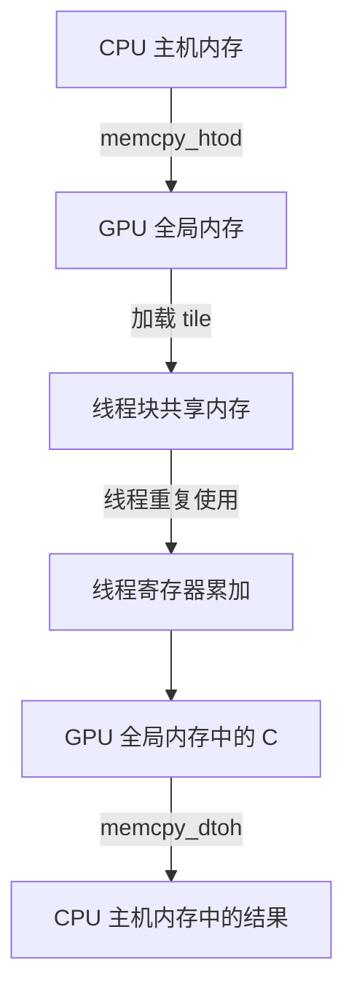

# GPU 算得快，数据怎么搬也很关键：用 PyCUDA 拆解矩阵乘法的内存流（附完整代码）

> **工程深度｜验证状态：** L2 工程｜静态复核 + 逻辑验证（传输重叠需上机实测）

> 一次矩阵乘法，数据要走过几段路？为什么搬进 GPU 还不够，还要再搬进共享内存？顺着这段 PyCUDA 示例，把两笔"搬运账单"一笔笔算清。

## 开场：GPU 已经很快，为什么一次计算还是慢？

设想一个推荐系统在线服务：用户特征和商品特征进入模型，GPU 完成若干矩阵运算，结果却迟迟没有返回。

问题可能出在计算，也可能出在数据流：输入是否频繁从 CPU 搬到 GPU？中间结果是否不断回到 CPU？同一批数据是否被 GPU 线程反复从显存读取？

上一篇《模型训练完了，为什么上线推理还是很慢？》讲过，推理优化要从端到端测量入手。这篇就顺着数据路径，把最容易被混为一谈的两段"搬运"拆开单点看。以 1024×1024 的矩阵乘法为例，讲清三件事：

1. CPU 内存中的输入如何进入 GPU 显存，一次大概要搬多少数据；
2. 进入显存的数据，为什么还要再搬进共享内存；
3. 怎样分别测量传输时间、Kernel 时间和完整流程时间。

矩阵乘法是理解数据复用的教学例子，也对应深度学习中的常见计算。但这个示例本身不是完整模型推理，数字也不能直接外推成某个模型、某个服务的加速效果。

## 先画出数据的路线：两笔不同的搬运账单



上面这张图里，有两段容易混为一谈的"搬运"：

- **主机到设备传输**：数据从 CPU 内存经过 PCIe 或其他互联进入 GPU 显存。代码中对应 H2D（Host to Device）和 D2H（Device to Host）拷贝。
- **GPU 内部的数据复用**：数据从 GPU 全局内存加载到线程块共享内存，供线程块中的多个线程重复使用。

先说结论：**这两笔账不应该混算。** 共享内存优化的是第二段（GPU 内部），它不会自动减少第一段（CPU 与 GPU 之间）的拷贝量。下面分别给这两笔账加上具体数字。

CUDA 编程指南说明，共享内存可供同一线程块中的线程共同访问；同步原语协调同一线程块内的线程，保证共享内存写入完成后再读取。[CUDA 编程指南：线程块同步](https://docs.nvidia.com/cuda/cuda-programming-guide/05-appendices/cpp-language-extensions.html)

## 第一笔账单：CPU 内存到 GPU 显存，一次大约要搬 12 MiB

### 先分配，再传输

PyCUDA 用下面的调用分配设备内存并显式复制数据：

```python
# 在 GPU 上申请足够容纳 A 的设备内存
A_gpu = cuda.mem_alloc(A.nbytes)

# H2D：把 A 从 CPU 内存复制到 GPU 显存
cuda.memcpy_htod(A_gpu, A)
```

- **mem_alloc**：在 GPU 上申请足以容纳 A 的设备内存。
- **memcpy_htod**：把 A 从主机内存复制到设备内存。HtoD 是 Host to Device 的缩写。

输出结果通过相反方向复制：

```python
# 在 CPU 侧准备接收结果的数组
C_gpu_result = np.empty_like(A)

# D2H：把 GPU 上的 C 复制回 CPU 内存
cuda.memcpy_dtoh(C_gpu_result, C_gpu)
```

**memcpy_dtoh** 把 GPU 上的 C 复制回 CPU 内存，DtoH 是 Device to Host 的缩写。PyCUDA 的基础教程同样采用"设备分配、主机到设备复制、Kernel 执行、设备到主机复制"的流程。[PyCUDA Tutorial](https://documen.tician.de/pycuda/tutorial.html)

### 这笔账有多大？一分钟心算

用文章示例的规模，数据量可以直接算出来：

| 项目 | 计算过程 | 大小 |
|---|---|---|
| 单个元素 | float32 | 4 字节 |
| 单个矩阵 A / B / C | 1024×1024 个元素 | 约 4 MiB |
| 一次 H2D（A 和 B） | 4 MiB × 2 | 约 8 MiB |
| 一次 D2H（C） | 4 MiB × 1 | 约 4 MiB |

一次完整流程，数据要跨过 PCIe 大约 **8 MiB 上行 + 4 MiB 下行 = 12 MiB**。把"数据搬运"从抽象概念换成这样的账单，才能判断它值不值得优化：如果输入只有几千字节，传输开销基本可以忽略；如果每帧是几十上百 MiB 的张量或图片，传输就会从幕后走到台前。

现代 PCIe 的理论带宽足以在几毫秒内搬完 12 MiB，但这是理论下限，不是实测结果。实际耗时受驱动、数据是否锁页、拷贝实现和系统负载影响，必须跑一次才知道——这正是后面计时要做的事。

### 在线推理中的内存管理思路

示例程序运行时分配 A、B、C。在线服务往往会重复执行相似形状的计算，可以考虑在请求之间复用设备缓冲区，避免把分配和释放放在每次请求的热路径里。

PyCUDA 文档指出，频繁调用设备内存和锁页主机内存分配可能带来明显开销；对于反复使用相近大小缓冲区的程序，内存池可以复用已分配空间。[PyCUDA Utilities：Memory Pools](https://documen.tician.de/pycuda/util.html)

内存池会持有闲置内存，因此需要同时观察应用和设备的内存占用。"复用内存"不等于"内存没有成本"。

### 更进一步能怎么改？先说清楚：这里测的是基线

当前示例使用普通 NumPy 数组和同步拷贝，便于看清显式数据流。**它测量的是基线，不是"主机传输优化之后"的结果。**后续可以对照评估这些方向：

- 使用锁页（pinned）主机内存配合异步拷贝；
- 使用 CUDA Stream，在依赖允许时重叠传输与计算；
- 把可留在 GPU 的中间结果留在 GPU，减少重复往返；
- 按批处理数据，摊薄每次请求的固定调度和传输成本。

锁页内存有助于提高主机与设备间的传输带宽，也是异步拷贝的重要条件；但它是有限资源，不适合大量、无控制地占用。异步传输也不意味着自动提速，只有传输和计算能有效重叠时才可能获益。[CUDA Best Practices Guide：Pinned Memory 与异步传输](https://docs.nvidia.com/cuda/cuda-c-best-practices-guide/index.html)

这些方向的收益，需要在同一台设备上分别实现并实测，而不是靠"听上去更快"的直觉判断。

## 第二笔账单：GPU 全局内存到共享内存，省的是重复读取

### 为什么显存里还要再搬一次？

GPU 全局内存容量大，适合存放完整的 A、B、C；共享内存容量小，但可在线程块内被多个线程共同使用。

矩阵乘法中，一个输出元素要沿 K 维度做点积：

```text
C[row, col] = A[row, 0] × B[0, col]
            + A[row, 1] × B[1, col]
            + ...
            + A[row, N-1] × B[N-1, col]
```

若每个线程独自从全局内存读取 A 行和 B 列，不同线程会反复读取很多相同的数据。共享内存分块的思路是：一个线程块协作加载 A、B 的小块，多个线程用同一批数据计算各自的输出元素。

### 一个 block 算一块输出，K 维度为什么仍然要循环？

这涉及两种不同的分块：

- **输出分块**：线程块根据 blockIdx 选择 C 的哪一块行列区域。
- **K 维分块**：线程块分几轮取数据，才能完成这块输出所需的点积。

线程块负责计算 C 的一个输出 tile，但该 tile 的每个元素都依赖 A、B 在整个 K 维度上的数据。每轮只加载一小段 K 数据，算出部分和并累加；循环结束时，输出 tile 才完整。

若 N=1024、BLOCK_SIZE=16，K 维度被分成 64 个 tile。**每个线程块循环 64 轮，逐步补齐同一块 C 的点积结果**——这 64 轮不会生成 64 块新的 C。

每个线程把 A、B 的元素搬进共享内存 tile 的关键代码如下：

```cuda
// 线程块内共享的 tile 缓存
__shared__ float As[BLOCK_SIZE][BLOCK_SIZE];
__shared__ float Bs[BLOCK_SIZE][BLOCK_SIZE];

// 当前线程负责输出 C[row, col]
int row = by * BLOCK_SIZE + ty;
int col = bx * BLOCK_SIZE + tx;
int a_col = tile_k_start + tx;   // 本轮 K 片段的起始列
int b_row = tile_k_start + ty;   // 本轮 K 片段的起始行

// 当前线程把 A、B 各一个元素写入共享内存
if (row < N && a_col < N) {
    As[ty][tx] = A[row * N + a_col];
} else {
    As[ty][tx] = 0.0f;   // 越界补 0，保证不完整 tile 也能安全计算
}
if (b_row < N && col < N) {
    Bs[ty][tx] = B[b_row * N + col];
} else {
    Bs[ty][tx] = 0.0f;
}
```

写入不是重点，重点在写入与读取之间那道护栏——`__syncthreads()`。它配合 K 维循环这样使用：

```cuda
for (int tile = 0; tile < num_tiles; ++tile) {
    // （本轮把 A、B 元素写进 As、Bs 的代码见上）

    __syncthreads();  // 等本线程块所有线程写完共享内存，才能开始读

    // 复用共享内存中的 tile，累加一段点积
    for (int k = 0; k < BLOCK_SIZE; ++k) {
        sum += As[ty][k] * Bs[k][tx];
    }

    __syncthreads();  // 等所有线程读完当前 tile，下一轮才能安全覆盖
}
```

两道 `__syncthreads()` 各有分工：第一道防"还没写完就读"，第二道防"上一轮还在读、就被下一轮覆盖"。少了任一道，共享内存都可能读到旧数据或半新半旧的数据，结果随机出错。

### 省的是"重复的全局内存读取"，不是"显存流量"

共享内存不会减少矩阵乘法本身所需的乘加次数，它减少的是**重复的全局内存读取请求**。

拿一个 16×16 的线程块、每轮 K 维分块来对比：

- 分块方式：协作加载 A、B 各一个 16×16 tile，共约 512 个元素的全局读取；
- 直读方式：256 个线程各自从全局内存读 32 个元素（16 个 A + 16 个 B），约 8192 次读取请求。

两者在"读取请求"层面相差约 16 倍（等于 BLOCK_SIZE）。但这里要分清两个概念：

- **全局内存读取请求**：指令层面发起的访问次数；
- **实际显存流量（DRAM Throughput）**：经过 L2 缓存等命中后，真正落到显存的流量。

实际显存流量往往没有 16 倍差距，因为 L2 缓存可能已经缓存了部分重复读的元素。共享内存的意义在于把"同一份数据要不要反复走到全局内存"显式控制住：tile 尺寸、访问是否合并、缓存命中率、寄存器与共享内存占用都会叠加影响最终性能。**收益最终要用性能分析工具（如 Nsight）实测，而不是只看代码结构推断。** NVIDIA 的矩阵乘法示例同样用共享内存避免冗余的全局内存传输，并指出共享内存可用于减少冗余加载、改善访问模式和避免带宽浪费。[CUDA Best Practices Guide：矩阵乘法共享内存](https://docs.nvidia.com/cuda/cuda-c-best-practices-guide/index.html)

### 两类同步别搞混

代码里出现了两个都叫"同步"的东西，作用完全不同：

| 同步函数 | 作用范围 | 谁在等谁 |
|---|---|---|
| `__syncthreads()` | GPU Kernel 内、单个线程块 | 块内线程互相等待，保证共享内存写完再读 |
| `cuda.Context.synchronize()` | 主机侧、整个上下文 | CPU 等待 GPU 上所有已提交工作完成 |

一句话记住：**`__syncthreads()` 等本线程块的线程；`cuda.Context.synchronize()` 让 CPU 等 GPU 工作完成。**

## 三类计时与"端到端"的边界

### 三段耗时分别怎么测

完整程序（见附录 A）分别测量 H2D、Kernel、D2H 和完整流程，核心计时片段如下：

```python
# H2D：主机时钟测同步拷贝，多轮取平均
cuda.Context.synchronize()
start = time.perf_counter()
for _ in range(TRANSFER_REPEATS):
    cuda.memcpy_htod(A_gpu, A)
    cuda.memcpy_htod(B_gpu, B)
h2d_average = (time.perf_counter() - start) / TRANSFER_REPEATS

# Kernel：CUDA Event 测 GPU 时间线，先预热一轮再计时
matmul(A_gpu, B_gpu, C_gpu, np.int32(N), block=block, grid=grid)  # 预热
cuda.Context.synchronize()
start_event, end_event = cuda.Event(), cuda.Event()
start_event.record()
for _ in range(KERNEL_REPEATS):
    matmul(A_gpu, B_gpu, C_gpu, np.int32(N), block=block, grid=grid)
end_event.record()
end_event.synchronize()
kernel_average = start_event.time_till(end_event) / 1000.0 / KERNEL_REPEATS

# 完整流程：H2D + Kernel + D2H 一次往返
cuda.Context.synchronize()
start = time.perf_counter()
for _ in range(END_TO_END_REPEATS):
    cuda.memcpy_htod(A_gpu, A)
    cuda.memcpy_htod(B_gpu, B)
    matmul(A_gpu, B_gpu, C_gpu, np.int32(N), block=block, grid=grid)
    cuda.memcpy_dtoh(C_gpu_result, C_gpu)
flow_average = (time.perf_counter() - start) / END_TO_END_REPEATS
```

两个计时工具的分工：

- **time.perf_counter()**：主机时钟，适合测同步拷贝（H2D、D2H）和完整流程；
- **CUDA Event**：记在 GPU 时间线上，测 Kernel 在 GPU 上的真实执行时间，不受 CPU 侧提交时序的干扰。

### "端到端"要加边界

把它统称"端到端耗时"，容易让读者误以为是完整推理服务的延迟。更准确的说法是：**H2D + Kernel + D2H 流程耗时**。

它的排除项要讲清楚：

- 不含矩阵生成（`rng.standard_normal`）；
- 不含显存分配（`cuda.mem_alloc`，分配发生在计时区间外，全程只需一次）；
- 不含 Kernel 编译（`SourceModule` 在运行前只编译一次）；
- 不含预处理、排队和后处理。

| 指标 | 包含什么 | 不包含什么 |
|---|---|---|
| H2D | A、B 从 CPU 复制到 GPU | 矩阵生成、分配、Kernel 编译 |
| Kernel | 仅 GPU 上执行矩阵乘法 | H2D / D2H、分配、编译 |
| D2H | C 从 GPU 复制回 CPU | 同上 |
| H2D + Kernel + D2H 流程 | 上述三者相加 | 矩阵生成、分配、编译、预处理、排队、后处理 |

它回答的是"**一次数据往返流程**实际花了多久"，不是"用户从发请求到拿到答案等了多久"。要测后者，必须把预处理、排队、后处理全部纳入计时区间。更不能把矩阵乘法微基准直接外推成完整模型的服务性能。

另外，H2D、D2H 的测量还包含 Python 循环和 API 调用开销，不是纯粹的 PCIe 物理传输时间。更严谨的分析需要预热、多轮统计和偏差处理，并用 Nsight Systems 等工具查看传输与 Kernel 在时间线上的位置。

## 这段程序能证明什么，不能证明什么？

它可以用来观察：

- 显式设备内存分配与主机/设备拷贝的代码路径；
- 共享内存 tile 如何被线程块复用；
- CUDA 结果是否与 NumPy 参考结果在容差范围内一致；
- 传输、Kernel 和完整流程耗时的区别。

它不能单独证明：

- GPU 一定比 CPU 快；
- 共享内存 Kernel 一定比其他实现快；
- 完整流程耗时等于深度学习模型的推理延迟；
- 锁页内存、统一内存或异步传输一定能提速。

比较性能结果时，至少要固定这几项：**数据规模、线程数、预热轮数、计时边界、设备型号。** NumPy 矩阵乘法通常调用优化过的 BLAS 实现；要比较 CPU 与 GPU，必须在相同输入、相同计时口径下报告上述条件。要证明"共享内存优化有效"，应另写一个边界处理一致、不走共享内存的朴素 GPU Kernel 作为对照组，在同一台设备上跑出两套数字再下结论。

## 从教学示例走向真实推理

真实模型服务的目标通常是缩短或隐藏整条数据链路中的等待：

1. **减少无效往返**：中间结果能留在 GPU 时，就不要每层都复制回 CPU。
2. **复用缓冲区**：请求形状稳定时，避免反复申请、释放同尺寸内存。
3. **合理批处理**：增加一次传输和一次 Kernel 启动处理的数据量，同时关注延迟要求。
4. **评估锁页内存与异步传输**：在数据量和硬件允许时，尝试让下一批数据传输与当前批次计算重叠。
5. **按完整链路测量**：包括预处理、H2D、Kernel、D2H 和后处理。

TensorRT、算子融合和计算图优化属于更高一层的推理优化。它们可以减少 Kernel 启动、合并操作或选择适合目标硬件的实现；这份 PyCUDA 示例的职责，是先把底层数据搬运和共享内存复用讲清楚。

## 结语：优化 GPU 程序，先问数据走了几趟

这次矩阵乘法展示了两笔不同的搬运账单：

- 输入和输出在 CPU 主机内存与 GPU 显存之间传输（示例中约 8 MiB 上行 + 4 MiB 下行）；
- A、B 的 tile 在 GPU 全局内存与线程块共享内存之间流动（减少重复读取，具体收益待实测）。

前一笔关系到数据是否频繁跨设备往返，后一笔关系到线程块是否反复读取相同数据。共享内存优化的是 GPU 内部的数据复用；复用显存、减少不必要的主机设备传输和测量完整流程耗时，则是应用层内存管理要解决的问题。

读 CUDA 性能代码时，沿着数据路径追踪：**数据在哪里分配、搬到哪里、被谁复用、何时同步、计时覆盖哪一段。**这比只盯着 Kernel 的乘加循环，更容易找到真正的性能瓶颈。

开放一个问题：你在实际服务里遇到过"计算看起来很快、整体却很慢"的情况吗？动手优化前，你测的是哪一段时间的"快"？欢迎留言对照。

下一篇会专门对比锁页内存、异步拷贝与 CUDA Stream 的实测差距，看第一笔账单还能怎么省。

## 附录 A：完整参考代码（可运行）

下面程序先在 CPU 上生成 A、B，再分配 GPU 显存并传入数据，运行共享内存分块 Kernel，最后把结果复制回 CPU 并与 NumPy 校验。它分别报告 H2D、Kernel、D2H 和"H2D + Kernel + D2H 流程"耗时，与正文各片段一一对应。

```python
"""GPU 算得快，数据怎么搬也很关键：用 PyCUDA 拆解矩阵乘法的内存流（附完整代码）（第1章 · GPU 编程基础）。

本文件是对应博文代码块的实现/演示，直接运行可见效果；运行依赖：PyCUDA、NumPy。
"""
import time

import numpy as np
import pycuda.autoinit
import pycuda.driver as cuda
from pycuda.compiler import SourceModule


# BLOCK_SIZE 会在 Python 端替换成编译期常量。
KERNEL_CODE = r"""
#define BLOCK_SIZE %(BLOCK_SIZE)s

__global__ void matrix_multiply_shared(
    const float *A,
    const float *B,
    float *C,
    int N
) {
    // 每个线程块协作缓存 A、B 的一个 tile。
    __shared__ float As[BLOCK_SIZE][BLOCK_SIZE];
    __shared__ float Bs[BLOCK_SIZE][BLOCK_SIZE];

    // block 选择 C 中的输出 tile。
    int bx = blockIdx.x;
    int by = blockIdx.y;

    // 当前线程在线程块内的位置。
    int tx = threadIdx.x;
    int ty = threadIdx.y;

    // 当前线程负责输出 C[row, col]。
    int row = by * BLOCK_SIZE + ty;
    int col = bx * BLOCK_SIZE + tx;

    // sum 在 K 维度的多轮循环中持续累加。
    float sum = 0.0f;

    // 沿 A 的列 / B 的行方向分块，也就是矩阵乘法的 K 维度。
    int num_tiles = (N + BLOCK_SIZE - 1) / BLOCK_SIZE;

    for (int tile = 0; tile < num_tiles; ++tile) {
        int tile_k_start = tile * BLOCK_SIZE;

        // 当前线程加载 A[row, tile_k_start + tx]。
        int a_col = tile_k_start + tx;
        if (row < N && a_col < N) {
            As[ty][tx] = A[row * N + a_col];
        } else {
            // 最后一个 tile 可能越过矩阵边界，越界元素补 0。
            As[ty][tx] = 0.0f;
        }

        // 当前线程加载 B[tile_k_start + ty, col]。
        int b_row = tile_k_start + ty;
        if (b_row < N && col < N) {
            Bs[ty][tx] = B[b_row * N + col];
        } else {
            // 越界位置补 0，使不完整 tile 也能安全计算。
            Bs[ty][tx] = 0.0f;
        }

        // 等待线程块内的加载完成，保证共享内存数据可读。
        __syncthreads();

        // 使用本轮 tile 计算一段点积，并加到当前线程的 sum。
        #pragma unroll
        for (int k = 0; k < BLOCK_SIZE; ++k) {
            sum += As[ty][k] * Bs[k][tx];
        }

        // 确保所有线程读完当前 tile，再允许下一轮覆盖共享内存。
        __syncthreads();
    }

    // 只写回合法的 C[row, col]。
    if (row < N && col < N) {
        C[row * N + col] = sum;
    }
}
"""


def average_seconds(elapsed, repeat_count):
    """把多次运行的总秒数换算成平均秒数。"""
    return elapsed / repeat_count


def main():
    # 矩阵维度；本示例实现 N×N 方阵。
    N = 1024

    # 一个线程块计算 C 的 16×16 区域。
    BLOCK_SIZE = 16

    # 分别测量传输和 Kernel 时的重复次数。
    TRANSFER_REPEATS = 10
    KERNEL_REPEATS = 20
    END_TO_END_REPEATS = 5

    if N <= 0 or BLOCK_SIZE <= 0:
        raise ValueError("N 和 BLOCK_SIZE 必须为正整数。")

    # 生成 float32 输入，与 CUDA Kernel 中的 float 类型一致。
    rng = np.random.default_rng(seed=42)
    A = rng.standard_normal((N, N)).astype(np.float32)
    B = rng.standard_normal((N, N)).astype(np.float32)

    # 把 BLOCK_SIZE 注入 CUDA 源码并编译 Kernel。
    source = KERNEL_CODE % {"BLOCK_SIZE": BLOCK_SIZE}
    module = SourceModule(source, options=["-O3"])
    matmul = module.get_function("matrix_multiply_shared")

    # 在 GPU 上为 A、B、C 分别申请显存。
    # 分配放在计时区间外，避免把分配开销混入传输或 Kernel 时间。
    A_gpu = cuda.mem_alloc(A.nbytes)
    B_gpu = cuda.mem_alloc(B.nbytes)
    C_gpu = cuda.mem_alloc(A.nbytes)

    # 一个 block 负责 C 的一个 BLOCK_SIZE×BLOCK_SIZE 输出区域。
    block = (BLOCK_SIZE, BLOCK_SIZE, 1)
    grid = (
        (N + BLOCK_SIZE - 1) // BLOCK_SIZE,
        (N + BLOCK_SIZE - 1) // BLOCK_SIZE,
        1,
    )

    # H2D：测量把 A、B 从 CPU 复制到 GPU 的主机端耗时。
    cuda.Context.synchronize()
    start = time.perf_counter()
    for _ in range(TRANSFER_REPEATS):
        cuda.memcpy_htod(A_gpu, A)
        cuda.memcpy_htod(B_gpu, B)
    h2d_total = time.perf_counter() - start
    h2d_average = average_seconds(h2d_total, TRANSFER_REPEATS)

    # 预热：首次启动及相关初始化不进入正式 Kernel 计时。
    matmul(A_gpu, B_gpu, C_gpu, np.int32(N), block=block, grid=grid)
    cuda.Context.synchronize()

    # 使用 CUDA Event 测量 GPU 时间线上的 Kernel 执行时间。
    # 这里不包括 H2D、D2H 和显存分配。
    start_event = cuda.Event()
    end_event = cuda.Event()

    start_event.record()
    for _ in range(KERNEL_REPEATS):
        matmul(A_gpu, B_gpu, C_gpu, np.int32(N), block=block, grid=grid)
    end_event.record()
    end_event.synchronize()

    # Event 时间以毫秒返回，除以 1000 转成秒。
    kernel_total = start_event.time_till(end_event) / 1000.0
    kernel_average = average_seconds(kernel_total, KERNEL_REPEATS)

    # 创建 CPU 输出数组，用于接收 GPU 上的 C。
    C_gpu_result = np.empty_like(A)

    # D2H：测量把 C 从 GPU 复制回 CPU 的主机端耗时。
    cuda.Context.synchronize()
    start = time.perf_counter()
    for _ in range(TRANSFER_REPEATS):
        cuda.memcpy_dtoh(C_gpu_result, C_gpu)
    d2h_total = time.perf_counter() - start
    d2h_average = average_seconds(d2h_total, TRANSFER_REPEATS)

    # 完整流程：计入输入拷贝、Kernel、输出拷贝。
    # 设备缓冲区仍在计时区间外申请并复用。
    # 同步 D2H 拷贝会等待此前的 Kernel 完成。
    cuda.Context.synchronize()
    start = time.perf_counter()
    for _ in range(END_TO_END_REPEATS):
        cuda.memcpy_htod(A_gpu, A)
        cuda.memcpy_htod(B_gpu, B)
        matmul(A_gpu, B_gpu, C_gpu, np.int32(N), block=block, grid=grid)
        cuda.memcpy_dtoh(C_gpu_result, C_gpu)
    flow_total = time.perf_counter() - start
    flow_average = average_seconds(flow_total, END_TO_END_REPEATS)

    # NumPy 矩阵乘法作为正确性参考。
    C_numpy = A @ B
    is_close = np.allclose(
        C_gpu_result,
        C_numpy,
        rtol=1e-3,
        atol=1e-3,
    )
    max_abs_error = np.max(np.abs(C_gpu_result - C_numpy))

    # 输出本机实测值。不同设备、驱动、系统负载下耗时都会变化。
    print(f"矩阵规模：{N}×{N}")
    print(f"线程块：{BLOCK_SIZE}×{BLOCK_SIZE}")
    print(f"H2D 平均耗时（A 和 B）：{h2d_average:.6f} 秒")
    print(f"Kernel 平均耗时：{kernel_average:.6f} 秒")
    print(f"D2H 平均耗时（C）：{d2h_average:.6f} 秒")
    print(f"H2D + Kernel + D2H 流程平均耗时：{flow_average:.6f} 秒")
    print(f"结果校验：{'通过' if is_close else '失败'}")
    print(f"最大绝对误差：{max_abs_error:.6e}")

    if not is_close:
        raise AssertionError("CUDA 计算结果与 NumPy 参考结果不一致。")


if __name__ == "__main__":
    main()
```

## 附录 B：运行说明与结果登记

### 环境依赖

- 一块 NVIDIA GPU 及对应驱动，本示例需要可用的 CUDA 运行时；
- Python 3，安装 PyCUDA 与 NumPy：`pip install pycuda numpy`。

### 运行方式

把附录 A 的代码保存为 `pycuda_memory_transfer_matmul.py`，运行：

```bash
python pycuda_memory_transfer_matmul.py
```

程序会打印类似下面的结构（具体数值取决于你的 GPU、驱动和系统负载，请以本机实测为准；N 卡上跑通后欢迎把输出贴到评论区做对照）：

```text
矩阵规模：1024×1024
线程块：16×16
H2D 平均耗时（A 和 B）：<实测值> 秒
Kernel 平均耗时：<实测值> 秒
D2H 平均耗时（C）：<实测值> 秒
H2D + Kernel + D2H 流程平均耗时：<实测值> 秒
结果校验：通过
最大绝对误差：<实测值>
```

一次性观察两个比例的常见问题：H2D + Kernel + D2H 流程耗时明显大于 Kernel 耗时，说明数据搬运占了不可忽略的份额；Kernel 耗时远小于流程耗时，说明计时边界是正确的（没有把编译、分配算进去）。

### 常见问题

- **SourceModule 编译慢**：第一次调用会触发 nvcc 在后台编译，耗时是正常的。Kernel 编译发生在所有计时之前，不属于任何一段计时。
- **输出校验失败**：float32 的累加误差与矩阵规模、数据分布相关。若你改了 N 或 BLOCK_SIZE，`rtol` / `atol` 容差可能需要重新标定。
- **计时被污染**：测 Kernel 前先 `cuda.Context.synchronize()`，避免把前一段 H2D 尚未完成的时间混进 Kernel 计时；这行在附录代码中已放置。

## 参考资料

1. [PyCUDA Tutorial：显式分配、数据传输与 Kernel 调用](https://documen.tician.de/pycuda/tutorial.html)
2. [PyCUDA Utilities：内存池与分配开销](https://documen.tician.de/pycuda/util.html)
3. [NVIDIA CUDA C++ Best Practices Guide：主机设备传输、锁页内存和共享内存矩阵乘法](https://docs.nvidia.com/cuda/cuda-c-best-practices-guide/index.html)
4. [NVIDIA CUDA Programming Guide：线程块同步](https://docs.nvidia.com/cuda/cuda-programming-guide/05-appendices/cpp-language-extensions.html)