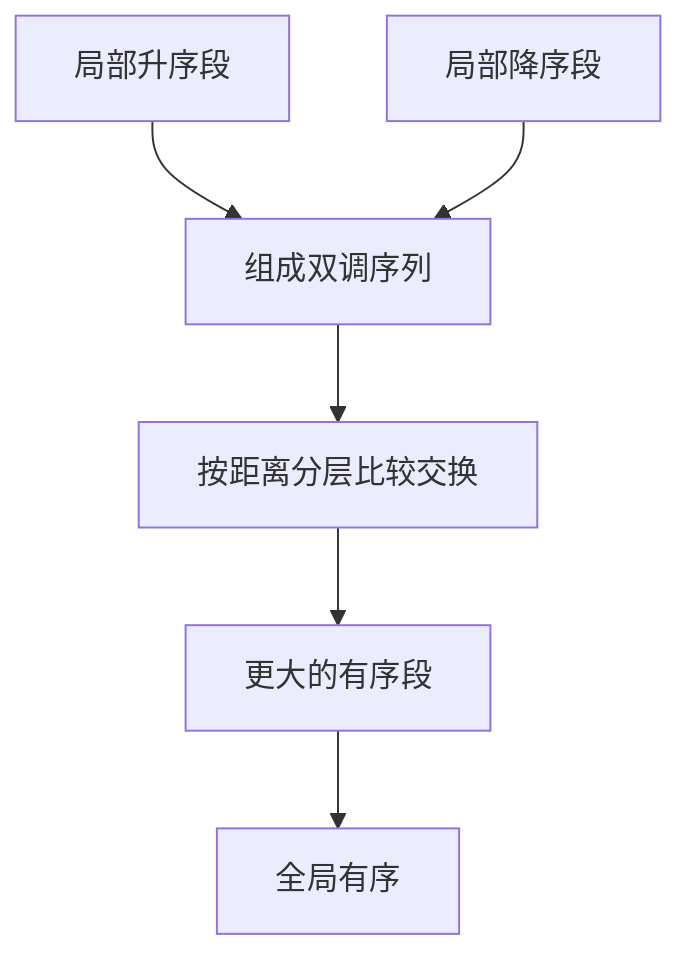
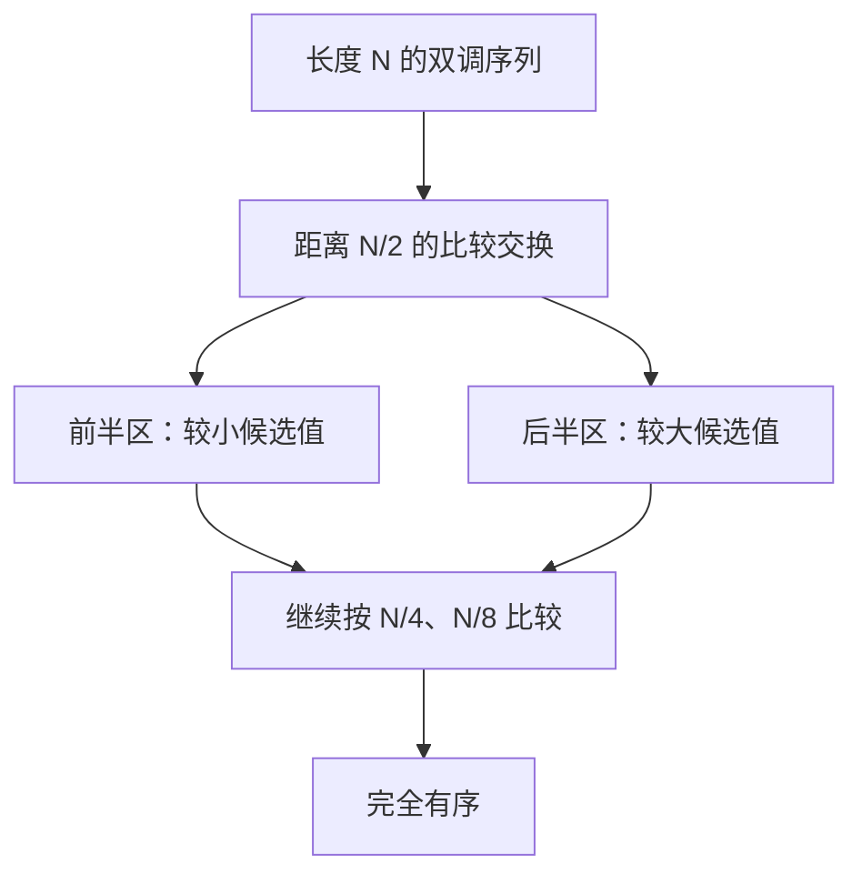
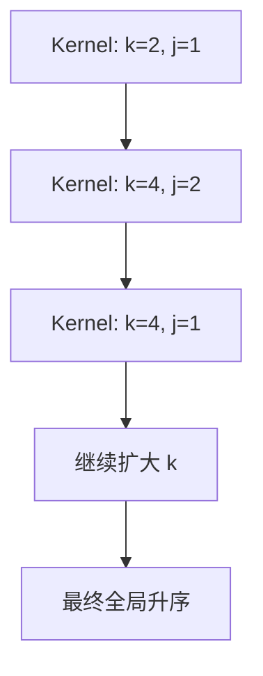

<!-- mode: light-tech -->

# 1024 个数，为什么这份朴素 CUDA 实现要启动 55 次 Kernel？

> **副标题：** 从 XOR 配对、升降序网络到跨 Block 同步，拆开全局 Bitonic Sort，理解 GPU 排序为什么不是“一个元素交给一个线程”那么简单。
>
> **工程深度：** L2，原理可验证、结果可校验 ｜ **验证状态**：未实测
>
> **预计阅读：** 正文约 22 分钟｜含附录 A 完整代码与附录 B 工程边界约 30 分钟
>
> **关键词：** CUDA、PyCUDA、Bitonic Sort、排序网络、XOR、Kernel Launch、CUDA Stream、CUDA Event

> **工程深度｜验证状态：** L2 工程｜静态复核 + CPU 对比验证（GPU 性能需上机实测）
---

## 一排线程同时动手，为什么数组还是没有排好？

第一次在 GPU 上写排序，最容易产生一种直觉：

```text
一个元素 → 一个线程 → 同时比较 → 同时交换 → 排序完成
```

这个想法只对了一半。

GPU 的确擅长让成千上万个线程同时工作。但排序不是矩阵加法：计算 `C[i] = A[i] + B[i]` 时，每个线程只需照顾自己的输出；排序中的一次交换，却会改变另一个线程下一步要读取的值。

假设 1024 个数已经进入显存。即使 1024 个线程同时完成一轮比较，也只会得到一批“局部正确”的元素对。下一轮该比较谁、按升序还是降序比较、上一轮是否已经全部完成，这些都必须由算法明确规定。

真正的问题不是：

> 怎样让更多线程参加比较？

而是：

> 怎样让所有线程沿着同一张比较网络，按正确顺序走完所有阶段？

Bitonic Sort——双调排序——正适合用来回答这个问题。它不一定是通用排序中最快的选择，却像一台透明的 GPU 教具：XOR 配对、线程分工、Block 边界、全局同步和 Kernel 启动开销，都能在几十行代码里看见。

先记住全文最重要的一句话：

> GPU 排序的难点，不是把比较拆给线程，而是让每一轮比较在正确的全局阶段发生。

---

## 30 秒讲懂 Bitonic Sort

Bitonic Sort 可以先记成两个动作：

```text
第一步：一升一降，构造双调序列
第二步：从远到近，对半比较合并
```

假设一组数据被整理成：

```text
先上升，再下降

1 → 3 → 7 → 9 → 8 → 6 → 2 → 0
```

这就是一种双调序列。它还没有完全有序，但已经具备一种很重要的结构：可以先比较前后两半中相距最远的对应元素，把较小值送入前半区、较大值送入后半区，再分别处理两个更小的子序列。

比较距离会这样缩短：

```text
N/2 → N/4 → N/8 → ... → 1
```

映射到代码，只需要记住：

> **k 管段，j 管距；XOR 找伙伴，位与定方向。**

```text
k 不断翻倍：当前处理的序列越来越长
j 不断减半：当前比较的两个元素越来越近
i ^ j      ：找到本轮比较伙伴
i & k      ：决定当前区域升序还是降序
```

后文所有循环、索引与 Kernel Launch，都是在实现这两步。

---

## 01｜先纠正名字：XOR 配对不是 Merge Sort

不少教学代码会把一个使用 XOR、共享内存和 `__syncthreads()` 的 Kernel 命名为 `parallel_merge_sort`。但名字不能只看“最后都在排序”。

| 算法 | 核心动作 | 典型特征 |
| --- | --- | --- |
| Merge Sort | 合并两个已有序区间 | 双指针、辅助输出区间 |
| Bitonic Sort | 按固定网络执行比较交换 | XOR 配对、升降序阶段 |
| Odd-Even Merge Sort | 按奇偶归并网络比较交换 | 固定比较器拓扑 |
| Radix Sort | 按位或数字分配、重排 | 不依赖通用比较器 |

如果代码通过 `i ^ j` 寻找比较伙伴，并按多个固定阶段推进，它更接近 Bitonic Sort，而不是传统 Merge Sort。

准确命名并非咬文嚼字。算法名称会直接决定我们如何判断它是否正确、复杂度如何计算，以及应当拿什么生产方案与它对比。

---

## 02｜排序不是一轮比较，而是一张“比较网络”

从最小的问题开始。要把 `[7, 2]` 排成升序，只需一次比较交换：

```python
if a > b:
    a, b = b, a
```

四个元素时，可以先并行处理两组互不重叠的元素：

```text
[7, 2]  [6, 3]
   ↓        ↓
[2, 7]  [3, 6]
```

这一轮没有写冲突，但结果 `[2, 7, 3, 6]` 仍未全局有序。下一轮还要比较更远的元素，并且必须等上一轮完成。

Bitonic Sort 的做法，是预先规定每个阶段的比较对象和方向。它不根据数据临时决定“下一步找谁”，而是让数据穿过一张结构固定的比较网络。



这也是它适合并行硬件的一面：控制结构规律、比较对可预先计算，同一阶段内的大量比较可以并行执行。

### 什么是“双调”？

最直观的双调序列，是先升后降：

```text
[1, 3, 7, 9, 8, 6, 2, 0]
```

也可以先降后升：

```text
[9, 7, 3, 1, 0, 2, 6, 8]
```

它还不是最终的全局升序结果，而是下一轮合并所需的中间结构。

这解释了一个常见误判：看到某个中间阶段“有一半在降序”，不代表算法错了。降序段是比较网络主动构造的材料。

补一句限定，先消除一个容易产生的误解：双调序列的严格定义确实允许“先升后降”及其循环移位，但它**不是调用者的输入前置条件**。本文的排序网络接受任意输入，从 `k=2` 开始逐层自行构造出标准方向的双调子序列；循环移位那一半只是帮助理解数学概念，完整定义见附录 B。

### 为什么偏偏要构造双调序列？

因为双调结构能够被规则地“对半拆开”。

设一个双调序列长度为 `N`。第一次比较时，让前半区的每个元素与后半区对应位置的元素比较，也就是比较距离为 `N/2`：

```text
索引 0       ↔ 索引 N/2
索引 1       ↔ 索引 N/2 + 1
索引 2       ↔ 索引 N/2 + 2
...
```

升序合并时，每一对都把较小值放到前半区、较大值放到后半区。完成后会得到两个关键结果：

1. 最终较小的那一半候选值被推向前半区，较大的候选值被推向后半区；
2. 前后两个半区仍保留双调结构，可以继续用同样方法处理。

于是一个大问题可以递归地缩小：



这就是 `j` 必须不断减半的根本原因：每完成一层比较，待处理的双调子序列规模也缩小一半。

> Bitonic Sort 不是碰巧用“远、近、再近”的顺序比较；它是在不断把一个双调问题拆成两个更小的双调问题。

---

## 03｜两个数字控制整张网络：`k` 与 `j`

经典实现中有两层循环：

```python
k = 2
while k <= N:
    j = k // 2
    while j > 0:
        bitonic_sort_step(..., j, k, N)
        j //= 2
    k *= 2
```

它们分工明确：

- `k`：当前要构造或合并的序列长度；
- `j`：当前阶段的比较距离。

对于 `N = 8`，调度顺序是：

```text
k=2 : j=1
k=4 : j=2, 1
k=8 : j=4, 2, 1
```

也就是 6 个全局阶段。

先不要急着看复杂度。下面让同一个数组真正走完这 6 个阶段。

### 8 个元素如何一步步变得有序？

假设输入是：

```text
[3, 7, 4, 8, 6, 2, 1, 5]
```

#### 第一层：构造长度为 2 的升降序段

此时：

```text
k = 2, j = 1
```

相邻元素两两比较，但方向交替变化：

```text
[3, 7]  升序，保持不变
[4, 8]  降序，变成 [8, 4]
[6, 2]  升序，变成 [2, 6]
[1, 5]  降序，变成 [5, 1]
```

得到：

```text
[3, 7, 8, 4, 2, 6, 5, 1]
```

这里看起来甚至比原数组更“不整齐”，但算法已经构造出四个方向交替的长度为 2 的有序段。

#### 第二层：合并成长度为 4 的升降序段

先比较距离为 2 的伙伴：

```text
k = 4, j = 2

[3, 7, 8, 4, 2, 6, 5, 1]
              ↓
[3, 4, 8, 7, 5, 6, 2, 1]
```

再比较相邻伙伴：

```text
k = 4, j = 1

[3, 4, 8, 7, 5, 6, 2, 1]
              ↓
[3, 4, 7, 8, 6, 5, 2, 1]
```

现在数组被组织成：

```text
[3, 4, 7, 8]  升序
[6, 5, 2, 1]  降序
```

把它们连起来看：

```text
3 → 4 → 7 → 8 → 6 → 5 → 2 → 1
```

这正是一个“先升后降”的长度为 8 的双调序列。

#### 第三层：把长度为 8 的双调序列合并为升序

先做最远的跨半区比较：

```text
k = 8, j = 4

比较：0↔4、1↔5、2↔6、3↔7

0↔4：3 与 6 → 保持
1↔5：4 与 5 → 保持
2↔6：7 与 2 → 交换
3↔7：8 与 1 → 交换

[3, 4, 7, 8, 6, 5, 2, 1]
              ↓
[3, 4, 2, 1, 6, 5, 7, 8]
```

同一阶段内的四对比较互不重叠，可以真正同时发生；一对里谁和谁比，也是由索引唯一确定的。这正是“比较网络”的含义——后面每一轮都遵循同样的规则，只是距离不同。

可以看到，小值开始集中到前半区，大值进入后半区。

继续把比较距离减半：

```text
k = 8, j = 2

[3, 4, 2, 1, 6, 5, 7, 8]
              ↓
[2, 1, 3, 4, 6, 5, 7, 8]
```

最后比较相邻元素：

```text
k = 8, j = 1

[2, 1, 3, 4, 6, 5, 7, 8]
              ↓
[1, 2, 3, 4, 5, 6, 7, 8]
```

完整过程可以压缩成一张阶段表：

| 阶段 | `k` | `j` | 这一轮在做什么 | 结果 |
| ---: | ---: | ---: | --- | --- |
| 1 | 2 | 1 | 构造长度 2 的升降序段 | `[3,7,8,4,2,6,5,1]` |
| 2 | 4 | 2 | 合并长度 4，先比远处 | `[3,4,8,7,5,6,2,1]` |
| 3 | 4 | 1 | 合并长度 4，再比近处 | `[3,4,7,8,6,5,2,1]` |
| 4 | 8 | 4 | 全局合并，跨半区比较 | `[3,4,2,1,6,5,7,8]` |
| 5 | 8 | 2 | 在子序列内继续减半 | `[2,1,3,4,6,5,7,8]` |
| 6 | 8 | 1 | 相邻比较，完成归位 | `[1,2,3,4,5,6,7,8]` |

现在再回头看两层循环，它不再只是代码模板：

```text
k 翻倍：2 → 4 → 8
        把短序列合成更长的序列

j 减半：k/2 → ... → 1
        在当前序列中从远到近完成归位
```

记忆时不必背六轮结果，抓住两层循环各自的任务就够了：

> **`k` 决定这一次要处理多长的序列，`j` 决定这一轮把比较距离收到多近。**

`k` 从小到大，序列越合越长；`j` 从 `k/2` 递减到 1，每一层的比较距离减半。六个阶段做完，数组只剩一种可能——全局升序。

如果 `N = 2^p`，排序网络的**逻辑阶段数**（也就是依赖深度）为：

$$1 + 2 + \cdots + p = \frac{p(p+1)}{2}$$

于是有下面这组数字：

| N | $p=\log_2 N$ | 逻辑阶段（网络深度） | 本文朴素实现 Launch 次数 | 比较交换对总数 |
| ---: | ---: | ---: | ---: | ---: |
| 8 | 3 | 6 | 6 | 24 |
| 1,024 | 10 | 55 | 55 | 28,160 |
| 1,048,576 | 20 | 210 | 210 | 110,100,480 |

比较交换对总数 = 每阶段的比较对数量 × 阶段数：

$$\frac{N}{2}\times\frac{p(p+1)}{2}=\frac{N}{4}\,p(p+1)$$

对 $N=1024$：

$$\frac{1024}{4}\times 10\times 11 = 28160$$

这里必须把两个数字彻底分开：

```text
55       —— 依赖阶段数：必须一层接一层地跨过，不能并行跳过
28,160   —— 比较交换对的总工作量：绝大部分可以同时执行
```

这正是 GPU 排序的核心张力：**工作量很大，但并行度更高**。55 回答的是“最少要等多少轮”，28,160 回答的是“一共要干多少活”。

还要补一句限定：55 不是 Bitonic Sort 的硬件定律，而是**这份实现的结构**。

> 排序网络的逻辑深度是 55 层；本文恰好把每一层映射为一次 Kernel Launch。阶段融合后，Launch 次数可以少于 55，但逻辑依赖不会凭空消失。

这也是标题里要写“这份朴素实现”的原因——换成共享内存融合、线程束（warp）shuffle 或其他调度设计后，Launch 次数未必仍是 55。

这张表揭示了 Bitonic Sort 的两面：

- 每个阶段可以并行处理大约 `N/2` 对元素；
- 阶段深度却是 $O(\log^2 N)$，朴素实现会产生许多 Kernel Launch 和多轮全局内存访问。

它的总比较工作量为 $O(N\log^2N)$，并行深度为 $O(\log^2N)$。这也是为什么“结构很适合教学”和“通用大规模排序未必最优”可以同时成立。

---

## 04｜XOR：每个线程如何找到自己的比较伙伴？

CUDA 线程先得到全局索引：

```cpp
const int i = blockIdx.x * blockDim.x + threadIdx.x;
```

然后用一行代码找到伙伴：

```cpp
const int ixj = i ^ j;
```

这里的 `^` 是按位异或，不是乘方。

### 当 `j = 1`

XOR 会翻转最低位：

```text
0(000) ↔ 1(001)
2(010) ↔ 3(011)
4(100) ↔ 5(101)
6(110) ↔ 7(111)
```

### 当 `j = 2`

它会翻转下一位：

```text
0(000) ↔ 2(010)
1(001) ↔ 3(011)
4(100) ↔ 6(110)
5(101) ↔ 7(111)
```

### 当 `j = 4`

比较距离继续扩大：

```text
0 ↔ 4
1 ↔ 5
2 ↔ 6
3 ↔ 7
```

把 `N = 8` 的六个阶段全部展开，就是一张完整的比较网络：

| 阶段 | `k` | `j` | `i ^ j` 生成的比较对 | 对数 |
| ---: | ---: | ---: | --- | ---: |
| 1 | 2 | 1 | (0,1) (2,3) (4,5) (6,7) | 4 |
| 2 | 4 | 2 | (0,2) (1,3) (4,6) (5,7) | 4 |
| 3 | 4 | 1 | (0,1) (2,3) (4,5) (6,7) | 4 |
| 4 | 8 | 4 | (0,4) (1,5) (2,6) (3,7) | 4 |
| 5 | 8 | 2 | (0,2) (1,3) (4,6) (5,7) | 4 |
| 6 | 8 | 1 | (0,1) (2,3) (4,5) (6,7) | 4 |

六个阶段、每阶段 4 对，合计 24 对——正好对上前面那条公式：$\frac{8}{4}\times 3\times 4 = 24$。网络本身是一张固定的表：比较谁、按什么方向比较，完全由 `(k, j)` 决定，不依赖数据本身——这也是它特别适合硬件并行的原因。

所以，`i ^ j` 不是“随便找另一个线程”，而是在索引的二进制空间中翻转指定比特，生成当前阶段固定的比较对。

把前面的口诀拆成两半，这一行负责的是「XOR 找伙伴」：

```text
i ^ j       决定“和谁比较”
(i & k)==0  决定“按什么方向比较”
```

方向判断写成一行代码：

```cpp
const bool ascending = ((i & k) == 0);
```

### `i & k` 为什么能决定方向？

这是全文最容易被跳过去的一行，也是口诀里「位与定方向」的完整答案。

`k` 永远是 2 的幂，二进制里只有一位是 1。以 `N = 8` 为例，把每个阶段的索引铺开：

| `k` | `k` 的二进制 | 索引 `i` | `i & k` | 方向 |
| --: | :---: | :--- | ---: | :--- |
| 2 | 0010 | 0, 1 | 0 | 升序 |
| 2 | 0010 | 2, 3 | 非 0 | 降序 |
| 2 | 0010 | 4, 5 | 0 | 升序 |
| 2 | 0010 | 6, 7 | 非 0 | 降序 |
| 4 | 0100 | 0 ~ 3 | 0 | 升序 |
| 4 | 0100 | 4 ~ 7 | 非 0 | 降序 |
| 8 | 1000 | 0 ~ 7 | 0 | 最终升序 |

从上往下读，规律很整齐：

- **`i & k` 检查的，是索引里“第几个长度为 `k` 的区域”的那一位。** 在连续的 `k` 个索引内，这一位保持不变，于是同一个区域内部方向完全一致；
- 相邻区域的这一位刚好相反，所以升降序天然交替——不需要任何额外判断，也不需要查表；
- 到了 `k = N`，所有 `i < N` 都有 `i & k == 0`，最后一个大阶段必然是升序。排序的收敛方向由此被钉死。

同一对元素为什么会得到同一个方向？因为伙伴 `i ^ j` 里 `j < k`，翻转的只是 `k` 这一位以下的比特，`i & k` 不会变——一对元素必然同升或同降。

升序区域里，`a > b` 才交换；降序区域里，`a < b` 才交换：

```cpp
const bool should_swap = ascending ? (a > b) : (a < b);
```

### 为什么还要判断 `ixj > i`？

XOR 配对是对称的：`0 ^ 1 = 1`，同时 `1 ^ 1 = 0`。如果两侧线程都动手，同一对元素会被处理两次，并形成写冲突。

```cpp
if (ixj > i && ixj < N) {
    // 只让索引较小的一侧负责这一对
}
```

在一个固定的 `(k, j)` 阶段，每个有效元素只属于一个比较对；再加上 `ixj > i`，每对只有一个线程写回。因此这个阶段不需要原子操作。

### 一个常被忽略的代价：一半线程其实在空转

`ixj > i` 消掉的不只是写冲突，还消掉了大约一半线程的活。

```text
启动线程数          ≈ N
真正执行比较交换的   ≈ N/2
算完索引直接退出的   ≈ N/2
```

对 `N = 1024` 来说，每个阶段只有约 512 个线程在做比较交换，另外约 512 个线程算完 `ixj` 就直接返回。

这不是写法错误，而是为可读性做的取舍：

> “一个元素一个线程，再让一半线程退出”是最好读的映射，但不是利用率最高的映射。更紧凑的实现可以直接启动 `N/2` 个比较器线程，再从比较器编号反推两个元素下标——令 `p` 为比较器编号，``i = (p / j) * (2 * j) + (p % j)`，两个待比较元素就是 `i` 与 `partner = i + j`。公式不难，但读者要先算清索引才能看懂它在比较谁。

（提前退出的线程仍会占用寄存器与调度资源，只是不再产生内存事务。真实收益要用 Nsight 和目标 GPU 上的 Benchmark 验证，不能凭直觉判断。）

---

## 05｜共享内存很快，却不能把四个 Block 变成一个 Block

假设：

```text
N = 1024
block_size = 256
```

Grid 会包含四个 Block：

```text
Block 0：索引   0 ~ 255
Block 1：索引 256 ~ 511
Block 2：索引 512 ~ 767
Block 3：索引 768 ~ 1023
```

如果 Kernel 中声明：

```cpp
__shared__ float sdata[256];
```

并不是四个 Block 共享同一块 `sdata`，而是每个 Block 各有一份。于是它最多自然地完成：

```text
Block 0 局部有序
Block 1 局部有序
Block 2 局部有序
Block 3 局部有序
```

这不等于整个数组有序。

```text
局部有序 ≠ 全局有序
```

同理，`__syncthreads()` 是 Thread Block 内屏障。它可以协调同一 Block 的线程，却不能让普通 Grid 中的所有 Block 在同一个 Kernel 中可靠地会合。CUDA 的 Block 必须能够独立调度；算法不能偷偷假设“Block 0 一定先于 Block 1 完成”。这一点来自 CUDA 编程模型本身，而不是某一代 GPU 的偶然行为。[CUDA Programming Guide](https://docs.nvidia.com/cuda/cuda-programming-guide/index.html)

### 把同步范围列成一张表

CUDA 里能“让线程等一等”的机制不止一种，它们的**同步域**差别很大。把这张表记住，比记住任何一段代码都有用：

| 机制 | 同步范围 | 能否直接完成本文的全局阶段 |
| --- | --- | --- |
| `__syncwarp()` / warp shuffle | 一个 warp | 只能处理 warp 内部伙伴 |
| `__syncthreads()` | 一个 Block | 不能同步四个 Block |
| `cluster.sync()`（Thread Block Cluster） | 一个 Cluster 内的若干 Block | 取决于 Cluster 范围与架构，且不等于任意 Grid 屏障 |
| Cooperative Groups Grid Sync | 协作式启动的整个 Grid | 可以，但有协作启动与驻留约束 |
| Kernel 边界 + 同一 Stream | 相邻两个 Kernel 之间的整个 Grid | 本文采用，最清晰通用 |

本文选择 Kernel 边界，是因为它适用于普通 Grid、不要求协作式驻留条件；其余机制的约束见附录 B。

---

## 06｜全局阶段边界：这份实现为什么选择多个 Kernel

到了 `(k=1024, j=512)`，比较对会变成：

```text
0   ↔ 512
1   ↔ 513
2   ↔ 514
...
511 ↔ 1023
```

伙伴已经跨越 Block 边界，共享内存无法直接覆盖它们。教学实现因此改用全局内存，并让一个 `(k, j)` 对应一次 Kernel Launch：



当这些操作提交到同一个 CUDA Stream 时，会按队列顺序执行。PyCUDA 也将 `Stream` 定义为按顺序执行操作的队列。[PyCUDA Stream 文档](https://documen.tician.de/pycuda/driver.html#concurrency-and-streams)

这里有一个很重要的工程区分：

- Kernel 与 Kernel 之间需要设备端阶段顺序；
- CPU 不需要在每一阶段调用 `Context.synchronize()`；
- 只需把所有阶段提交到同一 Stream，在最终取结果或计时结束时等待。

如果每轮都让 CPU 同步一次，正确性仍可能成立，但会把不必要的主机等待塞进调度路径。

### “多个 Kernel”不是唯一答案，却是最清晰的答案

把跨 Block 同步写成“只能拆成多个 Kernel”并不准确。现代 CUDA 至少还有三条路：协作式 Kernel（Cooperative Groups）的 `grid.sync()`、Thread Block Cluster 的 `cluster.sync()`、以及自维护阶段进度的 Persistent Kernel。

它们都没有免费午餐：协作式启动要求 Grid 内的 Block 能被同时驻留，Cluster 的同步域仅限于该 Cluster，Persistent Kernel 则必须自己解决跨 Block 阶段同步——**如果驻留 Block 数不足以覆盖整个 Grid，让已驻留的 Block 自旋等待尚未被调度的 Block，会直接死锁**。各自的完整约束见附录 B。

对普通 Grid 和这份可移植教学实现来说，**最清晰的全局阶段边界就是结束当前 Kernel、再启动下一个**：语义简单、不依赖设备是否支持协作启动、也不限制 Grid 大小。

换句话说，Kernel 边界是用“多几次启动开销”换“确定性与可移植性”。这个取舍值不值，取决于阶段有多重——本文每个阶段只做一轮比较，所以才需要认真评估启动开销（第 10 节会展开）。

---

## 07｜核心 Kernel 与启动循环

先只盯住排序本身。下面这段 Kernel 完成一个 `(k, j)` 阶段，前文讲过的每条规则都能在这里找到对应的一行：

```cpp
__global__ void bitonic_sort_step(float* data, int j, int k, int n) {
    const int i = blockIdx.x * blockDim.x + threadIdx.x;
    if (i >= n) {
        return;
    }

    // XOR 翻转 j 对应的索引位，得到本阶段比较伙伴。
    const int ixj = i ^ j;

    // 一对元素只由索引较小的一侧处理。
    if (ixj <= i || ixj >= n) {
        return;
    }

    // k 决定当前区域构建升序段还是降序段。
    const bool ascending = ((i & k) == 0);

    const float a = data[i];
    const float b = data[ixj];
    const bool should_swap = ascending ? (a > b) : (a < b);

    if (should_swap) {
        data[i] = b;
        data[ixj] = a;
    }
}
```

四行判断，对应四条规则：

| 代码 | 作用 |
| --- | --- |
| `i ^ j` | 找到本阶段的比较伙伴 |
| `ixj <= i` 或 `ixj >= n` | 每对只留一个 owner，同时消除写冲突与越界 |
| `(i & k) == 0` | 决定当前区域升序还是降序 |
| `should_swap` | 按方向决定这一对要不要交换 |

真正把整张网络串起来的，是外面那两层循环：

```python
def launch_bitonic_sort(data_gpu, n, stream, block_size=256):
    if not is_power_of_two(n):
        raise ValueError("n must be a power of two")
    if block_size <= 0:
        raise ValueError("block_size must be positive")

    # 设备上限校验：超过 MAX_THREADS_PER_BLOCK 的启动会直接失败。
    device = cuda.Context.get_device()
    max_threads = device.get_attribute(
        cuda.device_attribute.MAX_THREADS_PER_BLOCK
    )
    if block_size > max_threads:
        raise ValueError(f"block_size must be <= {max_threads}")

    grid_size = (n + block_size - 1) // block_size

    k = 2
    while k <= n:
        j = k // 2
        while j > 0:
            BITONIC_STEP(
                data_gpu,
                np.int32(j),
                np.int32(k),
                np.int32(n),
                block=(block_size, 1, 1),
                grid=(grid_size, 1, 1),
                stream=stream,
            )
            j //= 2
        k *= 2
```

外层 `k` 翻倍，内层 `j` 减半，**内层每转一圈就是一次 Kernel Launch**。数一数就知道 55 从哪来：

```text
k=2   : j=1                        → 1 次
k=4   : j=2, 1                     → 2 次
k=8   : j=4, 2, 1                  → 3 次
...
k=1024: j=512, 256, ..., 1         → 10 次

总计：1 + 2 + ... + 10 = 55 次
```

这段代码里有三处容易被跳过、却必须交代的细节：

- `block_size` 不只要大于 0，还不能超过设备的 `MAX_THREADS_PER_BLOCK`，否则启动会直接失败。教学代码既然要谈“工程可用”，参数契约就得写完整；
- 每次 `BITONIC_STEP(...)` 都提交到同一个 `stream`，CPU 不等待、不轮询、不同步。阶段之间的顺序由 Stream 保证，而不是由主机代码保证。
- 上面这两段是片段：`BITONIC_STEP`、`is_power_of_two` 与 `cuda` 均定义在附录 A 的完整程序中，正文只保留与算法结构直接相关的部分。

### 计时口径：测的是 Kernel，还是端到端？

完整程序（见附录 A）用 CUDA Event 包住整个 Kernel 序列。CUDA Event 是插入 Stream 的时间标记，事件时间要等排在它之前的操作执行到该位置才被记录；PyCUDA 文档也明确要求，计算两个 Event 的时间前应确保结束事件已经到达。[PyCUDA Event 文档](https://documen.tician.de/pycuda/driver.html#pycuda.driver.Event)

所以这段 Benchmark 测到的是：

```text
第一个排序 Kernel
        ↓
全部 (k, j) 阶段
        ↓
最后一个排序 Kernel
```

它**不包含**主机到设备（Host to Device, H2D）拷贝、设备到主机（Device to Host, D2H）拷贝和显存分配。这个口径适合观察算法本身，但不能冒充端到端延迟——两个数字回答的是不同问题。

---


## 08｜为什么校验不能只看“是否单调”？

一种常见检查是：

```python
np.all(actual[:-1] <= actual[1:])
```

它只能证明输出没有下降，却不能证明元素集合没有被破坏。例如，错误结果：

```text
输入： [1, 2, 3, 4]
输出： [1, 2, 2, 4]
```

依然单调，但元素 `3` 已经丢失。

更可靠的教学验证应当同时做两件事：

1. 用原始输入生成独立的 `np.sort` Reference；
2. 用 `np.array_equal` 逐元素比较完整输出。

此外还应覆盖：

- 随机输入；
- 已排序和逆序输入；
- 大量重复值；
- 最小规模 `N=1/2`；
- 多个不同的 2 次幂规模。

对于浮点业务数据，还必须先回答 NaN、`+0.0/-0.0`、正负无穷和稳定排序的语义。本文为避免掩盖这一问题，直接拒绝非有限值。

---

## 09｜不是 2 的幂怎么办？“补到 2 的幂”也有契约

排序网络通常按 2 的幂展开。若原始长度不是 2 的幂，可以补到下一次幂，但不能随便补零。

例如升序排列正数时补零：

```text
原始：[7, 2, 6]
补零：[7, 2, 6, 0]
排序：[0, 2, 6, 7]
```

最后不能靠“截取前三个”恢复原数组的排序结果。

升序有限浮点数常见做法是补 `+inf`，排序后再裁掉尾部；降序则可考虑 `-inf`。但如果真实输入允许无穷值、需要携带 value、要求稳定性，哨兵策略就必须扩展为显式有效位或键值对契约。

### 哨兵是内部约定，不是外部输入契约

这里有一个很容易踩的矛盾点：附录 A 的 `validate_input()` 明确拒绝 NaN 和 `+inf`，而上一段又说“补 `+inf`”。两者其实作用在不同阶段，并不冲突：

```text
用户输入
    ↓  先验证：必须全部有限
计算 padded_length
    ↓
内部追加 +inf 哨兵
    ↓
执行排序
    ↓
按 original_length 裁剪
```

`+inf` 是**内部 padding 哨兵**，不属于用户输入契约。正确的顺序是：先校验原始输入，再在内部完成填充；把填充后的数组重新交回“只允许有限值”的校验器，只会被自己拒绝。这也是为什么这段逻辑应该封装在排序入口内部，而不是让调用方自己补数组再传进来。

这也是工程实现与课堂演示的区别：输入约束不是注释，而是算法接口的一部分。

---

## 10｜这段代码为什么“能跑”，却还不是生产级排序器？

### 1. Kernel Launch 太多

在本文这份实现里，`N=1024` 已需 55 次启动，`N=2^20` 则需 210 次。每次 Kernel 都很短时，启动和调度开销会变得显眼。

可优化方向包括：

- 在 Block 内用共享内存融合多个小阶段；
- 用 warp shuffle 处理 warp 内比较；
- 把固定启动序列捕获为 CUDA Graph，降低重复提交开销；
- 重新设计全局阶段的数据访问与批处理方式。

但这些优化会增加复杂度，必须用 Nsight Systems、Nsight Compute 和目标 GPU 上的 Benchmark 来证明收益。

三条路径的边界也要分清，否则很容易产生错误期待：

```text
阶段融合（共享内存）
    → 把若干逻辑阶段压进一个 Kernel
    → 真正减少 Launch 次数与全局内存往返

warp shuffle
    → 只适用于 j < warpSize、且伙伴仍在同一 warp 的情况
    → 伙伴跨 warp、跨 Block 时，仍要回到共享内存、Kernel 边界或更大范围协作

CUDA Graph
    → 降低重复提交 55 个节点时的 CPU / Driver 开销
    ≠ 把 55 个逻辑依赖阶段变成 1 个阶段
    ≠ 消除多轮全局内存访问
```

换句话说：只有前两条可能改变算法结构与内存流量的形状；CUDA Graph 优化的是“提交”，不是“排序”。

### 2. 每个全局阶段都反复读写显存

朴素版本每轮从全局内存读取并写回。Bitonic 网络的规则整齐，不代表它自动拥有最佳内存效率。

### 3. 它不是稳定排序

键相等时，原始相对次序没有稳定性承诺。若业务需要稳定排序，应选择明确提供该语义的实现或附加原始位置作为次键。

### 4. 浮点“大小”不是一句 `a > b` 就结束

NaN 不满足普通全序直觉。即使没有 NaN，业务也可能关心 `-0.0`、无穷值和位级可复现性。必须先定义顺序，再选择比较器或键变换。

### 5. 生产环境优先使用成熟库

若目标是高性能通用排序，而不是学习排序网络，先按需求选型：

| 需求 | 首选 |
| --- | --- |
| 学习排序网络 | 手写 Bitonic Sort（本文） |
| 小型、固定长度、批量子序列 | Block / warp 内融合阶段的 Bitonic，需实测 |
| 整数 / 浮点大规模吞吐 | CUB `DeviceRadixSort` |
| 需要自定义比较器 | Thrust `sort` |
| 需要稳定性 | Thrust `stable_sort`，或显式构造复合键 |
| 数据已在框架中 | 优先框架原生算子（CuPy / PyTorch） |

CUB 与 Thrust 现由 NVIDIA 统一维护在 CCCL 项目中，接口与实现可在官方文档与源码中核对：[CCCL 官方文档](https://nvidia.github.io/cccl/)｜[CUB DeviceRadixSort 源码](https://github.com/NVIDIA/cccl/blob/main/cub/cub/device/device_radix_sort.cuh)。

想要一份可直接对照的官方网络型排序实现，可以看 CUDA Samples 里的 `sortingNetworks`，其中包含 `bitonicSort.cu` 与 `oddEvenMergeSort.cu`。[CUDA Samples：sortingNetworks](https://github.com/NVIDIA/cuda-samples/tree/master/cpp/2_Concepts_and_Techniques/sortingNetworks)

---

## 11｜到底什么时候值得使用 Bitonic Sort？

| 场景 | 是否合适 | 原因 |
| --- | --- | --- |
| 学习 CUDA 同步与索引 | 很合适 | 网络固定，线程关系透明 |
| 小型、固定长度、批量子序列 | 可能合适 | 可在 Block/warp 内融合阶段 |
| 需要固定的比较网络与可预测的阶段结构 | 可能合适 | 比较器拓扑与比较地址对不依赖输入值 |
| 大规模通用键排序 | 通常不首选 | $O(N\log^2N)$，阶段和流量较多 |
| 整数/浮点键高吞吐排序 | 优先比较 CUB Radix Sort | 成熟、专门优化 |
| 需要稳定排序 | 需另选实现或重构键 | 本文版本无稳定性保证 |

第三行需要说得更严谨：固定拓扑不等于严格常量时间——`if (should_swap)` 的实际写回行为仍然取决于数据，详见附录 B。

最值得带走的，不是“以后所有排序都写 Bitonic”，而是下面这套判断方法：

```text
比较对会不会写冲突？
        ↓
阶段之间是否存在全局依赖？
        ↓
依赖能否留在 Block / warp 内？
        ↓
跨 Block 时用什么建立阶段边界？
        ↓
测到的是 Kernel，还是端到端时间？
        ↓
自研实现是否真的优于成熟库？
```

---

## 结语：并行不是“同时做”，而是“有序地同时做”

如果读完全文只记住一幅画面，可以记住：

```text
一升一降，先造出一座山
从远到近，再把山层层劈开
```

如果只记住一句代码口诀，则是：

> **k 管段，j 管距；XOR 找伙伴，位与定方向。**

Bitonic Sort 最有价值的地方，不是让我们记住两层循环，而是把 GPU 并行的边界暴露得足够清楚：

- XOR 负责生成比较伙伴；
- `k` 负责决定升降序区域；
- `ixj > i` 负责消除重复处理与写冲突；
- `__syncthreads()` 只能解决 Block 内协作；
- 同一 Stream 中的多个 Kernel 建立全局阶段顺序；
- CUDA Event 给出清晰的设备端计时边界；
- CPU Reference 负责证明结果，而不是证明性能；
- CUB、Thrust 等成熟库负责回答生产环境的吞吐与维护问题。

GPU 真正擅长的，从来不是让所有线程毫无约束地一起动手。

它擅长的是：

> 把足够多的独立工作放进同一阶段，再用明确的边界连接这些阶段。

当你能分清“同一阶段的并行”和“阶段之间的顺序”，就不只读懂了 Bitonic Sort，也开始真正读懂 CUDA 算法。

---

## 参考资料

1. [NVIDIA CUDA Programming Guide](https://docs.nvidia.com/cuda/cuda-programming-guide/index.html)
2. [PyCUDA 2026.1 Device Interface：Streams 与 Events](https://documen.tician.de/pycuda/driver.html)
3. [NVIDIA CUDA Samples：sortingNetworks 示例目录](https://github.com/NVIDIA/cuda-samples/tree/master/cpp/2_Concepts_and_Techniques/sortingNetworks)
4. [NVIDIA CCCL：CUB DeviceRadixSort 源码与接口](https://github.com/NVIDIA/cccl/blob/main/cub/cub/device/device_radix_sort.cuh)
5. K. E. Batcher, [*Sorting Networks and Their Applications*](https://doi.org/10.1145/1468075.1468121), AFIPS Spring Joint Computer Conference, 1968 —— 双调排序网络的原始论文。
6. [NVIDIA/cccl 仓库](https://github.com/NVIDIA/cccl) —— CUB 与 Thrust 的统一维护入口。

## 附录 A｜完整可运行代码

下面这版代码刻意保持“透明”：一个 Kernel 只完成一个 `(k, j)` 阶段，便于观察比较网络。它需要已安装 PyCUDA 的环境，并且必须在一台有 NVIDIA GPU 的机器上运行。

它的边界也写得很清楚：

- 输入是一维 `float32`；
- 长度必须是 2 的幂；
- 示例输入只含有限数，不定义 NaN 的全序语义；
- 排序原地完成；
- 用独立 CPU Reference 校验；
- Benchmark 复用显存，CUDA Event 只包围 GPU 排序阶段。

```python
"""1024 个数，为什么这份朴素 CUDA 实现要启动 55 次 Kernel？（第1章 · GPU 编程基础）。

本文件是对应博文代码块的实现/演示，直接运行可见效果；运行依赖：PyCUDA、NumPy。
"""
import numpy as np

import pycuda.autoinit
import pycuda.driver as cuda
from pycuda.compiler import SourceModule


KERNEL_CODE = r"""
__global__ void bitonic_sort_step(
    float* data,
    int j,
    int k,
    int n
) {
    const int i = blockIdx.x * blockDim.x + threadIdx.x;
    if (i >= n) {
        return;
    }

    // XOR 翻转 j 对应的索引位，得到本阶段比较伙伴。
    const int ixj = i ^ j;

    // 一对元素只由索引较小的一侧处理。
    if (ixj <= i || ixj >= n) {
        return;
    }

    // k 决定当前区域构建升序段还是降序段。
    const bool ascending = ((i & k) == 0);

    const float a = data[i];
    const float b = data[ixj];
    const bool should_swap = ascending ? (a > b) : (a < b);

    if (should_swap) {
        data[i] = b;
        data[ixj] = a;
    }
}
"""


MODULE = SourceModule(KERNEL_CODE, options=["-O3"])
BITONIC_STEP = MODULE.get_function("bitonic_sort_step")


def is_power_of_two(n: int) -> bool:
    return n > 0 and (n & (n - 1)) == 0


def validate_input(data: np.ndarray) -> None:
    if data.ndim != 1:
        raise ValueError("input must be a 1D array")
    if data.dtype != np.float32:
        raise ValueError("input dtype must be float32")
    if not is_power_of_two(data.size):
        raise ValueError("input length must be a power of two")
    if not np.all(np.isfinite(data)):
        raise ValueError("this demo requires finite values; NaN/Inf are rejected")


def stage_count(n: int) -> int:
    if not is_power_of_two(n):
        raise ValueError("n must be a power of two")

    p = n.bit_length() - 1
    return p * (p + 1) // 2


def launch_bitonic_sort(
    data_gpu,
    n: int,
    stream: cuda.Stream,
    block_size: int = 256,
) -> None:
    if not is_power_of_two(n):
        raise ValueError("n must be a power of two")
    if block_size <= 0:
        raise ValueError("block_size must be positive")

    # 设备上限校验：超过 MAX_THREADS_PER_BLOCK 的启动会直接失败。
    device = cuda.Context.get_device()
    max_threads = device.get_attribute(
        cuda.device_attribute.MAX_THREADS_PER_BLOCK
    )
    if block_size > max_threads:
        raise ValueError(f"block_size must be <= {max_threads}")

    grid_size = (n + block_size - 1) // block_size

    k = 2
    while k <= n:
        j = k // 2
        while j > 0:
            BITONIC_STEP(
                data_gpu,
                np.int32(j),
                np.int32(k),
                np.int32(n),
                block=(block_size, 1, 1),
                grid=(grid_size, 1, 1),
                stream=stream,
            )
            j //= 2
        k *= 2


def validate_result(actual: np.ndarray, expected: np.ndarray) -> None:
    if not np.array_equal(actual, expected):
        mismatch = np.flatnonzero(actual != expected)
        first = int(mismatch[0]) if mismatch.size else -1
        raise AssertionError(
            f"GPU result differs from CPU reference at index {first}"
        )

    if actual.size > 1 and not np.all(actual[:-1] <= actual[1:]):
        raise AssertionError("GPU result is not monotonic")


def benchmark_sort(
    original: np.ndarray,
    block_size: int = 256,
    warmup: int = 5,
    iterations: int = 50,
) -> dict:
    """只测 GPU 排序阶段；不包含 H2D、D2H 与显存分配。"""
    n = original.size
    stream = cuda.Stream()
    data_gpu = cuda.mem_alloc(original.nbytes)

    # 预热：复用同一块显存，每轮恢复输入。
    for _ in range(warmup):
        cuda.memcpy_htod(data_gpu, original)
        launch_bitonic_sort(data_gpu, n, stream, block_size)
        stream.synchronize()

    elapsed_ms = []

    # Event 可以复用：每轮已等待 end 到达，下一轮重新 record 即可。
    start = cuda.Event()
    end = cuda.Event()

    for _ in range(iterations):
        # 同步 H2D 在计时区间之外完成。
        cuda.memcpy_htod(data_gpu, original)

        start.record(stream)
        launch_bitonic_sort(data_gpu, n, stream, block_size)
        end.record(stream)
        end.synchronize()

        elapsed_ms.append(float(start.time_till(end)))

    samples = np.asarray(elapsed_ms, dtype=np.float64)
    return {
        "p50_ms": float(np.percentile(samples, 50)),
        "p95_ms": float(np.percentile(samples, 95)),
        "min_ms": float(np.min(samples)),
        "max_ms": float(np.max(samples)),
    }


def run_tests(block_size: int = 256) -> int:
    """多规模、多输入形态的正确性回归；golden 仍是 CPU 侧 np.sort。"""
    stream = cuda.Stream()
    cases = {
        "random": lambda n, rng: rng.random(n, dtype=np.float32),
        "sorted": lambda n, rng: np.sort(rng.random(n, dtype=np.float32)),
        "reversed": lambda n, rng: np.sort(
            rng.random(n, dtype=np.float32)
        )[::-1].copy(),
        "duplicates": lambda n, rng: rng.integers(
            0, 3, size=n
        ).astype(np.float32),
        "all_equal": lambda n, rng: np.full(n, 1.5, dtype=np.float32),
    }

    checked = 0
    seed = 0
    for n in (1, 2, 4, 8, 32, 256, 1024):
        for make_case in cases.values():
            seed += 1
            host = np.ascontiguousarray(
                make_case(n, np.random.default_rng(seed)), dtype=np.float32
            )

            gpu = cuda.mem_alloc(host.nbytes)
            cuda.memcpy_htod(gpu, host)
            launch_bitonic_sort(gpu, n, stream, block_size)
            stream.synchronize()

            out = np.empty_like(host)
            cuda.memcpy_dtoh(out, gpu)
            gpu.free()

            validate_result(out, np.sort(host.copy()))
            checked += 1

    return checked


def main() -> None:
    n = 1024
    block_size = 256
    rng = np.random.default_rng(42)
    original = rng.random(n, dtype=np.float32)

    validate_input(original)
    expected = np.sort(original.copy())

    stream = cuda.Stream()
    data_gpu = cuda.mem_alloc(original.nbytes)
    cuda.memcpy_htod(data_gpu, original)

    launch_bitonic_sort(data_gpu, n, stream, block_size)
    stream.synchronize()

    actual = np.empty_like(original)
    cuda.memcpy_dtoh(actual, data_gpu)
    validate_result(actual, expected)

    print("Correctness: PASS")
    print("Input size:", n)
    print("Kernel stages:", stage_count(n))
    print("First 10 values:", actual[:10])

    checked = run_tests(block_size)
    print(f"Regression: PASS ({checked} cases)")

    stats = benchmark_sort(
        original,
        block_size=block_size,
        warmup=5,
        iterations=50,
    )

    print("Benchmark: kernel sequence only")
    print(f"P50: {stats['p50_ms']:.4f} ms")
    print(f"P95: {stats['p95_ms']:.4f} ms")
    print(f"Min: {stats['min_ms']:.4f} ms")
    print(f"Max: {stats['max_ms']:.4f} ms")


if __name__ == "__main__":
    main()
```

把它保存为 `bitonic_sort.py`，用一条命令运行即可：

```bash
python bitonic_sort.py
```

程序会先打印 `Correctness: PASS`、输入规模、Kernel 阶段数和前 10 个元素；然后跑一遍多规模回归（7 种规模 × 5 种输入形态 = 35 个用例），印出 `Regression: PASS`；最后给出只包含 Kernel 序列的 P50/P95/Min/Max 时间。计时口径的详细解释见第 07 节——它**不包含** H2D、D2H 与显存分配。

---

## 附录 B｜概念补充与同步机制的完整约束

### B.1 双调序列的严格定义

双调序列（bitonic sequence）是指：序列先单调不降、再单调不增，**或者它的某个循环移位满足这一形式**。

例如 `[9,7,3,1,0,2,6,8]` 循环移位后得到 `[0,2,6,8,9,7,3,1]`，后者恰好先升后降，所以前者也是双调序列。

这个定义在 Batcher 1968 的原始论文里用来描述排序网络的中间产物长什么样，而不是对调用者的输入要求。本文程序接受任意输入，从 `k=2` 开始逐层构造出标准方向的双调子序列。

### B.2 其他全局阶段同步机制的完整约束

根据 CUDA Programming Guide 的 execution model 与 Cooperative Groups 章节，可以把这三条路的前提条件列成一张表：

| 机制 | 启用方式 | 同步域 | 主要约束 |
| --- | --- | --- | --- |
| 协作式 Kernel（Cooperative Groups） | 用 `cudaLaunchCooperativeKernel` 替代 `<<<>>>` | 整个 Grid | Grid 内所有 Block 必须能同时驻留，Grid 大小因此受设备资源限制；实践上先查询 `cudaDevAttrCooperativeLaunch` 确认设备支持 |
| Thread Block Cluster | 编译期 `__cluster_dims__` 或启动时 `cudaLaunchKernelEx` | 一个 Cluster | compute capability 9.0 以上；可移植上限 8 个 Block；Cluster 内 Block 保证同时驻留在同一个 GPC；同步域不等于整个 Grid |
| Persistent Kernel | 自行设计 | 由实现决定 | 必须自己解决跨 Block 阶段同步：协作式启动、受控的常驻 Block 数量，或经过严格设计的原子计数加内存栅栏 |

**为什么 Persistent Kernel 不是免费的全局同步：**若 Grid 大于可同时驻留的 Block 数量，先被调度的 Block 会在自旋屏障处等待尚未获得执行资源的 Block，而那些 Block 又永远等不到空闲 SM——双方互等，程序挂死。实现上常见的做法是把常驻 Block 数量限制在 `cudaOccupancyMaxActiveBlocksPerMultiprocessor` 算出的范围内，再用原子计数做阶段同步。

### B.3 “固定拓扑”不等于“常量时间”

Bitonic Sort 的**比较器拓扑与比较地址对**不依赖输入值，这一点是成立的；但 `if (should_swap)` 决定了是否发生写回，写回行为仍然取决于数据。所以：

- 固定的控制流结构 ≠ 严格常量时间实现；
- 也不自动等于无侧信道（side-channel）实现。

如果业务真的需要与数据无关的执行时间，需要把比较交换改成无分支写回（无条件写入 min/max），并单独评估其代价；这属于另一个话题，本文不展开。

---

> **版本与口径说明：** 本文于 2026 年 9 月依据 NVIDIA CUDA Programming Guide、CUDA Samples、CCCL 与 PyCUDA 2026.1 文档核验。文中代码是用于理解全局排序阶段的教学实现；未给出未经目标 GPU 实测的性能数字，也不将其描述为对 CUB/Thrust 的性能替代。
