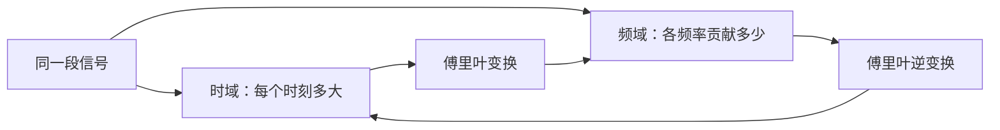
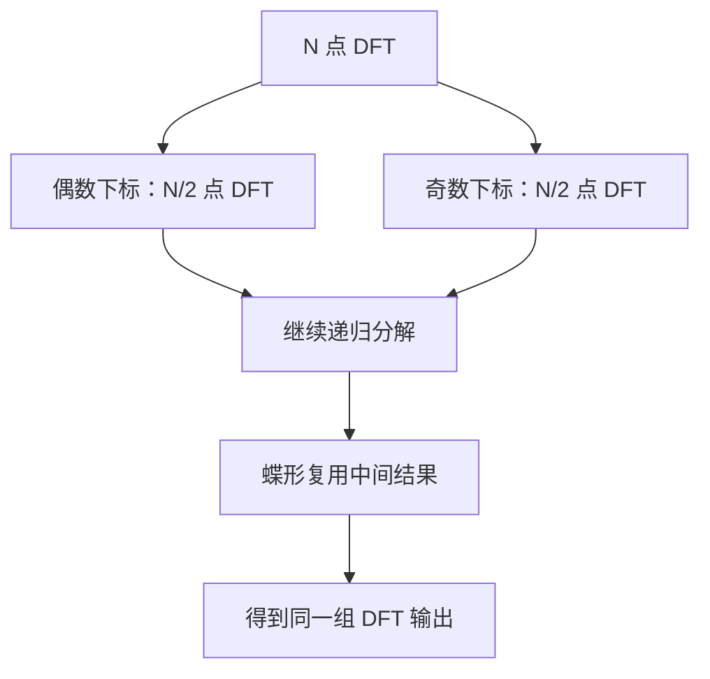

# 把声音拆成频率，究竟发生了什么？

> **副标题：从傅里叶变换、4 点手算，到 PyCUDA 朴素 DFT——讲清 GPU 为什么并行了，计算量仍是 $O(N^2)$**
>
> **预计阅读：** 25 分钟  
> **关键词：** 傅里叶变换、DFT、FFT、频谱、复数、CUDA、PyCUDA、Shared Memory

> **工程深度｜验证状态：** L2–L3 工程｜静态复核 + 数值验证（落桶需按整数频率桶选取）
---

一段声音，在示波器上只是一条随时间起伏的曲线。

可音乐软件却能告诉你：这里有 440 Hz 的主音，也有 880 Hz、1320 Hz 的泛音；降噪算法还能从人声中找到稳定的嗡声，再把它压下去。

它们究竟看见了什么？

答案并不是“声音里藏着一张频率表”，而是：**同一段数据，可以换一套坐标来描述。**

在时域里，我们逐时刻记录信号有多大；在频域里，我们改问：

> 如果拿许多不同转速的“旋转尺子”去测这段信号，哪一把最合拍？

这就是傅里叶变换最重要的直觉。

本文不从一串公式突然开始。我们会依次拆开五件事：

1. 傅里叶变换到底在变什么；
2. 为什么公式里会出现复数和旋转；
3. 朴素 DFT 如何一项一项算出频谱；
4. GPU 为什么能加速它，却没有改变 $O(N^2)$ 的总工作量；
5. FFT 又怎样从算法结构上真正减少计算。

读完后，你不只会调用 `np.fft.fft()`，还会知道它在替你完成什么。

> **30 秒讲懂**：DFT 拿 N 把不同转速的"旋转尺子"，逐把测量信号在哪个频率上最合拍。朴素实现每个输出都要扫完 N 个输入，总工作是 $O(N^2)$；GPU 让多个输出并行测量，但每个桶照样要扫完 N 个输入，总工作没有变；FFT 复用重复结构，才真正降到 $O(N\log N)$。

> **阅读路线**：只想理解 DFT，读 01～06；想看 CUDA 朴素实现，继续读 07～10；关心 FFT 与生产选型，读 11～14；完整参考实现与运行说明放在文末「附录 A」。

---

## 01｜先建立直觉：傅里叶变换不是“创造频率”

假设我们录到一秒钟的声音，波形看起来很复杂：

```text
振幅
  ↑       ╭╮    ╭──╮  ╭╮
  │  ╭╮  ╭╯╰╮╭──╯  ╰──╯╰╮
──┼──╯╰──╯  ╰╯            ╰──→ 时间
  │
```

这条曲线告诉我们“每个时刻的振幅”，却很难直接回答“里面有哪些音高”。

傅里叶分析做的事情，是尝试用许多简单的周期波去解释它：

```text
复杂信号
   ≈
低频正弦波
 + 中频正弦波
 + 高频正弦波
 + ……
```

更准确地说，傅里叶分析把信号投影到一组正交的周期基函数上。它并没有凭空生成频率，而是在回答：

> **每个候选频率，要用多大的幅度、怎样的相位，才能共同重建原信号？**

这像描述地图上的一点。你可以用经纬度，也可以说“从某地向东多少、向北多少”。对象没变，坐标系变了。



### 四个名字，别混在一起

| 名称 | 输入 | 输出 | 典型场景 |
|---|---|---|---|
| 傅里叶级数 | 连续、周期信号 | 离散频率系数 | 描述周期函数 |
| 连续傅里叶变换（FT） | 连续、非周期信号 | 连续频谱 | 理论分析 |
| 离散时间傅里叶变换（DTFT） | 离散时间序列 | 连续且周期的频谱 | 数字信号理论 |
| 离散傅里叶变换（DFT） | 有限个离散样本 | 有限个离散频点 | 计算机实际计算 |

本文真正要实现的是最后一个：**DFT**。

---

## 02｜为什么公式里偏偏要用复数？

看到 DFT 公式时，很多人首先被这一项劝退：

$$e^{-j\theta}$$

其实它没有看起来那么神秘。欧拉公式告诉我们：

$$e^{-j\theta}=\cos\theta-j\sin\theta$$

它可以被理解为复平面上一根长度为 1、顺时针旋转了 $\theta$ 的指针：

```text
虚轴 Im
  ↑
  │       • e^(jθ)
  │      ╱
  │     ╱ θ
──┼────╱────────→ 实轴 Re
  │
```

正弦和余弦本来就描述周期运动；复数只是把它们打包在同一个旋转对象里：

```text
实部 ←→ 余弦方向
虚部 ←→ 正弦方向
```

因此，DFT 输出的一个复数

$$X[k]=a+jb$$

同时保存了两类信息：

- 模长 $|X[k]|=\sqrt{a^2+b^2}$：这个频率成分有多强；
- 相位 $\arg X[k]=\operatorname{atan2}(b,a)$：它从周期的哪个位置开始。

只保留实部，就像记录一支箭头的水平投影，却丢掉垂直投影；结果不再是完整的 DFT。

---

## 03｜DFT 的本质：拿 N 把旋转尺子逐一比对

长度为 $N$ 的序列 $x[n]$，其前向 DFT 通常写作：

$$X[k]=\sum_{n=0}^{N-1}x[n]e^{-j2\pi kn/N},\qquad k=0,1,\ldots,N-1$$

先不要背。逐个看变量：

| 符号 | 含义 |
|---|---|
| $n$ | 输入样本下标，也就是“正在看第几个时刻” |
| $k$ | 输出频率桶（frequency bin）下标 |
| $x[n]$ | 第 $n$ 个输入样本 |
| $e^{-j2\pi kn/N}$ | 第 $k$ 把旋转尺子在第 $n$ 个位置的方向 |
| $X[k]$ | 所有样本与第 $k$ 个频率匹配后的复数总和 |

把复指数展开：

$$X[k] =\sum_{n=0}^{N-1}x[n]\cos\left(\frac{2\pi kn}{N}\right) -j\sum_{n=0}^{N-1}x[n]\sin\left(\frac{2\pi kn}{N}\right)$$

它做的其实很朴素：

```text
选定频率 k
   ↓
让参考指针按 k 对应的速度旋转
   ↓
每个样本 x[n] 乘上当时的指针方向
   ↓
把 N 个结果相加
   ↓
得到 X[k]：该频率的强度与相位
```

如果信号里确实含有这个频率，各个旋转后的向量会大体同向，相加后留下较大的合力；如果频率不匹配，向量会散向圆周各处，彼此抵消。

这就是“检测某个频率”的几何直觉。

---

## 04｜亲手算一次：4 个数字怎样变成频谱？

取一个只有 4 个样本的信号：

$$x=[1,0,-1,0]$$

它正好是余弦波 $\cos(\pi n/2)$ 的四个采样点。

令

$$W_4=e^{-j2\pi/4}=e^{-j\pi/2}=-j$$

则 DFT 也可写成：

$$X[k]=\sum_{n=0}^{3}x[n]W_4^{kn}$$

### k=0：零频，也就是直流分量

$$X[0]=1+0-1+0=0$$

它等于所有样本之和。这个信号正负抵消，所以没有直流偏置。

### k=1：每 4 个样本转一圈

$$
\begin{aligned}
X[1]
&=1\cdot1+0\cdot(-j)+(-1)\cdot(-1)+0\cdot j\\
&=2
\end{aligned}
$$

### k=2：每 2 个样本转一圈

$$X[2]=1+0-1+0=0$$

### k=3：对应负频率一侧

$$
\begin{aligned}
X[3]
&=x[0]W_4^0+x[1]W_4^3+x[2]W_4^6+x[3]W_4^9\\
&=1\cdot1+0\cdot j+(-1)\cdot(-1)+0\cdot(-j)\\
&=2
\end{aligned}
$$

其中 $W_4^3=e^{-j3\pi/2}=j$、$W_4^6=-1$、$W_4^9=e^{-j\pi/2}=-j$。

注意 $k=3$：它相当于"每 4 个样本反向转一圈"的负频率，在 4 点 DFT 里它与 $k=-1$ 是同一个桶。这一步先记住，下面解释为什么它恰好等于 $X[1]$。

最终得到：

$$X=[0,2,0,2]$$

为什么一个余弦波出现两个峰？因为

$$\cos\theta=\frac{e^{j\theta}+e^{-j\theta}}{2}$$

实数余弦可以看成一对方向相反的复旋转。因此实信号的频谱具有共轭对称性：

$$X[k]=X^*[N-k],\qquad k=1,2,\ldots,N-1$$

严格写是 $X[k]=X^*[(-k)\bmod N]$——因为当 $k=0$ 时，$X[N-k]$ 会走到 $X[N]$，超出数组。还要补充两句：直流桶 $X[0]$ 与自身共轭；偶数长度下的 Nyquist 桶 $X[N/2]$ 同样与自身共轭。实信号时这两个桶都应为实数（忽略浮点误差）。

所以 $X=[0,2,0,2]$ 里的两个 2 不是"重复算错了"，而是实信号频谱的结构。

**声音的频率，怎么可能是负的？** 正负频率不是"每秒振动了负数次"。它们表示复平面上两个相反的旋转方向：正频率向一个方向转，负频率向另一个方向转。实数正弦或余弦可以表示为一对方向相反、互为共轭的复指数（$e^{j\theta}$ 与 $e^{-j\theta}$）；两者相加，虚部相互抵消，得到只有实数的信号。

---

## 05｜频率桶到底是多少 Hz？

DFT 下标 $k$ 不是天然的 Hz。若采样率为 $f_s$，样本数为 $N$，相邻频率桶间隔为：

$$\Delta f=\frac{f_s}{N}$$

第 $k$ 个正频率桶对应：

$$f_k=k\frac{f_s}{N}$$

例如：

```text
采样率 fs = 8 000 Hz
样本数 N = 1 000

频率桶间距 Δf = 8 Hz
X[0]   → 0 Hz
X[1]   → 8 Hz
X[55]  → 440 Hz
```

> **桶间距 ≠ 真实分辨力**：$\Delta f=f_s/N=1/T$（$T=N/f_s$ 就是观察时长）只是相邻频率桶的间隔，它回答"相邻频率桶间隔多宽"，不回答"能不能把两个真实频率分辨开"。观察时间越长、桶越密，越有机会区分相近频率；但真正能否分辨，还受窗函数主瓣宽度、信噪比与两个峰幅度差的影响。"桶更密"本身不等于"分辨必然更高"——第 14 节对补零的回答与这里呼应。

标准 DFT 输出按数组下标顺序排列，下标与频率的对应关系是：

```text
数组下标：       [ 0, 1, ..., N/2,   N/2+1, ..., N-1 ]
对应频率：       [ 0, 1, ..., N/2-1, Nyquist, -(N/2-1), ..., -1 ] × fs/N
```

偶数长度下，下标 $k=N/2$ 对应的采样频率正好是 $f_s/2$。这个桶同时代表 $+f_s/2$ 与 $-f_s/2$——采样后的离散信号无法区分二者。不同的接口只是符号约定不同：`np.fft.fftfreq()` 把它记为负值，`np.fft.rfftfreq()` 把它记为正值，底层是同一个数学事实。

$f_s/2$ 也就是奈奎斯特频率。超过它的模拟频率若未在采样前滤除，会折叠成较低频率，这就是混叠。

### 为什么峰值会落在多个桶里？

DFT 默认把这 $N$ 个样本视为某个周期的一段。如果窗口首尾接不上，周期拼接处会出现跳变，能量便会泄到邻近频率桶。这叫**频谱泄漏**。工程上常使用 Hann 等窗函数缓解，但代价是主瓣变宽、幅度标定也需要相应处理。

所以，看到一个频谱峰值前至少要问三件事：

```text
采样率是多少？
观察了多长时间？
是否使用了窗函数？
```

---

## 06｜朴素 DFT 为什么是 O(N²)？

直接把公式翻译成代码，会得到两个循环：

```python
for k in range(N):               # N 个频率桶
    real_sum = 0.0
    imag_sum = 0.0

    for n in range(N):           # 每个桶检查 N 个样本
        angle = -2 * np.pi * k * n / N
        real_sum += x[n] * np.cos(angle)
        imag_sum += x[n] * np.sin(angle)

    real_output[k] = real_sum
    imag_output[k] = imag_sum
```

计算关系可以看成一张 $N\times N$ 的表：

```text
             输入样本 n
           0   1   2   ... N-1
频率 k  0  ×   ×   ×   ...  ×
        1  ×   ×   ×   ...  ×
        2  ×   ×   ×   ...  ×
        ...
      N-1  ×   ×   ×   ...  ×
```

每个格子至少包含一次权重计算与乘加。总格子数是：

$$N\times N=N^2$$

因此朴素 DFT 的工作复杂度是：

$$\boxed{O(N^2)}$$

也可以把 DFT 看成复数矩阵乘法：

$$\mathbf X=\mathbf W_N\mathbf x$$

其中 $\mathbf W_N$ 是一个 $N\times N$ 的稠密矩阵。直接做这次矩阵—向量乘法，同样要处理 $N^2$ 个矩阵元素。

---

## 07｜GPU 并行了，为什么还是 O(N²)？

最自然的 CUDA 映射是：**一个线程负责一个输出频率桶。**

```text
Thread 0  → X[0]  → 遍历全部 N 个输入
Thread 1  → X[1]  → 遍历全部 N 个输入
Thread 2  → X[2]  → 遍历全部 N 个输入
...
Thread N-1→ X[N-1]→ 遍历全部 N 个输入
```

它把 CPU 外层循环拆给了 GPU：

```cpp
int k = blockIdx.x * blockDim.x + threadIdx.x;
```

但每个线程内部依旧有：

```cpp
for (int n = 0; n < N; ++n) {
    // 复数乘加
}
```

因此，所有线程合计仍完成 $N^2$ 次“输入—频率”配对。

这里需要区分两个概念：

| 观察角度 | 结论 |
|---|---|
| 总工作量 | 仍是 $O(N^2)$ |
| 本文映射下每线程的工作量 | 「一个输出桶一线程」时，每个线程串行做 $O(N)$ 求和 |
| 更细粒度的并行 | 桶内求和也可以继续拆成归约，但会增加中间存储、同步与归约开销 |
| 实际墙钟时间 | 取决于 GPU 核心数、占用率、访存、三角函数吞吐与规模 |

所以严谨的说法是：

> **GPU 能压缩执行时间，但这份朴素实现没有减少算法要完成的总工作。**

硬件并行与算法复杂度是两条不同的轴。

---

## 08｜先保证正确：不能一边读输入，一边原地覆盖

一种诱人的写法是让 `data` 同时充当输入和输出：

```cpp
float x = data[n];
// ...
data[k] = real_sum;
```

这会埋下数据竞争。

Thread 0 写回 `data[0] = X[0]` 时，其他线程可能还需要读取原始 `x[0]`。它们最终读到旧值还是新值，取决于调度时序，结果不再可靠。

```text
原始 x[0]
   ├── Thread 0 读取后覆盖为 X[0]
   ├── Thread 1 仍准备读取 x[0]
   └── Thread 2 仍准备读取 x[0]
```

普通 Kernel 内的 `__syncthreads()` 只能同步同一 Thread Block，也无法给所有 Block 建立一个安全的全局原地更新阶段。

教学版最清晰的做法是输入输出分离：

```text
input[N] ──→ DFT Kernel ──┬──→ real_output[N]
                          └──→ imag_output[N]
```

此外，输出必须同时保存实部与虚部。只比较 `expected.real` 通过，并不意味着 DFT 正确。

---

## 09｜Shared Memory 能优化什么，不能优化什么？

同一个 Block 内的线程计算不同的 $X[k]$，却都会反复读取相同的输入序列。于是可以把输入分 Tile 搬进 Shared Memory：

```text
Global Memory
┌──────────┬──────────┬──────────┬─────┐
│ Tile 0   │ Tile 1   │ Tile 2   │ ... │
└────┬─────┴──────────┴──────────┴─────┘
     │ 协作加载一次
     ▼
Shared Memory: input_tile[]
     │
     ├── Block 内 Thread 0 复用
     ├── Block 内 Thread 1 复用
     └── Block 内其他线程复用
```

每个 Tile 需要两次屏障：

1. 加载后同步，确保所有元素都已就绪；
2. 使用后同步，确保没有线程仍在读，才允许下一轮覆盖。

```cpp
input_tile[threadIdx.x] = ...;
__syncthreads();       // Tile 已加载

// 读取 input_tile 并累加

__syncthreads();       // Tile 已使用完
```

一个经典错误是在屏障之前让越界线程提前 `return`：

```cpp
if (k >= N) return;    // 后面若还有 __syncthreads()，可能死锁
```

最后一个 Block 往往并不满。若部分线程退出、其余线程却在等待整个 Block 到达屏障，Kernel 的行为将是未定义的。

正确方式是让全部线程参与协作与同步，只用布尔值控制哪些线程最终计算和写回：

```cpp
const bool valid_output = (k < N);
```

但必须准确理解这项优化的边界：

- 它减少的是 Block 内重复的全局内存加载；
- 它没有减少 $N^2$ 次权重计算与乘加；
- 现代 GPU 缓存也可能吸收一部分重复读取，因此实际收益必须测量；
- `sincosf()` 等特殊函数和循环本身可能才是瓶颈；
- 要不要保留 Tile，用 Nsight Compute 实测比推理可靠：看 DRAM bytes、L1/L2 hit rate、shared load transactions、barrier stall 与 special function utilization。若实测 DRAM 流量没有明显下降，反而是 barrier 或特殊函数占着时间，Tile 就只是增加了代码复杂度。

换言之：

$$\boxed{\text{优化数据移动}\neq\text{改变算法复杂度}}$$

---

## 10｜核心 Kernel：每个线程测量一个频率桶

下面这份 Kernel 是整篇实现的"发动机"。教学上先读懂它，Host 端组装放到文末「附录 A」。

它的边界是：

- 输入为一维实数 `float32`；
- 输出实部和虚部分离；
- 一个线程计算一个频率桶；
- Shared Memory 按 Tile 复用输入；
- 所有线程都经过块级屏障，没有线程提前退出。

```cpp
#include <math_constants.h>

__global__ void dft_real_to_complex_tiled(
    const float* __restrict__ input,
    float* __restrict__ real_output,
    float* __restrict__ imag_output,
    int N
) {
    // 一个线程负责一个输出频率桶 k。
    const int k = blockIdx.x * blockDim.x + threadIdx.x;
    const bool valid_output = (k < N);

    float real_sum = 0.0f;
    float imag_sum = 0.0f;

    // Host 启动 Kernel 时传入 block_size * sizeof(float) 字节。
    extern __shared__ float input_tile[];

    // 每轮让整个 Block 协作搬运一个输入 Tile。
    for (int tile_start = 0;
         tile_start < N;
         tile_start += blockDim.x) {

        const int load_n = tile_start + threadIdx.x;
        input_tile[threadIdx.x] =
            (load_n < N) ? input[load_n] : 0.0f;

        // 所有线程必须到达：当前 Tile 才可安全读取。
        __syncthreads();

        if (valid_output) {
            const int remaining = N - tile_start;
            const int tile_count =
                remaining < blockDim.x ? remaining : blockDim.x;

            for (int local_n = 0; local_n < tile_count; ++local_n) {
                const int n = tile_start + local_n;
                const float angle =
                    -2.0f * CUDART_PI_F * (float)k * (float)n / (float)N;

                float sin_value;
                float cos_value;
                sincosf(angle, &sin_value, &cos_value);

                const float x = input_tile[local_n];
                real_sum += x * cos_value;
                imag_sum += x * sin_value;
            }
        }

        // 防止下一轮提前覆盖仍在被读取的 Tile。
        __syncthreads();
    }

    if (valid_output) {
        real_output[k] = real_sum;
        imag_output[k] = imag_sum;
    }
}
```

这份 Kernel 值得逐行读懂四个点：

1. **线程映射**：`k = blockIdx.x * blockDim.x + threadIdx.x`——一个线程负责一个输出桶，正是第 07 节的"并行输出、每个桶串行扫完整段输入"。
2. **`valid_output`**：最后一个 Block 往往不满（$N$ 不整除块大小时亦然），用布尔值收口而不是提前 `return`——保证所有线程都到达两次 `__syncthreads()`，否则屏障语义是未定义行为。
3. **Tile 双屏障**：加载后一次屏障让数据就绪；使用结束后再一次屏障，防止下一轮覆盖仍在被读取的元素。
4. **`sincosf`**：一次调用同时得到正弦和余弦，通常能复用角度范围归约等中间计算，比分别调用 `sinf`、`cosf` 更经济；实际节省多少取决于编译器、目标 GPU 与是否启用快速数学，发布前应在目标环境用 Profiling 确认。

> 完整可运行程序（Host 端分配、`np.fft.fft()` 数值参考、正确性校验、Kernel-only 计时、环境信息打印）见文末「附录 A」。附录里的 `np.fft.fft()` 只作为数值参考——它算的是同一个 DFT，只是内部用快速算法，不做同算法性能对照。

**适用规模声明**：Kernel 的角度用 `float32` 计算 `k*n/N`。$N$ 较小时没有问题；随着 $N$ 增大，`k*n` 的浮点表示精度下降、大角度的三角函数归约误差会变大，$O(N^2)$ 本身也迅速失去实用性。这份代码面向小到中等规模的教学验证，不应外推到大规模高精度 DFT。

---

## 11｜Benchmark：至少把三种时间分开

一句“GPU 耗时 0.2 ms”常常没有意义，因为它可能只测了 Kernel，也可能包含数据拷贝、首次编译和上下文初始化。

建议至少区分：

| 指标 | 包含什么 | 回答的问题 |
|---|---|---|
| Kernel-only | 仅 GPU Kernel | 内核本身执行多快 |
| Device pipeline | 已有显存上的多个 Kernel/库调用 | GPU 计算链路多快 |
| End-to-end | H2D + Kernel + D2H，必要时含分配 | 应用真实请求多快 |

同时记录：

```text
GPU 型号与 Compute Capability
CUDA / Driver / PyCUDA 版本
N、dtype、block_size
warmup 次数、iterations
P50、P95，而不只是单次最小值
是否包含编译、分配与数据传输
```

对于小 $N$，Kernel 启动、数据传输和 Python 调用开销可能超过计算本身；对于大 $N$，朴素 DFT 的二次增长会迅速压倒一切。因此不能从某一个规模推出“GPU 朴素 DFT 总比 CPU FFT 快”。这本来就不是公平的算法对比。

进入 FFT 之前，先把全篇的方法放进一张表，它是理解后面的认知中枢：

| 方案 | 数学结果 | 总工作量 | 主要收益 |
|---|---|---|---|
| CPU 朴素 DFT | DFT 系数 | $O(N^2)$ | 实现简单 |
| GPU 朴素 DFT | 相同 DFT 系数 | $O(N^2)$ | 并行压缩墙钟时间 |
| GPU + Shared Memory | 相同 DFT 系数 | $O(N^2)$ | 减少部分数据搬运 |
| FFT | 相同 DFT 系数 | $O(N\log N)$ | 复用重复结构 |
| cuFFT | 相同 DFT 系数 | 通常 $O(N\log N)$ | 成熟优化与生产能力 |

> 读这张表只需抓住一件事：前三行改的是常数与墙钟时间，第四行才真正改变增长阶。Shared Memory 优化的是「同一批数据被读多少次」；GPU 并行压缩的是墙钟时间；FFT 降低的是总工作量本身。

---

## 12｜FFT 到底快在哪里？不是“多开线程”

DFT 公式里存在大量可复用的结构。以偶数长度、Radix-2 的思路为例，把输入按偶数下标和奇数下标拆开：

$$
\begin{aligned}
X[k]
&=\sum_{m=0}^{N/2-1}x[2m]W_N^{2mk}
+\sum_{m=0}^{N/2-1}x[2m+1]W_N^{(2m+1)k}\\
&=E[k]+W_N^kO[k]
\end{aligned}
$$

其中：

- $E[k]$ 是偶数下标序列的 $N/2$ 点 DFT；
- $O[k]$ 是奇数下标序列的 $N/2$ 点 DFT；
- $W_N^k=e^{-j2\pi k/N}$ 是旋转因子（twiddle factor）。

更关键的是，另一半输出不需要重算：

$$X[k+N/2]=E[k]-W_N^kO[k]$$

于是同一组 $E[k]$、$O[k]$ 可以通过一次加法和一次减法，组合出两个输出。这就是“蝶形”运算：

```text
E[k] ───────────┬── (+) ──→ X[k]
                │
O[k] ── ×Wₙᵏ ──┴── (-) ──→ X[k+N/2]
```

再把两个 $N/2$ 点 DFT 继续拆成 $N/4$、$N/8$……若 $N=2^p$，一共只有 $\log_2N$ 层，每层处理 $O(N)$ 个数据：

$$\boxed{O(N\log N)}$$



所以必须牢记：

> **FFT 不是另一种变换，而是一族快速计算 DFT 的算法。**

朴素 DFT 和 FFT 在相同约定下应得到同样的数学结果；不同的是计算路径。

### 一个直观的数量级对比

忽略常数，只看增长趋势：

| $N$ | 朴素 DFT：$N^2$ | FFT：$N\log_2N$ | 粗略比值 |
|---:|---:|---:|---:|
| 1,024 | 1,048,576 | 10,240 | 约 102 倍 |
| 65,536 | 4,294,967,296 | 1,048,576 | 约 4096 倍 |
| 1,048,576 | 1.10×10¹² | 20,971,520 | 约 52,429 倍 |

这不是实际运行时间倍数，因为常数、访存和硬件并行都会介入；但它准确展示了为什么规模一大，算法结构比“再多开一些线程”更重要。

---

## 13｜生产环境为什么应优先用 cuFFT？

手写朴素 DFT 很适合教学、结果验证和极小固定尺寸的特殊融合场景；但常规生产 FFT 通常应使用成熟库。

NVIDIA 的 cuFFT 当前支持实数与复数变换、一维到三维、批处理、流式执行、原地/非原地布局以及多 GPU 等能力，并会针对变换配置生成执行计划。官方文档也明确说明，它为不同输入规模选择相应算法；由小质因数构成的长度通常更利于优化。

先看一张现代 GPU FFT 技术地图，别把下面这些当成可以互相替换的同义词：

| 技术 | 适合场景 | 核心价值 |
|---|---|---|
| cuFFT | 通用单机 GPU FFT | 成熟 Plan、批处理、布局与多精度 |
| cuFFTDx | FFT 嵌入自定义 CUDA Kernel | 与前后算子融合，减少中间数据往返 |
| cuFFTMp | 多节点、多 GPU 大规模 FFT | 分布式数据交换与大规模变换 |
| nvmath-python | Python GPU 数值计算 | 更直接的生产调用路径 |
| 手写朴素 DFT（本文） | 教学或特殊小规模融合 | 完整控制计算与数据路径 |

定位差异必须说清：cuFFTDx 是把 FFT 步骤融进你自己的 Kernel，不是 cuFFT 的简化版；cuFFTMp 面向多 GPU 规模，通常不该单独手写。这张表只用于选型认知，不展开成原理主线。

> 当生产链路由多个固定的 GPU 操作反复组成时，还可以评估 CUDA Graph 来降低重复的 Kernel 提交开销；但它只省调度时间，不改变朴素 DFT 的 $O(N^2)$。对本文这个算子，它不是核心优化方向。

选择可以很简单：

```text
为了理解公式、学习 CUDA
    → 手写朴素 DFT

需要生产级 FFT 性能和完整类型/布局
    → cuFFT / 成熟 FFT 库

需要特殊数据布局、算子融合、极小固定尺寸
    → 先测成熟库，再评估自定义 Kernel 或 cuFFTDx
```

“能写出来”与“值得维护”是两回事。

---

## 14｜六个最容易混淆的问题

### 1. DFT 和 FFT 有什么区别？

DFT 是数学变换；FFT 是快速计算 DFT 的算法。`fft()` 函数名强调算法，但返回的是 DFT 系数。

### 2. 为什么频谱是复数？

因为一个周期分量不仅有强度，还有相位。复数用实部和虚部一起编码二维旋转，能紧凑表示两者。

### 3. 为什么实信号会有正负两个频率峰？

实数正弦/余弦等价于一对相反方向的复指数，频谱因此共轭对称。若只关心实信号的非负频率，可使用 `rfft` 一类接口减少存储和计算。

### 4. |X[k]| 就是原信号振幅吗？

不一定。它还受 DFT 归一化约定、单双边频谱、窗口增益以及频率是否正好落桶影响。对无窗、落桶、实数正弦的单边谱，常见标定是内部频点乘 $2/N$，DC 与 Nyquist 不翻倍。

### 5. 补零会提高真实频率分辨率吗？

不会增加观测时间，也不会创造新信息。补零会让离散频谱采样更密，看起来更平滑，便于估计峰的位置；真正的分辨能力主要来自更长的有效观测时间和合适的窗。

### 6. Shared Memory 一定会让朴素 DFT 更快吗？

不一定。它降低一类访存成本，却增加搬运和同步；现代缓存、问题规模、Block 大小和三角函数成本都会改变结果。没有基准测试，就只能说“理论上具备复用机会”。

---

## 15｜把整篇文章压缩成一张路线图

```text
现实世界的连续信号
        ↓ 采样
有限离散序列 x[n]
        ↓ DFT：逐个频率做复数相关
离散频谱 X[k]
        │
        ├── 朴素计算：N 个输出 × N 个输入 → O(N²)
        │       ↓
        │   GPU 可并行输出、复用数据，但总工作量未变
        │
        └── FFT：分解偶数/奇数、复用蝶形结果 → O(N log N)
```

傅里叶变换真正迷人的地方，并不是那条公式，而是它提供了一种新的观察方式：

> 时域里纠缠在一起的波动，换到频域后，可能变成几根清晰的峰。

而这篇朴素 DFT 的价值，也不是试图替代 FFT。它让我们第一次把“频率分析”拆到每一次旋转、每一次乘加、每一个线程：

```text
数学上：每个频率究竟如何被测量？
算法上：为什么直接做需要 N² 次工作？
并行上：哪些输出能同时算，哪些循环仍然存在？
工程上：数据放在哪里，谁能覆盖它，何时必须同步？
```

当这四层同时清楚，傅里叶变换就不再是一段需要背诵的公式，CUDA 也不再只是“把循环搬到 GPU”。

你开始真正设计计算。

---

## 附录 A｜完整参考实现（待 NVIDIA 环境验证）

下面的 Python 文件构成完整的参考实现，其中的 Kernel 与第 10 节逐字一致。代码已完成静态审查，但尚未在 NVIDIA GPU 上完成编译、数值与性能验证；请在目标环境运行后，把真实输出回填到文末「本机的验证边界」小节，再据此解读 Benchmark。

**运行条件**：NVIDIA GPU + CUDA Toolkit + `pip install pycuda numpy`。默认运行打印 GPU 型号、Compute Capability 与库版本（对应第 11 节的复现要求）；加参数 `--self-test` 跑「随机 / 落桶 / 非落桶+加窗」三类输入 × 四个规模的一致性矩阵。

**计时口径**：`benchmark_kernel()` 只用 CUDA Event 测 Kernel-only，不含 H2D、D2H 与分配；小规模下这些开销常超过 Kernel 本身。

```python
"""把声音拆成频率，究竟发生了什么？（第1章 · GPU 编程基础）。

本文件是对应博文代码块的实现/演示，直接运行可见效果；运行依赖：PyCUDA、NumPy。
"""
import sys

import numpy as np

import pycuda.autoinit
import pycuda.driver as cuda
from pycuda.compiler import SourceModule


KERNEL_CODE = r"""
#include <math_constants.h>

__global__ void dft_real_to_complex_tiled(
    const float* __restrict__ input,
    float* __restrict__ real_output,
    float* __restrict__ imag_output,
    int N
) {
    // 一个线程负责一个输出频率桶 k。
    const int k = blockIdx.x * blockDim.x + threadIdx.x;
    const bool valid_output = (k < N);

    float real_sum = 0.0f;
    float imag_sum = 0.0f;

    // Host 启动 Kernel 时传入 block_size * sizeof(float) 字节。
    extern __shared__ float input_tile[];

    // 每轮让整个 Block 协作搬运一个输入 Tile。
    for (int tile_start = 0;
         tile_start < N;
         tile_start += blockDim.x) {

        const int load_n = tile_start + threadIdx.x;
        input_tile[threadIdx.x] =
            (load_n < N) ? input[load_n] : 0.0f;

        // 所有线程必须到达：当前 Tile 才可安全读取。
        __syncthreads();

        if (valid_output) {
            const int remaining = N - tile_start;
            const int tile_count =
                remaining < blockDim.x ? remaining : blockDim.x;

            for (int local_n = 0; local_n < tile_count; ++local_n) {
                const int n = tile_start + local_n;
                const float angle =
                    -2.0f * CUDART_PI_F * (float)k * (float)n / (float)N;

                float sin_value;
                float cos_value;
                sincosf(angle, &sin_value, &cos_value);

                const float x = input_tile[local_n];
                real_sum += x * cos_value;
                imag_sum += x * sin_value;
            }
        }

        // 防止下一轮提前覆盖仍在被读取的 Tile。
        __syncthreads();
    }

    if (valid_output) {
        real_output[k] = real_sum;
        imag_output[k] = imag_sum;
    }
}
"""


MODULE = SourceModule(KERNEL_CODE, options=["-O3"])
DFT_KERNEL = MODULE.get_function("dft_real_to_complex_tiled")


def launch_dft(input_gpu, real_gpu, imag_gpu, n, block_size=256):
    if n <= 0:
        raise ValueError("n must be positive")
    if block_size <= 0:
        raise ValueError("block_size must be positive")

    grid_size = (n + block_size - 1) // block_size
    shared_bytes = block_size * np.dtype(np.float32).itemsize

    DFT_KERNEL(
        input_gpu,
        real_gpu,
        imag_gpu,
        np.int32(n),
        block=(block_size, 1, 1),
        grid=(grid_size, 1, 1),
        shared=shared_bytes,
    )


def gpu_dft(x, block_size=256):
    x = np.ascontiguousarray(x, dtype=np.float32)
    if x.ndim != 1 or x.size == 0:
        raise ValueError("x must be a non-empty 1D array")

    n = x.size
    item_bytes = np.dtype(np.float32).itemsize

    input_gpu = cuda.to_device(x)
    real_gpu = cuda.mem_alloc(n * item_bytes)
    imag_gpu = cuda.mem_alloc(n * item_bytes)

    launch_dft(input_gpu, real_gpu, imag_gpu, n, block_size)
    cuda.Context.synchronize()

    real = np.empty(n, dtype=np.float32)
    imag = np.empty(n, dtype=np.float32)
    cuda.memcpy_dtoh(real, real_gpu)
    cuda.memcpy_dtoh(imag, imag_gpu)

    return real.astype(np.float64) + 1j * imag.astype(np.float64)


def validate_result(actual, expected, x, rtol=5e-4):
    """容差按输入幅度标定，而不是全局固定值。

    朴素 DFT 的 float32 误差近似正比于「输入 L1 范数 × eps × 累加层级数」，
    所以 atol 取 64 * eps * max(1, sum(abs(x)))。sum(abs(x)) 是唯一的规模因子：
    频谱峰值已经由输入决定，不应再用 max(abs(expected)) 把 N 重复放大一次——
    那会得到约 16*eps*N^2 的容差（N=1024 时约 2.0），足以放过显而易见的错误。
    系数 64 是工程安全系数，不是数学定理；更换规模、输入分布或数学库后应重新标定。
    rtol 覆盖接近零值附近的相对误差。除通过判定外，还返回最大绝对误差、
    相对 L2 误差与 atol，便于解释误差来源。
    """
    if actual.shape != expected.shape:
        raise AssertionError(
            f"shape mismatch: actual={actual.shape}, expected={expected.shape}"
        )

    eps = np.finfo(np.float32).eps
    input_l1 = float(np.sum(np.abs(x), dtype=np.float64))
    atol = 64.0 * eps * max(1.0, input_l1)

    abs_error = np.abs(actual - expected)
    denom = max(float(np.linalg.norm(expected)), np.finfo(np.float64).tiny)
    relative_l2 = float(np.linalg.norm(actual - expected) / denom)

    if not np.allclose(actual, expected, rtol=rtol, atol=atol):
        index = int(np.argmax(abs_error))
        raise AssertionError(
            "DFT validation failed: "
            f"index={index}, max_abs_error={abs_error[index]:.6e}, "
            f"actual={actual[index]}, expected={expected[index]}, "
            f"atol={atol:.6e}"
        )

    return {
        "max_abs_error": float(np.max(abs_error)),
        "relative_l2_error": relative_l2,
        "atol": float(atol),
    }


def benchmark_kernel(x, block_size=256, warmup=5, iterations=50):
    """只测 Kernel，不包含 H2D、D2H 和显存分配。"""
    x = np.ascontiguousarray(x, dtype=np.float32)
    n = x.size
    item_bytes = np.dtype(np.float32).itemsize

    input_gpu = cuda.to_device(x)
    real_gpu = cuda.mem_alloc(n * item_bytes)
    imag_gpu = cuda.mem_alloc(n * item_bytes)

    for _ in range(warmup):
        launch_dft(input_gpu, real_gpu, imag_gpu, n, block_size)
    cuda.Context.synchronize()

    elapsed_ms = []
    start = cuda.Event()
    end = cuda.Event()

    for _ in range(iterations):
        start.record()
        launch_dft(input_gpu, real_gpu, imag_gpu, n, block_size)
        end.record()
        end.synchronize()
        elapsed_ms.append(float(start.time_till(end)))

    times = np.asarray(elapsed_ms, dtype=np.float64)
    return {
        "p50_ms": float(np.percentile(times, 50)),
        "p95_ms": float(np.percentile(times, 95)),
        "min_ms": float(np.min(times)),
        "max_ms": float(np.max(times)),
    }


def self_test(sample_rate=8192.0, n_values=(64, 256, 1024, 4096)):
    """三类输入 × 四个规模，验证 Kernel 与参考实现的一致性。

    - random：随机输入，最容易暴露符号或公式错误；
    - on-bin-tones：落桶双音（对每个 N 取整数频率桶 f = k·fs/N）；
    - off-bin-windowed：443 Hz 非落桶音 + Hann 窗，覆盖频谱泄漏场景。
    """
    print("self-test (4 sizes × 3 cases, all must PASS):")
    for n in n_values:
        t = np.arange(n, dtype=np.float32) / np.float32(sample_rate)
        window = (
            0.5
            - 0.5
            * np.cos(
                2.0 * np.pi * np.arange(n, dtype=np.float32) / np.float32(n)
            )
        ).astype(np.float32)
        # 落桶双音：频率按 f = k * fs / N 选整数桶。
        # 固定 440 / 1000 Hz 只在 N=1024 / 4096 下落桶
        # （440*64/8192 = 3.4375，N=64 时并非整数桶）。
        bin1 = max(5, n // 16)    # 低频桶
        bin2 = max(11, n // 8)    # 高频桶（均低于 Nyquist 桶 n/2）
        f_on1 = bin1 * sample_rate / n
        f_on2 = bin2 * sample_rate / n
        cases = {
            "random": np.random.default_rng(0)
            .standard_normal(n)
            .astype(np.float32),
            "on-bin-tones": (
                np.sin(2.0 * np.pi * f_on1 * t)
                + 0.35 * np.sin(2.0 * np.pi * f_on2 * t + 0.4)
            ).astype(np.float32),
            "off-bin-windowed": (
                np.sin(2.0 * np.pi * 443.0 * t) * window
            ).astype(np.float32),
        }
        for name, x in cases.items():
            actual = gpu_dft(x)
            expected = np.fft.fft(x)
            metrics = validate_result(actual, expected, x)
            print(
                f"  N={n:<5} {name:<18} PASS  "
                f"max_abs={metrics['max_abs_error']:.3e}  "
                f"rel_l2={metrics['relative_l2_error']:.3e}  "
                f"atol={metrics['atol']:.3e}"
            )
    # 任何用例不通过都会在 validate_result 内抛 AssertionError，
    # 走不到打印与返回；此处不需要额外的通过标志。
    return True


def main():
    n = 1024
    sample_rate = 8192.0
    block_size = 256

    # 打印运行环境，便于复现（对应第 11 节的记录项）。
    device = cuda.Device(0)
    print(f"GPU: {device.name()}  Compute Capability: {device.compute_capability()}")
    print(f"PyCUDA: {pycuda.VERSION_TEXT}, NumPy: {np.__version__}")

    # 构造 440 Hz 与 1000 Hz 的双音信号。
    t = np.arange(n, dtype=np.float32) / np.float32(sample_rate)
    x = (
        1.0 * np.sin(2.0 * np.pi * 440.0 * t)
        + 0.35 * np.sin(2.0 * np.pi * 1000.0 * t + 0.4)
    ).astype(np.float32)

    actual = gpu_dft(x, block_size=block_size)
    expected = np.fft.fft(x)
    metrics = validate_result(actual, expected, x)

    # 只查看非负频率一侧；幅度采用 2/N 标定。
    positive_count = n // 2 + 1
    freqs = np.fft.rfftfreq(n, d=1.0 / sample_rate)
    amplitude = 2.0 * np.abs(actual[:positive_count]) / n
    amplitude[0] *= 0.5
    if n % 2 == 0:
        amplitude[-1] *= 0.5

    peak_indices = np.argsort(amplitude)[-5:][::-1]

    print("Correctness: PASS")
    print(
        f"max_abs_error={metrics['max_abs_error']:.3e}, "
        f"relative_l2_error={metrics['relative_l2_error']:.3e}, "
        f"atol={metrics['atol']:.3e}"
    )
    print(f"frequency bin spacing: {sample_rate / n:.3f} Hz")
    print("top positive-frequency bins:")
    for index in peak_indices:
        print(f"  {freqs[index]:8.2f} Hz  amplitude={amplitude[index]:.6f}")

    stats = benchmark_kernel(
        x,
        block_size=block_size,
        warmup=5,
        iterations=50,
    )
    print("kernel-only benchmark:", stats)


if __name__ == "__main__":
    if "--self-test" in sys.argv[1:]:
        self_test()
        sys.exit(0)
    main()
```

### 为什么示例峰值可能不正好落在 440 Hz？

这里 $f_s=8192$，$N=1024$，所以频率桶间距是：

$$\Delta f=8\ \text{Hz}$$

440 Hz 正好对应第 55 个频率桶，因此能对齐；1000 Hz 对应第 125 个桶，也恰好对齐。若把频率改成 443 Hz，能量便会分散到邻近桶中。此时不要急着怀疑 DFT，先检查频率是否落在桶中心、是否加窗以及观察长度是否足够。

### 为什么容差不是零？

GPU Kernel 使用 `float32`，而 NumPy 的 FFT 参考通常返回更高精度复数；两者求和顺序与三角函数实现也不同，浮点运算不满足严格结合律。`validate_result` 的 `atol` 按「输入 L1 范数 × eps」标定并以 64 为工程安全系数，`rtol` 覆盖接近零值附近的相对误差，同时输出最大绝对误差与相对 L2 误差供人工判断。要求逐位相等会误报；容差过宽则会放过真错误——早期版本用「峰值 × 样本数 × eps」近似会在 $N=1024$ 时把容差放到约 2.0，足以放过虚部符号写反这类错误。更换输入分布或数学库后，应重新标定系数 64。

### 本机的验证边界

作者环境是 Apple Silicon，没有 NVIDIA GPU 与 `nvcc`，无法在本机编译运行这份代码。因此上面的输出格式只是预期结构，不是实测结果。请在 N 卡机器上运行后把真实输出回填到本节，再据此解读 Benchmark——不要用本文的任何数字代替实测。

---

## 参考资料

1. [NumPy：Discrete Fourier Transform](https://numpy.org/doc/stable/reference/routines.fft.html)——DFT 定义、输出顺序、幅度/相位与逆变换约定。
2. [NVIDIA cuFFT Documentation](https://docs.nvidia.com/cuda/cufft/index.html)——cuFFT 的变换类型、计划机制、布局与当前支持能力。
3. [NVIDIA CUDA Programming Guide](https://docs.nvidia.com/cuda/cuda-programming-guide/index.html)——CUDA 线程模型、Tile Kernel、Shared Memory 与同步机制。
4. James W. Cooley, John W. Tukey, [An Algorithm for the Machine Calculation of Complex Fourier Series](https://doi.org/10.1090/S0025-5718-1965-0178586-1), *Mathematics of Computation*, 1965.

> **说明：** 本文代码是教学型朴素 DFT，不是生产级 FFT；文中的复杂度数字用于解释增长趋势，不代表任何特定 GPU 的实测性能。
