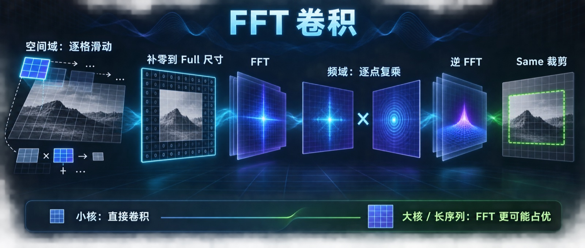
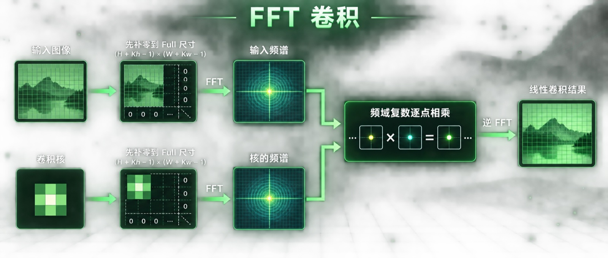
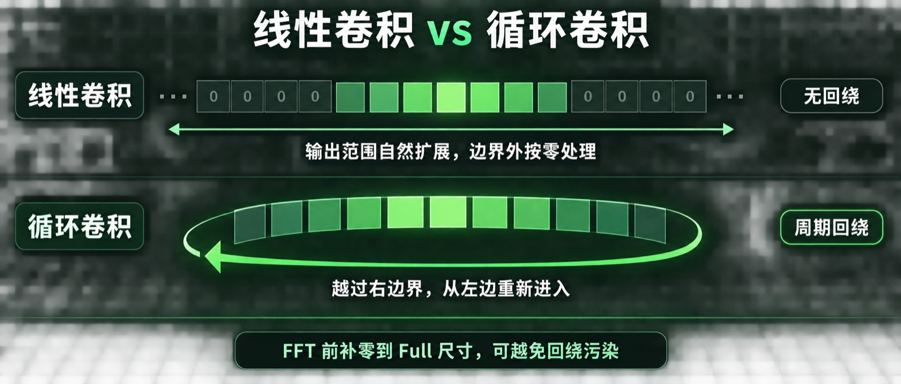
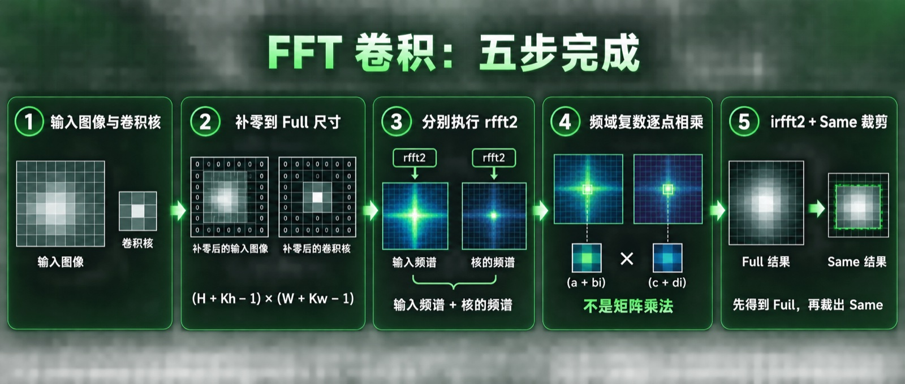
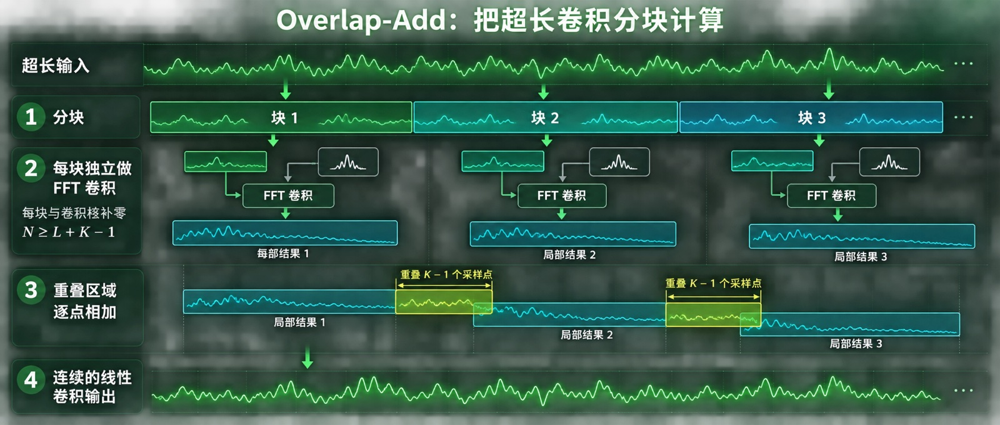

# FFT 卷积：不再让卷积核一格一格滑，真的会更快吗？



如果让你计算一张图像的卷积，最自然的做法是什么？

把卷积核放到图像左上角，乘一遍、加起来；再向右挪一格，重新乘一遍、加起来；走到行尾，再换到下一行。

这很像拿着一枚印章，在整张图上一个位置一个位置地盖过去。

卷积核只有 `3×3` 时，这种方法简单直接，往往也很快。但当卷积核越来越大，或者信号长到几十万、几百万个采样点时，问题开始出现：**同一批数据被反复读取，同一种乘加被重复执行，滑动窗口逐渐变成计算负担。**

FFT 卷积选择了一条完全不同的路：

> **既然在空间域里“滑动”很贵，那就换一个坐标系，让卷积变成对应位置相乘。**

> **工程深度｜验证状态：** L2–L3 工程｜静态复核 + 数值验证（GPU 性能需上机实测）
这就是本文要讲清楚的事。

---

## 一句话理解 FFT 卷积

FFT 卷积的核心只有一条公式：

$$x * k = \mathcal{F}^{-1}\left(\mathcal{F}(x)\odot\mathcal{F}(k)\right)$$

其中：

- $x$ 是输入图像或信号；
- $k$ 是卷积核；
- $*$ 表示卷积；
- $\mathcal{F}$ 表示傅里叶变换；
- $\odot$ 表示频域中对应元素相乘；
- $\mathcal{F}^{-1}$ 表示逆傅里叶变换。

> **这个等式有一个隐含前提**：输入与卷积核必须已经补零到足够长（至少 $H+K_h-1$ 与 $W+K_w-1$）。对有限长度数组，如果补零不足，DFT 频域乘法对应的是循环卷积，而不是你想要的线性卷积。原因在第 二 节展开。

翻译成人话就是：



注意，这里的“对应元素相乘”不是矩阵乘法。频谱中同一个位置的两个复数相乘，得到输出频谱中同一位置的复数。

NumPy 官方文档也把它概括为：空间域卷积等价于频域逐点乘法，因此 FFT 可以成为计算大规模卷积的更快路径。[NumPy DFT 文档](https://numpy.org/doc/stable/reference/routines.fft.html)

---

## 一、直接卷积为什么会越来越重？

假设输入图像尺寸为：

$$H\times W$$

卷积核尺寸为：

$$K_h\times K_w$$

直接卷积需要为每个输出位置执行约 $K_hK_w$ 次乘加，总计算量可以粗略写成：

$$O(HWK_hK_w)$$

如果卷积核是 `3×3`，每个输出像素只需要处理 9 个权重，这并不吓人；但如果卷积核变成 `101×101`，单个输出点就要处理 10201 个权重。

FFT 路线先把输入与卷积核变换到频域。若补零后的二维尺寸为 $P\times Q$，其主要复杂度约为：

$$O(PQ\log(PQ))$$

它没有消灭计算，而是用“两次正向 FFT、一次逆 FFT和一次频域乘法”，替换了大量重复的空间域乘加。

这也是第一个必须钉死的判断：

> **FFT 卷积擅长大卷积与长序列，不等于在任何尺寸、任何实现下都更快。**

直觉上，对于 `3×3`、`5×5` 这样的小核，FFT 的变换、复数中间结果和额外内存开销，很可能比省下的乘法更贵。但"很可能"不是"一定"：实测还得看**具体实现**。SciPy 的 `convolve` 会估算直接法和 FFT 法谁更合适，而不是永远选择 FFT；其文档也明确提示，`fftconvolve` 面向较大数组更有优势，但小任务或只需要少量输出时可能更慢。[SciPy `fftconvolve`](https://docs.scipy.org/doc/scipy/reference/generated/scipy.signal.fftconvolve.html)

第 九 节会贴一组本机真实跑出来的数据——结论里既有"符合直觉"的部分，也有"反直觉"的部分。

---

## 二、为什么必须先补零？

FFT 天生计算的是**循环卷积**。

可以把循环卷积想象成一条首尾相接的跑道：数据从右边跑出去，会从左边重新出现；从底部越界，也会绕回顶部。



图像滤波通常需要的是线性卷积，而不是这种“越界后从另一侧回来”的结果。解决方法就是给输入和卷积核补足够多的 0，让回绕发生在有效数据之外。

对于二维输入：

```text
输入尺寸：H × W
核尺寸  ：Kh × Kw
```

完整线性卷积的尺寸是：

$$P=H+K_h-1$$

$$Q=W+K_w-1$$

因此，两者都应该补零或直接按下面的目标尺寸做 FFT：

$$(H+K_h-1)\times(W+K_w-1)$$

补零不是为了让图像“看起来更大”，而是为了在周期化的 FFT 世界里，给线性卷积留出不会相互污染的空间。

---

## 三、`rfft2` 到底做了什么？

输入图像与常见卷积核通常都是实数。实数信号的频谱具有共轭对称性：负频率的一半可以由正频率的一半推导出来。

因此，NumPy 提供了：

```python
np.fft.rfft2(x)
```

它不是把结果继续存成一个同尺寸的实数矩阵，而是返回一个**复数半谱**。

如果输入尺寸是：

```text
P × Q
```

那么 `rfft2` 作用于最后两个轴、目标尺寸为 $P\times Q$ 时，输出形状精确是：

```text
P × (Q // 2 + 1)
```

最后一个维度只保留非冗余频率，因此比完整的 `fft2` 更省空间。NumPy 文档说明，实数 FFT 会利用 Hermitian 共轭对称性，只计算非冗余的一半频率分量。[NumPy `rfft2`](https://numpy.org/doc/stable/reference/generated/numpy.fft.rfft2.html)

这里还有一个容易被忽略的细节：**频域元素是复数。**

一个频率分量可以写成：

$$F(u,v)=a+bi$$

它同时包含：

- 幅值：这一频率成分有多强；
- 相位：这一频率成分在什么位置对齐。

所以频域乘法不是“只把两个亮度值相乘”，而是在同时组合幅值与相位信息。

---

## 四、整段代码其实只做了五件事

下面是一个更稳健、也更紧凑的 NumPy 实现：

```python
import numpy as np


def fft_convolution_same(input_data, kernel):
    """返回与输入同尺寸的 Same 数学卷积。

    不强制最终 dtype：NumPy FFT 内部会把输入提升到更高精度
    （float32→float64、complex64→complex128），返回的实数结果
    与原输入保持一致的数值类型，而不是无条件压回 float32。
    """
    input_data = np.asarray(input_data)
    kernel = np.asarray(kernel)

    if input_data.ndim != 2 or kernel.ndim != 2:
        raise ValueError("input_data 和 kernel 必须都是二维数组")

    in_height, in_width = input_data.shape
    k_height, k_width = kernel.shape

    # 1. 完整线性卷积所需尺寸
    full_shape = (
        in_height + k_height - 1,
        in_width + k_width - 1,
    )

    # 2. 按 full_shape 补零并进入频域
    freq_input = np.fft.rfft2(input_data, s=full_shape)
    freq_kernel = np.fft.rfft2(kernel, s=full_shape)

    # 3. 频域对应元素复数相乘
    freq_output = freq_input * freq_kernel

    # 4. 回到空间域；显式传入尺寸，避免奇数宽度推断歧义
    full_output = np.fft.irfft2(freq_output, s=full_shape)

    # 5. 从 Full 结果中心裁出与输入同尺寸的 Same 结果
    start_y = (k_height - 1) // 2
    start_x = (k_width - 1) // 2
    same_output = full_output[
        start_y:start_y + in_height,
        start_x:start_x + in_width,
    ]

    return same_output
```

把它拆开看，只有五步：



### 第一步：确定 Full 尺寸

```python
full_shape = (
    in_height + k_height - 1,
    in_width + k_width - 1,
)
```

这是避免循环回绕污染的关键。

### 第二步：把两份数据送入同一个频域坐标系

```python
freq_input = np.fft.rfft2(input_data, s=full_shape)
freq_kernel = np.fft.rfft2(kernel, s=full_shape)
```

两者必须使用相同的 FFT 尺寸，否则频率坐标无法一一对应。

### 第三步：对应元素相乘

```python
freq_output = freq_input * freq_kernel
```

NumPy 的 `*` 是逐元素乘法，不是 `@` 所代表的矩阵乘法。

### 第四步：逆变换

```python
full_output = np.fft.irfft2(freq_output, s=full_shape)
```

`irfft2` 是 `rfft2` 的逆过程。显式传入 `s=full_shape` 很重要：如果不传，逆变换需要从半谱宽度猜测原始宽度，而奇数长度与偶数长度可能对应相同的半谱长度。NumPy 官方接口也把 `s` 定义为逆变换所需的实数输出形状。[NumPy `irfft2`](https://numpy.org/doc/stable/reference/generated/numpy.fft.irfft2.html)

### 第五步：从 Full 裁出 Same

Full 卷积比输入更大，Same 只是从中间取出与输入相同大小的一块：

```python
start_y = (k_height - 1) // 2
start_x = (k_width - 1) // 2
```

这里使用 `(K - 1) // 2`，可以与 SciPy 的“相对于 Full 结果居中”语义对齐。直接写 `K // 2` 只在奇数卷积核下等价；对于偶数卷积核，两者会相差一个位置。

---

## 五、三个最容易写错的地方

### 误区一：不补零也能做普通卷积

不补零时，FFT 路线得到的是循环卷积。只有当你的业务本来就需要周期边界，例如某些周期信号处理任务，这才可能是正确语义。

普通图像零边界卷积，应至少补到：

$$(H+K_h-1)\times(W+K_w-1)$$

### 误区二：卷积和互相关是一回事

数学卷积会翻转卷积核：

$$y[m,n]=\sum_i\sum_j x[i,j]k[m-i,n-j]$$

而互相关不翻转核。很多深度学习框架的 `Conv2D` 实际计算的是互相关，只是沿用了“卷积”这个名字。

本文的 FFT 写法直接计算数学卷积，其 Same 裁剪锚点与 `convolve2d(mode="same")` 对齐。如果你要复现一个“不翻核”的滑窗内核，对 `3×3`、`5×5` 这类**奇数卷积核**，可以先翻转一次核，再送入 FFT 卷积：

```python
correlation_result = fft_convolution_same(
    input_data,
    kernel[::-1, ::-1],
)
```

但**偶数卷积核**（如 `4×4`、`3×4`）没有唯一的“自然中心”：`convolve2d` 的中心锚在 `(K - 1) // 2` 一侧，而 `correlate2d(mode="same")` 的实际锚点在 `K // 2` 一侧，两者对 `4×4` 核相差一格（本机 SciPy 1.17 实测）。所以不能只翻转卷积核，就默认与 `correlate2d` 完全等价；必须先确认目标库的锚点约定，再决定沿用 `(K - 1) // 2` 还是改成 `K // 2`。

一句话记忆：

```text
数学卷积：核在定义中翻转
互相关  ：核保持原方向
```

### 误区三：输入是 `float32`，FFT 全程就是单精度

不是。

NumPy 官方文档说明，`numpy.fft` 会把 `float32` 提升为 `float64`，把 `complex64` 提升为 `complex128`。这有助于数值精度，但也会增加内存和带宽成本。[NumPy FFT 类型提升](https://numpy.org/doc/stable/reference/routines.fft.html#type-promotion)

因此，如果你需要在接口里显式降回单精度（例如约定返回 `float32`），也要知道它只发生在最后一步：

```python
return same_output.astype(np.float32)
```

它只是把最终结果转回单精度，不代表 FFT 中间过程一直是单精度。上面的 `fft_convolution_same` 默认保留与输入一致的数值类型，只有接口确实需要时，才在返回处显式转换。

如果你需要保持单精度、使用多线程 FFT，或者精确控制后端，应进一步评估 `scipy.fft`、FFTW、MKL、CuPy/cuFFT 等实现。

---

## 六、怎样验证结果真的正确？

不要只打印左上角 `5×5`，而要与可信参考实现做全量比较。

```python
import numpy as np
from scipy.signal import convolve2d

rng = np.random.default_rng(42)
input_data = rng.random((512, 512), dtype=np.float32)
kernel = rng.random((3, 3), dtype=np.float32)

fft_result = fft_convolution_same(input_data, kernel)
reference = convolve2d(
    input_data,
    kernel,
    mode="same",
    boundary="fill",
    fillvalue=0,
)

np.testing.assert_allclose(
    fft_result,
    reference,
    rtol=1e-5,
    atol=1e-5,
)
```

建议至少覆盖这些测试：


| 测试维度  | 建议用例        | 要验证的问题            |
| ----- | ----------- | ----------------- |
| 输入尺寸  | 奇数宽、偶数宽     | `irfft2` 输出尺寸是否正确 |
| 卷积核尺寸 | `3×3`、`4×4` | Same 裁剪是否偏移       |
| 特殊卷积核 | 单位脉冲核       | 输出是否保持原输入         |
| 边界    | 角点非零        | 零填充语义是否正确         |
| 随机数据  | 多组固定种子      | 数值误差是否稳定          |
| 语义    | 非对称卷积核      | 是否混淆卷积与互相关        |


非对称核尤其重要。对称核翻不翻都一样，很容易把语义错误藏起来。

---

## 七、FFT 卷积什么时候值得用？

没有一个脱离硬件、尺寸和实现的万能分界线，但可以先按下面的方向判断。

### 更适合直接卷积

- 卷积核很小，例如 `3×3`、`5×5`（前提是直接法有专门优化，如 Winograd、隐式 GEMM、GPU 直接卷积；SciPy 的通用 `convolve2d` 并不在列，见第 九 节实测）；
- 只计算少量输出位置；
- 数据规模小，函数调用与变换开销占主导；
- GPU 上已有高度优化的直接卷积、隐式 GEMM 或 Winograd 实现；
- 对临时内存非常敏感。

### 更适合 FFT 卷积

- 卷积核较大；
- 一维长序列使用长滤波器；
- 同一个卷积核会处理很多输入，可以预计算并缓存核频谱；
- 需要完整输出，而不是几个局部值；
- 频域中还要继续执行滤波、反卷积或频谱分析。

### 输入特别长、核相对短怎么办？

不要急着把整段信号一次性变换。

可以使用 Overlap-Add：把长信号分块，每块分别做 FFT 卷积，再把重叠输出相加。SciPy 的 `oaconvolve` 就实现了这条路线，其文档指出，当一个输入远大于另一个输入时，它通常比整块 `fftconvolve` 更合适。[SciPy `oaconvolve`](https://docs.scipy.org/doc/scipy/reference/generated/scipy.signal.oaconvolve.html)



这是一种很典型的工程思路：**算法没变，执行粒度变了。**

---

## 八、到了 GPU，FFT 就一定赢吗？

仍然不是。

GPU 能并行执行 FFT，也有 NVIDIA cuFFT 这样的高性能库；cuFFT 提供 1D、2D、3D 与批量（batched）变换，以及实数/复数等多类 FFT 接口。[NVIDIA cuFFT 文档](https://docs.nvidia.com/cuda/cufft/)

但“能在 GPU 上做”与“在 GPU 上一定最快”是两件事。

FFT 卷积在加速器上的实际性能还取决于：

- FFT 长度是否友好；
- 复数中间结果带来的显存流量；
- 是否反复读写全局显存；
- 核频谱能否缓存复用；
- 是否能把 FFT、乘法、逆 FFT 融合；
- 直接卷积、Winograd 或矩阵乘单元是否更适合当前形状。

先解释第一项“长度友好”：cuFFT 对由 2、3、5、7 等小质因子组成的尺寸有专门优化，通常 2 的幂性能最好；大质数尺寸会退化到较慢的通用算法，并需要更多临时空间。

CPU/SciPy 路线同样如此，用 `next_fast_len` 可以把补零尺寸抬到友好长度：

```python
from scipy.fft import next_fast_len

full_shape = (in_height + k_height - 1, in_width + k_width - 1)
fft_shape = (
    next_fast_len(full_shape[0], real=True),
    next_fast_len(full_shape[1], real=True),
)
```

本机实测（512×512 输入，Apple Silicon M4，NumPy 2.4.2 / SciPy 1.17.1）：


| 卷积核       | 最小补零尺寸    | next_fast_len | 朴素耗时    | 友好耗时   | 加速   |
| --------- | --------- | ------------- | ------- | ------ | ---- |
| `15×15`   | `526×526` | `540×540`     | 32.6 ms | 3.9 ms | 8.4× |
| `31×31`   | `542×542` | `576×576`     | 37.8 ms | 4.1 ms | 9.3× |
| `63×63`   | `574×574` | `576×576`     | 10.1 ms | 4.1 ms | 2.5× |
| `127×127` | `638×638` | `640×640`     | 11.8 ms | 5.2 ms | 2.3× |


注意 `63×63`、`127×127` 的“最小补零尺寸”其实离友好长度已经只差 2，所以提升不如 `15×15`、`31×31` 那么夸张。这句话值得记住：

> **最小补零尺寸保证正确性，Fast Length 决定性能；FFT 尺寸不一定越小越快，多补几个 0 反而可能更快。**

这也是 FFT 卷积今天仍在演进的原因。

以长序列模型为例，FlashFFTConv 关注的就不只是 $O(N\log N)$，而是怎样让 FFT 更好地利用矩阵乘单元、减少内存层级之间的 I/O，并进行算子融合。论文指出，FFT 的渐近复杂度很漂亮，但传统实现可能无法充分利用现代加速器；性能竞争已经从“少算几次”进入“少搬几次、能否融合、是否匹配硬件”的阶段。[FlashFFTConv 论文](https://arxiv.org/abs/2311.05908)

这条前沿路线给普通工程一个很有价值的提醒：

> **复杂度决定上限，数据搬运和硬件映射决定你能否接近上限。**

### 前沿补充：FFT 卷积还在往哪里走

如果只停留在“调用一次库函数”，就看不清硬件侧的变化。三个值得留意的方向：

- **cuFFTDx：把 FFT 放进 Kernel 内部**。NVIDIA 的 cuFFTDx 允许在 CUDA Kernel 内执行实数/复数 FFT，并给出 FFT 卷积示例。它的价值不是改变 $O(N\log N)$ 的复杂度，而是把 FFT、频域乘法和逆 FFT 融合进同一份 Kernel，避免中间复数结果反复写回全局显存。[cuFFTDx 示例](https://docs.nvidia.com/cuda/cufftdx/examples.html)
- **cuFFT LTO Callback：在数据进出的那一刻处理**。cuFFT 支持在 FFT 的加载与保存阶段插入前后处理，减少单独的预处理/后处理 Kernel；LTO Callback 是官方推荐的替代路线，与本文“少搬几次”的观察一致。[cuFFT 文档](https://docs.nvidia.com/cuda/cufft/)
- **SciPy 的 Array API 后端（实验性）**。SciPy 正通过 Array API 接入 CuPy、PyTorch、JAX 等设备数组；未来同一套 `rfft2` 语义可能直接落在 GPU 上，届时 FFT 长度、显存流量与数据搬运又会成为新的焦点——这正是本文从头到尾关心的问题。

---

## 九、性能测试应该怎么做？

不要只运行一次，也不要把 CPU FFT 与 GPU Kernel 的裸执行时间直接放在一起比较。

一个可信的测试至少要统一以下口径：

1. **统一设备**：CPU 对 CPU，GPU 对 GPU；
2. **统一范围**：明确是否包含主机与设备之间的数据传输；
3. **先预热**：排除首次初始化、缓存与编译影响；
4. **重复多轮**：报告中位数或分位数，而不是单次最小值；
5. **先验正确性**：性能测试前用参考实现验证结果；
6. **覆盖多个尺寸**：同时改变输入尺寸和卷积核尺寸；
7. **记录临时内存**：速度不是唯一成本；
8. **区分一次性与复用**：核频谱是否预计算会显著改变结论。

以上是纪律。工具层面，也可以借用 SciPy 的自动选择做交叉验证：`method="auto"` 是估算，要在当前硬件上得到更可靠的结论，用 `choose_conv_method(..., measure=True)` 让库先实际计时再给建议。[SciPy `choose_conv_method`](https://docs.scipy.org/doc/scipy/reference/generated/scipy.signal.choose_conv_method.html)

下面是一组真实的测量：Apple Silicon M4、Python 3.14.3、NumPy 2.4.2、SciPy 1.17.1，预热 2 次后取 5 次运行的中位数；直接法为 `convolve2d`，FFT 法为 `fftconvolve`，两者都是 `mode="same"`、固定随机种子输入。


| 输入尺寸        | 卷积核       | 直接卷积     | FFT 卷积  | FFT / 直接 |
| ----------- | --------- | -------- | ------- | -------- |
| `512×512`   | `3×3`     | 6.2 ms   | 3.9 ms  | 0.63×    |
| `512×512`   | `15×15`   | 67.5 ms  | 3.8 ms  | 0.06×    |
| `512×512`   | `31×31`   | 267.6 ms | 4.8 ms  | 0.02×    |
| `512×512`   | `63×63`   | 1.37 s   | 4.5 ms  | 0.003×   |
| `512×512`   | `127×127` | 5.19 s   | 5.9 ms  | 0.001×   |
| `1024×1024` | `3×3`     | 23.8 ms  | 17.7 ms | 0.74×    |
| `1024×1024` | `15×15`   | 307.9 ms | 18.2 ms | 0.06×    |
| `1024×1024` | `31×31`   | 1.18 s   | 18.1 ms | 0.02×    |
| `1024×1024` | `63×63`   | 5.75 s   | 23.5 ms | 0.004×   |
| `1024×1024` | `127×127` | 19.9 s   | 20.8 ms | 0.001×   |


FFT / 直接 小于 1 表示 FFT 更快。三个值得注意的结论：

1. **FFT 的优势随卷积核增大呈数量级放大**。从 `15×15` 起已经拉开约 16 倍，`31×31` 之后直接法的时间按接近平方规律膨胀（算术量 $\propto HWK^2$），FFT 却几乎只在长度友好尺寸上小幅波动。到 `127×127`，FFT 比通用直接实现快 500 至 2000 倍。
2. **反直觉：在 SciPy 生态里，即使 `3×3`，FFT 也未必更慢**。这里的 `convolve2d` 是通用实现，`3×3` 也要把整幅图像按 9 个权重分别移位叠加；真正能体现“小核直接法优势”的，是 Winograd、im2col、隐式 GEMM，以及 GPU 上专门优化的直接卷积实现。
3. **交叉点不是常数**。`512×512` 与 `1024×1024` 的交叉位置不同；换 CPU、换库版本、换“是否预计算核频谱”，结论都会动。所以本文不给你一个“核大于多少就用 FFT”的魔数——第 七、八 节的选型清单加上这一节的方法，才是可以迁移的东西。

这就是把“算法交叉曲线”从概念变成证据的方式：不画一根假设的斜线，而是让读者自己看数据在哪一列开始翻转。交叉点在哪个尺寸，取决于你的硬件、库和任务，但“直接法增长快、FFT 增长慢”这个形状是稳定的。

---

## 十、把整件事重新串起来

FFT 卷积看起来像一次数学魔法，其实是一套非常清楚的工程转换。完整的链路（补零 → `rfft2` → 频域逐元素相乘 → `irfft2` → 从 Full 裁剪出 Same）在第 四 节已经逐段拆过，这里不再重复，只押在四句结论上：

真正应该记住的不是“FFT 更快”，而是下面四句话：

1. **卷积定理把空间域卷积变成频域逐点乘法。**
2. **补零决定你得到线性卷积还是循环卷积。**
3. **直接与 FFT 的取舍取决于实现与场景**：大核与长序列几乎总是 FFT 占优，小核则要看是否专用的优化实现。
4. **现代性能优化不仅看计算量，还看数据搬运、临时内存和硬件利用率。**

当你下一次看到：

```python
freq_out = np.fft.rfft2(x) * np.fft.rfft2(k)
```

不要只把它理解成“调用了两个 FFT”。

它真正做的，是把一个需要不断移动窗口的问题，换到了一个不需要滑动窗口的世界里。

这就是 FFT 卷积最迷人的地方：

> **它没有更努力地滑动，而是换了一个空间，让滑动本身消失。**

---

## 参考资料

- [NumPy：Discrete Fourier Transform](https://numpy.org/doc/stable/reference/routines.fft.html)
- [NumPy：`rfft2`](https://numpy.org/doc/stable/reference/generated/numpy.fft.rfft2.html)
- [NumPy：`irfft2`](https://numpy.org/doc/stable/reference/generated/numpy.fft.irfft2.html)
- [SciPy：`fftconvolve`](https://docs.scipy.org/doc/scipy/reference/generated/scipy.signal.fftconvolve.html)
- [SciPy：`oaconvolve`](https://docs.scipy.org/doc/scipy/reference/generated/scipy.signal.oaconvolve.html)
- [SciPy：`convolve2d` / `correlate2d`](https://docs.scipy.org/doc/scipy/reference/generated/scipy.signal.correlate2d.html)
- [SciPy：`choose_conv_method`](https://docs.scipy.org/doc/scipy/reference/generated/scipy.signal.choose_conv_method.html)
- [SciPy：`next_fast_len`](https://docs.scipy.org/doc/scipy/reference/generated/scipy.fft.next_fast_len.html)
- [NVIDIA：cuFFT Documentation](https://docs.nvidia.com/cuda/cufft/)
- [NVIDIA：cuFFTDx Examples](https://docs.nvidia.com/cuda/cufftdx/examples.html)
- [Fu et al.：FlashFFTConv](https://arxiv.org/abs/2311.05908)

