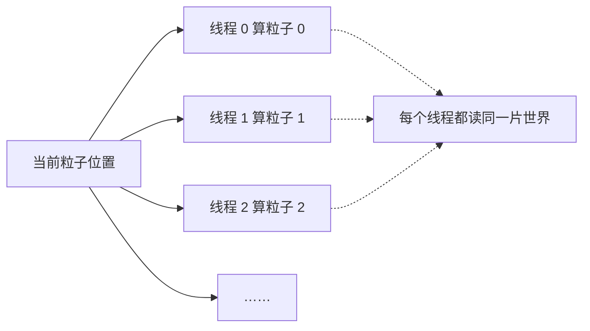
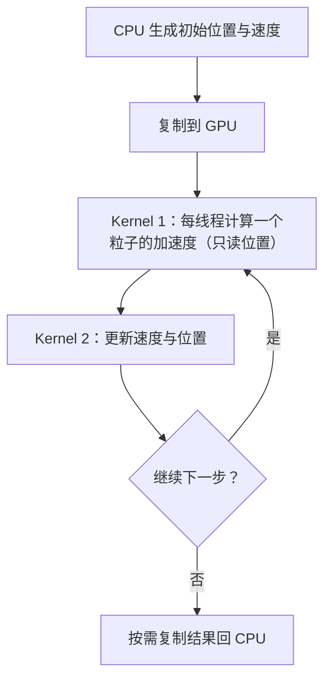
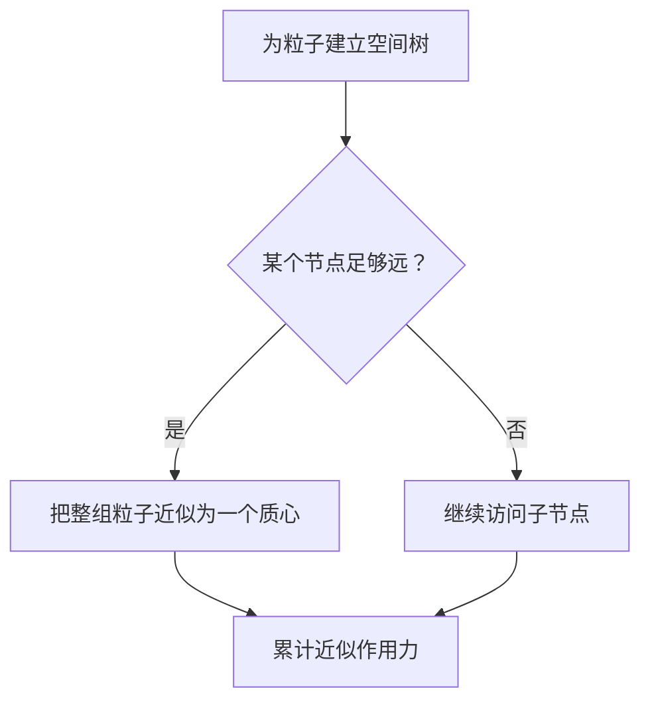

# 1024 个 CUDA 线程一起模拟引力，为什么算出的"宇宙"可能是错的？

> **从一线程一粒子、朴素 N-body，到数据竞争、共享内存与 Barnes–Hut。** 这篇文章不只让粒子动起来，还要讲清楚：它们为什么这样动，GPU 为什么适合算，以及一段"能运行"的并行代码为什么仍可能算错。
>
> **预计阅读：** 25 分钟
> **关键词：** N-body、万有引力、PyCUDA、数据竞争、`__syncthreads`、Shared Memory、Barnes–Hut

> **工程深度｜验证状态：** L2 工程｜静态复核 + CPU 对比验证（GPU 性能需上机实测）
---

> **30 秒讲懂**：把 1024 个粒子丢进显卡，每个线程负责一个粒子，而每个粒子都要反复查看其他所有粒子的位置——一步就发生约 105 万次相互作用。真正的坑不是"算不过来"，而是"同一个时间步里，有人还在读旧位置，有人已经写下了新位置"，结果混出两代坐标。修复办法：把"看世界"和"改变世界"拆成两个 Kernel。

> **阅读路线**：想直奔最值钱的那个并发陷阱，直接读第四章和第五章；想先补线程怎么映射，按顺序读；全文可运行代码在「附录 A」。

---

## 开篇：1024 个线程，造出了一个错误的宇宙？

想象一片没有边界的黑暗空间。

我们随机放入 1024 个粒子。每个粒子都在吸引其他粒子：近处拉得强，远处拉得弱。随后时间向前走一小步，所有粒子根据受到的合力改变速度，再移动到新的位置。

如果只看一个粒子，事情并不复杂：

```text
查看其他粒子的位置
        ↓
计算每一份吸引力
        ↓
把这些力累加起来
        ↓
更新速度
        ↓
更新位置
```

真正的问题在于：**每个粒子都要看其他所有粒子。**

1024 个粒子，一步就要检查大约：

$$1024\times 1023\approx 105\text{ 万次相互作用}$$

粒子数量翻倍，工作量接近变成四倍。这就是朴素 N-body 的 $O(N^2)$。

它计算量大，却又天生适合并行：在同一个时间切片里，每个粒子都可以独立计算自己受到的合力。

于是，一个自然的想法出现了：

> **让一个 CUDA 线程，负责一个粒子。**

但这句话只回答了"谁来算"。接下来要回答更难的两个问题：

1. **怎样算得对**——一段"能运行"的 GPU 代码，为什么可能悄悄算出一个混着两代坐标的错误宇宙；
2. **怎样算得快**——Shared Memory 能把 $O(N^2)$ 跑得更快，为什么终究消灭不了它。

---

## 一、每个粒子到底在算什么？

N-body，直译就是"N 个物体"。它研究的问题是：当很多物体彼此作用时，整个系统接下来会怎样变化。

天体之间的引力是最经典的例子，但 N-body 的思想并不只属于宇宙——分子动力学、带电粒子、群体行为里都能看到类似结构。

为了把核心原理讲清楚，本文采用一个简化模型：

- 所有粒子的质量均为 1；
- 相互作用常数取 1；
- 不考虑碰撞、阻尼和空间边界；
- 用软化项避免两个粒子几乎重合时数值爆炸；
- 使用单精度浮点数演示 CUDA 计算。

### 1. 一个粒子如何"感觉"到另一个粒子

假设粒子 $i$ 在 $\mathbf r_i$，粒子 $j$ 在 $\mathbf r_j$。从 $i$ 指向 $j$ 的位移是：

$$\mathbf d_{ij}=\mathbf r_j-\mathbf r_i$$

若采用单位质量、单位相互作用常数的软化引力模型，粒子 $j$ 对粒子 $i$ 产生的加速度可写为：

$$\mathbf a_{ij} = \frac{\mathbf d_{ij}} {\left(\|\mathbf d_{ij}\|^2+\varepsilon^2\right)^{3/2}}$$

这里的 $\varepsilon^2$ 是软化项（softening squared）。它的作用不是让物理规律"更真实"，而是避免两个粒子几乎重合时分母趋近零、产生极大加速度甚至 `inf`、`NaN`。

**初学者最容易卡住的地方：公式明明说"平方反比"，代码为什么在算三次方？**

> 标量引力大小与 $1/r^2$ 成正比；再乘上方向单位向量 $\mathbf d/\|\mathbf d\|$，向量形式就合并成：
>
> ```text
> 加速度 = 方向单位向量 × 力的大小
>        = (d / r) × (1 / r²)      ← 平方反比
>        = d / r³
> ```
>
> 代码里的 `inv_r3 = inv_r * inv_r * inv_r`，正是在算"方向归一化 × 平方反比"的合并结果。

粒子 $i$ 的总加速度，就是其他粒子贡献的总和：

$$\mathbf a_i = \sum_{j\ne i} \frac{\mathbf r_j-\mathbf r_i} {\left(\|\mathbf r_j-\mathbf r_i\|^2+\varepsilon^2\right)^{3/2}}$$

公式看起来有些长，但程序做的其实只有三件事：

```text
两点相减，得到方向
平方求和，得到距离
按距离衰减，再累加到合力
```

---

## 二、一线程一粒子的并行映射

CPU 更像少量能力很强的工程师，擅长处理复杂分支与串行任务；GPU 更像一座拥有大量轻量工位的计算工厂，适合让很多线程执行相似的工作。

N-body 的朴素映射非常自然：

```text
CUDA Grid
├── Block 0：线程 0 ... 255   → 粒子 0 ... 255
├── Block 1：线程 0 ... 255   → 粒子 256 ... 511
├── Block 2：线程 0 ... 255   → 粒子 512 ... 767
└── Block 3：线程 0 ... 255   → 粒子 768 ... 1023
```

线程的全局编号：

```cpp
int idx = blockIdx.x * blockDim.x + threadIdx.x;
```

当 `blockDim.x = 256` 时：

```text
blockIdx.x = 2
threadIdx.x = 10

idx = 2 × 256 + 10 = 522
```

于是这个线程负责第 522 个粒子。



注意，这个映射只回答了"谁来算"，还没回答"算得对不对、算得快不快"。下面先把 $O(N^2)$ 的来龙去脉看透，再把最容易写错的并发细节单独拎出来。

---

## 三、O(N²) 如何在 GPU 上展开？

对粒子 0，要查看其余 $N-1$ 个粒子；对粒子 1，也要查看其余 $N-1$ 个；一直重复到粒子 $N-1$。总工作量近似为：

$$N(N-1)\approx N^2$$

| 粒子数 N | 一步中的有向相互作用数 N(N−1) |
|---:|---:|
| 1,024 | 1,047,552 |
| 4,096 | 16,773,120 |
| 16,384 | 268,419,072 |
| 65,536 | 4,294,901,760 |

细心的人会问：一对粒子 $i$、$j$ 之间的相互作用，物理上明明只有一个，为什么这里对着算了两次？

> 唯一物理粒子对的数量是 $N(N-1)/2$；而当前 GPU 计算项是 $N(N-1)$。因为线程 $i$ 要算 $j$ 对自己的作用，线程 $j$ 还会再算 $i$ 对自己的作用——同一个相互作用，被两个方向各自计算了一遍。

一个直接的想法是：作用力是相互的，能不能用牛顿第三定律减半？

理论上可以，但代价在并发：

```text
同时更新两个粒子的加速度
        ↓
两个线程要写入对方的累加结果  ← 并发写
        ↓
需要原子操作，或分两个阶段归约
```

**重复计算一部分相互作用，有时比引入新的同步和原子操作更适合 GPU。** 这是并行计算里非常经典的权衡：算法上"浪费"一点，换来的是并发结构更简单。

最后记住这张表背后的事实：

> **GPU 可以把大量相互作用并行计算，却不会自动把 $O(N^2)$ 变成 $O(N\log N)$。硬件并行降低的是时间常数，算法决定的增长趋势仍然存在。**

---

## 四、最隐蔽的错误：读写混在同一个时间步

很多入门实现会在同一个 Kernel 里完成全部工作：

1. 读取所有粒子的当前位置；
2. 累计当前粒子的合力；
3. 更新当前粒子的速度；
4. 原地更新当前粒子的位置。

它看起来很合理：每个线程只写自己的 `positions[idx]`，不存在两个线程同时写同一位置的"写—写冲突"。

但并发问题不只有"多人同时写"，还可能是：**一个线程正在读，另一个线程已经开始写。**

```text
线程 A                              线程 B
  │                                  │
  ├─ 读取粒子 B 的旧位置              │
  │                                  ├─ 完成受力计算
  │                                  ├─ 写入粒子 B 的新位置
  ├─ 稍后再次读取其他粒子             │
  │                                  │
```

CUDA 不保证不同线程块按某个固定顺序推进。于是在同一个仿真步里：

- 某些计算可能读到时刻 $t$ 的位置；
- 某些计算可能读到已经被更新的 $t+\Delta t$ 位置；
- 结果失去了统一的"时间快照"。

我们真正想计算的是：

$$(X_t,V_t)\longrightarrow(X_{t+1},V_{t+1})$$

而不是让一个时间步里混入两代位置。

**为什么 `__syncthreads()` 救不了这段代码？** 因为它只协调同一个线程块内的线程；对由多个 Block 组成的整个 Grid，不存在对普通 Kernel 生效的"全 Grid 屏障"。根据 CUDA Programming Guide 对执行层次的说明：线程块是"可以被屏障协同的线程集合"，而 Grid 的行为边界只落在 Kernel 结束处。

| 同步手段 | 作用范围 | 能否修复本问题 |
|---|---|---|
| `__syncthreads()` | 单 Block 内所有线程 | 否，跨 Block 管不到 |
| 独立 Kernel 的边界 | 全 Grid（前一 Kernel 完成后才进下一个） | 能 |
| 原子操作 | 单次读改写 | 不能保证整个时间步的快照顺序 |

把这一节提炼成一句可以迁移的规律：

> **"每个线程只写自己的结果"只排除了写—写冲突；还必须检查这份结果是否正被其他线程读取。**

---

## 五、双 Kernel 如何恢复时间快照

修复办法是：把"看世界"和"改变世界"分开，用两个 Kernel 执行。

```text
阶段 1：所有线程只读 positions_t
        计算 accelerations_t

              Kernel 边界
        （前一阶段完成后再进入下一阶段）

阶段 2：读取 accelerations_t
        更新 velocities_t+1 与 positions_t+1
```



在**同一个 CUDA Stream、按提交顺序提交**的前提下，两个 Kernel 依次执行：第二个 Kernel 开始前，第一个 Kernel 已完成，因此所有粒子计算本轮加速度时看到的是同一份位置快照。

如果一定要把计算与积分融合进一个 Kernel，也应采用 `positions_old` / `positions_new` 双缓冲：本轮只读旧数组、只写新数组，下一轮再交换指针，而不是原地更新。

### 5.1 时间是怎样向前走的：半隐式 Euler

本文先更新速度：

$$\mathbf v_{t+1}=\mathbf v_t+\mathbf a_t\Delta t$$

再用新速度更新位置：

$$\mathbf x_{t+1}=\mathbf x_t+\mathbf v_{t+1}\Delta t$$

这种顺序通常称为半隐式 Euler（Symplectic Euler）。对位置相关的保守力系统，它通常比普通显式 Euler 展现出更合适的长期相空间行为；**但它仍是一阶积分器**，不能替代时间步长与守恒量验证。时间步长过大、粒子距离过近或模拟时间过长，仍会导致能量漂移和轨迹失真。

可以把时间积分理解成看动画：

```text
dt 太大：一次跨过很多帧，运动可能突然跳跃甚至失控
dt 较小：帧与帧更连续，但需要计算更多次
```

因此 `dt = 0.01` 不是放之四海皆准的答案，必须和初始位置尺度、速度尺度、软化项以及稳定性验证一起考虑。

### 5.2 双 Kernel 的核心逻辑（完整代码见附录 A）

计算加速度的 Kernel 只有三件关键事：

```cpp
// 每个线程负责一个粒子
int idx = blockIdx.x * blockDim.x + threadIdx.x;
if (idx >= n) return;

float px = positions[3 * idx];      // 自己当前位置
// ax、ay、az 从 0 开始累加

for (int j = 0; j < n; ++j) {
    float dx = positions[3 * j] - px;          // 方向
    float r2 = dx * dx + dy * dy + dz * dz + softening2;
    float inv_r = rsqrtf(r2);
    float inv_r3 = inv_r * inv_r * inv_r;      // 1/r³
    ax += dx * inv_r3;                          // 按 r³ 衰减并累加
}
```

`rsqrtf(r2)` 直接算 $1/\sqrt{r^2}$，再推得 $1/r^3$。这是常见写法，但有没有实际收益、误差能否接受，应在目标 GPU 上用真实数据验证。

积分 Kernel 只更新自己负责的那一个粒子：

```cpp
float vx = velocities[base]     + accelerations[base]     * dt;
velocities[base]     = vx;
positions[base]     += vx * dt;
```

第二个 Kernel 里每个线程只读写自己的粒子。此时其他线程已经不再读取旧位置，因此不会破坏本轮加速度计算的快照。

需要把定位说准确：我们建立的是**消除已知数据竞争、可以对照验证的教学基线**，而不是物理、数值、工程层面都已充分证明的"正确实现"。它还没有验证长期能量漂移、跨 GPU 稳定性、不同参数下的容差（见附录 A 的边界说明）。

### 5.3 为什么校验比"成功打印结果"更重要

CUDA Kernel 能编译、能启动、能输出数字，只能说明程序没有以明显方式失败，不能证明数学结果正确。

正确的验证关系应该是：

```text
同一份初始数据
   ├── CPU Reference ──→ reference_positions
   └── GPU Kernel ─────→ gpu_positions
                              │
                              ▼
                   allclose + 最大误差
```

由于浮点加法不满足结合律，并行与串行求和的顺序可能不同，不应机械地要求逐位相等。根据 CUDA C++ Best Practices Guide 的建议，应建立已知正确的参考输出，并在合理误差范围内比较。

使用这份校验时，有两个容易误用的前提要写明：

1. **这里的 CPU Reference 用于验证数学结果，不是经过优化的 CPU 性能基线。** 它外层是 Python 循环、内层用 NumPy，只适合对照结果；拿它宣称"GPU 比 CPU 快多少倍"是类别不同的对比。
2. **`allclose` 的容差是当前冒烟测试的阈值，不是放之四海皆准的标准。** 它针对固定的粒子数、固定的 `dt` 与软化项、单步计算；换成更大 N、`--use_fast_math` 或更长模拟时间，都必须重新评估。

---

## 六、正确之后再谈快：计时、共享内存与布局

上一章解决"算得对"，这一章全部围绕"测得准、跑得快"。

### 6.1 别被一行"执行时间"骗了

GPU 性能测量至少有三个不同的问题：

| 指标 | 包含什么 | 回答的问题 |
|---|---|---|
| Kernel-only | 两个 Kernel 的设备执行时间 | GPU 计算本身多快？ |
| GPU 流程 | Kernel、必要同步及设备端工作 | 一轮 GPU 工作多快？ |
| 端到端 | H2D、Kernel、D2H | 用户从输入到结果等多久？ |

如果在 Kernel 前调用 `time.time()`、在结果复制回 CPU 后结束，得到的是混合时间，不能直接标成"Kernel 执行时间"。

更适合测量设备执行时间的是 CUDA Event：

```python
start = cuda.Event()
end = cuda.Event()

start.record()
for _ in range(steps):
    compute_acceleration(...)
    integrate(...)
end.record()
end.synchronize()

elapsed_ms = start.time_till(end)
```

测量时还应注意：先预热，减少首次启动等一次性开销；多次重复，报告中位数；CPU 与 GPU 使用相同的数学模型与精度；多测几个 $N$；同时报告 Kernel-only 与端到端时间；不要把一次偶然测量包装成普遍结论。

### 6.2 Shared Memory 分块：让数据被复用，但有边界

在朴素实现里，一个线程要遍历全部粒子；一个 Block 内的许多线程会同时读同一批粒子位置。这意味着：**相同的数据被反复请求。**

Shared Memory Tiling 的思路是：每次把一小块粒子搬进共享内存，让整个 Block 反复使用。

```text
全局内存中的全部粒子
[ tile 0 ][ tile 1 ][ tile 2 ] ...
     │
     ▼
 共享内存载入一个 tile
     │
     ├── Block 内线程 0 使用
     ├── Block 内线程 1 使用
     └── ...共同复用
     │
     ▼
 载入下一个 tile
```

核心结构大致如下，这里用的是**一条完整的 active-thread 约定**：

```cpp
extern __shared__ float tile[];

bool active = idx < n;   // 决定"要不要累计/写回"，而不是提前退出

for (int tile_start = 0; tile_start < n; tile_start += blockDim.x) {
    int source = tile_start + threadIdx.x;

    // cooperative load：进入 __syncthreads() 前，所有线程都必须先走到这里
    if (source < n) {
        tile[3 * threadIdx.x]     = positions[3 * source];
        tile[3 * threadIdx.x + 1] = positions[3 * source + 1];
        tile[3 * threadIdx.x + 2] = positions[3 * source + 2];
    } else {
        tile[3 * threadIdx.x]     = 0.0f;
        tile[3 * threadIdx.x + 1] = 0.0f;
        tile[3 * threadIdx.x + 2] = 0.0f;
    }

    __syncthreads();   // 等本 Block 全部线程都写完 tile

    int count = min(blockDim.x, n - tile_start);
    if (active) {      // 只有 active 线程累计自己的结果
        for (int k = 0; k < count; ++k) {
            // 使用 tile 中的粒子位置累计加速度
        }
    }

    __syncthreads();   // 防止下一轮覆盖写入时还有人正在读
}

if (active) {
    // 写回自己粒子的加速度
}
```

这里有两个容易踩的坑，第一个最常见：

- **进入包含 Block 级屏障的循环后，不能沿用朴素版"不满员就直接 `return`"的写法。** `__syncthreads()` 要求同一 Block 内所有线程都到达；一旦 `if (idx >= n) return;` 让部分线程提前退出，剩下的人会永远等不到伙伴。判断"是否参与计算"用 `active` 标记，判断"是否退出"只能基于整块 Block 一致的条件。
- Shared Memory 减少的是重复的全局内存访问，**不会改变 $O(N^2)$ 的计算复杂度**。

官方文档把 Shared Memory、合并访问与数据复用列为重要优化手段，同时强调：优化应由测量驱动，而不是"用了共享内存就一定更快"。

### 6.3 AoS 还是 SoA？不要只背结论

当前数据布局是 AoS 风格：

```text
[x0 y0 z0][x1 y1 z1][x2 y2 z2]...
```

另一种是 SoA：

```text
x0 x1 x2 ...
y0 y1 y2 ...
z0 z1 z2 ...
```

SoA 往往更容易让相邻线程访问连续的同一分量；使用 16 字节对齐的 `float4` 也常见于 N-body 实现。但当前内层循环里，一个 Warp 的线程会同时读**同一个**源粒子，这又受缓存和广播行为支配。

所以工程结论不是"永远用 SoA"，而是：根据实际访问模式设计布局，再用 Nsight Compute 和基准测试确认吞吐、缓存命中与内存事务是否真的改善了。

---

## 七、GPU 再快，也逃不开算法复杂度

Shared Memory 能让朴素算法更快，但粒子数量持续增长时，$N^2$ 终究会成为一堵墙。

Barnes–Hut 的关键思想只有一句：

> 离得很远的一群粒子，不必逐个精确计算；可以把它们近似成一个整体。

例如观察远处一片星团时，我们未必需要知道其中每颗星的细微位置。只要这个星团相对足够远，就可以用它的总质量和质心近似它的影响。



判断"足够远"的经典标准是 **opening criterion**：当节点的包围盒宽度 $s$ 与它到粒子距离 $d$ 满足 $s/d<\theta$（$\theta$ 常取 0.5~1.0）时，就把该节点当成一个质心；否则继续下钻。$\theta$ 越小越精确，也越慢。

经典 Barnes–Hut 方法使用层次空间划分，把典型计算复杂度降低到约 $O(N\log N)$，用可控的近似误差换取规模能力，适合比教学版 all-pairs 更大的系统。该方法由 Josh Barnes 和 Piet Hut 在 1986 年的论文中系统提出：[A hierarchical O(N log N) force-calculation algorithm](https://doi.org/10.1038/324446a0)。

因此优化路线应分成两个层次，不要混为一谈：

```text
实现层优化
  朴素 O(N²)
      ↓ Shared Memory / 数据布局 / 指令优化
  更快的 O(N²)

算法层优化
  All-Pairs
      ↓ Barnes–Hut / Fast Multipole Method
  O(N log N) 或面向特定条件的更优复杂度
```

先改善访存，解决"同一算法怎样跑得更快"；再改变算法，解决"规模增长后为什么不被平方复杂度拖垮"。两者不是一回事。

### 7.1 今天还能怎样演进（进阶地图）

下面几条路线不必在本文展开，但值得作为下一步的方向：

```text
重复执行双 Kernel   → CUDA Graphs：降低大量重复启动的 CPU 开销
Shared Memory 分块  → 异步数据复制与流水线：尝试隐藏 tile 搬运延迟
单个 GPU           → 多 GPU 空间划分与通信
All-Pairs          → GPU Barnes–Hut / FMM / 专用近似算法
```

适用条件要心里有数：小规模、短 Kernel 才更容易受启动开销影响；异步复制是否有效必须经过 profiling；TMA 等特性与 GPU 代际相关；大规模模拟最终仍需要算法与空间划分共同演进。

---

## 结尾：比任何一行代码更值得带走的判断方法

N-body 最迷人的地方，不只是它能画出一团会运动的粒子，而是把 GPU 的世界压缩进了一个足够直观的问题里：

- 一个线程负责一个粒子；
- 每个粒子读取同一片世界；
- 大量线程同时计算；
- 一个错误的写入时机，就可能破坏整个时间切片；
- 一块共享内存，可以让数据被反复复用；
- 再多硬件，也无法永久逃离平方复杂度。

由此它串起了 GPU 编程层层递进的五件事：**并行映射 → 数据寻址 → 并发正确 → 性能结构 → 算法上限**。Shared Memory 能优化 $O(N^2)$，却不能消除 $O(N^2)$，正是这条链的终点。

这条顺序本身就是一套判断方法：

> **先保证数学模型正确，再保证并发正确；先测量瓶颈，再优化实现；当实现优化触顶，再考虑改变算法。**

下次你拿到任何一段并行代码，都可以按这五个问题过一遍：

```text
线程映射是否合理？
        ↓
读写关系是否正确？
        ↓
结果是否经过 Reference 验证？
        ↓
性能数字测量的到底是什么？
        ↓
瓶颈在实现，还是在算法复杂度？
```

当你能独立回答这五个问题时，你写下的就不再只是一个"能运行的 CUDA Demo"，而是一个可以继续演进的并行计算程序。

---

## 附录 A：可运行的完整 PyCUDA 基线代码

> 环境需要可用的 NVIDIA 驱动、CUDA Toolkit、NumPy 与 PyCUDA。不同 CUDA、驱动和 PyCUDA 版本的兼容关系请以各自官方文档为准。PyCUDA 官方教程展示了上下文初始化、主机—设备复制、`SourceModule` 编译和 Kernel 调用的基本流程：[PyCUDA Tutorial](https://documen.tician.de/pycuda/tutorial.html)。
>
> 编写环境（Apple Silicon / 无 N 卡）无法编译运行 PyCUDA，因此本文出现的所有性能输出一律以「未实测」为准；在装有 NVIDIA GPU 的机器上跑通后，请把结果回填到「附录 B」的实测表。

```python
"""1024 个 CUDA 线程一起模拟引力，为什么算出的'宇宙'可能是错的？（第1章 · GPU 编程基础）。

本文件是对应博文代码块的实现/演示，直接运行可见效果；运行依赖：PyCUDA、NumPy。
"""
import time

import numpy as np
import pycuda.autoinit
import pycuda.driver as cuda
from pycuda.compiler import SourceModule


KERNEL_CODE = r"""
__global__ void compute_acceleration(
    const float *positions,
    float *accelerations,
    int n,
    float softening2)
{
    int idx = blockIdx.x * blockDim.x + threadIdx.x;
    if (idx >= n) return;

    int base = 3 * idx;
    float px = positions[base];
    float py = positions[base + 1];
    float pz = positions[base + 2];

    float ax = 0.0f;
    float ay = 0.0f;
    float az = 0.0f;

    for (int j = 0; j < n; ++j) {
        int source = 3 * j;
        float dx = positions[source]     - px;
        float dy = positions[source + 1] - py;
        float dz = positions[source + 2] - pz;

        float r2 = dx * dx + dy * dy + dz * dz + softening2;
        float inv_r = rsqrtf(r2);
        float inv_r3 = inv_r * inv_r * inv_r;

        ax += dx * inv_r3;
        ay += dy * inv_r3;
        az += dz * inv_r3;
    }

    accelerations[base]     = ax;
    accelerations[base + 1] = ay;
    accelerations[base + 2] = az;
}


__global__ void integrate(
    float *positions,
    float *velocities,
    const float *accelerations,
    int n,
    float dt)
{
    int idx = blockIdx.x * blockDim.x + threadIdx.x;
    if (idx >= n) return;

    int base = 3 * idx;

    float vx = velocities[base]     + accelerations[base]     * dt;
    float vy = velocities[base + 1] + accelerations[base + 1] * dt;
    float vz = velocities[base + 2] + accelerations[base + 2] * dt;

    velocities[base]     = vx;
    velocities[base + 1] = vy;
    velocities[base + 2] = vz;

    positions[base]     += vx * dt;
    positions[base + 1] += vy * dt;
    positions[base + 2] += vz * dt;
}
"""


module = SourceModule(KERNEL_CODE, options=["-O3"])
compute_acceleration = module.get_function("compute_acceleration")
integrate = module.get_function("integrate")


def cpu_step(positions, velocities, dt, softening2):
    """小规模 CPU Reference：执行一个半隐式 Euler 时间步。

    只用于验证数学结果，不作为经过优化的 CPU 性能基线；
    它外层是 Python 循环 + NumPy，不适合与 GPU 比较毫秒数。
    """
    positions = positions.copy()
    velocities = velocities.copy()
    accelerations = np.zeros_like(positions)

    for i in range(positions.shape[0]):
        delta = positions - positions[i]
        r2 = np.einsum("ij,ij->i", delta, delta) + softening2
        inv_r3 = 1.0 / np.power(r2, 1.5)

        # 自作用的 delta 为 0，贡献本来就是 0；显式置零更易读。
        inv_r3[i] = 0.0
        accelerations[i] = np.sum(delta * inv_r3[:, None], axis=0)

    velocities += accelerations * dt
    positions += velocities * dt
    return positions.astype(np.float32), velocities.astype(np.float32)


def gpu_simulate(initial_positions, initial_velocities, steps, dt, softening2,
                 warmup=True):
    """数据常驻 GPU，连续执行多个时间步。"""
    positions = np.ascontiguousarray(initial_positions, dtype=np.float32)
    velocities = np.ascontiguousarray(initial_velocities, dtype=np.float32)

    n = positions.shape[0]
    accelerations = np.empty_like(positions)

    positions_gpu = cuda.mem_alloc(positions.nbytes)
    velocities_gpu = cuda.mem_alloc(velocities.nbytes)
    accelerations_gpu = cuda.mem_alloc(accelerations.nbytes)

    cuda.memcpy_htod(positions_gpu, positions)
    cuda.memcpy_htod(velocities_gpu, velocities)

    block_size = 256
    grid_size = (n + block_size - 1) // block_size
    launch = {
        "block": (block_size, 1, 1),
        "grid": (grid_size, 1, 1),
    }

    def one_step():
        compute_acceleration(
            positions_gpu,
            accelerations_gpu,
            np.int32(n),
            np.float32(softening2),
            **launch,
        )
        integrate(
            positions_gpu,
            velocities_gpu,
            accelerations_gpu,
            np.int32(n),
            np.float32(dt),
            **launch,
        )

    if warmup:
        one_step()
        cuda.Context.synchronize()

        # 预热会改变状态，因此恢复完全相同的初始数据。
        cuda.memcpy_htod(positions_gpu, positions)
        cuda.memcpy_htod(velocities_gpu, velocities)

    start = cuda.Event()
    end = cuda.Event()

    start.record()
    for _ in range(steps):
        one_step()
    end.record()
    end.synchronize()

    kernel_ms = start.time_till(end)

    result_positions = np.empty_like(positions)
    result_velocities = np.empty_like(velocities)
    cuda.memcpy_dtoh(result_positions, positions_gpu)
    cuda.memcpy_dtoh(result_velocities, velocities_gpu)

    return result_positions, result_velocities, kernel_ms


def verify_one_step():
    """使用较小数据集比较 CPU 与 GPU 的一步结果。

    注意：下面的 rtol/atol 只作为当前一步冒烟测试的阈值（固定 N、固定
    dt 与软化项），不是放之四海皆准的容差标准。
    """
    rng = np.random.default_rng(7)
    n = 128
    dt = np.float32(1e-3)
    softening2 = np.float32(1e-4)

    positions = rng.uniform(-1.0, 1.0, size=(n, 3)).astype(np.float32)
    velocities = np.zeros((n, 3), dtype=np.float32)

    cpu_positions, cpu_velocities = cpu_step(
        positions, velocities, dt, softening2
    )
    gpu_positions, gpu_velocities, _ = gpu_simulate(
        positions, velocities, steps=1, dt=dt,
        softening2=softening2, warmup=False
    )

    position_error = np.max(np.abs(cpu_positions - gpu_positions))
    velocity_error = np.max(np.abs(cpu_velocities - gpu_velocities))

    print(f"一步位置最大绝对误差: {position_error:.6e}")
    print(f"一步速度最大绝对误差: {velocity_error:.6e}")

    np.testing.assert_allclose(
        gpu_positions, cpu_positions, rtol=2e-4, atol=2e-5
    )
    np.testing.assert_allclose(
        gpu_velocities, cpu_velocities, rtol=2e-4, atol=2e-5
    )
    print("CPU Reference 与 GPU 结果在容差内一致。")


def main():
    verify_one_step()

    rng = np.random.default_rng(42)
    n = 1024
    steps = 100
    dt = np.float32(1e-3)
    softening2 = np.float32(1e-4)

    positions = rng.uniform(-1.0, 1.0, size=(n, 3)).astype(np.float32)
    velocities = np.zeros((n, 3), dtype=np.float32)

    wall_start = time.perf_counter()
    result_positions, result_velocities, kernel_ms = gpu_simulate(
        positions,
        velocities,
        steps=steps,
        dt=dt,
        softening2=softening2,
        warmup=True,
    )
    wall_ms = (time.perf_counter() - wall_start) * 1000.0

    print(f"{steps} 步 Kernel 总时间: {kernel_ms:.3f} ms")
    print(f"函数端到端时间: {wall_ms:.3f} ms")
    print("前 5 个粒子的位置：")
    print(result_positions[:5])
    print("前 5 个粒子的速度：")
    print(result_velocities[:5])


if __name__ == "__main__":
    main()
```

### 代码边界说明

这份代码的目标是建立一个**消除已知数据竞争、可对照验证、便于继续优化的教学基线**，不是生产级天体物理模拟器。它尚未包含：

- 粒子质量与真实引力常数；
- 周期性或反射边界；
- 碰撞处理；
- 能量、动量与角动量守恒监控；
- 自适应时间步长；
- 高阶积分器；
- Shared Memory Tiling 完整实现；
- 多 GPU 空间划分；
- Barnes–Hut 或 Fast Multipole Method。

对应地，本篇只验证了三件事：一步 CPU/GPU 数值接近；消除了已知的位置读写竞争；使用了简化物理模型。尚未验证长期能量漂移、跨 GPU 稳定性、不同参数下的容差——因此"通过冒烟测试"不等于"物理上精确"。

这些缺失不是"代码失败"，而是教学边界。明确边界，比假装几十行代码已经模拟了宇宙更重要。

---

## 附录 B：建议的实验清单与实测记录模板

正文里每一处性能声明，都应该来自你自己的测量。下面是最值得做的几组实验，以及发布/自检时要回填的表格（本机无 N 卡，当前统一标注「未实测」）。

### 实验 1：验证复杂度

分别测试 `N = 256 / 512 / 1024 / 2048 / 4096`，绘制横轴为 $N$、纵轴为每步 Kernel 时间的曲线。观察 $N$ 足够大后，时间是否接近平方增长。

| N | 每步 Kernel 时间（ms） | 归一化于 N=256 |
|---:|---:|---:|
| 256 | 未实测 | 1.0 |
| 512 | 未实测 | 未实测 |
| 1,024 | 未实测 | 未实测 |
| 2,048 | 未实测 | 未实测 |
| 4,096 | 未实测 | 未实测 |

上报性能时请同时标注：GPU 型号、驱动版本、CUDA 版本、PyCUDA 版本、Block Size、计时口径、重复次数与统计量（中位数还是均值）。

### 实验 2：一步正确性快照

| 项目 | 结果 |
|---|---:|
| N | 128 |
| 最大位置绝对误差 | 未实测 |
| 最大速度绝对误差 | 未实测 |
| 是否通过 `allclose`（rtol=2e-4, atol=2e-5） | 未实测 |

### 实验 3：比较错误版与正确版

在相同初始条件下运行：单 Kernel 原地更新版、双 Kernel 快照版、CPU Reference，比较一步误差、多步轨迹与重复运行的一致性。

### 实验 4：观察时间步长与守恒量

比较 `dt = 1e-2 / 5e-3 / 1e-3 / 5e-4`。不要只看动画好不好看，还应记录总能量随时间的变化：健康的 Symplectic Euler 应只出现缓慢而有界的能量振荡；如果能量单调发散，说明 `dt` 或软化项需要调整。

### 实验 5：Shared Memory 是否真的更快

实现分块版后，比较 Kernel 时间、achieved occupancy、DRAM 吞吐、L1/L2 命中、每秒完成的相互作用数。只有测量结果改善，优化才算成立。

### 实验 6：让读者"看见"粒子

在 N 卡机器上导出 Step 0 / 25 / 50 / 100 四个关键帧（或一段 GIF），放入 `img/` 目录并在正文引用。频繁 D2H 会让动画卡顿，采样频率按需降低即可。

---

## 参考资料

1. NVIDIA, [CUDA Programming Guide](https://docs.nvidia.com/cuda/cuda-programming-guide/index.html).
2. NVIDIA, [CUDA C++ Best Practices Guide](https://docs.nvidia.com/cuda/cuda-c-best-practices-guide/index.html).
3. NVIDIA, [CUDA Samples: N-body simulation](https://github.com/NVIDIA/cuda-samples/tree/master/Samples/5_Domain_Specific/nbody).
4. Lars Nyland, Mark Harris, Jan Prins, [Fast N-Body Simulation with CUDA, GPU Gems 3, Chapter 31](https://developer.nvidia.com/gpugems/gpugems3/part-v-physics-simulation/chapter-31-mapping-all-pairs-n-body-simulation-cuda).
5. PyCUDA Documentation, [Tutorial](https://documen.tician.de/pycuda/tutorial.html).
6. Josh Barnes, Piet Hut, [A hierarchical O(N log N) force-calculation algorithm](https://doi.org/10.1038/324446a0), Nature 324, 446–449, 1986.