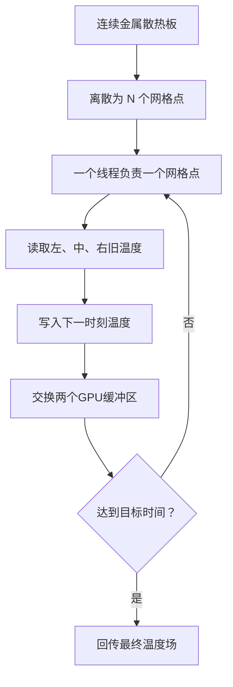
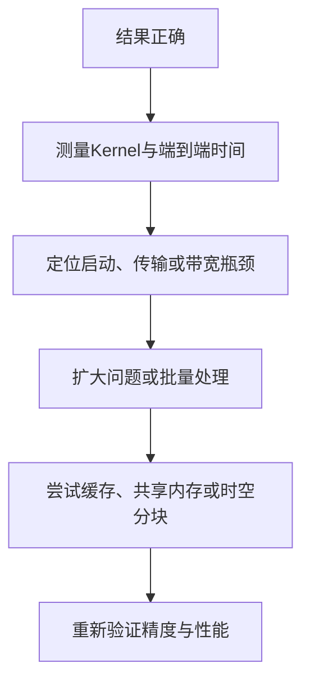

# GPU 算了 1000 次，温度为什么只前进了一步？

> **从一条服务器散热板出发，讲清热传导方程、有限差分、CUDA 线程映射、双缓冲与数值稳定性。**

> **工程深度｜验证状态：** L2–L3 工程｜静态复核 + 数值验证（关注稳定性条件）
凌晨 2 点 17 分，监控系统报出一条并不刺眼、却足够让值班工程师清醒的告警：

```text
GPU 节点局部温度持续升高，热点正在扩大。
```

温度传感器只能告诉我们“此刻哪里热”，工程师更关心的是下一步：

- 这团热会以多快的速度向周围扩散？
- 过几秒钟，散热板上哪些位置会超过阈值？
- 如果把空间切得更细，CPU 还能否及时算完？
- GPU 上千个线程，应该怎样接手这项工作？

真实服务器散热涉及导热、对流、辐射、风道和复杂几何，远比一段代码复杂。为了看清最核心的计算结构，我们先截取均匀金属散热板上的一条窄线，把它近似成一根一维导热杆：材料均匀、两端保持环境温度，初始时中央出现一个热点，暂时忽略空气对流和持续热源。

这个被刻意简化的模型，恰好能回答一个很有意思的问题：

> 一条偏微分方程，怎样被拆成成千上万个可以同时执行的 CUDA 线程？

但故事还有另一面。一段看似合理的 PyCUDA 热传导代码，如果没有正确交换 GPU 缓冲区，哪怕循环了 1000 次，物理时间也可能只向前走了一步。

这篇文章就从这个陷阱开始。

---

## 一、先别急着上 GPU：热量到底在做什么？

想象一条温度并不均匀的金属杆：中央很热，两侧较冷。

热量不会凭空消失，也不会突然跳到远处。它会先流向紧邻的低温区域，再继续向外扩散。宏观上看，尖锐的温度峰会越来越矮、越来越宽：

```text
初始时刻                 稍后                     更晚

温度                     温度                     温度
 │        █                │       ▆▆               │      ▄▄▄▄
 │        █                │      ▆  ▆              │    ▄      ▄
 │        █                │    ▅      ▅            │  ▃          ▃
 └────────────位置         └────────────位置         └────────────位置
```

描述这种现象的经典模型是一维热传导方程：

$$\frac{\partial T}{\partial t} = \alpha\frac{\partial^2T}{\partial x^2}$$

其中：

- $T(x,t)$：位置 $x$ 在时刻 $t$ 的温度；
- $\alpha$：热扩散率，表示材料摊平温差的能力；
- $\partial T/\partial t$：温度随时间变化的速度；
- $\partial^2T/\partial x^2$：温度曲线在当前位置的弯曲程度。

最后一项最容易把读者挡在门外。其实它表达的直觉很简单：

> 如果一个点比左右邻居高很多，它就应该降温；如果它比左右邻居低很多，它就应该升温。

热传导方程不是在问“这个点有多热”，而是在问“它和邻居相比有多不协调”。

---

## 二、计算机不认识导数，它只认识相邻的三个格子

连续的金属杆上有无数个位置，计算机不可能全部保存。第一步是把空间切成有限个网格点：

```text
      左邻居           当前点           右邻居
         │                │                │
         ▼                ▼                ▼
...  T[i-1]  ── dx ──  T[i]  ── dx ──  T[i+1]  ...
```

对于内部网格点 $i$，二阶空间导数可用中心差分近似：

$$\frac{\partial^2T}{\partial x^2} \approx \frac{T_{i+1}^{n}-2T_i^{n}+T_{i-1}^{n}}{\Delta x^2}$$

时间方向再使用显式欧拉方法：

$$\frac{T_i^{n+1}-T_i^n}{\Delta t} \approx \alpha \frac{T_{i+1}^{n}-2T_i^{n}+T_{i-1}^{n}}{\Delta x^2}$$

整理后得到真正交给计算机的更新公式：

$$T_i^{n+1} = T_i^n+ \frac{\alpha\Delta t}{\Delta x^2} \left(T_{i-1}^{n}-2T_i^n+T_{i+1}^{n}\right)$$

定义一个无量纲参数：

$$r=\frac{\alpha\Delta t}{\Delta x^2}$$

公式就变成：

$$T_i^{n+1} = T_i^n+r\left(T_{i-1}^{n}-2T_i^n+T_{i+1}^{n}\right)$$

这一步很关键。原本抽象的偏微分方程，现在只剩下一件重复的工作：

> 读取左、中、右三个旧温度，算出一个新温度。

每个内部网格点都执行同一套规则，而且在同一个时间步内彼此独立——这正是 GPU 喜欢的计算形状。

根据标准有限差分分析，这种“时间前向、空间中心”的显式格式具有时间一阶、空间二阶精度，并且是**条件稳定**的。相关推导和参考实现可见 [Finite Difference Computing with PDEs](https://hplgit.github.io/fdm-book/doc/pub/book/html/._decay-book009.html)。

---

## 三、一个比公式更直观的稳定性解释

把更新公式再整理一次：

$$T_i^{n+1} = rT_{i-1}^{n} +(1-2r)T_i^{n} +rT_{i+1}^{n}$$

现在不要把它看成微分方程，而把它看成一次“温度投票”：

| 旧温度 | 对新温度的权重 |
|---|---:|
| 左邻居 $T_{i-1}^{n}$ | $r$ |
| 当前点 $T_i^n$ | $1-2r$ |
| 右邻居 $T_{i+1}^{n}$ | $r$ |

三个权重之和始终为 1。只要：

$$0\le r\le\frac{1}{2}$$

三个权重就都不会是负数。新温度相当于邻域旧温度的加权平均，不会无缘无故高过最高点，也不会低过最低点。

可是一旦 $r>1/2$，中间权重 $1-2r$ 就变成负数。此时算法不再只是“平均”，而是在用负权重抵消当前温度，数值振荡和发散便有了入口。

这给出一维显式热传导格式常用的稳定性限制：

$$\boxed{\frac{\alpha\Delta t}{\Delta x^2}\le\frac{1}{2}}$$

也就是：

$$\boxed{\Delta t\le\frac{\Delta x^2}{2\alpha}}$$

这里藏着一个反直觉事实：

> 空间网格缩小一半，允许的时间步长不是缩小一半，而是缩小到四分之一。

所以“网格更细”意味着更高的空间分辨率，也意味着更多网格点和更多时间步。GPU 能提高吞吐，却不能取消数值方法本身的稳定性约束。

---

## 四、从网格点到 CUDA 线程

在一维 CUDA 网格中，每个线程先算出自己的全局编号：

```cpp
int idx = threadIdx.x + blockIdx.x * blockDim.x;
```

如果每个线程负责一个空间点，那么映射关系非常直接：

```text
CUDA线程 0  → 温度网格点 0
CUDA线程 1  → 温度网格点 1
CUDA线程 2  → 温度网格点 2
...
CUDA线程 i  → 温度网格点 i
```

完整计算流程可以压缩成一张图：



相邻线程访问相邻的数组元素，也符合 CUDA 偏好的连续内存访问模式。不过，这个三点 stencil 每个点只做少量算术，主要工作是读写内存，因此它通常更接近**内存带宽受限**，而不是计算能力受限。

这意味着优化时不应只盯着“浮点运算峰值”，还要关注：

- 数据是否反复在 CPU 和 GPU 之间搬运；
- 全局内存访问是否连续；
- kernel 是否过小、启动次数是否过多；
- 缓存是否已经复用了相邻线程的重叠读取；
- 使用共享内存后，收益是否真的超过同步和装载成本。

NVIDIA 的最佳实践也强调：适合 GPU 的任务通常需要大量并行数据元素，并应尽量让连续 kernel 使用的数据留在设备端。[CUDA C++ Best Practices Guide](https://docs.nvidia.com/cuda/cuda-c-best-practices-guide/index.html)

---

## 五、为什么必须有两块温度数组？

假设线程 $i$ 已经算出新温度，并直接覆盖 `temperature[i]`。与此同时，线程 $i+1$ 可能还没来得及读取旧的 `temperature[i]`。

这样，同一个时间步就会混入两个时代的数据：

```text
线程 i   读取旧数据 → 写回新数据
线程 i+1            → 可能读到线程 i 的新数据
```

结果取决于线程执行顺序，而 GPU 并不承诺所有线程按照空间坐标依次运行。

正确做法是使用两块显存：

```text
current：只读，保存第 n 时刻
next   ：只写，保存第 n+1 时刻
```

每完成一个时间步，只交换两个指针：

```text
时间步 0：current=A，next=B  →  A 读，B 写
交换后 ：current=B，next=A
时间步 1：current=B，next=A  →  B 读，A 写
交换后 ：current=A，next=B
```

这个动作叫 ping-pong buffer，也常被称为双缓冲。

注意，真正需要交换的是 GPU 指针：

```python
current_gpu, next_gpu = next_gpu, current_gpu
```

仅仅交换 CPU 上的 NumPy 数组，并不会让已经分配好的 GPU 显存改变角色。

---

## 六、原始实现里，1000 次循环为什么可能只算了一步？

原始代码每一轮都执行：

```python
heat_conduction(temperature_gpu, new_temperature_gpu, ...)
```

但从未交换这两个 GPU 指针。于是实际发生的是：

```text
初始温度 → 第一步结果
初始温度 → 第一步结果
初始温度 → 第一步结果
……重复 1000 次
```

而不是：

```text
初始温度 → 第一步 → 第二步 → 第三步 → …… → 第1000步
```

除此之外，还有几处容易被注释掩盖的问题。

### 1. `cuda.to_device()`返回的不是 `GPUArray`

底层 `cuda.to_device()`返回设备内存分配对象。将它复制回主机，应使用：

```python
cuda.memcpy_dtoh(host_array, device_pointer)
```

`.get()`通常属于 `pycuda.gpuarray.GPUArray` 的使用方式，不能混用两套抽象。接口定义可查阅 [PyCUDA Device Interface](https://documen.tician.de/pycuda/driver.html)。

### 2. 边界“固定”不能只写在注释里

如果内核跳过首尾两个点，却没有保证输出缓冲区的边界值正确，那么交换缓冲区后，边界可能来自未初始化或过期数据。

本例使用 Dirichlet 边界条件：两端相对环境温度恒为 0，并在每一轮显式写入。

### 3. 每轮同步会制造不必要的等待

CUDA kernel 启动对主机通常是异步的；但同一流中的操作会按顺序执行。因此，下一时间步自然会在上一时间步之后运行，不必每轮都让 CPU 调用全局同步。官方计时指南也提醒：使用 CPU 计时器测量 CUDA 时，必须理解异步行为并在正确的位置同步。[CUDA Best Practices：Timing](https://docs.nvidia.com/cuda/cuda-c-best-practices-guide/index.html#timing)

### 4. 每轮把结果搬回 CPU，会抹掉 GPU 的意义

如果只是求最终温度，正确的数据路线应该是：

```text
CPU初始数据 ──H2D一次──> GPU连续推进全部时间步 ──D2H一次──> CPU最终结果
```

而不是每一步都跨越 PCIe 往返。

---

## 七、完整修正版：从正确性到计时一次跑通

下面的代码使用“相对环境温度”建模：

- `0.0` 表示与环境同温；
- `1.0` 表示归一化热点；
- 两端始终保持 `0.0`；
- 中央一小段区域在初始时刻被加热；
- `r=0.4`，满足一维显式格式的稳定性条件。

它同时提供：

- NumPy CPU 参考实现；
- PyCUDA GPU 实现；
- GPU 双缓冲；
- CUDA Event 内核计时；
- 端到端计时；
- CPU/GPU 结果校验；
- 初始与最终温度曲线绘图。

> 运行环境需要 NVIDIA GPU、正确安装的驱动与 CUDA Toolkit，以及与环境匹配的 PyCUDA。PyCUDA 提供 Python 风格的 CUDA Driver API 访问方式，官方入口见 [PyCUDA Documentation](https://documen.tician.de/pycuda/)。

```python
"""GPU 算了 1000 次，温度为什么只前进了一步？（第1章 · GPU 编程基础）。

本文件是对应博文代码块的实现/演示，直接运行可见效果；运行依赖：PyCUDA、NumPy、Matplotlib。
"""
import time

import matplotlib.pyplot as plt
import numpy as np
import pycuda.autoinit  # 自动创建CUDA上下文
import pycuda.driver as cuda
from pycuda.compiler import SourceModule


# ============================================================
# 1. CUDA内核：一维热传导显式有限差分
# ============================================================
KERNEL_CODE = r"""
__global__ void heat_step(
    const float *current,
    float *next,
    int n,
    float r)
{
    // 当前CUDA线程负责的全局网格点
    int idx = threadIdx.x + blockIdx.x * blockDim.x;

    // 向上取整的grid可能产生多余线程，必须先做越界保护
    if (idx >= n) {
        return;
    }

    // Dirichlet边界：两端始终保持环境相对温度0
    if (idx == 0 || idx == n - 1) {
        next[idx] = 0.0f;
        return;
    }

    // FTCS更新：读取第n时刻，写入第n+1时刻
    next[idx] = current[idx]
              + r * (current[idx - 1]
                   - 2.0f * current[idx]
                   + current[idx + 1]);
}
"""


# JIT编译发生在计时区域之外，避免把首次编译成本算进迭代时间
module = SourceModule(KERNEL_CODE, options=["-O3"])
heat_step = module.get_function("heat_step")


# ============================================================
# 2. 初始温度：中央出现一段局部热点
# ============================================================
def make_initial_temperature(n: int) -> np.ndarray:
    temperature = np.zeros(n, dtype=np.float32)

    center = n // 2
    half_width = max(32, n // 4096)
    temperature[center - half_width:center + half_width] = 1.0

    # 与内核边界条件保持一致
    temperature[0] = 0.0
    temperature[-1] = 0.0
    return temperature


# ============================================================
# 3. CPU参考实现：用于正确性验证，不假装是最优CPU版本
# ============================================================
def solve_cpu(initial: np.ndarray, r: float, timesteps: int):
    current = initial.copy()
    next_temperature = np.empty_like(current)

    start = time.perf_counter()

    for _ in range(timesteps):
        next_temperature[0] = 0.0
        next_temperature[-1] = 0.0

        next_temperature[1:-1] = (
            current[1:-1]
            + r
            * (
                current[:-2]
                - 2.0 * current[1:-1]
                + current[2:]
            )
        )

        # CPU端同样采用双缓冲
        current, next_temperature = next_temperature, current

    elapsed_s = time.perf_counter() - start
    return current, elapsed_s


# ============================================================
# 4. GPU预热：排除首次运行的一次性开销干扰
# ============================================================
def warm_up_gpu(r: float, block_size: int):
    warm_host = np.zeros(block_size, dtype=np.float32)
    warm_current = cuda.to_device(warm_host)
    warm_next = cuda.mem_alloc(warm_host.nbytes)

    heat_step(
        warm_current,
        warm_next,
        np.int32(warm_host.size),
        np.float32(r),
        block=(block_size, 1, 1),
        grid=(1, 1, 1),
    )
    cuda.Context.synchronize()


# ============================================================
# 5. GPU实现：显存驻留、双缓冲、一次回传
# ============================================================
def solve_gpu(
    initial: np.ndarray,
    r: float,
    timesteps: int,
    block_size: int = 256,
):
    n = initial.size
    grid_size = (n + block_size - 1) // block_size

    # 端到端计时：包含显存分配、H2D、迭代和D2H，不包含JIT编译
    e2e_start = time.perf_counter()

    current_gpu = cuda.to_device(initial)
    next_gpu = cuda.mem_alloc(initial.nbytes)

    start_event = cuda.Event()
    end_event = cuda.Event()

    start_event.record()

    for _ in range(timesteps):
        heat_step(
            current_gpu,
            next_gpu,
            np.int32(n),
            np.float32(r),
            block=(block_size, 1, 1),
            grid=(grid_size, 1, 1),
        )

        # 核心：本轮输出成为下一轮输入
        current_gpu, next_gpu = next_gpu, current_gpu

    end_event.record()
    end_event.synchronize()

    # PyCUDA Event返回毫秒
    kernel_ms = start_event.time_till(end_event)

    result = np.empty_like(initial)
    cuda.memcpy_dtoh(result, current_gpu)

    e2e_s = time.perf_counter() - e2e_start
    return result, kernel_ms / 1000.0, e2e_s


def main():
    # N可逐步改为2^10、2^12、...、2^20，观察规模拐点
    n = 1 << 16
    timesteps = 2000
    r = 0.4
    block_size = 256

    if not (0.0 < r <= 0.5):
        raise ValueError(
            f"显式一维热传导格式要求0 < r <= 0.5，当前r={r}"
        )

    initial = make_initial_temperature(n)

    warm_up_gpu(r, block_size)

    cpu_result, cpu_s = solve_cpu(initial, r, timesteps)
    gpu_result, kernel_s, e2e_s = solve_gpu(
        initial,
        r,
        timesteps,
        block_size,
    )

    # 正确性优先：先比较结果，再谈速度
    np.testing.assert_allclose(
        gpu_result,
        cpu_result,
        rtol=1e-5,
        atol=1e-5,
    )

    if not np.all(np.isfinite(gpu_result)):
        raise RuntimeError("结果中出现NaN或Inf")

    # 稳定且无热源时，不应无缘无故超过初始极值
    tolerance = 1e-5
    if gpu_result.min() < -tolerance or gpu_result.max() > 1.0 + tolerance:
        raise RuntimeError("结果违反预期的温度范围，请检查稳定性或边界条件")

    max_abs_error = np.max(np.abs(cpu_result - gpu_result))

    print(f"网格点数              : {n:,}")
    print(f"时间步数              : {timesteps:,}")
    print(f"扩散参数r             : {r}")
    print(f"CPU参考实现            : {cpu_s:.6f} s")
    print(f"GPU Kernel             : {kernel_s:.6f} s")
    print(f"GPU端到端              : {e2e_s:.6f} s")
    print(f"CPU/GPU端到端加速比    : {cpu_s / e2e_s:.2f}x")
    print(f"CPU/GPU最大绝对误差    : {max_abs_error:.8e}")

    # 可视化归一化位置与相对环境温度
    x = np.linspace(0.0, 1.0, n, dtype=np.float32)

    plt.figure(figsize=(10, 5))
    plt.plot(x, initial, label="初始热点", linewidth=1.6)
    plt.plot(x, gpu_result, label="扩散后", linewidth=2.0)
    plt.xlabel("归一化位置 x")
    plt.ylabel("相对环境温度")
    plt.title("一维热传导：局部热点随时间扩散")
    plt.grid(alpha=0.25)
    plt.legend()
    plt.tight_layout()
    plt.show()


if __name__ == "__main__":
    main()
```

---

## 八、这段代码真正做对了什么？

### 1. 用 `const` 表达本轮只读输入

```cpp
const float *current
```

这既表达算法意图，也防止内核不小心修改当前时间层。

### 2. 把 r 在 CPU 端提前计算

原始公式包含：

```cpp
alpha * dt / (dx * dx)
```

这个值在整个仿真中不变，没有必要让每个线程、每个时间步重复计算。把它预先化为 `r` 后，内核更短，稳定性检查也更直接。

### 3. 边界由代码明确执行

```cpp
if (idx == 0 || idx == n - 1) {
    next[idx] = 0.0f;
    return;
}
```

“两端恒温”不再是一句注释，而成为每个时间步都满足的约束。

### 4. 中间状态留在 GPU

2000 个时间步全部在显存中完成，只有初始状态上传一次、最终状态下载一次。这与 NVIDIA 关于尽量减少主机—设备传输、延长数据设备驻留时间的建议一致。

### 5. 区分 Kernel 时间与端到端时间

`cuda.Event`测量 GPU 时间线中两个事件之间的间隔。PyCUDA 文档规定，应在读取事件间隔前确保结束事件已经到达，代码因此调用：

```python
end_event.synchronize()
kernel_ms = start_event.time_till(end_event)
```

对应接口见 [PyCUDA Event.time_till](https://documen.tician.de/pycuda/driver.html#pycuda.driver.Event.time_till)。

但用户实际等待的时间不只有 kernel，所以代码还用 `time.perf_counter()`测量：

```text
显存分配 + H2D + 全部kernel + D2H
```

只有把这两个数字同时给出，性能结论才不会偷换概念。

---

## 九、先证明算对，再讨论算快

科学计算最危险的失败，不是程序崩溃，而是程序安静地给出一个看起来很像答案的数组。

因此验证至少需要三层。

### 第一层：与 CPU Reference 对照

```python
np.testing.assert_allclose(
    gpu_result,
    cpu_result,
    rtol=1e-5,
    atol=1e-5,
)
```

CPU 和 GPU 的浮点运算顺序、融合乘加及编译优化可能带来细小差异，所以一般不应要求逐位相等，而应使用与精度目标匹配的容差。

### 第二层：检查有限值

```python
np.all(np.isfinite(gpu_result))
```

这能发现 `NaN` 和无穷大，却不能证明物理正确。

### 第三层：检查物理或数值不变量

本例无内部热源、初始相对温度位于 `[0,1]`，并采用稳定的凸组合更新。数值结果不应无缘无故低于 0 或高于 1。

真实工程中，还可以继续检查：

- 对称初始条件是否保持对称；
- 网格加密后误差是否按预期收敛；
- 绝热边界下总热量是否近似守恒；
- Dirichlet 边界是否在每一步都满足；
- 与已知解析解或成熟求解器是否一致。

这套思路比“打印前五个数看起来差不多”可靠得多。

---

## 十、GPU 一定更快吗？不一定

如果只有 1024 个网格点、一个时间步只启动 4 个包含 256 线程的 block，那么问题对现代 GPU 来说太小了。

GPU 每轮要承担固定成本：

- Python 调用进入 CUDA Driver；
- kernel launch；
- 调度线程块；
- 最终的数据传输与同步。

而三点差分每个网格点只执行少量运算。小规模下，CPU 凭借低延迟和缓存，完全可能更快。

因此不能只测一个 `N`，更不能拿 kernel-only 时间去对比 CPU 的端到端时间。建议至少做一组规模扫描：

| 网格规模 | CPU时间 | GPU Kernel | GPU端到端 | CPU/GPU端到端 |
|---:|---:|---:|---:|---:|
| $2^{10}$ | 实测 | 实测 | 实测 | 计算 |
| $2^{12}$ | 实测 | 实测 | 实测 | 计算 |
| $2^{14}$ | 实测 | 实测 | 实测 | 计算 |
| $2^{16}$ | 实测 | 实测 | 实测 | 计算 |
| $2^{18}$ | 实测 | 实测 | 实测 | 计算 |
| $2^{20}$ | 实测 | 实测 | 实测 | 计算 |

通常会看到一条“规模曲线”，而不是一句永远成立的“GPU 更快”：

```text
问题很小：启动开销占主导，CPU可能更快
问题变大：GPU逐渐填满，双方接近
问题足够大：并行吞吐和显存带宽开始发挥作用
```

NVIDIA 的性能指南也建议使用真实工作负载评估热点和扩展性，而不是在不现实的规模上得出普遍结论。[CUDA Best Practices Guide](https://docs.nvidia.com/cuda/cuda-c-best-practices-guide/index.html)

---

## 十一、如果还要优化，应该从哪里开始？

优化顺序应当是：



### 路线一：一次模拟多根“导热杆”

单根一维杆可能不够大，但工程中常常需要同时计算：

- 多个初始热点方案；
- 多种材料参数；
- 多组边界条件；
- 参数扫描或不确定性分析。

把批次维度加入网格，比勉强优化一个很小的数组更容易发挥 GPU 吞吐优势。

### 路线二：共享内存 stencil

相邻线程读取的数据高度重叠。理论上可以让一个 block 把一段温度和左右 halo 装入共享内存，再从共享内存完成更新。

但“用了共享内存”不等于“必然更快”。现代 GPU 的缓存可能已经吸收了部分重复读取，而共享内存会引入：

- halo 装载；
- block 内同步；
- 更多代码和资源占用。

是否采用，必须由 profiler 和 benchmark 决定。

### 路线三：减少大量短 kernel 的启动成本

时间推进存在跨步依赖，不能把 2000 个时间步简单并行展开。但可以考虑：

- CUDA Graphs：降低重复 launch 工作流的主机开销；
- temporal blocking：在处理 halo 的前提下，让一个 block 暂时推进多个局部时间步；
- cooperative groups：在满足设备与网格驻留条件时进行网格级同步；
- 更高层的 CuPy、Numba CUDA、JAX 或领域求解框架：减少手写调度成本。

这些属于进阶路线。NVIDIA 当前 CUDA Programming Guide 已将异步执行、CUDA Graphs、Cooperative Groups 等作为完整特性分别说明，可按瓶颈选择，而不应全部堆进第一个版本。[CUDA Programming Guide](https://docs.nvidia.com/cuda/cuda-programming-guide/index.html)

### 路线四：换数值方法，而不只优化内核

显式方法的限制是 $\Delta t=O(\Delta x^2)$。网格越细，需要的时间步越多。面对长时间、大规模扩散问题，可以评估：

- Backward Euler；
- Crank–Nicolson；
- 适合线性系统的三对角或稀疏求解器；
- 多重网格方法；
- 面向复杂几何的有限体积或有限元方法。

隐式方法每一步更贵，却允许更大的时间步。工程优化的对象应该是“达到目标物理时间所需的总成本”，而不是某一个 kernel 的纳秒数。

---

## 十二、从教学模型回到真实机柜

本文的一维模型能解释导热核心，却不能直接充当数据中心热仿真软件。

真实 GPU 服务器还需要考虑：

| 现实因素 | 一维模型中的处理 |
|---|---|
| 三维散热器与机箱几何 | 被压缩为一条直线 |
| 风扇与冷却气流 | 忽略 |
| 芯片持续发热 | 只设置初始热点，没有源项 |
| 材料不均匀 | 假设 $\alpha$ 为常数 |
| 对流与辐射 | 忽略 |
| 接触热阻 | 忽略 |
| 传感器误差 | 忽略 |

要进一步接近真实问题，方程可能扩展为：

$$\rho c_p\frac{\partial T}{\partial t} = \nabla\cdot(k\nabla T)+Q$$

其中 $Q$ 表示内部热源；如果再加入空气运动，就会进入流体与传热耦合问题。

但这并不削弱一维模型的价值。恰恰相反，它把复杂系统中最基础的计算骨架暴露出来了：

```text
连续物理规律
    ↓
空间与时间离散
    ↓
局部邻域更新
    ↓
并行线程映射
    ↓
边界、稳定性与误差验证
    ↓
性能测量与工程优化
```

这条路径不仅属于热传导，也会反复出现在扩散方程、图像模糊、地下水模拟、污染物扩散和许多 stencil 类科学计算中。

---

## 十三、真正应该记住的五件事

第一，GPU 不理解偏微分方程。它执行的是离散以后，每个网格点上的局部更新规则。

第二，同一时间步必须读取完整的旧状态、写入完整的新状态，所以需要双缓冲；交换 CPU 数组不能代替交换 GPU 指针。

第三，显式热传导格式必须满足：

$$\frac{\alpha\Delta t}{\Delta x^2}\le\frac{1}{2}$$

GPU 只会更快地执行你的算法，不会自动修复不稳定的数值格式。

第四，中间结果应尽量留在 GPU。每步同步、每步回传，会把并行计算重新拖回主机等待与数据搬运。

第五，性能之前是正确性。CPU Reference、容差比较、边界检查、极值检查和收敛实验，才是科学计算代码可信的起点。

当监控系统再次报告“局部热点正在扩大”时，我们看到的不再只是一条温度曲线。

它背后是一整条计算链：物理规律被写成方程，方程被切成网格，网格被交给线程，而每一次看似简单的数组交换，都决定着时间究竟有没有真正向前走。

---

## 参考资料

1. NVIDIA, [CUDA Programming Guide](https://docs.nvidia.com/cuda/cuda-programming-guide/index.html)：CUDA 执行模型、异步执行、CUDA Graphs、Cooperative Groups 等。
2. NVIDIA, [CUDA C++ Best Practices Guide](https://docs.nvidia.com/cuda/cuda-c-best-practices-guide/index.html)：数据传输、工作负载规模、性能测量与优化方法。
3. PyCUDA, [Official Documentation](https://documen.tician.de/pycuda/)：PyCUDA 的定位、安装与各类接口入口。
4. PyCUDA, [Device Interface](https://documen.tician.de/pycuda/driver.html)：设备内存复制、Stream、Event 与计时接口。
5. Hans Petter Langtangen et al., [Finite Difference Computing with Partial Differential Equations](https://hplgit.github.io/fdm-book/doc/pub/book/html/._decay-book009.html)：扩散方程的显式、隐式离散、边界处理与稳定性分析。

> **实验建议**：将 `r` 从 `0.4` 改为 `0.51`，把时间步增加到足以观察变化，再比较温度最小值和最大值。不要在生产代码中这样做——这只是为了亲眼看见“稳定性条件被破坏”意味着什么。
