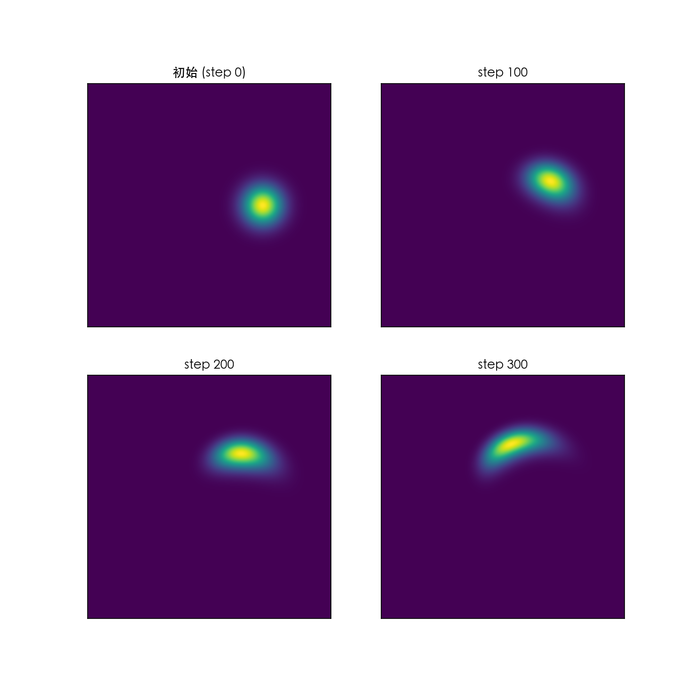
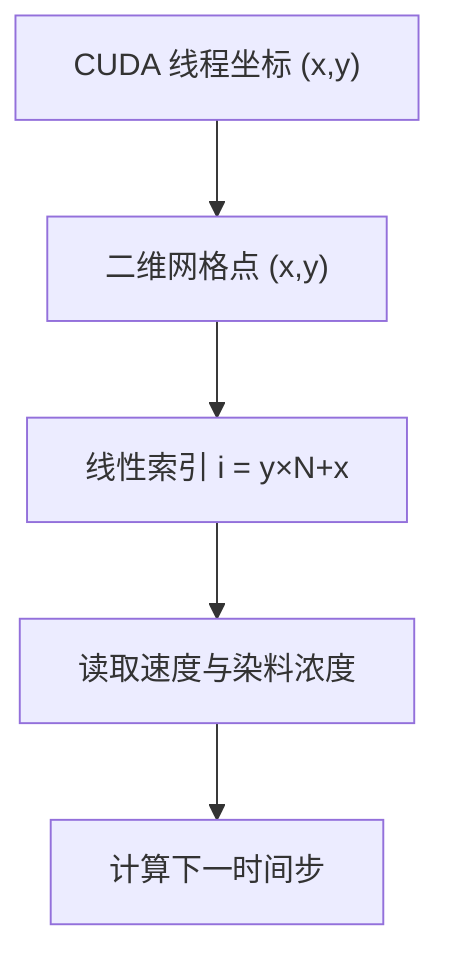
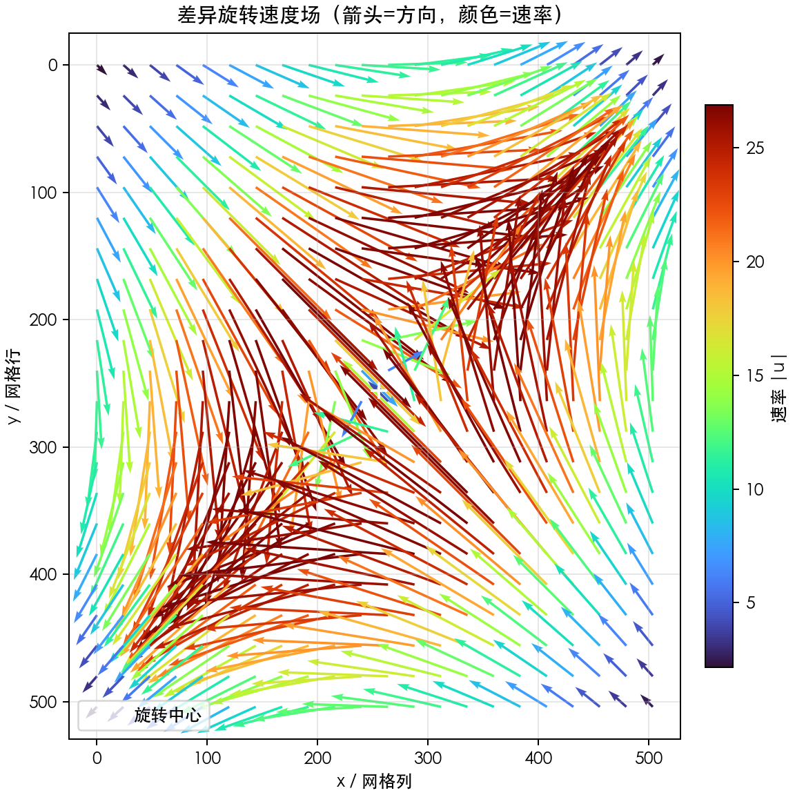
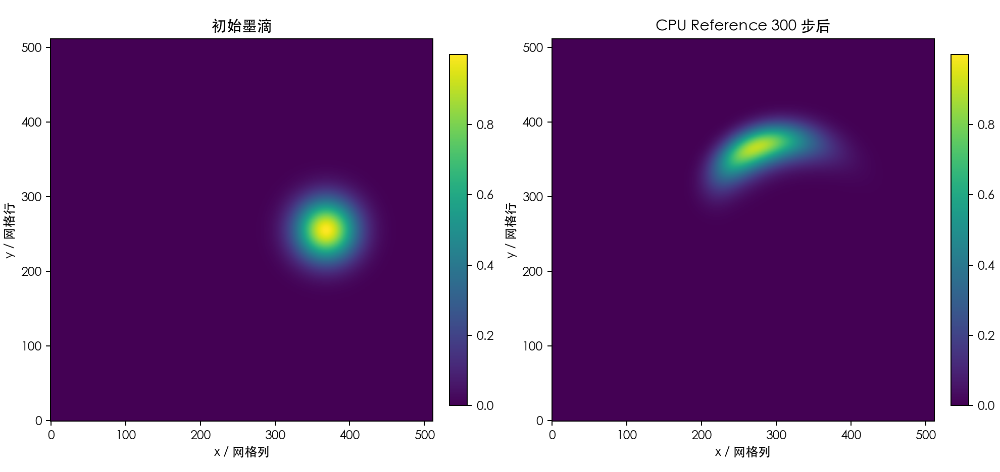
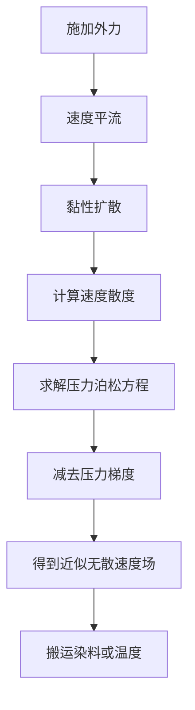

# 26 万个 CUDA 线程，如何推动一滴墨水？

> **从 `velocity_x[0, 0]` 到二维流场：用 PyCUDA 看懂网格、速度、显存索引、双缓冲与 GPU 并行。**
>
> **预计阅读：** 约 20 分钟（附录另计，按需查阅）
> **关键词：** 流体网格、Stencil、双缓冲、半拉格朗日平流、双线性插值、PyCUDA

> **工程深度｜验证状态：** L3 工程｜静态复核 + 数值验证（教学简化模型）
> **30 秒讲懂**：GPU 眼里没有"水"，只有一张 `512 × 512` 的表格：每个格子存一个染料浓度和两个速度分量，一个 CUDA 线程负责一个格子，从旧表格读自己的上下左右四个邻域，算出下一时刻，写进新表格，再交换两个缓冲区，重复几百次。真正的难点有两个：平流时要"倒着找"——从一个回溯位置插值浓度；以及绝不能"边读边写"——同一个时间步里，不能有人还在读旧值，有人已经写下了新值。

> **阅读路线**：想直奔数据竞争与双缓冲，直接读第四章和第五章；想先搞懂"二维数组怎么变成显存里的一条线"，按顺序读；完整可运行代码在「附录 A」，不需要 GPU 的 CPU 对照版本在「附录 B」。

---

## 1. GPU 看到的不是水，而是一张状态表

想象一只透明方盒，里面装着静止的水。我们在盒子右侧滴入一滴绿色墨水，再让它流动起来。

人看到的是墨水舒展、卷曲，最后拉成一条旋涡状的细丝；计算机看到的却完全不同：

```text
一片连续的水
      ↓ 划格子
N × N 个离散位置
      ↓ 每个位置保存状态
x 方向速度、y 方向速度、染料浓度
      ↓ 交给 GPU
一个 CUDA 线程负责更新一个位置
```

如果网格大小是 `512 × 512`，就有：

$$512\times512=262\,144$$

个网格点。

一个完整时间步由两个 Kernel 组成（先平流、后扩散），每个 Kernel Launch 都会创建约 26 万个逻辑线程、一个线程认领一个网格点。每个线程不需要理解整片流体，只需要回答一个局部问题：

> 我负责的这个格子，下一瞬间应该变成什么状态？

这正是流体网格计算与 GPU 相遇的地方。

**补一句精确的表述：** 26 万是"一次 Kernel Launch 创建的逻辑线程数"，不是"同一时刻全部在芯片上执行"。GPU 会把 32 个线程组织成线程束（warp），再由各计算单元（SM）按寄存器、共享内存与占用率分批调度。由于每个时间步启动两次 Kernel（平流 + 扩散），一个完整时间步实际产生约 52 万个线程实例（2 × 262144），它们同样由 SM 分批调度。"26 万"对应的是单次 Kernel Launch 覆盖的网格点数——标题里的数字因此成立。

不过，开始之前必须澄清一件事：网上常见的几十行"CUDA 流体仿真"代码，很多只是二维数组更新示例，并没有真正求解 Navier–Stokes 方程。本文不会用一个能运行的程序冒充完整流体求解器，而是从一段简化代码出发，逐层修正它，最后得到一个**物理含义明确、并行读写正确、可以产生旋涡效果的染料平流—扩散教学模型**。

### 先看一眼：我们最终要得到什么

在进入公式之前，先用 CPU 把整条管线跑起来，看看目标画面长什么样。下图是**与 GPU 采用同一套离散公式与边界规则的 CPU NumPy 向量化参考实现**（CPU 用 `float64`，GPU 用 `float32`）在本机（Apple Silicon）运行得到的演化序列，四个时刻从上到下依次是初始、100 步、200 步、300 步：



你应该会观察到三件事：墨滴质心绕中心**逆时针旋转**；不同半径转速不同，墨滴被**拉伸成一条弧**而不是保持圆形整体刚转；浓度峰值随时间下降、轮廓被扩散磨钝。这是"差异旋转 + 数值耗散"共同作用的结果。

请记住这张画面——后面所有代码的使命，就是把它从 CPU 挪到 GPU，并且保证搬到 GPU 之后，结果仍能和 CPU 逐点对照。

---

## 2. velocity_x[0, 0] 究竟是什么？

假设我们创建了两个数组：

```python
velocity_x = np.zeros((N, N), dtype=np.float32)
velocity_y = np.zeros((N, N), dtype=np.float32)
```

它们不是保存两个物体的速度，而是共同描述整片二维区域的速度场。

对于网格位置 `(y, x)`：

```python
velocity_x[y, x]  # 该位置沿 x 方向的速度分量
velocity_y[y, x]  # 该位置沿 y 方向的速度分量
```

因此：

```python
velocity_x[0, 0] = 0.2
velocity_y[0, 0] = -0.1
```

表示网格左上角位置的完整速度向量为：

$$\mathbf{u}(0,0)=(0.2,-0.1)$$

它不是"第一个流体粒子的速度"，也不是整片水的平均速度，而是**速度场在一个空间采样点上的值**。

在读下一段之前，请先把这个观念钉死：当数字按数组下标组织的世界，和按坐标组织空间的世界，第一次发生碰撞时，人最容易把"下标"和"粒子编号"混为一谈。对比一下就清楚了：

| 方法 | 数组下标含义 | CUDA 线程通常负责 |
|---|---|---|
| 粒子法 | 粒子编号（第几个粒子） | 一个粒子 |
| 网格法 | 空间位置（哪个格子） | 一个网格点 |
| 本文 | `dye[y, x]` 是位置 `(x, y)` 的染料浓度 | 一个网格点 |

### 为什么每个速度分量都是 `N × N`？

因为二维区域中有 `N × N` 个位置，每个位置都需要一个 x 方向速度和一个 y 方向速度：

```text
velocity_x：N × N 个水平速度分量
velocity_y：N × N 个垂直速度分量
dye：       N × N 个染料浓度（示踪标量）
```

注意这里用的是 **dye（染料）**，对应数值上是一个"浓度标量场"；它跟计算流体的质量密度不是一回事。避免把染料浓度与 Navier–Stokes 方程里的质量密度 $\rho$ 混用，是全文的措辞纪律，后面会再强调一次。

把不同物理量拆成独立连续数组的布局，也便于 CUDA 线程连续读取相邻的 `float` 数据。

---

## 3. 一个线程如何找到自己的网格点？

NumPy 中的数组看起来是二维的：

```python
velocity_x[y, x]
```

但数组在内存中仍然是一段连续字节。对于按行优先（C-order）存放的 `N × N` 数组，第 `(y, x)` 个元素的线性索引是：

$$i=y\times N+x$$

例如 `N = 4`：

```text
二维坐标                   一维显存索引

(0,0) (0,1) (0,2) (0,3)      0   1   2   3
(1,0) (1,1) (1,2) (1,3)  →   4   5   6   7
(2,0) (2,1) (2,2) (2,3)      8   9  10  11
(3,0) (3,1) (3,2) (3,3)     12  13  14  15
```

于是 CUDA 内核中会出现：

```cpp
int x = blockIdx.x * blockDim.x + threadIdx.x;
int y = blockIdx.y * blockDim.y + threadIdx.y;
int i = y * N + x;
```

CUDA 编程模型允许线程块和网格使用一维、二维或三维索引。二维并不会改变显存的线性本质，却能让"线程坐标"和"空间坐标"自然对齐。



这条映射关系，是全文最重要的一把钥匙。

### 一个格子，离不开邻居

如果每个格子的下一状态只取决于自己，GPU 编程并不困难。流体、热传导、卷积和偏微分方程真正有意思的地方在于：**当前点的变化通常取决于周围邻居。**

以二维扩散为例：

$$\frac{\partial c}{\partial t}=D\nabla^2c$$

其中 $c$ 是染料浓度，$D$ 是扩散系数，$\nabla^2c$ 是拉普拉斯算子，描述当前点与周围区域的差异。

在规则网格上，若 $x$、$y$ 方向的网格间距同为 $h$，五点差分写成：

$$\nabla^2c_{i,j}\approx
\frac{c_{i-1,j}+c_{i+1,j}+c_{i,j-1}+c_{i,j+1}-4c_{i,j}}{h^2}$$

**注意分母里的 $h^2$ 不能省。** 本文全程采用无量纲网格坐标（一个格子边长记为 $1$，即 $h=1$），所以后面的代码里不出现分母；但你把它套到任意"物理网格"前，一定要回到这个完整公式。

五点差分的几何含义就是字面意思：

```text
                  上
                  │
                  ▼
            ┌────┬────┬────┐
            │    │ ↑  │    │
            ├────┼────┼────┤
      左 ←  │ ←  │当前│  → │  → 右
            ├────┼────┼────┤
            │    │ ↓  │    │
            └────┴────┴────┘
                  │
                  ▼
                  下
```

这种"每个线程读取一个局部邻域、写出一个结果"的计算模式，称为 **Stencil（模板计算）**。热传导、有限差分、图像滤波和很多科学计算都属于这一家族。

---

## 4. 原始代码能运行，却有四个错误

网上流传的一段原始内核里有类似计算：

```cpp
float pressure_gradient =
    (pressure[i] - pressure[i + 1]) / viscosity;
```

它至少隐藏着四个问题。

### 问题一：`i + 1` 不一定是右侧邻居

当线程位于一行的最后一列时，`i + 1` 会跳到下一行第一列：

```text
本来想访问：同一行右边的格子
实际访问：  下一行开头的格子
```

二维邻居必须用二维坐标构造：

```cpp
int right = y * N + (x + 1);   // 并且先确认 x + 1 < N
```

### 问题二：最后一个元素会越界

当 `i = N * N - 1` 时，`i + 1 = N * N` 已经超出合法索引范围（合法最大是 `N * N - 1`）。

CUDA 越界不一定立即让 Python 报出清晰的异常；它可能表现为错误结果，也可能在之后的同步或数据复制时才暴露。

### 问题三：压力梯度和黏度放错了位置

不可压缩流体动量方程常写成：

$$\frac{\partial \mathbf{u}}{\partial t}+(\mathbf{u}\cdot\nabla)\mathbf{u}
=-\frac{1}{\rho}\nabla p+\nu\nabla^2\mathbf{u}+\mathbf{f}$$

注意这里的 $\rho$ 是流体质量密度。方程里：

- 压力通过 $-\nabla p/\rho$ 影响速度；
- 黏度系数 $\nu$ 乘在速度的拉普拉斯项上；
- 它**不是**压力差的分母。

因此，原公式可以作为"读取邻居并更新数组"的演示，却不能被称为正确的 Navier–Stokes 离散。

### 问题四：原地更新会制造数据竞争

假设线程 A 正在执行：

```cpp
new_value = dye[i] - dye[i + 1];
```

与此同时，线程 B 可能正在改写 `dye[i + 1]`。线程 A 读到的是旧值还是新值，取决于不可依赖的执行时序。

这四个错误正好对应四类检查：**索引正确、边界安全、物理无意义、并发正确**。第一、二条能由 memcheck 类工具撞出来，第三、四条必须靠人理解离散公式和读写顺序。验证层的对应关系，我们放到第九章和附录 C。

---

## 5. 双缓冲：为什么不能边读边写

问题四值得单独放一章，因为"每个线程只写自己的格子"并不能自动排除数据竞争。

正确做法是双缓冲：

```text
当前时间步 old：所有线程只读
           │
           ▼
       CUDA Kernel
           │
           ▼
下一时间步 new：每个线程只写自己的位置

一轮结束后，交换 old 与 new 的角色
```

双缓冲的本质不是"多申请一块显存"，而是明确时间边界：

> 第 $t+1$ 步的任何值，都只能由第 $t$ 步的完整状态计算出来。

把三种并发读写关系列成一张表，规则立刻清晰：

| 情形 | 结果 |
|---|---|
| 多个线程读同一个旧值 | 允许 |
| 多个线程写同一个新位置 | 冲突（样例：两个旧格子都想把染料写进同一个新格子） |
| 多个线程各写自己负责的新位置 | 安全（本模型采用） |

这也解释了为什么本文不需要 `atomicAdd`：半拉格朗日平流采用"每个新格子自己倒推来源"的写法，天然避免了"多人抢写一个格子"。反过来的前向写法才会制造冲突。

**关于"内核结束就是全局边界"要说得再准确一些：** 在同一 CUDA Stream 中，后一个 Kernel 会在前一个 Kernel 完成后执行，所以连续两次 Kernel Launch 之间自然形成一个时间步的边界；但这**不等于**单个 Kernel 内部拥有跨 Block 的全局屏障——`__syncthreads()` 只协调同一个 Block 内的线程，对由多个 Block 组成的整个 Grid，没有对普通 Kernel 生效的"全 Grid 屏障"。

---

## 6. 平流为什么要沿速度反向追踪？

只做扩散，墨水只会像热量一样向四周摊开，成不了旋涡。要让它"流动"，需要给网格预先设置一个速度场。

### 6.1 用差异旋转速度场，而不是单一角速度

一种想当然的写法是让整个流场以同一个角速度 $\omega$ 绕中心旋转：

$$u=-\omega(y-c_y),\qquad v=\omega(x-c_x)$$

这是刚体旋转：一团墨水会绕中心转，但因为内外圈转得一样快，不会被拉伸，最多随扩散逐渐变糊，很难出现"卷曲成旋涡细丝"的视觉效果。

为了让染料真正被剪切、拉长，应改用**随半径变化的角速度**：

$$\omega(r)=\omega_0\,e^{-r^2/R^2},\qquad r=\sqrt{(x-c_x)^2+(y-c_y)^2}$$

$$u(x,y)=-\omega(r)(y-c_y),\qquad v(x,y)=\omega(r)(x-c_x)$$

它仍然是无散速度场（$\nabla\cdot\mathbf{u}=0$），数学上干净；而内外圈转速不同，位于外侧的染料会被不断拉伸，形成旋涡状细丝——这正是第 1 章开头那个画面。

下图画出了这个速度场的**方向与速率分布**，箭头越接近中部环形带越暖、越长，代表那里转速最快（$\omega_0 R/\sqrt{2e}$ 处的速率峰值约 27 格/单位时间）；中心与角落的箭头都很短，转速接近零。墨滴恰好落在最外面的环形剪切区，才会被拉成细丝：



作为数值口径的旁证：该场最大速率约 27 格/单位时间，取 $\Delta t=0.02$ 时，单个时间步的最大位移约 $0.54$ 格（小于 1 格），半拉格朗日回溯的插值因此始终落在可插值区域内——这是稳定性之外的另一条安全线。

### 6.2 前向推有麻烦，改成倒着找

如果从旧位置向前推：

```text
旧格子中的染料 → 应该流到哪里？
```

多个旧格子可能抢着写同一个新格子，也可能留下没人写的空洞。

半拉格朗日方法换了一个问题：

```text
新格子里的这个值 ← 上一时刻来自哪里？
```

对于目标位置 `(x, y)`，沿速度反方向回溯：

$$x_s=x-u(x,y)\Delta t,\qquad y_s=y-v(x,y)\Delta t$$

再从旧浓度场的 $(x_s,y_s)$ 处做双线性插值。这里强调一个单位问题：

> 本文采用无量纲网格坐标，速度单位为"网格单元/单位时间"，因此回溯式中不需要再除以网格间距 $h$。如果换成米/秒的物理速度，回溯应写成 $x_s=x-u\Delta t/h$。

一个一维数值例子足以看穿这个方法：

```text
目标位置：x = 10
速度：u = 2 格/单位时间（沿 +x 流动）
时间步：dt = 0.25

回溯位置：
xs = 10 - 2 × 0.25 = 9.5
```

也就是说：新位置 10 的浓度，应该来自旧场上位置 9 和 10 之间的插值（更确切地说，来自 9.5 这个"半格"位置）。


这样每个线程仍然只写一个确定的位置，不需要原子操作。需要知道代价：半拉格朗日平流以稳定、易实现著称，但线性插值会引入数值耗散，细小旋涡和尖锐边界会逐渐变模糊——所以"会转"和"高保真"是两回事，教学与视觉演示选前者。

---

## 7. 一个数值例子看懂双线性插值

承接上一节的 `xs = 9.5`：回溯点不在任何网格点上，它落在旧场两格之间。

先看一维。位置 `9.5` 的权重分配是：

```text
c_new(10) = (1 - 0.5) × c_old(9) + 0.5 × c_old(10)
          = 0.5 × c_old(9) + 0.5 × c_old(10)
```

推广到二维，回溯点 `(xs, ys) = (9.5, 3.25)` 被 4 个旧网格点包围：

```text
(9, 3)  ?    (10, 3)
   \              /
    \    (9.5, 3.25)
   /              \
(9, 4)  ?    (10, 4)

x 方向权重：距 9 为 0.5，距 10 为 0.5
y 方向权重：距 3 为 0.75，距 4 为 0.25
```

先沿 x 分别插出上下两行的值，再沿 y 合并成一个数。整个过程用到的坐标与权重都来自同一份定义，GPU 上每个线程独立完成，彼此不通信——这就是它能并行又不需要原子操作的原因。

### 7.1 显式扩散的稳定性来自数值方法，不是 GPU

扩散项的离散用五点 Laplacian。实际出现在代码里的不是物理扩散系数 $D$，而是无量纲组合：

$$\alpha=\frac{D\Delta t}{h^2}$$

因此代码里的变量名用 `alpha` 而不是容易误读的 `diffusion`。二维均匀正方形网格、$h_x=h_y=h$、Forward Euler、标准五点 Laplace 的显式扩散有一个常见稳定性条件：

$$\alpha=\frac{D\Delta t}{h^2}\le\frac{1}{4}$$

这一条值得多说一句，因为初学者最容易颠倒因果：

> **这是显式差分方法的稳定性限制，不是 CUDA 硬件限制。** GPU 只能更快地执行离散公式，不能替数值方法取消稳定性条件；与平流组合后，整体时间步仍应通过收敛实验验证。

### 7.2 平流与扩散：两个内核，一阶分裂

有些实现把平流和扩散"融合"进一个内核，在一个算式里做完两种效应。这不是最清晰的表达。本文把两步拆成两个 Kernel：

```text
dye_old
   ↓ advect kernel（半拉格朗日 + 双线性插值）
dye_advected
   ↓ diffuse kernel（五点 Laplacian + alpha）
dye_new
```

这套"先平流、再扩散"的串行分解属于**一阶顺序算子分裂**（Lie splitting / Lie–Trotter splitting）：先让平流算子单独推进一个时间步，再让扩散算子接续推进：

$$c^{*}=A_{\Delta t}(c^n),\qquad c^{n+1}=D_{\Delta t}(c^{*})$$

这是教学上最常用的分裂，因为它让每个 Kernel 对应一个数学算子、可以独立校对与计时；代价是**一阶全局时间精度**，局部分裂误差通常为 $O(\Delta t^2)$、累积到全局约为 $O(\Delta t)$。若需要更高的组合精度，可以换 Strang 二阶分裂（先跑半个步长的扩散、再跑整步平流、再跑半个步长的扩散）或干脆采用整体耦合格式。

拆开的好处很实在：每个 Kernel 对应一个数学算子，能单独写 CPU Reference、单独计时、也能讲清误差来自平流还是扩散。附录 A 就是按这个结构组织的。

---

## 8. 完整实验：染料旋转与扩散

### 8.1 两个内核，各做一件事

平流内核只做三件事：回溯、钳制、插值。

```cpp
// advect：dye_old -> dye_advected
int x = blockIdx.x * blockDim.x + threadIdx.x;
int y = blockIdx.y * blockDim.y + threadIdx.y;
if (x >= N || y >= N) return;
int i = y * N + x;

if (x == 0 || x == N - 1 || y == 0 || y == N - 1) {
    dye_advected[i] = 0.0f;   // 固定零边界
    return;
}

// 沿速度反方向回溯，并把回溯点钳制在可插值区域内
float sx = (float)x - dt * velocity_x[i];
float sy = (float)y - dt * velocity_y[i];
sx = fminf(fmaxf(sx, 0.0f), (float)(N - 1) - 1e-4f);
sy = fminf(fmaxf(sy, 0.0f), (float)(N - 1) - 1e-4f);

// 找到包围回溯点的四个旧网格点，双线性插值
int x0 = (int)floorf(sx);
int y0 = (int)floorf(sy);
int x1 = min(x0 + 1, N - 1);
int y1 = min(y0 + 1, N - 1);
float fx = sx - (float)x0;
float fy = sy - (float)y0;

float q00 = dye_old[y0 * N + x0];
float q10 = dye_old[y0 * N + x1];
float q01 = dye_old[y1 * N + x0];
float q11 = dye_old[y1 * N + x1];
float top    = q00 * (1.0f - fx) + q10 * fx;
float bottom = q01 * (1.0f - fx) + q11 * fx;
dye_advected[i] = top * (1.0f - fy) + bottom * fy;
```

扩散内核只做一件事：读平流结果的五点 Laplacian，乘 `alpha`，写回。

```cpp
// diffuse：dye_advected -> dye_new
float center = dye_advected[i];
float left   = dye_advected[y * N + (x - 1)];
float right  = dye_advected[y * N + (x + 1)];
float up     = dye_advected[(y - 1) * N + x];
float down   = dye_advected[(y + 1) * N + x];
float laplacian = left + right + up + down - 4.0f * center;

float result = center + alpha * laplacian;
dye_new[i] = fmaxf(result, 0.0f);
```

最后一行的 `fmaxf(result, 0.0f)` 是非负裁剪，主要目的是不让缺陷导致负浓度爆进图像。但对它的性质要说准确：

> 在本文参数与非负初值下，平流和扩散其实都会保持非负：双线性插值是非负权重的凸组合，五点显式更新（满足 $\alpha\le1/4$）同样是凸组合。因此 `fmaxf` **正常情况下不会触发**，它只是防御性保护，不是数值格式成立的必要组成部分——CPU Reference 实测 300 步中裁剪零触发。若它真实触发，通常意味着上游输入已异常、`alpha` 越界或存在实现缺陷，应该去查根因，而不是把裁剪当成"守恒修补"。本实验总浓度下降的主要来源是：**半拉格朗日插值不严格守恒、固定零边界允许染料"流出"系统、浮点舍入**。

裁剪是保护性措施而非守恒机制。本文因此不把染料总量守恒作为模型性质；若目标是守恒输运，应改用守恒型有限体积格式或带限制器的方法。

> 正文展示的是"最小可理解的版本"片段；完整可运行版（双缓冲循环、计时、`run_gpu` 对拍入口）在附录 A。

### 8.2 线程、块与网格

- 一个 Block：`(16, 16)` = 256 个线程，是线程束大小 32 的整数倍；
- 一个 Grid：`32 × 32` = 1024 个 Block；
- 总逻辑线程数：`256 × 1024 = 262144`，正好覆盖一张 `512 × 512` 的网格。

`(16, 16)` 是二维网格和图像处理里常用的起点，但最优 Block 形状取决于架构、寄存器、共享内存、邻域宽度与真实瓶颈；附录 C 给出了实验方法，结论必须来自测量。

每一步在主机端这样推进（数据常驻 GPU，两轮之间只交换句柄，不搬数据）：

```python
for _ in range(steps):
    advect(dye_a, dye_b, vx, vy, np.int32(N), dt,
           block=block, grid=grid)   # a 读 -> b 写
    diffuse(dye_b, dye_a, np.int32(N), alpha,
            block=block, grid=grid)  # b 读 -> a 写（a 保存本轮结果）
```

每轮从 `dye_a` 出发、回到 `dye_a`，缓冲区角色在两步之间自然轮换，全程只有两张底色。

### 8.3 结果：不同半径转速不同，才会"卷出"旋涡

用差异旋转速度场（见第六章），一团偏心的高斯墨滴会在 300 步内被剪切、拉长成一条旋涡状弧线，同时被扩散逐渐磨钝轮廓。下面是 CPU Reference 在 `512 × 512` 网格上跑 300 步得到的"初始 vs 最终"对比：



结果用三行就能说清：

- **旋转**：墨滴质心绕中心逆时针转过约 75°；
- **拉伸**：差异旋转把它从圆形墨斑拉成一条螺旋状弧线；
- **质量变化**：总浓度降到初始的约 99.7%（来源：插值不严格守恒、固定零边界、浮点舍入，`fmaxf` 零触发）。

演化序列图已经在第 1 章展示过，那里同样来自 CPU Reference；GPU 版本的最终浓度图请在 N 卡机器上运行附录 A 代码后回填到本节——安装环境为 Apple Silicon 的本机没有 NVIDIA GPU，无法给出该设备的实测图，相关输出统一以「未实测」标记，不虚构。

---

## 9. 结果是否正确，GPU 是否真的更快？

一幅漂亮的旋涡图不能证明程序正确。科学计算至少需要四层验证，顺序不能倒。

### 9.1 内存正确性：四把工具各管一段

NVIDIA Compute Sanitizer 提供了四把工具，用途必须分清：

- `memcheck`：全局、局部与共享内存的越界 / 未对齐访问；
- `initcheck`：未初始化的设备全局内存读取；
- `racecheck`：**片上的共享内存**访问冲突（注意下面的纠正）；
- `synccheck`：`__syncthreads` / `__syncwarp` 等同步原语的错误使用。

每条对应一条命令行，见附录 C.1（`compute-sanitizer --tool <工具名> python fluid_demo.py`），这里不再重复粘贴。

这里要纠正一个常见表述：

> `racecheck` 目前主要检测**片上共享内存**的数据访问冲突，不能当作通用 global memory 数据竞争探测器（那是 Compute Sanitizer 官方文档明确声明的适用范围）。

因此，对全局显存的读写冲突，仍要通过读写所有权设计、代码审查、CPU Reference、重复运行一致性和算法验证来排除，不能指望 `racecheck` 自动发现。

### 9.2 数值正确性：和 CPU Reference 对拍

在较小网格上，用相同离散公式写一个 CPU 版本，对**单个时间步**进行比较。附录 A 把 GPU 主流程封装成了可传任意步数的 `run_gpu`，因此对拍可以真正跑起来（GPU 侧需 N 卡）：

```python
gpu_after_one_step = run_gpu(
    velocity_x, velocity_y, dye_initial, dt, alpha, steps=1,
)[0]                                # 只推进一个时间步
cpu_after_one_step = one_step(
    dye_initial.astype(np.float64),
    velocity_x.astype(np.float64),
    velocity_y.astype(np.float64),
    float(dt), float(alpha), N,
)
np.testing.assert_allclose(
    gpu_after_one_step,
    cpu_after_one_step,
    rtol=1e-5, atol=1e-6,           # GPU 用 float32、CPU 用 float64，允许预期舍入误差
)
```

直接比较运行 300 步后的数组不是好做法：浮点误差和插值误差会一路累积，不利于定位第一处偏差。`steps=1` 的逐点一致通过后，再逐步增加步数观察误差累积是否合理。附录 B 提供了完整的 CPU Reference，它只用 NumPy，任何机器都能跑。

### 9.3 数值性质与模型边界

数值性质检查清单：

- 是否出现 `NaN` 或 `Inf`；
- 浓度是否出现不应有的大量负值；
- 最大值是否异常爆炸；
- 调小 `dt`、加密网格后，结果是否趋于稳定；
- 不同 Block 形状是否得到相容结果。

最后才问模型本身：本文速度场是人工给定的差异旋转，并没有由压力、黏度和外力求解出来，所以它能演示"染料被流场搬运"，却不能预测真实水流。

```text
代码能运行
   ≠ 没有越界
   ≠ 没有数据竞争
   ≠ 数值离散正确
   ≠ 物理模型正确
```

这是全文最重要的工程边界。

### 9.4 性能：先分清三种时间

GPU 计时最容易犯的错误，是只用 `time.time()` 包住内核：

```python
start = time.time()
kernel(...)
end = time.time()   # 测到的主要是提交开销，不是 GPU 执行时间
```

CUDA 内核启动相对主机是异步的，CPU 墙钟很容易只测到"把任务丢给 GPU"的时间。至少应该分三种口径：

| 指标 | 测量方式 | 包含内容 |
|---|---|---|
| GPU Kernel Time | CUDA Event | 排入同一流的 GPU 工作时间 |
| End-to-End Time | CPU 墙钟 + 同步 | Python 循环、内核、同步和最终 D2H |
| 完整应用时间 | 墙钟 | 上下文初始化、首次编译、H2D、多步内核、D2H、可视化 |

CUDA Event 记录的是设备时间线上的时间戳，比墙钟更适合衡量内核本身：

```python
start_event.record()
for _ in range(steps):
    advect(dye_a, dye_b, ...)
    diffuse(dye_b, dye_a, ...)
end_event.record()
end_event.synchronize()
kernel_ms = start_event.time_till(end_event)
```

### 9.5 不要编造加速比

同一段代码在不同 GPU、驱动、CUDA Toolkit、功耗状态和网格规模下会得到不同结果。严谨记录性能时至少要注明：

```text
GPU型号：       （未实测）
驱动版本：      （未实测）
CUDA版本：      （未实测）
PyCUDA版本：    （未实测）
网格规模 / 步数：
预热轮次：
统计口径：     中位数（多次重复）
是否含 H2D/D2H：
```

尤其要说破一层：小规模问题上，GPU 甚至可能更慢，因为启动和传输开销还没有被足够的并行计算摊薄。附录 C 附有可回填的对比表骨架，供 N 卡实测使用。

---

## 10. 从教学模型到真实流体，还差什么？

完整的不可压缩流体求解通常不是一个内核就能完成，而是多个算子组成的流水线：



其中最关键的一步是压力投影：先把暂态速度算出来，再求解压力泊松方程，从暂态速度中减去压力梯度，让速度场回到近似无散（$\nabla\cdot\mathbf{u}\approx 0$）。压力求解可用 Jacobi、Gauss–Seidel、共轭梯度、多重网格或 FFT，它们在收敛速度、实现复杂度、边界处理和 GPU 并行性上各有权衡。

本文完整代码位于这条进阶路径的前半段：

```text
二维线程映射
    ↓
邻域 Stencil
    ↓
双缓冲时间推进
    ↓
给定速度场下的平流—扩散      ← 本文
    ↓
速度自身的平流与黏性扩散
    ↓
压力泊松方程与投影
    ↓
不可压缩 Navier–Stokes 求解器
    ↓
更高阶格式 / 自适应网格 / 多 GPU
```

现代工具链可以补强这一路的工程能力，各有适用场景，一张表看清取舍：

| 目标 | 工具或方法 |
|---|---|
| 降低回环里大量重复 Kernel Launch 的 CPU 提交开销 | CUDA Graphs |
| 查看 Kernel、同步、传输的时间线 | Nsight Systems |
| 分析带宽、占用率与 warp stall | Nsight Compute |
| 降低 Stencil 中相邻线程的重复邻域读取 | Shared-memory Tile + Halo |
| 利用硬件插值处理规则采样 | Texture sampling |
| 加速压力泊松方程收敛 | 多重网格 |
| 降低半拉格朗日的数值耗散、保住细丝 | MacCormack / BFECC |
| 更轻量的 Python CUDA 入口做对照 | CuPy RawKernel |

它们大多只适合在对应瓶颈出现时引入——把线程块集群（Thread Block Clusters）之类的新特性硬塞进这种基础二维 Stencil，往往只是"前沿名词展示"，跟真实瓶颈没有直接关系。

---

## 结尾：GPU 到底怎样推动一滴墨水？

它并不是启动一个巨大线程从头扫到尾，也不是给每滴水分配一个永不消失的线程。

真正发生的是：

```text
把连续空间离散成网格
          ↓
把速度与浓度保存为数组
          ↓
让一个线程认领一个网格点
          ↓
从旧状态读取自身与四邻域
          ↓
平流（反追踪 + 插值）+ 扩散（五点 Laplacian）
          ↓
把结果写入新状态，交换缓冲
          ↓
重复数百次
```

`velocity_x[0, 0]` 看似只是一个普通数组元素，背后却连接着四个世界：

```text
物理世界：一个位置的水平速度
数学世界：向量场的一个离散采样
内存世界：线性数组中的第 0 个 float
CUDA 世界：线程 (0, 0) 负责的数据
```

理解这四层映射，远比背下一段"流体仿真代码"更重要。同样的思路还会出现在热传导、图像卷积、波动方程、反应扩散、天气模型和大量科学计算程序中。

GPU 并不理解水，也不理解墨水。它只是让成千上万个线程，认真完成各自那一小格的工作。而宏观世界里的旋涡，正从这些局部计算中浮现出来。

**收藏时值得带走的，是一张检索表**，下次拿到任何一段并行网格代码都可以过一遍：

```text
① 下标是"第几个粒子"还是"哪个格子"？
② 内存里是二维还是一维，i = y × N + x 成立吗？
③ 边界的邻居是否会越界 / 跨行？
④ 旧值只读、新值只写，时间快照成立吗？
⑤ 稳定性条件满足了吗？alpha 来自 D·dt/h² 吗？
⑥ 你报告的"时间"到底测量了什么？
```

一个问题留给你：**你第一次发现自己写的并行代码有数据竞争，是在什么场景下暴露的？** 欢迎在评论区分享你的"翻车现场"——真实教训比任何教程都管用。下一篇我们继续沿这条路线往前：让速度场自己流动，而不是被我们事先设定。

---

## 附录 A：完整可运行的 PyCUDA 代码

> 环境需要 NVIDIA 驱动、CUDA Toolkit、NumPy、PyCUDA 与 matplotlib；版本兼容关系以各自官方文档为准。编写环境（Apple Silicon / 无 N 卡）无法运行 PyCUDA，因此本附录的 GPU 输出统一以「未实测」为准；运行前建议先跑附录 B 的 CPU Reference 建立预期。主流程封装在 `run_gpu(..., steps)` 中，附录 B 的对拍脚本会用 `steps=1` 做单步逐点对比。

```python
"""26 万个 CUDA 线程，如何推动一滴墨水？（第1章 · GPU 编程基础）。

本文件是对应博文代码块的实现/演示，直接运行可见效果；运行依赖：PyCUDA、NumPy、Matplotlib。
"""
import time

import matplotlib.pyplot as plt
import numpy as np
import pycuda.autoinit
import pycuda.driver as cuda
from pycuda.compiler import SourceModule


# ================================================================
# 1. CUDA 内核：平流与扩散（两个 Kernel，对应第 7 章的一阶算子分裂）
# ================================================================

kernel_code = r"""
__global__ void advect(
    const float *dye_old,       // 当前时间步浓度场：只读
    float *dye_advected,        // 平流结果：只写
    const float *velocity_x,    // x 方向速度场：只读
    const float *velocity_y,    // y 方向速度场：只读
    int N,
    float dt)
{
    int x = blockIdx.x * blockDim.x + threadIdx.x;
    int y = blockIdx.y * blockDim.y + threadIdx.y;
    if (x >= N || y >= N) {      // 向上取整启动 Grid 的多余线程
        return;
    }
    int i = y * N + x;

    // 固定零边界：避免访问网格外部，也满足下一轮邻域读取的一致性
    if (x == 0 || x == N - 1 || y == 0 || y == N - 1) {
        dye_advected[i] = 0.0f;
        return;
    }

    // 半拉格朗日：沿速度反方向回溯一个时间步（无量纲网格坐标，无
    // 需再除以网格间距 h）
    float sx = (float)x - dt * velocity_x[i];
    float sy = (float)y - dt * velocity_y[i];

    // 钳制到可插值区域内；上界留 1e-4，保证 x1/y1 不越界
    sx = fminf(fmaxf(sx, 0.0f), (float)(N - 1) - 1e-4f);
    sy = fminf(fmaxf(sy, 0.0f), (float)(N - 1) - 1e-4f);

    int x0 = (int)floorf(sx);
    int y0 = (int)floorf(sy);
    int x1 = min(x0 + 1, N - 1);
    int y1 = min(y0 + 1, N - 1);
    float fx = sx - (float)x0;
    float fy = sy - (float)y0;

    // 包围回溯点的四个旧网格点
    float q00 = dye_old[y0 * N + x0];
    float q10 = dye_old[y0 * N + x1];
    float q01 = dye_old[y1 * N + x0];
    float q11 = dye_old[y1 * N + x1];

    // 双线性插值：先沿 x，再沿 y
    float top    = q00 * (1.0f - fx) + q10 * fx;
    float bottom = q01 * (1.0f - fx) + q11 * fx;
    dye_advected[i] = top * (1.0f - fy) + bottom * fy;
}


__global__ void diffuse(
    const float *dye_advected,  // 平流结果：只读
    float *dye_new,             // 本轮最终浓度：只写
    int N,
    float alpha)                // alpha = D*dt/h^2，无量纲
{
    int x = blockIdx.x * blockDim.x + threadIdx.x;
    int y = blockIdx.y * blockDim.y + threadIdx.y;
    if (x >= N || y >= N) {
        return;
    }
    int i = y * N + x;

    if (x == 0 || x == N - 1 || y == 0 || y == N - 1) {
        dye_new[i] = 0.0f;
        return;
    }

    // 五点 Laplacian，h = 1
    float center = dye_advected[i];
    float left   = dye_advected[y * N + (x - 1)];
    float right  = dye_advected[y * N + (x + 1)];
    float up     = dye_advected[(y - 1) * N + x];
    float down   = dye_advected[(y + 1) * N + x];
    float laplacian = left + right + up + down - 4.0f * center;

    // 非负裁剪：教学演示友好，但会破坏严格守恒（见正文第 8.1 节说明）
    dye_new[i] = fmaxf(center + alpha * laplacian, 0.0f);
}
"""


module = SourceModule(kernel_code, options=["-O3"])
advect = module.get_function("advect")
diffuse = module.get_function("diffuse")


# ================================================================
# 2. 差异旋转速度场与初始染料（第 6.1 节）
# ================================================================

def create_initial_fields(N, omega0=0.35, R_ratio=0.35):
    """差异旋转：omega(r)=omega0*exp(-r^2/R^2)，内外圈转速不同。"""

    y, x = np.mgrid[0:N, 0:N].astype(np.float32)
    center_x = np.float32((N - 1) / 2.0)
    center_y = np.float32((N - 1) / 2.0)

    dx = x - center_x
    dy = y - center_y
    R = np.float32(N * R_ratio)
    omega = omega0 * np.exp(-(dx * dx + dy * dy) / (R * R))

    velocity_x = (-omega * dy).astype(np.float32)
    velocity_y = ( omega * dx).astype(np.float32)

    # 在中心右侧放一团高斯墨滴，便于观察它绕中心旋转、被拉伸成弧
    blob_x = center_x + np.float32(N * 0.22)
    blob_y = center_y
    sigma = np.float32(N * 0.055)

    dye = np.exp(
        -((x - blob_x) ** 2 + (y - blob_y) ** 2) / (2.0 * sigma ** 2)
    ).astype(np.float32)

    # 固定零边界
    dye[0, :] = 0.0
    dye[-1, :] = 0.0
    dye[:, 0] = 0.0
    dye[:, -1] = 0.0

    return velocity_x, velocity_y, dye


# ================================================================
# 3. 主流程封装：run_gpu 可传任意步数（steps=1 用于与 CPU 对拍）
# ================================================================

def run_gpu(velocity_x, velocity_y, dye_initial, dt, alpha, steps,
            block=(16, 16, 1)):
    """在 GPU 上推进 steps 步平流+扩散，返回
    (dye_final, kernel_ms, wall_ms, d2h_ms)。"""
    # 输入统一为 float32 且 C 连续（内核按 const float* 解释显存），
    # 避免调用方传入 float64 时被逐字节误读
    dye_initial = np.ascontiguousarray(dye_initial, dtype=np.float32)
    velocity_x = np.ascontiguousarray(velocity_x, dtype=np.float32)
    velocity_y = np.ascontiguousarray(velocity_y, dtype=np.float32)

    assert dye_initial.ndim == 2
    assert dye_initial.shape[0] == dye_initial.shape[1]
    assert velocity_x.shape == dye_initial.shape
    assert velocity_y.shape == dye_initial.shape
    assert 0.0 <= float(alpha) <= 0.25, "显式扩散稳定性：alpha 必须落在 [0, 0.25]"
    assert steps >= 0

    N = dye_initial.shape[0]

    # 双缓冲：dye_a 保存本轮状态，dye_b 作为平流中转，两步间角色轮换
    dye_a = cuda.to_device(dye_initial)
    dye_b = cuda.mem_alloc(dye_initial.nbytes)

    # 速度场全程不变，只上传一次
    velocity_x_gpu = cuda.to_device(velocity_x)
    velocity_y_gpu = cuda.to_device(velocity_y)

    grid = (
        (N + block[0] - 1) // block[0],
        (N + block[1] - 1) // block[1],
        1,
    )

    # CUDA Event 只测 Kernel 累计时间；墙钟测端到端（含最后一步 D2H）
    start_event = cuda.Event()
    end_event = cuda.Event()
    wall_start = time.perf_counter()
    start_event.record()

    for _ in range(steps):
        # 平流：dye_a(旧) -> dye_b(平流结果)
        advect(
            dye_a, dye_b, velocity_x_gpu, velocity_y_gpu,
            np.int32(N), dt, block=block, grid=grid,
        )
        # 扩散：dye_b(平流结果) -> dye_a(本轮最终值)
        diffuse(
            dye_b, dye_a, np.int32(N), alpha, block=block, grid=grid,
        )

    end_event.record()
    end_event.synchronize()
    kernel_ms = start_event.time_till(end_event)

    # 最终结果位于 dye_a；D2H 计入端到端墙钟
    dye_final = np.empty_like(dye_initial)
    t0_d2h = time.perf_counter()
    cuda.memcpy_dtoh(dye_final, dye_a)
    d2h_ms = (time.perf_counter() - t0_d2h) * 1000.0
    wall_ms = (time.perf_counter() - wall_start) * 1000.0

    return dye_final, kernel_ms, wall_ms, d2h_ms


# ================================================================
# 4. 演示运行：512 × 512、300 步（脚本被直接执行时触发）
# ================================================================

if __name__ == "__main__":
    from pathlib import Path

    N, steps = 512, 300
    dt = np.float32(0.02)
    alpha = np.float32(0.02)   # alpha = D*dt/h^2，无量纲，<= 0.25 才稳定
    velocity_x, velocity_y, dye_initial = create_initial_fields(N)

    dye_final, kernel_ms, wall_ms, d2h_ms = run_gpu(
        velocity_x, velocity_y, dye_initial, dt, alpha, steps,
    )

    # 基本数值检查
    assert np.isfinite(dye_final).all(), "结果中出现 NaN 或 Inf"
    assert dye_final.min() >= -1e-6, "浓度出现明显负值"

    print(f"网格：{N} × {N}")
    print(f"时间步：{steps}")
    print(f"累计 GPU 内核时间：{kernel_ms:.3f} ms")
    print(f"平均每步内核时间：{kernel_ms / steps:.6f} ms")
    print(f"最终 D2H 下载时间：{d2h_ms:.3f} ms")
    print(f"仿真循环端到端时间（含最终 D2H；不含上下文初始化/编译/显存分配/初始上传）：{wall_ms:.3f} ms")
    print(f"最终浓度范围：[{dye_final.min():.6f}, {dye_final.max():.6f}]")
    print(f"总浓度比（最终/初始）：{dye_final.sum() / dye_initial.sum():.4f}")
    print("（总浓度略降来自半拉格朗日插值不严格守恒 + 固定零边界 + 浮点舍入；fmaxf 裁剪在本参数下不触发，见正文 8.1）")

    # 可视化初始与最终浓度
    fig, axes = plt.subplots(1, 2, figsize=(12, 5), constrained_layout=True)
    images = [dye_initial, dye_final]
    titles = ["初始染料浓度", f"经过 {steps} 个时间步"]

    for ax, image, title in zip(axes, images, titles):
        im = ax.imshow(
            image,
            origin="lower",
            cmap="viridis",
            vmin=0.0,
            vmax=float(dye_initial.max()),
        )
        ax.set_title(title)
        ax.set_xlabel("x / 网格列")
        ax.set_ylabel("y / 网格行")
        fig.colorbar(im, ax=ax, fraction=0.046, pad=0.04)

    Path("img").mkdir(parents=True, exist_ok=True)
    plt.savefig("img/figure-dye-gpu-512.png", dpi=180)
    plt.show()
```

### 代码边界说明

这份代码的目标是建立**消除已知数据竞争、可对照验证、便于继续优化的教学基线**，不是可用于工程 CFD 预测的求解器。它尚未包含：

- 速度场的自演化（自平流、黏性、外力）；
- 压力泊松方程与散度投影；
- 粒子质量、真实流体密度 $\rho$ 与黏度；
- 周期、反射或无通量边界；
- 高阶时间积分与高阶插值；
- 共享内存 Tile、异步流水等性能结构。

对应地，本文只验证：单步平流/扩散公式的 CPU/GPU 一致、消除了同一步的读写竞争、简化模型的数值有限。真实的流体动力学预测需要完整 Navier–Stokes 流水线并在相应尺度上做收敛性验证。

---

## 附录 B：CPU Reference（纯 NumPy，任何机器可跑）

这份对照实现与 GPU 采用**相同的离散公式与边界规则**，但浮点精度不同：这里用 `float64` 作为高精度参考，GPU 用 `float32`。把它和附录 A 的 `run_gpu(steps=1)` 用于"一个时间步"的逐点对比（允许预期舍入误差），是验证 GPU 结果的正确姿势。

```python
"""26 万个 CUDA 线程，如何推动一滴墨水？（第1章 · GPU 编程基础）。

本文件是对应博文代码块的实现/演示，直接运行可见效果；运行依赖：NumPy。
"""
import numpy as np


def build_field(N, omega0=0.35, R_ratio=0.35):
    """差异旋转速度场 + 中心右侧的高斯墨滴；固定零边界。"""
    y, x = np.mgrid[0:N, 0:N].astype(np.float64)
    center_x = (N - 1) / 2.0
    center_y = (N - 1) / 2.0
    dx = x - center_x
    dy = y - center_y
    R = N * R_ratio
    omega = omega0 * np.exp(-(dx * dx + dy * dy) / (R * R))
    velocity_x = -omega * dy
    velocity_y = omega * dx

    blob_x = center_x + N * 0.22
    blob_y = center_y
    sigma = N * 0.055
    dye = np.exp(
        -((x - blob_x) ** 2 + (y - blob_y) ** 2) / (2.0 * sigma ** 2)
    )
    dye[0, :] = dye[-1, :] = dye[:, 0] = dye[:, -1] = 0.0
    return velocity_x, velocity_y, dye


def advect(src, velocity_x, velocity_y, dt, N):
    """半拉格朗日平流（反向回溯 + 双线性插值），边界保持 0。"""
    dst = np.zeros_like(src)
    iy, ix = np.indices((N, N))
    sx = np.clip(ix - velocity_x * dt, 0.0, N - 1 - 1e-4)
    sy = np.clip(iy - velocity_y * dt, 0.0, N - 1 - 1e-4)
    x0 = np.floor(sx).astype(np.int64)
    y0 = np.floor(sy).astype(np.int64)
    x1 = np.minimum(x0 + 1, N - 1)
    y1 = np.minimum(y0 + 1, N - 1)
    fx = sx - x0
    fy = sy - y0
    top = src[y0, x0] * (1 - fx) + src[y0, x1] * fx
    bottom = src[y1, x0] * (1 - fx) + src[y1, x1] * fx
    dst[1:-1, 1:-1] = (top * (1 - fy) + bottom * fy)[1:-1, 1:-1]
    return dst


def diffuse(src, alpha, N):
    """五点 Laplacian 显式扩散，非负裁剪，边界保持 0。"""
    dst = np.zeros_like(src)
    inner = src[1:-1, 1:-1]
    lap = (
        src[0:-2, 1:-1] + src[2:, 1:-1]
        + src[1:-1, 0:-2] + src[1:-1, 2:]
        - 4 * inner
    )
    dst[1:-1, 1:-1] = np.clip(inner + alpha * lap, 0.0, None)
    return dst


def one_step(dye, velocity_x, velocity_y, dt, alpha, N):
    """一个时间步 = 先平流、再扩散（与 GPU 两个 Kernel 完全对应）。"""
    return diffuse(advect(dye, velocity_x, velocity_y, dt, N), alpha, N)


if __name__ == "__main__":
    N, steps, dt, alpha = 64, 300, 0.02, 0.02
    vx, vy, dye = build_field(N)
    total0 = dye.sum()
    for k in range(steps):
        dye = one_step(dye, vx, vy, dt, alpha, N)
        assert np.isfinite(dye).all(), f"step {k}: 出现 NaN/Inf"
        assert dye.min() >= -1e-12, f"step {k}: 负浓度 {dye.min()}"
    print(f"N={N} 步数={steps}：有限性与非负检查通过")
    print(f"总浓度：初始 {total0:.4f} → 最终 {dye.sum():.4f}（非严格守恒，见正文 8.1）")
```

与 GPU 对拍脚本（需 N 卡 + PyCUDA）。把附录 A 存为 `fluid_gpu.py`、本脚本存为 `fluid_cpu_ref.py`，并排放置后运行，即可一键验证单步一致性：

```python
# 对拍脚本（本文件部分）——只比较一个时间步
# 先把附录 A 保存为同目录下的 fluid_gpu.py（N 卡环境执行）
import numpy as np

from fluid_cpu_ref import build_field, one_step
from fluid_gpu import create_initial_fields, run_gpu

N = 64
dt = 0.02
alpha = 0.02

# CPU 用 float64（高精度参考）；GPU 内部用 float32
vx, vy, dye = [a.astype(np.float64) for a in build_field(N)]
vx_gpu, vy_gpu, dye_gpu = create_initial_fields(N)   # float32 版本

gpu_after_one_step = run_gpu(
    vx_gpu, vy_gpu, dye_gpu,
    np.float32(dt), np.float32(alpha), steps=1,
)[0]                                            # 只推进一个时间步

cpu_after_one_step = one_step(dye, vx, vy, float(dt), float(alpha), N)

np.testing.assert_allclose(
    gpu_after_one_step.astype(np.float64),
    cpu_after_one_step,
    rtol=1e-5, atol=1e-6,     # float32 vs float64 的预期舍入误差
)
print("单步一致性验证通过")
```

### 本机自检记录（Apple Silicon，CPU NumPy 向量化 Reference，非 GPU 结果）

| 项目 | 结果 |
|---|---|
| N=64、300 步：有限性 / 非负检查 | 通过（未出现 NaN / Inf / 负浓度） |
| N=64：总浓度 初始 → 最终 | 77.85 → 75.44（约降 3%；来源：插值不严格守恒 + 固定零边界 + 浮点舍入） |
| N=64/512、300 步：`fmaxf` 裁剪触发 | 实测零触发（α=0.02 时五点更新是非负凸组合，见正文 8.1） |
| N=512、300 步：总浓度损失 | 约 0.34%（差异旋转把墨滴拉细后，插值与零边界的耗散占比更高） |
| N=512：单步耗时（NumPy 向量化） | 约 5.3 ms（**非优化基线，不与 GPU 直接对比**） |
| N=512、300 步：墨滴质心角位移 | 0° → 约 75°（逆时针，差异旋转证据） |
| N=512、300 步：最终峰值浓度 | 约 0.905（初始约 1.0，因扩散摊平） |

所有这些数字都来自**同一套离散公式、CPU 端用 float64 的参考实现**，用于在拿到 GPU 之前建立预期与教学对照；GPU 版本的真实输出、逐点误差与 `allclose` 结果，仍需在 N 卡机器上回填。

---

## 附录 C：Compute Sanitizer 与性能测试

### C.1 内存检查命令（四种工具，各管一段）

```bash
# 全局 / 局部 / 共享内存越界、未对齐访问
compute-sanitizer --tool memcheck python fluid_demo.py

# 未初始化的设备全局内存读取
compute-sanitizer --tool initcheck python fluid_demo.py

# 引入共享内存 Tile 后：共享内存数据竞争（不检测 global 竞争）
compute-sanitizer --tool racecheck python fluid_demo.py

# 使用 __syncthreads / __syncwarp 后：同步错误
compute-sanitizer --tool synccheck python fluid_demo.py
```

### C.2 性能对比表（GPU 侧未实测回填）

| 网格 | CPU 单步（NumPy 向量化 Reference） | GPU Kernel 单步 | GPU 端到端 | 加速比 |
|---:|---:|---:|---:|---:|
| 128² | 待补充 | 未实测 | 未实测 | 未实测 |
| 256² | 待补充 | 未实测 | 未实测 | 未实测 |
| 512² | ≈ 5.3 ms（附录 B 实测） | 未实测 | 未实测 | 未实测 |
| 1024² | 待补充 | 未实测 | 未实测 | 未实测 |

CPU 一列是 **NumPy 向量化参考实现（非优化基线）**——它用切片运算统一处理整块数组、会生成多个临时数组，并不是"一行行标量循环"；即便如此，把它当成可与 GPU 直接比较的基线，并声称"GPU 比 CPU 快 N 倍"，仍是口径错误。所有 GPU 数字必须同一套环境、预热后多次重复取中位数。

### C.3 Block 形状实验

同一个 GPU 上，把 `block` 扫一遍再决定；基础扫描先避开每 Block 最大线程数的上限：

```python
device = cuda.Context.get_device()
max_threads = device.get_attribute(
    cuda.device_attribute.MAX_THREADS_PER_BLOCK,
)
print("每 Block 最大线程数：", max_threads)

for block_shape in [(16, 16), (32, 8), (8, 32)]:
    # 用 CUDA Event 测相同 steps 的 Kernel 时间，记录中位数与波动
    ...
```

`(32, 32)` 是 1024 个线程，通常正好碰触现代 GPU 每 Block 线程上限，且过大 Block 可能因寄存器限制压低占用率——只在确认设备上限后作为附加档测试。`256`（16×16）是线程束大小 32 的整数倍，是安全的起点；是否更优取决于架构、寄存器与共享内存占用、邻域宽度以及瓶颈在计算还是带宽，一律以 Nsight Compute 或实测为准。

### C.4 性能记录模板

发布任何时间数字时，至少附带：

```text
GPU 型号 / 驱动版本 / CUDA 版本 / PyCUDA 版本
网格规模 / 时间步数 / 预热轮次 / 重复次数
统计口径（中位数 / 均值 / P95）
是否包含 H2D 上传与 D2H 下载
```

---

## 参考资料

1. NVIDIA, [CUDA Programming Guide：线程、线程块与网格索引](https://docs.nvidia.com/cuda/cuda-programming-guide/02-basics/intro-to-cuda-cpp.html).
2. NVIDIA, [CUDA C++ Best Practices Guide：计时、带宽与合并访存](https://docs.nvidia.com/cuda/cuda-c-best-practices-guide/).
3. Mark J. Harris, [GPU Gems Chapter 38: Fast Fluid Dynamics Simulation on the GPU](https://developer.nvidia.com/gpugems/gpugems/part-vi-beyond-triangles/chapter-38-fast-fluid-dynamics-simulation-gpu).
4. Jos Stam, *Stable Fluids*, SIGGRAPH 1999——半拉格朗日平流与算子分裂的经典来源。
5. PyCUDA Documentation, [Tutorial：数据传输、SourceModule 与 Kernel 调用](https://documen.tician.de/pycuda/tutorial.html).
6. NVIDIA, [Compute Sanitizer 文档](https://docs.nvidia.com/compute-sanitizer/ComputeSanitizer/index.html).

> 本文代码用于理解二维网格、平流—扩散和 CUDA 并行，不用于工程 CFD 预测。进入工程计算前，应进一步验证边界条件、离散误差、稳定性、守恒性和网格收敛性。