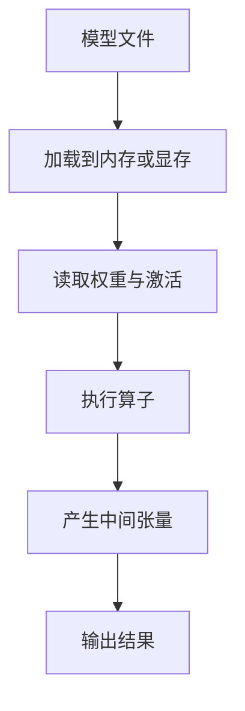
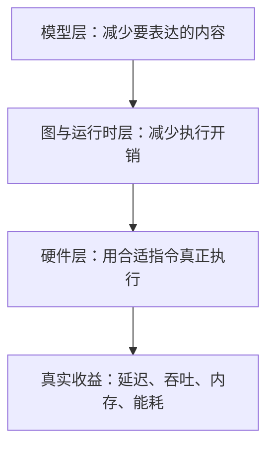
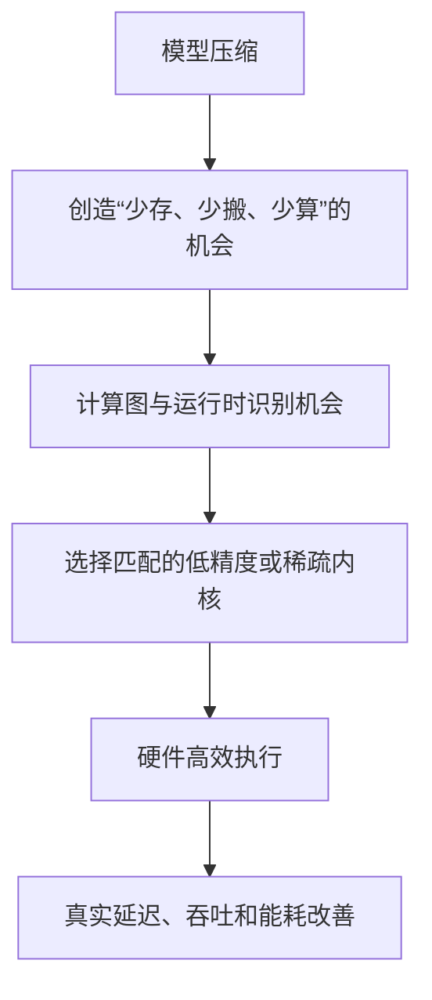
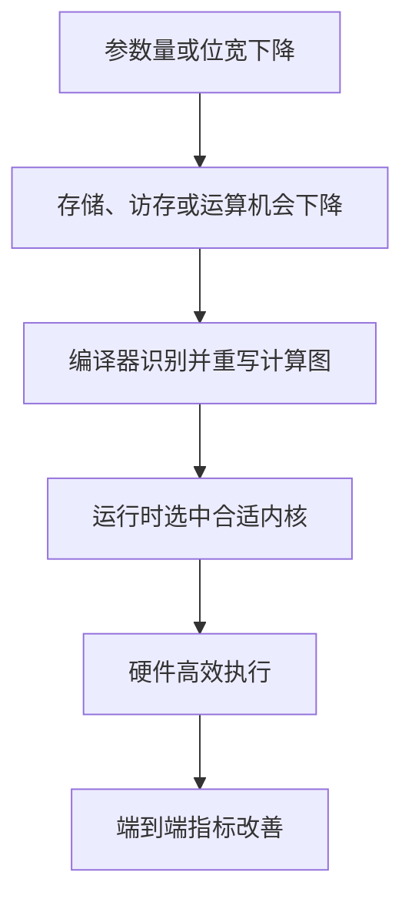
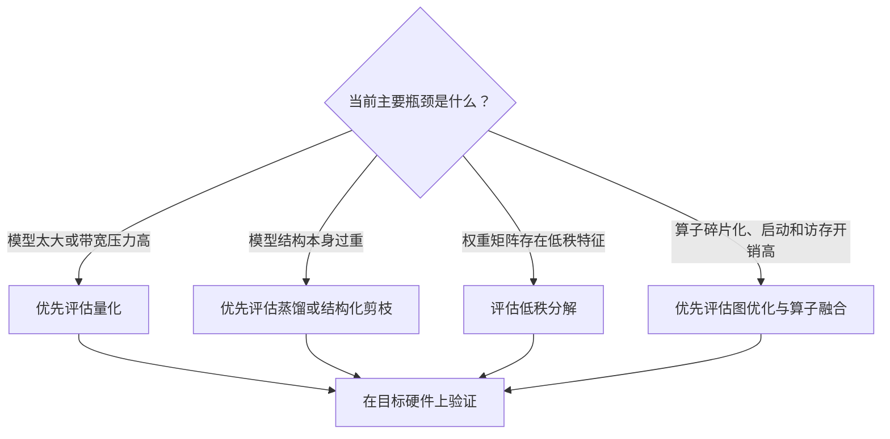

# 模型压缩全景图：参数少了、FLOPs 降了，为什么模型不一定跑得更快？

# Phase 4：压缩、量化与稀疏


> **模型变小，只是优化的开始。真正困难的是：如何让少掉的参数、降低的精度和出现的稀疏，最终变成用户能感知的低延迟、低功耗与高吞吐。**

> **工程深度｜验证状态：** L2 工程｜概览（无单一实验，侧重决策框架）
---

假设一款 200 MB 的图像识别模型准备装进手机。

工程团队先把模型压缩到 50 MB，又将理论计算量削减了近一半（这是用来说明思路的假设场景，并非某个具体模型的实测）。看起来，一切都在变好。

但测试结果却让人困惑：

- 安装包确实变小了；
- 峰值内存有所下降；
- 推理速度只提高了一点；
- 某些机型甚至比原来更慢。

如果“模型更小”就等于“模型更快”，这种结果不应该发生。

问题恰恰在这里：**模型大小、计算量和真实运行速度，本来就不是同一个指标。**

模型压缩减少的是某些成本；运行时、算子实现和硬件，决定这些成本能否真正转化为性能收益。

这一篇不急着写量化公式，也不急着展示 CUDA 内核。我们先建立一张完整地图：模型到底在消耗什么，量化、蒸馏、剪枝分别改变了什么，以及为什么一些“漂亮的压缩率”最终没有变成更低的延迟。

---

## 一、模型真正消耗的，不只是磁盘空间

很多人第一次接触模型压缩，关注的是模型文件大小。

这当然重要，但一个模型从磁盘走到输出结果，中间至少要经过以下过程：



因此，部署成本至少包含五个维度。

| 成本 | 它回答的问题 | 常见指标 |
|---|---|---|
| 存储成本 | 模型文件有多大？ | MB、GB、参数量 |
| 运行时内存 | 执行时要占多少内存或显存？ | Peak Memory、KV Cache、Workspace |
| 计算成本 | 理论上要做多少运算？ | FLOPs、MACs |
| 数据搬运成本 | 权重和激活要移动多少次？ | 内存带宽、读写字节数 |
| 时间与能源成本 | 用户究竟要等多久、设备耗多少电？ | Latency、Throughput、Energy |

这五个维度彼此相关，却不能相互替代。

> 指标速记：Peak Memory（峰值内存，一次推理中最高占用）、KV Cache（大语言模型保存历史注意力键和值的缓存）、Workspace（推理引擎执行算子所需的临时空间）、FLOPs（浮点运算次数）、MACs（乘加运算次数）。

例如，将 FP32 权重压缩为 INT8，单个权重从 4 字节降为 1 字节，模型文件通常会明显缩小，权重搬运量也可能下降。但是，如果目标硬件没有高效的 INT8 指令，或者中间频繁发生量化与反量化，推理速度就未必按比例提高。

再比如，剪掉一半权重后，权重矩阵里可能出现大量零。如果底层内核仍把它当作稠密矩阵计算，那么 GPU 依然会认真完成大量“乘以零”的工作。

所以，模型优化不能只问：

> 压缩率是多少？

还要继续问：

> 少掉的东西，运行时真的不再存、不再搬、不再算了吗？

---

## 二、先分清三个经常被混用的概念

### 1. 模型压缩：改变模型本身

模型压缩主要试图减少模型的表示成本或结构冗余，例如：

- 降低权重和激活的数值精度；
- 删除不重要的权重、通道或层；
- 用较小的学生模型承接大模型能力；
- 将大矩阵分解为多个较小矩阵。

它关注的是：**怎样让模型以更低成本表达相近的能力。**

### 2. 计算图优化：改变模型的执行方式

计算图优化通常不改变模型要表达的函数，而是重写执行过程，例如：

- 将卷积、偏置和激活融合；
- 提前计算常量表达式；
- 删除不影响输出的节点；
- 调整算子顺序或张量布局；
- 为目标硬件选择更合适的内核。

它关注的是：**同一件事，能否少启动几次内核、少产生一些中间结果、少搬几次数据。**

### 3. 硬件加速：让优化后的模型匹配真实机器

GPU、NPU、TPU、CPU 向量指令和专用加速器，并不是压缩算法，但会决定压缩结果能否被有效执行。

例如，同样是 2:4 结构化稀疏：

- 模型必须形成符合要求的稀疏模式；
- 推理框架必须识别这种模式；
- 算子必须存在稀疏实现；
- 硬件必须支持相应执行路径；
- 具体形状下，稀疏内核还必须比稠密内核更划算。

少一环，理论收益都可能停留在报告里。

可以把三者理解成三层系统：



模型压缩提供“可以更快”的条件；运行时和硬件负责把条件兑现。

用四个词概括这条链路，就是本文的主线：

> **少存、少搬、少算、能执行。**

- 量化主要帮助**少存、少搬**；
- 剪枝和低秩分解尝试**少算**；
- 蒸馏直接换一个更小的模型；
- 编译器、运行时和硬件负责**能执行**。

下面的主图把这条链路画完整——前面三步在模型层创造机会，后面三步在系统层兑现收益：



---

## 三、四条主要路线：它们到底改变了什么？

接下来要展开的内容较多，先用一张极简地图记下四个方向：

| 方法 | 一句话理解 |
|---|---|
| 量化 | 让每个数字占得更少 |
| 蒸馏 | 重新训练一个更小的学生 |
| 剪枝 | 删除不重要的权重或结构 |
| 低秩分解 | 用两个小矩阵近似一个大矩阵 |

### 路线一：量化——让每个数字变得更轻

神经网络的权重和激活通常由浮点数表示。量化的核心思想，是用更低精度的数值类型近似原来的数值。

最容易理解的例子是：

```text
FP32：每个数通常占 32 bit
INT8：每个数通常占  8 bit
```

如果只看权重存储，位宽从 32 bit 降到 8 bit，理论体积可以降至约四分之一。但实际模型文件还包含量化参数（如 Scale、Zero Point）、打包与对齐开销、算子元数据，以及未必同步量化的层，因此通常不会严格达到 4 倍压缩。量化真正有价值的地方不只在“文件变小”，还包括：

- 降低权重与激活的内存占用；
- 减少内存或显存带宽压力；
- 在支持低精度计算的硬件上提高吞吐；
- 降低边缘设备和数据中心推理的能耗与成本。

今天的量化也早已不只是“FP32 转 INT8”。现代推理系统还会使用 FP8、INT4、FP4，以及逐张量、逐通道、逐组或分块量化。TensorRT 当前文档已经覆盖 INT8、FP8、INT4、FP4 等低精度类型和多种量化粒度（[TensorRT: Quantization Schemes](https://docs.nvidia.com/deeplearning/tensorrt/latest/inference-library/quantized-types-schemes.html)）。需要注意的是，不同格式支持的量化对象并不相同：例如 INT4 通常用于权重量化，FP4 往往依赖分块缩放；具体算子、量化粒度和硬件支持应以目标版本的兼容矩阵为准。

> **前沿观察：低精度正在从“统一降位宽”走向“精细化分工”**
>
> 现代量化不再要求所有张量采用同一种格式。实际系统可能采用权重 INT4、激活 FP8、累加 FP16 或 FP32，并对不同层选择不同量化粒度。低精度的核心已经从“位数越少越好”，转向“精度、带宽、内核与硬件能力共同匹配”。

不过，位宽越低，可表示的数值就越有限。最直观的两类量化误差是舍入误差和截断误差：

- **舍入误差**：原始数值无法被低精度格式精确表示；
- **截断误差**：超出表示范围的数值被压到边界。

在完整模型中，量化粒度过粗、异常值拉大动态范围、缩放因子估计偏差、中间累加精度，以及不同算子之间的误差传播，也会影响最终结果。

因此，量化的工程问题不是简单地“少用几位”，而是：

> 哪些张量可以降低精度？采用什么量化粒度？如何选择缩放因子？精度损失是否在可接受范围内？目标硬件能否高效执行？

这些问题将在下一篇量化实战中展开。

---

### 路线二：知识蒸馏——不是压缩大模型，而是重新训练一个小模型

知识蒸馏常被描述成“大模型教小模型”。

教师模型能力强但成本高，学生模型结构更小、推理更便宜。训练时，学生不仅学习数据集里的硬标签，还可以学习教师输出的概率分布、隐藏层表示、注意力关系，甚至更复杂的行为信息。

例如，一张图片的硬标签只告诉学生：

```text
这是一只猫。
```

教师模型的输出可能还包含：

```text
猫：0.82
狐狸：0.09
狗：0.06
其他：0.03
```

这些概率揭示了类别之间的相似关系。学生学到的不只是“正确答案”，还包括教师如何理解边界。

蒸馏与量化、剪枝有一个重要区别：

> 量化和剪枝通常从已有模型出发改变其表示；蒸馏则通过训练过程，把能力迁移到另一个模型中。

学生模型究竟能小到什么程度，取决于任务复杂度、模型结构、训练数据和蒸馏目标。蒸馏并不保证小模型复制教师的全部能力，但它常用于提高轻量模型在有限容量下的表现。

值得注意的是，蒸馏通常不会直接修改教师模型，而是用教师的知识训练出一个更小的学生模型——被压缩的是最终部署模型，而不是教师本身。同时，蒸馏本身不会让一个固定结构的学生模型在前向传播时“突然跑得更快”。[PyTorch 官方知识蒸馏教程](https://docs.pytorch.org/tutorials/beginner/knowledge_distillation_tutorial.html)也明确指出，其实验改善的是轻量模型的权重和准确率，而学生模型既有的前向计算成本并未因此改变。真正的推理收益，来自我们选择了更小的学生结构。

---

### 路线三：剪枝——删掉不重要的部分

剪枝的直觉很自然：神经网络中并不是每个权重、通道和层都同样重要。如果能删除贡献较小的部分，就有机会减少模型规模和计算成本。

但“删什么”决定了硬件是否真的受益。

#### 非结构化剪枝

非结构化剪枝可以删除单个权重：

```text
剪枝前：[0.73, 0.01, -0.52, 0.02]
剪枝后：[0.73, 0.00, -0.52, 0.00]
```

它比较灵活，往往能获得较高稀疏率；问题是零值位置不规则。GPU 要高效利用这种不规则稀疏，需要专门的数据格式、索引和稀疏内核，否则额外的索引与调度开销可能吞掉收益。

如果追问一句“权重都变成零了，GPU 为什么不直接跳过？”，答案是：稠密矩阵内核按固定位置批量执行乘加，并不会逐个检查权重是否为零；只有模型采用受支持的稀疏格式，并调用相应的稀疏内核，零值才有机会被跳过。

#### 结构化剪枝

结构化剪枝删除完整的通道、卷积核、注意力头、块甚至层。它对模型结构影响更大，但产生的形状通常更适合现有稠密算子。

#### 半结构化剪枝

半结构化稀疏在规则性和自由度之间折中。以 NVIDIA 支持的 2:4 半结构化稀疏为例（[PyTorch 半结构化稀疏教程](https://docs.pytorch.org/tutorials/advanced/semi_structured_sparse.html)），需要沿算子规定的压缩维度分组：矩阵乘法通常沿归约维度 K，每连续 4 个元素中至少有 2 个为零；卷积则需要满足相应输入通道维度上的稀疏约束。NVIDIA Ampere 及后续部分架构可以利用这种模式，但还需要框架、精度模式和具体算子共同支持。

更关键的是：**满足稀疏条件，也不等于运行时一定选择稀疏内核。** TensorRT会根据实际性能选择执行策略；在某些张量形状下，稠密实现仍可能更快。

因此，剪枝后不能只报告“稀疏率达到80%”，还要测量：

- 模型文件是否真的缩小；
- 推理引擎是否识别稀疏结构；
- 稀疏内核是否被实际选择；
- 端到端延迟和吞吐是否改善；
- 微调后精度是否恢复。

---

### 路线四：低秩分解——把一块大计算拆成两块小计算

许多神经网络层的核心是矩阵乘法。如果一个大权重矩阵 $W_{m\times n}$（$m$ 行 $n$ 列）可以用两个较小矩阵近似表示：

$$W_{m\times n}\approx U_{m\times r}V_{r\times n},\qquad r\ll m,n$$

那么原来的计算 $y=Wx$ 可以改写为 $y\approx U(Vx)$。

原本需要保存 $mn$ 个参数，现在近似为 $r(m+n)$ 个参数。当中间秩 $r$ 远小于 $m$ 和 $n$ 时，参数规模明显下降。

低秩分解能够减少参数和部分计算，但同样要警惕两个问题：近似会带来精度损失；一次大算子变成两次小算子后，额外的中间结果和内核启动未必总是划算。

这再次说明：理论计算量只是性能的一部分。

到这里可以发现，四条路线看起来不同，却都面临同一道关：**模型层省下来的成本，运行时是否真的能够识别并利用？**

---

## 四、两张表看懂四种技术

先看每种技术改变了什么、主要能带来什么收益：

| 技术 | 改变对象 | 主要收益 |
|---|---|---|
| 量化 | 权重或激活的数值表示 | 更小存储、更低带宽、低精度计算 |
| 蒸馏 | 学生模型的学习过程 | 用更小模型保留更多能力 |
| 剪枝 | 单个权重，或通道/头/块/层 | 减少参数或结构，改善稀疏率 |
| 低秩分解 | 权重矩阵的表示形式 | 减少参数与部分乘加 |

再看需要付出的代价：

| 技术 | 主要风险 | 是否需要训练或微调 | 是否必然加速 |
|---|---|---|---|
| 量化 | 舍入与截断导致精度下降 | PTQ 通常不需要完整训练，但静态量化往往需要具有代表性的校准数据；QAT 需要训练 | 否 |
| 蒸馏 | 学生容量不足、训练目标不合适 | 是 | 否，收益来自学生结构 |
| 剪枝 | 不规则稀疏难以被利用、删除粒度大 | 通常需要微调 | 否 |
| 低秩分解 | 近似误差、算子拆分开销 | 经常需要微调 | 否 |

术语速记：**PTQ** 是训练后量化（Post-Training Quantization，用少量校准数据统计数值范围）；**QAT** 是量化感知训练（Quantization-Aware Training，把量化误差纳入训练过程）。

这两张表中最值得注意的是“是否必然加速”这一列：**没有一种方法可以脱离具体硬件和运行时，承诺必然加速。**

---

## 五、为什么“FLOPs 降了一半”，延迟可能只降 10%？

为了理解这个问题，可以把推理时间粗略拆成：

$$T_{\text{total}}\approx T_{\text{compute}}+T_{\text{memory}}+T_{\text{launch}}+T_{\text{sync}}+T_{\text{pre/post}}$$

其中包括计算、数据访问、内核启动、同步和前后处理等成本。

> 这是用于定位瓶颈的简化心智模型，并非严格的 GPU 时间分解公式；真实执行中，计算、访存和数据传输可能部分重叠。

### 原因一：模型可能受内存带宽限制

如果大量时间花在读取权重和激活，而不是算术运算，那么只减少 FLOPs、却没有减少数据搬运，收益就会很有限。

### 原因二：小算子可能让 GPU 吃不饱

剪枝或分解后，算子规模变小，但 GPU 并行度和占用率也可能下降。理论运算少了，硬件利用率却更低了。

### 原因三：格式转换会产生额外开销

低精度计算前后如果频繁执行 Quantize（量化）、Dequantize（反量化）、Cast（类型转换）或布局转换，节省的计算可能被转换成本抵消。类似运输：把货物装进更小的箱子确实能减少运输量，但如果每到一个仓库都要重新拆箱、换箱，包装节省的时间就可能被转换过程抵消。

### 原因四：端到端瓶颈不在模型主体

图像解码、分词、数据传输、后处理、动态批处理和排队，都可能比某个卷积层更影响用户等待时间。

### 原因五：框架没有采用预期内核

模型“具备”INT8、FP8或稀疏条件，并不代表每个算子都采用相应实现。算子支持、形状约束、数据类型、融合机会和性能策略都会影响最终执行计划。

所以，一个更接近现实的因果链是：



从 A 到 F，没有一步可以凭空省略。

---

## 六、压缩技术可以组合，但不是简单叠加

实际工程中，经常会同时使用多种技术：

```text
教师模型
   ↓ 蒸馏
轻量学生模型
   ↓ 剪枝与微调
更小的结构或稀疏模型
   ↓ 量化
低精度部署模型
   ↓ 图优化与内核选择
推理引擎
```

这个顺序看起来合理，却不能被当作唯一答案。

原因在于，不同压缩方法会相互影响：

- 剪枝改变权重分布，可能影响后续量化；
- 量化误差可能放大剪枝后的精度损失；
- 蒸馏可以帮助小模型或压缩模型恢复性能；
- 训练时形成的稀疏模式，未必符合部署硬件要求；
- 不同组合顺序可能得到不同结果。

因此，组合压缩应该通过消融实验回答，而不是依靠口号：

| 实验组 | 蒸馏 | 剪枝 | 量化 | 用途 |
|---|---:|---:|---:|---|
| Baseline | 否 | 否 | 否 | 原始基线 |
| A | 是 | 否 | 否 | 测量蒸馏贡献 |
| B | 否 | 是 | 否 | 测量剪枝贡献 |
| C | 否 | 否 | 是 | 测量量化贡献 |
| D | 是 | 是 | 是 | 测量组合结果 |

如果没有单项基线，就很难知道最终收益来自哪一种技术，也无法定位精度为什么下降。

---

## 七、真正可靠的评测，至少要同时看六项指标

一份只报告“压缩率”的结果是不完整的。

建议至少记录以下指标：

1. **任务质量**：Accuracy、F1、mAP、Perplexity或业务指标；
2. **模型大小**：磁盘文件与序列化权重大小；
3. **峰值内存**：主机内存、显存与运行时Workspace；
4. **真实延迟**：P50、P95、P99，而不只是一次运行。P50 指 50% 的请求延迟不超过该值（中位数），P95 指 95% 的请求延迟不超过该值；分位数越高，越能反映尾部慢请求，而尾延迟恰恰最影响实际体验。
5. **吞吐量**：固定并发和批大小下的samples/s或tokens/s；
6. **能源与成本**：功耗、每千次推理成本或每百万Token成本。

测试时还要固定：

- 硬件型号与功耗模式；
- CUDA、驱动、框架和推理引擎版本；
- 输入形状、序列长度与批大小；
- 预热次数和正式测试次数；
- 是否包含数据传输及前后处理；
- 使用的精度、算子和稀疏策略。

否则，“快了两倍”很可能只是在不同测试条件下比较出来的数字。

---

## 八、如何为自己的模型选择压缩路线？

不要从“哪种技术最先进”开始，而要从瓶颈开始。



还可以用下面的五问法快速筛选：

### 第一问：你想优化什么？

是安装包、显存、首Token延迟、单请求延迟、吞吐，还是能耗？目标不同，方案就不同。

### 第二问：瓶颈在哪里？

先用Profiler确认是计算受限、带宽受限、内核启动受限，还是前后处理受限。

### 第三问：目标硬件支持什么？

不要只看模型能否导出，还要确认目标GPU、CPU或NPU支持哪些数据类型、稀疏模式和算子。

### 第四问：允许损失多少精度？

“基本不掉点”和“可以下降2个百分点”对应的压缩空间完全不同。必须先定义业务容忍线。

### 第五问：如何验收？

同时设置质量、延迟、吞吐、内存和成本门槛。只达成其中一项，不代表压缩成功。

---

## 九、关于“混合精度”，需要单独说清楚

混合精度训练经常与模型压缩放在一起讨论，因为它们都使用低精度数值。但两者的目标并不完全相同。

- **混合精度训练**主要希望降低训练显存占用并提高训练速度，同时在必要位置保留较高精度；
- **部署量化**主要关注推理阶段的权重、激活、算子和硬件执行格式。

使用 FP16 或 BF16 完成训练，不代表最终模型已经完成 INT8、INT4 或 FP4 部署量化；反过来，模型也可以先以高精度训练，再通过训练后量化进入低精度推理。

概念上的相似，不能代替流程上的区分。

---

## 十、本篇最重要的结论

如果只记住一句话，请记住：

> **模型压缩制造优化机会，计算图、运行时和硬件决定机会能否变成真实收益。**

再展开一点，就是下面四条：

1. 参数量、FLOPs、模型文件和真实延迟是不同指标；
2. 量化减少数值表示成本，蒸馏迁移能力，剪枝删除冗余，低秩分解改变矩阵表示；
3. 非结构化稀疏和低位宽模型都不保证自动加速；
4. 所有方案最终都必须在目标硬件上，用端到端指标验证。

把全文浓缩成八个字：**少存、少搬、少算、能执行**——前三步创造机会，最后一步兑现收益。

模型压缩不是一场“把数字做小”的比赛，而是一项跨越模型、编译器、运行时和硬件的系统工程。

后续几篇将用统一的评测框架动手验证，而不是继续停留在概念上。每一篇都会同时报告下面这组指标：

```text
模型大小
准确率
峰值显存
内核延迟
端到端延迟
吞吐量
```

这样不同压缩技术之间才有可比性，也方便你带着同一把尺子阅读整个系列。

下一篇，我们将沿着其中最常见的一条路线继续深入：

> **从 FP32 到 INT8，量化究竟如何把连续实数映射到有限整数？Scale、Zero Point、PTQ与QAT分别解决什么问题？CUDA硬件又如何兑现低精度计算的收益？**

---

## 参考资料

1. NVIDIA, [TensorRT: Working with Quantized Types](https://docs.nvidia.com/deeplearning/tensorrt/latest/inference-library/work-with-quantized-types.html)
2. NVIDIA, [TensorRT: Quantization Schemes](https://docs.nvidia.com/deeplearning/tensorrt/latest/inference-library/quantized-types-schemes.html)
3. NVIDIA, [TensorRT: Data Formats and Tensors / Structured Sparsity](https://docs.nvidia.com/deeplearning/tensorrt/latest/inference-library/data-formats-tensors.html)
4. NVIDIA, [TensorRT: Accuracy Considerations](https://docs.nvidia.com/deeplearning/tensorrt/latest/inference-library/accuracy-considerations.html)
5. PyTorch, [Knowledge Distillation Tutorial](https://docs.pytorch.org/tutorials/beginner/knowledge_distillation_tutorial.html)
6. PyTorch, [Pruning Tutorial](https://docs.pytorch.org/tutorials/intermediate/pruning_tutorial.html)
7. PyTorch, [Accelerating BERT with Semi-Structured 2:4 Sparsity](https://docs.pytorch.org/tutorials/advanced/semi_structured_sparse.html)
8. Geoffrey Hinton, Oriol Vinyals, Jeff Dean, [Distilling the Knowledge in a Neural Network](https://arxiv.org/abs/1503.02531)
9. Song Han, Huizi Mao, William J. Dally, [Deep Compression](https://arxiv.org/abs/1510.00149)

> 注：不同框架、版本、模型与硬件对低精度和稀疏执行的支持范围不同。文章中的压缩比例和性能关系用于解释原理，正式部署应以目标环境中的兼容性文档与基准测试为准。
