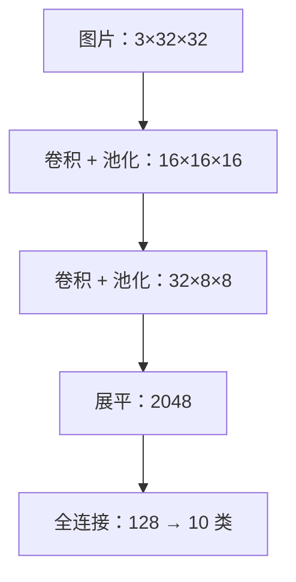
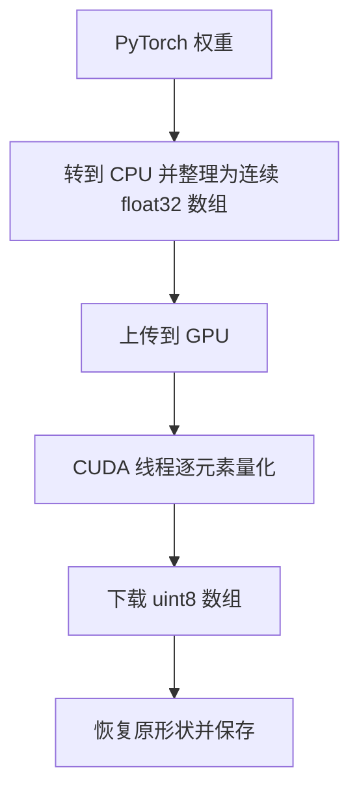
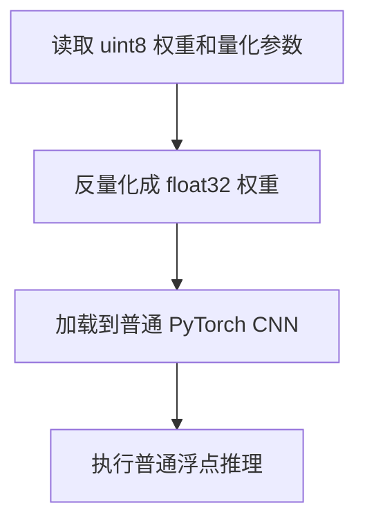

# 模型缩小近 4 倍，推理也会快 4 倍吗？

> 从一个 CIFAR-10 小模型出发，亲手走过权重量化、CUDA 并行编码、文件保存和恢复推理。看懂量化拿到的收益，也看清它**还没**拿到的收益。
>
> **验证状态**：CPU 侧量化实验已运行；GPU 推理加速尚未实测

> **工程深度｜验证状态：** L2–L3 工程｜实验验证（建议在目标 GPU 上复现）
一次真实运行的输出摆在我面前：同一份测试集上，这个 CIFAR-10 小模型的准确率从 **65.43%** 掉到 **64.89%**，只下降了 **0.54 个百分点**。量化听起来“几乎无损”。

可如果有人在报告末尾补一句“参数量从 12,345 压缩到 1,234，压缩了 10 倍”，这句话就已经算错了——**参数是一个一个的数，改成 8 位存储，不会让任何一个参数消失**。“缩了 10 倍”成立的前提，是把参数个数误当成存储字节数。

更常见的是下一句顺水推舟的推论：“文件小了四倍，推理也该快四倍。”这又是一笔没理清的账：量化改的是权重**存**的方式，推理还停在**算**的路径上。要看清这只箱子到底压了什么，得把四本账分开：

| 指标 | 量化作用在什么地方 | 本实验应记的口径 |
|---|---|---|
| 参数个数 | 不改变，一个都不少 | 268,650 → 268,650 |
| 张量理论载荷 | 权重 4 字节 → 1 字节 | 1,074,600 → 269,208 字节（≈3.99×） |
| 磁盘文件大小 | 部分改变（含序列化与元数据开销） | 以两个 `.pth` 文件的实际字节数为准 |
| 推理耗时 | 本实验不加速 | 未测量，不能推断 |

> 四个指标口径不同，谁也替代不了谁：参数个数回答“有多少个数”，张量载荷回答“按类型算需要几个字节”，文件大小回答“磁盘上占多大”，推理耗时回答“运行时快不快”。凡是把其中任何两个画等号的说法，都先打个问号。

我们手里正好有一份可拆解的完整实验：用 PyTorch 训练一个识别 CIFAR-10 的小 CNN，借助 Numba CUDA 核函数把卷积层和全连接层的权重编码为 `uint8` 保存；需要推理时，再把权重恢复成 `float32`，装回同样结构的模型。它像一次完整的“打包、寄出、拆包”：**箱子可以更小，拆包后机器做的运算未必改变**。

## 先看模型：究竟压的是哪一部分

输入是一批 `32×32` 的 RGB 图片。两次卷积和池化之后，特征图由 `3×32×32` 变为 `32×8×8`；展平成 2048 个数，交给全连接层做分类。



这里有个容易被忽略的数字：整个模型一共 **268,650 个参数**（268,464 个权重 + 186 个偏置）。仅第一个全连接层 `fc1` 就占 `2048×128＝262,144` 个权重，约为全部权重的 **97.6%**。因此，四个层都被量化了，主要体积收益却来自 `fc1`。这是按代码结构计算的结果，与训练准确率无关。

要特别记住：**量化前后，这 268,650 个参数一个都不少**。权重的存储类型从 `float32` 变成 `uint8`，但每个权重依然存在——“参数量压缩”在本实验里不成立，压缩的是这些参数的**存储字节数**，不是参数本身。

原脚本只量化 `Conv2d` 与 `Linear` 的 `weight`，偏置仍保留 `float32`。这也解释了为什么“每个权重从 4 字节变成 1 字节”不意味着整个文件恰好缩为四分之一。

## 一个权重，怎样住进一个 8 位整数

把量化想成给一把刻度尺重新编号。浮点数可以落在两个刻度之间；`uint8` 只提供从 `0` 到 `255` 的 256 个格子。代码为**每一个权重张量**计算一把尺子的两个参数：

- `scale`：相邻整数格子对应多少浮点值。
- `zero_point`：浮点零对应哪个整数编号。

编码和解码的核心关系是：

$$q=\operatorname{clip}\!\left(\left\lfloor\frac{w}{s}+0.5\right\rfloor+z,\;0,\;255\right), \qquad \hat w=s(q-z)$$

其中 $w$ 是原权重，$s$ 是 `scale`，$z$ 是整数 `zero_point`，$q$ 是存下来的 `uint8`，$\hat w$ 是恢复值。`clip` 把结果限定在合法区间。这里的 `floor(x+0.5)` 明确规定**恰好半格时向较大的整数取整**，与 Python `round()` 对某些半格值的规则不同；复现实验时必须保持同一舍入约定。

用一把便于心算的尺子演示：假设 `scale=0.1`，`zero_point=128`，要保存权重 `0.26`。那么 `0.26÷0.1=2.6`，舍入得到 `3`，编码为 `131`；恢复后是 `(131−128)×0.1=0.3`。**差掉的 `0.04`，就是有限刻度造成的误差。** 实际脚本会根据每层权重的范围计算 `scale` 和 `zero_point`，这里的数值只用于解释公式。

为什么要给零留位置？权重可能同时有正有负，而 `uint8` 没有负数。以 `128` 为零点时，比它小的整数可表示负值，比它大的整数可表示正值。代码计算范围时显式纳入浮点零；若整层权重全为零，则用 `scale=1`、`zero_point=0` 处理退化情形。它还拒绝空张量及含 `NaN`、无穷大的权重，防止生成无意义的量化参数。

> **记住一件事：** `uint8` 单独不是权重。只有同时保存 `q`、`scale` 和 `zero_point`，才能按约定把浮点值恢复出来。

## CUDA 在这里做了什么

选好一层的 `scale` 和 `zero_point` 后，每个权重的编码都相互独立。这很适合让 GPU 上的大量线程分工：**一个线程处理一个权重元素**。

```python
@cuda.jit
def quantize_kernel(weights, output, scale, zero_point):
    idx = cuda.grid(1)  # 当前线程在整个一维网格中的编号
    if idx < weights.size:  # 最后一个 block 可能有多余线程
        q = math.floor(weights[idx] / scale + 0.5) + zero_point
        if q < 0:
            q = 0
        elif q > 255:
            q = 255
        output[idx] = q
```

`cuda.grid(1)` 可以展开为 `cuda.blockIdx.x × cuda.blockDim.x + cuda.threadIdx.x`。假设每个 block 有 256 个线程，第二个 block 中编号为 7 的线程，负责数组下标 `1×256+7=263` 的权重。`1` 表示取**一维网格**上的全局编号，不表示使用第 1 张 GPU。线程数通常向上凑成整块，所以 `idx < weights.size` 是必须保留的边界检查。[Numba CUDA 核函数参考][numba-grid]

反量化核函数同样是逐元素工作：从 `uint8` 值减去零点，乘 `scale`，写入一个 `float32` 输出数组。这里没有线程争抢同一输出位置，也无须原子操作。

CUDA 内核本身很短，内核外的旅程却更长。以量化阶段为例：



代码中的 `weights.detach().to('cpu').numpy()` 脱离梯度计算，并取得 CPU 端的 NumPy 数组；`np.ascontiguousarray(..., dtype=np.float32)` 保证输入具有预期类型和连续布局。接着 `cuda.to_device()` 上传数据，`cuda.device_array()` 分配输出，核函数运行后 `copy_to_host()` 下载结果。这个过程有数据搬运和首次 JIT 编译成本。**“把量化步骤交给 GPU”不能单凭代码就推出“整个打包过程更快”。**

## 文件变小，到底该怎么算

量化前，权重和偏置都按 `float32` 计；量化后，权重按 `uint8` 计，偏置仍按 `float32` 计。按照这份 CNN 的结构，可直接算出张量的理论载荷：

| 对象 | 权重 | 偏置 | 理论张量载荷 |
|---|---:|---:|---:|
| 原始模型 | 268,464 × 4 字节 | 186 × 4 字节 | 1,074,600 字节 |
| 量化包 | 268,464 × 1 字节 | 186 × 4 字节 | 269,208 字节 |

两者之比约为 **3.99:1**。注意：这只是*按数据类型推算的张量载荷*，量化包还保存了各层 `scale`、`zero_point`，实际 `.pth` 文件还含序列化开销。脚本用 `os.path.getsize()` 分别读取两个生成文件的真实字节数，最终文章中的“文件缩小多少”应以运行结果为准。

所以严谨的说法是：**这个实验把张量理论载荷压缩到约 3.99∶1；参数个数没有任何变化；真实文件比例与推理速度都不能从这个 3.99 推出。** 一份可信的报告应当把开篇那四个数字分别列出，而不是用一句“缩小 10 倍”带过。

保存时还有两件事不能漏：其一，量化前铺平的卷积核必须恢复原形状，否则无法装回模型；其二，量化参数必须与 `uint8` 张量一起保存。脚本把它们装进同一个检查点，再**从磁盘读回**并重建模型，避免出现“内存里的结果能用，交付的文件却无法恢复”的假成功。

## 真正的悬念：推理会快吗

这份代码加载量化包后，执行的次序是：



所以，**它验证了权重的存储压缩与恢复后预测，尚未实现整数卷积或整数矩阵乘。** 量化包在磁盘上占用较少空间；恢复后权重重新以 `float32` 装入模型，不能把磁盘压缩比例写成运行时显存节省比例，更不能写成推理加速比例。**本实验尚未测得任何推理加速**——这句话应当写进量化报告的结论，而不是留给读者去猜。

这也不代表量化与推理速度无关。支持量化权重的推理实现可以在运行时按自己的方式读取、解码和计算，收益取决于算子、批量大小、硬件，以及任务更受**内存带宽**还是**计算**限制。PyTorch 的 TorchAO 文档提供了权重量化及动态量化等配置；其 GPU 教程指出，权重量化更适合从减少权重读取中获益的场景，转换开销也可能抵消部分收益。[TorchAO 权重量化配置][torchao-intx] [PyTorch GPU 量化教程][torchao-gpu] 这些是下一步工程选型的依据，不能当成当前手写 CNN 已经提速的实测结果。

## 怎样把这个实验做扎实

跑实验时，先训练**一次**浮点模型，再从同一份训练完成的权重分出两条评估路径。不要分别训练两个模型后把准确率差归因于量化；训练随机性会混入比较。

| 要回答的问题 | 应记录的指标 | 比较方式 |
|---|---|---|
| 文件是否更小 | 两个 `.pth` 文件的实际字节数 | 同一训练后模型；同时列出理论载荷 |
| 分类是否受影响 | 同一 CIFAR-10 测试集的 top-1 准确率 | 原模型与反量化模型使用相同样本和预处理 |
| 发生了哪些预测变化 | 预测类别不同的样本数 | 比只看整体准确率更容易发现抵消现象 |
| 打包是否省时 | CPU 转换、上传、内核、下载、保存各段耗时 | 首次 JIT 编译与后续运行分开记录 |
| 交付后启动是否更快 | 读取文件、反量化、加载模型分别计时 | 包含磁盘与设备差异，重复测量 |
| 热态推理是否更快 | 相同硬件和 batch 下的推理耗时 | 预热后计时，GPU 计时要正确同步 |

**先追 0.54 个百分点的下落。** 总准确率只告诉我们变差了多少，没说差在哪。更细的做法是逐张比较两次预测：把“原模型对、恢复模型错”和“原模型错、恢复模型对”分别计数——两者很可能都比 54 大，说明有大量样本在量化后被“纠正”回来，整体损失被抵消了。接着做单层对照：`fc1` 占全部权重的 97.6%，先只量化 `fc1`、其余保持浮点，再逐层累加量化，看清误差由哪一层主导；然后把每层的一组全局 `scale/zero_point` 换成按输出通道的细粒度量化。粒度越细、精度通常越接近浮点，但元数据变多、文件缩小幅度收窄——收益与代价要一起报，不能预先承诺收益。

**再分清这次下降是“训练问题”还是“量化问题”。** 如果模型本身的验证准确率就上不去，0.54 个百分点里可能有一大半来自训练欠拟合、过拟合或数据增强不当，而不是量化误差。判断方法：记录每个 epoch 的**完整训练集平均损失**与验证集准确率，而不是只拍几个批次的损失曲线；所有量化对比都从**同一个训练完成的检查点**出发，把重新训练的随机波动隔离在量化评估之外。

**另起一条实验线：结构压缩。** `fc1` 的 2048 维输入来自展平；若在第二次池化后改用全局平均池化（Global Average Pooling），展平输入会从 2048 变成 32，`fc1` 的权重从 262,144 骤降到 4,096——这才是真正改变参数个数的压缩。它与“原结构做 8 位量化”互不排斥，但两者答案不同，应当分开呈现，而不是合在一个“压缩 10 倍”里。

以上是**实验清单，不是已经测得的成绩**。目前这份教学代码输出实际文件大小与两种模型的准确率，尚未实现分阶段计时、预测差异统计或可靠的推理基准；发表任何相关速度数字之前，需要补实验。尤其不要用第一次执行 Numba 内核的耗时代表稳态核函数时间。

## 从教学代码走向真实部署

这段实现有意保持简单：每个权重张量共用一组量化参数，使用 8 位无符号仿射量化，保留偏置浮点存储，推理前一次性恢复原精度。它足以教会我们刻度、零点、误差、线程映射，以及“文件格式”和“运行算子”的区别。

如果业务目标转向实际推理性能，就要进一步比较更细的量化粒度、激活值处理、支持的算子和目标设备，而不是把这份 Numba 编码核直接称为量化推理引擎。当前 TorchAO 的相关配置已包含按通道或分组的权重量化，具体支持范围与表现应以所用版本、层类型和硬件实测为准。[TorchAO API][torchao-intx] [TorchAO 推理工作流][torchao-inference]

回到开头：**模型文件可以因权重量化而显著变小；推理是否更快，取决于模型加载后是否继续利用量化表示，以及整条执行路径的实际成本。** 一行 `uint8`，解决的是怎样存；让推理变快，还要回答怎样算。

---

## 附录： 
```python
"""CIFAR-10 CNN 权重 uint8 存储量化示例。

运行依赖：兼容的 PyTorch、TorchVision、Numba、NumPy 版本，以及可供 Numba 使用的 CUDA GPU/驱动。
运行方式：python cifar10_numba_weight_quantization_中文详注.py
说明：只在保存时压缩卷积层/全连接层权重；推理前反量化为 float32，仍使用浮点算子。
"""

# math 提供向下取整，用于实现本示例约定的“恰好半格时向上取整”。
import math
# os 提供文件大小查询，以区分理论权重字节数和实际磁盘文件大小。
import os

# NumPy 保存 Numba CUDA 内核输入和输出所需的连续数组。
import numpy as np
# PyTorch 提供张量计算、模型保存与加载。
import torch
# nn 提供卷积、池化、线性层和交叉熵损失。
from torch import nn
# optim 提供 Adam 优化器。
from torch import optim
# DataLoader 按批读取 CIFAR-10 数据。
from torch.utils.data import DataLoader
# TorchVision 提供 CIFAR-10 数据集及图像预处理。
from torchvision import datasets, transforms
# Numba cuda 提供 JIT CUDA 核函数、设备数组和显存拷贝。
from numba import cuda


# ===================== 网络结构 =====================
class SimpleCNN(nn.Module):
    """接受 N×3×32×32 图像，返回 N×10 类别 logits。"""

    def __init__(self):
        # 初始化父类，让所有子层注册为模型参数。
        super().__init__()
        # padding=1 保持 32×32 的空间尺寸，通道从 3 变为 16。
        self.conv1 = nn.Conv2d(3, 16, kernel_size=3, padding=1)
        # 每次池化将空间尺寸缩小一半。
        self.pool = nn.MaxPool2d(kernel_size=2, stride=2)
        # 第二层卷积保持 16×16，通道从 16 变为 32。
        self.conv2 = nn.Conv2d(16, 32, kernel_size=3, padding=1)
        # 两次池化后特征形状为 N×32×8×8，展平维度为 2048。
        self.fc1 = nn.Linear(32 * 8 * 8, 128)
        # CIFAR-10 有 10 类，输出未经过 softmax 的分类 logits。
        self.fc2 = nn.Linear(128, 10)

    def forward(self, x):
        # 第一层：卷积、ReLU、池化；形状 N×3×32×32 → N×16×16×16。
        x = self.pool(torch.relu(self.conv1(x)))
        # 第二层：卷积、ReLU、池化；形状 → N×32×8×8。
        x = self.pool(torch.relu(self.conv2(x)))
        # 从第 1 维开始展平，每张图独立保留为一行；形状 → N×2048。
        x = torch.flatten(x, start_dim=1)
        # 映射到 128 维隐藏表示并激活。
        x = torch.relu(self.fc1(x))
        # 输出 N×10 logits；交叉熵损失内部自行处理 log-softmax。
        return self.fc2(x)


# ===================== CUDA 核函数 =====================
@cuda.jit
def quantize_kernel(weights, output, scale, zero_point):
    """逐元素执行 uint8 仿射量化：clip(floor(w / s + 0.5) + z, 0, 255)。"""
    # 求一维 CUDA 网格中当前线程对应的数组下标。
    idx = cuda.grid(1)
    # 最后一个 block 可能有多余线程，必须检查边界。
    if idx < weights.size:
        # 零点已经是整数，按约定的半格向上舍入，再加零点。
        q = math.floor(weights[idx] / scale + 0.5) + zero_point
        # 饱和裁剪到无符号八位整数的合法区间。
        if q < 0:
            q = 0
        elif q > 255:
            q = 255
        # 输出数组类型是 uint8；裁剪后赋值不会发生整数溢出。
        output[idx] = q


@cuda.jit
def dequantize_kernel(quantized, output, scale, zero_point):
    """逐元素反量化：w_hat = (q - z) * s。"""
    # 求当前线程负责的一维数组下标。
    idx = cuda.grid(1)
    # 防止尾部线程访问越界。
    if idx < quantized.size:
        # 从整数编码扣除零点，再乘缩放因子，结果写入 float32 数组。
        output[idx] = (int(quantized[idx]) - zero_point) * scale


# ===================== 单个张量的量化 / 反量化 =====================
def quantize_weights_cuda(weights):
    """输入 CPU/GPU 上的 float32 张量，返回同形状 CPU uint8 张量和标量元数据。"""
    # 明确从计算图分离并传到 CPU；Numba 使用独立的主机输入数组。
    weights_cpu = np.ascontiguousarray(weights.detach().to('cpu').numpy(), dtype=np.float32)
    # 空张量无法确定最小值/最大值，明确拒绝。
    if weights_cpu.size == 0:
        raise ValueError('不支持量化空权重张量')
    # NaN 或无穷大会破坏范围/零点计算，提前给出明确错误。
    if not np.isfinite(weights_cpu).all():
        raise ValueError('权重中包含 NaN 或无穷大')

    # 将真实最小值和 0 一并纳入表示范围，使浮点零能由合法整数零点表示。
    real_min = min(float(weights_cpu.min()), 0.0)
    # 将真实最大值和 0 一并纳入表示范围。
    real_max = max(float(weights_cpu.max()), 0.0)
    # 唯一退化情况：整个张量都是零；任意正尺度都能无损表示零。
    scale = 1.0 if real_max == real_min else (real_max - real_min) / 255.0
    # 先按相同舍入规则计算零点，再限制为 uint8 合法编码。
    zero_point = int(math.floor(-real_min / scale + 0.5))
    # 浮点误差可能使理论边界差 1；裁剪保证零点始终合法。
    zero_point = max(0, min(255, zero_point))

    # 将多维权重铺平供一维 CUDA 网格处理，并保持 C 连续存储。
    flat_weights = weights_cpu.ravel()
    # 上传 float32 权重到 GPU；这是一次主机到设备拷贝。
    device_weights = cuda.to_device(flat_weights)
    # 在 GPU 上分配 uint8 输出；无需从 CPU 上传一份全零数组。
    device_quantized = cuda.device_array(flat_weights.size, dtype=np.uint8)
    # 每个 CUDA block 使用 256 个线程。
    threads_per_block = 256
    # 向上取整，覆盖全部元素；核函数自身处理尾部线程。
    blocks_per_grid = (flat_weights.size + threads_per_block - 1) // threads_per_block
    # 启动 CUDA 核函数；第一次启动还会触发 Numba JIT 编译。
    quantize_kernel[blocks_per_grid, threads_per_block](
        device_weights, device_quantized, scale, zero_point
    )
    # 设备到主机的拷贝会等待默认流中的内核计算完成。
    quantized_cpu = device_quantized.copy_to_host()
    # 恢复卷积核/矩阵原始形状，供后续保存与模型加载。
    quantized_tensor = torch.from_numpy(quantized_cpu.reshape(weights_cpu.shape).copy())
    # 元数据随模型一起保存，否则量化权重无法正确反量化。
    return quantized_tensor, {'scale': float(scale), 'zero_point': int(zero_point)}


def dequantize_weights_cuda(quantized, scale, zero_point):
    """把 CPU uint8 张量反量化成相同形状的 CPU float32 张量。"""
    # 检查文件中的元数据与张量类型，避免静默得到错误结果。
    if quantized.dtype != torch.uint8 or quantized.numel() == 0:
        raise ValueError('量化权重必须是非空的 torch.uint8 张量')
    # 强制转为 Python 标量，以便安全传递给 Numba 内核。
    scale = float(scale)
    zero_point = int(zero_point)
    # 缩放因子必须为有限正数；零点必须是 uint8 合法整数。
    if not math.isfinite(scale) or scale <= 0 or not 0 <= zero_point <= 255:
        raise ValueError('量化元数据 scale 或 zero_point 非法')
    # 将输入搬到 CPU、铺平并变为 C 连续数组。
    quantized_cpu = np.ascontiguousarray(quantized.detach().to('cpu').numpy()).ravel()
    # 将整数数据上传到 GPU。
    device_quantized = cuda.to_device(quantized_cpu)
    # 在 GPU 上分配同样元素数的 float32 数组。
    device_output = cuda.device_array(quantized_cpu.size, dtype=np.float32)
    # 配置一维 CUDA 网格。
    threads_per_block = 256
    blocks_per_grid = (quantized_cpu.size + threads_per_block - 1) // threads_per_block
    # 逐元素反量化并写入 float32 输出。
    dequantize_kernel[blocks_per_grid, threads_per_block](
        device_quantized, device_output, scale, zero_point
    )
    # 下载结果，恢复原张量形状，获得可加载到原模型的 float32 权重。
    return torch.from_numpy(device_output.copy_to_host().reshape(tuple(quantized.shape)).copy())


# ===================== 模型权重打包 / 恢复 =====================
def quantize_model_weights(model):
    """只压缩卷积/全连接权重；偏置以 float32 保留。"""
    # 取得已训练模型的命名参数和缓冲区视图。
    original_state = model.state_dict()
    # 保存量化权重与未量化的偏置/缓冲区。
    packed_state = {}
    # 按每个权重张量分别保存 scale 与 zero_point。
    qparams = {}
    # 遍历模型结构中声明的卷积层与线性层，避免仅凭名字包含 weight 误选其他层。
    quantized_names = {
        f'{module_name}.weight'
        for module_name, module in model.named_modules()
        if module_name and isinstance(module, (nn.Conv2d, nn.Linear))
    }
    # 按 state_dict 的键名处理，方便后续严格按名称加载模型。
    for name, tensor in original_state.items():
        # 对目标层的权重分别使用一组量化参数。
        if name in quantized_names:
            print(f'正在量化: {name}, 形状={tuple(tensor.shape)}')
            packed_state[name], qparams[name] = quantize_weights_cuda(tensor)
        else:
            # 转到 CPU 并克隆，令结果独立于后续模型移动或参数更新。
            packed_state[name] = tensor.detach().cpu().clone()
    # 统一打包格式，避免只保存 uint8 数据却丢失量化参数。
    return {'state_dict': packed_state, 'qparams': qparams}


def restore_model_weights(checkpoint, model):
    """用量化包恢复 float32 权重，再严格加载到相同结构的模型。"""
    # 读取之前随文件保存的张量和量化元数据。
    packed_state = checkpoint['state_dict']
    qparams = checkpoint['qparams']
    # 新的 state_dict 将全部是模型需要的原始形状与 dtype。
    restored_state = {}
    # 遍历每个模型参数/缓冲区。
    for name, tensor in packed_state.items():
        # 仅处理有元数据的权重；其他参数直接沿用浮点值。
        if name in qparams:
            # 各层的 scale 与 zero_point 不可混用。
            params = qparams[name]
            restored_state[name] = dequantize_weights_cuda(
                tensor, params['scale'], params['zero_point']
            )
        else:
            # 偏置仍保留在 CPU float32 中。
            restored_state[name] = tensor
    # 严格校验全部键名及形状，出现不匹配立即抛错。
    model.load_state_dict(restored_state, strict=True)
    # 返回加载完毕、仍使用 float32 算子执行推理的模型。
    return model


# ===================== 训练与评估 =====================
def train_model(model, loader, device, epochs=5):
    # 将模型放到训练设备，先于创建优化器执行。
    model.to(device)
    # 设置训练模式，适用于以后增添 BN / Dropout 的情况。
    model.train()
    # 多分类任务以 logits 和整数类别计算交叉熵。
    criterion = nn.CrossEntropyLoss()
    # 在模型确定设备后创建 Adam，管理当前模型的参数。
    optimizer = optim.Adam(model.parameters(), lr=0.001)
    # 从第 1 个 epoch 开始循环。
    for epoch in range(1, epochs + 1):
        # 汇总本轮所有样本的损失，计算真正按样本加权的平均值。
        loss_sum = 0.0
        # 累计处理的图像数量。
        sample_count = 0
        # 从训练集逐批取得图像和标签。
        for images, labels in loader:
            # 把图像与标签搬到同一设备；标签保持整型类别编号。
            images, labels = images.to(device), labels.to(device)
            # 清空上一批产生的梯度，避免跨 batch 累积。
            optimizer.zero_grad(set_to_none=True)
            # 前向计算当前批次的分类 logits。
            logits = model(images)
            # 计算当前批次的平均交叉熵。
            loss = criterion(logits, labels)
            # 反向传播计算各参数梯度。
            loss.backward()
            # 由 Adam 使用梯度更新参数。
            optimizer.step()
            # 乘以 batch 大小，末批不足时也能正确统计全轮均值。
            loss_sum += loss.item() * labels.size(0)
            # 记录本批样本数。
            sample_count += labels.size(0)
        # 输出全轮每样本平均损失。
        print(f'Epoch {epoch}/{epochs}，平均损失: {loss_sum / sample_count:.4f}')


def test_model(model, loader, device):
    # 将待测模型搬到指定设备。
    model.to(device)
    # 启用推理模式；如果将来加入 BN/Dropout，它们会采用评估行为。
    model.eval()
    # 初始化预测正确数量与总样本数。
    correct, total = 0, 0
    # 关闭 autograd 记录，减少推理期间的额外内存和开销。
    with torch.inference_mode():
        # 遍历测试集的所有批次。
        for images, labels in loader:
            # 让数据与模型位于同一设备。
            images, labels = images.to(device), labels.to(device)
            # 计算每张图的 10 维分类 logits。
            logits = model(images)
            # 沿类别维取最大值位置，得到预测类别索引。
            predicted = logits.argmax(dim=1)
            # 累计本批标签数与正确预测数。
            total += labels.size(0)
            correct += (predicted == labels).sum().item()
    # 返回 [0, 1] 的准确率，供外部比较。
    return correct / total


# ===================== 主程序 =====================
def main():
    # 本脚本的量化核函数依赖 CUDA，即使网络训练可在 CPU 上执行也必须先检查。
    if not torch.cuda.is_available() or not cuda.is_available():
        raise RuntimeError('本示例需要 PyTorch 和 Numba 均可访问的 CUDA GPU；请检查安装与驱动')
    # 使用第一张 GPU 训练和测试；量化数据会单独经过 CPU↔GPU 拷贝。
    device = torch.device('cuda:0')
    # 令 Numba 切换至第一张 CUDA 设备，避免多卡时设备选择不一致。
    cuda.select_device(0)
    # CIFAR-10 原图就是 32×32 RGB，无须再次 Resize。
    transform = transforms.Compose([
        # 将 PIL 图像转为 C×H×W 的 float32 张量，像素缩放至 [0, 1]。
        transforms.ToTensor(),
        # 三个通道均执行 (x - 0.5) / 0.5，结果约在 [-1, 1]。
        transforms.Normalize((0.5, 0.5, 0.5), (0.5, 0.5, 0.5)),
    ])
    # 首次运行需联网下载 CIFAR-10；后续复用本地缓存。
    trainset = datasets.CIFAR10(root='./data', train=True, download=True, transform=transform)
    # 测试集只用于评估，不参与优化器更新。
    testset = datasets.CIFAR10(root='./data', train=False, download=True, transform=transform)
    # num_workers=0 更适合跨平台教学脚本，避免部分平台的子进程入口问题。
    trainloader = DataLoader(trainset, batch_size=128, shuffle=True, num_workers=0)
    # 评估时无需打乱样本顺序。
    testloader = DataLoader(testset, batch_size=100, shuffle=False, num_workers=0)

    # 新建原始 float32 CNN。
    model = SimpleCNN()
    # 在训练集上训练五轮；本示例不承诺某个固定准确率。
    train_model(model, trainloader, device, epochs=5)
    # 测量浮点模型的测试集分类准确率。
    original_accuracy = test_model(model, testloader, device)
    print(f'原始模型准确率: {original_accuracy:.2%}')
    # 把权重转至 CPU 后再保存，方便在不同设备环境加载。
    original_state_cpu = {k: v.detach().cpu().clone() for k, v in model.state_dict().items()}
    # 保存原始模型权重；同名文件会被覆盖。
    torch.save(original_state_cpu, 'original_model.pth')

    # 在 GPU 上逐层量化 float32 权重，打包 uint8 权重、偏置和元数据。
    checkpoint = quantize_model_weights(model)
    # 把完整量化包写到磁盘；仅保存权重而不保存 qparams 将无法恢复。
    torch.save(checkpoint, 'quantized_model.pth')
    # 实际从磁盘读回一次，验证保存文件包含可恢复的全部信息。
    checkpoint_loaded = torch.load('quantized_model.pth', map_location='cpu', weights_only=True)
    # 创建结构完全相同的新模型，反量化后严格加载原形状权重。
    restored_model = restore_model_weights(checkpoint_loaded, SimpleCNN())
    # 验证恢复模型可以完成推理，并测量量化引入的准确率变化。
    restored_accuracy = test_model(restored_model, testloader, device)
    print(f'反量化后模型准确率: {restored_accuracy:.2%}')
    # 统计全部浮点模型参数在理论上的字节数，不含容器/元数据开销。
    original_payload_bytes = sum(t.numel() * t.element_size() for t in original_state_cpu.values())
    # 分别统计量化权重与未量化偏置；qparams 的标量开销未计入理论载荷。
    packed_payload_bytes = sum(
        t.numel() * t.element_size() for t in checkpoint_loaded['state_dict'].values()
    )
    # 输出实际写入文件的大小，它包含序列化元数据、容器开销等。
    original_file_bytes = os.path.getsize('original_model.pth')
    # 量化文件还会包含每层 scale、zero_point 的序列化开销。
    packed_file_bytes = os.path.getsize('quantized_model.pth')
    # 理论载荷比较按字节数计算，不再用“参数个数”误称压缩率。
    print(f'理论张量载荷: {original_payload_bytes} → {packed_payload_bytes} 字节，'
          f'比例 {original_payload_bytes / packed_payload_bytes:.2f}×')
    # 文件比较才反映本示例实际保存出来的体积。
    print(f'实际文件大小: {original_file_bytes} → {packed_file_bytes} 字节，'
          f'比例 {original_file_bytes / packed_file_bytes:.2f}×')
    # 说明此程序只演示 uint8 存储压缩，分类运算依然是 float32。
    print('推理说明：加载后已反量化；本示例没有 INT8 卷积/矩阵乘加速。')


# 仅直接运行当前脚本时执行主程序；被其他模块导入时不会自动下载或训练。
if __name__ == '__main__':
    main()

```