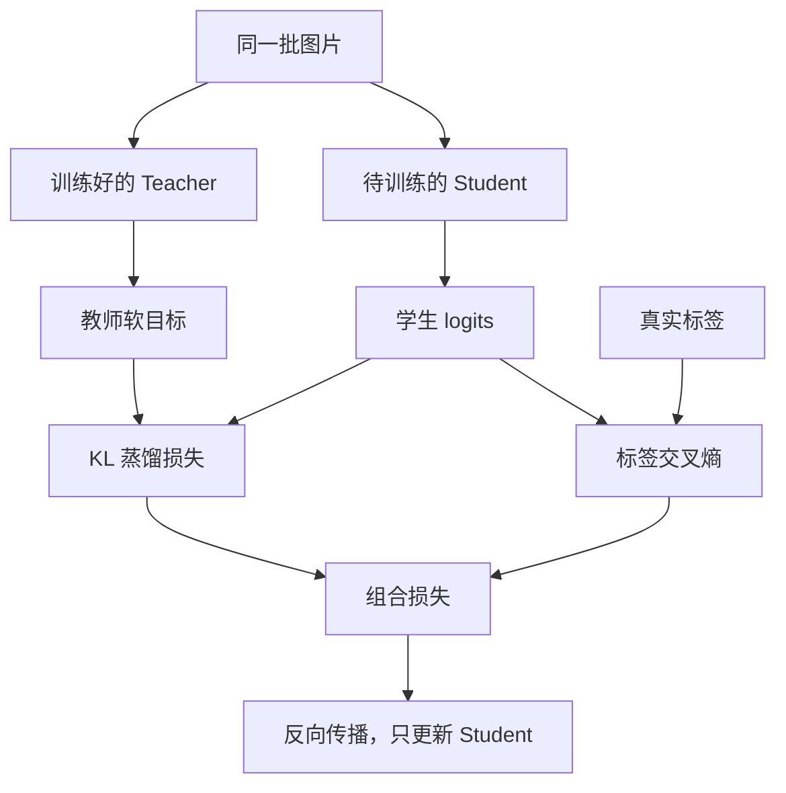

# Loss 在下降，学生却没学到老师？一篇讲透知识蒸馏

> **从 Softmax、KL 和梯度断路，讲到闭源大模型的行为蒸馏。**  
> **关键词：** 知识蒸馏（Knowledge Distillation）、KL 散度、Temperature、Soft Target、行为蒸馏  
> **适用人群：** 想搞清“蒸馏真的是传知识还是拟合标签”的学习者  
> **阅读时长：** 约 18 分钟  
> **工程深度｜验证状态：** L2–L3 工程｜静态复核 + 概念验证（实验需按环境复现）  
> **前置知识：** 第 20 篇。**延伸：** 第 23 篇。  
> **说明：** 老师的答案出现在 Loss 里，不代表老师真的教到了学生。本文从一段写错的 CUDA 蒸馏代码出发，讲清知识蒸馏到底在传递什么，以及怎么用一个可复现的小实验，回答“老师究竟有没有教到学生”。

<!-- more -->

## 01｜Loss 在下降，老师却可能没起作用

想象一个课堂场景。

你要把图像识别模型放进一台算力有限的设备。服务器上的大模型效果不错，可部署时，延迟、内存和成本都变得紧张。于是你训练一个小模型，希望它向大模型取经。

程序看起来很完整：Teacher、Student、交叉熵、KL 散度，甚至还有手写 CUDA Kernel。

结果，训练刚进入第一个 batch，就卡在这一行：

```python
student_logits.cpu().numpy()
```

搜索一下报错，你加了一个 `detach()`。

程序终于能往下走。如果观察到 Loss 下降，你很容易松一口气：蒸馏开始生效了。

**可真正的陷阱，恰恰可能从这里开始。**

原代码里的交叉熵仍能训练学生；而被转成 NumPy、交给外部 CUDA Kernel 计算的 KL 数值，已经没有通往学生参数的反向传播路径。

这意味着：即使 Loss 变化，也不能据此证明学生学到了教师知识。

以下按代码分析这条故障路径，尚未完成训练实测；完整验证状态见文末“代码与复现说明”。

接下来，本文围绕三个问题展开：**教什么（第 02～04 节）→ 怎么教进去（第 05～06 节）→ 怎么证明学会了（第 07 节）**，最后把同一套判断标准延伸到闭源大模型（第 08 节）。

## 02｜老师比标签多教了什么

先看一张猫的照片。

真实标签告诉模型：这是一只猫。用交叉熵训练，学生会被鼓励提高“猫”的预测概率。

教师还能提供另一种信息：这张图有点像狗，但几乎不像卡车。

这里的价值，是**不同候选类别之间的相对关系**。一张模糊的猫脸和一张清晰的猫脸，虽然真实标签一样，教师给出的概率分布可能很不同。

这种软目标（soft target），是经典知识蒸馏的重要监督信号。Hinton、Vinyals 和 Dean 的蒸馏工作讨论了如何把大模型或模型集成的行为迁移到更适合部署的模型中。[1]

不过，教师提供的关系不一定都正确。它也可能带着数据偏差、错误判断和过度自信。因此，本例保留真实标签监督，让学生同时参考两种信号：

- **真实标签：**这道题的标准答案是什么。
- **教师分布：**老师如何区分这些候选答案。



上图是整条训练链路的总览：左边是同一批图片分别送进教师和学生，中间两类损失汇合成一个总损失，最后只有学生的参数会被更新。推理部署时只留下 Student，Teacher 的工作发生在训练阶段。

还有一个容易忽略的区别：**蒸馏本身不会自动减少 Student 的层数或参数。**本例先设计一个较小网络，再尝试用教师监督改善它的权重。和相同结构、只用标签训练的学生相比，蒸馏学生的理论前向计算量并没有因为“学过老师”而减少。[2] 这个网络到底小在哪、值不值，第 07 节用数字回答。

## 03｜把分数变成概率：logits、Softmax 与温度

### logits 是分数，还不是概率

模型最后输出的十个数叫 logits。它们可以是正数，也可以是负数，既不要求落在 0 到 1 之间，也不要求加起来等于 1。

Softmax 把这些分数变成一个概率分布：

$$
p_i(T)=\frac{\exp(z_i/T)}{\sum_{j=1}^{C}\exp(z_j/T)}
$$

这里，`C` 是类别数，`T` 是温度。

看不熟公式也没关系：**先把每个分数转换成正数，再除以这一行的总和。**这样，一张图片对应的所有类别概率才会加起来等于 1。

### 温度调的是分布的“尖锐程度”

用一个独立的三分类小例子说明。假设猫、狗、卡车的 logits 分别是 `[4, 2, 0]`，直接代入上式：

| 类别 | 原始 logit | T=1 | T=4 |
|---|---:|---:|---:|
| 猫 | 4 | 86.68% | 50.65% |
| 狗 | 2 | 11.73% | 30.72% |
| 卡车 | 0 | 1.59% | 18.63% |

这是公式计算示例，不是 CIFAR-10 十分类模型的预测记录。

温度升高后，顺序没有改变，但概率差距缩小了。原先被压得很低的候选类别，更容易影响训练。

### 温度的边界：分布变均匀，不等于监督信号消失

不过，温度不是越高越好。对有限 logits 来说，温度足够高时，分布会趋近均匀，类别差异也会越来越弱。

这里要补一层限定：**高温会缩小概率差距，但不能仅凭分布看起来更均匀，就判断训练信号已经消失。**在相应高温近似下，配合 `T²` 缩放，软目标对学生 logits 的梯度仍与两个分布的差值直接相关（第 04 节会给出这条式子）；原始论文对此有明确推导。[1]

因此，温度不能单独凭“分布看起来平不平”来定，还要结合损失缩放方式、教师输出的置信度和学生容量一起判断，最终应通过验证集选择，而不是把某个固定值视作通用答案。

### CUDA Kernel 漏掉的，恰好是分母

原代码写的是：

```python
exp_teacher = math.exp(teacher_logits[idx] / temperature)
soft_teacher = exp_teacher
```

这一步只算出了指数值，**没有除以同一张图片所有类别的指数和**。

随后计算：

```python
soft_teacher * (math.log(soft_teacher) - math.log(soft_student))
```

并不能补回缺失的归一化。变量叫 `soft_teacher`，不意味着它已经是 Softmax 概率。

这个错误还可以用一个很直观的方法识别：给教师所有 logits 同时加上一个常数，正确 Softmax 应保持不变；单独的 `exp(logit/T)` 却会整体变大。模型分类的相对判断没有变化，所谓“KL”却改变了，这就暴露了数学定义的问题。第 06 节会看到，在 GPU 上重写这个计算时，最容易漏掉的恰好也是这一步。

## 04｜学生怎样跟老师靠近：KL 散度与组合损失

记教师分布为 `p_t`，学生分布为 `p_s`，本例使用：

$$
D_{KL}(p_t\parallel p_s)=\sum_i p_{t,i}\log\frac{p_{t,i}}{p_{s,i}}
$$

它衡量学生分布和教师分布的差异。方向不能随便交换：一般来说，`KL(teacher || student)` 与反过来的结果不同。

实现中一个容易误读的细节是：

```python
F.kl_div(student_log_probs, teacher_probs)
```

虽然学生放在第一个参数，数学方向仍是 **教师分布到学生分布**。PyTorch 的第一个输入使用对数概率，第二个输入默认使用普通概率。[3]

本例采用的总损失为：

$$
L=\alpha L_{CE}+(1-\alpha)T^2
\frac{1}{B}\sum_{b=1}^{B}D_{KL}(p_t^{(b)}\parallel p_s^{(b)})
$$

其中，`B` 是 batch size；本文约定 `alpha` 为真实标签损失的权重。

```python
ce = F.cross_entropy(student_logits, labels)

kd = F.kl_div(
    F.log_softmax(student_logits / temperature, dim=1),
    F.softmax(teacher_logits.detach() / temperature, dim=1),
    reduction="batchmean",
) * temperature**2

loss = alpha * ce + (1 - alpha) * kd
```

读这段代码，只要记住三件事：

1. 交叉熵直接接收原始 logits，不提前做 Softmax。
2. 对 `[B,C]` 分类输出，`batchmean` 等价于先求和再除以 `B`，不要重复平均。
3. 这里采用经典温度补偿，**乘 `T²`**；原代码的除法方向与这一定义相反。

### 为什么需要 T²？

温度提高时，软目标损失对学生 logits 的梯度尺度会变化。经典蒸馏用 `T²` 补偿这种缩小趋势；这不是任何温度、任何分布下都能完全消除温度影响的恒等式。[1]

对于本例经过 `T²` 缩放、按 batch 平均的 KD 项，可以直接求得：

$$
\frac{\partial L_{KD}}{\partial z_{s,b,i}}
=\frac{T}{B}(p_{s,b,i}-p_{t,b,i})
$$

这条式子还有一个工程用途：**它能检查实现给出的梯度到底对不对**——第 05 节的自检就以它为基准。

## 05｜数字算出来了，梯度却断了

### 先用四句话说清“梯度”和“计算图”

后面所有结论都依赖几个词，先把它们说明白：

- **Loss**：当前表现有多差的一个数值。
- **梯度（gradient）**：告诉优化器，每个参数应该朝哪个方向调整、走多大一步。
- **计算图（computation graph）**：从参数到 Loss 的每一步计算关系，会被框架自动记录下来。
- **反向传播（backpropagation）**：沿着这张图从 Loss 往回走，逐层算出每个参数的梯度。

PyTorch 里参与自动求导的 Tensor 通常带 `requires_grad=True` 标记，其中最“源头”的那些（比如模型权重）叫叶子节点（leaf tensor）。`detach()` 做的事很具体：把一个 Tensor 从这张计算图上摘下来——数值还在，依赖关系没了。

明白了这一点，原程序的问题就能分三层看，而不能混成一句“NumPy 切断梯度”。

### 第一层：原样运行，会先报错

学生输出参与自动求导，通常带有 `requires_grad=True`。

`.cpu()` 本身不会自动解除这种关系。继续调用默认的 `.numpy()`，PyTorch 会拒绝转换这个需要梯度的 Tensor。[4]

因此，在依赖、数据和设备正常的前提下，这份代码会在第一个 batch 计算损失时中断。

### 第二层：加 detach，只解决了转换

如果改成：

```python
student_logits.detach().cpu().numpy()
```

外部 CUDA Kernel 就有机会拿到数据。但这个分支已经离开 PyTorch 的计算图。

Numba 算完后返回一个 NumPy 标量，PyTorch 不知道这个数字怎样依赖学生参数。总损失的数值可以包含它，反向传播却只能通过仍连接着的交叉熵分支。

这里说“KL 是常量”，指的是**在当前这次自动求导中被当作常量**。下一个 batch 或学生权重改变后，它的数值仍可能变化。这也是只看 Loss 曲线容易误判的原因。

一个必须讲清楚的边界：**此时学生仍可能从真实标签中学习，只是当前自动求导没有利用教师项更新它。**“没有完成蒸馏”不等于“学生完全没有训练”——这正是“Loss 里有老师，梯度里没有老师”这句话的准确含义。

### 第三层：重新包装成 Tensor，仍接不回旧计算图

下面这种补丁也无效：

```python
kl = torch.tensor(kl_number, device=device, requires_grad=True)
```

它创建了一个新的可求导叶子节点，但没有建立它与 Student 参数之间的函数关系。

正确选择是保持 PyTorch 运算链，或者为外部算子明确实现并注册反向传播。PyTorch 的自定义 Autograd 接口允许对接外部实现，关键在于提供正确的梯度规则。[5]

### 验证链：公式对、梯度对、网络真的连上了

把 `alpha` 暂时设为 0，让损失只保留 KD，就能逐级验证。附录的 `--smoke-test` 做两件事，正好构成三级证据：

| 层级 | 检查什么 | 对应检查 |
|---|---|---|
| 公式正确 | KD 损失有限，梯度与 `T/B × (p_s-p_t)` 一致 | 损失函数梯度自检 |
| 梯度正确 | 学生 logits 梯度非零且有限，教师 logits 没有梯度 | 损失函数梯度自检 |
| 网络连接正确 | 仅用 KD 时，学生**参数**梯度非零、一步更新后参数改变、教师参数不变 | 网络级自检 |

第一级证明“损失函数算对了”；第二级进一步说明“这个梯度确实流进了学生网络的参数，并真的会改变它”。这比观察一次 `loss.backward()` 没报错，更能说明蒸馏链路是否接通。

需要说明的是，这仍然只是梯度链路的正确性检查，不等于训练效果的证据——效果要靠第 07 节的对照实验回答。

## 06｜CUDA 真正需要做什么：线程、归约、原子操作

原代码的线程映射其实很清楚：

```python
idx = cuda.grid(1)
if idx < num_elements:
    ...
```

在一维启动配置下，`cuda.grid(1)` 给线程一个全局编号。越界判断负责拦住多启动出来的线程。

例如 `B=128、C=10` 时，共有 1280 个 logits。每个 block 放 256 个线程，启动 5 个 block 就能覆盖全部元素。**完整原代码使用 `size(0)*size(1)`，这一点是正确的。**

问题出在接下来：每个线程只有自己的一个 logit，Softmax 却需要同一张图片整行类别的信息。

继续用开头的课堂场景：每个学生只负责一个类别的分数，但要算出各类别的占比，就必须先把**这张答卷的全部分数**加起来得到总分。这一步就是归约（reduction）。缺了它，就是第 03 节说的“漏掉分母”。

对每一行，一个稳定实现要考虑：

| 步骤 | 计算内容 | 为什么需要 |
|---|---|---|
| 行内最大值 | `m = max(z/T)` | 降低指数溢出风险 |
| 指数 | `exp(z/T - m)` | 转成非负权重 |
| 行内求和 | `sum(exp(...))` | 得到归一化分母 |
| 概率或对数概率 | 除以分母，或使用 log-sum-exp | 得到合法分布表示 |
| KL 归约 | 类别求和、批次平均 | 得到本例需要的标量损失 |

具体实现可以使用 warp 协作、寄存器、共享内存或分块策略，取决于行宽和硬件，不必机械地要求“一行一定对应一个 block”。对于 CIFAR-10，每行只有十个类别，启动和调度开销也值得注意。

### atomicAdd 能保证什么？

```python
cuda.atomic.add(kl_div, 0, kl)
```

它解决多个线程同时累加同一地址时的更新冲突。

但它不会替你计算 Softmax 分母，也不会建立 Autograd，更不是所有线程的通用同步屏障。浮点加法还受累加顺序影响，原子操作不意味着结果逐位可重复。

本例让所有线程争用一个标量地址；规模增大时，这可能成为性能瓶颈。常见优化思路是先局部归约，再合并少量结果。

### 一个能用于训练的自定义 Kernel，还缺什么？

除了正确前向，至少还要处理反向传播、上游梯度、设备与 dtype、连续性与步幅，以及 CUDA stream 和数据生命周期。即使实现了共享显存的零拷贝交换，也不自动获得 Autograd 关系。[5]

这些工作有价值，但应建立在经过验证的参考实现之上。

### 把 KL 搬到 GPU，不等于训练一定更快

原封装在每次计算时安排了这样的数据路线：PyTorch GPU Tensor 拷贝到 CPU，转换成 NumPy，再复制到 Numba 的设备数组；计算结束，又把标量带回 CPU。

只看 `B=128、C=10`，每份 FP32 logits 只有 5120 字节，约 5 KiB。两份输入数据并不大，却伴随着复制、同步、设备内存分配与 Kernel 启动。

对这样的小任务，**固定开销可能比想优化的计算本身更显眼**。实际影响必须测量，不能凭这段分析直接报出一个减速或加速倍数。

NVIDIA 的 CUDA 优化指南也把减少 Host 与 Device 间数据搬运列为重要原则。[6]

修正版使用 PyTorch 原生算子。Tensor 在 CUDA 设备上时，这些运算仍由 GPU 执行；同时，框架管理其自动求导关系。

后续优化应先看 profiler：瓶颈究竟在教师前向、学生反向、数据加载，还是 KL？只有 KL 占据足够多时间时，手写或融合这个算子才更可能改善端到端训练。

另外，蒸馏通常增加训练阶段的教师前向开销。它希望改善的是部署阶段的成本与效果，不承诺训练更便宜。

## 07｜小模型是否更快、更好：参数、性能与对照实验

### 这个“小模型”到底小在哪

本文使用 CIFAR-10：输入为 `3×32×32` 的 RGB 图片，输出十个类别的分数。

| 项目 | Teacher | Student |
|---|---|---|
| 卷积通道 | 3 → 64 → 128 → 256 | 3 → 32 → 64 |
| 池化次数 | 3 次 | 2 次 |
| 最后特征图 | 256×4×4 | 64×8×8 |
| 展平长度 | 4096 | 4096 |
| 全连接隐藏层 | 1024 | 512 |
| 输出长度 | 10 | 10 |
| 参数总量，含偏置 | 4,576,394 | 2,122,186 |

这些参数量由代码中的层配置直接计算，属于结构统计，不是训练实测。

注意表格里那个相同的 **4096**。

Student 卷积通道减少了，但少做了一次池化，留下了更大的空间尺寸。最终，两者送入分类器的向量长度竟然相同。

仅 Student 的第一层全连接，权重就有：

$$
4096\times512=2,097,152
$$

再算上偏置和最后的分类层，**Student 约 99.09% 的参数集中在全连接分类器里**。

因此，这个例子适合教学，但不能只凭“少了一层卷积”就称它为极致轻量模型。参数量大约减少到教师的 46.37%，实际延迟却未必按同样比例下降；卷积计算、算子形状、显存访问和硬件利用率都会影响速度。

如果下一步要优化架构，可以实验全局平均池化等设计。但它会改变空间信息的处理方式，准确率需要重新验证，不能直接拿来替换后宣称效果不变。

### 蒸馏前，先修一个更朴素的问题

原代码还有一个很朴素的问题：加载教师权重的语句被注释掉了。

```python
teacher_model = TeacherCNN()
# teacher_model.load_state_dict(...)
```

随机初始化的网络没有学过这项任务。把它设成 `eval()`，不会让它凭空获得知识。

附录提供两条路径：没有教师权重就先监督训练 Teacher；已有权重则显式加载。随后固定 Teacher，蒸馏 Student。

教师与学生必须使用相同的类别含义和顺序。预处理也必须与教师训练时保持一致。名字同叫“CIFAR-10 模型”，并不能保证随便一个 checkpoint 都兼容。

### 三组对照，脚本一键跑

效果评估至少需要三组：

| 对象 | 训练信号 | 回答的问题 |
|---|---|---|
| Teacher | 真实标签 | 老师本身表现如何？ |
| Student-CE 基线 | 真实标签 | 小模型独立训练能到什么程度？ |
| Student-KD 蒸馏版 | 真实标签 + Teacher | 教师监督是否带来增益？ |

只比较 Teacher 与蒸馏 Student，会漏掉最关键的问题：**不请老师，这个学生本来能考多少分？**

附录脚本用 `--mode` 直接支持这组对照：

| 模式 | 用途 |
|---|---|
| `teacher` | 只获取训练好的教师 |
| `ce` | 相同学生结构，仅使用标签的基线 |
| `kd` | 相同初始权重，使用标签与教师的蒸馏版 |
| `compare`（默认） | 依次跑完上面三组，输出统一结果表 |

实现上特别注意两个公平性细节：

- **直接复制同一份 Student 初始权重**，而不是只靠在不同位置调用同一个随机种子——训练教师会消耗全局随机状态，两次创建的网络未必拥有相同初值。
- **为两组学生分别创建相同种子的 DataLoader**。训练教师会消耗训练 DataLoader 的随机状态；复用同一实例，不能保证后续实验的数据顺序一致。

日志也按分支拆开打印 `CE / KD / Total / Val Accuracy`，便于观察每个组成部分的变化。但要记住：**KD 数值下降不是梯度连接正确的充分证据**，梯度链路的证据来自第 05 节的自检。

其中两个 Student 应从相同初始权重出发，尽量固定数据顺序、训练预算和优化设置；用验证集选超参数，用独立测试集作最后比较。多次随机种子运行有助于判断小幅增益是否稳定。

### 部署指标也要分开测

- **准确率：**测试集 Top-1，以及关注类别的错误情况。
- **延迟：**固定设备、batch size、精度和预热，正确同步 CUDA。
- **内存：**区分权重体积、峰值显存和运行时开销。
- **成本：**把额外教师训练、教师推理和样本制作成本算进去。

本文保留原来的简单 CNN 和训练思路，没有做完整超参数搜索，也不保证蒸馏学生一定胜过同结构基线。蒸馏是一种可验证的训练方法，效果要由对照实验回答——本文当前给出的是原理与排错路径，实测结果待在 N 卡环境跑完 `--mode compare` 后补入。

## 08｜没有 logits 的老师，还能怎么教

前面的例子能直接调用教师，取得十个类别的 logits。这让我们很自然地用概率分布指导训练。

面对闭源大模型 API，通常无法取得权重，也通常没有每一步完整词表上的 logits。某些接口提供有限的 token 概率信息，但这不等于能照搬本例的完整分布 KL。

更准确的划分是：**你能获得什么训练信号？**访问教师权重并不是所有分布蒸馏的必要条件；如果服务完整暴露所需概率，也可能构建相应目标。反过来，即使拥有权重，也可以选择只用生成文本蒸馏。

### 第一种：学习教师的回答

设想要训练一个处理 Kubernetes 排障工单的小模型。

输入是一段 Pod 状态、事件和已脱敏的日志；Teacher 生成结构化诊断。经人工抽检、规则校验或可执行验证后，保存为输入与回答样本，再对 Student 做监督微调。

这里的重点是：训练数据必须包含诊断所需上下文。只有“Pod 为什么 Pending”这句话，不能让模型学习真实故障的证据与结论之间的关系。

| 样本部分 | 示例 |
|---|---|
| 输入证据 | Pod 为 Pending；事件显示调度失败；包含相关节点资源信息 |
| 教师输出 | 原因分类、支持证据、建议检查步骤 |
| 质量校验 | 结论与事件一致，命令和建议经过检查 |
| Student 目标 | 根据输入学习生成核验后的回答 |

这种 Response Distillation 常以 SFT 实现：对教师生成的目标序列，训练学生逐 token 预测。它仍在训练概率模型，但无需取得 Teacher 的完整概率分布。Teacher 与 Student 也可以使用不同 tokenizer，文本会按学生的 tokenizer 重新编码。

生成序列作为蒸馏目标并非最近才出现；2016 年的 Sequence-Level Knowledge Distillation 就研究过这一方向。[7] 大模型时代让它的应用范围进一步扩大。

例如，DeepSeek-R1 官方资料介绍了使用其生成数据微调 Qwen、Llama 系列底座，构建蒸馏模型的做法。[8] 这是输出数据驱动训练的实例，不意味着可以把任意大模型的全部能力无损复制给小模型。

### 第二种：学习教师的偏好

另一个任务是让 Student 先给出候选回答，再由 Teacher 对候选进行比较，构造 `chosen/rejected` 配对。

这些数据可以进入 DPO 等偏好优化流程。DPO 的输入组织与训练目标有其具体定义，不能把“收集了评分”直接说成“完成了强化学习”；标准 DPO 也不要求显式训练一个奖励模型。[9]

教师评审本身仍可能有偏差。例如偏爱更长、更像标准答案的文字，却没发现技术错误。能用单元测试、执行结果或结构化规则判断的任务，应尽量引入这些独立证据。

### 第三种：学习可观察的步骤与工具轨迹

对工具型 Agent，最终回答可能只是最后一小部分。

学生还需要学习何时查日志、何时取指标、如何填写工具参数，以及如何根据返回结果调整下一步操作。因而，输入、工具调用、工具结果与最终答案，可以共同构成训练轨迹。

但必须区分：**模型公开输出的步骤或解释，不保证等于其内部完整推理过程。**文章和数据集都应如实描述来源，不能把 API 可见文本写成“提取到了模型内部思维链”。

这三类信号也不是互斥的算法清单。回答与轨迹可以进入 SFT，偏好可以支持偏好优化，验证结果可以用于筛选样本或其他训练过程；关键是弄清每条信号怎样进入目标函数。

### 学生只看老师的标准答案，遇到自己的错误怎么办？

大模型蒸馏还带来一个 CNN 例子没有的新问题。自回归生成时，训练阶段学生看到的前缀是**教师写出的答案**，推理阶段接在前面的却可能是**学生自己生成的、带错误的内容**。训练和推理的输入分布对不上，学生就可能在自己的错误上越走越偏。

针对这个问题已经有一类研究方向：让学生先自己生成序列，再用教师在这些序列上提供的反馈来训练，也就是 on-policy 蒸馏（on-policy distillation）的思路。GKD（Generative Knowledge Distillation）等工作明确讨论了这种训练与推理分布不匹配的问题。[10] 这是已有的研究方向，不是新发明；它通常需要教师对新生成的序列给出反馈（如逐 token 差异或标量评分），这与“让文本 API 给回答打个分再筛数据”并不是同一件事，不能混为一谈。

这段内容想说明的是：**蒸馏不仅要决定“向谁学”，还要决定“在哪些输入和生成路径上学”。**

### 技术路线成立，具体数据使用仍有边界

调用 API 得到输出，与获准用输出训练某个模型，是两个需要分别确认的问题。例如 Anthropic 商业条款对利用服务构建竞争产品、训练竞争 AI 模型等用途作了限制；具体业务需要核对适用条款和合同授权。[11] 平台产品的可用状态则随时间变化，统一放在文末“资料时效说明”，不让方法论文章变成平台状态介绍。

从工程上看，这一段与 CNN 蒸馏其实遥相呼应：

- CNN 要检查概率是否正确、梯度是否接通。
- API Teacher 要检查样本是否可信、训练信号是否有效、用途是否获得许可。
- 两者最后都要回到独立评测，确认 Student 在目标任务上学到了什么。

## 写在最后｜从一个数字，到一次真正的学习

重新看这段代码，你会发现知识蒸馏要跨过好几道门：

Teacher 得先掌握任务；输出得成为合法的监督信号；损失得和学生参数建立正确关系；训练结果还得经得起对照实验。

CUDA 的线程数、归约和原子操作很重要，但它们无法替代这些前提。

到了大模型时代，知识载体可以从类别分布扩展为回答、偏好和工具轨迹，问题也从“向谁学”延伸到“在哪些路径上学”。方法变丰富了，判断标准仍然具体：学生在新问题上做得怎样，为此付出了多少成本。

**一个 Loss 数值，只说明你算出了一个数。只有正确的训练信号真正改变了学生，并通过独立评估，知识迁移才算有了证据。**

---

## 附录｜代码与复现说明

以下代码保留原 Teacher/Student 网络结构，使用 PyTorch 完成可微蒸馏。Tensor 位于 CUDA 设备时，相应算子在 GPU 上执行；没有 CUDA 时可使用 CPU。

准备相互兼容的 PyTorch、torchvision，保存下面代码为 `cifar10_distillation_fixed.py`。CUDA 安装方式请按 [PyTorch 官方安装页面](https://pytorch.org/get-started/locally/)选择适合本机的平台与构建版本。

```bash
# 第一步：不下载数据，跑损失函数梯度自检 + 网络级梯度自检
python cifar10_distillation_fixed.py --smoke-test

# 第二步：完整对照（默认模式）——教师 → 学生 CE 基线 → 学生蒸馏 → 统一结果表
python cifar10_distillation_fixed.py

# 只跑其中一组
python cifar10_distillation_fixed.py --mode teacher
python cifar10_distillation_fixed.py --mode ce
python cifar10_distillation_fixed.py --mode kd \
  --teacher-checkpoint ./checkpoints/teacher_best.pth

# CPU 环境，或希望关闭多进程数据加载
python cifar10_distillation_fixed.py --device cpu --workers 0
```

默认从 CIFAR-10 训练集中划出 5000 张验证图像，剩余 45000 张参与训练；测试集只用于末尾报告。指定输出目录下的同名权重文件会被新运行覆盖。固定随机种子有助于复现，不等于跨硬件、跨版本逐位一致。

教师权重必须与本脚本的网络、类别顺序、`mean=0.5/std=0.5` 预处理匹配。加载外部教师时还要确认它没有使用本次验证集或测试集做过模型选择，否则相应评估会失去独立性。

**验证状态：代码通过 Python 语法检查；当前制作环境未安装 PyTorch，未执行所附自检或完整训练，“未实测”。默认 20 个 epoch 是可调整的示例配置，不是效果保证；文中所有准确率、延迟与加速比结论均待实测补入。**

```python
"""CIFAR-10 知识蒸馏：Teacher → Student-CE 基线 → Student-KD → 对照结果表。

依赖：相互兼容的 PyTorch 与 torchvision；不需要 Numba。
首次运行会下载 CIFAR-10。已有教师权重必须使用相同网络、类别顺序和预处理。
对比组（ce 与 kd）沿用同一份初始权重、各自新建同种子 DataLoader，保证公平性。
本文件保存的 checkpoint 包含 model_state_dict；也支持加载原始 state_dict。
"""
import argparse
import math
import random
import time
from pathlib import Path

import torch
import torch.nn as nn
import torch.nn.functional as F
from torch.utils.data import DataLoader, Subset
from torchvision import datasets, transforms


class TeacherCNN(nn.Module):
    def __init__(self):
        super().__init__()
        self.features = nn.Sequential(
            nn.Conv2d(3, 64, 3, padding=1), nn.ReLU(inplace=True),
            nn.MaxPool2d(2),  # [B, 64, 16, 16]
            nn.Conv2d(64, 128, 3, padding=1), nn.ReLU(inplace=True),
            nn.MaxPool2d(2),  # [B, 128, 8, 8]
            nn.Conv2d(128, 256, 3, padding=1), nn.ReLU(inplace=True),
            nn.MaxPool2d(2),  # [B, 256, 4, 4]
        )
        self.classifier = nn.Sequential(
            nn.Linear(256 * 4 * 4, 1024), nn.ReLU(inplace=True),
            nn.Linear(1024, 10),
        )

    def forward(self, x):
        return self.classifier(self.features(x).flatten(1))


class StudentCNN(nn.Module):
    def __init__(self):
        super().__init__()
        self.features = nn.Sequential(
            nn.Conv2d(3, 32, 3, padding=1), nn.ReLU(inplace=True),
            nn.MaxPool2d(2),  # [B, 32, 16, 16]
            nn.Conv2d(32, 64, 3, padding=1), nn.ReLU(inplace=True),
            nn.MaxPool2d(2),  # [B, 64, 8, 8]
        )
        self.classifier = nn.Sequential(
            nn.Linear(64 * 8 * 8, 512), nn.ReLU(inplace=True),
            nn.Linear(512, 10),
        )

    def forward(self, x):
        return self.classifier(self.features(x).flatten(1))


def kd_terms(student_logits, teacher_logits, labels, temperature, alpha):
    """返回 (交叉熵, 缩放后的 KL, 组合损失)。

    此处 KL 方向是 KL(P_teacher || P_student)：教师概率是基准。
    两个学生/教师分支都在这里集中处理，便于 fit() 与自检复用。
    """
    t = temperature
    ce = F.cross_entropy(student_logits, labels)
    kd = F.kl_div(
        F.log_softmax(student_logits / t, dim=1),
        F.softmax(teacher_logits.detach() / t, dim=1),
        reduction='batchmean',  # 类别维求和，batch 维求平均
    ) * (t * t)  # 乘 T²；不要再次除以 batch_size 或 T²
    return ce, kd, alpha * ce + (1 - alpha) * kd


class DistillationLoss(nn.Module):
    def __init__(self, temperature=2.0, alpha=0.7):
        super().__init__()
        if not math.isfinite(temperature) or temperature <= 0:
            raise ValueError('temperature 必须是有限正数')
        if not 0 <= alpha <= 1:
            raise ValueError('alpha 必须位于 [0, 1]，表示硬标签 CE 权重')
        self.temperature, self.alpha = temperature, alpha

    def forward(self, student_logits, teacher_logits, labels):
        # Student 保留梯度；Teacher 在外部 no_grad，内部再 detach 防误用。
        _, _, total = kd_terms(student_logits, teacher_logits, labels,
                               self.temperature, self.alpha)
        return total


def make_loaders(args, device):
    # Normalize 的第二个参数是标准差，不是方差。
    transform = transforms.Compose([
        transforms.ToTensor(),
        transforms.Normalize((0.5,) * 3, (0.5,) * 3),
    ])
    # CIFAR-10 本身就是 32×32，无需 Resize。
    full_train = datasets.CIFAR10(args.data_dir, train=True,
                                  download=True, transform=transform)
    test = datasets.CIFAR10(args.data_dir, train=False,
                            download=True, transform=transform)
    indices = torch.randperm(len(full_train),
                             generator=torch.Generator().manual_seed(args.seed)).tolist()
    # 从训练集划分验证集；不使用测试集选 epoch/权重。
    train = Subset(full_train, indices[5000:])
    val = Subset(full_train, indices[:5000])
    options = dict(batch_size=args.batch_size, num_workers=args.workers,
                   pin_memory=(device.type == 'cuda'))
    return (
        DataLoader(train, shuffle=True,
                   generator=torch.Generator().manual_seed(args.seed), **options),
        DataLoader(val, shuffle=False, **options),
        DataLoader(test, shuffle=False, **options),
    )


@torch.no_grad()
def evaluate(model, loader, device):
    model.eval()
    correct = total = 0
    for images, labels in loader:
        images = images.to(device, non_blocking=True)
        labels = labels.to(device, non_blocking=True)
        correct += (model(images).argmax(dim=1) == labels).sum().item()
        total += labels.size(0)
    return 100.0 * correct / total


def fit(model, train_loader, val_loader, device, epochs, lr, teacher=None,
        temperature=2.0, alpha=0.7, tag=''):
    optimizer = torch.optim.Adam(model.parameters(), lr=lr)
    best_acc, best_state = -1.0, None
    if teacher is not None:
        teacher.eval()
        teacher.requires_grad_(False)

    for epoch in range(1, epochs + 1):
        model.train()  # evaluate 会切到 eval，每个 epoch 要切回 train。
        ce_sum = kd_sum = total_sum = 0.0
        count = 0
        for images, labels in train_loader:
            images = images.to(device, non_blocking=True)
            labels = labels.to(device, non_blocking=True)
            optimizer.zero_grad(set_to_none=True)
            logits = model(images)
            if teacher is None:
                # 教师或基线：只有真实标签监督。
                loss = F.cross_entropy(logits, labels)
                ce_sum += loss.item() * labels.size(0)
            else:
                with torch.no_grad():
                    teacher_logits = teacher(images)
                ce, kd, loss = kd_terms(logits, teacher_logits, labels,
                                        temperature, alpha)
                ce_sum += ce.item() * labels.size(0)
                kd_sum += kd.item() * labels.size(0)
            loss.backward()
            optimizer.step()
            total_sum += loss.item() * labels.size(0)
            count += labels.size(0)

        accuracy = evaluate(model, val_loader, device)
        message = f'{tag}Epoch {epoch:02d}/{epochs}' \
                  f' | CE={ce_sum / count:.4f}'
        if teacher is not None:
            message += f' | KD={kd_sum / count:.4f}'
        message += f' | Total={total_sum / count:.4f}' \
                   f' | val_acc={accuracy:.2f}%'
        print(message)
        if accuracy > best_acc:
            best_acc = accuracy
            # clone 避免后续参数更新改变已记录的最优权重。
            best_state = {k: v.detach().cpu().clone()
                          for k, v in model.state_dict().items()}
    model.load_state_dict(best_state)
    return best_acc


def smoke_test(device):
    """损失函数梯度自检：不下载数据，验证纯 KL 确实产生正确的 Student 梯度。"""
    s = torch.randn(4, 10, device=device, requires_grad=True)
    teacher_logits = torch.randn(4, 10, device=device, requires_grad=True)
    labels = torch.zeros(4, dtype=torch.long, device=device)
    t = 2.0
    loss = DistillationLoss(t, alpha=0.0)(s, teacher_logits, labels)
    loss.backward()
    expected = t / s.size(0) * (
        F.softmax(s.detach() / t, dim=1)
        - F.softmax(teacher_logits.detach() / t, dim=1)
    )
    torch.testing.assert_close(s.grad, expected, rtol=1e-4, atol=1e-6)
    assert teacher_logits.grad is None
    assert torch.isfinite(loss) and s.grad.abs().sum() > 0
    # 验证原始两种 CNN 在 CIFAR-10 输入上的输出形状。
    with torch.no_grad():
        x = torch.randn(2, 3, 32, 32, device=device)
        for cls in (TeacherCNN, StudentCNN):
            assert cls().to(device)(x).shape == (2, 10)
    print('损失函数梯度自检通过：KL 梯度与解析式一致、Teacher 无梯度、输出形状正确。')


def network_grad_test(device):
    """网络级梯度自检：仅用 KD（alpha=0），验证梯度真正流进 Student 参数。"""
    torch.manual_seed(0)
    teacher = TeacherCNN().to(device)
    student = StudentCNN().to(device)
    teacher.eval()
    teacher.requires_grad_(False)  # 教师冻结，梯度必须始终为 None
    x = torch.randn(8, 3, 32, 32, device=device)
    labels = torch.zeros(8, dtype=torch.long, device=device)

    before = {k: v.detach().clone() for k, v in student.state_dict().items()}
    with torch.no_grad():
        teacher_logits = teacher(x)
    student_logits = student(x)
    _, kd, _ = kd_terms(student_logits, teacher_logits, labels, 2.0, 0.0)
    kd.backward()

    # 1) 学生参数确实收到非零、有限的梯度
    grads = [p.grad for p in student.parameters() if p.grad is not None]
    assert grads and all(torch.isfinite(g).all() for g in grads)
    assert sum(g.abs().sum().item() for g in grads) > 0
    # 2) 教师参数没有梯度（requires_grad_(False) 下 grad 恒为 None）
    assert all(p.grad is None for p in teacher.parameters())

    # 3) 执行一步更新后，学生参数确实改变
    optimizer = torch.optim.SGD(student.parameters(), lr=0.1)
    optimizer.step()
    after = student.state_dict()
    assert any(not torch.equal(before[k], after[k]) for k in before)
    print('网络级梯度自检通过：KD 梯度流入 Student 参数并完成一步更新，Teacher 未受影响。')


def main():
    parser = argparse.ArgumentParser(description='CIFAR-10 知识蒸馏对照实验')
    parser.add_argument('--mode',
                        choices=['teacher', 'ce', 'kd', 'compare'],
                        default='compare',
                        help='teacher=只训练教师；ce=仅标签基线；'
                             'kd=蒸馏；compare=完整对照（默认）')
    parser.add_argument('--data-dir', default='./data')
    parser.add_argument('--output-dir', default='./checkpoints')
    parser.add_argument('--teacher-checkpoint', default=None)
    parser.add_argument('--teacher-epochs', type=int, default=20)
    parser.add_argument('--student-epochs', type=int, default=20)
    parser.add_argument('--batch-size', type=int, default=128)
    parser.add_argument('--workers', type=int, default=2)
    parser.add_argument('--lr', type=float, default=1e-3)
    parser.add_argument('--temperature', type=float, default=2.0)
    parser.add_argument('--alpha', type=float, default=0.7)
    parser.add_argument('--seed', type=int, default=42)
    parser.add_argument('--device', choices=['auto', 'cpu', 'cuda'], default='auto')
    parser.add_argument('--smoke-test', action='store_true')
    args = parser.parse_args()
    if min(args.teacher_epochs, args.student_epochs, args.batch_size) <= 0:
        parser.error('epochs 和 batch-size 必须大于 0')
    if args.workers < 0 or not math.isfinite(args.lr) or args.lr <= 0:
        parser.error('workers 必须非负，lr 必须是有限正数')
    DistillationLoss(args.temperature, args.alpha)  # 提前校验超参数
    random.seed(args.seed)
    torch.manual_seed(args.seed)
    if args.device == 'cuda' and not torch.cuda.is_available():
        parser.error('指定了 CUDA，但当前 PyTorch 无可用 CUDA 设备')
    device = torch.device(('cuda' if torch.cuda.is_available() else 'cpu')
                          if args.device == 'auto' else args.device)
    print(f'使用设备：{device}')
    if args.smoke_test:
        smoke_test(device)
        network_grad_test(device)
        return
    if args.teacher_checkpoint and not Path(args.teacher_checkpoint).is_file():
        parser.error('指定的教师权重文件不存在')

    # ---- 数据与共享初始权重 ----
    # 训练 DataLoader 会被各轮训练各自消耗随机状态，因此每组实验都新建独立实例；
    # create 时使用同一个 seed，保证学生 CE / KD 两组的数据顺序一致。
    _, val_loader, test_loader = make_loaders(args, device)
    # 用独立的一份 Student 初值作为两组学生的共同起点。
    init_state = {k: v.detach().cpu().clone()
                  for k, v in StudentCNN().state_dict().items()}
    output = Path(args.output_dir)
    output.mkdir(parents=True, exist_ok=True)
    models, results = {}, {}

    # ---- 1. 教师：加载或监督训练 ----
    teacher = None
    if args.mode in ('teacher', 'kd', 'compare'):
        teacher = TeacherCNN().to(device)
        if args.teacher_checkpoint:
            checkpoint = torch.load(args.teacher_checkpoint, map_location='cpu',
                                    weights_only=True)
            teacher.load_state_dict(checkpoint.get('model_state_dict', checkpoint))
            print('已加载教师权重；请确认其训练预处理与本脚本一致。')
        else:
            print('开始监督训练 Teacher')
            train_loader, _, _ = make_loaders(args, device)
            fit(teacher, train_loader, val_loader, device,
                args.teacher_epochs, args.lr, tag='[Teacher] ')
            torch.save({'model_state_dict': teacher.state_dict(),
                        'val_accuracy': evaluate(teacher, val_loader, device),
                        'config': vars(args)}, output / 'teacher_best.pth')
        models['Teacher'] = teacher
        results['Teacher'] = evaluate(teacher, val_loader, device)
        print(f'Teacher 验证准确率：{results["Teacher"]:.2f}%')
        if args.mode == 'teacher':
            print(f'权重已保存至：{output.resolve()}')
            return

    # ---- 2. 学生基线：相同初始权重，仅使用标签 ----
    if args.mode in ('ce', 'compare'):
        print('\n开始训练 Student-CE（相同初始权重，仅使用标签）')
        student_ce = StudentCNN().to(device)
        student_ce.load_state_dict(init_state)
        train_loader, _, _ = make_loaders(args, device)
        val_acc = fit(student_ce, train_loader, val_loader, device,
                      args.student_epochs, args.lr, tag='[CE] ')
        torch.save({'model_state_dict': student_ce.state_dict(),
                    'val_accuracy': val_acc, 'config': vars(args)},
                   output / 'student_ce_best.pth')
        models['Student-CE'] = student_ce
        results['Student-CE'] = val_acc

    # ---- 3. 学生蒸馏：相同初始权重，标签 + 教师软目标 ----
    if args.mode in ('kd', 'compare'):
        if teacher is None:
            parser.error('--mode kd 需要先提供教师（--teacher-checkpoint 或先跑 teacher）')
        print('\n开始蒸馏 Student-KD（相同初始权重，标签 + 教师）')
        student_kd = StudentCNN().to(device)
        student_kd.load_state_dict(init_state)
        train_loader, _, _ = make_loaders(args, device)
        if device.type == 'cuda':
            torch.cuda.synchronize(device)
        start = time.perf_counter()
        val_acc = fit(student_kd, train_loader, val_loader, device,
                      args.student_epochs, args.lr, teacher,
                      args.temperature, args.alpha, tag='[KD] ')
        if device.type == 'cuda':
            torch.cuda.synchronize(device)
        print(f'蒸馏耗时（含每轮验证）：{time.perf_counter() - start:.2f} 秒')
        torch.save({'model_state_dict': student_kd.state_dict(),
                    'val_accuracy': val_acc, 'config': vars(args)},
                   output / 'student_kd_best.pth')
        models['Student-KD'] = student_kd
        results['Student-KD'] = val_acc

    # ---- 4. 统一结果表（验证集 + 独立测试集） ----
    print('\n==== 对照结果（同一初始权重、同一数据顺序）====')
    for name, val_acc in results.items():
        test_acc = evaluate(models[name], test_loader, device)
        print(f'{name:<12} val_acc={val_acc:6.2f}%  test_acc={test_acc:6.2f}%')
    print(f'\n权重已保存至：{output.resolve()}')


if __name__ == '__main__':
    main()
```

## 资料时效说明

资料核查日期：2026-10-03。下列平台状态随时可能变化，点击时以官方页面为准：

- OpenAI 在 2024 年介绍过平台内的 Model Distillation 工作流，把输出收集、评测和小模型微调连接起来。[12] 截至本文核查日，其模型优化文档说明微调平台正在收缩，新用户已无法访问；不能把历史产品介绍当作当前对所有账号开放的承诺，也不能理解为对任何训练用途的普遍许可。[13]
- 模型与平台资料用于说明机制或历史实例，不代表本文已复现其性能结果。

## 参考资料

1. Hinton, Vinyals, Dean. [Distilling the Knowledge in a Neural Network](https://arxiv.org/html/1503.02531v1). 2015.
2. PyTorch. [Knowledge Distillation Tutorial](https://docs.pytorch.org/tutorials/beginner/knowledge_distillation_tutorial.html).
3. PyTorch. [KLDivLoss：参数顺序与 reduction 定义](https://docs.pytorch.org/docs/2.14/generated/torch.nn.KLDivLoss.html).
4. PyTorch. [Tensor.numpy：转换条件](https://docs.pytorch.org/docs/2.14/generated/torch.Tensor.numpy.html).
5. PyTorch. [Extending PyTorch：自定义自动求导](https://docs.pytorch.org/docs/2.14/notes/extending.html).
6. NVIDIA. [CUDA C++ Best Practices Guide](https://docs.nvidia.com/cuda/cuda-c-best-practices-guide/).
7. Kim, Rush. [Sequence-Level Knowledge Distillation](https://arxiv.org/abs/1606.07947). 2016.
8. DeepSeek. [DeepSeek-R1 官方仓库](https://github.com/deepseek-ai/DeepSeek-R1)；[技术报告](https://arxiv.org/abs/2501.12948). 2025.
9. Rafailov et al. [Direct Preference Optimization](https://arxiv.org/abs/2305.18290). 2023.
10. Agarwal, Vieillard, et al. [On-Policy Distillation of Language Models: Learning from Self-Generated Mistakes (GKD)](https://arxiv.org/abs/2306.13649). 2023.
11. Anthropic. [Commercial Terms of Service，D.4](https://www.anthropic.com/legal/commercial-terms).
12. OpenAI. [Model Distillation in the API](https://openai.com/index/api-model-distillation/). 2024 年产品介绍。
13. OpenAI. [Model optimization](https://developers.openai.com/api/docs/guides/model-optimization). 平台可用性以当前文档和实际账户为准。
