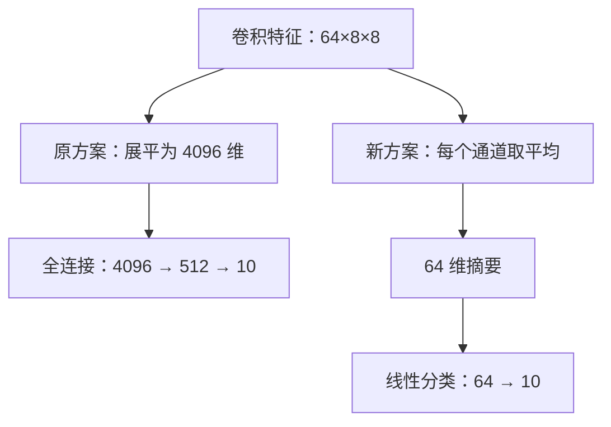

# 参数缩到原来的 1/106，计算量却只少了 27%：小模型到底小在哪？

> **工程深度｜验证状态：** L2 工程｜实验验证（建议复现）

> 一个只有两层卷积的学生网络，约 99% 的参数挤在分类器里。把分类头换成全局平均池化：参数量降到约 1/106，主要乘加次数却只减少约 27%。这台离线终端的真实延迟是多少，还得用设备说话。

<!-- more -->

## 01｜模型明明不深，怎么还是装得这么“重”？

设想你在开发一台放在教室里的离线图片识别终端。

孩子把一张图片放到摄像头前，它要判断画面里的主体属于哪个类别。设备不能每次都把图片发到服务器，模型需要在本地运行。原型阶段，你先用 CIFAR-10 的十分类任务验证训练流程；这只是教学代理任务，并不代表它已经适用于真实摄像头画面。

服务器上的教师网络比较大。于是，你设计了一个只有两层卷积的学生，又让它向教师学习。

上一篇《Loss 在下降，学生却没学到老师？》已经解决了训练链路的问题：教师要训练好，损失要可微，梯度要真正流进学生。

这一次，产品同事问了另一个问题：

“训练先放一边。这个学生，究竟小在哪儿？”

你打开网络定义，看见两个卷积层，后面接了两层全连接。结构很短，应该不重吧？

把参数数出来，答案有点反直觉：

**两层卷积一共只有 19,392 个参数，后面的分类器却有 2,102,794 个。**

约 99.09% 的参数，都集中在分类器里。

真正值得动手的地方，就这样暴露了。

开始深挖之前，先亮出本文算清的两笔账，以及还差的那一笔：

| 指标 | 改造结果 |
|---|---|
| 参数量 | 约 212 万 → 约 2 万（约 1/106） |
| 卷积与线性层 MACs | 约 771 万 → 约 560 万（减少约 27%） |
| 实际准确率与延迟 | 尚待训练和设备测试 |

前两行是结构计算出来的确定结论，第三行必须由实验回答。本文的目标是把这本“账”读清楚，而不是提前替设备下结论。

> 本文的参数量和乘加次数由网络结构直接计算，并用独立算术脚本核对；不是训练或性能实测。本文不报告未经验证的准确率、延迟或加速比。

## 02｜参数为什么会在这里突然膨胀？

先跟着一张图片走一遍。

输入是三个颜色通道、宽高各 32 的图片。经过两次卷积和池化后，学生得到 64 张 `8×8` 的特征图：

| 位置 | 单张图片的特征形状 |
|---|---|
| 输入 | `3×32×32` |
| 第一次卷积与池化后 | `32×16×16` |
| 第二次卷积与池化后 | `64×8×8` |
| 展平后 | `4096` |
| 全连接隐藏层 | `512` |
| 分类输出 | `10` |

问题出现在这一行：

```python
nn.Linear(64 * 8 * 8, 512)
```

展平之后，每个样本有 4096 个数。全连接层让这 4096 个输入分别连接到 512 个输出，每条连接都有一个可学习权重。

所以，仅权重就有：

$$
4096\times512=2,097,152
$$

再加 512 个偏置，这一层就是 2,097,664 个参数。

**`Flatten` 自己没有参数，但它把空间网格全部铺开，使后面的全连接层变得昂贵。**

以这份代码为例，参数账本如下。所有层均计入偏置，卷积使用默认的 `groups=1`。

| 模块 | 计算方式 | 参数量 |
|---|---|---:|
| 第一层卷积 | `32×(3×3×3+1)` | 896 |
| 第二层卷积 | `64×(32×3×3+1)` | 18,496 |
| 第一层全连接 | `4096×512+512` | 2,097,664 |
| 输出层 | `512×10+10` | 5,130 |
| **合计** | | **2,122,186** |

为什么卷积参数这么少？因为同一组卷积权重会在不同空间位置重复使用。全连接层则为展平后的不同位置分别分配连接权重。

这不是说全连接层没有价值。它能够利用具体位置及位置之间的组合关系。只是这种表达能力，需要付出参数代价。

## 03｜换一种汇报方式：从“每个位置都上报”到“每个通道交一份摘要”

把 64 张特征图想象成 64 份观察记录。

每份记录都有 `8×8=64` 个位置，记录网络在不同区域对某种特征的响应。为了理解，可以把其中一些响应想象为边缘或纹理；真实学习到的通道不一定能被人类准确命名，也不是每个通道都对应一个类别。

原分类头把全部 4096 个位置响应交给全连接层。

另一种做法是：**每张特征图先取一个平均值，再把 64 个平均值交给分类器。**

这就是全局平均池化，Global Average Pooling，简称 GAP。

假设一个通道的特征图只有 `2×2`，数值如下：

| | 左列 | 右列 |
|---|---:|---:|
| 上行 | 1 | 3 |
| 下行 | 5 | 7 |

池化后只剩一个数：

$$
(1+3+5+7)/4=4
$$

对真实的 `64×8×8` 特征，逐通道执行同样的操作，就得到 64 个数。它不会把不同通道混在一起，也不会把不同图片混在一起。[1]

分类器拿到的是 64 份“摘要”：**GAP 把“哪些位置出现了响应”汇总成“这个通道整体响应有多强”**，但平均值是压缩过的，不能从它还原原来的空间分布。

平均值同时受两项因素影响：响应强度和覆盖范围。同样的强响应，出现在很多位置，和只出现在一个位置，得到的平均值可能不同——小范围强信号会被平均稀释。所以不要把它简化成“只判断特征有没有出现”。这一点在第 06 节会看到实际例子。



对应到 PyTorch：

```python
self.classifier = nn.Sequential(
    nn.AdaptiveAvgPool2d(1),  # [B, 64, 8, 8] → [B, 64, 1, 1]
    nn.Flatten(1),           # [B, 64, 1, 1] → [B, 64]
    nn.Linear(64, 10),       # [B, 64] → [B, 10]，输出 logits
)
```

这里的 `1` 指输出空间尺寸为 `1×1`，不是把通道数变成 1。

还有一个实现细节：**池化要发生在展平之前。** 如果仍沿用旧版 `forward()`，先把特征变成 `[B,4096]` 再传给这个分类头，二维空间池化就接不到预期的特征图了。

GAP 不需要学习权重，最后的线性层只需要：

$$
64\times10+10=650
$$

个参数。

这也不是刚出现的新技巧。Network In Network 在 2013 年发布的论文中就讨论了以全局平均池化替代传统全连接分类层的设计。[2] 本文采用的是“GAP 后接可学习线性分类器”，并不意味着它与论文中的具体网络完全相同。

## 04｜一换分类头，参数量真的降到了约 1/106

卷积部分保持不变，我们重新记账：

| 项目 | 原学生：全连接头 | 新学生：GAP 头 |
|---|---:|---:|
| 卷积部分参数 | 19,392 | 19,392 |
| 分类头参数 | 2,102,794 | 650 |
| **整个模型参数** | **2,122,186** | **20,042** |
| 仅 FP32 参数原始字节 | 8,488,744 B | 80,168 B |
| 换算后的参数存储 | 约 8.10 MiB | 约 78.29 KiB |

整个模型的参数量比值是：

$$
\frac{2,122,186}{20,042}\approx105.89
$$

也就是说，新模型参数量约为原模型的 **1/106**，减少约 **99.06%**。

请留意比较对象：这是**原学生与改造后的学生**，不是教师与学生。

存储数字的口径也很明确：按每个 FP32 参数 4 字节计算，不含文件封装、运行时、激活、算子工作区、梯度或优化器状态。它不能直接当作整个模型文件大小，更不能当作应用峰值内存。

到这里，我们得到了一个确定结论：参数确实少了很多。

但设备会快多少，还没有答案。

## 05｜反转来了：参数缩到 1/106，主要乘加次数却只少了约 27%

卷积有一个容易让人误判的特点：**权重少，不代表使用次数少。**

先完整展开第一层：

```python
nn.Conv2d(3, 32, kernel_size=3, padding=1)
```

一张图片经过它：

- 输出有 `32×32×32` 个数（32 个输出通道，每个通道一张 `32×32` 特征图）；
- 每个输出需要对 `3×3×3=27` 个输入值做加权求和（3 个输入通道，每个通道一个 `3×3` 邻域）；
- 所以按本文口径，这一层的乘加次数为：

$$
32\times32\times32\times27=884,736
$$

这一层只有 864 个卷积权重（`32×(3×3×3)=864`），但每个权重会在不同输出位置反复使用。**参数统计“有多少个权重”，计算量统计“这些权重被用了多少次”。** 这一组对应关系是全文的关键一档：全连接层的权重很多，却没有这种空间上的重复应用。

因此，我们还得算另一笔账：处理一张图片，需要多少次乘加？

这里把一次乘法和累加记为一个 MAC，仅统计卷积与线性层的常规直接计算量，不统计偏置加法、ReLU、池化、内存访问等开销。MAC 也不要与不同统计口径的 FLOPs 混用。

**卷积与线性层 MACs 对照（不含池化等操作）**

| 模块 | 原学生 MACs | GAP 学生 MACs |
|---|---:|---:|
| 第一层卷积 | 884,736 | 884,736 |
| 第二层卷积 | 4,718,592 | 4,718,592 |
| 分类头线性层 | 2,102,272 | 640 |
| **上述项目合计** | **7,705,600** | **5,603,968** |

卷积部分的计算没有减少，仍然要完成约 560 万次乘加。

因此，表内 MACs 的降幅只有：

$$
1-\frac{5,603,968}{7,705,600}\approx27.3\%
$$

这一刻，三个概念终于分开了：

| 指标 | 回答的问题 |
|---|---|
| 参数量 | 有多少需要存储的可学习数值？ |
| 计算量 | 为一个输入做多少算术操作？ |
| 实际延迟 | 目标设备完成一次推理要多久？ |

参数量的变化，不能直接替后两者作答。

甚至 MACs 比值约为 1.38，也不是实测加速比或速度上限。减少权重读取可能改善缓存和带宽压力；另一方面，算子启动、并行度和运行时开销也可能限制收益。实际结果必须在目标设备测量。

回到那台离线终端：这次改造可能先解决模型存储问题，响应速度是否足够好，还要另测。

## 06｜取个平均数，真的不会丢掉重要信息吗？

会。它确实改变了模型能直接使用的信息。

看下面两个假想的单通道特征图：

| 行 | 特征图 A | 特征图 B |
|---|---|---|
| 第一行 | `8, 0` | `0, 0` |
| 第二行 | `0, 0` | `0, 8` |

一个响应在左上角，一个在右下角。两者平均值都是 2。

GAP 之后，下游线性层仅凭这个通道的平均值，无法区分它们。

如果任务更关心某种特征是否广泛出现，而不太关心精确位置，这种汇总方式可能合适。若任务依赖“左边还是右边”“两个部件怎样排列”，直接平均就可能损失有用线索。

这不意味着整张网络完全不懂位置。前面的卷积能编码局部结构，边界、步长和特征分布也会影响结果。但 **GAP 不会保留每个空间位置供分类头自由使用**，不能把它描述成无损压缩或保证严格平移不变。

我们的学生还只有两层卷积。原先那个宽大的全连接层，也许承担了不少特征组合工作。把它移除，等于要求卷积部分提供更适合直接分类的摘要。

所以，改完结构必须重新训练、重新评估。它不是对训练好的权重做一次等价变换。

如果准确率下降，也不必立刻恢复到两百万参数。可以先试一个中间方案：

```python
nn.AdaptiveAvgPool2d((2, 2)),  # 每个通道保留四个区域的平均响应
nn.Flatten(1),                # 64×2×2 = 256 维
nn.Linear(256, 10),           # 分类头有 256×10+10 = 2570 个参数
```

它保留粗粒度空间布局，整个网络为 21,962 个参数。是否值得用，仍要看验证结果，而不是“比 GAP 多留一点信息”就必然更好。

还要提醒一点：这次“换分类头”其实同时做了两件事——把展平改成空间平均，并**删除了 512 维隐藏层及其非线性变换**。之后如果观察到准确率变化，不能把账全部算在 GAP 头上。

如果要进一步判断性能变化究竟来自空间平均，还是隐藏层的删除，可以增加一个中间方案：`GAP → Linear(64,512) → ReLU → Linear(512,10)`。它保留隐藏层，只替换展平部分，总参数量为：

$$
19,392+(64\times512+512)+(512\times10+10)=57,802
$$

这个方案不必进入正文主实验，作为“进一步研究”提示即可，避免把四组实验扩成难以完成的大工程。

## 07｜这时候再请老师：蒸馏能帮助更小的学生吗？

现在，蒸馏有了一个具体任务：帮助经过结构改造的学生学习。

真实标签继续告诉它正确类别；教师输出提供额外的类别关系。沿用前文的训练方法即可，无须再次改变损失定义。[3]

为了避免系列代码中的权重约定混淆，这里统一把软损失权重叫作 `kd_weight`：

```python
loss = (1 - kd_weight) * ce + kd_weight * scaled_kl
```

这次最值得记住的是：

**参数变少来自架构改造；蒸馏是否改善准确率，需要单独验证。**

蒸馏不会凭空给 GAP 增加空间坐标，也不能保证容量很小的学生学会教师的所有判断。它可以通过训练影响前面的卷积特征，但仍受学生结构和任务条件约束。

因此，不要只比较“旧学生直接训练”和“新学生加入蒸馏”。两个变量同时改变，结果很难解释。

应该做四组：

| 组别 | 分类头 | 训练信号 | 参数量 |
|---|---|---|---:|
| A | 原全连接头 | 真实标签 CE | 2,122,186 |
| B | 原全连接头 | CE＋蒸馏 | 2,122,186 |
| C | GAP 头 | 真实标签 CE | 20,042 |
| D | GAP 头 | CE＋蒸馏 | 20,042 |

这张表让每个比较都有明确含义：

- **B 对 A**：蒸馏对原结构有没有帮助？
- **D 对 C**：蒸馏对 GAP 结构有没有帮助？
- **C 对 A**：同样直接训练，换分类头付出了什么代价或得到了什么收益？
- **D 对 B**：同样使用蒸馏，两个学生怎样取舍？

同一结构内的 CE/KD 两组复制相同初始权重，并各自重建相同种子的数据加载器；不同结构的卷积部分共享初值。所有组使用一致的数据划分与评估方式，测试集留作最终报告。

第一轮可以先固定训练轮数与优化器，获得受控比较；但需要注意，**相同训练轮数不代表相同训练耗时**，蒸馏多了教师前向。多种子、调参预算与数据顺序的细节见附录 B[实验与测量记录规范]。

除了总准确率，再看看错误样本丢在哪些类别或空间关系上，它提示下一步该改分类头、加强特征提取，还是调整训练。

## 08｜延迟怎么测，才能不把自己“测赢”？

假设模型已经训练好。把它放到实际终端，至少分开测两段时间：

| 测量层次 | 包含什么 | 用途 |
|---|---|---|
| 模型前向 | 输入张量已就位后的网络推理 | 比较网络本身 |
| 应用端到端 | 图像解码、预处理、传输、推理、后处理 | 判断用户等待时间 |

摄像头采集等待是否算入端到端，也要明确，不能一组算、一组不算。

交互式终端通常先看 batch size 为 1 的表现。批处理服务则应使用其真实批大小，另报吞吐量。把大批量的每张平均耗时拿来宣传单张响应速度，会产生误导。

还有一个很有用的自检：B 与 A、D 与 C 的网络结构分别相同，权重形状和常规前向算子相同。在相同密集执行方式下，不能仅凭“经过蒸馏”期待它们自然获得结构性加速。若差异很大，先检查计时和运行条件。

统一的测量口径——设备、预热、同步、线程与编译选项——见附录 B[实验与测量记录规范]，正式微基准可以 PyTorch Benchmark 作为起点。[4]

## 09｜这个老技巧，为什么今天仍值得学？

GAP 的年份不新。它有价值的地方，在于让我们理解了轻量模型设计的一条基本思路：**不要让高分辨率空间维度无意间放大分类头。**

这一思路并未停留在教学网络里。当前 torchvision 的 MobileNetV3 实现也先使用 `AdaptiveAvgPool2d(1)`，再进入分类器；不过成熟轻量网络会**共同设计特征提取与分类器**，它后面仍保留带非线性变换的全连接层，而不是简单删掉所有全连接。[5] 所以合理的讨论不是“全连接一定不好”，而是：在怎样的特征表示之后，安排多大容量的分类器？[6]

本文的两层 CNN 是一块容易看清结构的练习板，不应因为参数只有两万，就被包装成优于成熟轻量网络的通用方案。它让你练习的是一套可以带走的判断方法：找到参数大户，检查计算大户，再用实验观察修改后的代价。算术账本是起点，目标设备的表现才决定能否部署。

## 10｜回到终端：下一步该做什么？

现在，你可以给产品同事一个比“模型只有两层卷积”更可靠的回答：

模型的大部分参数原来藏在分类头里。换一种空间汇总方式，参数可降至原来的约 1/106；但前面的卷积没有消失，主要乘加次数只减少约 27.3%。准确率和终端延迟，需要通过四组对照与设备测试确认。

也许 GAP 版本已经满足需求。也许它在位置敏感的图片上退步，需要保留 `2×2` 的粗布局。也许蒸馏能帮助它，也许收益不足以抵偿训练成本。

这些结果都值得记录。

**一个值得部署的小模型，不只是参数表里小；它要在你的设备上跑得动，在你的任务上做得对。**

---

## 附录 A｜完整结构检查代码

下面脚本只依赖 PyTorch，不下载数据，不训练教师。它用于核对两种学生的输出形状、参数量与权重字节数，不会输出准确率，也不会伪装成性能测试。**四组训练、计时与准确率不在此脚本内，属于正文第 07 节提出的验证方案，需要另行执行。**

保存为 `inspect_student_heads.py` 后运行即可。本文制作环境未安装 PyTorch，代码已做语法检查，前向和断言尚待在具备 PyTorch 的环境执行。

```python
"""参数缩到原来的 1/106，计算量却只少了 27%：小模型到底小在哪？（第2章 · 模型压缩）。

本文件是对应博文代码块的实现/演示，直接运行可见效果；运行依赖：PyTorch。
"""
import copy
import torch
import torch.nn as nn


class StudentCNN(nn.Module):
    """同一卷积主体，切换 FC 或 GAP 分类头。"""

    def __init__(self, head="fc"):
        super().__init__()
        self.features = nn.Sequential(
            nn.Conv2d(3, 32, 3, padding=1),  # [B, 32, 32, 32]
            nn.ReLU(inplace=True),
            nn.MaxPool2d(2),                # [B, 32, 16, 16]
            nn.Conv2d(32, 64, 3, padding=1), # [B, 64, 16, 16]
            nn.ReLU(inplace=True),
            nn.MaxPool2d(2),                # [B, 64, 8, 8]
        )
        if head == "fc":
            self.classifier = nn.Sequential(
                nn.Flatten(1),             # 将每个样本展开为 4096 维
                nn.Linear(64 * 8 * 8, 512),
                nn.ReLU(inplace=True),
                nn.Linear(512, 10),
            )
        elif head == "gap":
            self.classifier = nn.Sequential(
                nn.AdaptiveAvgPool2d(1),   # 每个通道的空间维取平均
                nn.Flatten(1),             # 保留 batch，得到 [B, 64]
                nn.Linear(64, 10),         # 返回 logits，不加 softmax
            )
        else:
            raise ValueError("head 必须为 'fc' 或 'gap'")

    def forward(self, x):
        # 不在这里提前 flatten，空间池化需要完整的四维特征。
        return self.classifier(self.features(x))


def count_params(module):
    return sum(p.numel() for p in module.parameters())


def main():
    torch.manual_seed(42)
    original = StudentCNN("fc")
    compact = StudentCNN("gap")

    # 两种结构使用相同卷积初值；不同分类头无法逐参数共享初值。
    compact.features.load_state_dict(original.features.state_dict())

    # 同一结构内复制整个模型，作为 CE/KD 两组的共同起点。
    models = {
        "FC-CE": original,
        "FC-KD": copy.deepcopy(original),
        "GAP-CE": compact,
        "GAP-KD": copy.deepcopy(compact),
    }
    expected = {"FC-CE": 2122186, "FC-KD": 2122186,
                "GAP-CE": 20042, "GAP-KD": 20042}
    x = torch.randn(2, 3, 32, 32)  # 两张随机图片，仅供形状检查

    with torch.inference_mode():
        for name, model in models.items():
            model.eval()
            output = model(x)
            total = count_params(model)
            # 按当前实际 dtype 计算参数字节数，不统计激活和运行时。
            nbytes = sum(p.numel() * p.element_size()
                         for p in model.parameters())
            assert output.shape == (2, 10)
            assert total == expected[name]
            print(f"{name:6s} | total={total:,} | "
                  f"head={count_params(model.classifier):,} | "
                  f"parameter_bytes={nbytes:,} | shape={tuple(output.shape)}")

    # 验证 GAP 确实等价于对每个通道的空间维取平均。
    feature = torch.randn(2, 64, 8, 8)
    actual = nn.AdaptiveAvgPool2d(1)(feature)
    reference = feature.mean(dim=(2, 3), keepdim=True)
    torch.testing.assert_close(actual, reference)

    print("参数量比值：", count_params(original) / count_params(compact))
    print("以上只是结构检查，不代表训练效果或实际加速比。")


if __name__ == "__main__":
    main()
```

## 附录 B｜实验与测量记录规范

参数量已由结构确定；准确率与延迟必须由本轮实验填写，不要把“待测”替换成参考论文或别人的网络结果。执行四组对照时，至少记录：

- **随机种子：**至少尝试多个种子，报告每次差值及均值±标准差；小幅改善不能仅凭一次运行宣布成功。
- **调参口径：**温度、`kd_weight`、训练轮数用验证集选择，测试集只作最终报告；比较各结构的最佳可达效果时，给它们相当的验证集调参预算。
- **数据顺序：**训练教师会消耗训练 DataLoader 的随机状态，CE/KD 组应各自重建相同种子的数据加载器，保证数据顺序一致。
- **训练预算：**固定训练轮数不等于相同训练耗时（蒸馏多了教师前向）；记录训练耗时是否包含验证和教师预训练。
- **设备与软件：**设备型号、驱动与 CUDA 版本、PyTorch/torchvision 版本、输入尺寸与图像预处理。
- **测量口径：**batch size、精度、运行后端与编译选项、重复次数、预热轮数、CUDA 同步；单张响应速度与设计批吞吐分别报告，端到端延迟（含解码、预处理、传输与后处理）是否并入摄像头采集等待需注明。
- **结果维度：**测试准确率、目标设备前向延迟、训练耗时；若报告应用体验，再单列端到端延迟及其统计口径。

四组学生接入前文训练脚本时，同一结构的 CE/KD 组分别使用附录 A 生成的独立模型副本和独立优化器，并重建相同种子的数据加载器。先将模型移动到设备，再创建优化器；教师沿用同一份训练好的权重，保持冻结。

原 FC 分类头权重不能直接加载到 GAP 分类头。可以显式加载兼容的卷积部分，但这属于另一种初始化方案，比较组需要一致记录。

## 参考资料

资料核查日期：2026-10-08。本文使用经典方法及现行官方实现说明工程原理，不将其包装为新发布算法。

1. PyTorch：[AdaptiveAvgPool2d](https://docs.pytorch.org/docs/stable/generated/torch.nn.modules.pooling.AdaptiveAvgPool2d.html)。输出尺寸与通道维行为。
2. Lin, Chen, Yan：[Network In Network](https://arxiv.org/abs/1312.4400)，2013 年首次发布。全局平均池化的经典网络设计背景。
3. PyTorch：[Knowledge Distillation Tutorial](https://docs.pytorch.org/tutorials/beginner/knowledge_distillation_tutorial.html)。教师监督与学生训练的参考实现。
4. PyTorch：[Benchmark](https://docs.pytorch.org/tutorials/recipes/recipes/benchmark.html)。预热、线程设置、同步与微基准测量。
5. torchvision：[MobileNetV3 源码](https://docs.pytorch.org/vision/main/_modules/torchvision/models/mobilenetv3.html)。GAP 与分类器的实际组合。
6. Howard et al.：[Searching for MobileNetV3](https://arxiv.org/abs/1905.02244)，2019。硬件感知的模型设计背景。
