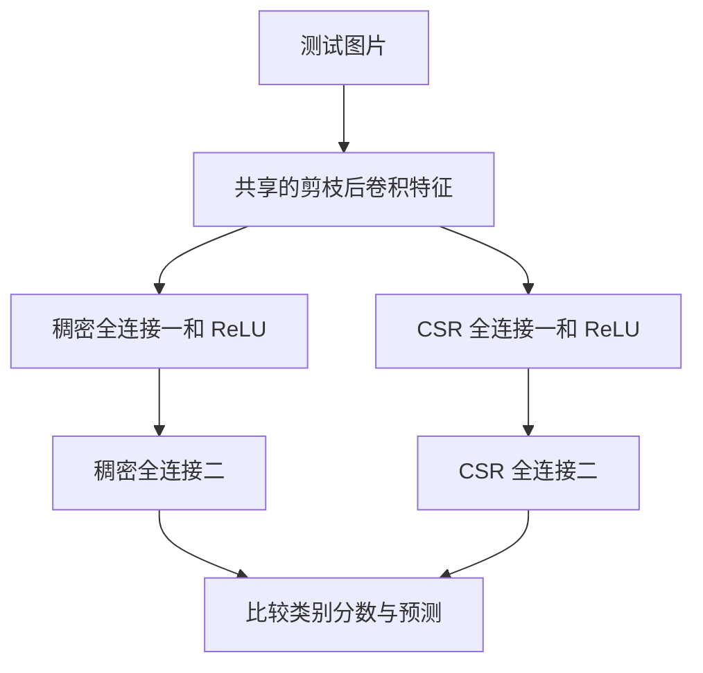

# 权重剪掉一半，模型就能快一倍？用 CUDA 算一笔账

> **工程深度｜验证状态：** L2–L3 工程｜静态复核 + CPU 对比验证（GPU 实际加速需按设备/稀疏度实测）

> 想让模型变快，先得让机器真正少做事。第一步通常是只保存非零权重。但刚算存储账，就遇到了意外：索引把省下的空间吃回去了。继续写 CUDA，又遇到第二道关：乘法少了，线程却没铺开。

假设你负责一个图片自动归档服务。用户上传一张图片，系统给它贴上“汽车”“猫”“船”等标签。

功能已经跑通，接下来要省资源、降延迟。你看到一个很诱人的方案：把模型里不重要的权重剪掉一半。

直觉很自然：少一半参数，内存应该少一半；少一半乘法，推理应该快一倍。

**严格说，这里减少的是非零权重数量，权重张量仍然保留原来的形状和元素个数。**

然而，把第一层全连接权重换成 CSR 稀疏格式后，一笔确定的账摆在眼前：

| 权重表示 | 占用字节数 |
| --- | ---: |
| 原来的 FP32 稠密矩阵 | 1,048,576 |
| 50% 非零的 FP32 + int32 CSR | 1,049,092 |

在这个第一层全连接中，使用 FP32 数值和 int32 索引，**50% 非零的 CSR 权重载荷比稠密表示多 516 字节**。实际模型文件还涉及序列化、压缩和其他层，不能直接由这张表推断。

原因藏在“位置”里：零可以不存，留下来的数却必须知道自己原来在哪。

这篇文章就从这个小意外出发，沿着一张图片的推理过程，把三笔账算清楚：**模型剪掉了多少、存储省下了多少、实际运行快了多少。**

本文以教学程序解析原理，空间数据为精确计算；速度以读者实际运行结果为准。文中的网络和 CUDA 内核来自一份 CNN 剪枝教学程序。场景用于帮助理解；空间数字由矩阵尺寸直接推导；已有准确率与耗时摘录会明确标注证据边界。本文没有新跑 GPU 实验，也不把未经核实的“4 倍加速”当作结论。

## 01｜先跟着一张图片，走到真正要优化的地方

为了把问题缩小，程序使用 CIFAR-10 的 32×32 RGB 图片和一个小型 CNN。这个网络用于教学，不代表生产图片服务的完整方案。

网络分成两部分：前半段提取特征，后半段根据特征分类。

```python
self.features = nn.Sequential(
    nn.Conv2d(3, 16, 3, padding=1),
    nn.ReLU(),
    nn.MaxPool2d(2),
    nn.Conv2d(16, 32, 3, padding=1),
    nn.ReLU(),
    nn.MaxPool2d(2),
)

self.classifier = nn.Sequential(
    nn.Linear(32 * 8 * 8, 128),
    nn.ReLU(),
    nn.Linear(128, 10),
)
```

可以把卷积特征理解为一份“图片观察记录”：不同位置、不同通道记录不同的响应。它们未必与人类命名的“耳朵”“车轮”一一对应，但能被后续层组合，用于分类。

| 处理位置 | 单张图片的张量形状 | 发生了什么 |
| --- | --- | --- |
| 原始输入 | `[1,3,32,32]` | 三个颜色通道 |
| 第一次卷积、激活、池化后 | `[1,16,16,16]` | 提取特征并缩小空间尺寸 |
| 第二次卷积、激活、池化后 | `[1,32,8,8]` | 得到更深一层的特征 |
| 展平后 | `[1,2048]` | 每张图片整理出 2048 个数 |
| 第一层全连接、ReLU 后 | `[1,128]` | 组合成 128 维中间特征 |
| 第二层全连接后 | `[1,10]` | 得到 10 个类别分数 |

第一层全连接的权重矩阵是 `W1:[128,2048]`。每一行对应一个输出，每一列对应一个输入特征。

单个输出的计算是：

$$
h_i=\max\left(0,\sum_{j=0}^{2047}W_{1,i,j}x_j+b_{1,i}\right)
$$

不必被求和符号吓住。它只是说：**把 2048 个输入分别乘上相应权重，加起来，加偏置，再把负数变成零。**

第二层继续计算：

$$
z=W_2h+b_2
$$

得到的 10 个数叫 logits，也就是未经概率归一化的类别分数。预测类别取最大分数的下标即可。

这里的输入 `x` 有明确来源：它是卷积提取的特征，不是临时生成的随机数。单样本写成 `W @ x + b`；PyTorch 把一批样本放在矩阵的各行，因此批量写法是 `X @ W.T + b`。

## 02｜剪枝之后，零出现了，矩阵并没有变小

程序这样剪枝：

```python
def apply_pruning(model, amount):
    for module in model.modules():
        if isinstance(module, (nn.Conv2d, nn.Linear)):
            prune.l1_unstructured(module, name="weight", amount=amount)
```

`model.modules()` 会递归遍历内部模块，所以**两个卷积层和两个全连接层都会被处理**。ReLU 和池化没有这里需要剪掉的权重；偏置也没有被这段代码剪枝。

当 `amount=0.5` 时，每个选中层分别按权重绝对值排序，剪掉约一半较小的权重。它没有把全模型权重合在一起统一排序。

例如：

```python
原始权重 = [0.02, -0.80, 0.01, 0.60]
掩码     = [0,     1,    0,    1]
有效权重 = [0,    -0.80, 0,    0.60]
```

这种做法叫非结构化剪枝：零可能出现在任意位置。这里的 L1 指按绝对值衡量大小，不是在损失函数里额外加入 L1 正则项。小权重是一个简单的重要性近似，不保证每条被剪连接都无关紧要。

PyTorch 的实现会保存原始参数 `weight_orig` 和掩码 `weight_mask`，通过前向 hook 得到有效权重：[1]

$$
W_{\mathrm{effective}}=W_{\mathrm{orig}}\odot M
$$

其中，\(\odot\) 是逐元素相乘。

微调时保留掩码，被剪位置的有效权重就持续为零，剩余连接有机会适应变化。微调后调用 `prune.remove()`，会把当前有效权重固化成普通 `weight`，去掉掩码和 hook；它不会恢复原来的非零值。移除掩码后再继续普通训练，零值仍可能重新被更新为非零。[1]

关键在这里：第一层权重原来是 `[128,2048]`，剪枝后还是 `[128,2048]`。

可以把它想成一张有 262144 个格子的表。你把一半格子填成了零，表的行数、列数都没有改变。普通稠密数组仍为这些位置留着空间，普通稠密算子也通常按完整形状工作。

所以，“剪枝完成”只说明数值发生了变化。要获得存储和计算收益，还得继续改变数据表示和执行方式。

## 03｜CSR：把空格删掉，就得补上一份地址簿

CSR，全称 Compressed Sparse Row，按行压缩稀疏矩阵。它用非零值、列索引、行偏移三个数组共同表示矩阵。[2]

先把 128×2048 的矩阵缩成一个能手算的例子：

$$
W=\begin{bmatrix}
0&2&0&3\\
0&0&0&0\\
4&0&5&0
\end{bmatrix}
$$

按行收集非零值：

```python
data    = [2, 3, 4, 5]  # 保存什么数
col_ind = [1, 3, 0, 2]  # 原来位于哪一列
row_ptr = [0, 2, 2, 4]  # 每一行从哪里开始、到哪里结束
```

`data` 与 `col_ind` 一一对应。数值 `3` 的列号是 `3`，数值 `4` 的列号是 `0`。这些索引均从零开始。

第 `i` 行的非零元素范围是：

```python
range(row_ptr[i], row_ptr[i + 1])
```

| 行号 | 压缩数组区间 | 含义 |
| --- | --- | --- |
| 0 | `[0,2)` | 使用 `data[0]`、`data[1]` |
| 1 | `[2,2)` | 没有非零元素，是空行 |
| 2 | `[2,4)` | 使用 `data[2]`、`data[3]` |

**全零行没有消失，它由两个相等的行边界表示。** M 行需要 M+1 个边界，最后一个边界等于总非零数 `nnz`。

代码里用每行计数的前缀和生成这些边界：

```python
rows, cols = np.nonzero(weight)
data = weight[rows, cols]
col_ind = cols.astype(np.int32)

counts = np.bincount(rows, minlength=weight.shape[0])
row_ptr = np.zeros(weight.shape[0] + 1, dtype=np.int32)
row_ptr[1:] = np.cumsum(counts, dtype=np.int64)
```

在这个例子里，`counts=[2,0,2]`，累计计数为 `[2,2,4]`，前面补上起点零就得到 `row_ptr`。正式实现还要检查数值、内存连续性和 int32 索引范围；矩阵形状也应保存，尤其不能靠非零列号推断末尾全零列的数量。

### 为什么“第几列”决定乘输入中的“第几个数”？

因为矩阵的列与输入特征按位置对应。

令：

```python
x    = [1, 4, 5, 6]
bias = [1, -2, 3]
```

第一行的权重 `2` 对应输入 `x[1]`，权重 `3` 对应输入 `x[3]`：

$$
y_0=2\times4+3\times6+1=27
$$

第二行没有非零权重，但还有偏置：

$$
y_1=-2
$$

第三行：

$$
y_2=4\times1+5\times5+3=32
$$

最终输出 `[27,-2,32]`；如果再执行 ReLU，则变成 `[27,0,32]`。

这就解释了内核里最重要的一行：

```python
acc += data[k] * x[col_ind[k]]
```

`k` 是压缩数组里的位置，`col_ind[k]` 才是原始特征的编号。省掉这次索引，就无法把权重和正确的输入对齐。

## CSR 索引追踪：看清 `k` 如何映射

用前面的 3×4 示例，拆解各个非零位置的映射关系：

| `k` | `data[k]` | `col_ind[k]` | 读取输入 | 乘积 | 属于哪行 |
|---:|---:|---:|---|---:|---:|
| 0 | 2 | 1 | `x[1]=4` | 8 | 0 |
| 1 | 3 | 3 | `x[3]=6` | 18 | 0 |
| 2 | 4 | 0 | `x[0]=1` | 4 | 2 |
| 3 | 5 | 2 | `x[2]=5` | 25 | 2 |

根据 `row_ptr = [0,2,2,4]`：

- 第 0 行：`range(0,2)` → `k=0,1`，累加 `8+18+1=27`
- 第 1 行：`range(2,2)` → 无乘积，只加偏置 `-2`
- 第 2 行：`range(2,4)` → `k=2,3`，累加 `4+25+3=32`

> `row_ptr` 决定取哪些记录，`col_ind` 决定去哪里取输入，`data` 提供权重值。

## 04｜算一笔空间账：为什么 50% 还不够？

假设权重使用 FP32，列索引和行指针使用 int32，每项都占 4 字节。

对于 M×N 的矩阵：

$$
S_{\mathrm{dense}}=4MN
$$

CSR 的空间为：

$$
S_{\mathrm{CSR}}=4nnz+4nnz+4(M+1)
$$

三项分别是非零值、列号和行边界。

本例第一层为 128×2048，恰好一半非零时：

| 项目 | 计算 | 字节数 |
| --- | --- | ---: |
| 稠密权重 | `128 × 2048 × 4` | 1,048,576 |
| CSR 非零值 | `131072 × 4` | 524,288 |
| CSR 列号 | `131072 × 4` | 524,288 |
| CSR 行指针 | `129 × 4` | 516 |
| CSR 合计 | 三项相加 | 1,049,092 |

少掉的数值空间，恰好被列号抵消了，还多出一份行指针。

如果把零元素占比记为稀疏率 s，要求 CSR 更小，可以推导出：

$$
s>\frac12+\frac{M+1}{2MN}
$$

第一层约需要超过 **50.049%**。这只是当前数据类型和格式下的存储临界点。

同一个矩阵继续增加稀疏率，理论结果如下。表中直接指定非零数，避免比例取整产生歧义：

| 零元素比例 | 非零数 | CSR 字节数 | 占稠密权重比例 |
| --- | ---: | ---: | ---: |
| 0% | 262144 | 2,097,668 | 200.05% |
| 50% | 131072 | 1,049,092 | 100.05% |
| 75% | 65536 | 524,804 | 50.05% |
| 87.5% | 32768 | 262,660 | 25.05% |

**这些是表示空间的算术结果，不是模型精度或性能实测。** 更高稀疏率可能损伤精度，也不保证速度按比例提升。

还要注意，这张表不含偏置、Python 对象、分配器开销和模型文件封装。教学程序同时保留稠密模型与 CSR 副本，所以整个进程的实际占用更不能直接套用表中数字。

## 05｜把公式交给 GPU：一个线程，负责一个输出

理解了 CSR，下面这个内核就不神秘了：

```python
from numba import cuda, float32

@cuda.jit
def csr_linear_kernel(row_ptr, col_ind, data, bias, x, y, relu):
    row = cuda.grid(1)
    if row < y.size:
        acc = float32(0.0)
        for k in range(row_ptr[row], row_ptr[row + 1]):
            acc += data[k] * x[col_ind[k]]
        acc += bias[row]
        if relu and acc < 0.0:
            acc = float32(0.0)
        y[row] = acc
```

`@cuda.jit` 将支持的 Python 子集编译成 GPU 内核。`cuda.grid(1)` 给出一维全局线程编号，等价于 `blockIdx.x * blockDim.x + threadIdx.x`。[3]

这里把线程编号直接用作行号：**一个线程负责一个输出。** 这不是最优实现，而是最容易验证的基线。它能帮助我们看清 CSR 如何计算，也会暴露并行度不足的问题。

每个线程有自己的局部累加器，只写自己的 `y[row]`，没有多人同时修改一个输出，因此不需要原子加法，也不需要线程间同步。

一行全部为零时，循环执行零次，但仍然加偏置并写回结果。于是预分配的输出数组即使没有清零，也不会让有效输出残留旧值。

第一层可以顺便执行 ReLU，避免为这个激活额外启动一个内核；第二层保留负的 logits。负分数照样参与类别排序，不能随意截断。

> 这里先观察到的是这个具体内核的工作分配没有充分展开并行，并不能据此判断优化过的 CSR 内核也会同样慢。

### 两层之间，数据怎么传？

初始化 `CSRLinearCUDA` 时，权重与索引只上传一次，输出缓冲区也预先分配。真正推理时：

```python
d_x.copy_to_device(x)
hidden = layers[0].launch(d_x, relu=True)
logits = layers[1].launch(hidden).copy_to_host()
```

128 维的 `hidden` 留在 GPU，直接成为第二层输入；只有最后的 10 维结果回到 CPU。同一 CUDA 流保证两次内核按序执行。CPU 提交第一层后可以先返回，不意味着第二层能够越过依赖、提前读取结果。

这个封装复用输出缓冲区，适合程序里的串行调用。多个请求并发复用同一个实例时，需要重新设计缓冲区所有权和流依赖。

> 工具链说明：本文保留原程序的 Numba CUDA 风格接口。检索时 NVIDIA 的 `numba-cuda` 仓库已标记为维护模式，新功能开发转向 Numba-CUDA-MLIR。[6] 复现应记录实际包版本和 CUDA 环境；这里的教学内核不应被当成最新工具链的安装与迁移指南。

## 06｜为什么乘法少了，GPU 仍可能慢？

先看这段启动配置：

```python
threads = 128
blocks = (out_features + threads - 1) // threads
```

实际结果是：

| 层 | 输出数 | 启动线程块数 | 有效线程数 |
| --- | ---: | ---: | ---: |
| 第一层全连接 | 128 | 1 | 128 |
| 第二层全连接 | 10 | 1 | 10 |

第一层只有一个线程块，常规 CUDA 调度下该块由一个 SM 执行，无法把任务铺满整块 GPU。第二层只有 10 个线程真正工作。

而第一层剪掉一半权重后，每行平均仍有 1024 个非零元素。每个线程需要串行完成这一行的累加。

也就是说：**工作量少了，工作分配却可能不足以发挥 GPU 的并行能力。** 这是从当前代码推导出的限制，不能把它泛化成“稀疏计算一定慢”。

另外还有三笔成本。

**第一笔是找地址。** 每次乘法先读列索引，再根据列号读取输入。比起规则的连续计算，多了一条地址依赖。

**第二笔是访存和负载。** 相邻线程处理不同行，同一步读取的权重位置可能相隔很远，不利于合并访存。各行非零数不一致时，线程的循环长度也不一致。CUDA 的 32 线程 warp 内，部分线程可能已结束，其他线程仍在工作。

**第三笔是调度和搬运。** 小任务的计算时间可能很短，内核启动和 CPU/GPU 传输就变得显眼。当前单样本输入只有 8192 字节，输出只有 512 字节；即使数据不大，调用、传输和等待仍有固定成本。

反过来，稠密算子虽然处理零值，却可以使用高度优化的规则访存和并行实现。因此不能只数乘法次数来比较两者。CUDA 官方最佳实践也强调，应先定位瓶颈，再分析内存访问、传输和并行执行。[4]

这份代码目前是“一个样本一次稀疏矩阵向量乘”，即 SpMV。DataLoader 一次给 100 张图，并不自动让下面的循环变成批量稀疏矩阵乘：

```python
for i, x in enumerate(features_np):
    # 每个样本分别上传、启动内核、取回结果
    ...
```

真正的批量方案需要同时处理多个输入，使权重在样本之间复用；这会变成 SpMM 等不同的实现问题，也必须重新比较批量稠密基线。

## 07｜为什么要验证两个全连接层，计时却只测一个？

因为它们回答不同的问题。

两个全连接层连同中间 ReLU，一起构成完整分类器。只检查第一层 `W1x+b1`，发现不了“忘记 ReLU”或者“第二层读错中间缓冲区”等组合错误。



对应代码：

```python
layers = [CSRLinearCUDA(pruned.classifier[i]) for i in (0, 2)]
```

索引 `0` 和 `2` 是两个 Linear；索引 `1` 是 ReLU，它的功能融合到第一层 CSR 内核。这里创建的是额外的 CSR 对象，并没有原地替换 `pruned.classifier`。

验证时，两条路径共享相同的 CPU 卷积特征，分别计算最终 10 维 logits。这样就能隔离分类器实现差异。

至少看四项指标：

| 指标 | 回答的问题 |
| --- | --- |
| 最大 logits 绝对误差 | 分数差了多少？ |
| 逐元素容差校验 | 差异是否在设定范围内？ |
| 预测一致率 | 两种实现是否选中同一类别？ |
| 各自的分类准确率 | 相对于真实标签，各自对了多少？ |

两种实现都把猫判断成狗，预测一致率依然可以是 100%。因此一致率不能代替准确率。

数值检查采用：

```python
np.testing.assert_allclose(actual, reference, rtol=1e-4, atol=1e-5)
```

每个元素需要满足：

$$
|actual-reference|\le10^{-5}+10^{-4}|reference|
$$

CPU 和 GPU 的累加顺序、融合乘加可能不同，FP32 不能默认逐位一致。小矩阵检查边界情况，真实图片检查实际输入；两者结合，提高对实现正确性的信心。容差也需要结合规模与数值范围判断；失败后应定位最大误差和对应输入，不能只把容差调大。

性能测试 `benchmark_fc1()` 则只测第一层：同一个输入、同一份剪枝权重，都计算 `Wx+b`，不包括 ReLU。这使性能比较的范围更明确。

| 模块 | 剪枝 | 转 CSR | 单层计时包含 |
| --- | --- | --- | --- |
| 两个卷积层 | 是 | 否 | 否 |
| 第一层全连接 | 是 | 是 | 是 |
| 中间 ReLU | 无权重 | 融合执行用于验证 | 否 |
| 第二层全连接 | 是 | 是 | 否 |

卷积权重虽然也变稀疏，仍由普通稠密卷积执行。这个实验没有实现稀疏卷积加速。

## 08｜看到“快 4 倍”，先问计时器站在哪里

已有的一份输出摘录写着：

```text
测试准确率：60.25%
剪枝后准确率：59.80%
fc1 非零元：131072 / 262144
CUDA 平均耗时：0.05s，CPU 平均耗时：0.20s
加速比：4.00x
```

这些数字最可靠的解读是：准确率记录下降了 0.45 个百分点；第一层非零比例为 50%；两个耗时相除等于 4。

但摘录没有给出样本数、同步方式、传输边界，也与当前完整程序的输出格式不同，所以还不能确认“4 倍”属于哪段计算，更不能将其归因于 CSR。它也没有说明 59.80% 是否经过微调、是否来自 CSR 路径。速度结论应以读者实际运行结果为准，而非直接套用这份摘录。

### GPU 的“提交完成”，不等于“计算完成”

CPU 执行内核启动后，GPU 可能仍在计算。如果立即停止主机计时，容易只测到提交开销。墙钟测试应在计时前排空此前任务，计时后等待目标任务完成。[4]

简化写法如下：

```python
# 示意片段：实际基准应先预热，并进行多组测量
cuda.synchronize()
start = time.perf_counter()
for _ in range(repeats):
    sparse_fc1.launch(d_x)
cuda.synchronize()
us = (time.perf_counter() - start) * 1e6 / repeats
```

预热排除首次 JIT 编译、库初始化等一次性成本。当前 `bench_wall()` 做 5 组重复测量，返回组均值的中位数；它不是单请求的 P50，更不是 P99。

### 五个时间，不能混成一个“速度”

| 测量口径 | 输入与权重状态 | 主要用途 |
| --- | --- | --- |
| CPU 稠密墙钟 | 在 CPU | CPU 调用基线 |
| GPU 稠密墙钟 | 已在 GPU | 同设备稠密基线 |
| GPU CSR 墙钟 | 已在 GPU | CSR 调用与完成耗时 |
| GPU CSR 含传输墙钟 | 输入来自 CPU，输出回 CPU | 观察搬运成本 |
| CSR CUDA Event 区间 | 已在 GPU | 观察设备时间线区间 |

比较 GPU 稠密与 GPU CSR，才能回答“同样用 GPU，换稀疏实现有没有收益”。CPU 稠密对 GPU CSR，则同时改变了设备和实现。

Event 在 GPU 时间线上打点，单位转换是：

```python
event_us = cuda.event_elapsed_time(start, end) * 1000 / repeats
```

它也不总是“纯内核时间”：如果 Python 发射下一次内核不够快，两个事件之间会夹着 GPU 等待。需要更精确分析时，应结合 profiler 中逐次内核耗时与时间线，而不是把 Event 数值直接等同于某条机器指令的执行成本。

此外，当前稠密路径由 PyTorch 管理输出，CSR 路径复用输出缓冲区。这是两套实现的调用级对比，包含不同框架开销。正确性检查也只校验了 CPU 稠密与 CSR，正式报告最好同时检查 GPU 稠密输出。

## 09｜同样是“一半为零”，为什么还会有 2:4 稀疏？

到这里，你可能会问：既然稀疏这么麻烦，硬件为什么还专门支持它？

关键在于，硬件能利用的零通常需要遵守规则。

对比两组沿规定维度排列的权重：

```python
# 整体一半为零，但第一组四个数没有零
[1, 2, 3, 4,  0, 0, 0, 0]

# 每组四个数都至少有两个零
[1, 0, 3, 0,  0, 2, 0, 4]
```

它们总稀疏率相同，却只有第二种满足这里展示的局部 2:4 模式。

NVIDIA TensorRT 文档对结构化稀疏有明确要求：例如常量权重参与矩阵乘时，沿归约维度每四个元素至少两个为零；还要满足所用硬件、精度和算子的支持条件。[5]

这与当前逐层按绝对值剪掉一半权重不同。**随机分布的 50% 零值，不会自动变成 Sparse Tensor Core 可利用的 2:4 权重。** 当前手写 FP32 CSR 内核也没有调用这条硬件稀疏路径。

更有意思的是，TensorRT 文档明确说明：满足稀疏条件的层，也可能选用更快的稠密实现。[5] 这说明工业推理引擎同样要用实际性能做决定。

| 路线 | 改变的对象 | 要额外解决的问题 |
| --- | --- | --- |
| 非结构化剪枝 + CSR | 任意位置的权重变零，压缩保存 | 索引、访存、负载均衡 |
| 通道或神经元剪枝 | 删除完整结构 | 真正重建更小张量，并修正相邻层依赖 |
| 2:4 等半结构化稀疏 | 按固定局部规则产生零 | 硬件、精度、布局、后端共同支持 |

对结构化剪枝也不能只停在掩码上：如果只是把整条通道填零，却不缩小张量和调整网络，普通稠密算子的规模依然可能不变。

## 10｜把这个实验做成可信的优化结论

回到图片归档服务，真正要交付的是稳定、正确、足够快的预测。可以按以下顺序推进。

**先确认变化来自哪里。** 从同一个训练好的模型分别复制，测试不同剪枝比例；保留同样的数据预处理和微调规则，记录剪枝前、剪枝后、微调后的准确率。不要把不同训练起点造成的差异算成剪枝效果。

**再证明替换算子没有算错。** 除了真实图片，还可以用小矩阵覆盖空行、末尾空行、全部为零、带负偏置和 ReLU 等情况。检查最终分数，而不只展示前十个标签。

**然后分清节省的是哪种资源。** 权重载荷、实际模型文件大小、运行时显存是三个指标，分别测量。CSR 转换、上传和初始化成本是否需要计入，则取决于模型是长期驻留还是频繁加载。

**最后才谈速度。** 记录 CPU 型号与线程数、GPU 型号、驱动、CUDA、PyTorch 和实际 CUDA Python 包版本；说明 FP32/TF32 等计算设置、batch、预热次数和重复次数。不要把多请求摊销耗时与单请求同步延迟混用。

当前实验可整理成这样一张结果表，全部由实际运行填入：

| 稀疏率 | 微调后准确率 | 验证一致率 | CSR 字节数 | CPU 稠密 μs | GPU 稠密 μs | GPU CSR μs | CSR 含传输 μs |
| --- | --- | --- | --- | --- | --- | --- | --- |
| 0% | 实测 | 实测 | 统计 | 实测 | 实测 | 实测 | 实测 |
| 50% | 实测 | 实测 | 统计 | 实测 | 实测 | 实测 | 实测 |
| 80% | 实测 | 实测 | 统计 | 实测 | 实测 | 实测 | 实测 |
| 90% | 实测 | 实测 | 统计 | 实测 | 实测 | 实测 | 实测 |

表中的“实测”是报告模板，不是已有结果。准确率、一致率分别标明测试样本数；时间列统一对应第一层、单样本、同一组权重和输入。若要判断是否适合实际请求，还应补测多个代表性输入。

若 profiler 确认瓶颈在行内串行累加，可以尝试让一个 warp 协作处理一行，再归约部分和；这会引入新的同步与归约设计。若瓶颈在频繁小调用，可以研究真正批量计算或合适的图执行机制。任何改进都要重新与成熟稠密实现及适用的稀疏库比较，不能预先承诺收益。

### 单层快了，整个服务能快多少？

假设第一层全连接只占原始请求耗时的 20%，其余部分不变，且没有新增传输等成本。即使这一层快了 4 倍，整体加速也只有：

$$
\frac{1}{0.8+0.2/4}\approx1.18
$$

这是一个假设性的 Amdahl 定律算例，不是本模型的实测占比。[4] 它提醒我们：卷积、预处理和数据搬运还在，局部加速必须放回完整请求中验收。

用户感受到的是图片上传后多久拿到标签。只有完整链路的时间下降，局部优化才变成了服务收益。

## 写在最后｜零只是机会，执行方式决定能兑现多少

回头看，那多出来的 516 字节，其实给我们上了很好的一课。

权重变零，是模型层面的变化；只存非零值，是表示层面的变化；让硬件高效跳过这些零，是执行层面的变化。三步彼此相关，却没有任何一步能自动替代下一步。

下次看到“剪掉一半参数，提速几倍”，可以先问三个具体问题：

1. 张量真的变小了，还是数值变成了零？
2. 索引、传输和调用开销，算进去了没有？
3. 加速的是一个算子，还是用户等待的整个请求？

把这三件事问清楚，你就已经开始从“会调用优化接口”，走向“能够解释优化为什么有效”。

## 参考资料与事实边界

检索日期：2026-10-09。以下使用官方文档和官方项目资料；本文对具体形状、存储字节数、启动规模与算例的分析，来自所讨论程序及明确列出的假设。

1. [PyTorch — Pruning Tutorial](https://docs.pytorch.org/tutorials/intermediate/pruning_tutorial)：剪枝重参数化、掩码、前向 hook，以及固化剪枝的行为。
2. [NVIDIA cuSPARSE — Storage Formats](https://docs.nvidia.com/cuda/cusparse/storage-formats.html)：CSR 三数组表示及行偏移定义。
3. [NVIDIA Numba CUDA — Writing CUDA Kernels](https://nvidia.github.io/numba-cuda/user/kernels.html)：CUDA 内核、线程层次和调用方式。
4. [NVIDIA — CUDA C++ Best Practices Guide](https://docs.nvidia.com/cuda/cuda-c-best-practices-guide/index.html)：同步计时、访存、数据传输与整体性能分析。
5. [NVIDIA TensorRT — Data Formats and Tensors / Sparsity](https://docs.nvidia.com/deeplearning/tensorrt/latest/inference-library/data-formats-tensors.html#sparsity)：2:4 稀疏条件，以及符合条件仍可能选择稠密策略的说明。
6. [NVIDIA/numba-cuda — Maintenance notice](https://github.com/NVIDIA/numba-cuda)：工具链维护状态与后续迁移方向。

已有的 `60.25% → 59.80%`、`0.05s / 0.20s` 来自讨论中提供的输出摘录，未在本文写作期间重跑。它们用于说明如何审视实验，不能作为新验证的加速结果。正文代码是原程序的核心片段，需与模型定义、CSR 封装及计时函数配合使用。
