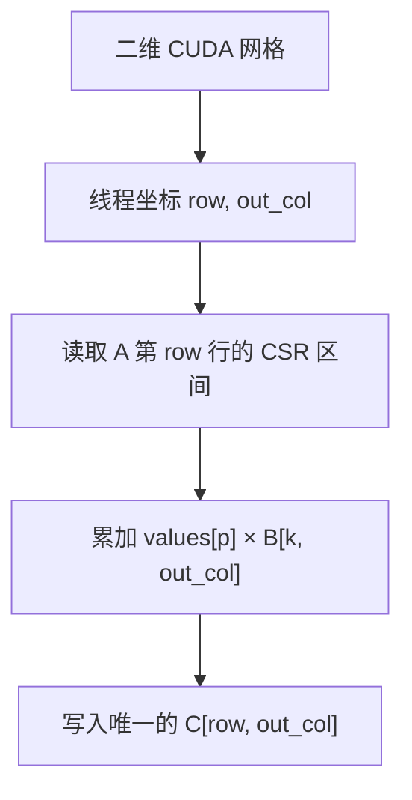
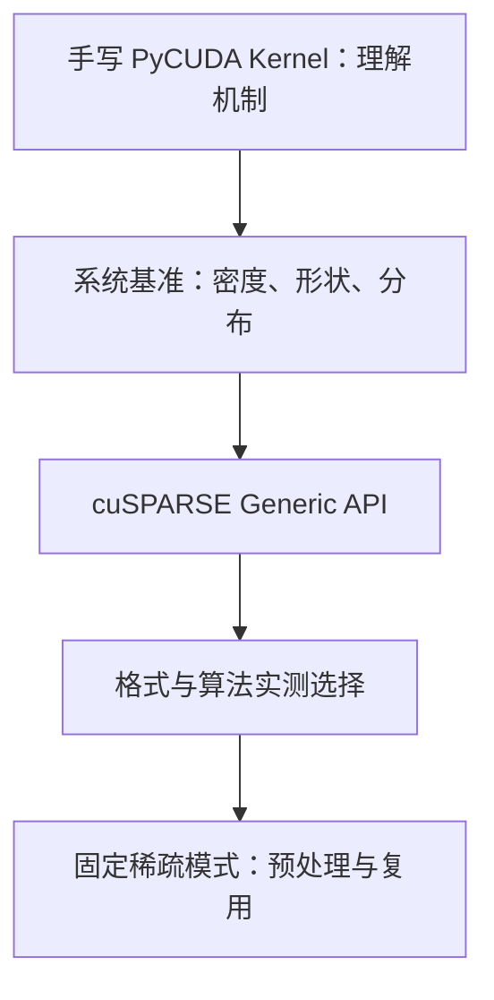

<!-- mode: light-tech -->

# 别再搬运那些零：从 CSR 到 CUDA SpMM，拆开稀疏矩阵乘法

> **副标题**：三个数组怎样替代一整张矩阵，一个 warp 又怎样把它重新算回来？
>
> 工程深度：L2 ｜ 验证状态：未实测 ｜ 预计阅读：22 分钟

---

## 一块几乎全是零的矩阵，为什么还要完整搬上 GPU？

假设有一张 (1024\times1024) 的 `float32` 矩阵，其中只有 1% 的元素非零。

按稠密矩阵保存，它仍要占用：

$$1024\times1024\times4\ \text{bytes}=4\ \text{MiB}$$

其中约 99% 的空间，只是在认真保存数字 `0`。计算时情况也类似：如果仍按普通矩阵乘法逐项读取和相乘，GPU 会把大量显存带宽和指令花在“零乘任何数仍是零”这件早已知道的事上。

稀疏计算的第一原则并不神秘：

> **既然零不贡献结果，就不要存它，也不要算它。**

> **工程深度｜验证状态：** L2 工程｜静态复核 + CPU 对比验证（GPU 性能需上机实测）
这正是 CSR（Compressed Sparse Row，压缩稀疏行）格式的出发点，也是本文 PyCUDA 代码想演示的核心。

先把两个词一次性钉死，后文所有数字都对齐这一套口径：

- **密度（density）** = 非零元素数占全部元素的比例，(density=\dfrac{nnz}{m\times k})；
- **稀疏度（sparsity）** = 1 − 密度，也就是“零占了多少比例”。

于是「1% 的元素非零」= 密度 1% = 稀疏度 99%；70%～99.9% 的“稀疏度”对应 30%～0.1% 的“密度”。下文的 crossover 讨论、Benchmark 分层和 FLOPs 公式都在这一套定义上说话。

但先给热情降一点温：**矩阵稀疏，不代表放到 GPU 上就一定更快。** 稀疏计算省掉了零，却引入了索引、间接寻址、负载不均和不规则访存。NVIDIA 当前 cuSPARSE 文档把主要目标描述为约 70%～99.9% 的稀疏度范围，但这不是性能承诺；真正的分界点仍取决于矩阵形状、非零分布、数据类型、GPU、输出宽度和复用次数。[NVIDIA cuSPARSE 文档](https://docs.nvidia.com/cuda/cusparse/index.html)

---

## 先判断：这篇适合你吗？

适合。它填补的是一个很具体的认知断层：

很多 CUDA 入门材料从向量加法直接跳到稠密矩阵乘法；很多稀疏计算资料又直接进入 cuSPARSE API。中间少了一座桥：**稀疏格式怎样改变内存布局，又怎样反过来决定线程布局。**

这篇文章适合三类读者：

- 已经会写基础 CUDA Kernel，想理解“不规则并行”的开发者；
- 正在接触图计算、推荐系统、科学计算或稀疏神经网络的工程师；
- 会使用 SciPy、PyTorch 或 cuSPARSE，但希望看懂库函数底层大致在解决什么问题的人。

它不试图用一个教学 Kernel 取代 cuSPARSE，而是回答三个更基础的问题：

1. CSR 的三个数组到底怎样还原一张矩阵？
2. 当前代码究竟是 SpMV、SpMM，还是稀疏矩阵之间的乘法？
3. 为什么“少算了很多零”之后，性能仍可能输给高度优化的稠密计算？

---

## 一、稀疏不是一种格式，而是一种代价交换

“稀疏矩阵”只描述了一个事实：大量元素为零。它没有规定这些非零元素该怎样保存。

常见格式的差异，本质上是在交换三种成本：

- 索引要占多少空间；
- 目标运算按行还是按列访问；
- GPU 线程能否得到规则、连续、负载接近的工作。

| 格式 | 核心表示 | 更适合什么 | 主要代价 |
|---|---|---|---|
| COO | `row + col + values` | 构造、追加、格式转换 | 每个非零元素都保存行列坐标 |
| CSR | `row_ptr + col + values` | 按行遍历、SpMV、SpMM | 按列切片和动态插入不友好 |
| CSC | `col_ptr + row + values` | 按列遍历、列切片 | 按行访问不如 CSR 直接 |
| BSR | 以非零小块为单位压缩 | 非零元素天然成块 | 块内零值也可能被保存 |
| SELL | 分片后按片内最长行补齐 | 每行 NNZ 差异较小的矩阵 | 需要 padding，分布不合适会浪费 |
| Blocked-ELL | 固定块结构与每行块槽位 | 规则块稀疏、特定 SpMM 路线 | 规则性换来 padding 和格式约束 |

当前 cuSPARSE 文档列出了 CSR、CSC、COO、BSR、SELL 和 Blocked-ELL 等格式，并指出 SELL 通过切片与列主序片内布局改善低行长波动场景的访存；格式不是标签，而是算法的一部分。[cuSPARSE Storage Formats](https://docs.nvidia.com/cuda/cusparse/index.html#cusparse-storage-formats)

本文选择 CSR，不是因为它永远最快，而是因为它最适合解释“按行取出非零元素，再和稠密矩阵相乘”这条路径。

---

## 二、CSR 的三个数组，怎样装下一整张矩阵？

先看一个 (4\times5) 的矩阵：

```text
A =
┌               ┐
│ 0  7  0  0  2 │
│ 0  0  0  0  0 │
│ 3  0  0  8  0 │
│ 0  0  5  0  0 │
└               ┘
```

CSR 不保存零，只留下三个数组：

```text
values         = [7, 2, 3, 8, 5]
column_indices = [1, 4, 0, 3, 2]
row_pointers   = [0, 2, 2, 4, 5]
```

前两个数组容易理解：`values[p]` 是第 (p) 个非零值，`column_indices[p]` 是它所在的列。

真正把数据组织成“行”的，是 `row_pointers`：

```text
第0行 → [row_pointers[0], row_pointers[1]) = [0, 2)
第1行 → [row_pointers[1], row_pointers[2]) = [2, 2)  ← 空行
第2行 → [row_pointers[2], row_pointers[3]) = [2, 4)
第3行 → [row_pointers[3], row_pointers[4]) = [4, 5)
```

所以 `row_pointers` 的长度永远是“行数 + 1”。最后一个元素等于 NNZ（Number of Non-Zeros，非零元素总数）。SciPy 所称的规范 CSR 还要求每行列索引有序、没有重复项；本文生成代码也遵守这两点。[SciPy `csr_matrix` 文档](https://docs.scipy.org/doc/scipy/reference/generated/scipy.sparse.csr_matrix.html)

### 它到底省了多少空间？

设矩阵 $A$ 的形状为 $m\times k$，非零元素数为 $nnz$。若值和索引都使用 32 位类型：

$$M_{dense}=4mk$$

$$M_{CSR}=4nnz+4nnz+4(m+1)$$

也就是：每个非零元素保存 4 字节数值和 4 字节列索引，每一行再分摊一个行指针。

忽略较小的行指针项，CSR 仅从存储容量看，大约要在密度低于 50% 时才开始比 `float32` 稠密存储省空间。但“省空间”和“算得快”是两道题：索引读取、间接访问和负载不均通常要求矩阵更稀疏，GPU 稀疏计算才更有机会获胜。

---

## 三、先把名字钉死：代码算的是 SpMM，不是 SpMV

稀疏乘法里，缩写只差一个字母，输出维度却完全不同。

| 名称 | 计算 | 输出 | 典型场景 |
|---|---|---|---|
| SpMV | 稀疏矩阵 × 稠密向量 | 向量 | 迭代求解器、PageRank |
| SpMM | 稀疏矩阵 × 稠密矩阵 | 稠密矩阵 | 图神经网络、批量特征传播 |
| SpGEMM | 稀疏矩阵 × 稀疏矩阵 | 稀疏矩阵 | 图算法、符号计算 |

本文代码的维度是：

$$A_{m\times k}\times B_{k\times n}=C_{m\times n}$$

因此它是 **SpMM**。

> **退化注：** 当输出宽度 (n=1) 时，(B) 从 (k\times n) 窄化为 (k\times1) 向量，(C) 也随之变成 (m\times1) 向量。此时你写的这个 Kernel 做的事情，数学上和 **SpMV**（稀疏矩阵乘向量）完全一致，只是代码没看到向量就专门少跑一遍。这就是为什么 cuSPARSE 把 `cusparseSpMM()` 和 SpMV 路线分开建模：对 `n==1` 的单列输出，重新走上已高度优化的 SpMV 路径往往更划算，而不是让一个专门为多列复用而设计的 SpMM Kernel 退到带宽受限的窄输出。本文主要讨论 (n>1) 的多列情形。

对输出元素 (C_{ij})，不再遍历 (A) 第 (i) 行的全部 (k) 个位置，而只遍历这一行实际存在的非零元素：

$$C_{ij}=\sum_{p=row\_ptr[i]}^{row\_ptr[i+1]-1} values[p]\cdot B_{col[p],j}$$

这条公式就是 CUDA Kernel 的全部骨架。

特别需要纠正参考材料中的一句话：**本文代码不是“一个线程负责一个非零元素，再把贡献累加到输出”。** 那种设计通常需要归约或原子操作。本文采用的是：

> **一个线程负责一个输出元素 (C[row, out\_col])，由它独立遍历这一行的全部非零元素。**

这也解释了为什么代码不需要 `atomicAdd`：没有两个线程写同一个输出地址。

---

## 四、线程怎样铺到输出矩阵上？

代码使用二维线程网格：x 方向覆盖输出列，y 方向覆盖稀疏矩阵行。



对应的索引只有两行：

```cpp
const int out_col = blockIdx.x * blockDim.x + threadIdx.x;
const int row     = blockIdx.y * blockDim.y + threadIdx.y;
```

线程块配置为：

```python
block = (32, 8, 1)
```

一个块共有 (32\times8=256) 个线程。这里让 x 维等于一个 warp 的 32 个线程，是有意为之：一个 warp 会处理同一输出行的连续 32 列。

当它们执行：

```cpp
B[k * out_cols + out_col]
```

同一时刻的 `k` 相同，`out_col` 连续，于是 32 个线程读取 `B` 同一行的连续位置。这比让相邻线程跳到互不相干的地址，更有利于形成合并的全局内存访问。

```text
一个 warp：thread 0  1  2  3 ... 31
输出列：      j  j+1 j+2 j+3 ... j+31
读取 B：    B[k,j] ... 连续的 32 个元素
```

这里有一个容易忽略的细节：`values[p]` 和 `column_indices[p]` 会被同一 warp 的 32 个线程重复读取。硬件缓存和 warp 级广播可能缓解流量，但教学代码没有显式把它们搬入共享内存或用 warp 协作重构计算。这正是它和生产级实现之间的距离之一。

---

## 五、核心 Kernel：短，但每一行都在决定性能

```cpp
__global__ void csr_spmm(
    const float *__restrict__ values,
    const int   *__restrict__ column_indices,
    const int   *__restrict__ row_pointers,
    const float *__restrict__ B,
    float       *__restrict__ C,
    const int num_rows,
    const int out_cols)
{
    const int out_col = blockIdx.x * blockDim.x + threadIdx.x;
    const int row = blockIdx.y * blockDim.y + threadIdx.y;

    if (row >= num_rows || out_col >= out_cols) {
        return;
    }

    float sum = 0.0f;
    const int begin = row_pointers[row];
    const int end = row_pointers[row + 1];

    for (int p = begin; p < end; ++p) {
        const int k = column_indices[p];
        sum += values[p] * B[k * out_cols + out_col];
    }

    C[row * out_cols + out_col] = sum;
}
```

从正确性看，它完成了三件事：

1. 用 `row_pointers` 找到当前行的非零区间；
2. 用 `column_indices` 把非零值映射到 `B` 的对应行；
3. 用行主序公式定位 `B[k, out_col]` 和 `C[row, out_col]`。

从性能看，它也暴露了稀疏计算最典型的三个难题。

### 1. 行长不等，线程工作量就不等

如果某些行只有 2 个非零元素，另一些行有 2000 个，那么负责短行的 warp 很快结束，负责长行的 warp 仍在循环。GPU 看起来启动了很多线程，真正并行推进的工作却不均匀。

### 2. A 连续，B 不一定连续

CSR 能让当前行的 `values` 和 `column_indices` 连续，但 `k=column_indices[p]` 决定了下一次读取 `B` 的哪一行。不同 `k` 之间可能相距很远，因此跨循环迭代的局部性不稳定。

### 3. 算术强度可能很低

每次乘加之前，至少要读取一个值、一个列索引和一个 `B` 元素。很多非结构化稀疏 Kernel 更容易受显存带宽和访问效率限制，而不是先撞到 GPU 的浮点峰值。

所以，稀疏计算不是把 dense GEMM 中的零跳过就结束了；真正困难的是：**如何让不规则数据仍然喂得饱规则执行的 GPU。**

---

## 六、代码里三个很重要、却容易被忽略的工程细节

### 1. CSR 生成必须让行指针与数据分段一致

生成代码先为每一行采样 NNZ，再做前缀和：

```python
nnz_per_row = rng.binomial(num_cols, density, size=num_rows).astype(np.int32)
row_pointers[0] = 0
np.cumsum(nnz_per_row, dtype=np.int32, out=row_pointers[1:])
```

之后逐行填充对应区间，并用 `replace=False` 避免同一行出现重复列。这样生成的 `values`、`column_indices` 和 `row_pointers` 才描述同一张矩阵。

### 2. 输出只需要分配，不需要先上传零

错误但常见的写法是：

```python
C_gpu = cuda.to_device(np.zeros(...))
```

本 Kernel 会覆盖每个合法输出元素，因此只需：

```python
C_gpu = cuda.mem_alloc(C_gpu_result.nbytes)
```

这省掉了一次没有计算意义的 Host-to-Device 传输。

### 3. `DeviceAllocation` 不能调用 `.get()`

`cuda.to_device()` 和 `cuda.mem_alloc()` 返回底层设备内存对象，不是 `pycuda.gpuarray.GPUArray`。结果回传应使用：

```python
cuda.memcpy_dtoh(C_gpu_result, C_gpu)
```

对象模型看似是 Python 细节，落到 CUDA 上却直接决定程序能否运行。

---

## 七、计时：不要把编译、传输和内核混成一个数字

GPU 调用通常相对主机异步。如果用普通 CPU 时钟包住一次 Kernel 调用，却没有同步，很可能只测到“发出任务”花了多久。

本文代码先预热，再用 CUDA Event 测量设备时间：

```python
csr_spmm(*kernel_args, block=block, grid=grid)
cuda.Context.synchronize()

start_event.record()
csr_spmm(*kernel_args, block=block, grid=grid)
end_event.record()
end_event.synchronize()
kernel_ms = start_event.time_till(end_event)
```

一次可信的性能报告至少应拆开四个口径：

| 口径 | 包含什么 | 回答的问题 |
|---|---|---|
| Kernel time | 仅设备端计算 | 内核本身有多快？ |
| H2D / D2H | 输入上传与结果回传 | PCIe/NVLink 传输代价多大？ |
| End-to-end | 准备、传输、计算、回传 | 应用实际等待多久？ |
| Amortized | 数据常驻 GPU、多次复用后的均摊 | 长期运行是否值得？ |

还要避免一个没有意义的结论：“GPU 比 SciPy 快，所以 Kernel 优秀。”更公平的基线至少包括：

- SciPy CPU CSR × Dense；
- 同尺寸、同数据类型的稠密 GEMM；
- cuSPARSE `cusparseSpMM()`；
- 多组密度、矩阵形状和每行 NNZ 分布；
- 预热后的多次重复与中位数/分位数，而不是单次结果。

公平还意味着让双方站在**同一种计算口径**上。稠密和稀疏可以做到 FLOPs 严格同口径：

$$
\begin{aligned}
F_{\text{dense}} &= 2mkn\\[2pt]
F_{\text{spmm}} &\approx 2\cdot nnz\cdot n = 2mnk\cdot density
\end{aligned}
$$

`F_dense` 是所有元素都按乘加计算的稠密 GEMM 工作量；`F_spmm` 只算非零那部分。若密度为 1%，稀疏乘法的 FLOPs 大约只有稠密的 1%——但代价是每个乘加都要额外搬运列索引和间接寻址。所以「GPU 比 SciPy 稠密快」与「kernel 优秀」是两回事：**FLOPs 同口径、同矩阵时才公平**，而不是在「GPU 算得少」这个预设前提上去比谁快。

---

## 八、正确性验证：浮点数不要用 `==`

代码用同一组 CSR 数据构造 SciPy 矩阵：

```python
A_cpu = csr_matrix(
    (values, column_indices, row_pointers),
    shape=(rows, inner),
)
C_cpu = np.asarray(A_cpu @ B, dtype=np.float32)
```

然后使用容差比较：

```python
is_correct = np.allclose(
    C_gpu_result,
    C_cpu,
    rtol=1e-4,
    atol=1e-5,
)
```

CPU 与 GPU 可能采用不同的加法顺序，而浮点加法不满足严格结合律，所以结果可能在末位有差异。正确的验证不是要求逐位完全相同，而是根据数据类型、数值范围和问题条件数设定合理误差。

但 `allclose` 也不是万能保险：如果结果中可能出现 NaN，应额外检查；如果规模很大，除最大绝对误差外，还可以报告相对 (L_2) 误差，并用小矩阵做逐项单元测试。

---

## 九、什么时候应该停止手写，转向 cuSPARSE？

教学 Kernel 的价值是把机制照亮；生产库的价值是处理你不想重新踩一遍的性能与兼容性问题。

当前 cuSPARSE Generic API 支持矩阵描述符、32/64 位索引、多种数据类型、算法选择和外部工作区。`cusparseSpMM()` 计算的标准形式是：

$$C=\alpha\,op(A)\,op(B)+\beta C$$

其 SpMM 路径支持 COO、CSR、CSC、BSR 和 Blocked-ELL 等格式。对于行主序稠密矩阵，当前文档提示 CSR ALG2 通常是更匹配的选择；如果需要确定性结果，则要检查具体算法，例如 CSR ALG3 的适用约束。算法特性会随 CUDA 版本演进，工程中应以目标环境的文档和实测为准。[cuSPARSE `cusparseSpMM()`](https://docs.nvidia.com/cuda/cusparse/index.html#cusparse-generic-function-spmm)

如果同一种稀疏结构会被重复使用，`cusparseSpMM_preprocess()` 还可以为部分 CSR 算法预处理稀疏模式，加速后续调用；关键是“索引结构保持不变”，数值本身可以变化。这对固定图拓扑上的多轮特征传播、固定有限元网格上的重复迭代尤其有意义。[cuSPARSE SpMM preprocessing](https://docs.nvidia.com/cuda/cusparse/index.html#cusparse-generic-function-spmm)

可以把升级路线理解成：



手写仍然有价值的场景包括：

- 稀疏乘法前后能与业务算子融合，减少中间结果；
- 数据结构有强领域特征，通用库无法表达；
- 需要研究新的负载均衡、分块或调度策略；
- 教学、验证和性能模型研究。

除此之外，优先从 cuSPARSE 起步，通常更符合工程经济性。

---

## 十、前沿稀疏计算：非结构化 CSR 之外，还有另一条路

本文讨论的是**非结构化稀疏**：非零元素可以出现在任意位置，CSR 用索引记录它们。

另一条路线是**结构化稀疏**：零出现在哪里受到规则约束。规则牺牲一部分自由度，却让硬件更容易加速。

NVIDIA cuSPARSELt 面向至少一个操作数具有固定 50% 稀疏率的结构化稀疏矩阵乘法，支持 Sparse MMA、混合精度、剪枝与压缩、自动调优以及融合 bias/activation 等尾处理。它和普通 CSR SpMM 不是同一个接口的“更快版本”，而是数据约束、硬件路径和适用工作负载都不同的一套方案。[NVIDIA cuSPARSELt 文档](https://docs.nvidia.com/cuda/cusparselt/index.html)

| 路线 | 稀疏位置 | 优势 | 代价 |
|---|---|---|---|
| CSR 非结构化稀疏 | 任意 | 表达能力强，适合天然稀疏数据 | 索引与不规则访存成本高 |
| BSR/Blocked-ELL 块稀疏 | 以块为单位 | 更规则，更容易提高吞吐 | 块内可能含零，需匹配块结构 |
| cuSPARSELt 结构化稀疏 | 受硬件规则约束 | 可利用专门 Sparse MMA 路径 | 需要剪枝、压缩与精度评估 |

这也是稀疏计算正在发生的变化：优化目标已经不只是“压缩得更小”，而是让**模型结构、存储格式、库算法和硬件执行单元共同设计**。

---

## 十一、三个必须撤回的过度承诺

### “只要稀疏，GPU 就会显著加速”

不成立。小矩阵可能被启动开销淹没；稀疏度不够时，索引成本可能超过省下的乘法；行长分布极不均匀时，大量线程会等待长行。

### “CUDA 稀疏乘法就是每个线程处理一个非零元素”

不成立。这只是众多映射策略之一。线程可以负责输出元素、行、行片段、非零块，也可以让一个 warp 或一个 CTA 协作处理一行。映射方式必须与输出宽度、行长分布和归约策略共同设计。

### “稀疏矩阵适合直接求逆”

通常不该这样表述。一个稀疏矩阵的逆可能是稠密的，显式求逆也往往不是求解 (Ax=b) 的首选。工程上更常用稀疏直接法或迭代法，并结合预条件器；cuSPARSE 提供的是一组稀疏线性代数原语，而不是“稀疏就能廉价求逆”的保证。

---

## 十二、下一步怎么优化这份代码？

建议按证据推进，而不是一上来堆共享内存。

### 第一阶段：把基准做对

- 密度从 50%、10%、1%、0.1% 分层测试；
- 分别生成均匀行长、长尾行长和块状非零分布；
- 改变 (m,k,n)，尤其关注输出列数 (n)；
- 分开报告 Kernel、传输和端到端时间；
- 用 Nsight Compute 确认带宽、缓存命中、warp stall 和负载不均。

### 第二阶段：针对瓶颈改映射

- 短行：考虑一个 warp 同时处理更多行；
- 长行：考虑一个 warp/线程块协作处理一行并归约；
- 重复读取：评估是否缓存当前行的 `values` 和索引；
- 行长差异大：尝试分桶，把相近长度的行交给同类 Kernel；
- 天然块结构：评估 BSR 或 Blocked-ELL，而不是坚持标量 CSR。

### 第三阶段：与生产库正面对比

- 对比 cuSPARSE 默认算法和显式算法；
- 固定稀疏模式时测试 `preprocess` 的收益；
- 检查行主序/列主序是否与算法匹配；
- 同时比较吞吐、端到端延迟、额外工作区和确定性要求。

最终目标不是证明“手写 Kernel 比库快”，而是回答：**这份数据的稀疏结构，最适合怎样被 GPU 看见？**

---

## 结语：GPU 不怕矩阵大，怕的是工作没有规律

CSR 做的第一件事，是把没有贡献的零从存储中拿走。

CUDA Kernel 做的第二件事，是把剩下的非零元素重新组织成大量并行任务。

真正困难的是第三件事：非零元素虽然少了，它们却不再整齐。不同的行有不同长度，`B` 的访问由索引间接决定，线程的工作量也随数据变化。

所以稀疏矩阵优化的核心，不只是“少算”：

> **它是在更少的数据、更复杂的索引和更规则的 GPU 之间，重新寻找平衡。**

理解 `values`、`column_indices` 和 `row_pointers`，只是走进稀疏世界的第一步；理解线程怎样被数据形状牵着走，才是真正开始理解 CUDA 稀疏计算。

---

## 附录 A：代码运行环境与验证清单

建议环境：

```text
Python 3.10+
NumPy
SciPy
PyCUDA
CUDA Toolkit（包含 NVCC）
NVIDIA Driver
```

运行前检查：

- `nvidia-smi` 能识别 GPU；
- `nvcc --version` 能找到 CUDA 编译器；
- PyCUDA 能创建上下文；
- NumPy 数组为 `float32` / `int32` 且采用连续 C-order；
- GPU 与 SciPy 结果通过容差验证；
- 性能数字注明 GPU、CUDA、PyCUDA、矩阵形状、密度与统计方法。

配套完整代码：`pycuda_csr_spmm_optimized.py`。

---

## 附录 B：核心资料

1. [NVIDIA cuSPARSE 13.4 Documentation](https://docs.nvidia.com/cuda/cusparse/index.html)
2. [NVIDIA cuSPARSE Storage Formats](https://docs.nvidia.com/cuda/cusparse/index.html#cusparse-storage-formats)
3. [NVIDIA `cusparseSpMM()` Generic API](https://docs.nvidia.com/cuda/cusparse/index.html#cusparse-generic-function-spmm)
4. [NVIDIA cuSPARSELt Documentation](https://docs.nvidia.com/cuda/cusparselt/index.html)
5. [NVIDIA CUDA Programming Guide](https://docs.nvidia.com/cuda/cuda-programming-guide/index.html)
6. [SciPy `csr_matrix` Documentation](https://docs.scipy.org/doc/scipy/reference/generated/scipy.sparse.csr_matrix.html)

> 文档核对时间：2026 年 9 月。库接口、算法枚举和硬件支持范围可能随版本变化，生产环境请以目标 CUDA Toolkit 对应文档为准。
