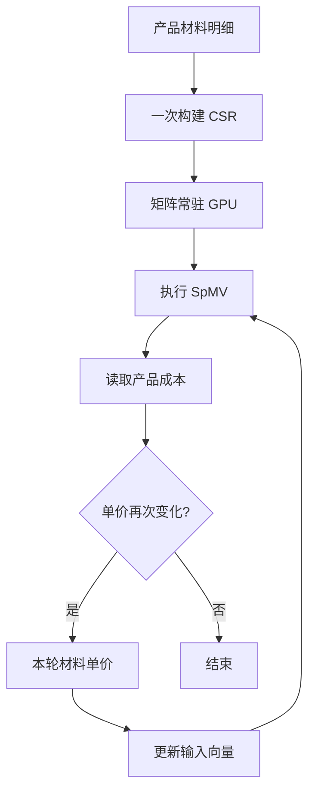

# 99.99% 都是零：40 GB 的矩阵，如何用 8.4 MB 存下？从 CSR 到 CUDA，讲透稀疏矩阵存储与计算

> **工程深度｜验证状态：** L2 工程｜静态复核 + CPU 对比验证（GPU 性能需上机实测）

> 十万行、十万列，听起来需要一大块内存。但如果每行平均只有十个位置有值，真正值得保存的数据并不多。难点在于：删掉那些零以后，怎样知道每个数原来在哪里？GPU 又怎样顺着这些线索算出答案？

## 01｜材料价格变了，十万种产品的成本都要重算

设想你在维护一家制造企业的成本系统。

系统里有十万种产品，也有十万种可能使用的材料。每次供应商调整价格，系统都要重新计算产品的材料成本。

最直观的表示方法，是建一张用量表：每行一种产品，每列一种材料，单元格记录材料用量。

这张表有多大？

$$
100000\times100000=10^{10}
$$

一百亿个单元格。如果每个数用 4 字节的 `float32` 保存，仅数值就需要 **40 GB**。

但每种产品平均只使用十种材料。绝大多数格子都是零：不是价格未知，而是根本不用这种材料。

我们为“没有使用”这件事，重复存了一百亿次左右的说明。

换一种表示：每个产品只记“用了哪种材料、用了多少”，再附上一份能找到各产品记录的目录。需要保留的材料用量就只有约一百万条。

**这就是稀疏存储的出发点：省去零值，同时留下找回位置的线索。**

对一张 99.99% 的位置为零、采用 `float32` 存储的十万阶矩阵，CSR 的三个数组预计只需约 8.4 MB。它保留原有数值，省去的是零值及其重复占位。**40 GB 是同一矩阵采用稠密格式时的理论空间；程序不会先申请这 40 GB，再进行压缩。**

本文用这个教学场景讲清 CSR 存储、CUDA SpMV 和性能测试。它是数值计算示例；真实财务计价还需要根据业务要求选择定点或十进制精度。

## 02｜先用三种产品，把数学算明白

先别急着启动 GPU。把大表缩成三种产品、四种材料：

| 产品 | 材料 0 | 材料 1 | 材料 2 | 材料 3 |
|---|---:|---:|---:|---:|
| 产品 0 | 5 | 0 | 8 | 0 |
| 产品 1 | 0 | 0 | 0 | 0 |
| 产品 2 | 0 | 3 | 0 | 7 |

材料单价为：

```python
x = [1, 2, 3, 4]
```

产品 0 使用 5 份材料 0、8 份材料 2，成本就是：

$$
5\times1+8\times3=29
$$

产品 1 暂无材料用量，成本为 0；产品 2 的成本为：

$$
3\times2+7\times4=34
$$

合起来：

$$
y=Ax=
\begin{bmatrix}
5&0&8&0\\
0&0&0&0\\
0&3&0&7
\end{bmatrix}
\begin{bmatrix}1\\2\\3\\4\end{bmatrix}
=
\begin{bmatrix}29\\0\\34\end{bmatrix}
$$

这就是矩阵—向量乘法。矩阵稀疏时，通常简称 **SpMV**，即 Sparse Matrix-Vector Multiplication。

一般形式为：

$$
y_i=\sum_{j=0}^{n-1}A_{i,j}x_j
$$

公式里的对应关系很具体：**材料 j 的用量，乘材料 j 的单价。** 所以矩阵有多少列，输入向量就必须有多少个分量，而且排列含义必须一致。

`x` 的数值由业务提供。代码中用随机数生成它，只是为了构造测试输入。

## 03｜CSR 的三个数组：值、列号、行目录

CSR 是 Compressed Sparse Row，按行压缩存储。它不依赖 CUDA：CPU 和 GPU 都可以使用这种表示。

上面的矩阵可以写成：

```python
data    = [5, 8, 3, 7]       # 按行保存的非零值。
col_ind = [0, 2, 1, 3]       # 每个值原来的列号。
row_ptr = [0, 2, 2, 4]       # 各行的起止边界。
```

前两个数组成对读取：值 5 在第 0 列，值 8 在第 2 列，依此类推。

真正容易卡住的是第三个数组。

### `row_ptr` 记录的不是列号

第 `i` 行的数据范围是：

```python
start = row_ptr[i]
end = row_ptr[i + 1]

# 左边包含，右边不包含。
row_values = data[start:end]
row_columns = col_ind[start:end]
```

逐行展开：

| 行号 | 起止区间 | 数值 | 列号 |
|---|---|---|---|
| 0 | `[0, 2)` | `[5, 8]` | `[0, 2]` |
| 1 | `[2, 2)` | `[]` | `[]` |
| 2 | `[2, 4)` | `[3, 7]` | `[1, 3]` |

可以把 `row_ptr[i]` 理解成：**第 i 行之前，已经存了多少条记录。**

因此，采用从零开始索引的本例中：

```python
row_ptr[0] = 0           # 第一行之前没有记录。
row_ptr[-1] = len(data)  # 所有行结束后，正好是总记录数。
```

有 `m` 行，就需要 `m + 1` 个边界。最后多出来的一项，是为了知道最后一行在哪里结束。

### 全零行没有消失

第 1 行的起点和终点都是 2，表示这里没有数据。它仍然占有一个行位置，输出向量中也仍然有 `y[1]`。

因此：

```python
y = np.empty(row_ptr.size - 1, dtype=np.float32)
```

包含所有行。`np.empty` 只分配空间，不初始化为零；计算时必须覆盖每一个输出位置。后面的核函数会把空行写成 0。

严格地说，CSR 也可以存储显式零值；本文生成的数据没有显式零，所以存储条目数与非零元素数相同，记为 `nnz`。

### 列号为什么要排序？

随机选择的列号可能是：

```python
cols = np.array([3, 0, 2])
cols.sort()  # 得到 [0, 2, 3]。
```

SciPy 所说的规范 CSR，要求行内列号有序且没有重复。[1] 本例用无放回采样避免重复，再通过排序保证有序。

SpMV 的数学计算并不要求列号一定有序；排序有利于规范化和某些后续操作，却不能保证每次都加速。

还要注意：如果数值与列号已经绑定，必须同步重排。本文先排序列号，再生成随机数值，不会破坏已有对应关系。

## 04｜40 GB 为什么变成了约 8.4 MB？

回到十万行、十万列，每行平均十个非零值的场景。

非零密度为：

$$
d=\frac{10}{100000}=0.0001=0.01\%
$$

也就是约 99.99% 的位置为零。本文把 `density` 统一称为**非零密度**，避免与零元素比例混淆。

对于 float32 数值与 int32 索引：

$$
S_{\text{dense}}=4mn
$$

$$
S_{\text{CSR}}=4\,\mathrm{nnz}+4\,\mathrm{nnz}+4(m+1)
$$

三项依次是数值、列索引、行指针。

| 数据 | 条目数 | 预计空间 |
|---|---:|---:|
| 稠密数值 | 100 亿 | 40 GB |
| CSR 数值 | 约 100 万 | 4 MB |
| CSR 列索引 | 约 100 万 | 4 MB |
| CSR 行指针 | 100001 | 约 0.4 MB |
| CSR 合计 | — | **约 8.4 MB** |

表中使用十进制 GB/MB，只计算矩阵存储，不含输入、输出、构造临时数组和 GPU 副本。代码按 MiB 打印，因此显示数值会略有不同。

这个估算还揭示一个常被忽略的事实：**CSR 保存一个非零值，通常还要为它保存一个列索引。**

本例中，一个非零值连同列号要 8 字节。忽略行指针开销时，非零比例低于约 50%，CSR 才比 float32 稠密存储更省空间。若改用更小的数值类型或更大的索引类型，界限也会变化。

这是存储空间的粗略分界，不能当作性能加速的分界。

## 05｜把十万行分给 GPU，每个线程负责一行

CPU 可以从第一行算到最后一行。GPU 的基础做法是让很多线程同时工作：每个线程领取一行，算完写入自己的结果位置。

在 CUDA 核心循环之前，先用这个 3×4 小例子，把 `row_ptr`、`k`、`col_ind[k]` 和 `x[col_ind[k]]` 对应起来看清楚：

| 所属行 | 存储位置 `k` | 数值 `data[k]` | 原列号 `col_ind[k]` | 取出的输入 | 本次乘积 |
|---|---:|---:|---:|---|---:|
| 0 | 0 | 5 | 0 | `x[0]=1` | 5 |
| 0 | 1 | 8 | 2 | `x[2]=3` | 24 |
| 1 | 无 | 无 | 无 | 不读取 | 输出 0 |
| 2 | 2 | 3 | 1 | `x[1]=2` | 6 |
| 2 | 3 | 7 | 3 | `x[3]=4` | 28 |

总结：**`row_ptr` 决定取哪些记录，`col_ind` 决定去哪里取单价，`data` 提供材料用量。**

```python
@cuda.jit
def csr_spmv_kernel(row_ptr, col_ind, data, x, y):
    row = cuda.grid(1)  # 当前线程对应的全局行号。

    if row < y.size:   # 最后一个线程块可能存在多余线程。
        acc = np.float32(0.0)

        for k in range(row_ptr[row], row_ptr[row + 1]):
            acc += data[k] * x[col_ind[k]]

        y[row] = acc   # 空行循环不执行，也会写入 0。
```

核心只有这句：

```python
acc += data[k] * x[col_ind[k]]
```

以第 0 行的第二条记录为例：

```python
k = 1

data[k]          # 8：材料用量。
col_ind[k]       # 2：材料编号。
x[col_ind[k]]    # x[2] = 3：该材料的单价。

# 本次贡献为 8 × 3 = 24。
```

**`k` 是压缩数组的位置，`col_ind[k]` 才是原矩阵的列号。** 如果写成 `x[k]`，就把存储位置错当成了材料编号。

各线程拥有独立的累加器，分别写入不同的 `y[row]`，所以这里不需要原子加法，也不需要在线程之间共享归约结果。

若每个线程块有 256 个线程，网格大小为：

```python
threads = 256
blocks = (n_rows + threads - 1) // threads
```

十万行需要 391 个线程块，共启动 100096 个线程。多出的 96 个线程被越界检查挡住。

这里的并行发生在不同行之间；**单个线程仍然按顺序遍历自己负责的那一行。** 包含空行写回后，总工作量为 `O(n_rows + nnz)`。

## 06｜别为了构造稀疏矩阵，先申请一个稠密矩阵

下面这类写法很直观，却会先消耗巨量内存：

```python
# 大规模下不要这样生成测试矩阵。
dense = np.random.rand(n_rows, n_cols).astype(np.float32)
```

`np.random.rand` 首先产生 float64 数组。十万阶方阵仅这个数组就约 80 GB，类型转换还会产生额外空间需求。

正确的思路是直接生成 CSR：先决定每行有多少条记录，再生成这些记录的列号与数值。

```python
# 每行非零条目数；实际总数会围绕期望值波动。
counts = rng.binomial(n_cols, density, size=n_rows)

# 先用 int64 求前缀和，避免 int32 累计溢出。
row_ptr64 = np.empty(n_rows + 1, dtype=np.int64)
row_ptr64[0] = 0
np.cumsum(counts, dtype=np.int64, out=row_ptr64[1:])
```

随后逐行无放回抽取列号，再独立生成数值。这里“位置”和“数值”要独立：如果用随机数小于 `density` 作为筛选条件，又直接保留那些随机数作为值，数值范围也会被意外限制到 `[0, density)`。

本文这种逐行生成法主要控制内存，Python 逐行循环本身仍可能耗时。生成时间应该单独记录，不能混入 SpMV 核函数耗时。

还需检查 `nnz` 是否超过 int32 可表示范围；不能简单强制转换后继续运行。真实数据可由材料明细表等来源构建，通常不需要生成随机大矩阵。

## 07｜跑得快之前，先证明算得对

用 SciPy 根据同一组 CSR 数据创建独立参考：

```python
matrix = csr_matrix(
    (data, col_ind, row_ptr),
    shape=(n_rows, n_cols),
)

reference = matrix.astype(np.float64) @ x.astype(np.float64)
```

这不会展开为稠密矩阵。显式提供 `shape`，还能保留末尾全零列等不能仅靠最大列索引推断的信息。

CPU 与 GPU 分别对照这个 float64 参考：

```python
np.testing.assert_allclose(
    result,
    reference,
    rtol=1e-4,
    atol=1e-6,
)
```

它检查的是近似条件：

$$
|\mathrm{result}-\mathrm{reference}|
\le \mathrm{atol}+\mathrm{rtol}\,|\mathrm{reference}|
$$

这叫“在指定容差内一致”，不是逐位完全相等。乘加融合与求和顺序等因素都可能影响舍入结果。

本文使用正值随机数据。更长的行、正负项强烈抵消的情况，应重新评估容差，必要时提高累加精度。真实输入还应校验行指针单调、末指针与数据长度一致，以及列索引没有越界。

## 08｜GPU 加速比，最容易在计时里算错

### 先预热：把首次编译与计算分开

CPU 函数使用 `@njit`，首次调用可能要编译；CUDA 核函数首次运行也可能涉及编译、加载等准备工作。

```python
csr_spmv_cpu(row_ptr, col_ind, data, x, y_cpu)

csr_spmv_kernel[blocks, threads](
    d_row_ptr, d_col_ind, d_data, d_x, d_y
)
cuda.synchronize()
```

先运行，再正式测量，得到的是重复执行时的表现。冷启动延迟同样有价值，但应单独报告。

### 再同步：提交任务不等于任务完成

GPU 核函数通常异步启动。CPU 很快返回，并不能说明 GPU 已算完。

设备时间可使用 CUDA Event，并在结束事件完成后读取耗时；Numba CUDA 提供相应事件与同步接口。[2] 附录按一批连续启动计算平均时间，这个区间可能包含启动之间的空隙。

### 最后分清：你测的是哪一种耗时？

| 口径 | 包含什么 | 回答什么问题 |
|---|---|---|
| GPU 数据驻留时平均计算耗时 | 观察核函数计算阶段，数据已在设备上 |
| GPU 价格更新模式 | `x` 上传、计算、`y` 下载 | **最贴合场景**：配方（CSR）常驻 GPU，仅单价更新 |
| GPU 完整往返 | CSR 与 `x` 上传、`y` 下载 | 对应每次矩阵也变化的场景 |

附录中的完整往返测试复用缓冲区，不包含每次重新申请显存；计时代码不混入随机数据生成和参考校验。若采用“价格更新”模式，需先准备好 `x` 测试向量，避免在计时循环内生成随机数。

对于“配方不变，仅单价变化”的业务循环，推荐将不变矩阵的 H2D 迁移到循环外，仅保留 `d_x.copy_to_device(x)` 和 `d_y.copy_to_host(y)`。附录已提供两种口径的示例，读者可按需扩展为价格更新模式。

本文没有真实 GPU 实测结果，因此不提供虚构的毫秒数和加速倍数。可复现的测试口径，比一个孤立的大数字更有价值。

## 09｜已经跳过了零，为什么还可能不快？

### 乘法变少了，找数据仍然要花时间

每次执行：

```python
data[k] * x[col_ind[k]]
```

都要读取数值、读取列号，再根据列号读取 `x`。

做一个简化估算：一个 float32 值 4 字节，一个 int32 列号 4 字节，一个 float32 输入分量 4 字节，对应一次乘法、一次加法，按惯例计为 2 FLOPs。

暂不考虑缓存复用、行指针和输出，约为：

$$
\frac{2}{12}\approx0.167\ \text{FLOP/byte}
$$

这只是**忽略缓存等因素的访问量示意**，不能当作硬件实测指标。缓存命中会减少流量，不规则访问又可能浪费内存事务。SpMV 经常更受访存带宽或延迟约束，不能仅凭 GPU 峰值算力预测收益。

### 每个线程领取的工作量可能不同

一行只有 2 项，另一行有 2000 项。如果每个线程负责一行，短行早早结束，长行还在累加。这些是**逻辑线程**，硬件会分批调度执行，并非十万行同时驻留在执行单元。同一 **warp**（CUDA 调度与执行的基本分组，通常包含 32 个线程）内的负载差异可能降低执行效率。

本文随机生成的行长度相对集中，**不能体现少数超长行造成的负载不均**；真实业务中的长尾分布可能会进一步拖慢整体。

### 按行连续，不等于线程之间访问连续

CSR 让单行数据连续。但相邻线程负责不同行，它们同时访问的地址不一定相邻。因此，“行优先存储”不能直接推导出“GPU 访存最优”。本文采用“一线程一行”的入门写法，重点在于说明 CSR 与索引，而非追求极限性能。

### 小任务还没算多久，调度与传输已经占了大头

任务很小时，核函数启动与传输开销可能超过节省的计算时间。更高的稀疏程度也不必然带来同比例加速：总工作变少后，固定开销会更加显眼。

**稀疏化减少了运算量，同时引入了索引与调度问题。哪一边占上风，要看具体数据。**

## 10｜真正值得先做的优化：矩阵别来回搬

回到材料成本系统：配方没有变化，只有单价更新。

这种情况下，CSR 矩阵可以只上传一次。后续每轮仅上传新的价格向量 `x`，计算后按需取回 `y`。



本例中，价格向量和结果向量分别只有约 0.4 MB，而 CSR 矩阵约 8.4 MB。避免反复上传不变的矩阵，有明确的数据量收益；它最终能省多少时间，仍应计时验证。

附录中的完整往返测试每次上传全部 CSR，用于展示该口径的成本。实现业务循环时，可以把不变矩阵的传输移到循环外，只保留 `d_x.copy_to_device(x)`。不要把现有完整往返结果误称为“只更新价格”的实测结果。

继续优化时，按问题选择方法：

| 观察到的问题 | 下一步尝试 |
|---|---|
| 重复分配和上传占比高 | 复用显存，让不变矩阵驻留设备 |
| 长行明显拖慢计算 | 尝试 warp 协作处理一行，并承担相应归约成本 |
| 行长度差异很大 | 按行长度分组，或采用更均衡的工作分配 |
| 同一矩阵对应多组输入 | 评估 SpMM，复用矩阵值与索引 |
| 自写内核性能不足 | 对照 cuSPARSE 的优化实现 |

NVIDIA 的 cuSPARSE Generic API 提供 SpMV、SpMM 等运算，并支持算法及索引类型选择。[3] 本文保留自写内核，是为了看清数据如何流动；工程选型应补上成熟库基线。

存储格式也没有通用冠军：CSR 便于按行处理，CSC 按列组织，COO 用坐标列表构建数据。本文的任务是逐行求成本，因此选择 CSR 很自然，但并不由此证明它适合所有任务。

## 11｜怎样跑出一组有说服力的实验？

先从最小验证开始：靠眼算和少量数组确认逻辑是否正确，再进入环境验证和大规模测试。

### (1) 不依赖 CUDA 的最小验证

在具备 `numpy`、`scipy` 的环境即可运行：

```python
import numpy as np
from scipy.sparse import csr_matrix

data = np.array([5, 8, 3, 7], dtype=np.float32)
col_ind = np.array([0, 2, 1, 3], dtype=np.int32)
row_ptr = np.array([0, 2, 2, 4], dtype=np.int32)

matrix = csr_matrix(
    (data, col_ind, row_ptr),
    shape=(3, 4),
)

x = np.array([1, 2, 3, 4], dtype=np.float32)

print(matrix @ x)
# [29.  0. 34.]
```

先得到这行确定的输出，再检查 CPU JIT 和 GPU 计算结果是否落在容差内。

运行顺序建议：

1. 固定小矩阵校验：确认手算结果与稀疏乘法一致。
2. 小规模随机矩阵验证 CUDA 环境：`python csr_spmv_corrected.py --rows 1000 --cols 1000 --density 0.01 --runs 20`。
3. 默认大规模测试：按业务实际需求或 `--rows 100000 --cols 100000 --density 0.0001` 测试。

每组记录：

| 项目 | 应记录的内容 |
|---|---|
| 环境 | CPU、GPU、驱动、CUDA 与 Python 包版本 |
| 数据 | 行列数、实际 nnz、数值及索引类型 |
| 分布 | 平均与最大行长度，是否有大量空行 |
| 校验 | 最大绝对误差、rtol、atol |
| 时间 | CPU 计算、GPU 驻留计算、GPU 完整往返 |
| 重复性 | 预热次数、测量次数；多轮测试的中位数及波动 |

附录为入门版本，打印一次测试中的重复平均值。正式发布性能结论时，应运行多轮，记录波动，并补充表格中的环境与分布信息。

若要回答“稀疏计算本身带来了多少收益”，还应在**同一 GPU** 上，用适当规模的同一矩阵比较稠密与稀疏计算。不要为了做对照，强行分配装不下的 40 GB 稠密矩阵。

CPU/GPU 对比回答硬件与实现组合的差异；同 GPU 稠密/稀疏对比，才能更直接观察跳过零项的收益。

## 12｜从一张空表，到一份可执行的目录

第一次看到 CSR，三个数组似乎比二维矩阵更难懂。

但站在成本系统的角度，它很朴素：保存实际使用的材料，记下材料编号，再给每个产品留一个能找到这些记录的入口。

CUDA 接手的工作也很具体：很多线程各自领取一个产品，顺着目录找到材料，把用量乘单价，再把结果写回。

40 GB 到约 8.4 MB，来自对数据结构的重新组织。能不能进一步缩短计算时间，则取决于这些记录能否被高效搬运和分配。

下一次看到“GPU 算力很强”，不妨再追问一步：**它拿到的任务里，有多少是真正需要计算的数据，又有多少时间花在找数据和搬数据上？**

---

## 附录｜完整代码与运行方式

代码包含直接生成 CSR、CPU JIT 基线、CUDA 核函数、SciPy float64 校验，以及两种 GPU 计时口径。

Numba 内置 CUDA target 的后续开发已迁移至 NVIDIA 的 `numba-cuda` 包，用户代码仍使用 `from numba import cuda`。[4] 在已配置匹配的 NVIDIA 驱动和 CUDA Toolkit 的环境中，可安装 Python 依赖；具体兼容条件以官方安装文档为准。[5]

```bash
python -m pip install numpy scipy numba numba-cuda

# 默认：十万行、十万列，期望每行约 10 个非零元素。
python csr_spmv_corrected.py

# 先用小规模验证环境。
python csr_spmv_corrected.py --rows 1000 --cols 1000 --density 0.01 --runs 20
```

`cuda.is_available()` 为假时，脚本完成 CPU 校验后跳过 GPU。它不保证捕获驱动与 Toolkit 不兼容造成的所有编译异常。

验证边界：代码已通过语法检查，以及非方阵、全零矩阵、满矩阵、零行、零列五组生成器与去除 JIT 装饰器后的 CPU 逻辑校验。编写环境缺少 Numba，尚未执行 JIT、CUDA 模拟器或真实 GPU 测试。

将以下代码保存为 `csr_spmv_corrected.py`：

```python
"""CSR SpMV：CPU Numba、GPU Numba CUDA，以及 SciPy float64 参考。
依赖：numpy、scipy、numba；GPU 环境另需匹配驱动/Toolkit 的 numba-cuda。
示例：python csr_spmv_corrected.py --rows 100000 --cols 100000 --density 0.0001
"""
import argparse  # 解析命令行参数。
import time  # 用高精度单调时钟进行墙钟计时。
import numpy as np  # 管理主机数组与随机数。
from numba import cuda, njit, config  # CUDA 核函数、CPU JIT 和模拟器配置。
from scipy.sparse import csr_matrix  # 提供独立的稀疏矩阵乘法参考。


@cuda.jit
def csr_spmv_kernel(row_ptr, col_ind, data, x, y):
    """一个线程负责一行；输入值、输出值与累加器均为 float32。"""
    row = cuda.grid(1)  # 全局线程编号 = blockIdx.x * blockDim.x + threadIdx.x。
    if row < y.size:  # 最后一块可能有多余线程，必须进行越界保护。
        acc = np.float32(0.0)  # 显式使用单精度，避免隐式双精度累加。
        start = row_ptr[row]  # 当前行的数据起点（包含）。
        end = row_ptr[row + 1]  # 当前行的数据终点（不包含）。
        for k in range(start, end):  # 仅遍历当前行已存储的元素。
            acc += data[k] * x[col_ind[k]]  # 列索引用于查找 x 的对应分量。
        y[row] = acc  # 空行也会写入 0；每行独立写入，不需要原子操作。


@njit
def csr_spmv_cpu(row_ptr, col_ind, data, x, y):
    """单线程 CPU JIT 基线；复杂度为 O(n_rows + nnz)。"""
    for row in range(y.size):  # 逐行计算，包含空行。
        acc = np.float32(0.0)  # 与 CUDA 保持相同的累加精度。
        for k in range(row_ptr[row], row_ptr[row + 1]):
            acc += data[k] * x[col_ind[k]]  # 只计算 CSR 中存储的条目。
        y[row] = acc  # 覆盖结果，无需提前把 y 清零。


def generate_random_csr_matrix(n_rows, n_cols, density, seed=42):
    """直接生成 CSR，不创建 n_rows × n_cols 稠密矩阵。

    每行条目数服从二项分布，行内列号无放回采样。
    density 是期望非零比例；实际 nnz 会随机波动。
    为简化演示，值使用 float32，索引使用 int32。
    """
    if n_rows < 0 or n_cols < 0:  # 允许零维矩阵，但不允许负维度。
        raise ValueError("矩阵维度不能为负数")
    if not np.isfinite(density) or not 0.0 <= density <= 1.0:
        raise ValueError("density 必须是 [0, 1] 内的有限数")
    limit = np.iinfo(np.int32).max  # int32 索引的可表示上限。
    if max(n_rows, n_cols) > limit:
        raise ValueError("本示例仅支持 int32 范围内的矩阵维度")
    rng = np.random.default_rng(seed)  # 固定种子，便于复现实验。
    counts = rng.binomial(n_cols, density, size=n_rows)  # 每行条目数。
    row_ptr64 = np.empty(n_rows + 1, dtype=np.int64)  # 先用 int64 求前缀和。
    row_ptr64[0] = 0  # CSR 的第一个起点必须为 0。
    np.cumsum(counts, dtype=np.int64, out=row_ptr64[1:])  # 空行对应重复指针。
    nnz = int(row_ptr64[-1])  # 最后一个行指针就是总条目数。
    if nnz > limit:  # 必须在转换 int32 之前检查，防止静默溢出。
        raise ValueError("nnz 超过 int32 上限，请降低规模或改用 int64 索引")
    row_ptr = row_ptr64.astype(np.int32)  # 确认安全后转换为 int32。
    col_ind = np.empty(nnz, dtype=np.int32)  # 只分配实际条目所需的列索引。
    data = np.empty(nnz, dtype=np.float32)  # 只分配实际条目所需的数值空间。
    for row in range(n_rows):  # 逐行生成，临时数组最多为单行规模。
        start, end = int(row_ptr[row]), int(row_ptr[row + 1])
        count = end - start  # 当前行条目数，可能为 0。
        if count == 0:
            continue  # 空行无需填充数据。
        cols = rng.choice(n_cols, size=count, replace=False)  # 防止列号重复。
        cols.sort()  # 行内升序排列，使 CSR 保持规范格式。
        col_ind[start:end] = cols  # 写入当前行列号。
        data[start:end] = rng.uniform(0.1, 1.0, size=count).astype(np.float32)
        # 数值与位置独立生成；采用正值区间避免本例产生显式零元素。
    return data, col_ind, row_ptr  # 不再返回不必要的 dense 矩阵。


def check_result(name, result, reference):
    """对照独立 float64 参考；失败时抛异常，避免带着错误结果报告性能。"""
    error = np.abs(result.astype(np.float64) - reference)  # 用双精度计算误差。
    max_error = float(error.max()) if error.size else 0.0  # 兼容空结果。
    print(f"{name} 最大绝对误差: {max_error:.6e}")
    np.testing.assert_allclose(result, reference, rtol=1e-4, atol=1e-6)
    # 这是本例数据的工程容差；更长行或强抵消数据需重新评估误差界。


def benchmark_cpu(row_ptr, col_ind, data, x, runs):
    y = np.empty(row_ptr.size - 1, dtype=np.float32)  # 预分配结果。
    csr_spmv_cpu(row_ptr, col_ind, data, x, y)  # 预热，排除首次 JIT 编译。
    start = time.perf_counter()  # CPU 计算使用墙钟计时。
    for _ in range(runs):
        csr_spmv_cpu(row_ptr, col_ind, data, x, y)  # 重用输入与结果数组。
    elapsed = (time.perf_counter() - start) / runs  # 每次调用的平均秒数。
    return y, elapsed


def benchmark_gpu(row_ptr, col_ind, data, x, runs):
    """分别测量驻留 GPU 的重复计算，以及重用显存的往返总耗时。"""
    n_rows = row_ptr.size - 1  # 输出长度由矩阵行数确定。
    if n_rows == 0:
        raise ValueError("零行矩阵不启动 CUDA kernel")
    threads = 256  # 每个线程块 256 个线程。
    blocks = (n_rows + threads - 1) // threads  # 向上取整，覆盖全部行。
    d_row_ptr = cuda.to_device(row_ptr)  # H2D：行指针。
    d_col_ind = cuda.to_device(col_ind)  # H2D：列索引。
    d_data = cuda.to_device(data)  # H2D：非零值。
    d_x = cuda.to_device(x)  # H2D：输入向量。
    d_y = cuda.device_array(n_rows, dtype=np.float32)  # GPU 输出缓冲区。
    y = np.empty(n_rows, dtype=np.float32)  # 预分配主机输出缓冲区。

    def launch():  # 封装启动，重复调用时不再申请设备内存。
        csr_spmv_kernel[blocks, threads](d_row_ptr, d_col_ind, d_data, d_x, d_y)

    launch()  # 预热 CUDA 核函数，排除首次编译及初始化影响。
    cuda.synchronize()  # CPU 继续计时前，等待预热完成。
    if config.ENABLE_CUDASIM:  # 模拟器只能验证逻辑，不能代表 GPU 性能。
        d_y.copy_to_host(y)
        return y, None, None

    begin = cuda.event(timing=True)  # CUDA Event 在设备时间线上记录时间。
    end = cuda.event(timing=True)
    begin.record()  # 默认流开始事件。
    for _ in range(runs):
        launch()  # 数据已驻留 GPU，不包含显存分配和显式数据传输。
    end.record()  # 默认流结束事件，排在最后一次 kernel 后面。
    end.synchronize()  # 必须等事件完成后再读取时间。
    compute_s = cuda.event_elapsed_time(begin, end) / (1000.0 * runs)
    # Event 返回毫秒；此处转换为单次平均秒数，可能包含启动之间的空隙。

    start = time.perf_counter()  # 单独测量含 H2D、计算、D2H 的墙钟耗时。
    for _ in range(runs):
        d_row_ptr.copy_to_device(row_ptr)  # 每次重新传输完整 CSR。
        d_col_ind.copy_to_device(col_ind)
        d_data.copy_to_device(data)
        d_x.copy_to_device(x)
        launch()  # 执行同一个核函数。
        d_y.copy_to_host(y)  # 默认流同步拷回，主机收到完整结果。
    cuda.synchronize()  # 明确确保所有设备工作完成。
    roundtrip_s = (time.perf_counter() - start) / runs
    return y, compute_s, roundtrip_s  # 总耗时不含初始化、编译和缓冲区分配。


def main():
    parser = argparse.ArgumentParser(description="CSR SpMV 正确性与性能演示")
    parser.add_argument("--rows", type=int, default=100000)  # 默认十万行。
    parser.add_argument("--cols", type=int, default=100000)  # 默认十万列。
    parser.add_argument("--density", type=float, default=0.0001)  # 平均每行约 10 项。
    parser.add_argument("--runs", type=int, default=10)  # CPU/GPU 使用相同重复次数。
    parser.add_argument("--seed", type=int, default=42)  # 可复现的随机种子。
    args = parser.parse_args()
    if args.runs <= 0:
        parser.error("--runs 必须大于 0")
    data, col_ind, row_ptr = generate_random_csr_matrix(
        args.rows, args.cols, args.density, args.seed
    )
    rng = np.random.default_rng(args.seed + 1)  # 向量使用独立的随机数流。
    x = rng.random(args.cols, dtype=np.float32)  # x 的长度必须等于矩阵列数。
    total = args.rows * args.cols  # 支持非方阵和零维矩阵。
    actual_density = data.size / total if total else 0.0
    csr_bytes = data.nbytes + col_ind.nbytes + row_ptr.nbytes
    print(f"矩阵: {args.rows} × {args.cols}; nnz={data.size:,}")
    print(f"实际密度: {actual_density:.6%}; CSR 大小: {csr_bytes / 2**20:.2f} MiB")

    matrix = csr_matrix((data, col_ind, row_ptr), shape=(args.rows, args.cols))
    reference = matrix.astype(np.float64) @ x.astype(np.float64)  # 独立高精度参考。
    y_cpu, cpu_s = benchmark_cpu(row_ptr, col_ind, data, x, args.runs)
    check_result("CPU", y_cpu, reference)
    print(f"CPU JIT 单线程平均计算耗时: {cpu_s * 1000:.6f} ms")
    print("CPU 前 10 项:", y_cpu[:10])
    if args.rows == 0:  # 避免 blocks=0 的无效启动。
        print("零行矩阵：结果为空，跳过 GPU。")
        return
    if not cuda.is_available():  # 没有 CUDA 时，CPU 校验仍可完成。
        print("CUDA 不可用：跳过 GPU 校验与计时。")
        return
    y_gpu, gpu_s, roundtrip_s = benchmark_gpu(row_ptr, col_ind, data, x, args.runs)
    check_result("GPU", y_gpu, reference)  # GPU 同样直接对照独立参考。
    print("GPU 前 10 项:", y_gpu[:10])
    if gpu_s is None:
        print("CUDA 模拟器模式：仅验证逻辑，不报告 GPU 性能。")
        return
    print(f"GPU 数据驻留时平均计算耗时: {gpu_s * 1000:.6f} ms")
    print(f"GPU H2D + 计算 + D2H 平均耗时: {roundtrip_s * 1000:.6f} ms")
    if gpu_s > 0:
        print(f"计算口径加速比（CPU / GPU）: {cpu_s / gpu_s:.2f}x")
    if roundtrip_s > 0:
        print(f"含传输口径加速比（CPU / GPU）: {cpu_s / roundtrip_s:.2f}x")


if __name__ == "__main__":
    main()  # 仅直接运行脚本时执行，导入时不自动开始测试。
```

## 参考资料

1. [SciPy：csr_matrix 的构造方式与规范 CSR 格式](https://docs.scipy.org/doc/scipy/reference/generated/scipy.sparse.csr_matrix.html)
2. [Numba CUDA：Host API，包含事件计时与同步](https://nvidia.github.io/numba-cuda/reference/host.html)
3. [NVIDIA：cuSPARSE 官方文档，Generic API 与 SpMV](https://docs.nvidia.com/cuda/cusparse/index.html)
4. [Numba：CUDA target 迁移说明](https://numba.readthedocs.io/en/stable/cuda/overview.html)
5. [NVIDIA Numba CUDA：安装指南](https://nvidia.github.io/numba-cuda/user/installation.html)

> 本文的空间数字来自明确的数据规模与字节数计算；小矩阵结果可手算验证。文中未声称获得尚未实测的 GPU 加速结果。
