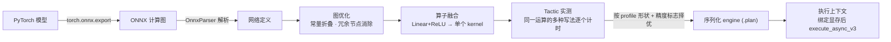
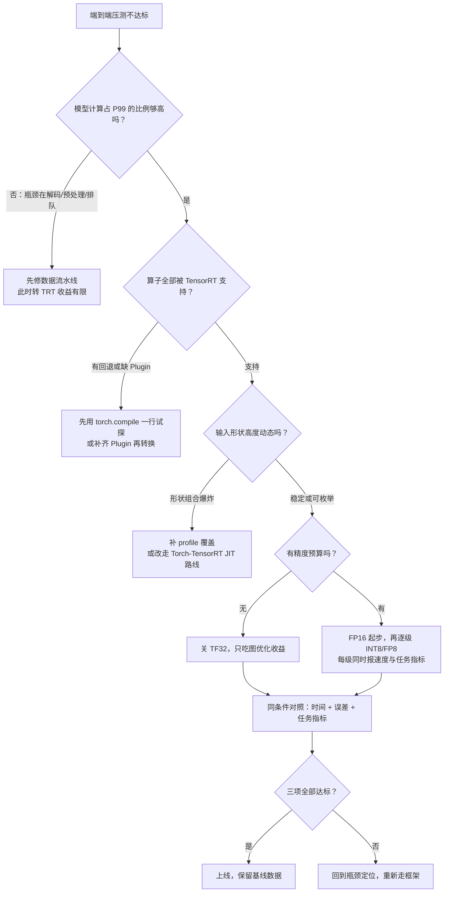
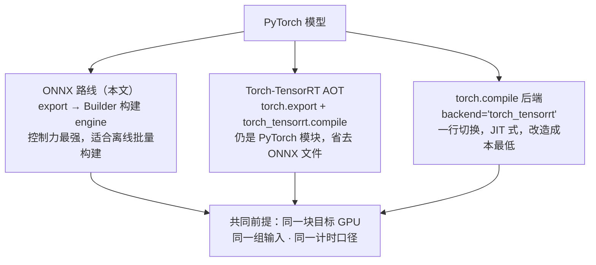

# PyTorch→ONNX→TensorRT：一条推理链路的验证清单（附完整对照代码）

> **工程深度｜验证状态：** L2 工程｜文档/API 核对 + CPU 逻辑验证（未实测；环境随版本变化）｜ 预计阅读：18 分钟
>
> TensorRT 不是魔法，收益是一笔要逐项核算的账。

---

## 压测没达标，同事说"转 TensorRT 吧"

想象一个电商商品搜索服务：上游图像编码器已经把商品图压成了 1024 维特征，接下来由一个三层打分头把它映射成 512 维向量，再去商品库里做最近邻检索。压测结果出来了——P99 延迟超标，留给打分头的时间预算只有几毫秒。

同事看了一眼说："转成 TensorRT 吧，推理会快很多。"

这句话听起来像答案，其实只是一个**待验证的假设**。翻一翻 NVIDIA 自己公布的数据，你会发现"快很多"从来都是带条件的：NVIDIA 技术博客在 A100 上用 EfficientNet-b0、batch=1 测得 Torch-TensorRT 相对 PyTorch 即时执行（eager）的吞吐提升最高可达 6 倍；另一篇 2025 年的博客里，FLUX.1-dev 在 B200 上从 PyTorch FP16 到 TensorRT FP16 是 1.5 倍，再叠加 FP8 量化才到 2.4 倍。模型不同、精度不同、GPU 不同，数字就不同。

所以本文不预设 TensorRT 一定获胜。我们要做的是：从这个打分头出发，走完 **PyTorch → ONNX → TensorRT** 整条链路，在同一块 GPU、同一组输入、同一个 batch 下，测三条路径的 GPU 计算时间，并比较它们与 PyTorch FP32 基线之间的数值误差，让数据来回答"到底快了多少、代价是什么"。

> 说明：本示例的模型权重是随机初始化的，目的是讲清部署链路和数值一致性检查，不代表已经训练好的业务模型，也不用于评估分类准确率。

## 一次推理的时间，究竟花在哪几段

要判断"转 TensorRT 能不能帮上忙"，先得知道一次推理的墙钟时间由什么构成。把一次请求在 GPU 上的旅程画出来，大致是这样：

```text
一次推理的时间线
┌──────────┬────────────────────────────────┬──────────┬──────────────┐
│  H2D 拷贝 │   Kernel 启动 + Kernel 执行 × N │  D2H 拷贝 │  CPU 侧调度    │
└──────────┴────────────────────────────────┴──────────┴──────────────┘
   输入上卡      每个算子一次启动 + 一段执行       结果回传     框架逐 op 派发
                 ▲______________▲
                  这一段才是优化的主战场
```

用一句话写成公式就是：

```text
推理时间 = H2D 拷贝 + Σ(Kernel 启动 + Kernel 执行) + D2H 拷贝 + CPU 侧调度
```

这里面藏着三个关键事实：

**第一，内核（Kernel）启动是固定开销。** 每个算子（Operator）从 CPU 侧派发到 GPU 执行，中间都有一段与"算了多少数"无关的调度成本。PyTorch 的 eager 模式逐个算子现算现发，一个三层 MLP 加上两次激活就是五次启动；模型越小、batch 越小，这部分占比越高。

**第二，Kernel 执行时间由"工作量 ÷ 有效吞吐"决定。** 而有效吞吐和数值精度（Precision）直接相关：FP16 的每个数只占 2 字节（FP32 是 4 字节），同样的显存带宽能搬运两倍的数据，现代 NVIDIA GPU 上的 Tensor Core 对半精度的矩阵运算吞吐也远高于单精度。**位宽，是硬件层面上一条拧不动的物理约束。**

**第三，CPU 侧调度本身也花钱。** Python 解释器、算子查找、参数打包，这些都不在 GPU 上发生，却计入用户等待的总时间。

现在可以把优化路径推导出来了。因为时间由"启动次数、实现选择、数值位宽"三项决定（物理约束），所以想提速就必须减少启动、选对实现、降低位宽；把这三件事**从运行时挪到构建期提前做完**，就成了一个自然的设计决策——这正是 TensorRT 的思路。代价也随之而来：构建要花时间、推理引擎（engine）和目标硬件绑定、低精度会引入数值误差。

💡 隐性知识：对 batch=1 的小模型，三条路径的差距往往不在"算力"，而在谁把启动和调度压得更低。所以如果你转了 TensorRT 却没变快，先别急着删数据——它很可能在告诉你：你的模型本来就不是被算力卡住的。

## TensorRT 把优化挪到了构建期

理解了时间构成，就可以回答"TensorRT 到底优化了什么"。如果说 PyTorch eager 像一张随时可改的草稿纸——每个算子现写现擦；TensorRT engine 就像印刷版讲义，排版全部在付印前完成，付印之后不能再改（换了 GPU 或输入形状，就得重新制版）。

这份"排版"在构建期做四件事，整条流水线如下图所示：



**图优化**是最基础的一层：把能提前算的常量算完（常量折叠），把没用的节点删掉。这一步在任何编译器里都存在，收益稳定但通常不惊人。

**算子融合**是运行时提速的关键。打分头里的 `Linear + ReLU` 原本是两个 kernel：第一个算完要把结果写回显存，第二个再读进来。融合之后中间张量的这次"写—读"消失了，kernel 启动也从两次变一次。但要留一个心眼：**"模型里有 Linear+ReLU"只是给了 TensorRT 融合的机会，不等于它一定融合了**——想确认，构建时打开 layer info 日志看一眼，别靠猜。

**Tactic 实测挑选**是 TensorRT 最有辨识度的一步。同一个矩阵乘法，在目标 GPU 上有好几种写法：不同分块尺寸、不同指令路径、不同精度。构建时 builder 像让几位厨师各炒一盘菜，逐个计时，把最快的那种实现——执行策略（tactic）——固化进 engine。这也解释了工程上一个高频踩坑点：

💡 隐性知识：engine 是给"这台烤箱"定制的菜谱。在开发机上构建的 engine，拿到另一型号 GPU 上很可能加载失败或被迫回退——构建必须在目标硬件上做，这也是为什么"本地测得好好的，上生产环境起不来"的事故总在发布日出现。

**低精度执行**由精度标志控制，而这里有一个最容易被误解的语义：`BuilderFlag.FP16` 是"**允许**构建器为某层选择 FP16 实现"，不是"把所有层都强制改成 FP16"。某些层在 FP16 下反而更慢或精度损失过大时，构建器会自动保留 FP32。同理，`clear_flag(TF32)` 则是把 Tensor Core 的 TF32 路径关掉，保证我们后面得到的是"纯 FP32 口径"的基线。

💡 隐性知识：对照实验最容易翻车的不是 TensorRT 这一侧，而是 PyTorch 这一侧。PyTorch 的 cuDNN 路径默认允许 TF32（matmul 的 TF32 默认自 1.12 起已关闭），两边口径不一致时，误差和加速比会同时失真。写对照代码时别依赖任何"默认值"，把 `torch.backends.cuda.matmul.allow_tf32` 和 `torch.backends.cudnn.allow_tf32` 显式设为 `False`，构建侧同时 `clear_flag(TF32)`——两边都摆到桌面上，测出来的才有意义。

## 起跑线要一样：三条路径的实验设计

优化机制清楚了，但"优化了什么"和"快了多少"之间还差一次对照实验。实验对象就是开场那个打分头：

```text
上游图像编码器输出的特征  [batch, 1024]
          │
          ▼
   全连接 1024 → 2048 + ReLU   ┐
   全连接 2048 → 2048 + ReLU   ├─ 本文的"打分头"（三层 MLP）
   全连接 2048 → 512           ┘
          │
          ▼
  商品库检索用的 512 维向量  [batch, 512]
```

三条路径同起跑线：

| 路径 | 精度 | 说明 | 它回答什么问题 |
| --- | --- | --- | --- |
| PyTorch GPU | FP32（关 TF32） | eager 模式，基线 | 原点 |
| TensorRT FP32 | FP32（`clear_flag(TF32)`） | 只吃图优化与调度收益 | **编译优化值多少分** |
| TensorRT FP16 | 允许 FP16 | 在上一条之上叠加低精度 | **降位宽再值多少分** |

中间多加一档 TensorRT FP32，是这次实验设计里最要紧的一步。少了它，FP16 那一档的加速比就说不清是图优化给的还是降精度给的——**把"编译收益"和"位宽收益"拆开分别计量**，结论才能搬到别的模型上。这也是可以复用的实验方法论：任何"换框架提速 X 倍"的结论，都应该先问一句"X 里有几成来自哪里"。

计时口径也要先约定死，否则数字没法复现：

- **只测 GPU 计算**：用 CUDA Event 包住循环，先 warmup 20 次再跑 200 次取平均；H2D/D2H 拷贝单独计，不混进计算时间。端到端延迟是另一个指标，两者不能混着报。
- **误差对齐 PyTorch FP32 的输出**：报最大绝对误差与平均绝对误差，并做 `allclose` 检查。注意这衡量的是"TensorRT 和 PyTorch 算得一不一样"，不是业务准确率——业务指标要另跑。

| 实验环境 | 数值 |
| --- | --- |
| GPU 型号 | （待实测填写） |
| TensorRT / PyTorch / CUDA 版本 | （待实测填写） |
| 输入形状 | batch=16, 1024 |
| 计时 | warmup 20 + 200 次平均，CUDA Event |

## 完整链路代码：从 ONNX 到 execute_async_v3

实验设计定了，接下来把它落成代码。整条链路分四步，先看最小可读版本（逐段带中文注释，完整脚本在附录 A）。

**第一步：导出 ONNX。** PyTorch 模型转 TensorRT 的标准入口是一个中间表示（IR）文件：

```python
model.eval()
torch.onnx.export(
    model, sample_input, "mlp.onnx",
    input_names=["input"], output_names=["output"],
    dynamic_axes={"input": {0: "batch"}, "output": {0: "batch"}},  # batch 维可变
    opset_version=17,
)
```

`dynamic_axes` 决定了后面能跑哪些 batch。如果导出时忘了声明，engine 会把形状焊死在导出那一刻——这是动态 shape 需求最常见的翻车点。

**第二步：构建 engine。** 这是全套代码里信息密度最高的一段：

```python
network = builder.create_network(0)          # TensorRT 10.x：显式 batch 是唯一模式
parser = trt.OnnxParser(network, logger)
# ... 解析 ONNX，失败时打印 parser 错误 ...

config = builder.create_builder_config()
config.set_memory_pool_limit(trt.MemoryPoolType.WORKSPACE, 1 << 30)   # 工作区 1 GiB

profile = builder.create_optimization_profile()                        # 动态形状的 min/opt/max
profile.set_shape("input", (1, 1024), (16, 1024), (64, 1024))
config.add_optimization_profile(profile)

config.clear_flag(trt.BuilderFlag.TF32)        # 与 PyTorch 基线同为 IEEE FP32 口径
if precision == "fp16":
    config.set_flag(trt.BuilderFlag.FP16)      # 允许，不是强制

serialized = builder.build_serialized_network(network, config)         # 构建期完成全部优化
```

这里的优化配置档（optimization profile）就是给动态形状用的"合同"：min/opt/max 三个形状里，TensorRT 会重点为 opt 形状调优。合同覆盖不到的形状，运行时要么报错要么回退，不会有人主动提醒你。

**第三步：按名字绑定并执行。** TensorRT 10.x 的 API 和 8.x 差异很大，这是转 10.x 时最容易卡住的地方：

```python
context = engine.create_execution_context()
context.set_input_shape("input", input_shape)        # 8.x: set_binding_shape
context.set_tensor_address("input",  int(d_input))    # 8.x: bindings[] 数组传地址
context.set_tensor_address("output", int(d_output))
context.execute_async_v3(stream_handle=stream.handle) # 8.x: execute_async_v2(bindings=...)
```

8.x 到 10.x 的关键迁移对照（官方迁移指南所列，新代码直接按 10.x 写，避免踩已删除 API 的坑）：

| 8.x 写法 | 10.x 写法 | 为什么变了 |
| --- | --- | --- |
| `EXPLICIT_BATCH` 标志 | `create_network(0)` | 显式 batch 成为唯一模式 |
| `num_bindings` / `get_binding_index` | `num_io_tensors` / `get_tensor_name` | 从"序号"改为"名字" |
| `set_binding_shape` | `set_input_shape` | 同上 |
| `execute_async_v2(bindings=[...])` | `set_tensor_address` + `execute_async_v3` | 地址注册与执行分离 |
| `max_workspace_size` | `set_memory_pool_limit` | 统一为内存池模型 |

**第四步：计时。** warmup 消掉首次执行的一次性开销，再用 CUDA Event 只统计 GPU 侧：

```python
start, end = cuda.Event(), cuda.Event()
start.record(stream)
for _ in range(runs):                       # runs = 200
    context.execute_async_v3(stream_handle=stream.handle)
end.record(stream)
end.synchronize()
avg_ms = start.time_till(end) / runs
```

## 怎么读结果：加速比和误差必须出现在同一张表

代码跑通后，最危险的一步其实是读数。下面这张表就是实验的最终交付物，前三列在有 NVIDIA GPU 的机器上运行附录 A 后填入：

| 路径 | 平均 GPU 时间（ms） | 相对 PyTorch 加速比 | 最大绝对误差 | 平均绝对误差 | allclose(rtol=1e-2) |
| --- | --- | --- | --- | --- | --- |
| PyTorch GPU（FP32 关 TF32） | 待实测 | 1.00x（基线） | — | — | — |
| TensorRT FP32 | 待实测 | 待实测 | 待实测 | 待实测 | 待实测 |
| TensorRT FP16 | 待实测 | 待实测 | 待实测 | 待实测 | 待实测 |

> 本机为 Apple Silicon 开发环境，没有 NVIDIA GPU 和 nvcc，无法完成编译与实测，因此结果留空。在目标机器上运行 `python trt_mlp_benchmark.py` 即可填表——这正是"先验证后下结论"的含义：没跑出来的数字，一个都不写。

读这张表时盯住三件事：

**1. 加速比不到 1 也是有效结论，不许删。** 它说明这个模型的瓶颈不在"TensorRT 能优化的那部分"（计算被融合/调优的空间小，固定开销占比高），下一步该去查数据流水线而不是继续折腾精度。删掉"不好看"的数据，等于把最有信息量的一次测量扔了。

**2. 分列看两笔收益。** TensorRT FP32 对 PyTorch 的加速比，度量的是图优化与调度方式的收益；TensorRT FP16 相对 FP32 再提升的部分，才是位宽的收益。两者常常一大一小，合起来报一个总数，你就永远不知道该往哪使劲。

**3. 误差要和速度放在同一行。** FP32 路径的误差应当接近浮点舍入量级（通常 1e-6 以下）；FP16 的误差会明显变大——半精度的十进制有效数字只有大约 3.3 位。`allclose(rtol=1e-2, atol=1e-2)` 是一条工程常用的宽松线，但**最终裁判永远是任务指标**：如果这个打分头后面接的是排序召回，还要拿转换前后的检索指标对比一遍，误差检查通过≠业务无损。

两个高频踩坑先记下来：一是没 warmup 就计时，首帧的 engine 懒加载会把平均值拉高一大截；二是把 H2D/D2H 混进"计算时间"，拷贝密集的场景下数字会虚高，回头优化时又找不到抓手。

## 什么时候该转，什么时候先别转

读完结果你会发现，加速比有时很好看，有时甚至不到 1。把上面所有的判断收敛成一个统一框架：**先问瓶颈在哪，再问算子/形状/精度/batch 这四个决策变量，最后用"时间 + 误差 + 任务指标"三项验收**。每次想说"转 TensorRT 吧"之前，顺着这张图走一遍：



框架里的每个"否"分支，对应一个真实的失败场景，说清根因和不适用边界：

- **小模型 + batch=1 + 端到端计时**：固定开销主导，模型本身再快也救不了 P99。根因是 Amdahl 定律——串行段（拷贝、排队、调度）没动，计算段的提速被稀释。此时该做的是攒 batch 或上 CUDA Graphs，而不是先转引擎。
- **算子不支持或悄悄回退**：engine 里混进回退执行，收益打折还难排查。用构建日志和 inspector 查证，别凭"构建没报错"就安心。
- **形状覆盖不足**：profile 之外的形状运行时报错，比报错更糟的是静默选了低效 tactic——同一个 engine 在不同 batch 下表现天差地别，往往就是这个原因。

还有一个反直觉的点值得单说：**不一定非要走完 ONNX 链路才知道值不值。** PyTorch 官方已把 Torch-TensorRT 做成了 `torch.compile` 的后端，一行 `torch.compile(model, backend="torch_tensorrt")` 就能在 eager 和完整转换之间拿到一个中间档；即使完全不碰 TensorRT，`torch.compile` 的图捕获与算子融合本身也能吃掉一部分调度开销。用低成本路径先试探，再决定要不要投入完整的 engine 构建与运维，是更聪明的顺序。

## 从脚本到生产：三条集成路线怎么选

本文的代码走的是最经典的 ONNX 路线，但生产环境里还有两条同样主流的路，选择差异主要在"灵活度 vs 控制力"：



- **ONNX 路线**：构建与服务解耦，engine 是独立产物，可以纳入 CI 在目标机上批量构建、按版本分发。适合形状稳定、追求可重复性的服务——本文的三路对照实验也必须走这条，否则拿不到纯净的基线。
- **Torch-TensorRT AOT**：保留 PyTorch 模块的代码形态，省去 ONNX 中间文件，适合模型还在快速迭代、不想维护两套构建脚本的团队。
- **torch.compile 后端**：改动最小的试探路径。新项目想先回答"值不值得投入"，从这里开始，拿到正反馈再升级到前两条。

无论选哪条，**验收标准不变**：同一条件下的时间、误差、任务指标三项对照。

## FP16 只是起点：精度阶梯与 2026 年的前沿

FP16 验证通过之后，再往下走就是一串"每一级多一种代价"的阶梯。把官方口径的硬件门槛整理成一张表：

| 精度 | 硬件门槛 | 附加前提 | 典型代价 |
| --- | --- | --- | --- |
| FP32 / TF32 | 全部 | — | 速度一般 |
| FP16 / BF16 | 支持快速半精度的 GPU | `platform_has_fast_fp16` | 误差量级上升一档 |
| INT8 | 支持 TensorRT 的 GPU | 校准数据（PTQ 量化） | 需要采样真实分布做校准 |
| FP8 | Hopper 及以上 | ModelOpt 量化 | 分布统计要求更严 |
| FP4（NVFP4 / MXFP4） | Blackwell 及以上，TensorRT ≥ 10.8 | ModelOpt 量化 | 仅部分算子支持 |

阶梯的**物理逻辑**是：位宽每降一半，同样带宽能搬两倍的数据，Tensor Core 吞吐也整体抬升，但表示范围与精度同时收窄。量化因此从"能不能跑"变成了"分布拟合得好不好"——这正是 INT8 需要校准（Calibration）的原因：拿带着真实输入分布的样本去统计每个张量的数值范围，而不是拍脑袋定一个 max/min。

**一条重要信号：校准这一步正在被前移。** 随着 TensorRT 11.0 的方向越来越清晰——强类型（strongly-typed）网络将成为默认形态，弱类型 API 和隐式 INT8 量化会被移除——低精度不再是在构建期用 flag 指定，而是通过 NVIDIA ModelOpt 在导出 ONNX 之前就量化"烧"进图里。也就是说：**想追下一档精度，功夫要下在 TensorRT 之前**（模型侧），而不是转换之后。

前沿动态里值得记三笔：

- **TensorRT 10.16** 引入了 MoE 的 IMoELayer（面向 SM110 与 NVFP4）和多设备推理（Multi-Device Inference）预览，大模型路由与张量并行的算子级支持正在补齐。
- **Torch-TensorRT 2.10/2.11**：`torch.compile(backend="torch_tensorrt")` 已稳定；2.10 引入基于规则的混合精度（Autocast），2.11 把 TensorRT-RTX 拆成独立包，低精度路线图更清晰。
- 量化验证的纪律永远是同一条：**只报加速比不报任务指标，是不合格的验证**。校准分布一偏，速度涨了指标掉下去的例子比比皆是。

铺垫到这里，下一篇文章我们就把这一步补齐：用真实分布的校准数据做 INT8 实战，把量化误差从头到尾控制住。

## 结语：把"转 TensorRT"从一句话变成一次可复用的验证

回到开场的同事。"转 TensorRT 吧"这句话本身没有错，错在它被当成了答案。经过这一轮，它应该被替换成一句完整的问题："在**同一块 GPU、同一组输入**下，TensorRT 相对 PyTorch 的 FP32 与 FP16 两条路径，分别带来多少时间收益、付出多少误差代价？"

把文章收成一张可以直接收藏的检查清单（含跳过代价，按优先级排）：

| 阶段 | 检查项 | 跳过代价 | 优先级 |
| --- | --- | --- | --- |
| 转换前 | 定位瓶颈：模型计算占端到端比例多高 | 转完 P99 无感，白干一周 | 高 |
| 转换前 | 确认算子全被支持、无回退 | engine 混入 fallback，收益打折 | 高 |
| 构建 | 在目标 GPU 型号上构建 engine | 加载失败或被迫重构建 | 高 |
| 构建 | 显式关 TF32、统一精度口径 | 加速比与误差双双失真 | 中 |
| 构建 | 动态形状的 profile 覆盖 min/opt/max | 形状溢出静默变慢或报错 | 中 |
| 计时 | warmup + CUDA Event + 分离拷贝 | 数字不可复现，优化无抓手 | 高 |
| 验收 | 时间、误差、任务指标三者同表 | 上线后精度事故 | 高 |
| 运维 | 改权重/形状后重建 engine | 静默执行旧计划 | 中 |

三个能带走的判断，也连成一句话：**先定位瓶颈，再拆开两笔收益，最后让任务指标一票否决。**

📌 下一篇预告：INT8 校准实战——用真实分布的校准数据把量化误差控制住。**评论区**：你的模型转 TensorRT 后加速比是多少？卡在哪一步？有没有被"回退执行"坑过？期待你的数据。

## 附录 A：完整参考代码（TensorRT 10.x，可运行）

需要 NVIDIA GPU 与对应软件环境（运行说明见附录 B）。

```python
"""
PyTorch → ONNX → TensorRT 10.x 对照实验（配套正文完整代码）

三条路径对比：PyTorch GPU FP32 / TensorRT FP32 / TensorRT FP16
只统计 GPU 计算时间，H2D/D2H 不混入；误差对齐 PyTorch FP32 输出。

在有 NVIDIA GPU 的机器上运行：
    python trt_mlp_benchmark.py
依赖：torch、onnx、numpy、tensorrt(10.x)、pycuda
"""

import os

import numpy as np
import onnx
import pycuda.autoprimaryctx          # 自动创建并激活主 CUDA 上下文
import pycuda.driver as cuda
import tensorrt as trt
import torch
import torch.nn as nn


# ------------------------- 1. 示例模型 -------------------------
class MLP(nn.Module):
    """商品打分头（演示用）：权重随机初始化，不代表已训练的业务模型。"""

    def __init__(self):
        super().__init__()
        self.layers = nn.Sequential(
            nn.Linear(1024, 2048), nn.ReLU(),
            nn.Linear(2048, 2048), nn.ReLU(),
            nn.Linear(2048, 512),
        )

    def forward(self, x):
        return self.layers(x)


def export_onnx(model, onnx_path, sample_input):
    """导出 batch 维动态的 ONNX 并做结构检查。"""
    model.eval()
    torch.onnx.export(
        model, sample_input, onnx_path,
        input_names=["input"], output_names=["output"],
        dynamic_axes={"input": {0: "batch"}, "output": {0: "batch"}},
        opset_version=17,
    )
    onnx.checker.check_model(onnx.load(onnx_path))   # 结构不合法会在此抛错


# ------------------------- 2. 构建 engine -------------------------
def build_engine(onnx_path, precision, max_batch=64):
    """构建并保存指定精度的 engine，返回反序列化后的对象与 plan 路径。"""
    logger = trt.Logger(trt.Logger.WARNING)
    builder = trt.Builder(logger)
    # TensorRT 10.x：显式 batch 是唯一模式，8.x 的 EXPLICIT_BATCH 标志已移除
    network = builder.create_network(0)
    parser = trt.OnnxParser(network, logger)
    with open(onnx_path, "rb") as f:
        if not parser.parse(f.read()):
            errors = "\n".join(str(parser.get_error(i))
                               for i in range(parser.num_errors))
            raise RuntimeError(f"ONNX 解析失败：\n{errors}")

    config = builder.create_builder_config()
    config.set_memory_pool_limit(trt.MemoryPoolType.WORKSPACE, 1 << 30)  # 1 GiB

    profile = builder.create_optimization_profile()   # 动态形状合同：min/opt/max
    if not profile.set_shape("input", (1, 1024), (16, 1024), (max_batch, 1024)):
        raise RuntimeError("设置动态输入 profile 失败：请检查输入张量名")
    config.add_optimization_profile(profile)

    # 关闭 TF32，保证与 PyTorch 基线同为 IEEE FP32 口径（详见正文实验设计）
    config.clear_flag(trt.BuilderFlag.TF32)

    if precision == "fp16":
        # platform_has_fast_fp16 在部分 10.x 构建中已从 Builder 移除，缺失时视为可用
        if not getattr(builder, "platform_has_fast_fp16", True):
            raise RuntimeError("当前 GPU 不支持快速 FP16，无法完成该对照")
        config.set_flag(trt.BuilderFlag.FP16)   # “允许”，不是“强制”，见正文
    elif precision != "fp32":
        raise ValueError("precision 仅支持 'fp32' 或 'fp16'")

    serialized = builder.build_serialized_network(network, config)
    if serialized is None:
        raise RuntimeError("TensorRT engine 构建失败（请查看 WARNING 日志）")

    engine_path = f"mlp_{precision}.plan"
    with open(engine_path, "wb") as f:
        f.write(serialized)

    engine = trt.Runtime(logger).deserialize_cuda_engine(serialized)
    if engine is None:
        raise RuntimeError("TensorRT engine 反序列化失败")
    return engine, engine_path


# ------------------------- 3. 可复用推理器 -------------------------
class TensorRTRunner:
    """封装执行上下文、CUDA 流与设备内存，按名称绑定张量（10.x 风格）。"""

    def __init__(self, engine, input_shape):
        self.engine = engine
        self.context = engine.create_execution_context()
        self.stream = cuda.Stream()
        self.input_shape = tuple(input_shape)

        # 若 ONNX 里改了名字，用 engine.get_tensor_name(i) 遍历确认
        self.input_name = "input"
        self.output_name = "output"
        if not self.context.set_input_shape(self.input_name, self.input_shape):
            raise RuntimeError(f"输入形状未命中 profile：{self.input_shape}")

        out_dims = self.context.get_tensor_shape(self.output_name)
        if any(d <= 0 for d in out_dims):
            raise RuntimeError(f"输出形状无效：{tuple(out_dims)}")
        self.output_shape = tuple(out_dims)          # 形状由输入动态推导出来

        in_dtype = trt.nptype(engine.get_tensor_dtype(self.input_name))
        out_dtype = trt.nptype(engine.get_tensor_dtype(self.output_name))
        self.host_input = np.empty(self.input_shape, dtype=in_dtype)
        self.host_output = np.empty(self.output_shape, dtype=out_dtype)
        self.device_input = cuda.mem_alloc(self.host_input.nbytes)
        self.device_output = cuda.mem_alloc(self.host_output.nbytes)

        # TensorRT 10.x：地址注册与执行分离，不再传 bindings 数组
        self.context.set_tensor_address(self.input_name, int(self.device_input))
        self.context.set_tensor_address(self.output_name, int(self.device_output))

    def copy_input(self, input_array):
        if tuple(input_array.shape) != self.input_shape:
            raise ValueError(f"输入应为 {self.input_shape}，实际 {input_array.shape}")
        self.host_input[...] = input_array
        cuda.memcpy_htod_async(self.device_input, self.host_input, self.stream)

    def enqueue(self):
        if not self.context.execute_async_v3(stream_handle=self.stream.handle):
            raise RuntimeError("TensorRT 推理执行失败")

    def infer(self, input_array):
        """完整推理一次：上卡 → 执行 → 下卡 → 同步 → 返回主机端结果。"""
        self.copy_input(input_array)
        self.enqueue()
        cuda.memcpy_dtoh_async(self.host_output, self.device_output, self.stream)
        self.stream.synchronize()
        return self.host_output.copy()

    def benchmark_gpu_compute(self, input_array, warmup=20, runs=200):
        """只统计 GPU 上重复执行 engine 的时间，不含主机设备间拷贝。"""
        self.copy_input(input_array)
        self.stream.synchronize()
        for _ in range(warmup):
            self.enqueue()
        self.stream.synchronize()

        start, end = cuda.Event(), cuda.Event()
        start.record(self.stream)
        for _ in range(runs):
            self.enqueue()
        end.record(self.stream)
        end.synchronize()
        return start.time_till(end) / runs          # 单位：毫秒 / 次


# ------------------------- 4. PyTorch 基线与误差 -------------------------
def benchmark_torch_gpu(model, input_gpu, warmup=20, runs=200):
    """用 CUDA Event 统计 PyTorch eager 的 GPU 计算时间。"""
    model.eval()
    with torch.no_grad():
        for _ in range(warmup):
            _ = model(input_gpu)
        torch.cuda.synchronize()
        start = torch.cuda.Event(enable_timing=True)
        end = torch.cuda.Event(enable_timing=True)
        start.record()
        for _ in range(runs):
            _ = model(input_gpu)
        end.record()
        end.synchronize()
        return start.elapsed_time(end) / runs       # 单位：毫秒 / 次


def error_stats(reference, candidate):
    """返回最大绝对误差与平均绝对误差（对齐 reference）。"""
    diff = np.abs(reference - candidate)
    return float(diff.max()), float(diff.mean())


def register_result(name, ms, ref, out):
    """打印单条路径的完整指标（速度 + 误差 + allclose）。"""
    max_err, mean_err = error_stats(ref, out)
    print(f"\n[{name}]")
    print(f"  平均 GPU 计算时间：{ms:.4f} ms/次")
    print(f"  最大绝对误差：{max_err:.6e}")
    print(f"  平均绝对误差：{mean_err:.6e}")
    print(f"  allclose(rtol=1e-2, atol=1e-2)："
          f"{np.allclose(ref, out, rtol=1e-2, atol=1e-2)}")
    return max_err, mean_err


# ------------------------- 5. 对照实验入口 -------------------------
def main():
    if not torch.cuda.is_available():
        raise RuntimeError("本脚本需要在 CUDA 版 PyTorch 与 NVIDIA GPU 上运行")

    torch.manual_seed(2026)
    np.random.seed(2026)

    # 显式关闭 TF32，确保 PyTorch 与 TensorRT 的 FP32 基线口径一致（正文实验设计）
    torch.backends.cuda.matmul.allow_tf32 = False
    torch.backends.cudnn.allow_tf32 = False

    device = torch.device("cuda:0")
    model = MLP().to(device).eval()

    batch_size = 16
    input_shape = (batch_size, 1024)
    input_cpu = np.random.randn(*input_shape).astype(np.float32)
    input_gpu = torch.from_numpy(input_cpu).to(device)

    onnx_path = "mlp.onnx"
    export_onnx(model, onnx_path, input_gpu)

    # 基线：PyTorch GPU FP32
    with torch.no_grad():
        torch_output = model(input_gpu).float().cpu().numpy()
    torch_ms = benchmark_torch_gpu(model, input_gpu)
    print(f"PyTorch GPU 平均计算时间：{torch_ms:.4f} ms/次（基线 1.00x）")

    # 对照：TensorRT FP32 / FP16
    for precision in ("fp32", "fp16"):
        engine, engine_path = build_engine(onnx_path, precision)
        runner = TensorRTRunner(engine, input_shape)
        trt_output = runner.infer(input_cpu)
        trt_ms = runner.benchmark_gpu_compute(input_cpu)

        register_result(f"TensorRT {precision.upper()}", trt_ms,
                        torch_output, trt_output)
        print(f"  相对基线加速比：{torch_ms / trt_ms:.2f}x")
        print(f"  engine 文件：{os.path.getsize(engine_path) / 1024:.1f} KiB")
        print(f"  执行上下文设备内存需求："
              f"{int(engine.device_memory_size) / 1024:.1f} KiB")


if __name__ == "__main__":
    main()
```

> 以上代码在正文完成后，还需在目标 NVIDIA GPU 上运行验证并回填结果登记表。本机（Apple Silicon）不具备条件，故不预先编造任何输出数值。

## 附录 B：运行说明与结果登记

**环境要求**

| 组件 | 建议 |
| --- | --- |
| GPU | 支持 TensorRT 的 NVIDIA GPU（FP16 对照需支持快速半精度） |
| 系统 | Linux，NVIDIA 驱动 + CUDA |
| 语言 | Python 3.9+ |
| 软件 | `torch`（CUDA 版）、`onnx`、`numpy`、`tensorrt>=10.0`、`pycuda` |

安装示例：`pip install onnx pycuda`；TensorRT 请按 NVIDIA 官方渠道安装与 PyTorch/CUDA 版本匹配的 wheel。

**运行**

1. `python trt_mlp_benchmark.py`：自动完成导出、两次构建、三次计时与误差统计。
2. 首次构建较慢属正常现象——tactic 实测要逐个试跑，这正是"构建期换运行时"的代价。

**常见问题**

- `import tensorrt` 失败：未安装或与 CUDA 驱动不匹配，按官方渠道重新安装。
- 动态 shape 报「shape not found」：检查 `set_shape` 里的张量名与 ONNX 是否一致。
- 想跑 batch=1：把 `batch_size`、profile 的 min/opt 和输入形状同步改成 `(1, 1024)`。

**结果登记表（供在目标机器回填）**

| 路径 | 平均 GPU 时间（ms） | 相对基线加速比 | 最大绝对误差 | 平均绝对误差 | allclose |
| --- | --- | --- | --- | --- | --- |
| PyTorch GPU（FP32 关 TF32） |  | 1.00x | — | — | — |
| TensorRT FP32 |  |  |  |  |  |
| TensorRT FP16 |  |  |  |  |  |

| 环境项 | 数值 |
| --- | --- |
| GPU 型号 / 显存 | |
| 驱动 / CUDA / TensorRT / PyTorch | |
| 输入形状与 batch | batch=16, [16,1024] |
| warmup / runs | 20 / 200 |

## 参考资料

- NVIDIA，TensorRT 8.x → 10.x Python API 迁移指南（EXPLICIT_BATCH、set_input_shape、execute_async_v3 等变更）
- NVIDIA，TensorRT 10.16 Release Notes（MoE IMoELayer、Multi-Device Inference 预览）
- NVIDIA Developer Blog：Accelerating Inference Up To 6x Faster In PyTorch With Torch-TensorRT（A100 / EfficientNet-b0 / batch=1）
- NVIDIA Developer Blog（2025）：FLUX.1-dev 在 B200 上的 TensorRT 优化（FP16 1.5x、FP8 2.4x）
- PyTorch / Torch-TensorRT 文档：torch.compile 后端、Autocast、精度-硬件矩阵、NVIDIA ModelOpt
- PyTorch 文档：torch.backends.cuda.matmul.allow_tf32 默认值变更说明
