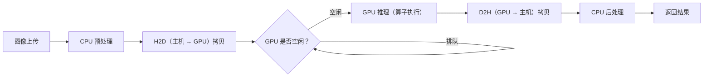
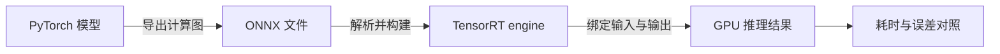

# 模型上了 GPU，一次请求的时间都花在哪？一次 TensorRT 对照实验

> GPU 利用率高，不等于模型计算就是唯一瓶颈。先把耗时拆开，再看 TensorRT 能帮上哪一段。

> **旧版接口提示**：本文脚本基于 TensorRT 8.6 的 Python API（`EXPLICIT_BATCH`、`execute_async_v2` 等），这些接口在 TensorRT 10.x 已移除或改名，差异见第 28 篇的迁移表与第 2 节末的官方迁移链接。实验方法（对照设计、预热、CUDA Event 计时、误差与显存口径）与版本无关；部署链路的最新写法请结合第 67—70 篇的 TensorRT 系列阅读。
>
> **验证状态**：未实测——实验代码需在 NVIDIA GPU 环境运行，本文未报告任何实测性能数字。

> **工程深度｜验证状态：** L3 工程｜文档/API 核对 + 环境锁定（TensorRT 8.6.x）
---

## 商品图片已经过了“机器初筛”，为什么结果还要等？

想象一个电商质检服务：商品图片上传后，视觉模型先提取出一个 1024 维特征向量，再由分类头判断商品类别、决定是否转人工复核。

促销开始后，请求变多，接口延迟也跟着上升。监控显示 GPU 正在忙，但这个数字没有回答关键问题：时间花在排队、数据拷贝，还是模型计算？有人提议：

> “把 PyTorch 模型转成 TensorRT，应该就快了。”

TensorRT 确实能针对 NVIDIA GPU 构建优化后的推理 engine；但**这个模型、这个 batch、这张 GPU，究竟能快多少？**必须测出来。

一次请求不只有矩阵乘法：数据要进入 GPU，框架要提交任务，GPU 执行算子，结果还可能返回 CPU。模型越小，这些环节占总耗时的比例越高。



> 本文重点关注 **GPU 推理计算耗时**（输入已在 GPU 的前提下测量模型执行时间），不等于线上端到端延迟。端到端延迟还包含预处理、CPU↔GPU 拷贝、排队和后处理等环节。

这篇文章就用一个分类头做小实验，从 PyTorch 导出 ONNX，再交给 TensorRT 构建 FP32 和 FP16 engine，最后测计算耗时、输出误差和可统计的显存组成。

> 示例网络使用随机权重，只用于展示部署链路与数值一致性；它不是训练好的商品分类模型，不能用来报告业务准确率。

---

## CUDA 内核与融合：为什么 TensorRT 想要合并算子？

在 GPU 上，CUDA Kernel 是由 CPU 发起、在 GPU 执行的函数。启动时，工作被组织成 `grid`（网格）、`block`（线程块）和 `thread`（线程）。一个线程常用以下方式取得自己的全局编号：

```cpp
int idx = blockIdx.x * blockDim.x + threadIdx.x;
```

其中 `blockIdx.x` 是 block 在 grid 中的编号，`threadIdx.x` 是线程在 block 内的编号，`blockDim.x` 是 block 的线程数。向量长度为 N 时，通常让相邻线程读写相邻地址，以利于合并全局内存访问（这是 CUDA 性能的重要考量）。[CUDA 编程指南：全局内存访问](https://docs.nvidia.com/cuda/cuda-programming-guide/02-basics/writing-cuda-kernels.html)

### 算子融合减少了什么？

分类头中的偏置与 ReLU 可写为：

$$
y_{i,j}=\max(x_{i,j}+b_j, 0)
$$

**不融合**时，需要先启动一个加法 kernel（读取 `x` 和 `bias`、写出临时张量），再启动一个 ReLU kernel（读回临时张量、写出最终结果）。**融合**后，一个 kernel 就能在寄存器里连续完成加法和 ReLU，只写最终结果。

- **分开执行：** 读取输入 → 写临时结果 → 读临时结果 → 写输出（启动 2 个 kernel）
- **融合执行：** 读取输入 → 寄存器中完成加法和 ReLU → 写输出（启动 1 个 kernel）

简单来说，融合的核心收益是：**减少 kernel 启动次数和中间张量的读写开销**。但这不是银弹——融合可能增加寄存器压力，也可能妨碍某些高效实现。因此，TensorRT 只会在满足条件的图模式下尝试融合，是否真正发生要结合构建信息和 Profiler 来验证。[TensorRT 性能最佳实践](https://docs.nvidia.com/deeplearning/tensorrt/latest/performance/best-practices.html) · [TensorRT 术语表：Fusion](https://docs.nvidia.com/deeplearning/tensorrt/latest/reference/glossary.html)

最简的融合思路可以用下面这两行核心逻辑来表达：

```cpp
float value = x[idx] + bias[col];
y[idx] = value > 0.0f ? value : 0.0f;
```

它体现了“两个逐元素操作在寄存器中连续完成、不创建中间张量”这个关键直觉。本文的实验并不需要完整的 CUDA 扩展实现，重点是理解这个直觉如何被 TensorRT 的图优化利用。

### 全连接层里的融合：GEMM epilogue

矩阵乘法 `XW` 和逐元素运算不同，常见做法是在 GEMM 的 **epilogue**（后处理阶段）中融合偏置和激活：当累加结果还在寄存器或片上路径时，就顺手完成 `bias + ReLU` 再写出结果，从而省掉额外的后处理 kernel 和中间写回。TensorRT builder 会根据网络结构和形状选择合适的 tactic，但是否发生融合不能只凭“有 Linear+ReLU”就推断，仍需通过执行计划或 Profiler 确认。[PyTorch 自定义 Triton kernel 教程](https://docs.pytorch.org/tutorials/recipes/torch_compile_user_defined_triton_kernel_tutorial.html) · [PyTorch 调优指南：CUDA Graphs](https://docs.pytorch.org/tutorials/recipes/recipes/tuning_guide.html)

---

## 先看整条路：模型怎样变成 engine？

ONNX 是描述“输入经过哪些计算得到输出”的通用计算图。本文选择 ONNX 作为 PyTorch 和 TensorRT 之间的交换格式。



> 注意：ONNX 只是其中一种转换路线。NVIDIA 也提供 Torch-TensorRT 等方案。本文沿 ONNX 路线走，目的是把每一步拆开讲清楚。[NVIDIA TensorRT](https://developer.nvidia.com/tensorrt)

---

## TensorRT 到底替我们做了什么？

可以把 TensorRT builder 理解为 GPU 的“装配工程师”：它读取计算图、输入形状范围和精度选项，为目标环境挑选执行策略并构建 engine。

它可能做的事情包括：

- **选择执行策略（Tactic）：**同一类运算可能有多种 GPU 实现，builder 会在允许的配置中选择合适的 tactic。
- **融合部分算子：**满足条件时，把相邻操作合并，减少 kernel 启动或中间结果读写。是否融合要看网络与构建结果，不能只凭“调用了 Builder”就断言发生。
- **选择计算精度：**FP16 标志允许 builder 选择 FP16 实现；不代表每一层都一定以 FP16 运行。INT8 还涉及量化尺度，常见校准路径需要代表性数据。
- **安排推理资源：**执行上下文（Execution Context）和输入输出缓冲区都要占用设备资源。engine 文件大小不是整次推理的显存峰值。

记住一个顺序：**先测基线，再改一项配置，最后复测**。NVIDIA 的性能指南同样建议用“测量—优化—确认”的循环推进。[TensorRT 性能最佳实践](https://docs.nvidia.com/deeplearning/tensorrt/latest/performance/best-practices.html)

---

## 实验怎么设计，才不至于“比了个寂寞”？

我们用一个简单分类头代表视觉模型后半段：

```text
1024 维图像特征
      ↓
全连接 + ReLU
      ↓
全连接 + ReLU
      ↓
512 类分数
```

实验比较三条路径：

| 路径 | 用来回答什么 |
|---|---|
| PyTorch GPU FP32 | 原始框架的参考耗时与输出 |
| TensorRT FP32 | 只看 engine 构建和执行带来的差异 |
| TensorRT FP16 | 观察低精度对速度与误差的影响 |

本文测的是 **GPU 上重复执行模型的计算时间**：输入先拷到 GPU，预热后再开始计时。因此，它不包含每次请求的主机到设备拷贝，也不等于线上端到端延迟。


## 1）导出 ONNX

首先定义示例分类头，并使用 PyTorch 新版 `torch.export` 导出带动态 batch 的 ONNX。动态维度通过 `dynamic_shapes` 显式声明，需注意字典的 key 要与 `forward` 的参数名保持一致。

关键配置片段如下：

```python
torch.onnx.export(
    model,
    (sample,),
    path,
    input_names=["input"],
    output_names=["output"],
    dynamo=True,
    dynamic_shapes={
        "x": {0: Dim("batch", min=1, max=64)}
    },
    opset_version=17,
)
onnx.checker.check_model(onnx.load(path))
```

> 运行此导出路径需安装 `onnxscript`。示例以 TensorRT 8.6 的 Python API 为主，不同 TensorRT 主版本（8.x vs 10.x/11.x）的 API 写法略有差异。[PyTorch ONNX 导出文档](https://docs.pytorch.org/docs/stable/onnx_export.html)

---

## 2）构建 TensorRT engine

构建 engine 时，**动态 batch 必须通过 Optimization Profile 告诉 TensorRT 输入形状范围**。这里把最小 batch 设为 1、常用 batch 设为 16、最大 batch 设为 64。

最关键的配置点包括：

- **显式 batch（Explicit Batch）**：让 TensorRT 能处理动态维度。
- **Optimization Profile**：为 `input` 设置 `(min, opt, max)` 三个形状，builder 会重点针对 `opt`（常用形状）做优化。
- **精度控制**：FP32 基线清除 `TF32` 以保证基线可比性；FP16 模式则仅在平台支持快速 FP16 时开启，允许 builder 按需选择 FP16 实现。

```python
flags = 1 << int(trt.NetworkDefinitionCreationFlag.EXPLICIT_BATCH)
network = builder.create_network(flags)
parser = trt.OnnxParser(network, logger)

profile = builder.create_optimization_profile()
profile.set_shape("input", (1,1024), (16,1024), (batch_max,1024))
config.add_optimization_profile(profile)

config.clear_flag(trt.BuilderFlag.TF32)
if precision == "fp16":
    if builder.platform_has_fast_fp16:
        config.set_flag(trt.BuilderFlag.FP16)
```

> TensorRT 8.6 与 10.x/11.x 在 I/O API（binding vs. 张量名称）上有差异。本文示例基于 TensorRT 8.6 API 编写，部署到不同主版本时需注意迁移。[TensorRT 8.x 到 10.x API 迁移说明](https://docs.nvidia.com/deeplearning/tensorrt/10.x.x/api/migration/tensorrt-8x-to-10x-python-api.html) · [TensorRT 11.x API 迁移模式](https://docs.nvidia.com/deeplearning/tensorrt/latest/api/migration/tensorrt-10x-to-11x-python-api-patterns.html)

---

## 3）准备推理运行器与 GPU 计时

TensorRT 推理需要把输入输出绑定到 GPU 缓冲区，并在指定 CUDA Stream 上执行。最关键的是**计时方式**：要测量“只包含 GPU 计算”的耗时，推荐使用 `cuda.Event`，并且**先预热、后计时**，且事件要记录在 TensorRT 使用的同一条 Stream 上。

核心要点如下：

- **动态形状设置**：推理前先调用 `context.set_binding_shape(input_index, shape)`，确保实际输入在 Optimization Profile 范围内。
- **异步执行**：使用 `execute_async_v2` + `cuda.memcpy_htod_async/dtoh_async`，减少 CPU 阻塞。
- **只测 GPU 计算**：将输入拷贝到 GPU 并 `synchronize()` 后再开始计时，只统计多次 `enqueue()` 的 GPU 时间区间（`start.time_till(end)/runs`），避免把 H2D/D2H 拷贝计入模型计算耗时。

```python
# 设置实际输入形状（动态 batch）
context.set_binding_shape(input_index, shape)

# 只测 GPU 计算耗时（输入已在 GPU）
cuda.memcpy_htod_async(device_input, host_input, stream)
stream.synchronize()

# 预热
for _ in range(warmup): context.execute_async_v2(bindings, stream.handle)
stream.synchronize()

# 计时
start.record(stream)
for _ in range(runs): context.execute_async_v2(bindings, stream.handle)
end.record(stream)
end.synchronize()
ms_per_run = start.time_till(end) / runs
```

这种做法能更清晰地区分“GPU 计算时间”和“端到端时间”。服务场景还需单独评估完整 Pipeline 的 P50/P95 和吞吐量。[TensorRT 性能测量指南](https://docs.nvidia.com/deeplearning/tensorrt/latest/performance/best-practices.html)

---

## 4）同一输入对照实验

最后，在同一块 GPU、同一组输入和同一 batch 下，对比 PyTorch GPU 与 TensorRT（FP32/FP16）的计算耗时和输出误差。PyTorch 这边同样使用 `torch.cuda.Event` 计时，并在对比前先计算出 `reference`（基准输出），再用 `np.allclose` 做数值一致性检查。

```python
with torch.no_grad():
    reference = model(x_torch).float().cpu().numpy()

# PyTorch GPU 计时（预热 + 多次运行取平均）
for _ in range(warmup): model(x_torch)
torch.cuda.synchronize()
start.record(); [model(x_torch) for _ in range(runs)]; end.record(); end.synchronize()
torch_ms = start.elapsed_time(end)/runs

# TensorRT：先 infer 拿回输出做误差校验，再 benchmark_compute 测 GPU 计算时间
output = runner.infer(x_np)
trt_ms  = runner.benchmark_compute(x_np)

abs_err = np.abs(reference - output)
same    = np.allclose(reference, output, rtol=1e-4 if prec=="fp32" else 1e-2)
```

> FP32 建议用 `rtol/atol ~ 1e-4` 做初步核对，FP16 由于精度变化可适当放宽到 `~1e-2`。但数值接近只是必要检查，不等于业务指标（准确率/mAP/排序指标）不变，真实模型仍需在验证集上复核。

---

## 看结果时，别只盯着“几倍”

运行后需要关注四类信息：

1. **推理时间**：PyTorch GPU、TensorRT FP32、TensorRT FP16 各自每次 GPU 计算耗时。
2. **相对速度**：以 PyTorch GPU 为基准（`torch_ms / trt_ms`）。
3. **数值误差**：最大误差、平均误差，以及指定容差下是否通过。
4. **资源占用（可统计部分）**：engine 文件大小、执行 context 的设备内存需求、输入输出 GPU 缓冲区大小。

尤其要区分两个计时口径：

- **GPU 计算时间（本文所测）：**输入已在 GPU，只测模型执行。
- **端到端时间（线上感受）：**包含预处理、CPU↔GPU 拷贝、推理、后处理和排队。

若目标是服务延迟，应继续测端到端 P50/P95；若目标是吞吐量，应测试不同 batch 和并发数。只测单个 batch 的 GPU Event，不能代表完整服务表现。

---

## 为什么 FP16 可能快，INT8 又不能“点一下就好”？

- **FP16：**位宽更小，在支持相应硬件路径的 GPU 上可能减少计算或带宽成本，但精度会变化。本文用输出误差做初步核对，真实模型仍要在验证集上测任务指标。
- **INT8：**需要把数值映射到量化范围（Calibration/Quantization）。TensorRT 常用的校准流程需要有**代表性**的输入来估算量化尺度。如果用不匹配真实分布的随机数据做校准，实验数字再漂亮也不能说明线上效果可靠。

此外，INT8 工作流也在演进：较新的 TensorRT 版本逐步转向显式量化图（如 ONNX Q/DQ）。因此本文只把 INT8 作为后续方向，不把 TensorRT 8.6 的旧式校准接口说成所有新版本的通用做法。[TensorRT INT8 校准 API](https://docs.nvidia.com/deeplearning/tensorrt/archives/tensorrt-861/api/python_api/infer/Int8/EntropyCalibrator2.html) · [TensorRT 量化类型说明](https://docs.nvidia.com/deeplearning/tensorrt/10.x.x/inference-library/work-quantized-types.html)

---

## 三个容易踩的坑

1. **小模型不一定跑得更快。** GPU 计算很快，但 kernel 启动、Python 调用提交、CPU↔GPU 拷贝都有成本。模型太小、batch 太低时，TensorRT 节省的计算时间可能不够覆盖这些开销。
2. **FP16 输出接近，不等于业务精度没变。** 数值接近是必要检查，不是最终业务结论。分类要看准确率、召回率，检测要看 mAP，排序要看线上业务指标。
3. **engine 文件小，不等于显存峰值低。** engine 文件是磁盘序列化大小；运行时还需要权重、执行上下文和输入输出资源。本文只列出可直接查询的部分，不等同于进程的显存总峰值。需要峰值数据时，应在目标进程运行期间用 GPU 监控工具测量。

---

## 5 分钟最小复现

**依赖**

```bash
# 本文脚本基于 TensorRT 8.6.x 的 Python API，必须锁定 8.6 主版本：
# EXPLICIT_BATCH 与 execute_async_v2 在 10.x 已移除，装错主版本会直接报错。
> **环境锁定（必读）**  
> - 建议使用 **TensorRT 8.6.x**（本篇代码与示例按此版本验证）。TensorRT 10.x 的 Python API 与执行接口有较大迁移（如 `EXPLICIT_BATCH` 标志、`execute_async_v2` 等），不保证直接兼容。  
> - 安装示例：`pip install "tensorrt==8.6.*" torch onnx onnxscript numpy pycuda`（具体以你机器的 CUDA/驱动匹配为准）。  
> - 若需在 TensorRT 10.x 环境复现，需按官方迁移文档调整 API。

pip install "tensorrt==8.6.*" torch onnx onnxscript numpy pycuda
```

> 注意：TensorRT 8.6 需配套 CUDA 11.x；TensorRT 10.x/11.x 需 CUDA 12.x，且必须先按第 2 节末的迁移链接改写 I/O 与执行接口，不能直接运行本文脚本。此外 CUDA 与驱动还需与 PyTorch 版本匹配，且环境需有 NVIDIA GPU。

**运行**

将文末附录的完整脚本保存为 `trt_bench.py`，直接运行：

```bash
python trt_bench.py
```

**预期观察**

脚本会依次输出：

- `PyTorch GPU：... ms/次`
- `TensorRT FP32`：GPU 计算时间、相对 PyTorch（× 倍）、最大/平均绝对误差、容差检查（通过/未通过）、engine 文件大小、context 设备内存需求、输入输出 GPU 缓冲区大小
- `TensorRT FP16`：同上

重点关注：**相对速度是否大于 1.0** 以及 **容差检查是否全部通过**。若 FP16 容差未通过，先检查是否在支持 FP16 的 GPU 上运行，或适当调整对比容差，而不是直接忽略数值一致性。

---

## 读完这篇，应该带走什么？

PyTorch → ONNX → TensorRT 不是“换个格式就自动变快”。它是一条部署链路：

```text
导出模型
  → 检查 ONNX
  → 设置输入形状范围（Optimization Profile）和精度
  → 构建目标 GPU 的 engine
  → 绑定显存并执行
  → 对比耗时、误差和资源占用
```

**TensorRT 提供优化能力，基准测试给出优化结果。** 先用 FP32 建立对照，再尝试 FP16；有真实、代表性的校准数据后，再评估 INT8。最后用目标硬件和完整服务链路验证，才知道优化是否真正落到了用户体验上。

还要记住：engine 是为具体 TensorRT 版本、GPU 和构建配置生成的部署产物。不要默认一个 `.plan` 文件可以跨不同环境直接复用；在目标部署环境验证兼容性和性能。

---

## 附录：可运行完整脚本

下面是本实验的最小可复现完整代码。文中为了聚焦思路，对此做了片段化讲解。

```python
"""模型上了 GPU，一次请求的时间都花在哪？一次 TensorRT 对照实验（第3章 · 推理服务与部署）。

本文件是对应博文代码块的实现/演示，直接运行可见效果；运行依赖：PyTorch、PyCUDA、TensorRT、ONNX、NumPy。
"""
import os
import numpy as np
import onnx
import pycuda.autoprimaryctx  # 让 PyCUDA 与 PyTorch 使用 CUDA primary context
import pycuda.driver as cuda
import tensorrt as trt
import torch
import torch.nn as nn
from torch.export import Dim


class ClassifierHead(nn.Module):
    """示例分类头：输入 1024 维特征，输出 512 个类别分数。"""

    def __init__(self):
        super().__init__()
        self.layers = nn.Sequential(
            nn.Linear(1024, 2048),
            nn.ReLU(),
            nn.Linear(2048, 2048),
            nn.ReLU(),
            nn.Linear(2048, 512),
        )

    def forward(self, x):
        return self.layers(x)


def export_onnx(model, path, sample):
    """导出带动态 batch 维度的 ONNX 模型。"""

    torch.onnx.export(
        model,
        (sample,),
        path,
        input_names=["input"],
        output_names=["output"],
        dynamo=True,
        dynamic_shapes={
            "x": {0: Dim("batch", min=1, max=64)}
        },
        opset_version=17,
    )

    # 检查 ONNX 文件结构；通过检查不代表 TensorRT 一定支持所有算子。
    onnx.checker.check_model(onnx.load(path))


def build_engine(onnx_path, precision, batch_max=64):
    """使用 TensorRT 8.x API 构建指定精度的 engine。"""

    logger = trt.Logger(trt.Logger.WARNING)
    builder = trt.Builder(logger)

    # 显式 batch：batch 是输入张量形状的一部分。
    flags = 1 << int(trt.NetworkDefinitionCreationFlag.EXPLICIT_BATCH)
    network = builder.create_network(flags)
    parser = trt.OnnxParser(network, logger)

    with open(onnx_path, "rb") as f:
        parsed = parser.parse(f.read())

    if not parsed:
        errors = "\n".join(
            str(parser.get_error(i)) for i in range(parser.num_errors)
        )
        raise RuntimeError(f"ONNX 解析失败：\n{errors}")

    config = builder.create_builder_config()
    # TensorRT 8.6：设置构建阶段 WORKSPACE 内存池上限为 1 GiB。
    config.set_memory_pool_limit(trt.MemoryPoolType.WORKSPACE, 1 << 30)

    profile = builder.create_optimization_profile()
    ok = profile.set_shape(
        "input",
        (1, 1024),          # 最小 batch
        (16, 1024),         # 常用 batch，builder 重点优化
        (batch_max, 1024),  # 最大 batch
    )
    if not ok:
        raise RuntimeError("动态输入 profile 配置失败")
    config.add_optimization_profile(profile)

    # 让 FP32 基线不使用 TF32；FP16 模式则允许 builder 选择 FP16 tactic。
    config.clear_flag(trt.BuilderFlag.TF32)
    if precision == "fp16":
        if not builder.platform_has_fast_fp16:
            raise RuntimeError("当前 GPU 不支持快速 FP16")
        config.set_flag(trt.BuilderFlag.FP16)
    elif precision != "fp32":
        raise ValueError("precision 只能是 fp32 或 fp16")

    plan = builder.build_serialized_network(network, config)
    if plan is None:
        raise RuntimeError("TensorRT engine 构建失败")

    plan_path = f"classifier_{precision}.plan"
    with open(plan_path, "wb") as f:
        f.write(plan)

    runtime = trt.Runtime(logger)
    engine = runtime.deserialize_cuda_engine(plan)
    if engine is None:
        raise RuntimeError("TensorRT engine 反序列化失败")

    return engine, plan_path


class Runner:
    """复用执行上下文、CUDA 流和显存缓冲区。"""

    def __init__(self, engine, shape):
        self.engine = engine
        self.context = engine.create_execution_context()
        self.stream = cuda.Stream()
        self.shape = tuple(shape)

        self.input_index = engine.get_binding_index("input")
        self.output_index = engine.get_binding_index("output")

        # 动态输入先设置本次实际形状。
        if not self.context.set_binding_shape(self.input_index, self.shape):
            raise RuntimeError(f"输入形状不在 profile 范围内：{self.shape}")

        self.output_shape = tuple(
            self.context.get_binding_shape(self.output_index)
        )
        if any(d <= 0 for d in self.output_shape):
            raise RuntimeError(f"输出形状无效：{self.output_shape}")

        self.host_input = np.empty(self.shape, dtype=np.float32)
        self.host_output = np.empty(self.output_shape, dtype=np.float32)
        self.device_input = cuda.mem_alloc(self.host_input.nbytes)
        self.device_output = cuda.mem_alloc(self.host_output.nbytes)

        # 地址列表必须按 binding 索引排列。
        self.bindings = [0] * engine.num_bindings
        self.bindings[self.input_index] = int(self.device_input)
        self.bindings[self.output_index] = int(self.device_output)

    def enqueue(self):
        ok = self.context.execute_async_v2(
            bindings=self.bindings,
            stream_handle=self.stream.handle,
        )
        if not ok:
            raise RuntimeError("TensorRT 推理提交失败")

    def infer(self, x):
        """完整执行一次：主机输入 → GPU 计算 → 主机输出。"""

        self.host_input[...] = x
        cuda.memcpy_htod_async(
            self.device_input, self.host_input, self.stream
        )
        self.enqueue()
        cuda.memcpy_dtoh_async(
            self.host_output, self.device_output, self.stream
        )
        self.stream.synchronize()
        return self.host_output.copy()

    def benchmark_compute(self, x, warmup=20, runs=200):
        """只计 GPU 计算，不计输入输出拷贝。"""

        self.host_input[...] = x
        cuda.memcpy_htod_async(
            self.device_input, self.host_input, self.stream
        )
        self.stream.synchronize()

        for _ in range(warmup):
            self.enqueue()
        self.stream.synchronize()

        start = cuda.Event()
        end = cuda.Event()
        start.record(self.stream)

        for _ in range(runs):
            self.enqueue()

        end.record(self.stream)
        end.synchronize()
        return start.time_till(end) / runs  # 毫秒/次


def benchmark_torch(model, x, warmup=20, runs=200):
    """测量 PyTorch GPU 前向计算的平均时间。"""

    with torch.no_grad():
        for _ in range(warmup):
            model(x)
        torch.cuda.synchronize()

        start = torch.cuda.Event(enable_timing=True)
        end = torch.cuda.Event(enable_timing=True)
        start.record()
        for _ in range(runs):
            model(x)
        end.record()
        end.synchronize()
        return start.elapsed_time(end) / runs


def main():
    if not torch.cuda.is_available():
        raise RuntimeError("请在有 NVIDIA GPU 的 CUDA 环境中运行")

    torch.manual_seed(2026)
    np.random.seed(2026)
    torch.backends.cuda.matmul.allow_tf32 = False
    torch.backends.cudnn.allow_tf32 = False

    device = torch.device("cuda:0")
    model = ClassifierHead().eval()
    batch = 16
    x_np = np.random.randn(batch, 1024).astype(np.float32)

    # 先用 CPU 模型和 CPU 示例输入导出 ONNX，再把同一组权重搬到 GPU。
    onnx_path = "classifier.onnx"
    export_onnx(model, onnx_path, torch.from_numpy(x_np))
    model = model.to(device).eval()
    x_torch = torch.from_numpy(x_np).to(device)

    with torch.no_grad():
        reference = model(x_torch).float().cpu().numpy()

    torch_ms = benchmark_torch(model, x_torch)
    print(f"PyTorch GPU：{torch_ms:.4f} ms/次")

    for precision in ("fp32", "fp16"):
        engine, plan_path = build_engine(onnx_path, precision)
        runner = Runner(engine, (batch, 1024))

        # infer 用于取回输出；benchmark_compute 单独测 GPU 计算时间。
        output = runner.infer(x_np)
        trt_ms = runner.benchmark_compute(x_np)

        abs_error = np.abs(reference - output)
        tolerance = 1e-4 if precision == "fp32" else 1e-2
        same = np.allclose(
            reference, output, rtol=tolerance, atol=tolerance
        )

        # 这些是可统计的内存组成，不是整个进程的显存峰值。
        plan_bytes = os.path.getsize(plan_path)
        io_device_bytes = runner.host_input.nbytes + runner.host_output.nbytes
        context_bytes = int(engine.device_memory_size)

        print(f"\nTensorRT {precision.upper()}")
        print(f"GPU 计算时间：{trt_ms:.4f} ms/次")
        print(f"相对 PyTorch：{torch_ms / trt_ms:.2f}x")
        print(f"最大绝对误差：{abs_error.max():.6e}")
        print(f"平均绝对误差：{abs_error.mean():.6e}")
        print(f"容差检查：{'通过' if same else '未通过'}")
        print(f"engine 文件：{plan_bytes / 1024:.1f} KiB")
        print(f"context 设备内存需求：{context_bytes / 1024:.1f} KiB")
        print(f"输入输出 GPU 缓冲区：{io_device_bytes / 1024:.1f} KiB")


if __name__ == "__main__":
    main()
```

## 参考资料

- [NVIDIA TensorRT 文档与产品集成路径](https://developer.nvidia.com/tensorrt)
- [TensorRT 性能最佳实践](https://docs.nvidia.com/deeplearning/tensorrt/latest/performance/best-practices.html)
- [TensorRT 8.6.1 Python Execution Context API](https://docs.nvidia.com/deeplearning/tensorrt/archives/tensorrt-861/api/python_api/infer/Core/ExecutionContext.html)
- [TensorRT 8.6.1 INT8 Entropy Calibrator API](https://docs.nvidia.com/deeplearning/tensorrt/archives/tensorrt-861/api/python_api/infer/Int8/EntropyCalibrator2.html)
- [PyTorch 新版 ONNX 导出器文档](https://docs.pytorch.org/docs/stable/onnx_export.html)
- [ONNX 官方网站](https://onnx.ai/)
