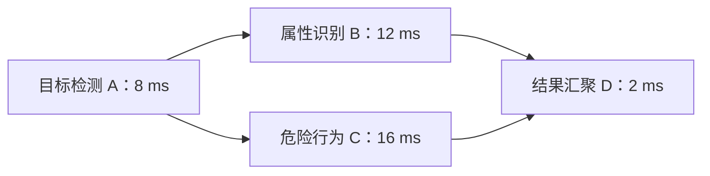
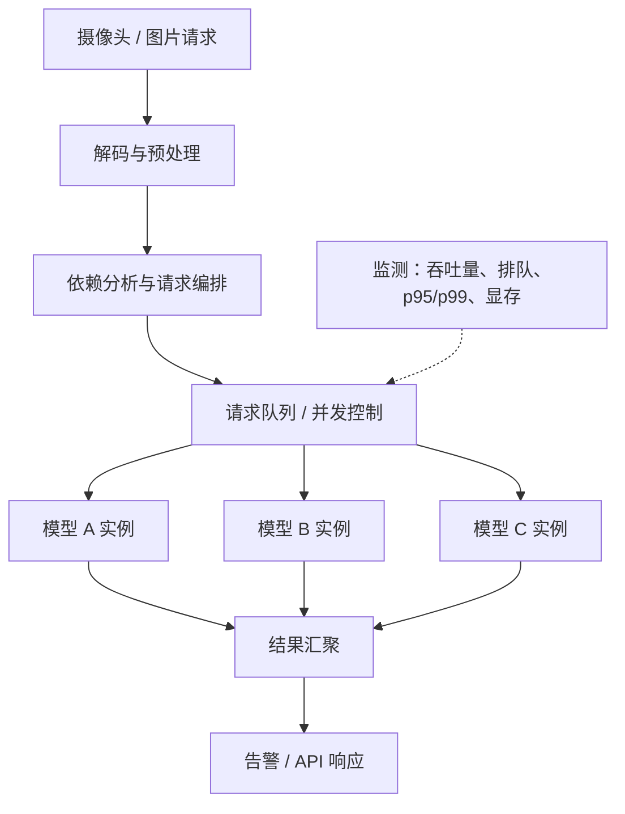

# 三个 AI 模型一起跑，为什么可能比一个一个跑还慢？

# Phase 5：多模型并发与推理服务


> **多模型与多请求并发推理系列 · 第 1 篇｜架构与原理**
>
> **一句话讲透：** 多模型推理不是把三个 `model()` 放进三个线程就能获得三倍速度。真正决定效果的是：任务能否独立、硬件有没有余量，以及你究竟想缩短单次响应，还是提高整套系统的吞吐。
>
> 读完本文，你将理解：独立并行与依赖流水线的区别、GPU 并发的资源边界、延迟与吞吐的取舍、DAG 关键路径，并能运行一个不依赖 GPU 的小实验，亲手观察为什么“任务怎么排”会改变最终完成时间。

> **工程深度｜验证状态：** L2–L3 工程｜概念验证（并发思路为主）
<!-- more -->

> **先说清本系列的边界。** 前五篇讨论**多个完整模型、多个请求的并发调度**（副本并发、请求批处理、服务调度等）；第六篇进一步讨论**把一个模型拆到多张 GPU** 协作完成一次推理（张量并行/流水线并行等模型拆分）。两条线名字相近，含义完全不同，先看表格对号入座：

| 概念 | 含义 | 本系列覆盖 |
|---|---|---|
| **多模型并发推理** | 多个完整模型同时处理任务，共享或分别使用 GPU | ✅ 第 1、5 篇为主 |
| **多请求并发推理** | 同一个完整模型同时处理多个输入批次 | ✅ 第 2、4 篇为主 |
| **跨 GPU 任务调度** | 把完整推理任务分配到不同 GPU | ✅ 第 3 篇为主 |
| **模型并行推理（模型拆分）** | 把一个模型拆分到多张 GPU，协作完成一次推理 | ✅ 第 6 篇（多模型并行推理第六篇） |

对号入座三个例子，避免混淆：

- GPU0 跑人员模型、GPU1 跑车辆模型 → **多模型并发**；
- 四张 GPU 各放一份**完整模型**，分别处理图片 → **模型副本并发（数据并行服务）**；
- 一个模型的不同层、或同一层的不同计算分布在四张 GPU → **模型并行（模型拆分）**（详见第六篇：张量并行/流水线并行）。

所以前五篇要解决的问题是：**多个完整模型、多个请求，如何在一块或几块 GPU 上被高效地调度、传输和服务。** 第六篇转入模型拆分：副本并发、张量并行和流水线并行解决的问题不同，读者应先明确自己的目标。

## 01｜一个奇怪的现场：三位 AI 专家一起工作，报警却更慢了

晚上 10 点，一座智慧园区的监控大屏亮起。

系统每收到一帧画面，就让三个 AI 模型各做一件事：

- **模型 A：人员检测**——画面中有没有人？
- **模型 B：车辆检测**——有没有车辆进入禁停区域？
- **模型 C：烟火识别**——有没有疑似火焰或烟雾？

为了让故事足够清楚，我们先做一个简化：三个模型共享同一帧的解码结果（只有输入规范一致时，预处理张量才能共享），互相不依赖；处理结果最后汇总为一次告警判断。真实烟火识别可能需要连续多帧，这里暂不展开时序建模。

产品经理提出一个看似合理的要求：

> “一帧画面，三个模型各干各的。为什么不同时执行？肯定比排队快。”

工程师将模型并发部署。奇怪的现象出现了：**并发请求提交得更快，某些请求的完成时间却更长**。

这并不矛盾。因为“同时发出三张工作单”，不等于“多出三套计算设备”。

你可以把 GPU 想成一座厨房：三位厨师可以同时下单，但如果厨房只有一套关键设备，大家最终还是要争用它。再多加几位服务员，也不会让锅灶自动变多。

这篇文章不急着介绍 CUDA Streams，也不写复杂的调度器。我们先回答更底层的三个问题：**什么能够并行？并行的极限在哪里？并行究竟优化什么指标？**

先把比较口径讲清楚：本文主要看的是**同一帧的三个模型全部完成需要多久**。业务上真正关心的是这一帧能不能及时告警，而不只是某个模型自己跑了多久。某个请求变慢，和整次告警变慢，其实是两件事——后面会用一张表把这两者分开。

## 02｜同样叫“多模型”，其实有三种不同的工作方式

### 2.1 独立模型并行：三位专家各看各的

```text
                 同一帧视频图像
                       │
                 解码 / 预处理
                       │
            ┌──────────┼──────────┐
            │          │          │
         人员检测    车辆检测    烟火识别
         模型 A      模型 B      模型 C
            │          │          │
            └──────────┼──────────┘
                       │
                 汇总 / 告警
```

**这是任务级并行（task parallelism）**：A、B、C 的输出没有互相依赖，可以在资源允许时重叠执行。

请留意两个词：**“可以”**和**“资源允许时”**。业务上独立，只说明不存在必须先等某个模型输出的依赖，不保证硬件一定能够同时完成计算。

### 2.2 依赖流水线：上一位专家的结果是下一位的输入

另一种业务流程是：先检测出人，再裁剪出目标区域，最后识别安全帽。


对**同一帧、同一个目标**而言，B 必须等待 A 产生检测框；不能因为想并行，就让 B 在不知道裁剪区域的情况下提前执行。

但当视频帧不断进入时，可以让第 2 帧执行 A、第 1 帧执行 B，从而形成**跨输入的流水线并行**。用一个简化例子看清它能带来什么：检测 8 毫秒，安全帽识别 12 毫秒，两个阶段使用可独立工作的资源，并忽略其他开销。

| 排布 | 第 1 帧完成 | 第 2 帧完成 | 第 3 帧完成 |
|---|---:|---:|---:|
| 每帧全部做完再处理下一帧 | 20 ms | 40 ms | 60 ms |
| 跨帧流水线 | 20 ms | 32 ms | 44 ms |

流水线能缩短连续结果之间的间隔：进入稳定状态后，每隔约 12 毫秒就能完成一帧。但它不会消除单帧必须经过的两个计算阶段。表中的数字是相对整体起点的完成时刻；每帧实际等了多久，还要减去它自己的到达时刻。

这里有个前提：**如果两个阶段仍争用同一张已经饱和的 GPU，这种理想节拍未必可达。** 只有两个阶段真正用到可独立工作的资源时，上面的数字才接近现实。

### 2.3 同一个模型的多请求并发：一位专家同时服务多位客户

```text
请求 1 ─┐
请求 2 ─┼──> 同一个“车辆检测”模型 ──> 各自结果
请求 3 ─┘
```

这里可能采用多个模型实例，也可能将多个请求组成 Batch。**模型实例并发、Batch 推理与三个不同模型并行不是一回事**：它们的调度单位、显存需求和性能边界可能完全不同。

NVIDIA Triton Inference Server 明确支持不同模型，以及同一模型的多个实例并发执行，并通过 `instance_group` 配置实例数量；但能否提升性能仍要实际测试。[来源 1](https://docs.nvidia.com/deeplearning/triton-inference-server/user-guide/docs/user_guide/model_execution.html)

先分清工作关系，再讨论 GPU 并行，这是避免架构设计走偏的第一步。

## 03｜36 毫秒的工作，为什么理论上只要 16 毫秒？

回到园区监控。假设单独运行时，三个模型的纯计算阶段分别耗时：

| 模型 | 假设计算耗时 |
|---|---:|
| 人员检测 A | 8 ms |
| 车辆检测 B | 12 ms |
| 烟火识别 C | 16 ms |

这些数字是**教学用假设**，不是具体 GPU 上的实测，也不包含解码、预处理、数据传输、排队和告警汇总。

### 串行：一个接一个

```text
时间（ms）    0         8              20               36
              │─────────│──────────────│────────────────│
单执行位置    [   A   8 ][    B  12   ][      C  16     ]

全部完成：36 ms
```

计算十分直接：$8+12+16=36$ 毫秒。

### 理想并行：三项计算完全重叠

```text
时间（ms）    0         8     12        16
              │─────────│─────│─────────│
资源位置 1    [   A   8 ]
资源位置 2    [      B  12   ]
资源位置 3    [          C  16         ]

全部完成：16 ms
```

如果有**三套足够独立的执行资源**，并忽略并发开销，整批工作最早由最慢的 C 决定：$T_{\mathrm{ideal}}=\max(8,12,16)=16$ 毫秒。

于是一个*仅用于理解极限*的理想加速比为 $S_{\mathrm{ideal}}=36/16=2.25$。

**注意：这里的三条“资源位置”不是 CUDA Streams，也不是自动分配的三个 GPU 核心。** 它只是为了理解调度下界而设定的理想资源模型。

真实单卡 GPU 上，这个 16 ms 不能当作一定可达的性能预测。原因在下一节。

## 04｜GPU 不是三间独立的厨房：并行为什么会变慢？

先说清一件事：**一个模型不是一个占据 GPU 的大任务**。一次 `model(image)` 通常会触发一串 GPU Kernel，例如卷积、矩阵乘法和激活计算。多个模型并发时，真正可能重叠的，是这些 Kernel。

一个 Kernel 能否和另一个一起执行，要看依赖是否满足，以及计算资源、寄存器、共享内存是否允许；即使真的重叠，也可能一起争用显存带宽。**「提交了多个模型」不能直接等同于「模型内部计算充分重叠」。**

沿用前面的厨房比喻：一个模型更像一道包含切菜、炒制、装盘的菜谱。两道菜能不能同时做，要看当下的步骤是不是在争同一口锅。

回到硬件。GPU 内部有许多可执行线程块的计算资源（例如 SM），还有寄存器、缓存、显存带宽等共享资源。多个模型同时提交，不等于每个模型都能独占一份足够大的资源。

假设 A、B、C 的计算都很“饥饿”：

```text
                    一张 GPU
       ┌───────────────────────────┐
模型 A │ 计算单元 / 寄存器 / 缓存   │
模型 B │          竞争             │
模型 C │      显存带宽等           │
       └───────────────────────────┘
```

能不能并行受益，关键看模型执行期间是否留下可利用的资源余量，而不只看模型大小。当单个 Kernel 无法充分占用设备时，其他计算加入就有机会利用空闲资源。

相反，如果某个模型已经接近硬件的计算或带宽瓶颈，强行增加并发可能带来额外争用，导致单次请求变慢。并发还有调度、内存占用及额外队列等成本。

NVIDIA CUDA 文档说明，跨流计算可以具备并发执行能力，但实际并发受到设备能力和资源占用等条件限制；并不是创建了多条 CUDA Stream，就必然发生硬件计算重叠。[来源 2](https://docs.nvidia.com/cuda/cuda-c-best-practices-guide/index.html)

**因此，两个看似相反的结果可以同时成立：**

- 模型留下可利用资源余量时，并行能让整批更早结束。
- 模型已经吃满瓶颈时，强行并发会让单次请求延迟甚至尾延迟上升。

把这句话落到数字上，就得到标题所说的「更慢」：

| 执行方式 | A 完成时间 | B 完成时间 | C 完成时间 | 三项全部完成 |
|---|---:|---:|---:|---:|
| 串行，按 A→B→C | 8 ms | 20 ms | 36 ms | 36 ms |
| 理想并行 | 8 ms | 12 ms | 16 ms | 16 ms |
| 并发争用示例 | 18 ms | 30 ms | 40 ms | 40 ms |

**最后一行是教学假设，不是 GPU 实测。** 三个模型同时提交后，共享带宽和计算资源，原来独占 GPU 时的 8、12、16 毫秒都可能被拉长。

但资源共享首先拉长的是单个模型的耗时。**要让整批完成时间也超过串行的 36 毫秒，还需要有效执行效率下降或额外开销**，例如缓存干扰增加访存、同步成本上升等。单纯「分着用 GPU」，并不足以证明整批一定更慢。

反过来说，假设并发后 A、B、C 分别在 18、25、30 毫秒完成——A 比串行时更晚，但三项全部完成的时间却从 36 毫秒缩短到 30 毫秒。**所以「某个模型更慢」和「整次告警更慢」是两件事。**

从业务视角出发，问题不再是“能否让模型同时跑”，而变成了“**怎样在指定硬件上，让更多工作及时完成，同时不拖慢关键请求**”。

## 05｜最容易混淆的两个指标：延迟和吞吐量

### 延迟（Latency）：一个请求等了多久

从收到一帧画面，到最终告警结果返回，端到端时间大致等于「排队＋预处理＋传输＋计算＋后处理」的总和。这是一个便于分析的阶段分解；如果阶段之间发生重叠，就不能简单地把每段孤立耗时相加，而应以真实端到端墙钟时间为准。

单模型前向传播的 8 ms 与用户最终等待的 8 ms，通常不是同一个指标。

### 吞吐量（Throughput）：单位时间处理多少工作

吞吐量 = 观察窗口内完成的请求数 ÷ 观察窗口秒数。

这里必须明确“请求”指什么：是一帧视频、一个 Batch，还是三模型处理完毕的一次业务告警。**不同口径不能直接比较。**

对持续视频输入来说，提高吞吐量可能意味着每秒能处理更多帧；但某一帧从进入系统到发出告警的等待时间，仍可能增加。

### 一张表看懂取舍

| 优化目标 | 关注什么 | 容易踩的坑 |
|---|---|---|
| 降低单帧延迟 | 单请求端到端完成时间 | 只看模型计算耗时 |
| 提高整套吞吐 | 每秒完成帧数/请求数 | 忽略排队和尾延迟 |
| 缩短批任务 Makespan | 从这批任务开始到最后一个完成所经过的时间 | 误当成每个请求都更快 |
| 稳定在线服务 | p95/p99、超时和丢帧 | 只展示平均值 |

Triton 官方性能分析工具会将请求并发度、吞吐量、延迟及排队耗时放在同一套测试中衡量。这也说明，**并发数本身不是最终 KPI**。[来源 3](https://docs.nvidia.com/deeplearning/triton-inference-server/user-guide/docs/user_guide/optimization.html)｜[来源 4](https://github.com/triton-inference-server/perf_analyzer/blob/main/docs/quick_start.md)

## 06｜一旦存在依赖，决定下限的是“关键路径”

如果三个模型并非独立，而是要先检测目标，再分别进行两种识别，拓扑关系就变了：



假设没有其他开销、各模型计算时间固定，B、C 可在 A 结束后并行：

- A：0～8 ms；
- B：8～20 ms；
- C：8～24 ms；
- D：24～26 ms。

这时业务结果的理论下界不是 `max(8,12,16,2)=16 ms`，而是最长依赖链：

$$
T_{\mathrm{critical\ path}}=8+16+2=26\ \mathrm{ms}
$$

这条路径叫作 **DAG（有向无环图）的关键路径**。

**决定能否并行的第一因素，是任务间的依赖关系；决定能并行多少的第二因素，是硬件资源。**

Triton 的 Ensemble Model 就通过模型间的张量数据流描述这种依赖：上游输出准备好后，下游节点才具备被调度的条件；符合条件的多个下游节点可以并发推进。[来源 5](https://docs.nvidia.com/deeplearning/triton-inference-server/user-guide/docs/user_guide/ensemble_models.html)

但要把两个层次分开：**下游节点「可被调度」，不等于 GPU 上一定立刻发生计算重叠。** 「何时具备执行条件」是调度层的事，「是否真的并行占用硬件资源」是执行层的事，中间还隔着资源争用这一关。

## 07｜动手实验：不需要 GPU，也能模拟任务排布

前面的数字都是推导。现在写一个最小可运行实验：把 GPU 抽象成若干个**独立、同速、同一时刻只能执行一个任务的计算位置**。这个抽象足以解释调度与 Makespan，但它**不等价于真实 GPU 的 SM、Stream 或 Kernel 调度**。

**环境：** Python 3.10+，仅依赖标准库。

```python
# 文件：model_parallel_arch_demo.py
# 只模拟调度的理论时间线；没有 CUDA，也没有 GPU 推理。
from heapq import heappush, heappop

TASKS = [("人员检测", 8), ("车辆检测", 12), ("烟火识别", 16)]


def simulate(tasks, capacity):
    """贪心分配到最早空闲的计算位置，时间单位为 ms。"""
    if capacity < 1:
        raise ValueError("capacity 必须 >= 1")
    # 堆元素：(最早可用时间, 资源编号)
    available = [(0, idx) for idx in range(capacity)]
    timeline = []

    for name, duration in tasks:
        # 每次取出最早空闲的位置
        start, resource = heappop(available)
        finish = start + duration
        timeline.append((resource, name, start, finish))
        heappush(available, (finish, resource))

    makespan = max((finish for _, _, _, finish in timeline), default=0)
    return timeline, makespan


if __name__ == "__main__":
    for capacity in (1, 2, 3):
        timeline, total = simulate(TASKS, capacity)
        print(f"\n资源位置数={capacity}，全部完成={total} ms")
        for resource, name, start, finish in timeline:
            print(f"  位置{resource}: {name:<6} [{start:>2}, {finish:>2})")

    # 换个顺序：让长任务先进入队列，再看完成时间
    long_first = sorted(TASKS, key=lambda task: task[1], reverse=True)
    _, total = simulate(long_first, capacity=2)
    print(f"\n长任务优先，两处资源全部完成={total} ms")
```

运行：

```bash
python model_parallel_arch_demo.py
```

预期输出的核心结果为：

```text
资源位置数=1，全部完成=36 ms
资源位置数=2，全部完成=24 ms
资源位置数=3，全部完成=16 ms

长任务优先，两处资源全部完成=20 ms
```

为什么两处资源时是 24 ms？因为程序按输入顺序贪心分配：

```text
位置 0： A [0, 8) ─── C [8, 24)
位置 1： B [0,12)
                         ↑
                    最后于 24 ms 完成
```

要强调：**24 ms 是这个顺序下的贪心结果，不是理论下界，更不代表任何两张 GPU 都会得到 24 ms。**

两处独立资源的理论下界是多少？总工作量 8+12+16=36 毫秒分到两个位置，均分下界是 18 毫秒；同时它也不能低于最长任务 C 的 16 毫秒，所以下界是 `max(36/2, 16)=18 ms`。但任务不可拆分——C 只能整个占一个位置——本例真正的最优排布是：

- 一个位置执行 C：16 ms；
- 另一个位置执行 A、B：20 ms。

因此最优完成时间是 **20 ms**，既不是 18，也不是 24。

怎么拿到这个 20？保留最早空闲分配方式，只调整任务排序——让耗时长的任务先进入队列即可（完整程序里已经包含这一步）。资源数量没变，完成时间就从 24 毫秒降到 20 毫秒。**长任务优先是启发式方法，并非对所有任务集合都保证最优**，但它已经说明：排布策略本身就能改变结果。

### 进一步想一想：资源再多，为什么也不一定继续快？

独立任务、同质计算位置且不可拆分时，一个常用的理论下界是：**整批完成时间 ≥ “总时长均分到每个位置”与“最长单个任务”两者中的较大者**。其中 `m` 是独立计算位置数，`t_i` 是每个任务时长。对本例而言，哪怕有十处资源，单个 C 也要 16 ms；在假设模型不被拆分的前提下，整批计算不会低于 16 ms。

如果任务有先后依赖，还要同时满足关键路径约束。

**别把这个公式直接当 GPU 性能模型**：真实 GPU 上的任务耗时会随并发、Batch、显存争用、内核选择等变化，不能始终视为固定常数。

## 08｜想把这个架构真正落地，还要补哪几层？

到这里，我们才适合画出一个稍完整的推理服务轮廓：



这个架构至少需要回答四个工程问题。

**第一，输入有没有必要重复搬运？** 三个模型消费同一帧时，应评估是否能共享预处理结果、避免不必要的中间数据复制；但“共享数据”不等于 CUDA Kernel 的 shared memory。

**第二，模型常驻显存还是按需加载？** 模型权重驻留会消耗显存；频繁加载则增加启动和切换成本。

**第三，什么时候应该排队？** 并发请求超过服务能力时，无限制放行只会堆积等待。需要队列容量、限流、超时与优先级策略。

**第四，以什么指标验收？** 对园区烟火告警来说，平均吞吐提高不代表告警体验改善；应优先约定端到端告警 p95/p99 或超时率，再评估吞吐。

NVIDIA Triton 的优化文档给出了一个很好的现实提醒：增加模型实例在某些实验中能提高吞吐，但在动态批处理已经充分利用 GPU 时，再增加实例可能几乎没有收益，反而增大延迟。[来源 3](https://docs.nvidia.com/deeplearning/triton-inference-server/user-guide/docs/user_guide/optimization.html)

### 三个看似“先进”、实际上容易误用的选择

| 做法 | 为什么不能直接视为最优 |
|---|---|
| 开更多 CUDA Streams | 流是执行序列，不是额外硬件计算资源；实际重叠受资源约束 |
| 给每个模型开更多实例 | 可能造成显存与计算争抢，还可能损害延迟 |
| 一味增加 Batch Size | 可能提高吞吐，却增加凑批等待和单请求响应时间 |

这不是反对并行，而是提醒：并行策略需要与工作负载和服务目标一起设计。

## 09｜收束：怎么验证，怎么决策

回到园区那个问题：三个模型一起跑，为什么可能比一个一个跑还慢？因为业务上的“同时做”，未必对应硬件上的“同时算”；当模型争用计算资源时，并发增加的可能是等待和干扰，而不是有效产出。

### 回到真实 GPU 上，怎么验证

本文用的是模拟代码。要判断真实系统里并行到底是帮忙还是添乱，可以按下面这张表去观察：

| 想确认的问题 | 应观察什么 |
|---|---|
| 三个模型是否真正重叠计算？ | GPU Kernel 时间线 |
| 响应变慢是否来自排队？ | 队列时间与端到端延迟 |
| 增加并发是否值得？ | 同一负载下的完成吞吐、p95/p99 和超时率 |
| 是不是只测到了提交速度？ | 计时是否覆盖 GPU 工作完成 |

Nsight Systems 能把 CPU 与 GPU 的活动放到同一条时间线上，适合检查计算是否重叠、瓶颈卡在哪一段。先把问题定义成「要观察什么」，再决定用哪个工具，比罗列一堆新名词更有用。

### 回到园区的决策

要给这套监控系统上线，先把比较做对：先分别测出 A、B、C 单独运行的耗时，了解每个模型的基线；再在相同硬件、输入和请求到达负载下，比较“三模型串行”与“三模型并发”。两组测试都必须完成同样的三项任务，记录每帧全部完成时间、端到端 p95/p99、完成吞吐和超时率。最终按业务目标判断：告警时限是否满足，以及系统能否承接需要的输入量。

下一篇，我们把抽象资源位置换成真实 GPU：**《开了 4 条 CUDA 流，GPU 就能同时推理 4 批图片吗？》** 用 PyTorch + CUDA Streams 观察 Kernel 什么时候真正重叠、什么时候只是排队，以及为什么必须正确计时。

> **留一个问题：** 你的业务里，那几个模型真的需要在同一帧上同时出结果吗？

---

## 参考资料与进一步阅读

1. NVIDIA Triton Inference Server，*Concurrent Model Execution*：https://docs.nvidia.com/deeplearning/triton-inference-server/user-guide/docs/user_guide/model_execution.html
2. NVIDIA，*CUDA C++ Best Practices Guide*（Concurrent Kernel Execution）：https://docs.nvidia.com/cuda/cuda-c-best-practices-guide/index.html
3. NVIDIA Triton，*Optimization*：https://docs.nvidia.com/deeplearning/triton-inference-server/user-guide/docs/user_guide/optimization.html
4. NVIDIA Triton，*Performance Analyzer Quick Start*：https://github.com/triton-inference-server/perf_analyzer/blob/main/docs/quick_start.md
5. NVIDIA Triton，*Ensemble Models*：https://docs.nvidia.com/deeplearning/triton-inference-server/user-guide/docs/user_guide/ensemble_models.html

> **实验说明：** 文中出现的毫秒数字（如 8/12/16、36/24/16/20、并发争用的 18/30/40、流水线的 20/40/60 与 32/44 等）均为明确假设或由附录模拟代码推导的教学数值，并非 GPU 实测结果。文章不声称特定硬件加速比。真实部署须以固定环境下的端到端压测和 GPU 时间线为准。
