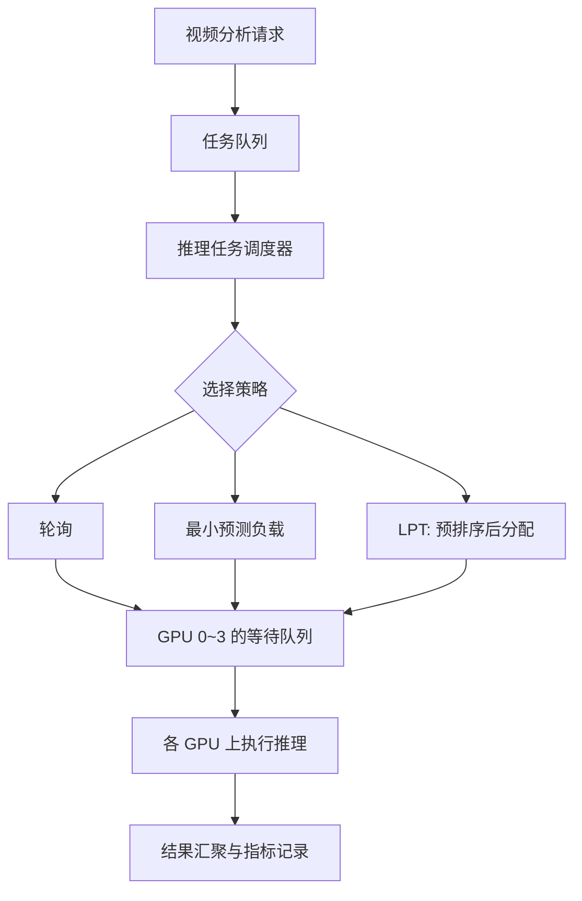
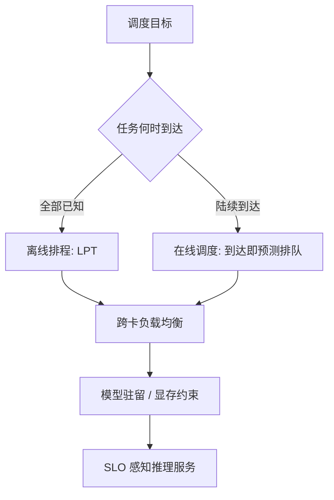

# 10 个推理任务、4 张 GPU：换种排法，整批耗时为何能少 27%？（模拟实验）

> **多模型与多请求并发推理系列 · 第 3 篇｜任务调度与负载均衡**  
> 同样的 GPU，同样的推理任务，不修改神经网络，也不增加显卡，只改变任务的先后顺序与设备分配规则：在一个简化的四卡调度实验中，整批任务的预计完成时间从 2354 ms 降到了 1708 ms。究竟发生了什么？
>
> **阅读收获：** 明白负载均衡到底均衡什么；亲手实现轮询、List Scheduling 和 LPT；分清离线排程与在线动态调度；知道模拟器距离真正的 GPU 推理服务还有多远。

> **工程深度｜验证状态：** L2 工程｜模拟验证为主（与真实 GPU 时间线有差异）
<!-- more -->

> **本篇边界：** 这里每个任务仍在**一张 GPU 上完整执行**，没有把模型拆成多段，也没有跨卡交换模型中间结果——本篇讲的是**跨 GPU 的任务调度**，不是**模型并行**。

## 01｜整批报告迟迟出不来，GPU 却有的已经闲了

晚上十点，一座智慧园区里的异常事件识别系统突然迎来一批视频分析请求：人员检测、车辆识别、烟火检测、异常行为识别……共 **10 个独立推理任务**，调度器有 **4 张 GPU** 可用。

乍看之下，这是一道很简单的分配题：10 个任务，平均给 4 张卡，不就好了？

但监控室很快出现了奇怪的一幕：某张 GPU 已经完成所有工作，另一张还拖着最后一个分析任务。业务上却必须等所有必要的结果归集，才能生成整批分析报告。

```text
智慧园区视频分析平台
     │ 10 个独立的推理任务
     ▼
  ┌───────────────────┐
  │    任务调度器      │  ← 关键问题：任务交给谁？
  └───┬────┬────┬────┘
      │    │    │    │
      ▼    ▼    ▼    ▼
    GPU0 GPU1 GPU2 GPU3
      │    │    │    │
      └────┴────┴────┘
                ▼
         整批分析结果
```

这里最重要的指标，不是“平均每张卡分到几个任务”，而是 **最后一张卡什么时候完成**。

这个时刻叫 **Makespan（最大完工时间）**。如果任务都在时间 0 可执行，并把某张卡上的任务排成队，它等于最忙那张卡的累计执行时间。

> 本文中的 GPU 先被抽象为四个**同质、单任务串行执行的虚拟工作单元**。执行时长是已知预测值，忽略模型加载、拷贝、上下文切换和 Kernel 资源竞争。这样才能先把调度算法讲清楚。文中的数值是可复现的调度计算，**不是真实 GPU 基准测试**。

## 02｜先别谈算法，弄清楚我们究竟在优化什么

10 个任务的预测执行时间（单位 ms）：

| 任务 | M0 | M1 | M2 | M3 | M4 | M5 | M6 | M7 | M8 | M9 |
|---|---:|---:|---:|---:|---:|---:|---:|---:|---:|---:|
| 预计耗时 | 451 | 973 | 638 | 196 | 841 | 512 | 755 | 327 | 609 | 869 |

任务总量是 $W=\sum_{j=0}^{9}p_j=6171$ 毫秒。

如果四张 GPU 完全均匀分摊，平均负载是 $W/4=1542.75$ 毫秒。

但实际任务不可拆分，故最优完工时间至少满足：

$$
C_{\max}^{*}\geq \max\left(\frac{\sum_j p_j}{m},\ \max_j p_j\right)
$$

其中 $m=4$，最大单任务时长是 973 ms。因此本例的下界为 **1542.75 ms**（若执行时间采用整数毫秒，则最优 Makespan 至少为 1543 ms）。

这个下界不是“必定能达到的结果”，而是一把尺子：它能帮助我们评价调度策略与理想分配之间还有多少差距。

要特别分清另外两个指标：

- **Makespan**：这一批任务全部完成需要多久；适合离线批处理、并行分析作业。
- **请求延迟**：某个任务从到达至完成经历多久，包括排队；适合实时告警。
- **吞吐量**：单位时间完成多少请求；适合持续运行的推理服务。

**批任务完成得快，不代表每一个紧急请求都及时。** 这也是我们在文章后半部分还要讨论“在线调度”的原因。

## 03｜第一种排法：轮流发任务，看似公平却未必高效

最省脑的方案叫 **Round Robin（轮询）**：

```text
M0 → GPU0    M1 → GPU1    M2 → GPU2    M3 → GPU3
M4 → GPU0    M5 → GPU1    M6 → GPU2    M7 → GPU3
M8 → GPU0    M9 → GPU1
```

它强调的是“分配顺序公平”，没有考虑任务大小。最后得到：

| GPU | 分配任务 | 累计耗时 |
|---|---|---:|
| GPU0 | M0, M4, M8 | 1901 ms |
| GPU1 | M1, M5, M9 | **2354 ms** |
| GPU2 | M2, M6 | 1393 ms |
| GPU3 | M3, M7 | 523 ms |

可以想象：GPU3 早已忙完，GPU1 还要继续工作很久。

```text
时间轴（示意，数字为结束时刻）
GPU0 [M0 451][M4 1292][M8 1901]
GPU1 [M1 973][M5 1485][M9 2354]  ← 最后完成
GPU2 [M2 638][M6 1393]
GPU3 [M3 196][M7 523]

            全部任务完成：2354 ms
```

“每张卡分到差不多数量的任务”并不是资源均衡。真正决定尾部完工时间的是 **耗时负载**。

## 04｜第二种排法：谁的活少，就把新任务给谁

先不要改变任务输入顺序。我们只改变一个规则：

> 把当前新任务交给 **已分配总耗时最小** 的 GPU。

这就是经典的 **List Scheduling（列表调度）** 的一种形式。它用贪心方法逐个决定任务归属。

```python
# 每张 GPU 的预测累计工作量
loads = [0, 0, 0, 0]

for model_id, cost_ms in enumerate(task_sizes):
    gpu_id = min(range(4), key=lambda g: (loads[g], g))
    loads[gpu_id] += cost_ms
    print(model_id, '->', gpu_id)
```

这里最关键的一句不是 `+=`，而是：

```python
gpu_id = min(range(4), key=lambda g: (loads[g], g))
```

它在四张卡中找出**当前预测累计负载最小**的一张。`(loads[g], g)` 中第二个元素专门处理平局：负载相同时，选择编号较小的 GPU，让实验结果稳定可复现。

在 10 个任务上执行后：

| GPU | 分配任务 | 累计耗时 |
|---|---|---:|
| GPU0 | M0, M5, M7 | 1290 ms |
| GPU1 | M1, M8 | 1582 ms |
| GPU2 | M2, M6 | 1393 ms |
| GPU3 | M3, M4, M9 | **1906 ms** |

读前几步会更直观：M0（451 ms）先落到全空的 GPU0；M1（973 ms）落到 GPU1；到 M4（841 ms）时，GPU3 累计只有 196 ms（放着 M3），于是 M4 被放到了 GPU3 上。

整批任务完工时间从 2354 ms 降到了 **1906 ms**。注意，它已经好很多，但仍有一张卡承担了明显较长的任务链。

为什么？因为当调度器读到最后的 M9（869 ms）时，只能把它放到当下最轻的一张卡上，已经放进去的任务不能再改派。

这种策略只看**当前局面**，没有利用“后面还有哪些大任务”的信息。

## 05｜第三种排法：让“大件”先占位置——LPT

假设你搬家，有几件大沙发和很多小箱子。通常会先把大件放进车厢，再用小箱子填缝；若反过来，可能最后只剩零散空间，却装不下沙发。

LPT（**Longest Processing Time first**，最长处理时间优先）使用类似思路：

1. 先将已知任务按预计耗时**从长到短排序**；
2. 再把每个任务交给**当前预测负载最小**的 GPU。

注意：**LPT = 排序 + 最小负载分配**。单纯选择最小负载 GPU，而不排序，不叫 LPT。

```python
jobs = sorted(
    enumerate(task_sizes),
    key=lambda job: (-job[1], job[0])
)

loads = [0] * 4
for model_id, cost_ms in jobs:
    gpu_id = min(range(4), key=lambda g: (loads[g], g))
    loads[gpu_id] += cost_ms
```

本例得到：

| GPU | 分配任务 | 累计耗时 |
|---|---|---:|
| GPU0 | M1, M0 | 1424 ms |
| GPU1 | M9, M5, M7 | **1708 ms** |
| GPU2 | M4, M8 | 1450 ms |
| GPU3 | M6, M2, M3 | 1589 ms |

```text
轮询      2354 ms ┃████████████████████████
List      1906 ms ┃███████████████████
LPT       1708 ms ┃█████████████████
                 └── 越短越好
```

改变任务顺序和设备分配规则后，本例的预计 Makespan 相比轮询下降约 $(2354-1708)/2354\times100\%\approx27.4\%$，也就是完成耗时**少了约 27%**（对应的完成时间加速比约 $2354/1708\approx1.38\times$——「耗时少 27%」和「速度快 38%」是同一件事的两种说法，别把两者混用）。

相对于不预排序的 List Scheduling，下降约 **10.4%**。

**请注意这里优化的是一整批任务的完工时间，而不是每个模型自身的执行耗时。** 单个模型的计算并没有因为调度算法而突然变快。

### LPT 是不是最优算法？

不一定。它是一个带近似保证的贪心算法，不是每次都找到最优解。就本文这组任务而言，三种结果可以放在一起看：

| 量 | 数值 | 含义 |
| --- | ---: | --- |
| 理论下界 | 1543 ms | 不可突破的下限（§02 的 1542.75 ms 向上取整） |
| 实际最优排程 | 1582 ms | 对 10 个任务穷举搜索得到的最优 Makespan |
| LPT 排程 | 1708 ms | 本文贪心算法的结果 |

一种达到最优 1582 ms 的分配如下：

| 虚拟 GPU | 任务 | 累计时长 |
| --- | --- | ---: |
| GPU0 | M1、M8 | 1582 ms |
| GPU1 | M9、M2 | 1507 ms |
| GPU2 | M4、M5、M3 | 1549 ms |
| GPU3 | M6、M0、M7 | 1533 ms |

LPT 得到 1708 ms，比最优值 1582 ms 高出约 8%：它的价值是**快速给出一个较好的排程**，而不是保证每次找到最优解。（穷举代码见附录，正文不展开。）

理论上，Graham 在 **独立、不可抢占的任务 + 相同处理速度的并行机器 + 全部任务预先已知 + 最小化 Makespan** 这一经典模型中给出了近似界：

$$
C_{\max}^{LPT}\leq
\left(\frac43-\frac1{3m}\right)C_{\max}^{*}
$$

通俗说：在上述严格假设成立时，LPT 的最坏完成时间不超过最优值的 1.25 倍。这不是说 LPT 总比其他策略快 25%，也不意味着在真实异构 GPU 集群里仍有同样的保证。原始结果见 [Graham 1969, *Bounds on Multiprocessing Timing Anomalies*](https://doi.org/10.1137/0117039)。

## 06｜把问题画成一张图：调度器到底管哪一层？



这里必须把三个层级分开：

- **调度层**：决定任务放在哪张 GPU、排在谁后面。
- **执行层**：具体模型是否已加载、显存是否充足、Kernel 能否并发。
- **观测层**：记录预测耗时、实际耗时、排队等待和失败原因。

上一篇 CUDA Streams 讨论的是**一张卡内部**的执行序列与 Kernel 重叠；本文讨论的是**任务跨卡分配和排队**。二者是互补关系，而非相互替代。

## 07｜动手验证：一个不需要 GPU 的小型调度实验

为了聚焦算法，先用**确定性时间轴模拟**，不借助 `sleep`、线程池或真正的 CUDA。

它的好处是：同一组任务在任何电脑上都会得到相同的排程结果；它的限制也很明确：只能验证分配逻辑，不能测试真实显卡的硬件吞吐。

核心代码如下，完整可运行版本见配套文件 `32-multi_gpu_scheduler_demo.py`。

```python
from dataclasses import dataclass

TASKS = [451, 973, 638, 196, 841,
         512, 755, 327, 609, 869]

@dataclass(frozen=True)
class Slot:
    task: int
    gpu: int
    start: int
    end: int


def static_schedule(sizes, num_gpus, policy):
    loads = [0] * num_gpus
    timeline = []
    jobs = list(enumerate(sizes))

    if policy == 'lpt':
        jobs.sort(key=lambda x: (-x[1], x[0]))

    for task_id, duration in jobs:
        if policy == 'round_robin':
            gpu = task_id % num_gpus
        else:
            gpu = min(range(num_gpus),
                      key=lambda g: (loads[g], g))

        start = loads[gpu]
        loads[gpu] += duration
        timeline.append(Slot(task_id, gpu, start,
                             loads[gpu]))

    return timeline, loads

for policy in ('round_robin', 'list', 'lpt'):
    plan, loads = static_schedule(TASKS, 4, policy)
    print(policy, loads, 'makespan=', max(loads))
```

本机实际输出（纯 Python、确定性复现）：

```text
round_robin [1901, 2354, 1393, 523] makespan= 2354
list        [1290, 1582, 1393, 1906] makespan= 1906
lpt         [1424, 1708, 1450, 1589] makespan= 1708
```

这里不需要真正启动四个线程：每张虚拟 GPU 的 `loads[gpu]` 就是下一项任务可开始的预计时间，新的任务从这个时刻排到队尾。我们因此可以直接构建每个任务的 `[start, end)` 区间。

### 为什么不直接用 `ThreadPoolExecutor(max_workers=4)`？

因为 **4 个工作线程 ≠ 四张 GPU 的执行队列**。

若只写：

```python
with ThreadPoolExecutor(max_workers=4) as pool:
    pool.submit(gpu_inference_task, gpu_id, task_id, size)
```

线程池只能限制同一时刻最多有几个 Python 调用在运行，并不能保证“分给 GPU0 的两个任务一定按序串行、而 GPU1 有独立队列”。若任务体只是 `time.sleep()`，更不会消耗 GPU 计算资源。

若想演示实时执行，至少要为每张虚拟 GPU 建立自己的队列与 worker，或使用与 GPU ID 绑定的串行执行器。更重要的是区分 `predicted_duration` 与 `actual_elapsed`。参考 [Python concurrent.futures 官方文档](https://docs.python.org/3/library/concurrent.futures.html)。

## 08｜一个更难的问题：任务不是一起到达，而是随时进来

现在故事变了：园区白天有零星推理请求，夜间某些摄像头突然触发事件。调度器一开始不知道下午还会来哪些任务，自然无法把未来的任务全部排序再做 LPT。

这时问题就从**离线调度**变成了**在线调度**。

```text
时间 →
0 ms        100 ms      250 ms       300 ms       600 ms
 │             │           │            │            │
 M0(400)      M1(600)     M2(200)      M3(500)      M4(300)
 │             │           │            │            │
 └─────────────┴───────────┴────────────┴────────────┘
                       在线调度器
              每次只能看到已经到达的任务
```

在这个阶段，`gpu_loads` 的语义必须重新设计。

**错误理解：** 从开机到现在累计派发了多少毫秒，就认为 GPU 当前仍承担这么多工作。

**更有用的预测：** 某张 GPU 已经排队的任务，预计到什么时候才能完成？

对于同质且每卡严格串行的虚拟设备，可以维护 `available_at[g]`：任务 j 在 GPU g 上的预计开始时刻与完成时刻为

$$
\widehat S_{j,g}=\max(a_j,\widehat A_g),\qquad
\widehat F_{j,g}=\widehat S_{j,g}+\widehat p_{j,g}
$$

即用「任务到达时刻」与「该卡已排队任务预计完成时刻」中较大者作为开始，再加上预计执行时长得到完成。其中：

- $a_j$：任务到达时间；
- $\widehat A_g$：GPU g 已分配任务的预计队列完成时刻；
- $\widehat p_{j,g}$：任务 j 在 GPU g 上的预计执行时间；同质假设下可写为 $\widehat p_j$。

然后选择预计完成时间最早的 GPU。对同质 GPU，选择 `max(available_at[g], arrival)` 最小的 GPU 即可，因为相同任务的预测执行时长在所有 GPU 上相等。

```python
available_at = [0, 0]

def allocate_online(task_id, arrival_ms, cost_ms):
    gpu = min(range(2), key=lambda g:
              (max(available_at[g], arrival_ms), g))
    start = max(arrival_ms, available_at[gpu])
    finish = start + cost_ms
    available_at[gpu] = finish
    return gpu, start, finish
```

**代码前提：** 任务按到达时刻顺序调用；一旦派发不改派；每张卡内部严格串行；预测时长暂时视为准确。

拿开头的五个在线任务跑一遍，结果是：

| 任务 | 到达时刻 | 执行时长 | 分配 GPU | 开始时刻 | 完成时刻 |
| --- | ---: | ---: | ---: | ---: | ---: |
| M0 | 0 | 400 | 0 | 0 | 400 |
| M1 | 100 | 600 | 1 | 100 | 700 |
| M2 | 250 | 200 | 0 | 400 | 600 |
| M3 | 300 | 500 | 0 | 600 | 1100 |
| M4 | 600 | 300 | 1 | 700 | 1000 |

**只看关键一步：** M4 在 600 ms 到达时，GPU0 已被安排到 1100 ms，GPU1 被安排到 700 ms。虽然两张卡都有历史工作量，但当前真正有用的信息是——**哪张卡能更早接手新任务**。所以 M4 落到了 GPU1。

**动态调度不是「任务一结束，就把过去的历史累计负载清零」这么简单。** 它需要真实到达事件、预计完成时间、执行反馈，并考虑不可抢占任务是否已开始。若时长预测错误，还要及时修正队列尾部的预测。

### 在线调度是不是直接更好？

并不总是。离线场景知道所有任务，LPT 可以利用全局信息；在线场景只能使用已到达的信息，但系统仍可允许有限等待、对待执行任务重排——**并非所有在线策略都必须「到达即永久绑定」**。信息更少、也更灵活，两者优化目标也可能不同：离线作业侧重 Makespan，而告警服务可能更关心 **p99 延迟和截止时间违约率**。

设想只有 196 ms 的 M3 是一条烟火告警。在当前 LPT 排程中，它要等到 1393 ms 才开始、1589 ms 才完成；若业务要求它在 500 ms 内返回，这份排程虽然整批完成得更快，却已经违反告警时限。在真实业务里，重要的不只是「谁先跑完全部任务」，还包括「紧急任务能否在规定时间前出结果」。

## 09｜现实中的 GPU，比这道数学题更复杂

真正上线时，调度器至少要回答四个问题。

### ① 这些 GPU 一样快吗？

不一定。异构 GPU 下，同一模型在两张卡的预计耗时可能不同，调度必须使用 $\widehat p_{j,g}$，而非一个全局的 `task_size`。

### ② 模型是不是已经在显存里？

某张卡当前队列短，却可能需要从磁盘或主机内存加载几 GB 权重。调度时只看预计推理时间，就会选错设备。

```text
预计完成时间（简化）
  = 预计排队等待
  + 必要的模型加载 / 数据准备
  + 预计推理执行
  + 必要的收尾开销
```

上述求和是一个便于解释的串行成本模型；真实系统中的部分传输与计算可以重叠，需建立更细粒度的预测。

### ③ 同一 GPU 一定只能跑一个任务吗？

不一定。第二篇已经讨论 CUDA Streams 可能使 GPU Kernel 重叠。同卡多任务并发时，任务耗时会彼此影响，简单累加时长不再准确。真实服务还需要控制同时执行的模型实例数量、显存预算和资源竞争。

### ④ 能否只追求 GPU 利用率？

也不行。高 GPU 利用率不自动等于良好体验。当排队持续增长时，吞吐量可能很高，用户却要等很久。必须一起观察请求到达率、队列等待、模型执行时间、p95/p99 延迟、显存峰值和超时率。

这并不是纸上谈兵。NVIDIA Triton Inference Server 支持多模型和多实例并发，并提供模型实例、请求调度、动态批处理和跨模型限流机制。例如，官方 Rate Limiter 可通过配置资源需求与优先级来控制模型实例的执行，避免过多模型同时执行造成过载甚至内存不足——但要注意，它**不是**自动测量剩余显存、再执行 LPT 的跨卡调度器。参见 [Concurrent Model Execution](https://docs.nvidia.com/deeplearning/triton-inference-server/user-guide/docs/user_guide/model_execution.html) 和 [Rate Limiter](https://docs.nvidia.com/deeplearning/triton-inference-server/user-guide/docs/user_guide/rate_limiter.html)。

## 10｜从实验走向真实系统：两条分支，而非固定路线



离线 LPT 与在线调度是**适用场景不同的两条分支**，不是所有系统都必须依次升级的台阶：任务能提前攒齐就适用离线排程，请求随时到达就适用在线调度。真正的工程演进发生在它们**汇合之后**——当负载均衡还要顾及模型驻留、显存约束与服务目标（SLO）时。

工程落地时，我建议采用下面的层次，而不是给一个 `ThreadPoolExecutor` 不断加 if：

```text
┌──────────────────────────────────────┐
│ 接入层：请求 ID / 优先级 / 截止时间    │
├──────────────────────────────────────┤
│ 预测层：模型-设备耗时 / 显存需求       │
├──────────────────────────────────────┤
│ 调度层：设备选择 / 队列 / 准入控制     │
├──────────────────────────────────────┤
│ 执行层：GPU worker / 模型实例 / CUDA   │
├──────────────────────────────────────┤
│ 观测层：排队 / 吞吐 / p99 / 失败原因  │
└──────────────────────────────────────┘
```

这张架构图也告诉我们，**调度算法只是推理服务的决策大脑，而不是整套推理服务本身**。

## 11｜读完自测：三个问题

**问题一：List Scheduling 和 LPT 有什么区别？**

前者按给定顺序逐个选择当前负载最小的设备；后者先按预测处理时间降序排列，再做相同的贪心选择。排序是关键差异。

**问题二：为什么当前 `gpu_loads` 不是真正的动态负载？**

因为它只是所有历史分配工作量之和。任务完成后，历史总量不会减少；在线调度需要维护待完成任务的预测状态，结合到达时间与执行反馈。

**问题三：为什么 1708 ms 不能叫“四张 GPU 实测推理耗时”？**

因为代码未调用 GPU，也没考虑并发、拷贝、模型加载、设备差异与预测误差。它验证的是调度算法在明确假设下的排程结果。

## 结语｜GPU 不会自己把活分好

回到最初的园区监控室。10 个推理任务、4 张虚拟 GPU，轮询把整批工作拖到 **2354 ms**；让调度器按已分配负载选卡，降到 **1906 ms**；再让大任务先排队，降到 **1708 ms**。

这次改变的不是神经网络结构，不是 GPU 算力，也不是 CUDA Kernel，而是**任务如何被安排**。

但这不意味着 LPT 是所有推理服务的万能答案。一旦任务实时到达、模型大小不同、GPU 性能不同，或必须保护紧急告警的截止时间，调度就从“分配数学题”变成了“面向真实资源与服务目标的系统设计”。

**下一篇预告：**《GPU 为什么总在等数据？用 CUDA 流水线把传输时间藏起来》——跨 GPU 的任务安排讲清楚之后，我们回到单张 GPU，看看如何让数据搬运和计算尽量重叠，而不是让昂贵的算力空等。

> **放到今天看：** 大模型服务同样需要在资源约束下安排工作，但调度单位往往细化为**序列和 Token**，任务耗时也会随生成过程变化。本文的 LPT 模型适合建立跨设备负载分配的直觉，不能直接替代连续批处理调度器。调度算法是输入，SLO 才是输出。

---

## 附录｜复现实验与参考资料

**运行环境：** Python 3.10+，无需 NumPy、PyTorch、CUDA 或实际 GPU。

完整脚本：`32-multi_gpu_scheduler_demo.py`

```bash
python 32-multi_gpu_scheduler_demo.py
```

脚本里的 `static_schedule(sizes, num_gpus, policy)` 会校验 GPU 数与任务时长，并对未识别的 `policy` 直接抛错——避免策略名拼错时静默退化成 List Scheduling。

**这组任务的最优解（穷举）：** 10 个任务分到 4 张卡共有 $4^{10}$ 种指派，直接枚举即可确认最优 Makespan：

```python
import itertools
T = [451, 973, 638, 196, 841, 512, 755, 327, 609, 869]
best = min(
    max(sum(T[i] for i in range(len(T)) if a[i] == g)
        for g in range(4))
    for a in itertools.product(range(4), repeat=len(T))
)
print(best)   # 1582
```

建议进一步尝试：把 M9 的执行时间从 869 改成 2000，观察三种策略变化；把 GPU 数从 4 改为 2；再为每个任务加入真实 `arrival_ms`，观察离线 LPT 为什么无法直接用于实时到达的请求。

**参考资料（官方/原始技术来源）：**

1. Graham, R. L. (1969). *Bounds on Multiprocessing Timing Anomalies*. SIAM Journal on Applied Mathematics：[doi:10.1137/0117039](https://doi.org/10.1137/0117039)。
2. LPT 近似算法的教学概述：[Scheduling on parallel machines: longest jobs first](https://fabiofurini.github.io/combinatorial-optimization/heuristic-algorithms/constructive-heuristics/scheduling-on-parallel-machines-longest-jobs-first/)。
3. Python 官方文档：[concurrent.futures — Launching parallel tasks](https://docs.python.org/3/library/concurrent.futures.html)。
4. NVIDIA Triton 官方文档：[Concurrent Model Execution](https://docs.nvidia.com/deeplearning/triton-inference-server/user-guide/docs/user_guide/model_execution.html)。
5. NVIDIA Triton 官方文档：[Rate Limiter](https://docs.nvidia.com/deeplearning/triton-inference-server/user-guide/docs/user_guide/rate_limiter.html)。
6. NVIDIA Triton 官方文档：[Schedulers](https://docs.nvidia.com/deeplearning/triton-inference-server/user-guide/docs/user_guide/scheduler.html)。

> **实验说明：** 上述 2354 / 1906 / 1708 ms 数字可由配套脚本确定性复现，属于预测任务时长下的模拟 Makespan，不应写成在某款实际 GPU 上测得的吞吐率或加速比。其中 1582 ms 是该简化模型的最优 Makespan，同样来自确定性枚举，也不代表真实 GPU 集群能达到的结果。
