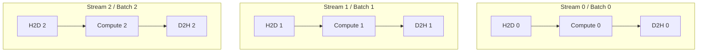
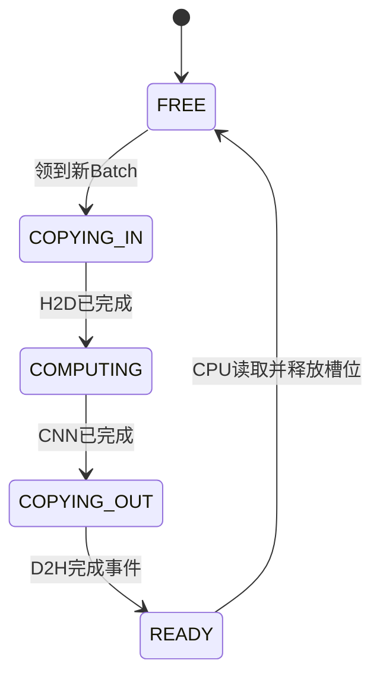

# GPU 明明算得很快，为什么还在等数据？——用 CUDA Streams 搭一条推理流水线

> **多模型与多请求并发推理系列 · 第 4 篇：Pinned Memory、异步传输与跨批次重叠**  
> 一句话：优化推理不只是让 GPU 的 Kernel 更快，还要让**下一批数据的搬运**与**上一批数据的计算**尽量交叠；但 `non_blocking=True`、Pinned Memory 与多条 CUDA Stream，任何一个单独使用都不保证加速。

<!-- more -->

> **本篇边界：** 本篇研究**同一个模型的多批次**在传输与计算之间的重叠，用来解释多模型服务同样会遇到的数据路径机制；它不直接证明多个不同模型共享 GPU 的性能收益。

> **工程深度｜验证状态：** L2 工程｜静态复核 + 逻辑验证（传输重叠需上机实测）
## 01｜一个奇怪的监控系统：GPU 算完了，报警还没出来

夜里 11 点，智慧园区的摄像头捕捉到一辆汽车驶入禁行区域。系统要依次完成图像预处理、输入上传 GPU、车辆识别、结果下载 CPU、业务规则判定。

> 说明：本文用一个十分类 CNN 来示范其中的「上传 → 推理 → 回传」执行机制，**它不是一套完整的车辆检测系统**——不涉及检测框回归、目标跟踪或多类别业务规则，业务场景只是用来解释数据路径。

团队先把 CNN 换成了更快的推理版本。前向传播从 8 ms 缩短到 5 ms，但监控平台端到端延迟改善有限：Profiler 里一段一段的灰色空白，仍然把各批次隔开。

为什么？**模型推理不是只有 `model(x)`。** 数据还得进来，结果还得出去。特别是持续输入的摄像头，逐批处理可能浪费了独立于 GPU 算力的传输资源。

不妨先做一个**教学假设**，它不是实测：每批 H2D（主机到设备）3 ms、CNN 前向 5 ms、D2H（设备到主机）2 ms。那么一批需要 10 ms，三批串行需要 30 ms。但如果不同批次的 H2D、Kernel、D2H 能占用不同硬件引擎并有效重叠，三批的完成时间有机会明显缩短。

```
一批请求的端到端路径

摄像头 → 解码/预处理 → CPU RAM → [H2D] → GPU CNN → [D2H] → CPU 规则引擎
                                3 ms       5 ms       2 ms
                                     ↑ 教学数字，非实际测量
```

本篇回答四个问题：

1. 为什么 `.to("cuda")` 可能阻塞 CPU？
2. Pinned Memory 与 `non_blocking=True` 各自负责什么？
3. 如何用 CUDA Streams 为**多批次**构建流水线，而不破坏依赖？
4. 怎样证明复制与计算真的发生重叠，而不是只写出了异步语法？

> **与前三篇的分工**：第一篇讲架构与关键路径；第二篇讲 GPU 上的多 Stream 计算并发；第三篇讲多 GPU 的任务分配；第四篇只讨论**单 GPU 上、不同批次的数据搬运与计算重叠**。这里依然是同一个 CNN 处理多批图像，不是多个不同模型争抢 GPU。

## 02｜GPU 的推理时间，到底漏算了什么？

很多基准测试只测 GPU Kernel：在设备上提前准备好输入，运行 `model(gpu_tensor)`，再读取 CUDA Event 耗时。这适合测纯计算，但不等于视频业务端到端耗时。

真正的数据路径是：


为保持实验公平，需要分别量测：CPU 预处理、H2D、GPU Compute、D2H、CPU 后处理，以及整个请求从进入到响应的时间。本文的附带程序聚焦 **H2D + GPU Compute + D2H**；它**不包含摄像头解码、磁盘读取和真实网络接入**，因此不能把它的加速比直接当作监控系统的端到端加速比。

### 三个指标，不要混用

- **单批延迟（Latency）**：单个批次从开始上传到结果可消费的时间。
- **吞吐量（Throughput）**：稳定时间窗内处理的图片张数/秒或批次数/秒。
- **批次总完工时间（Makespan）**：一组固定批次全部完成的时间。

流水线优化尤其容易降低多批次的 Makespan、提高稳态吞吐；单个孤立请求通常仍需经历完整的 H2D→Compute→D2H 关键路径。**不能把“总吞吐更高”写成“每条报警一定更快”。**

## 03｜第一道门：主机内存为什么要 Pin？

系统 RAM 里的普通（Pageable）内存可能被操作系统换出或迁移；GPU 的 DMA 复制希望源缓冲区的物理页面在传输期间保持可用。CUDA 支持通过 **Pinned / Page-locked Memory（页锁定内存）** 为异步的主机—设备拷贝提供条件。

**先澄清一个常见误解：页锁定内存仍然位于 CPU RAM。** 它只是让相关内存页在传输期间保持可用，为 DMA 异步传输提供条件；它既不会自动把数据放进显存，也不会阻止程序修改数据。

```
普通 Pageable 数据：
CPU Pageable RAM ──[可能涉及中间暂存/固定页面]──> GPU 显存

预先准备的 Pinned 数据：
CPU Pinned RAM ─────────[DMA 传输]────────────> GPU 显存
```

Pinned 内存并不是 GPU 的 CUDA Shared Memory。前者位于**主机 RAM**，后者是 CUDA Kernel 内线程块使用的**片上共享内存**；名字相似，层次完全不同。

PyTorch 的基本写法：

```python
# CPU 上的页锁定内存（初始化时创建）
x_host = torch.randn(64, 3, 32, 32, pin_memory=True)

# 在指定 Stream 中发起主机到设备复制
with torch.cuda.stream(copy_stream):
    x_device.copy_(x_host, non_blocking=True)
```

但要区分三件事：

- **Pinned Memory** 是内存属性，为可靠的设备侧异步传输提供条件；
- **`non_blocking=True`** 表示复制可能异步于调用的 CPU 线程，不代表该复制一定与 Kernel 重叠；
- **不同非默认 Stream** 让相互独立的复制与计算有机会被安排重叠，还必须满足设备有相应拷贝引擎、数据依赖正确等条件。

> PyTorch 官方教程还提醒：在热路径里现做 `tensor.pin_memory().to(device, non_blocking=True)` 可能比直接 `.to(device)` 更慢——`pin_memory()` 本身可能产生阻塞的 CPU 拷贝。更合理的方式是**提前创建 Pinned 缓冲区**，或者通过 `DataLoader(pin_memory=True)` 在数据加载流程中准备。参见文末官方资料 [1]。

过量锁页也有代价：它占用主机内存、增加系统压力，而且显卡拷贝引擎与 PCIe 带宽不是无限的。

## 04｜第二道门：异步提交，不等于复制与计算重叠

先看容易误导人的代码：

```python
for batch in batches:
    x = batch.to("cuda", non_blocking=True)
    y = model(x)
    result = y.cpu()  # 默认阻塞式结果搬运
```

即使 H2D 提交可以异步返回，循环中的 `.cpu()` 往往需要等待当前 GPU 输出完成，导致 CPU 线程难以连续提交后续批次。**同步点藏在看似普通的张量转换里。**

再看另一类错误：

```python
with torch.cuda.stream(s_copy):
    x_gpu.copy_(x_cpu, non_blocking=True)
with torch.cuda.stream(s_compute):
    logits = model(x_gpu)   # 错：尚未建立 H2D 完成依赖
```

这里 Kernel 可能在输入尚未上传完成时读数据，存在竞态。正确做法是让计算 Stream 等待复制完成的 Event，或者将一批次依次相关的 H2D、Compute、D2H 放在**同一 Stream** 内（同流指令按顺序执行）。不同批次各用不同 Stream，才有正确的跨批并发机会。



这张图表达的是**依赖与可提交关系**，不是保证在设备上会画出三个整齐重叠的色块。CUDA 文档指出：重叠程度与设备是否配备独立的拷贝引擎、Kernel 占用、命令提交顺序等因素有关 [2]。

## 05｜为什么流水线能变快？先拿铅笔算一遍

仍用教学数字：H2D=3ms，Compute=5ms，D2H=2ms；每批次三个阶段必须串行，但**不同批次可以并发占用不同引擎**。

### 情况 A：完全串行

```
时间(ms): 0   3     8  10  13    18 20  23    28 30
Batch 0 : [H2D][ KKKKK ][D2H]
Batch 1 :                 [H2D][ KKKKK ][D2H]
Batch 2 :                                  [H2D][ KKKKK ][D2H]
总计：30 ms
```

### 情况 B：理想化的三阶段流水线

如果 H2D、Compute、D2H 可以使用相互独立的引擎，且三个阶段分别保持各自的顺序，以下是一个合法的理想时间表：

| 批次 | H2D | Compute | D2H | 完成 |
|---|---|---|---|---:|
| 0 | 0–3 | 3–8 | 8–10 | 10 ms |
| 1 | 3–6 | 8–13 | 13–15 | 15 ms |
| 2 | 6–9 | 13–18 | 18–20 | 20 ms |

三批只需 20 ms，而不是 30 ms，教学案例的 Makespan 改善为 33.3%。**这是理想化阶段重叠模型的算术推导，不是硬件跑分**。

当批次数足够多且流水线达到稳态，三阶段独立资源、固定耗时的理想吞吐节拍受最慢阶段限制：

$$
T_{\mathrm{cycle}} \geq \max(T_{\mathrm{H2D}}, T_{\mathrm{compute}}, T_{\mathrm{D2H}})
$$

如果三阶段分别为 3、5、2 ms，那么稳态瓶颈为计算阶段 5 ms/批。在理想条件下，N 批的完成时间近似：

$$
T_{\mathrm{ideal}}(N) = T_{\mathrm{H2D}} + T_{\mathrm{compute}} + T_{\mathrm{D2H}} + (N-1)\max(T_{\mathrm{H2D}}, T_{\mathrm{compute}}, T_{\mathrm{D2H}})
$$

换成上面的数字：第一批走完整条路径需要 10 ms；流水线填满后，理想情况下每隔 5 ms（最慢的计算阶段）再完成一批。

这个公式给的是**理想完成时间下限**——对完成时间它是乐观下限，对应的**理想吞吐才是上限**。现实里完成时间通常更长、实际吞吐可能低于理想值，因为每个阶段未必有完全独立的资源，还存在额外竞争与启动开销。所以不要把它当成预期加速比。

回头看上面的时间表，还有一点值得注意：Batch 1 从它自己开始上传到完成是 12 ms，Batch 2 是 14 ms，都比 Batch 0 的 10 ms 长。**整体更快，并不表示每个批次的等待都缩短了**——流水线压缩的是批次之间的间隔，不是单个批次的端到端路径。

## 06｜双缓冲：为什么下一批数据不能覆盖上一批？

假设只用一块 GPU 输入缓冲 `gpu_input`：Batch 0 还在用它做 CNN 前向，CPU 就开始把 Batch 1 上传到同一地址。新数据可能覆盖尚未被读取的旧数据——**这不是性能问题，而是正确性问题。**

一种直观的方法是**双缓冲（Ping-Pong Buffer）**：准备两块缓冲轮流用，让下一批立刻有地方可写，不用等上一批腾出空间。

不过要分清两件容易被混为一谈的事：**双缓冲解决的是「有没有另一块空间可用」；至于「这块空间现在能不能安全写入」，仍要靠完成事件或等价的同步来确认。** 换句话说，双缓冲和完成事件不是二选一的替代方案——双缓冲让下一批拥有另一块可用空间，而每块缓冲再次使用之前，依然要确认相关读写已经结束。

```
                   GPU Input Slot 0 ──> CNN ──> Output Slot 0
CPU Pinned RAM ──┤
                   GPU Input Slot 1 ──> CNN ──> Output Slot 1

                一块正在执行，另一块等待下一批
                槽位重新使用前，必须确认上一批已完成
```

双缓冲不是必须让 H2D、Kernel、D2H 各配一条不同的 Stream。一个更易懂的初级方案是：**每个槽位绑定一条非默认 Stream；该槽位中的 H2D→Compute→D2H 在流内有序；下一批复用槽位之前等待该槽位完成。**

更复杂的生产实现可以拆分复制流与计算流，并通过 Event 串接；那样能更精细调度，但同步与内存生命周期也更复杂。本篇先验证最小可工作的流水线。

> **和代码对齐**：第 07 节的最小实现为了让依赖关系一目了然，给每一批都分配了独立缓冲（`make_buffers` 按批次数分配），**并没有真的只保留两块槽位**。这是刻意简化——它不会覆盖未读完的数据，代价是显存占用随批次数增长。真正的两块槽位循环复用在第 10 节展开。

## 07｜动手实验：真正把 H2D、CNN、D2H 放到不同批次的 Stream 上

这里沿用前一篇的 CIFAR-10 形状的轻量 CNN，但**不再训练模型**：我们研究的是相同算子的传输与调度，而不是分类精度。固定随机权重、输入和 Batch Size，足以验证两种执行路径输出一致，并测量吞吐。

完整源码见同目录的 `33-cuda_pipeline_benchmark.py`，以下摘出核心逻辑。代码在正式计时之前预分配 CPU Pinned 输入、CPU Pinned 输出与 GPU 输入缓冲：

```python
def make_buffers(n, batch, device):
    cpu_inputs = [torch.randn(batch, 3, 32, 32, pin_memory=True)
                  for _ in range(n)]
    cpu_outputs = [torch.empty(batch, 10, pin_memory=True)
                   for _ in range(n)]
    gpu_inputs = [torch.empty(batch, 3, 32, 32, device=device)
                  for _ in range(n)]
    return cpu_inputs, cpu_outputs, gpu_inputs
```

### 对照组：单 Stream 逐批执行

```python
@torch.inference_mode()
def sequential(model, cpu_inputs, cpu_outputs, gpu_inputs):
    for h_in, h_out, d_in in zip(cpu_inputs, cpu_outputs, gpu_inputs):
        d_in.copy_(h_in, non_blocking=True)  # H2D
        logits = model(d_in)                 # CNN
        h_out.copy_(logits, non_blocking=True) # D2H
    torch.cuda.synchronize()                 # 批次全部完成
```

同一默认 Stream，三个操作对每批构成严格序列。注意虽然复制使用 `non_blocking=True`，**单 Stream 内的顺序依赖仍然存在**。

### 实验组：不同批次轮转到非默认 Stream

```python
@torch.inference_mode()
def staged(model, cpu_inputs, cpu_outputs, gpu_inputs, streams):
    for i, (h_in, h_out, d_in) in enumerate(
        zip(cpu_inputs, cpu_outputs, gpu_inputs)
    ):
        s = streams[i % len(streams)]
        with torch.cuda.stream(s):
            d_in.copy_(h_in, non_blocking=True)  # H2D
            logits = model(d_in)                 # 计算
            h_out.copy_(logits, non_blocking=True) # D2H
    torch.cuda.synchronize()  # 读 CPU 输出前必须同步
```

这里的 `gpu_inputs` 是每批独立预分配的，`cpu_inputs` 与 `cpu_outputs` 在同步前也始终保有引用，所以不存在一块缓冲被下一批提前覆盖的情况。这刻意避免了过早引入槽位复用的复杂度。

不过要分清两件事：**「保留引用」只保证这块内存不会被回收，不等于「可以随意改写」。** 异步传输期间，源和目标两端都不能被别的操作碰到。下表列出每类缓冲的安全边界，无论用独立缓冲还是双缓冲都成立：

| 缓冲 | 何时才能安全操作 |
|---|---|
| Pinned CPU 输入 | H2D 完成后才能改写或复用 |
| GPU 输入 | 最后一次读取（如 CNN 前向）完成后才能覆盖 |
| GPU 输出 | D2H 完成后才能覆盖 |
| Pinned CPU 输出 | D2H 完成后才能读取，CPU 消费结束后才能复用 |

最容易漏掉的是第一行：**异步 H2D 提交后，如果 CPU 立刻改写页锁定输入，GPU 可能收到被改过的内容。** PyTorch 官方教程专门演示了这一点。本文代码在同步前不改写任何输入，并且最后统一同步，所以在它的前提下是安全的；一旦引入双缓冲提前复用槽位，就必须按这张表逐项确认。

为了保证跨流正确性，我们在所有初始化、模型权重和缓冲区分配完成后先调用 `torch.cuda.synchronize()`，确保非默认流启动前这些准备工作已结束。运行期间不在不同流之间传递临时 Tensor；每批 Tensor 的 H2D、Compute、D2H 都在同一流中。若未来改成 GPU 缓冲跨流消费，则必须引入 `wait_stream` / CUDA Event，并考虑 `record_stream` 或同步约束下的生命周期 [3]。

还有一点必须说清：`staged()` 把不同批次的 H2D、Compute、D2H 放进不同 Stream，**同时打开了多种并发机会**——H2D 与 Compute、D2H 与 Compute，甚至不同批次的 Compute 之间，都可能互相重叠。所以，如果总耗时下降，只能说明整体排布有效，**不能直接归因于某一类重叠**。具体收益来自哪里，要看 Nsight Systems 时间线上 memcpy–Kernel 与 Kernel–Kernel 两类区间各自是否真的交叠（见第 09 节）。想要更接近“只有一个计算阶段”的理想模型，可以让所有 CNN 前向进入同一条计算流、用 Event 串接复制流——那样能分离变量，但同步也更复杂，作为进阶练习。

### 为什么选择 `.copy_()` 而不是 `out.cpu()`？

`h_out` 是预先创建好的 Pinned CPU Tensor：`h_out.copy_(logits, non_blocking=True)` 可以在当前 Stream 上发起 GPU→CPU 异步复制；并且**在同步完成之前禁止读取 `h_out`**。这与循环里直接阻塞式 `out.cpu()` 不同。

PyTorch 官方教程特别指出，异步 D2H 后立刻在 CPU 上读取数据可能得到错误值 [1]。这里用统一同步收口保证正确性。

> **保守边界**：即便代码满足了正确的流水线提交形式，设备是否实际让 H2D/Compute/D2H 重叠，仍取决于 Copy Engine、内存带宽、Kernel 资源与调度顺序。这个程序是用于比较的实验装置，不保证所有 GPU 上多流都更快。

### 运行方法

```bash
python -m pip install torch  # 按 PyTorch 官网选择匹配 CUDA 的安装方式
python 33-cuda_pipeline_benchmark.py --batches 40 --batch-size 64 --streams 2
python 33-cuda_pipeline_benchmark.py --batches 40 --batch-size 64 --streams 4
python 33-cuda_pipeline_benchmark.py --batches 40 --batch-size 64 --streams 8
```

程序先预热，再按每轮全部完成的墙钟时间计算中位数，输出单流与多流的比值，并用 `torch.allclose` 校验输出数值。**不要预设 2/4/8 中哪一个最快**。

还要提醒一句：**这个 CNN 的输出只有 `[batch, 10]`，非常小**（batch=64 时约 2.5 KiB；输入 `[64, 3, 32, 32]` 约 0.75 MiB）。所以 D2H 更可能表现为固定调用成本，未必形成明显的带宽瓶颈。开头的 3/5/2 ms 是用来理解流水线的教学假设，**不代表这个小型 CNN 的真实阶段比例**；如果实验里看不到明显的 D2H 重叠收益，并不说明代码写错了。配套程序需要可用的 CUDA GPU 才能产出真实数字，**本文的性能表待目标设备实测后回填**。

## 08｜怎样设计实验，才知道究竟快在什么地方？

仅跑一遍多流对比是不够的：要把影响性能的变量隔离。

| 组别 | CPU 输入 | H2D | 流数量 | 研究问题 |
|---|---|---|---:|---|
| A | Pageable | 默认阻塞路径 | 1 | 真实的简单基线 |
| B | Pinned | `non_blocking=True` | 1 | 只改内存属性与复制形式后怎样 |
| C | Pinned | `non_blocking=True` | 2 | 两条流是否形成重叠 |
| D | Pinned | `non_blocking=True` | 4 | 增加流是否还能收益 |
| E | Pinned | `non_blocking=True` | 8 | 开销与资源争用是否反噬 |

**请勿把 A→D 的差值全部归因于 Streams**：A 与 D 同时更改了数据所在内存类型、复制行为和流数量。更严格的 Stream 增益对比应使用 B→C→D→E。配套程序默认重点完成 B 与 C/D/E 的对照，A 可在后续扩展。

性能记录推荐表：

| 项目 | 1 Stream | 2 Streams | 4 Streams | 8 Streams |
|---|---:|---:|---:|---:|
| 批量总耗时（ms） | 待测 | 待测 | 待测 | 待测 |
| 图片吞吐量（images/s） | 待测 | 待测 | 待测 | 待测 |
| 峰值 GPU 显存 | 待测 | 待测 | 待测 | 待测 |
| H2D/Compute 重叠 | 待 Profiling | 待 Profiling | 待 Profiling | 待 Profiling |
| D2H/Compute 重叠 | 待 Profiling | 待 Profiling | 待 Profiling | 待 Profiling |
| 跨批 Compute/Compute 重叠 | 待 Profiling | 待 Profiling | 待 Profiling | 待 Profiling |

将 CPU 数据生成、模型初始化、页锁定内存分配、cuDNN 预热排除在稳态计时区间之外是为了验证**流水线本身**。但部署到生产环境时，这些工作如果发生在真实请求路径上，仍需另测端到端延迟。

## 09｜光看秒表不够：Nsight Systems 里到底要看什么？

NVIDIA Nsight Systems 能把不同 Stream 的 Kernel 与 memcpy 显示在时间线上。可用方式之一：

```bash
nsys profile --trace=cuda,nvtx,osrt \
  -o pipeline_report \
  python 33-cuda_pipeline_benchmark.py --batches 40 --streams 2
```

在 CUDA 时间线上重点检查：

1. 能否识别 `Memcpy HtoD`、CNN Kernel、`Memcpy DtoH`；
2. **不同批次**的 memcpy 和 Kernel 时间区间是否真正交叠；
3. 有没有意料之外的 `cudaStreamSynchronize` 或 `cudaDeviceSynchronize`；
4. H2D、D2H 的占比是否足以值得做流水线；
5. 频繁的小 Kernel、CPU Launch 开销是否成为新的瓶颈。

如果曲线没有重叠，不能拿着 `non_blocking=True` 强行宣称并行成功；如果曲线有重叠但总时间没有下降，则要继续检查带宽、排队、Kernel 饱和、D2H 复制和提交开销。

只有把总耗时变化对应到具体重叠类型，才算真正完成归因：分别看 memcpy–Kernel 区间和 Kernel–Kernel 区间各自是否交叠。为了让 Nsight 只聚焦正式测量区间，配套脚本在计时区间外打了 NVTX 标签（如 `seq`、`streams=2`），展开 CUDA Stream 轨道时只看这些区间；**性能数字要取自未开启 profiler 的运行**，profiler 时间线用于解释重叠与瓶颈，两者不要混用。

### 失败案例值得比成功案例多讲一段

**情况一：模型本身极小。** 传输很短、Python 循环与 Kernel Launch 开销反而可观，增加 Stream 未必有收益。

**情况二：模型本身已经非常饱和。** GPU 计算或带宽成瓶颈，多个任务并发不能凭空增加算力。

**情况三：输入很小、输出也很小。** 传输本来不是瓶颈，增加复杂流水线可能得不偿失。

**情况四：缓冲复用太激进。** 数据还没复制结束就回写 Pinned CPU 输出区，可能出现难复现的正确性问题。

**情况五：主机内存锁定过多。** Pinned RAM 过度配置会伤害系统整体性能，尤其是多进程推理服务。

## 10｜进阶：从“每批一个缓冲”走向真正的双缓冲

配套代码为了教学稳妥，给每批准备独立 GPU 输入缓冲。如果输入持续不断，这会造成与批次数成正比的显存占用。在生产系统里通常需要固定数量的槽位循环复用。

一个槽位的状态机可以写成：



一个简单的安全策略是：每个槽位绑定一条 CUDA Stream，复用前调用该流先前工作的 `synchronize()`；只有完成才能重写 GPU 输入、Pinned 输出缓冲。这个策略正确且易懂，但如果 CPU 等待位置选得太早，会降低流水线重叠。更深入的实现可以使用 Event 查询、队列背压与多阶段独立流，作为后续工程化优化课题。

资源预算必须回答：如果同时有 K 个在途 Batch，每批输入显存占用 `B_in`、模型中间结果和输出为 `B_temp`，至少要预留对应缓冲与工作区；**不能只看权重显存占用**。

## 11｜还值得学哪些更先进的方法？

多流流水线不是 GPU 推理优化的终点。到这里可以自然认识几个现代工程方向，但不需要在本篇一口气学完：

- **CUDA Graphs**：减少频繁、重复 Kernel Launch 时 CPU 侧的提交开销，但不自动消除 H2D/D2H 依赖和资源瓶颈。
- **动态批处理（Dynamic Batching）**：服务层合并请求，以提高某些模型的硬件利用率；这与数据传输流水线是两个不同维度的优化。
- **Inference Serving / SLO**：生产系统还要控制队列长度、p95/p99 延迟、显存预算和模型实例争用；吞吐量变高并不自动意味着所有请求都更快。

## 12｜最后总结：GPU 不需要更忙，而要少等

这次真正学到的不是“给 PyTorch 代码加 `non_blocking=True`”这么简单，而是一套完整的因果链：

```
发现端到端耗时
    ↓
拆成 CPU准备 / H2D / Compute / D2H / CPU消费
    ↓
识别哪些阶段存在独立硬件资源
    ↓
Pinned Memory + 非默认 CUDA Stream + 正确依赖
    ↓
跨批次重叠（而非打乱单批数据依赖）
    ↓
比较公平对照实验 + Profiling
    ↓
确认确实提高吞吐，且不损害正确性 / SLO
```

**记住三个底线：**

- `non_blocking=True` 只是一种异步提交语义，不保证 GPU 上必然重叠。
- 多 Stream 不允许“数据还没到就先算”；一批的 H2D→Compute→D2H 依赖永远不能省。
- 性能收益必须通过可复现实验和时间线证明；即使吞吐提升，也不要直接宣称单请求延迟下降。

### 读完自测：三个问题

1. `non_blocking=True` 为什么不能保证复制与计算一定重叠？
2. 一批次的 H2D→Compute→D2H 依赖链路，为什么多流也省不掉？
3. 怎样才算「证明」了流水线真的有效，而不只是写出了异步语法？

**下一篇预告**：一张 GPU 上同时跑人员检测、车辆识别、烟火识别三个模型：从手写 Streams 到真正的模型服务，为什么还需要模型实例、动态批处理和资源治理？

> **放到今天看：** KV Cache 的卸载或预取，确实会涉及数据传输与计算的重叠，本文建立的依赖与时间线分析方法可以沿用；但 prefill / decode 分离还牵涉计算阶段、资源池与请求调度，具体流水线不能直接照搬。另外要记住：某一毫秒是否真的改善响应，取决于它是否落在关键路径上——重叠部分的局部缩短，不一定改变总时间。

---

## 参考资料（官方文档）

1. PyTorch, *A guide on good usage of `non_blocking` and `pin_memory()` in PyTorch*（页面标注 2026-04 更新）。https://docs.pytorch.org/tutorials/intermediate/pinmem_nonblock.html
2. NVIDIA, *CUDA Programming Guide — Asynchronous Execution* 与 *CUDA C++ Best Practices Guide*。https://docs.nvidia.com/cuda/cuda-programming-guide/02-basics/asynchronous-execution.html ； https://docs.nvidia.com/cuda/cuda-c-best-practices-guide/index.html
3. PyTorch, *CUDA semantics* 与 *Tensor.record_stream*。https://docs.pytorch.org/docs/stable/notes/cuda ； https://docs.pytorch.org/docs/stable/generated/torch.Tensor.record_stream.html
4. PyTorch, *Tensor.copy_*。https://docs.pytorch.org/docs/stable/generated/torch.Tensor.copy_.html
5. NVIDIA, *Nsight Systems User Guide*。https://docs.nvidia.com/nsight-systems/UserGuide/index.html

> **复现声明**：配套脚本 `33-cuda_pipeline_benchmark.py` 通过静态语法检查，但未在当前环境的真实 CUDA GPU 上完成运行；文中的 3/5/2 ms 时间线是教学设定，所有硬件性能结论请以目标机器的独立实测为准。
