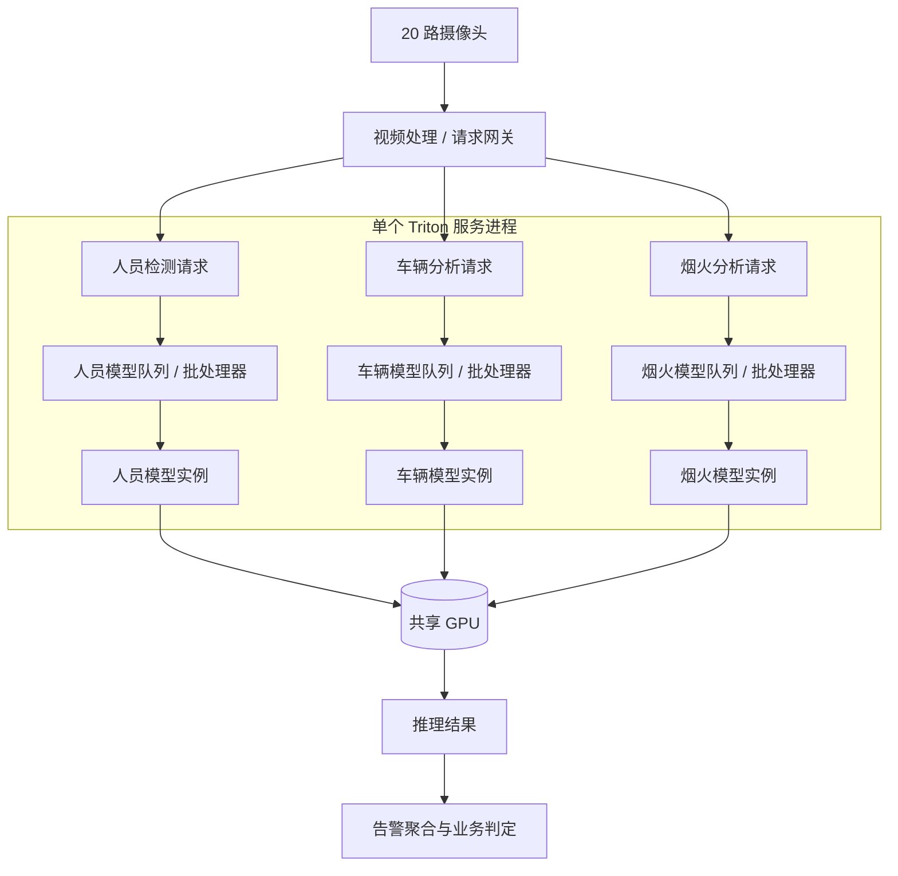
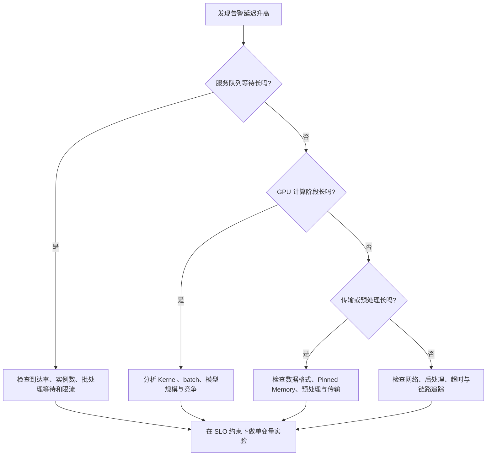

# 一张 GPU 同时跑三个 AI 模型，为什么请求反而越来越慢？——从 CUDA Streams 到 Triton 推理服务

> **多模型与多请求并发推理系列 · 第 5 篇｜推理服务工程化**  
> 关键词：Triton Inference Server、模型实例、动态批处理、请求排队、显存预算、p99、SLO  
> **一句话：GPU 能并发执行任务，不代表推理服务能稳稳接住并发请求；真正的优化，是让吞吐、排队、显存和尾延迟一起达到业务目标。**
>
> **三个核心概念先认领：** 模型实例（`instance_group`，一个模型可开的执行窗口）、动态批处理（等一等、凑成一波再算）、SLO（服务等级目标，即可测量的服务目标——规定比例的请求在指定时间内成功完成）。

> **工程深度｜验证状态：** L3 工程｜概念验证 + 工程框架（压测需真实环境）
<!-- more -->

> **本篇边界：** 本篇研究**三个完整模型一起服务**时的实例、合批、队列与资源竞争；每个模型仍是一份**完整模型**，不涉及把一个模型拆到多张 GPU 的**模型并行**。

## 01｜凌晨两点，监控中心的一场“慢报警”

设想一座有 20 路摄像头的智慧园区。夜里，系统要同时识别三类事件：人员闯入、异常车辆、烟火迹象。

原型阶段，工程师分别测试了三个模型：单独运行都很快。接着，他把三个模型都装进同一张 GPU，并把请求改为异步发出。压测一开始，吞吐量不错；摄像头同时触发告警时，**最慢的一小部分请求，却排起了长队**。

有人提议：“再开几条 CUDA Stream？”有人建议：“模型实例改成 4 个！”还有人说：“等 8 张图片凑齐再推理，GPU 就不浪费了。”

三个建议都可能有用，也都可能让告警更慢。因为这里已不只是“算得快不快”的问题，而是：**请求何时进入队列、何时凑成批、谁占用实例、显存够不够、最迟要多久回复。**

这一篇，我们把前四篇的知识装进同一个推理服务，弄清生产环境里多模型并发的真正玩法。

> **阅读路线**：一个现场故事 → 三层并发 → Triton 配置 → 请求排队与动态批处理 → 性能测量 → 生产落地。实验使用三个 *合成 CNN 模型* 演示服务机制，不代表已训练的真实安防算法。

---

## 02｜前四篇解决了什么，第五篇还差什么？

回顾四个问题：

1. **能不能并行？** 三个互不依赖的模型，可以在依赖图上并发；但GPU资源竞争使加速并不必然成立。
2. **怎样提交并发工作？** CUDA Streams 允许不同流的命令具备并发执行机会；多流不等于多份 GPU。
3. **任务交给谁？** List Scheduling、LPT 等策略研究如何把已知任务分给 GPU；线上请求还要考虑排队和 SLO。
4. **数据怎么不拖后腿？** H2D、计算、D2H 通过异步流水线可能重叠，但受到内存、同步和硬件条件约束。

现在多了一个重要角色——**推理服务器**。它不只是“套一层 HTTP”，而是把模型加载、请求排队、批处理、模型实例、结果返回和指标观测统一管理起来。



图中队列是逻辑分组，不意味着每个模型都有独占的硬件队列；模型实例共享同一块 GPU 的计算和显存资源。

### 三个容易混淆的“并发”

| 层次 | 关心的问题 | 常见技术 | 不等于什么 |
|---|---|---|---|
| **请求并发** | 多少客户端同时发请求？ | HTTP/gRPC、异步客户端、服务队列 | 不等于 GPU 同时执行请求 |
| **实例并发** | 一个模型允许多少执行实例？ | Triton `instance_group` | 不等于一定获得线性加速 |
| **设备并发** | Kernel、拷贝能否实际重叠？ | CUDA Streams、GPU 硬件调度 | 不等于请求一定低延迟 |

Triton 官方明确支持**不同模型以及同一个模型的多个实例**在同一系统上并发执行，也允许每个模型独立选择调度与批处理配置。这里的“允许并发”仍然不是“保证硬件重叠”。[1]

---

## 03｜模型实例：为什么一个模型可以有多个“窗口”？

先把那个“越跑越慢”的因果链讲清楚。三个模型**单独跑**时都不慢：一个模型独占 GPU 时，处理能力相当可观。可一旦三者的请求同时涌来，它们要争同一块 GPU 的算力和带宽——**模型没变，每个模型实际能提供的有效服务能力却下降了**。

而摄像头不会等。20 路视频持续送帧，请求按固定节奏到达，完成速度却跟不上到达速度，差额就堆在队列里。队列越长，最慢的那部分请求等得越久。此时“再加一个实例”看似多开了一个窗口，实际上只是让更多的工作一起去抢同一块 GPU。

这就是本篇要拆解的核心链条：**共享 GPU 降低有效服务能力 → 持续输入使完成跟不上到达 → 请求在队列里堆积 → 必须靠测量来决定实例与批处理策略。** 下面先从“实例”这个窗口说起。

想象监控中心有一个车辆分析窗口。十个人排队时，一位工作人员一次只能办理一批业务；如果再增开一个窗口，有些人能更早开始办理。

在 Triton 里，`instance_group` 就像指定要开多少个模型执行窗口：

```protobuf
instance_group [
  { kind: KIND_GPU count: 2 gpus: [0] }
]
```

这是**配置示例**：给指定模型在 GPU 0 上建立 2 个执行实例。它不是“启动两张显卡”，也不代表每个实例都占有 GPU 50% 的计算资源。模型的实际显存占用、后端执行方式和资源争用仍要测试。

```text
请求：  R1    R2    R3    R4    R5
          \   |    |    |    /
             模型队列
                |
          +-----+-----+
          |           |
       实例 A        实例 B
          \           /
             GPU 0
        (共享算力/带宽)
```

**实例数并不是越多越好。** 增加实例可能降低排队等待，但也可能复制模型权重或执行缓冲、提高显存占用，造成 Kernel 竞争。GPU 满载时增加实例，常常只能把一个拥堵点挪到另一个地方。

### 用一条不等式理解排队

假设平均每个实例的有效服务能力是 $\mu$（请求/秒），有 $c$ 个实例，外部平均到达率为 $\lambda$。把实例和请求简化为稳定、无复杂批处理的队列模型时，长期稳定运行至少要求近似满足：

$$
\lambda < c\mu
$$

但实际共享 GPU 时，增加 $c$ 并不保证 $\mu$ 不变。模型实例之间互相争用资源，所以不能直接把容量写成随实例数线性增长。此式用来建立直觉，不是 Triton 的容量计算公式。

---

## 04｜动态批处理：等一等，为什么反而能更快？

再看人员检测模型。20 路摄像头会在不同时刻送来图片：

```text
请求到达 (示意)
时间 →  0ms       1ms       2ms       3ms
         A          B   C      D

不合批：  [A]  [B]  [C]  [D]    四次模型调用
动态批：  [A B C D]             一次模型调用
```

单次执行一个样本，GPU 可能没有被充分利用；把几个请求组成批次，通常能更好摊薄内核启动和固定处理成本。**但合批不是免费午餐**：A 可能需要等到 B、C、D 到来，批次越大，单批计算时间也可能增长。

Triton 的 Dynamic Batcher 建议**从最小配置开始**：先只开 `max_batch_size` 和空的 `dynamic_batching {}`。此时批处理器会把能凑到的请求尽量组成一批，但**不会为了凑批主动等待**；测出基线之后，再按需加入凑批等待。[2]

```protobuf
max_batch_size: 16

dynamic_batching {
}
```

**为什么不一上来就写 `preferred_batch_size: [4, 8]`？** 因为官方明确指出：**多数模型都不应配置 `preferred_batch_size`**，只有当某个批大小能带来显著性能提升时才值得设置（典型例外是带多个优化 profile 的 TensorRT 模型）。偏好值应当是压测后的结论，而不是拍脑袋的起点。[2]

**一条基础边界（后面会反复用到）：** 动态批处理是**按模型**进行的——它只能把发往*同一个模型*的兼容请求合并成一次模型执行。它**不能**把人员、车辆、烟火三个不同模型的请求拼成一次模型执行，那本就是三种不同的计算。[1][2]

### 三个时间，决定用户是否觉得“快”

端到端响应时间可近似拆为：

$$
T_{response}=T_{network}+T_{queue}+T_{input}+T_{compute}+T_{output}+T_{post}
$$

这里的 `T_queue` 还能再拆，很多人的误会就出在这一步：

| 时间 | 含义 | 由什么决定 |
|---|---|---|
| **凑批等待** | 批处理器为一个请求“等同伴”的时间 | `max_queue_delay_microseconds` 只约束这一段 |
| **实例等待** | 批次排到空闲实例前的等待 | 到达率、实例数、前方批次的执行时长 |
| **请求总延迟** | 请求从发出到收到结果的全部时间 | 上两者 + 网络 + 计算 + 后处理 |

**关键澄清：`max_queue_delay_microseconds` 不是“请求总排队上限”。** 它只限制批处理器主动等待凑批的时间。就算把它设成 2ms，一个请求仍可能因为实例被占满而在“实例等待”里再等上几十毫秒——那部分不归它管。

对监控告警而言，更大的 Batch 可能降低单位请求的平均计算成本，却把 `T_queue` 拉高。因此：

- 如果是**夜间批量回放**，通常可以优先追求吞吐。
- 如果是**火情告警**，必须优先约束尾延迟、超时和漏报风险。
- 如果是**混合业务**，不要仅靠同一组 Batch 参数照顾所有模型；每个模型应有自己的 SLO 和调度策略。

**动态批处理提升的通常是设备效率或整体吞吐，而不是保证每个请求更快。**

---

## 05｜把故事落到代码：用三个合成 CNN 搭一套 Triton 服务

下面给出一套可复现的教学实验。为了把“服务调度机制”与“模型精度训练”分开，我们用 PyTorch 生成三个不同宽度的随机参数 CNN，导出 ONNX，再交给 Triton 的 ONNX Runtime 后端运行。

> **重要提示**：模型名称沿用 `person_detector`、`vehicle_analyzer`、`fire_analyzer`，仅为模拟三种业务请求；这些随机权重模型**没有人员、车辆或火情检测能力**，输出是 10 维合成 logits，不可用于任何真实安全告警。真实项目必须使用经过验证的模型、正确输入预处理、后处理和质量评估。

**整条操作链**（每一步都可复现）：

1. **装依赖**：`pip install torch onnx 'tritonclient[http]' numpy`；
2. **生成模型**：运行 `python export_models.py`，产出三个 `model.onnx`；
3. **写配置**：为三个模型分别放好 `config.pbtxt`（见 5.3）；
4. **启服务**：用与驱动匹配的 Triton 容器挂载模型仓库（见 5.4）；
5. **验就绪**：`curl` 健康检查通过、三个模型 `/ready` 全部返回成功；
6. **发请求**：运行 `python client_demo.py`，核对输出形状与延迟。

**版本说明**：本文写作环境没有 NVIDIA GPU，未能实测锁定一套依赖组合，故下列版本均为**参考建议、待验证**——Python 3.10+、PyTorch 2.x（`dynamo=False` legacy exporter 需较新版本）、`onnx` 与所选 PyTorch 匹配。请以安装版本文档与 `onnx.checker` 结果为准。

### 5.1 项目目录

```text
triton-multi-model-demo/
├── export_models.py
├── client_demo.py
└── model_repository/
    ├── person_detector/
    │   ├── config.pbtxt
    │   └── 1/model.onnx
    ├── vehicle_analyzer/
    │   ├── config.pbtxt
    │   └── 1/model.onnx
    └── fire_analyzer/
        ├── config.pbtxt
        └── 1/model.onnx
```

模型仓库按 **模型名 / 版本号 / 模型文件**组织，Triton 会读取 `config.pbtxt` 中的输入输出、批量和实例信息。[3]

### 5.2 导出三个不同规模的 ONNX 模型

三个模型结构完全相同，只是卷积宽度不同。`export_models.py` 用一份代码生成三个随机权重 CNN，再导出 ONNX 供 Triton 的 ONNX Runtime 后端加载。正文只保留最有教学价值的模型定义（代码片段），完整可运行脚本见附录 C。

```python
class DemoCNN(nn.Module):
    def __init__(self, channels: int):
        super().__init__()
        self.net = nn.Sequential(
            nn.Conv2d(3, channels, 3, padding=1),
            nn.ReLU(),
            nn.MaxPool2d(2),
            nn.Conv2d(channels, channels * 2, 3, padding=1),
            nn.ReLU(),
            nn.AdaptiveAvgPool2d((1, 1)),
            nn.Flatten(),
            nn.Linear(channels * 2, 10),
        )

    def forward(self, x):
        return self.net(x)
```

三个模型分别用 `channels=8 / 16 / 24` 生成，权重由固定随机种子得到。导出时有三个要点（完整写法见附录 C）：

1. `dynamic_axes` 把 Batch 维声明为动态，才能配合 Triton 的 `max_batch_size` 拼批；
2. 使用 legacy exporter（`dynamo=False`）便于本实验跨版本复现；
3. 导出后可用 `onnx.checker.check_model()` 做结构检查，但检查通过不等于模型预测有业务意义。

建议环境见本章开头的版本说明。不同 PyTorch 版本的 ONNX 导出 API 可能变化；导出后务必以 `onnx.checker` 与安装版本文档为准。

### 5.3 为模型配置实例与动态批处理

以 `person_detector/config.pbtxt` 为例：

```protobuf
name: "person_detector"
platform: "onnxruntime_onnx"
max_batch_size: 16

input [
  { name: "INPUT" data_type: TYPE_FP32 dims: [3, 32, 32] }
]
output [
  { name: "OUTPUT" data_type: TYPE_FP32 dims: [10] }
]

instance_group [
  { kind: KIND_GPU count: 1 gpus: [0] }
]

dynamic_batching {
}
```

另外两个模型只需把 `name` 改为 `vehicle_analyzer` 和 `fire_analyzer`，其余字段在本教学模型下可以保持一致。由于 ONNX 输入动态 Batch 维与 `max_batch_size` 配合，Triton 的 `dims` **不应再写 Batch 维**。

这段配置对应三项决策：

1. **`max_batch_size: 16`**：允许推理服务组装最多 16 个样本的批次，不保证每次都凑到 16。
2. **`count: 1`**：每个模型在 GPU 0 上先放一个实例；别急着调到 4。
3. **`dynamic_batching {}`（空的）**：先把“能凑就凑、不为凑批等待”作为基线。等测出瓶颈后，再考虑加入 `max_queue_delay_microseconds: 2000` 作为第二轮对照；**`preferred_batch_size` 留到更后面**，由批大小-性能测试决定，不要默认写上去。

如果后端、GPU 支持情况或模型配置不匹配，Triton 可能拒绝加载。启动后必须检查模型就绪状态，不要仅依据进程已启动便认定服务可用。

### 5.4 启动 Triton

本文未在具体版本上实测，因此不给死标签。请到 NVIDIA NGC 查询**与你的驱动相兼容、且含 ONNX Runtime 后端**的 Triton Server 容器标签（形如 `yy.mm-py3`），用它替换下面的 `<release>`，不要直接原样执行：

```bash
docker run --gpus all --rm \
  --shm-size=1g \
  -p 8000:8000 -p 8001:8001 -p 8002:8002 \
  -v "$PWD/model_repository:/models:ro" \
  nvcr.io/nvidia/tritonserver:<release>-py3 \
  tritonserver --model-repository=/models
```

访问健康检查（HTTP 默认端口 8000）：

```bash
curl -f http://localhost:8000/v2/health/ready
curl -f http://localhost:8000/v2/models/person_detector/ready
```

典型端口：8000 为 HTTP，8001 为 gRPC，8002 为 Prometheus 指标端口。生产环境中应经由网关限制访问、认证鉴权与传输保护，不应将这些服务端口不加控制地暴露在公网。

### 5.5 用客户端发送三类请求

`client_demo.py` 提供最小可运行客户端（完整脚本见附录 C）。核心只有一小段：用线程池并发发 60 个请求，再**按模型分别**统计 p50 / p95 / p99。

```python
def infer_once(model_name: str, seed: int):
    # 简易通路脚本：每个请求单独建客户端，便于讲解；
    # 正式压测应复用长连接（见下方说明）。
    client = httpclient.InferenceServerClient(url='localhost:8000')
    x = np.random.default_rng(seed).random((1, 3, 32, 32), dtype=np.float32)
    tensor = httpclient.InferInput('INPUT', list(x.shape), 'FP32')
    tensor.set_data_from_numpy(x)
    output = httpclient.InferRequestedOutput('OUTPUT')   # 注意命名空间前缀
    t0 = perf_counter()
    resp = client.infer(model_name, [tensor], outputs=[output])
    y = resp.as_numpy('OUTPUT')            # 取回结果也在计时范围内
    elapsed_ms = (perf_counter() - t0) * 1000
    client.close()
    assert y.shape == (1, 10), y.shape     # 形状检查
    return model_name, elapsed_ms

# 主程序：60 个请求、8 线程并发，最后按模型分别打印 p50 / p95 / p99
```

三点必须说明：

1. **每请求建客户端只是简易写法**：它直观，但连接建立本身就有开销。正式压测应复用长连接（注意所选客户端对象的线程安全约定），别把连接开销算进服务延迟。
2. **形状检查 ≠ 正确性校验**：`y.shape == (1, 10)` 只能说明输出维度对上了。要验证数值，应拿同一份固定随机权重在 PyTorch 里本地推理一次，与 Triton 返回结果做 `np.allclose` 容差比对（浮点顺序不同，不要求逐位相等）。
3. **别漏掉失败与超时**：上面只收集了成功请求的延迟。生产压测必须同时记录失败数、超时数与错误类型，否则“平均延迟”会因为把失败样本全部丢掉而显得**偏低**——数字反而更好看，却掩盖了服务其实已经在丢请求。

还要提醒：把三个模型的延迟**混在一起**统计，会掩盖单个模型的问题。如果 `fire_analyzer` 尾延迟已经恶化，但另外两个模型请求多又快，合并分位仍会“看起来很美”。分位数必须**按模型分别计算**，§08 会统一换成这种口径。

安装客户端：`pip install 'tritonclient[http]' numpy`。这里的 60 个请求只是**通路验证和入门观察**，并非严谨的容量压测；尤其 p99 在小样本下不稳定，不能用来决定生产 SLO。

---

## 06｜再加两个实例，性能一定更好吗？

现在开始真正的调优。假设模型已在 GPU 0 上稳定运行，我们只修改一个变量：

```protobuf
# 配置 A：1 个实例
instance_group [{ kind: KIND_GPU count: 1 gpus: [0] }]

# 配置 B：2 个实例
instance_group [{ kind: KIND_GPU count: 2 gpus: [0] }]
```

然后在**相同硬件、模型、批量策略、请求到达方式**下观察：

- 吞吐量（inferences/s 或 requests/s，要注明统计口径）；
- 平均延迟及 p50/p95/p99；
- 服务器端排队时间；
- GPU 显存占用与利用率；
- 模型加载成功与失败数。

如果增加实例后请求排队时间下降、p99 下降，且显存仍有空间，说明增加实例可能有效；如果实例越多 GPU 越拥挤、显存增加而吞吐不再增长，就应该停止增加。

**两个指标千万别混为一谈**：

```text
吞吐：     一秒里系统一共处理了多少请求/样本？
延迟：     单个请求从发送到收到结果经历多久？
尾延迟：   最慢的一小部分请求要等多久？
```

如果业务说“平均 20ms 就行”，并不等于“99% 请求必须低于 20ms”。SLO 必须定义观察窗口、统计口径、具体模型与目标阈值。对于火情告警，通常尤其关注尾部请求与超时处置。

---

## 07｜动态批处理为什么可能伤害实时告警？

假设某个告警模型每秒请求较少，若额外设置了 `preferred_batch_size: [8]`（回想 §04：这本就不是默认该配的项）并给了较长的等待窗口，许多请求就会迟迟凑不齐 8 张图片。即使最终单批计算效率提高，**单请求等待时间也可能增加**。

以下为纯教学示意，不能当成任何 GPU 测量结果：

| 策略 | 服务器等待凑批 | 计算效率 | 可能的业务结果 |
|---|---|---|---|
| 不启用动态批处理 | 无主动凑批等待 | 低并发时可能偏低 | 延迟更可预测 |
| 短等待（如 1–2ms） | 较小 | 有机会改善 | 常适合纳入比较 |
| 长等待（如 10ms） | 可能较大 | 高到达率下可能更充分 | 低到达率下可能恶化告警延迟 |

动态批处理还有容易忽略的前提：**模型必须支持批量维、输入形状相容，且语义允许不同请求拼成一个批次**。有跨请求状态依赖的模型，不能直接套用一般无状态模型的动态批处理方式。[1][2]

### 为什么“更高 GPU 利用率”不总是好事？

GPU 利用率升高可能意味着硬件更充分地工作，也可能意味着负载已逼近饱和，排队开始失控。工程上真正关注的是：在满足 SLO 的前提下，单位成本能稳定处理多少请求。

一个简化的选型目标可以写成：

$$
\max\; Throughput
\quad \text{subject to}\quad
p99\_latency \le SLO,\; GPU\_memory \le Budget
$$

此外还需要考虑错误率、业务正确性和容错空间；它们不能被一条吞吐公式替代。

---

## 08｜不要凭感觉调参数：用 Perf Analyzer / Model Analyzer 看证据

Triton 生态提供 Perf Analyzer 与 Model Analyzer，用于压测和分析吞吐、延迟、排队、GPU 显存与利用率等指标。[4][5]

### 先选对负载模式：并发 ≠ 到达率

Perf Analyzer 不只有“多少并发”一种加载方式，它区分**并发模式**（维持 N 个请求同时在飞）与**请求率模式**（每秒固定发 M 个请求），此外还有自定义间隔、周期性并发、固定时间表等模式。[6]

```bash
# 并发模式：维持 N 个请求同时在飞（闭环负载）
perf_analyzer -m person_detector -i grpc -u localhost:8001 \
  --concurrency-range 1:16 --measurement-interval 5000

# 请求率模式：以固定到达率发送，不管服务快慢（开环负载）
perf_analyzer -m person_detector -i grpc -u localhost:8001 \
  --request-rate-range 10:200:10 --measurement-interval 5000
```

**为什么必须区分？** 并发模式是“闭环”的：服务一变慢，客户端发下一个请求也跟着变慢，**负载会自动降下来**，于是压不出真正的过载。而监控场景是“开环”的——**摄像头不会因为上一帧还没处理完就停止产生新帧**。要复现“完成跟不上到达”的排队，就得用请求率模式（或自定义间隔），让请求按固定节奏持续涌入。

### 读懂指标：计数、时长、分位要分开看

抓指标：

```bash
curl -s http://localhost:8002/metrics \
  | grep -E 'nv_inference_(count|exec_count|queue_duration_us)' \
  | grep person_detector
```

Triton 的指标分几类，很容易读错。先按下表对齐口径（记得带模型标签、注明统计窗口）：[7]

| 你想知道 | 看的指标 | 怎么读 |
|---|---|---|
| 一共处理了多少样本 | 推理计数增量 `nv_inference_count` | 一批 8 个样本 = 计 8 次 |
| 真正执行了多少次模型 | 执行计数增量 `nv_inference_exec_count` | 一批算 1 次执行 |
| 平均批大小 | 两者相除 | 推理计数增量 ÷ 执行计数增量 |
| 平均排队时间 | 排队时长增量 `nv_inference_queue_duration_us` ÷ 推理计数增量 | 它是**累计值**，必须配计数换算 |
| 尾延迟 p99 | 客户端分位（或服务端 summary 分位） | 默认计数器给不出 p99，需另开分位 |

**一个必须记住的坑：`nv_inference_queue_duration_us` 是累计量，不是 p99，也不是单次最长排队。** 它统计的是所有请求排队时长的**总和**。想看某模型的平均排队，要拿它除以对应的推理计数增量。

**教学例子**：某窗口内 `nv_inference_count` 增加 800、`nv_inference_exec_count` 增加 200，那么这批请求的平均批大小就是 800 ÷ 200 = 4，说明动态批处理确实在起作用；若还想知道平均排队，再用排队时长增量 ÷ 800。

不同分位的口径还不一样：Perf Analyzer 给的是**客户端分位**（含网络往返），Triton 服务端 summary 分位**不含网络**，两者不是一回事，写结论前一定要说明用的是哪一种。[4][7]

### 核心实验：让三个模型一起施压

只压一个模型，看不出多模型共享 GPU 的真实问题。实验必须让三个合成模型**同时**接受请求，并按比例构造不同的流量画像：

| 组别 | 流量构成 | 目的 |
|---|---|---|
| 0 | 仅 `person_detector` 单模型 | 单模型基线，作为对照 |
| 1 | 三模型 **1:1:1** | 均衡混合，观察公平竞争下的排队 |
| 2 | 三模型 **8:1:1**（人员为热点） | 热点混合，观察热点模型如何挤占冷门模型 |
| 3 | 三模型**突发**（周期性集中到达） | 突发混合，观察队列积压与恢复 |

每一组都要**按模型分别**报告指标，而不是合成一个总表：

| 组别 | 模型 | 实例数 | 动态批 | 到达率 | 完成吞吐 | p95(ms) | p99(ms) | 错误率 |
|---|---|---|---:|---:|---:|---:|---:|---:|
| 1 | person_detector | 1 | 开 | 20/s | 待测 | 待测 | 待测 | 待测 |
| 1 | vehicle_analyzer | 1 | 开 | 20/s | 待测 | 待测 | 待测 | 待测 |
| 1 | fire_analyzer | 1 | 开 | 20/s | 待测 | 待测 | 待测 | 待测 |
| 2 | fire_analyzer | 1 | 开 | 5/s | 待测 | 待测 | 待测 | 待测 |

**为什么要按模型拆开？** 因为三个模型共享 GPU，热点模型的排队会**间接推高冷门模型**的等待。只看合并分位，很可能出现“整体平均很好看，烟火模型早已严重超时”。这类藏在尾部的差异，正是告警场景最不能接受的。

还要额外测一个**业务级延迟**：同一时刻、同一路摄像头的三个分析结果，多久能**三个都到齐**？单模型的 p99 不等于“三结果齐全”的 p99——只要有任意一个模型偶尔变慢，整次告警判定的延迟就会被拖长。

实验要求：同一 GPU、同样输入分布、固定模型版本，先预热再测量；每组记录显存峰值、按模型的吞吐、p95/p99、排队时间与错误率。**不能只贴一张“GPU 利用率 99%”的截图作为成功证据。**

---

## 09｜三种资源问题，不能靠同一个开关解决

现在可以反过来诊断监控中心的“慢报警”了。



请留意这三种优化的工作层次：

- **队列和批处理参数**影响“何时开始执行”；
- **模型实例数**影响“允许多少份执行上下文同时推进”；
- **CUDA Streams 与流水线**影响“设备工作和拷贝如何组织”，是否有重叠受资源限制。

它们彼此相关，但绝不能互相替代。Triton 并不会因为开启了动态批处理，就自动解决模型之间的显存竞争，也不会因为配置了两个实例，就必然满足火情模型的尾延迟目标。

---

## 10｜真实生产部署，还要过五道关

**第一道：显存预算。** 评估权重、激活、工作空间、实例副本、Batch 缓冲及显存碎片。保留余量，避免负载上升时 OOM。多模型共享 GPU 时要测整体峰值，而不只是单模型峰值。

**第二道：流量治理。** 入口层设置请求超时、排队上限、过载拒绝和有界重试；重试应设置预算与退避，避免雪崩式放大。Triton 调度器也支持一定的队列策略、优先级和请求超时设置，但具体可用能力依模型类型和配置而定。[2]

**第三道：模型版本与发布。** 模型仓库的版本、配置和输入输出契约必须一起管理。升级时检查版本就绪，先灰度再放量，必要时回滚。

**第四道：可观测性。** 至少监控每模型请求量、错误率、排队时间、计算时间、p95/p99、实例数、GPU 显存与利用率；并通过 trace 关联请求 ID，定位突发慢请求。

**第五道：业务安全边界。** 人员、车辆、烟火三类任务的容错要求不相同。示例模型完全没有业务准确率；真正的烟火告警需通过独立的验证数据、误报漏报评估、人工复核与故障降级设计，不能只依据服务性能判断可上线。

### MPS、MIG 要不要现在引入？

可以提，但不建议在本篇展开过多：

- **MPS** 主要讨论受支持环境中的多 CUDA 进程工作共享与执行协调，不是请求层批处理器。
- **MIG** 是受支持 NVIDIA GPU 上的硬件资源分区与隔离能力；不是任意 GPU 都能启用，也不等于同一个 GPU 实例内的模型自然获得更好吞吐。

本篇的实践核心仍是：**先把 Triton 模型、实例、Batch、队列、SLO 调清楚；需要更强隔离时，再研究硬件分区与多租户部署。**

---

## 11｜回到凌晨两点：真正的答案是什么？

三种提议现在可以逐一判断：

**“多开 Stream！”** 可能有效，但只有当底层有可重叠的计算或拷贝工作且资源许可时才可能带来收益；还需测量。

**“多开模型实例！”** 可能缩短请求排队，却会增大实例级内存和计算竞争；应在保持 Batch 策略不变的条件下对比。

**“把请求尽量合成大 Batch！”** 可能提升吞吐，但对低到达率的紧急告警而言，凑批等待可能恶化尾延迟。

所以，没有一个叫“开启并行”的万能按钮。

> **真正的多模型推理服务优化，是以业务 SLO 为边界，在请求、实例、批处理和 GPU 资源之间找到可验证的平衡。**

当你能解释“为什么排队变长”，能测出“再加一个实例是否值得”，能证明“凑批没有拖慢最紧急的请求”，这才算从 CUDA 代码走向了生产推理系统。

> **放到今天看：** Triton 的这三层并发（请求 / 实例 / 设备）在大模型推理服务里同样存在，但**调度单位和指标不同**：大模型按序列（Sequence）甚至按 Token 推进，关注的是首 Token 延迟与后续 Token 间隔，而不是一次前向的批大小。本文的测量方法（联合施压、按模型拆指标、卡在 SLO 内）可以沿用，但 CNN 的动态批处理参数不能直接照搬到大模型场景。

### 读完自测：三个动手挑战

1. **改实例数。** 保持批处理策略不变，比较 `count=1` 和 `count=2`，观察吞吐、排队与显存峰值。
2. **改等待窗口。** 保持实例数不变，比较动态批处理关闭、0μs、2,000μs，在低/高请求率下的 p95/p99。
3. **改流量构成。** 把三个模型请求比例从 1:1:1 改为 8:1:1，观察热点模型怎样改变整体资源竞争和尾延迟。

---

## 附录 A｜为什么本文不直接给出“提速 2.3 倍”的结论？

因为没有在具体 GPU、Triton 版本、驱动、实际模型与请求负载下完成全部测量。文中代码旨在**复现服务机制和实验方法**，并没有运行出可供传播的真实性能曲线。任何吞吐/延迟加速结论，必须附对应测试环境和对照数据。

## 附录 B｜部署时的常见坑

| 症状 | 优先检查 | 说明 |
|---|---|---|
| 模型加载失败 | ONNX opset、输入输出名字、Batch 维、后端 | `config.pbtxt` 与导出 ONNX 必须一致 |
| 请求输出形状错误 | 输入是否为 `[N,3,32,32]` | Triton `dims` 不写 Batch 维 |
| 多实例后 OOM | 实例副本、workspace、其他模型 | 增加实例不意味着显存免费 |
| 吞吐上升但 p99 变差 | 队列、合批等待、竞争 | 不能只看平均时延 |
| 随机图片“准确率低” | 这是随机权重合成模型 | 示例不具备业务识别能力 |
| 指标无 GPU 信息 | 镜像、驱动、Metrics 配置 | 需要检查版本和部署环境 |

## 附录 C｜两个完整脚本

### export_models.py

```python
from pathlib import Path
import torch
import torch.nn as nn

ROOT = Path('model_repository')
SPECS = {
    'person_detector': 8,
    'vehicle_analyzer': 16,
    'fire_analyzer': 24,
}

class DemoCNN(nn.Module):
    def __init__(self, channels: int):
        super().__init__()
        self.net = nn.Sequential(
            nn.Conv2d(3, channels, 3, padding=1),
            nn.ReLU(),
            nn.MaxPool2d(2),
            nn.Conv2d(channels, channels * 2, 3, padding=1),
            nn.ReLU(),
            nn.AdaptiveAvgPool2d((1, 1)),
            nn.Flatten(),
            nn.Linear(channels * 2, 10),
        )

    def forward(self, x):
        return self.net(x)

for i, (name, channels) in enumerate(SPECS.items()):
    torch.manual_seed(100 + i)
    model = DemoCNN(channels).eval()
    out_dir = ROOT / name / '1'
    out_dir.mkdir(parents=True, exist_ok=True)
    torch.onnx.export(
        model,
        (torch.randn(1, 3, 32, 32),),
        str(out_dir / 'model.onnx'),
        input_names=['INPUT'],
        output_names=['OUTPUT'],
        dynamic_axes={'INPUT': {0: 'batch'},
                      'OUTPUT': {0: 'batch'}},
        opset_version=17,
        dynamo=False,  # 使用 legacy exporter，便于本实验复现
    )
    print('exported:', name)
```

### client_demo.py

```python
from concurrent.futures import ThreadPoolExecutor, as_completed
from time import perf_counter
import numpy as np
import tritonclient.http as httpclient

MODELS = ['person_detector', 'vehicle_analyzer', 'fire_analyzer']


def infer_once(model_name: str, seed: int):
    # 简易通路脚本：每请求单独建客户端，便于讲解；
    # 正式压测应复用长连接，并复用连接做更多请求。
    client = httpclient.InferenceServerClient(url='localhost:8000')
    x = np.random.default_rng(seed).random(
        (1, 3, 32, 32), dtype=np.float32
    )
    tensor = httpclient.InferInput('INPUT', list(x.shape), 'FP32')
    tensor.set_data_from_numpy(x)
    output = httpclient.InferRequestedOutput('OUTPUT')   # 注意命名空间前缀
    t0 = perf_counter()
    response = client.infer(model_name, [tensor], outputs=[output])
    y = response.as_numpy('OUTPUT')          # 取回结果也在计时范围内
    elapsed_ms = (perf_counter() - t0) * 1000
    client.close()
    assert y.shape == (1, 10), y.shape       # 形状检查
    return model_name, elapsed_ms


def percentiles(samples, model_name):
    # 按模型分别统计，避免合并分位掩盖单个模型的尾延迟
    lat = np.array([ms for name, ms in samples if name == model_name])
    return (
        len(lat),
        round(float(np.percentile(lat, 50)), 2),
        round(float(np.percentile(lat, 95)), 2),
        round(float(np.percentile(lat, 99)), 2),
    )


if __name__ == '__main__':
    jobs = [(MODELS[i % 3], i) for i in range(60)]
    with ThreadPoolExecutor(max_workers=8) as pool:
        fs = [pool.submit(infer_once, name, seed) for name, seed in jobs]
        samples = [f.result() for f in as_completed(fs)]
    for name in MODELS:
        n, p50, p95, p99 = percentiles(samples, name)
        print(f'{name}: n={n} p50={p50} p95={p95} p99={p99} ms')
```

> 这段客户端只统计**成功请求**的延迟。生产压测请补上失败/超时计数与错误分类，否则丢弃失败样本会让延迟数字虚低。

## 下一篇预告

> 前五篇介绍了多个完整模型与多个请求的组织方式。下一篇，我们把视角从“多个完整模型同时服务”切换到“把一个模型拆到多张 GPU 协作完成一次推理”：**《4 张 GPU 推理一个模型：复制四份，还是把模型拆开？》**——介绍副本并发、张量并行（TP）与流水线并行（PP），看它们分别解决“模型装得下”“单请求更快”还是“更多请求及时完成”。

## 参考资料（官方资料，检索于 2026-10-13）

[1] NVIDIA Triton, **Concurrent Model Execution**：https://docs.nvidia.com/deeplearning/triton-inference-server/user-guide/docs/user_guide/model_execution.html  
[2] NVIDIA Triton, **Dynamic Batcher / Queue Policy**：https://github.com/triton-inference-server/server/blob/main/docs/user_guide/batcher.md  
[3] NVIDIA Triton, **Model Repository & Model Configuration**：https://docs.nvidia.com/deeplearning/triton-inference-server/user-guide/docs/user_guide/model_repository.html ；https://docs.nvidia.com/deeplearning/triton-inference-server/user-guide/docs/user_guide/model_configuration.html  
[4] NVIDIA Triton, **Model Analyzer Metrics**：https://docs.nvidia.com/deeplearning/triton-inference-server/user-guide/docs/model_analyzer/docs/metrics.html  
[5] NVIDIA Triton, **Model Analyzer Documentation**：https://docs.nvidia.com/deeplearning/triton-inference-server/user-guide/docs/model_analyzer/docs/README.html  
[6] NVIDIA Triton, **Perf Analyzer — Inference Load Modes**：https://docs.nvidia.com/deeplearning/triton-inference-server/user-guide/docs/perf_analyzer/docs/inference_load_modes.html  
[7] NVIDIA Triton, **Metrics**：https://docs.nvidia.com/deeplearning/triton-inference-server/user-guide/docs/user_guide/metrics.html

