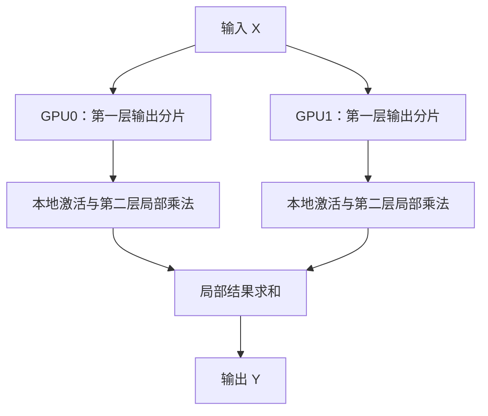

# 4 张 GPU 推理一个模型：复制四份，还是把模型拆开？

> **多模型、多请求与模型并行推理系列 · 第 6 篇｜副本并发、张量并行与流水线并行**  
> **一句话：** 四张显卡能带来更多显存和算力，但不会自动带来四倍速度；关键是先判断要解决“模型装得下”“单请求更快”还是“更多请求及时完成”，再选择副本并发、张量并行或流水线并行。
>
> 阅读收获：清楚区分副本并发、张量并行（TP）与流水线并行（PP），理解列切分/行切分的数学意义、流水线空泡（Bubble）与利用率、TP/PP 的组合方式，并通过一个纯 NumPy 小例子验证分片的正确性。

<!-- more -->

> **本篇边界：** 前五篇讲的是多个完整模型 / 多个请求的并发调度（多模型并发、多请求并发、跨卡任务调度、数据流水线与服务治理）。本篇进入前五篇未覆盖的**模型并行推理**——即把**一个模型拆分到多张 GPU** 协作完成一次推理。副本并发虽然也用多卡，但每个请求仍由一张卡上的完整模型独立完成，不属于模型拆分。

> **工程深度｜验证状态：** L3 工程｜理论推导 + 概览（多卡实测需相应拓扑环境）
## 01｜监控中心升级了模型，四张显卡却不知道怎么用

前五篇，我们让园区里的人员、车辆、烟火模型各自处理任务，再讨论流、调度、传输和服务排队。

现在园区要增加一个视频问答服务：值班员输入“刚才哪辆车停在消防通道？”，系统结合画面给出解释。我们把其中的语言生成模块拿出来讨论——视觉编码器、视频解码和检索不在本篇展开。

团队准备了四张 GPU，马上出现三种方案：

“每张卡放一个完整模型，四个窗口一起接客。”

“把同一层拆成四份，四张卡合算一个请求。”

“把模型分成四段，每张卡负责一段，像流水线一样传下去。”

这些方案都合理，却解决不同的问题。

| 方式 | 权重怎样放 | 请求怎样走 | 优先解决的问题 |
|---|---|---|---|
| 副本并发 | 每张卡一份完整模型 | 不同请求送到不同副本 | 增加服务容量 |
| 张量并行 TP | 同一层的部分权重分到不同卡 | 多张卡协作计算同一次前向 | 分摊模型存储与层内计算 |
| 流水线并行 PP | 不同模型层分到不同卡 | 中间结果沿阶段传递 | 分摊模型存储，重叠不同工作项 |

**前三种说法里，后两种才是在拆分一个模型。** 副本并发属于推理服务中的数据并行；它与训练里的梯度同步不是一回事。

## 02｜先看显存：四张卡的容量，不会自动合成一块大显存

假设每张 GPU 有 24 GiB 显存，模型仅权重就需要约 30 GiB。这是教学设定，不对应某个指定模型。

四张卡合计 96 GiB，并不意味着单卡可以直接分配一个 30 GiB 的普通设备张量。模型怎样分片、张量在哪里计算、结果怎样传递，都需要框架组织。

此时，复制四份模型行不通：每张卡仍要放下完整权重。可以考虑量化、卸载或模型并行，本篇重点讲最后一种。

即使权重已经拆开，容量评估也没有结束：

> 每卡实际显存需求＝该卡权重＋KV Cache＋激活与临时工作区＋通信缓冲＋运行时余量。

这是一张预算清单，不是要求所有项在峰值时简单相加的精确公式。不同阶段的峰值、缓存分片方式和后端内存管理都会影响实际占用。

例如，稠密模型若有 140 亿参数，每参数按 2 字节存储，权重原始数据约 28 GB，即约 26.1 GiB；这还没算运行时开销。量化模型则还要考虑缩放参数和具体存储格式。

**模型并行常常先解决“能运行”，然后才讨论“是否更快”。**

## 03｜副本并发：四个窗口，分别办理四位客户的业务

假设完整模型已经能放进一张卡。最直接的做法，是每卡部署一个副本：

| GPU | 模型 | 正在处理 |
|---|---|---|
| 0 | 完整副本 A | 请求甲 |
| 1 | 完整副本 B | 请求乙 |
| 2 | 完整副本 C | 请求丙 |
| 3 | 完整副本 D | 请求丁 |

四个请求可以分别推进，但请求甲仍由 GPU0 完成，并没有四张卡替它合算。

假设单卡执行一个固定任务需 40 ms，四个任务不合批、每卡严格串行且忽略其他开销：一张卡依次处理需要 160 ms；四张独立卡分担，可以在约 40 ms 完成全部任务。

这个例子改善的是整批完成时间和服务容量。单个任务的计算仍是 40 ms；在线系统里，因队列缩短，端到端响应也可能改善。

现实收益还取决于网关、CPU、请求分布和其他共享瓶颈。**副本数量翻倍，不等于容量一定翻倍。**

推理副本也不需要为每次请求同步梯度。加载相同权重、将请求路由到合适副本、维护版本与会话状态，才是服务侧关注点。

## 04｜张量并行：同一层，四张卡共同算

把“拆模型”说清楚，最好的起点是一层矩阵乘法。

设输入为行向量或一批行向量，计算：

$Y=XW$
其中，$X$ 的形状是 $[B,d_{in}]$，$W$ 是 $[d_{in},d_{out}]$，结果 $Y$ 是 $[B,d_{out}]$。这里暂时省略偏置。

### 4.1 拆输出列：每张卡负责一部分输出

将权重沿输出维分成两份：

$W=[W_0\;W_1]$

GPU0 算 $Y_0=XW_0$，GPU1 算 $Y_1=XW_1$。完整结果为：

$Y=[Y_0\;Y_1]$

**这里是拼接，不是相加。** 两张卡计算不同的输出特征。

若下一步要求完整结果，需要收集这些分片；若下一层能够直接消费分片，就不必立即把它们拼回去。

### 4.2 拆输入行：每张卡算一份贡献，再相加

将输入和权重对应切分：

$X=[X_0\;X_1],\qquad W=\begin{bmatrix}W_0\\W_1\end{bmatrix}$

则：

$Y=X_0W_0+X_1W_1$

**这里是相加，不是拼接。** 每张卡给同一份输出贡献一个局部结果。

如果各卡都要继续持有完整输出，可以使用 All-Reduce：把局部结果求和，再使各参与卡得到求和结果。某些分片布局也可以使用 Reduce-Scatter 等其他通信方式；并非所有 TP 都必须采用相同通信模式。[1][2]

### 4.3 两层连起来，为什么能少一次搬运？

一个简化的两层 MLP 可以写成：

$H=\operatorname{ReLU}(XW_1),\qquad Y=HW_2$

第一层按输出列拆开，得到 \(H_0,H_1\)。ReLU 对每个元素独立运算，可以各卡本地完成。第二层将权重按对应输入行拆开，于是直接计算：

$Y=H_0W_{2,0}+H_1W_{2,1}$

中间的 \(H\) 不必先拼成完整张量。这就是列切分与行切分配对的价值：**计算布局对上了，能减少不必要的通信。**



Megatron 的经典 Transformer MLP 使用了类似的第一层列切分、第二层行切分思路；PyTorch 的原生 TP 提供 ColwiseParallel、RowwiseParallel 等布局工具。[1][2]

注意本文使用 \(XW\) 记法。PyTorch `nn.Linear` 的权重存为 `[out_features, in_features]`，前向是 `x @ weight.T + bias`。照着切张量时，不能把数学记法的轴直接套到参数存储轴上。

## 05｜动手验证：不用 GPU，也能看见“拼接”与“相加”

下面只依赖 NumPy，验证两卡张量分片的数学关系。它不启动分布式进程、不测通信，也不是多 GPU 性能实验。

```python
import numpy as np

rng = np.random.default_rng(42)
x = rng.normal(size=(3, 4))
w1 = rng.normal(size=(4, 8))
w2 = rng.normal(size=(8, 2))
relu = lambda z: np.maximum(z, 0)

# 未分片基线：两层 MLP。
y_ref = relu(x @ w1) @ w2

# 第一层按输出列切分；两份隐藏特征留在各自位置。
w1_parts = np.split(w1, 2, axis=1)
h_parts = [relu(x @ part) for part in w1_parts]

# 第二层按输入行切分，与隐藏特征一一对应。
w2_parts = np.split(w2, 2, axis=0)
local_outputs = [h @ w for h, w in zip(h_parts, w2_parts)]

# 模拟求和归约。这里是 CPU 加法，不是 NCCL All-Reduce。
y_tp = local_outputs[0] + local_outputs[1]
np.testing.assert_allclose(y_tp, y_ref, rtol=1e-10, atol=1e-10)
print("分片结果与完整计算一致（容差内）")

# 错误示范：把局部输出拼接，形状变成 [3,4]，而非 [3,2]。
wrong = np.concatenate(local_outputs, axis=1)
print("正确形状：", y_tp.shape, "错误拼接形状：", wrong.shape)
```

运行：`python tensor_parallel_math_demo.py`。

读代码时抓住三个动作：第一层切列，第二层切行，末尾相加。真实 TP 要把这些分片放到不同设备，并用通信原语实现结果交换。

本例没有偏置。若第二层有偏置，不能每个局部输出都加完整偏置后再求和，否则偏置会被重复加入。实际实现必须正确安排偏置与归约。

## 06｜拆得更细，为什么反而可能更慢？

张量并行既拆分计算，也增加通信和协调。

假设某层单卡耗时 8 ms。四卡分片后，局部计算降到 3 ms，而关键路径上未被隐藏的通信及协调需 2 ms，则该层约需 5 ms。若相关成本变为 6 ms，则约需 9 ms，反而更慢。

这些是教学数字。实际运行要考虑通信与计算是否重叠，不能把所有孤立测量值机械相加。

| 条件 | 为什么影响 TP |
|---|---|
| 卡间互联与拓扑 | 决定数据交换成本；不能仅看 GPU 型号 |
| 每次矩阵乘法规模 | 分片后太小，设备效率可能下降 |
| 通信次数与布局 | 反复收集完整张量可能抵消收益 |
| 同步与负载差异 | 协作组可能被较慢的参与者拖住 |

因此，多卡 TP 的主要目标可以是容量，也可以是延迟，但必须分别验证。

## 07｜流水线并行：每张卡负责一段模型

TP 拆同一层，PP 则把模型层分成阶段。


对同一个工作项而言，后段必须等待前段的激活结果。把层放到不同卡，不能取消依赖。

假设四个阶段各需 5 ms，忽略通信：单个工作项仍要依次经过四段，20 ms 才完成。如果串行单卡本来也需要 20 ms，简单拆层并没有让它自动变成 5 ms。

真正的机会来自多个独立工作项：GPU1 处理 A 时，GPU0 可以处理 B。

| 时间段 | GPU0 | GPU1 | GPU2 | GPU3 |
|---|---|---|---|---|
| 0–5 ms | A | — | — | — |
| 5–10 ms | B | A | — | — |
| 10–15 ms | C | B | A | — |
| 15–20 ms | D | C | B | A |
| 20–25 ms | — | D | C | B |
| 25–30 ms | — | — | D | C |
| 30–35 ms | — | — | — | D |

四项工作在 35 ms 完成。它们若在一个严格串行设备上依次执行，每项 20 ms，则需要 80 ms。

**比较口径是固定四项工作的完成时间，不是单请求加速，也不是相同四卡资源下的副本对照。** 若模型能单卡运行，四个副本在上述理想模型里可分别执行一项，约 20 ms 完成全部；PP 未必是容量允许时的吞吐最优选择。

## 08｜流水线空泡：为什么总有卡闲着？

上表中的“—”就是空泡：流水线还没填满，或前段已结束、后段还在排空。

在等速的 \(p\) 阶段、\(m\) 个工作项、每阶段耗时 \(t\)、无通信且缓冲充足的简单前向流水线中：

$T=(m+p-1)t$

平均阶段忙碌比例为：

$U=\frac{m}{m+p-1}$

四阶段、四项工作时，\(U=4/7\approx57.1\%\)。这表示抽象阶段槽位的忙碌比例，**不是 `nvidia-smi` GPU 利用率预测**。

多一些可流水的工作，有助于摊薄填充与排空成本。但它们还要占用缓存和队列空间，不能无限堆积。

阶段不均衡也是问题。若四段耗时为 3、3、9、3 ms，稳态完成间隔至少受 9 ms 的慢段限制，另外几张卡可能等待它。

**按层数平均切分，不等于按执行成本均衡。** 层类型、序列长度、设备性能与各阶段显存都应一起评估。

## 09｜大模型生成还有一条不能省的依赖

前面的流水线将 A、B、C、D 视为独立工作项：可以是不同请求，也可以是拆分后的微批次，取决于框架调度。

自回归生成中，同一序列的下一个 Token，通常需要等当前 Token 经过最后阶段并产生结果后，才能继续推进下一次解码。不能把同一序列后续 Token 当成互不依赖的包裹，随意填满流水线。

这也是为何只有一个低并发请求时，PP 可能出现很多空闲；多个请求或微批次则能提供更多可调度工作。

同时要区分两个阶段：

| 阶段 | 在做什么 | 常见测量重点 |
|---|---|---|
| Prefill | 处理输入上下文并建立相应缓存 | 首 Token 延迟、输入规模、吞吐 |
| Decode | 持续生成后续 Token | Token 间隔、活跃序列数、缓存容量 |

具体瓶颈取决于模型、批量和上下文长度，不能认定所有 prefill 都只受算力限制，所有 decode 都只受带宽限制。

Prefill/decode 分离还涉及将不同执行阶段放到不同资源池，并可能转移 KV Cache；它与“按模型层切成流水线阶段”不是同一个定义。本篇不把两者混称为 PP。

## 10｜三种方式不是三选一：四卡可以怎样组合？

对于本篇的稠密模型、规则部署，可以用下面的分组理解卡数：

$$
GPU\ 数量=副本组数\times TP\ 度\times PP\ 度
$$

这是一种资源组织关系，不是所有复杂分布式部署的通用公式。

| 四卡方案 | 如何组织 | 适用前提或目标 |
|---|---|---|
| 4 个副本 | 每组 1 卡 | 完整模型及运行空间能单卡容纳，关注请求容量 |
| TP=4 | 一组四卡协作各层计算 | 后端支持，分片与互联适合该模型 |
| PP=4 | 一组四卡负责不同层段 | 后端支持，需要层级分片及可流水工作 |
| 2 个副本，每组 TP=2 | 两组双卡模型 | 每组能容纳模型，兼顾容量与协作计算 |
| TP=2、PP=2 | 两阶段，每阶段两卡 TP | 同时需要层内与层间拆分 |

真实部署还会受注意力头数、隐藏维度、分片约束和模型支持范围限制。四张卡不是“任何模型都能随便切四份”。

MoE 还可能引入专家并行，长上下文还可能引入上下文相关的分片方式。它们有不同通信与调度特点，不能都简化成 TP 或 PP。[3]

## 11｜落到推理框架：参数表达布局，实验决定收益

vLLM 支持 TP 与 PP，并可以组合使用。以下为部署形式示例，`/models/your-model` 必须替换为框架支持且已准备好的本地模型；不同版本与模型的支持情况需查对应文档。[3]

```bash
# 一组四卡 TP。
vllm serve /models/your-model --tensor-parallel-size 4

# 两个流水线阶段，每阶段两卡 TP。
vllm serve /models/your-model \
  --tensor-parallel-size 2 --pipeline-parallel-size 2
```

这两条命令都使用四张卡，但分工不同。它们不是本篇已经验证的性能配置，也不保证适用于你的模型与硬件。

副本部署则可以由独立服务进程与路由层完成，或使用框架支持的数据并行部署能力。不要为实现推理副本而默认套上训练用的 DDP。

还有一个常见误会：`device_map` 将不同模块放在多卡，说明模型被分布放置；它本身不足以证明已经采用高效微批次流水调度。**权重放在哪里，与请求怎么流水执行，是两件事。**

## 12｜怎样做一次可信的四卡比较？

先固定同一个模型、精度、输入输出长度分布和总资源，再比较配置。若完整模型单卡装不下，副本方案应标记“不适用”，不能换成小模型后假装仍是同一对照。

| 观察项 | 回答什么 |
|---|---|
| 每卡显存峰值及缓存余量 | 是否能在目标负载下稳定运行 |
| 客户端首 Token 延迟 TTFT | 输入到首次结果等了多久 |
| 后续 Token 间隔或请求级 TPOT | 生成过程是否平稳；注明统计口径 |
| 成功完成的请求与 Token 吞吐 | 相同工作负载下产出了多少有效结果 |
| p95/p99、超时与失败率 | 高吞吐是否以慢请求或失败为代价 |
| 计算、通信与空闲时间线 | 时间究竟花在计算、交换还是等待 |

固定并发测试有助于观察容量曲线；固定到达率和突发负载测试则更接近“用户照常来”的线上压力。必须记录实际发出速率，避免客户端能力不足被误判为服务容量。

性能结果取自独立基准运行，Profiler 用于解释机制。预热、加载、网络与预处理是否计入，应写清楚。

张量切分可能改变浮点归约顺序；验证应使用合理容差。对生成任务，即使设置确定性采样，微小数值差异也可能改变后续文本，不能只用“最终文字完全相同”作为唯一正确性标准。

## 13｜回到四张 GPU：现在该怎么选？

先回答四个问题：

1. 完整模型加运行时空间，单卡装得下吗？
2. 业务主要缺请求容量，还是单请求延迟？
3. 卡间通信成本是否适合频繁协作？
4. 有多少独立请求或微批次能让流水线持续工作？

单卡装得下且请求多，副本并发值得作为重要基线。单卡装不下，研究模型拆分，并测量分片后的实际内存。需要缩短一次前向，TP 是候选方案，但计算节省要能够覆盖未隐藏的通信成本。考虑 PP，则同时检查阶段均衡、空泡和请求依赖。

**四张 GPU 的价值，取决于你让它们分别服务，还是共同完成同一份工作，以及这种分工是否符合业务目标。**

前五篇解释了如何组织独立任务；这一篇补上了如何拆分一个模型。以后看到“多卡推理”，先问权重如何分布、请求如何流动、哪些地方要通信，再看加速数字，判断就会清楚得多。

### 读完自测

1. 四份完整副本为什么不能解决单份模型装不下的问题？
2. 为什么张量并行有时拼接结果，有时相加结果？
3. 为什么四阶段流水线的首个结果仍要走完整条链？
4. 为什么同一序列的连续 Token 不能被当成独立任务？

## 参考资料与实验边界

资料核对日期：2026-10-14。框架部署能力具有版本与模型差异，复现时应记录具体版本。

1. NVIDIA ADLR，MegatronLM: Training Billion+ Parameter Language Models Using GPU Model Parallelism。用于解释两层 MLP 的分片与通信结构；其训练性能数字不作为本文推理性能结论。https://research.nvidia.com/labs/adlr/MegatronLM/
2. PyTorch，Large Scale Transformer model training with Tensor Parallel (TP)。用于核对 Colwise/Rowwise 布局思想；训练优化不直接等同于推理部署。https://docs.pytorch.org/tutorials/intermediate/TP_tutorial.html
3. vLLM，Parallelism and Scaling。用于核对 TP/PP 部署、组合与资源选择边界。https://docs.vllm.ai/en/stable/serving/parallelism_scaling/
4. PyTorch，Tensor Parallelism API。https://docs.pytorch.org/docs/stable/distributed.tensor.parallel
5. Narayanan 等，Efficient Large-Scale Language Model Training on GPU Clusters Using Megatron-LM，2021。用于进一步阅读多种并行的组合；属于训练研究。https://arxiv.org/abs/2104.04473

> 本文的 24/30 GiB、40 ms、8/3/2/6 ms、四阶段 5 ms 等数字均为教学假设。NumPy 示例只验证数学分片，流水线表只验证理想排程；本文不声称已在真实四卡设备上获得指定加速比。
