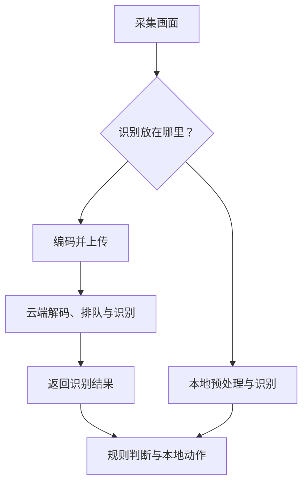
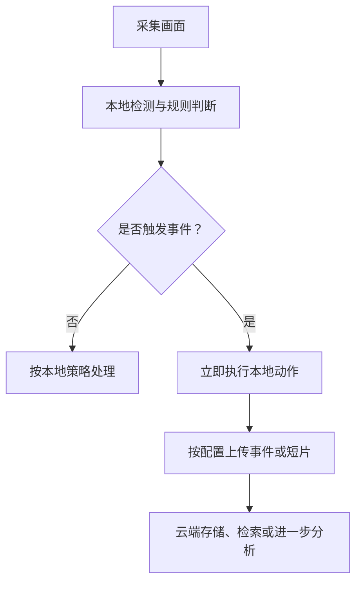

# 摄像头认出人只要几十毫秒，为什么提醒却晚了两秒？

> **端侧推理加速 · 第一篇**
>
> AI 的响应速度，不只取决于模型算得多快，还取决于数据要走多远、排多久，以及结果最后在哪里被使用。
>
> 本文面向非 AI 专业读者。无需先懂神经网络，也无需运行代码。
>
> 资料核对日期：2026 年 10 月 15 日。本文场景、算例与数字均为教学推演，用于解释因果关系，不是设备实测，也不是任何厂商的产品承诺。文中凡标注“教学假设”之处，都请按这个口径理解。

<!-- more -->

## 01｜快递员已经转身，手机才说“门口有人”

你给家门口装了智能摄像头。快递员走近，放下包裹，转身离开。过了一会儿，手机才弹出通知：

**“门口有人。”**

你看产品介绍：AI 识别一次，只要几十毫秒。

既然识别这么快，提醒为什么还晚了两秒？

先厘清一个词。本篇里的“认出人”，只指**检测到画面里有人**，不是确认“他是谁”。它们是不同的任务：

| 任务 | 要回答的问题 | 典型输出 |
| --- | --- | --- |
| 人员检测 | 画面里有没有人、在哪里 | 方框与分数 |
| 人员跟踪 | 这一帧和上一帧是不是同一个人 | 带编号的轨迹 |
| 身份识别 | 这个人是谁 | 身份标签 |
| 事件判断 | 这个情况要不要提醒 | 是否触发事件 |

把这几件事混为一谈，后面的账就很难算清。产品说“认出人只要几十毫秒”，通常指的是第一行。

原因在于：“模型识别一次”，只是整段旅程中的一站。

摄像头要先采集画面、编码、传出去；服务器收到后，可能还要解码、排队，再交给模型；结果出来后，还要经过规则判断和推送，才显示在手机上。任何一段变慢，你感受到的都是同一件事：提醒不及时。

这就像外卖店说“出餐只要三分钟”，却没告诉你骑手什么时候到、路上堵不堵。出餐时间是真的，半小时后才吃上饭也是真的。

**模型单次耗时，和用户等待时间，是两把不同的尺子。**

端侧推理要解决的核心问题，就是把一部分判断搬到数据产生的地方，缩短这段旅程。但它也带来新问题：家门口这个小设备，真的算得动吗？

## 02｜两秒的账单：真正“认人”的只有约 30 毫秒

要解释“两秒”，就得把整段旅程的每一步都摊开记账。

记一笔从 t0“人进入检测区”到 t4“手机显示通知”的账。以下数字是教学假设，用于说明时间花在哪里，不是任何设备的实测。

| 环节 | 典型等待 | 这笔时间花在哪 |
| --- | ---: | --- |
| 触发与采样等待 | 700 ms | 等凑够一次检测所需的画面，或触发节流后的排队 |
| 画面准备与编码 | 200 ms | 抽帧、缩放、压缩成可传输的格式 |
| 上传与网络等待 | 250 ms | 数据从摄像头到云端这一段路 |
| 云端排队 | 450 ms | 服务器的请求等待与调度 |
| 模型推理 | 30 ms | 真正“看这一眼”的时间 |
| 规则判断与事件处理 | 70 ms | 判断“这算不算要提醒的事件” |
| 消息推送与手机显示 | 300 ms | 从服务器推送到手机点亮屏幕 |
| **合计** | **≈2,000 ms** | |

一个关键观察：真正“识别”只占约 30 毫秒，剩下约 1,970 毫秒，都花在准备、传输、排队和推送这些“看起来跟 AI 无关”的环节上。

所以标题里的两个数字并不矛盾：**“几十毫秒”是模型单次耗时，“两秒”是用户感知的端到端延迟。** 它们测的根本不是同一段时间。

为了不把不同的“尺子”混为一谈，可以记住三条时间边界：

| 尺子 | 从哪算到哪 | 回答的问题 |
| --- | --- | --- |
| T模型 | t1 模型输入就绪 → t2 推理完成 | 模型本身快不快 |
| T本地动作 | t0 进入检测区 → t3 本地动作完成 | 设备本地能不能及时反应 |
| T手机通知 | t0 进入检测区 → t4 手机显示 | 用户多久收到提醒 |

三把尺子的起点不同，谁也不能替谁回答。下一节的对比表只量其中一小段——从“画面准备好”算到“本地动作完成”，既不含前面的触发与采样等待，也不含后面的消息推送，所以只有几十到一百多毫秒，自然看不到两秒。

## 03｜先弄懂：什么叫“在设备上推理”？

先把两个词说清楚。

**训练**，是用大量样本调整模型里的参数，让它学会一种任务；**推理**，是拿训练好的模型处理新的输入。对门口摄像头来说，模型输出的往往不是一句完整的“快递到了”，而是几个方框、类别和分数，应用再结合区域、停留时间等规则，决定要不要提醒。

训练可以在服务器完成，推理可以放在设备上。摄像头不需要每天从头学会认人。

再看部署位置：

| 方式 | 模型主要在哪里运行 | 门口摄像头的例子 |
| --- | --- | --- |
| 云端推理 | 远程数据中心 | 上传画面，由云端识别 |
| 端侧推理 | 产生数据的设备本身 | 摄像头芯片直接识别人 |
| 附近边缘推理 | 附近的网关或本地服务器 | 摄像头把画面交给家中网关处理 |

“端侧”和“边缘”常被交叉使用。本文把设备自身叫端侧，把附近网关也纳入更广义的边缘。

要注意：**在附近网关运行，仍有局域网传输；在摄像头里运行，才省掉这段模型输入的外部传输。** 端侧推理不要求设备完全没有网络，它只说明：这项模型计算在本地完成。

## 04｜云端算得更快，结果为什么反而更晚？

下面描述“云端识别”和“摄像头内识别”两种方案，不代表所有产品都这样实现。



本地动作可以是亮灯、响铃，或在本地屏幕上显示标记。

**如果动作是给远处的手机发通知，即使识别在本地完成，消息传输与推送仍可能需要网络。** 端侧能缩短前面的识别路径，却不能保证手机通知全程离线、零延迟——这也正是第 02 节那笔“两秒账单”里，最后的“推送与显示”仍要计时的原因。

现在只量其中一小段：假设从“画面可用”到“本地动作完成”，各环节串行执行。

| 环节 | 云端方案 | 端侧方案 |
| --- | ---: | ---: |
| 画面准备、预处理或上传前编码 | 15 ms | 15 ms |
| 上传与返回：含有效传输和链路等待 | 120 ms | 0 ms |
| 推理前排队 | 30 ms | 5 ms |
| 模型执行 | 10 ms | 35 ms |
| 规则判断与本地动作 | 5 ms | 5 ms |
| **合计** | **180 ms** | **60 ms** |

这些数字是教学假设；真实系统还有解码、重试等步骤，也可能让部分步骤重叠，这里简化，只为看清因果。

反直觉的结果来了：云端模型只算了 10 毫秒，本地模型算了 35 毫秒。云端计算更快，但在这组假设下，本地完成整件事更早。省下来的主要是通信与等待，而不是凭空让芯片算得更快。

> **端到端延迟 = 数据准备 + 通信 + 排队 + 模型执行 + 后处理与动作。**

反过来也成立：如果本地模型需要 300 毫秒，而云端整条路径只需 180 毫秒，本地方案就更慢。所以，判断要不要放在本地，不能只问“有没有网络”，也不能只比较两次模型执行时间，而应该问：

**省掉的通信与等待，能不能抵消本地多出来的计算和排队？**

## 05｜省带宽的关键：上传“发生了什么”，而不是持续上传画面

识别结果不就是“有人”两个字吗？能省多少流量？关键是输入和结果的大小，常常差得很远。

为了让云端知道门口有没有人，设备可能需要上传图片或视频；本地识别后，如果业务允许，设备可以只上传一条事件：

```json
{ "event": "person_detected", "camera": "front_door", "timestamp": "2026-10-15T10:30:00+08:00" }
```

这条消息记录的是“发生了什么”，而不是完整的现场画面，也不包含确认身份所需的全部信息。

再算一笔账。**教学假设：**某摄像头向云端连续上传平均码率为 2 Mb/s 的压缩视频，每天上传 24 小时；这里的码率并非所有摄像头的标准值。注意小写 b 表示 bit，大写 B 表示 byte，8 bit = 1 byte。

```text
2 Mb/s ÷ 8 = 0.25 MB/s
0.25 MB/s × 86,400 s = 21,600 MB ≈ 21.6 GB/天
```

如果改为本地识别，假设每天只有 100 条事件，每条应用层消息按 1 KB 估算：

```text
100 × 1 KB = 100 KB/天
```

两者差距很大，但不能把这个对比直接写成产品节省比例——它们提供的服务不同：连续上传保留了完整远程画面，事件消息只记录有限信息。如果你仍需要云端录像、远程直播、截图或事件短片，相应的视频流量依然存在。

**端侧降低带宽的条件，是业务允许设备在本地筛选信息，减少需要向外发送的数据。** 它不是把同一段视频“神奇地传得更省”，而是让一部分视频不必为了识别而离开设备——这也正是第 02 节账单里“上传与网络等待”能被省掉的原因。

## 06｜断网还能认人，但不一定还能通知你

端侧推理的另一个吸引力，是离线运行。但“离线”需要说清楚做到哪一步。

假设模型文件已经安装、本地运行时和必要资源已经就绪，应用也没有被联网授权等机制阻断，那么断开外网后，它仍可以识别画面，并执行本地动作。

| 功能 | 完全本地实现时，断外网后的情况 |
| --- | --- |
| 检测画面中是否有人 | 可以继续 |
| 根据检测结果点亮本地灯光 | 可以继续 |
| 保存事件到本地存储 | 可以继续，受可用空间等条件限制 |
| 推送到远处的手机 | 通常仍需可用的通信路径 |
| 从云端下载新模型 | 无法通过已断开的外网完成 |

这也是为什么测试端侧能力，不能只看宣传中的“本地 AI”四个字，而要看**完整功能链有没有远程依赖**：设备初始化与账号授权是否需要联网、模型是否首次得在线激活，这些都要一并验证。

隐私同样如此。在本地处理画面，可以减少原始数据外发的需求与暴露面；但如果应用随后仍上传录像、日志或截图，数据也会离开设备。**本地推理提供了减少外发的可能，实际的数据流向取决于产品设计。**

## 07｜把 AI 装进摄像头，才发现厨房太小了

好处说完了，代价在哪里？如果本地这么好，为什么不把所有 AI 都搬进摄像头？

因为云端承担的计算，并没有消失，只是换了一个地方。而设备至少要付出四笔成本。

### 第一笔：存得下模型

模型包含大量参数，可以先把它们理解为“执行识别时要使用的数字”。假设一个模型有 1,000 万个参数，每个用 4 字节保存，仅这些参数就约占 40 MB——这只是参数数据的估算，不是模型文件和运行内存的完整大小。

### 第二笔：留得出运行空间

“模型文件只有 40 MB”，不意味着设备只需空出 40 MB 内存。处理图片时，模型还会生成一层层中间结果，需要输入输出缓冲区，运行时也可能申请额外工作空间。

可以把模型文件理解为菜谱，运行内存理解为厨房操作台：**菜谱薄，不代表备菜时不占地方。** 这个比喻只说明“静态文件”和“执行过程”的区别，实际占用需要在设备上测量。

### 第三笔：算得完，而且来得及

摄像头每秒采集 30 帧，平均约每 33.3 毫秒来一帧。设单帧处理需要 50 毫秒：

```text
采集速度 λ = 30 帧/秒
处理速度 μ = 1000 ms ÷ 50 ms = 20 帧/秒
λ > μ  →  队列越积越长
```

**摄像头一秒拍 30 张，不代表 AI 一秒检查 30 次。** 只要处理速度低于采集速度，设备就可能一直在工作，却一直在看旧画面。

解决办法未必是换一颗更大的芯片，也可能是降低检测频率、调整输入尺寸，或在任务允许时跳过过期画面——**对安防类应用而言，“始终看最新画面”往往比“处理每一帧”更重要**。代价是可能漏掉短暂事件，需要结合目标验证。

### 第四笔：供得起电，散得了热

一次运行很快，不等于连续运行十分钟仍然很快。设备还要共享电源与散热能力，持续计算可能增加功耗，在热约束下也可能降低运行频率。

所以，真正的端侧优化目标是：**在准确率可接受的前提下，让计算、内存、功耗和响应时间同时落在设备承受范围内。**

## 08｜模型压缩、量化、GPU 与 NPU，各自解决什么？

现在再看这些技术名词，就容易理解了——它们都在回答同一个问题：怎样让有限的设备完成需要的任务？

| 手段 | 通俗解释 | 需要保留的边界 |
| --- | --- | --- |
| 轻量模型 | 一开始就选择较省资源的网络结构 | 仍需验证任务效果和真实运行成本 |
| 蒸馏 | 训练较小模型，学习较大模型的部分输出行为 | 不能保证完整继承教师能力 |
| 剪枝 | 删除部分参数或结构 | 参数少了，未必就有后端可兑现的加速 |
| 量化 | 用较低精度表示数值 | 有误差，且收益依赖实现与硬件支持 |
| GPU/NPU | 把适合的计算交给专门硬件执行 | 算子支持、数据搬运和同步会影响收益 |

一个容易忽略的点：**模型变小，不等于自动变快。** 文件小四倍，运行未必快四倍——这条线后面会专门展开。

另一个同样常见：**设备“有 NPU”，应用也不会自动把全部模型交给它。** GPU 可以并行处理大量适合的计算，NPU 则是针对神经网络计算设计的加速器，具体能力因芯片而异；中间还需要运行时等软件，把模型计算接到可用的硬件后端上。不支持的部分可能留在 CPU 执行，跨硬件切换也可能产生额外开销。

ONNX Runtime 官方移动端文档明确提醒：硬件后端的性能取决于设备和模型；当不受支持的算子把模型切分成多个分区时，性能可能下降。[1] 软件路线也在演进——Google 的 LiteRT（原 TensorFlow Lite）已提供面向硬件加速的 CompiledModel API，同时保留 Interpreter 路线。[2][3]

这几项技术会在后续文章展开。本篇先建立一个认识：**模型变小、计算变少、运行更快、能耗更低，是相关但不同的结果，不能用其中一个替代全部。**

## 09｜一个更实用的方案：本地先判断，必要时再上传

回到门口摄像头。它不一定需要在“全部云端”和“全部本地”之间二选一。



这里，本地负责需要快速响应的基础判断；云端负责远程访问、集中存储或更复杂的分析。

但这种方案要特别留意一个问题：如果本地第一道筛选漏掉了事件，后面的云端可能根本没有机会看到它。因此，不能只看省了多少流量，也要看漏检是否可接受。

另外，本地完成推理，并不意味着设备会自动学习。模型更新、版本管理和效果验证，仍然需要单独设计。

## 10｜不用写代码，也能判断“本地 AI”有没有价值

评估一套产品或方案，与其听宣传，不如把问题问具体、把验证方法摆出来：

| 要验证的问题 | 怎么测 | 要注意什么 |
| --- | --- | --- |
| 哪一步真的在本地？ | 断网后逐个功能试：检测、规则、动作分别还在不在 | “本地”常只指其中一环 |
| 到底上传了什么？ | 抓包或看隐私说明：连续视频、抽帧图片、事件短片，还是只有事件消息 | 服务不同，流量不可直接对比 |
| 测的是哪段时间？ | 明确起点：从“人进画面”还是“模型输入就绪”开始计时 | 起点不同，数字不可直接比较 |
| 迟迟不来有多严重？ | 看 P95 延迟，而不只看平均值 | 偶尔很快、经常迟到，体验依然差 |
| 连续运行后是否稳定？ | 跑上一段时间，观察延迟、内存、温度与效果 | 发热降频会让“标称很快”失效 |

对实时应用，平均耗时不够用。P95 延迟表示：在测得的样本中，约 95% 的延迟不超过这个值，能帮你看清“多数情况有多慢”。一套系统偶尔极快、却经常迟到，用户依然会觉得不好用。

## 11｜那声提醒，究竟应该在哪里产生？

快递员走近门口，摄像头拍到画面。如果设备能在本地可靠地判断“有人进入指定区域”，它就可以先完成这一步，再决定是否亮灯、录像或上传事件。

改变的并不只是模型的位置。原来，画面需要先离开设备，远处的系统才能告诉它发生了什么；现在，设备可以先理解一部分现场，再决定哪些信息值得传出去。

但前提始终是：本地模型算得动、结果可用，而且持续运行也来得及。

**端侧推理的价值，是在合适的地方完成合适的计算，让结果及时到达需要它的位置。**

下一篇，我们继续解决那个最实际的问题：**模型已经选好了，摄像头却装不下——怎样让它变小，又不把能力一起丢掉？**

---

## 资料来源与口径

本文的延迟账本、流量计算和门口摄像头设计均为教学推演；以下资料用于核对部署机制与软件现状，不代表对本文算例的实测背书。

[1] **Deploy on Mobile — ONNX Runtime**。说明移动端部署流程、模型存储与内存要求，以及硬件后端和图分区的性能边界。  
https://onnxruntime.ai/docs/tutorials/mobile/

[2] **Getting Started with LiteRT — Google AI Edge**。介绍端侧推理、模型转换与运行流程，以及 CompiledModel、Interpreter 等部署路线。  
https://ai.google.dev/edge/litert/overview

[3] **On-device Inference with LiteRT — Google AI Edge**。介绍 LiteRT 端侧执行与硬件加速接口。  
https://ai.google.dev/edge/litert/inference

[4] **CompiledModel API Reference — LiteRT C++**。用于查阅模型编译选项、输入输出缓冲区与执行接口。  
https://developers.google.com/edge/api/litert/c/classlitert/1-1-compiled-model

## 系列阅读路线

| 篇次 | 核心问题 |
| --- | --- |
| 第一篇 · 本文 | 为什么把推理放在本地？ |
| 第二篇 | 怎样让模型更小，并理解运行内存？ |
| 第三篇 | INT8 量化为什么可能加速，又如何产生误差？ |
| 第四篇 | 模型怎样真正用上 GPU、NPU 等硬件？ |
| 第五篇 | 多个模型怎样持续、稳定地满足实时要求？ |
