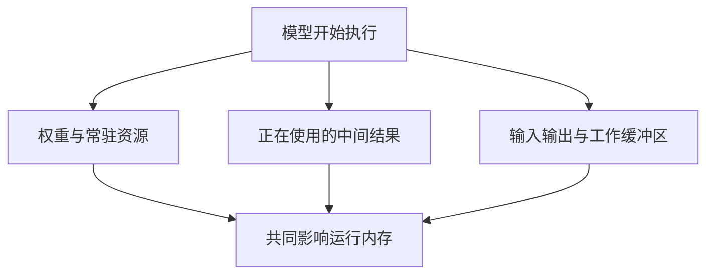
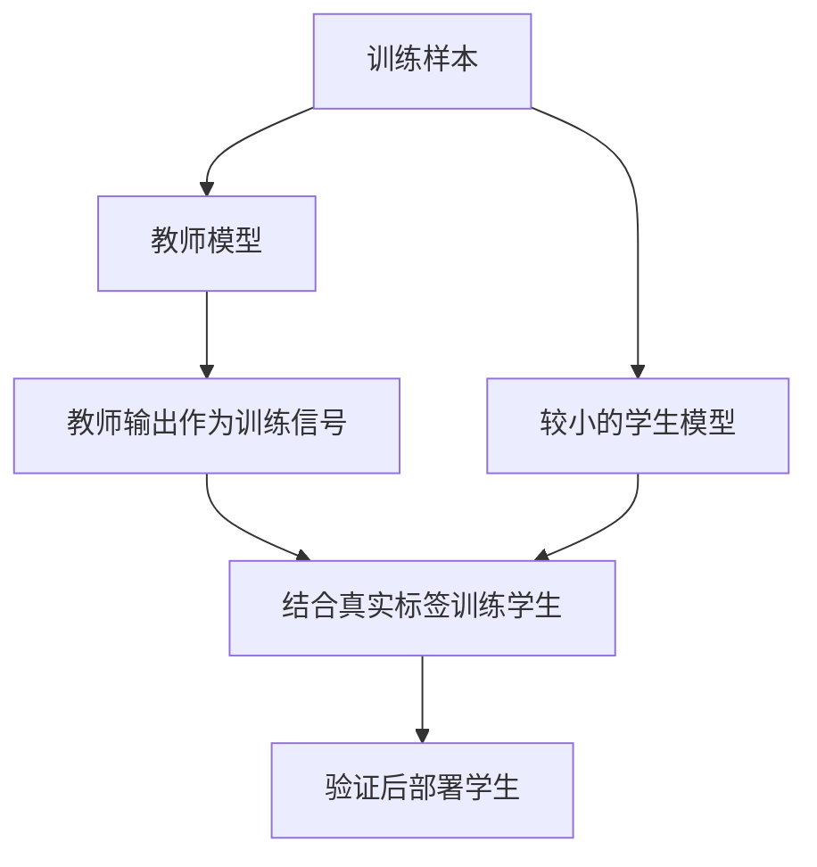
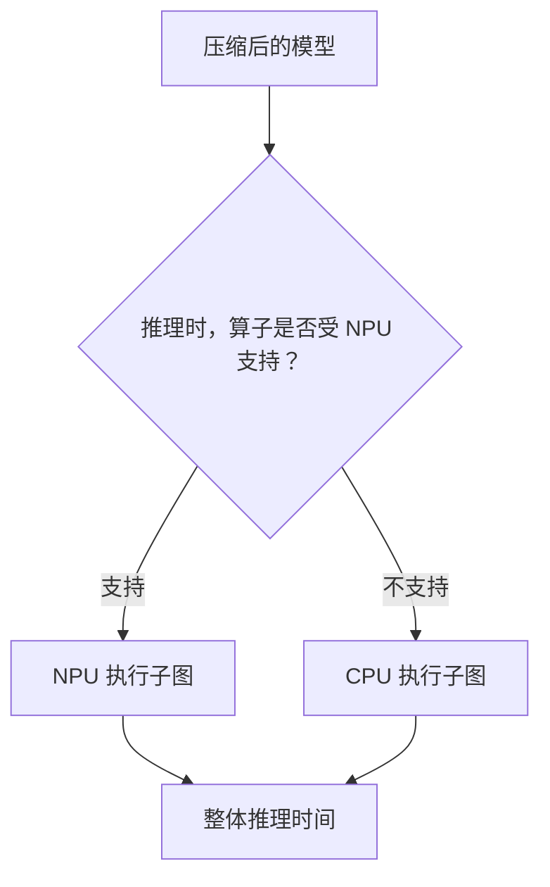

# 模型从 40 MB 缩到 10 MB，摄像头为什么还是卡？

> **端侧推理加速 · 第二篇**
>
> 让模型变小，至少有三件不同的事：少存一些数字、少生成一些中间结果、少做一些计算。它们有关联，却不会自动同时发生。
>
> 本文面向非 AI 专业读者，延续“家门口的智能摄像头”场景。文中的设备预算、数值与分数均为教学假设，用于解释因果关系，不是设备实测。资料核对日期：2026 年 10 月 15 日。

<!-- more -->

## 01｜模型瘦了四倍，摄像头却还是一卡一卡

上一篇，我们决定让门口摄像头先在本地发现人和包裹，再按需上传事件。现在，新的麻烦出现了。

工程师原本选中的模型有 40 MB。团队想办法把它压到了 10 MB。文件能下载，设备也能加载，可一打开实时画面，应用仍然卡顿，偶尔还因内存不足直接退出。

产品经理很高兴：“下载包小了四倍，总该流畅了吧？”

工程师打开性能监控，却看到三件怪事：**模型文件确实小了，运行内存并没有同比降下来，每帧推理时间也几乎没变。**

| 观察项 | 压缩前 | 压缩后 | 看起来 |
| --- | ---: | ---: | --- |
| 模型文件 | 40 MB | 10 MB | 小了约 75% |
| AI 峰值内存 | 90 MB | 60 MB | 只降了约 33% |
| 单帧模型执行 | 48 ms | 47 ms | 几乎没变 |

（这是一组为教学构造的可行数据，不是任何设备的测量结果。）

文件明明小了四倍，为什么运行起来没有跟着快四倍？问题就藏在“压缩”这两个字里。

**我们缩小的，到底是哪一部分？**

## 02｜40 MB 变成 10 MB，到底少了什么？

先交代这 40 MB 是怎么变成 10 MB 的，否则后面的账会算错。

一种常见做法，是把权重从 FP32 改成 INT8——精度降低，每个数占用的字节数减少，文件随之缩小。FP32 可以理解为“每个数通常占 4 字节”的格式，INT8 则是“每个数占 1 字节”；4 字节变 1 字节，正好能让参数数据从约 40 MB 缩到约 10 MB。量化是下一篇的主题，这里只借它说明“文件为什么变小”。

换个角度看，“压缩”至少可能指三件不同的事：

| 压缩方式 | 省下了什么 | 运行前可能要做的事 |
| --- | --- | --- |
| 打包压缩（如 ZIP） | 传输与存储空间 | 运行前通常需要解压 |
| 降低数值精度（如 INT8） | 每个数占的字节数 | 数值表示改变，按低精度执行 |
| 改变网络结构 | 参数与运算本身 | 计算图改变，需重新训练验证 |

三者不能混为一谈：打包压缩只影响“怎么存”，数值精度影响“怎么存、怎么算”，结构改变影响“算多少”。

本文的 40→10 MB，先按最简单的一种解释——权重的低精度存储——来理解，并忽略量化元数据与其他文件开销。但要记住一句话：

**文件小了，不等于整个网络的中间结果、运算量和执行方式都变了。**

要看清模型到底“瘦”在哪里，最好同时记四本账。

| 账本 | 关注什么 | 典型指标 |
| --- | --- | --- |
| 存储账 | 保存模型需要多大空间 | MB |
| 内存账 | 推理时有多少数据同时存在 | 峰值 MB |
| 计算账 | 要做多少运算、怎么执行 | MACs、执行时间 |
| 数据搬运账 | 计算时读写多少数据 | 访存字节、带宽 |

前三本容易理解，第四本——数据搬运——恰恰是现代 AI 最容易超支的一本。下面逐一展开。

## 03｜文件装得下，运行为什么还会撑爆内存？

模型看到一张图片，通常不会一步跳到“有人”。

在卷积网络里，图片会经过多层计算，生成一组组中间数组，常称为**特征图**，也是中间激活的一种。你可以把它们理解为模型对画面的逐步加工结果：某些响应与边缘、纹理有关，后面的响应又参与形成更复杂的判断。这只是直觉解释，并不是每个通道都有可命名的固定含义。

先别管具体计算，只看一个数组有多大。

假设某层输出的特征图是：高 160、宽 160、64 个通道，每个数占 4 字节，一次处理一张图（batch = 1）。“64 个通道”可以先理解为 64 张同样高宽的数值网格。

它的存储量就是：

```text
160 × 160 × 64 × 4 字节 = 6,553,600 字节 ≈ 6.55 MB
```

**仅一个中间张量，就可能占掉数 MB。**

如果其他条件不变，高和宽都翻倍：

```text
320 × 320 × 64 × 4 字节 ≈ 26.21 MB
```

不是两倍，而是四倍——因为高和宽各乘了二。

这里的“翻四倍”只针对这个张量，不能直接推断整个模型峰值内存必然翻四倍。运行时通常会回收和复用空间，所以不能把所有层的输出机械相加；反过来，分支连接、多个尚未消费的结果、算子工作空间，又可能让若干块内存同时存在。

更合理的理解是：

> **峰值内存，看的是某一时刻必须同时保留什么。**



这是组成关系图，不是可以直接相加的物理内存账单：真正要算账，得看每一刻谁在同时占内存。

还要分清几个常被混用的量：**模型文件大小**、**运行时常驻内存**、**峰值工作集**、以及**整个进程的内存峰值（RSS）**——它们计量口径不同，不能互相代替。后文出现的“AI 峰值内存”，请按“同一计量边界下的简化工作集峰值”理解，不等同于系统显示的 RSS。

现在你就能理解：权重文件从 40 MB 变成 10 MB，为什么应用仍可能因大尺寸特征图而吃紧。

## 04｜AI 到底是在忙计算，还是忙搬数据？

内存讲完了，再看性能。

很多人以为推理慢 = 算得太多。但在真实设备上，一大块时间并不花在乘法和加法上，而是花在读取权重、搬运特征图、写入中间结果、等待存储系统上。

打个比方：厨房做一道菜，要切、要炒，还要不断从冰箱拿食材。你把菜谱从 40 页缩成 10 页，厨师并不会因此快四倍——**如果真正耗时的是不停往返冰箱，菜谱再薄也帮不上多少忙。** 参数只是要保存的数据之一；运行时，计算单元还要反复读写大量数据。

为了粗略区分“算得忙”还是“搬得忙”，可以引入一个简化关系：

```text
计算强度 = 运算量 ÷ 数据搬运量
```

- 计算强度**低**：运算相对数据搬运很少，性能容易卡在“搬数据”上，这叫访存受限。
- 计算强度**高**：运算相对数据搬运很多，性能更可能受限于“算得快不快”，这叫计算受限。

这就是 Roofline（屋顶线）模型的直觉。本篇只用到这个比值，不展开完整的硬件峰值分析。

但别急着下结论：启动开销、同步、算子实现、硬件不支持加速，都可能成为真正的瓶颈。**光看这一个比值还不够，必须到目标设备上测量。**

所以“压缩有没有用”，要分别看它动了哪本账：让权重文件变小，主要动存储账；让同时存活的特征图变小，动内存账；让运算变少，动计算账；让中间读写变少，动的才是数据搬运账。

## 05｜第一种减负：为什么 MobileNet 能少做很多计算？

给小厨房减负，最直接的办法，是选一套适合它的工作流程。对应到模型，就是**轻量网络设计**：从结构上决定“该怎么算”。

但“轻量”不是把所有层随意砍掉，而是改变计算结构，在任务效果与资源成本之间做取舍。以 MobileNet 采用的深度可分离卷积为例。[1]

普通卷积像一个滑动窗口：窗口扫过图片的一小块区域，**同时**把所有输入通道的信息组合起来，生成输出通道。

深度可分离卷积把这件事拆成两步：

```text
普通卷积
  32 个输入通道
        │  一次卷积同时处理 32 个通道
        ▼
  64 个输出通道

深度可分离卷积
  32 个输入通道
        │  ① 逐通道各做一次 3×3 空间卷积
        ▼
  仍是 32 个通道
        │  ② 用 1×1 卷积混合通道
        ▼
  64 个输出通道
```

第一步叫 depthwise，第二步叫 pointwise。记不住英文没关系，先记住“**先分别处理空间，再混合通道**”。

核心不在于公式，而在于：普通卷积把“空间特征提取”和“通道信息组合”**揉在一起**做；深度可分离卷积把它们**拆成两步**，从而减少重复计算。

为了看清差别，做一个限定条件的算例：输入 32 通道、输出 64 通道、窗口 3×3，两种方案输出高宽相同，忽略偏置与边界细节。在一个输出位置上，普通卷积约需要：

```text
3 × 3 × 32 × 64 = 18,432 次乘加
```

拆成两步后：

```text
逐通道处理：3 × 3 × 32      =    288 次乘加
通道混合：  1 × 1 × 32 × 64 =  2,048 次乘加
合计：                          2,336 次乘加
```

在这组设定下，理论乘加次数约为原来的 12.7%，减少了约 87%。

但这里有句要紧的话：**运算次数减少，不保证运行时间按比例缩短。**

原因不只是数据读写。某些设备对普通卷积的实现高度优化，能让大量计算单元同时忙起来；换成逐通道卷积后，每个小算子反而可能利用不满硬件。

一个常见的结果是：普通卷积纸面计算量更大，却把 GPU 忙得满满当当；深度可分离卷积乘加次数少了很多，实际推理时间却没有同比下降。

**轻量网络的价值，是设计出更合适的计算结构，而不是保证某个固定加速倍数。**

## 06｜第二种减负：把权重变成零，GPU 就会少算吗？

假设已经训练好一个模型，不想从头换结构，能不能把不太重要的部分删掉？这就是剪枝的出发点。

最容易理解的是把某些权重设成零：

```text
原来的一行权重： [0.8, 0.01, -0.4, 0.02]
剪枝后：         [0.8, 0.00, -0.4, 0.00]
```

（这里的阈值只是示意。真实剪枝不能简单认定“小数字一定没用”，还要考虑不同层的尺度和任务影响。）

关键来了：**四个位置仍然是四个位置。**

用一个 4×4 的权重矩阵看更清楚：

```text
剪枝前：                非结构化剪枝后：
4 × 4 稠密矩阵           仍是 4 × 4 矩阵
16 个权重位置             仍有 16 个存储位置，其中若干值为 0
```

它揭示了四件事：非结构化剪枝只是增加了零；稠密存储下矩阵形状没变；稠密计算内核通常不会自动跳过这些零；要拿到稀疏加速，需要专门的稀疏表示和受目标后端支持的计算路径。而且稀疏表示还要记录非零值的位置，所以“有一半是零”不等于“文件一定小一半”。

在 PyTorch 的剪枝接口里，剪枝过程可能同时保留原始权重与掩码。调用 `prune.remove` 是去掉这种重参数化、把结果固定到权重里，**并不是把网络自动变成更窄的结构。**[2]

### 结构化剪枝：真正删掉结构

如果把某层的部分输出通道真正删除，并同步修改后续层对应的输入，数组尺寸才有机会实际下降。

```text
原网络：
  Conv 32 → 64
        ↓
  Conv 64 → 128

结构化裁剪后：
  Conv 32 → 48
        ↓
  Conv 48 → 128
```

例如一层原本输出 64 个通道，重建成只输出 48 个，这一层输出张量就少了四分之一。

但要满足三个条件：需要实际调整模型与依赖关系，不能只把整组值置零；删除后通常要微调或重新训练以恢复效果；硬件对不同尺寸的执行效率不同，少四分之一通道不保证快四分之一。此外，残差连接、通道分组等结构还会带来联动约束，不能机械删掉通道后就认为模型仍可运行。

对门口摄像头，最终关心的是人有没有漏掉、设备是否省内存、延迟是否下降。剪枝比例只是过程指标。

## 07｜第三种减负：让大模型教一个更小的学生

如果不想继续修剪原来的大模型，还有一条路：干脆设计一个更小的学生模型，让能力较强的大模型在训练阶段教它做判断。这就是知识蒸馏。[3]

先用一个**简化分类任务**说明（它不是完整的检测流程）：给一张裁剪后的画面，在“人、猫、空画面”之间分类，真实标签是“人”。

只看标签，学生得到的信息只有一句话：“正确答案：人。”

而教师会给出更丰富的一组分数：

| 类别 | 教师的示意输出 |
| --- | ---: |
| 人 | 0.70 |
| 猫 | 0.25 |
| 空画面 | 0.05 |

这组数表达的训练信号更丰富：教师虽然偏向“人”，却认为这张画面也有一些容易与“猫”混淆的特征。学生可以同时学习真实标签和教师的输出分布。（这些数是模型分数经处理后的概率分布，不应直接当作事件发生概率；教师也可能出错。）



蒸馏不是把老师的参数塞进学生文件，也不是让老师在每次端侧推理时陪跑。在这种离线训练、部署学生的方案里，教师只在训练阶段参与；上线后可以只运行学生。

还要补一个常被忽略的条件：**蒸馏本身不会自动改变学生的大小。**资源收益来自你选择了更小、更适配设备的学生结构；蒸馏帮助它学会任务。学生的容量、训练数据和教师质量都会影响效果，不能保证“小模型完整继承大模型能力”。

### 三条路，三种病因

| 路线 | 主要改变什么 | 是否通常需要训练 | 最容易误解的地方 |
| --- | --- | --- | --- |
| 轻量结构 | 网络如何组织计算 | 用预训练模型也可能需要适配 | 少计算不保证固定倍数加速 |
| 剪枝 | 连接或结构的保留方式 | 常需微调或再训练 | 置零不等于结构变小 |
| 蒸馏 | 学生的训练信号 | 需要训练学生 | 教师不会自动让任意学生变小 |
| 量化 | 数值表示与相关执行方式 | 可训练后执行，也可训练时适配 | 权重缩小不保证运行内存同比缩小 |

量化将在下一篇专门解释。这些手段可以组合（轻量学生 + 蒸馏 + 量化），也可以只取一项。它们不是必须逐个打勾的步骤，而是针对不同“病因”的不同药方：先查清超的是哪本账，再选对应的手段。对一个尚未上线的端侧项目，更稳的做法是先建立合适轻量模型的基线，再判断是否值得做更复杂的压缩。

## 08｜明明 NPU 更强，为什么小模型跑得慢？

如果两份模型参数一样多，谁更快？答案仍然要到目标设备上测。

设备可能花时间搬数据，也可能对某类算子有特别高效的实现；某些模型计算量低，却拆成许多小操作，调度与中间读写反而更显眼。这就是**硬件感知设计**的重要性：设计模型时，就把目标设备实际执行的特点考虑进去。

现代轻量模型的代表作是 2024 年的 MobileNetV4。它不只看参数量和计算量，还引入面向移动加速器的结构，并用硬件感知的架构搜索，在多种移动 CPU、GPU、DSP 上评估效率。[4]

它带来的启发是一句话：**选择端侧模型，要比较“任务、结构、数值格式、运行时、芯片”的组合，而不是只看参数量排名。**只拿参数量排名，就像只凭汽车重量判断通勤时间。

一个很能说明问题的反例：模型 B 看起来更小、计算更少，实际却可能更慢。

| 指标 | 模型 A | 模型 B |
| --- | ---: | ---: |
| 参数量 | 800 万 | 500 万 |
| 运算量 | 500 MMACs | 300 MMACs |
| 假设 NPU 推理耗时 | 18 ms | 25 ms |
| 关键差异 | 主要算子由 NPU 执行 | 部分算子需要 CPU 回退 |

（全部为教学假设，不能视为 MobileNetV4 或任何 NPU 的实测结果。）

模型 B 明明更小、更省算，却因为算子兼容性、设备切换和执行效率问题而更慢。原因在于，推理时并非所有算子都能落到 NPU 上：



当不受支持的算子把模型切成多个分区时，跨设备的数据同步与搬运会带来额外开销。ONNX Runtime 官方移动端文档也提醒：硬件后端的性能取决于设备和模型；模型被切成较多分区时，性能可能下降。它提供的 Model Usability Checker 可以检查模型在 NNAPI、CoreML 等后端上的算子支持情况与分区数量。[5][6]

实际的执行分配通常以“子图”为单位，而不是每个算子都单独切换设备。所以，今天的端侧优化重点正在转变：**不是只设计一个数学上计算更少的网络，而是设计一个能被目标设备高效执行的网络。**

## 09｜回到门口：先查哪本账超了，再决定怎么改

回到这台摄像头。它还要处理视频、管理网络、运行其他应用，所以 AI 能使用的内存不是设备总内存，而是系统分给它、且需要留有余量的**预算**。

假设我们为 AI 功能设了 **80 MB 的教学预算**（不是具体产品推荐值），一种简化账本如下：

| 内存项 | 假设占用 |
| --- | ---: |
| 权重与相关常驻数据 | 40 MB |
| 当前同时存活的中间结果 | 35 MB |
| 其他独立缓冲区与运行开销 | 15 MB |
| 合计 | 90 MB |

这里特意假设三项独立、无共享，便于演算；真实设备不能机械照搬。

如果压缩后权重降到 10 MB，其他项不变，合计降到 60 MB，确实缓解了，但整个账本并没有从 90 MB 变成 22.5 MB。如果更高分辨率让同时存活的中间结果涨到 70 MB，合计又会回到 95 MB——这时继续盯着模型文件压缩，可能已经偏离主要矛盾。

更有效的排查顺序是：

1. **确认任务**：只需知道“有人”，还是要找位置、识别身份？任务不同，模型需求不同。
2. **确认瓶颈**：文件超限、内存不足、推理慢，还是前后处理慢？
3. **选择修改**：更换轻量结构、调整输入尺寸、结构化剪枝、蒸馏或量化。
4. **返回设备验证**：检查真实效果与资源成本，决定是否采用。

降低输入尺寸可能省计算与特征图空间，但远处的小目标也可能更难发现；只截取门口区域可能减少输入，却也可能丢掉区域外的事件。这些都要验证，没有一项是无代价按钮。

## 10｜怎样证明模型真的“瘦身成功”？

不要只交付一句“模型小了四倍”。

先看一组时间账。摄像头的帧率决定了它每帧的间隔：

```text
    T帧周期 = 1000 ÷ FPS
    30 FPS → T帧周期 ≈ 33.3 ms
```

再看处理能力。如果按单执行单元、逐帧串行处理，每帧推理需要 47 ms，那么这个阶段的服务能力约为：

```text
    1000 ÷ 47 ≈ 21.3 帧/秒
```

21.3 帧/秒 < 30 帧/秒，说明**这个阶段来不及处理每一帧**。但这不等于“视频无法流畅播放”——视频显示是否卡顿，还取决于是否有独立的解码、渲染、缓冲和抽帧机制。

请记住这条分界：**“AI 来不及处理每一帧”，不一定等于“视频卡”，但可能导致 AI 告警滞后。** 前者是播放性能，后者是分析实时性，是两回事。

所以验收不能只看一个数字，而要在同一任务、相同测试集下比较：

| 指标 | 它回答的问题 |
| --- | --- |
| 部署文件大小 | 下载、存储是否更容易？ |
| 峰值运行内存 | 真正运行时是否装得下？ |
| 模型执行延迟与端到端延迟 | 模型更快，用户是否也更早得到结果？ |
| 持续运行表现 | 运行一段时间后，速度和功耗是否仍可接受？ |
| 任务效果 | 节省资源后，漏检与误报有没有增加？ |

对于人体检测，不能只看“预测类别是否正确”，还要看目标有没有漏、位置是否合适，以及真实场景中的误报。白天的平均表现，也可能掩盖夜间、逆光、遮挡和远处小目标的退化。

比较性能时应记录设备、运行时、后端、输入尺寸、精度、batch 与并发度，并区分冷启动与预热后的稳态。CPU、GPU、NPU 各自分配的内存，可能需要各自的工具观察，不能凭一个进程内存数字得出全部结论。

**压缩成功，是在任务效果达到要求时，所需资源确实下降。**

## 11｜摄像头需要的，是一份承担得起的能力

门口摄像头不需要因为“越大越聪明”，就承担一份超出设备能力的模型。它需要在有人走近时及时发现，在夜间也尽量可靠，并给视频采集、网络和其他功能留下空间。

轻量结构，改变工作怎么组织；剪枝，尝试删除可舍弃的连接或结构；蒸馏，让较小的模型获得更丰富的训练指导。而文件大小、运行内存和执行速度，是三张需要分别验收的成绩单。

把 40 MB 压到 10 MB，只回答了“它需要多少空间存放”。要让它真正跑得动，还得追问三个问题：运行时会产生多少中间数据？它要做多少计算、搬多少数据？这些计算能不能被这颗芯片高效执行？

**模型轻量化，不是让模型在文件管理器里看起来更瘦，而是让它在真实设备上真正承担得起工作。**

下一篇，我们盯住模型里的每一个数字：

**如果一个数原本占 4 字节，能不能只用 1 字节？INT8 量化到底省了什么，又丢掉了什么？**

---

## 资料来源与口径

本文场景、内存预算、教师分数和计算示例均为教学推演，不是产品测试结果。以下引用用于核对技术机制与研究方向。

[1] **MobileNets: Efficient Convolutional Neural Networks for Mobile Vision Applications（2017）**。深度可分离卷积及移动视觉模型的精度与资源取舍。  
https://arxiv.org/abs/1704.04861

[2] **PyTorch Pruning Tutorial**。剪枝接口、权重掩码、重参数化与移除掩码机制；移除重参数化不代表自动执行结构裁剪。  
https://docs.pytorch.org/tutorials/intermediate/pruning_tutorial.html

[3] **Distilling the Knowledge in a Neural Network（2015）**。使用教师输出分布训练较易部署的模型。  
https://arxiv.org/abs/1503.02531

[4] **MobileNetV4 — Universal Models for the Mobile Ecosystem（2024）**。面向移动硬件的结构设计、搜索与蒸馏。  
https://arxiv.org/abs/2404.10518

[5] **Google AI Edge：Model optimization**。端侧模型优化以及资源、精度取舍的官方说明。  
https://developers.google.com/edge/litert/quantization/model_optimization

[6] **ONNX Runtime：Model Usability Checker**。检查模型在移动端后端（如 NNAPI、CoreML）的算子支持与分区情况。  
https://onnxruntime.ai/docs/tutorials/mobile/helpers/model-usability-checker.html

## 系列阅读路线

| 篇次 | 核心问题 |
| --- | --- |
| 第一篇 | 为什么把推理放在本地？ |
| 第二篇 · 本文 | 怎样让模型更小，并理解运行内存？ |
| 第三篇 | INT8 量化为什么可能加速，又如何产生误差？ |
| 第四篇 | 模型怎样真正用上 GPU、NPU 等硬件？ |
| 第五篇 | 多个模型怎样持续、稳定地满足实时要求？ |
