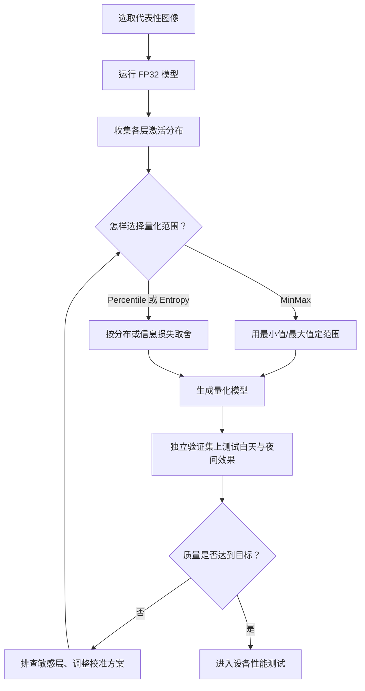
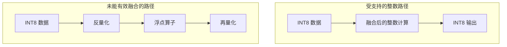

# 把模型里的数字缩小四倍，摄像头就能快四倍吗？

> **端侧推理加速 · 第三篇**
>
> INT8 量化的关键，是用有限的整数刻度近似表示原来的数值。能省下多少资源、损失多少效果，取决于刻度怎么选，以及设备怎样执行。
>
> 本文面向非 AI 专业读者，延续门口摄像头的场景。全部算例、内存预算和检测分数均为教学假设，不是设备实测。文末 Python 小实验仅演示数值映射，不执行神经网络。
>
> 资料核对日期：2026 年 10 月 15 日。

<!-- more -->

## 01｜白天认得出人，晚上为什么开始漏报？

上一回，我们给摄像头换了一份较小的模型，也弄清了一件事：文件大小、运行内存、计算速度，是三张不同的成绩单。

现在，团队还想再省一点资源。

有人提出一个看起来稳赚的想法：“把 FP32 换成 INT8。一个数从 4 字节变成 1 字节，权重不就只剩四分之一了？”

先把这句话说准：**我们缩小的是保存每个参数所用的位数，不是把参数值统统除以四。** 一个权重原来可能是 0.42，量化后不会变成 0.105，而是被换成一个更短的整数编码，再由一段刻度信息还原成近似值。

体重秤的单位从“克”换成“十克”，读数会变短，但你的体重并没有除以十。量化的道理类似。

团队照做了，转换顺利，白天测试一切正常。

可第二天晚上，测试人员报告：白天能稳定检测到的行人，到了光线昏暗、离摄像头较远的门口，偶尔会从 AI 的判断里消失。远处穿深色衣服的人尤其明显。

你可能首先怀疑：“是不是小数点被删掉了？”

不完全是。量化不是简单抹掉小数点，而是给数值换一套刻度：**刻度太粗，细微差别会消失；覆盖范围太窄，超出的数值会被压在同一端。**

但也要守住一条边界：夜间漏检不能直接算在量化头上。弱光、曝光、运动模糊、原模型的训练分布，都可能造成同样的现象。只有当同一批输入、同样的预处理、可比的后处理下，FP32 与 INT8 的结果出现系统性差异，才有证据说“是量化导致的”。

这一次，我们要追查两件事：

1. **整数到底丢掉了什么**——为什么夜间更容易受伤？
2. **为什么模型小了四倍，摄像头不一定快四倍？**

先看第一个问题：**256 个整数格子，怎么装下模型里成千上万的小数？**

## 02｜INT8 只有 256 个位置，怎么装下模型的小数？

先认识两种表示方式：

| 格式 | 每个数通常占多少空间 | 可以先怎样理解 |
| ---- | ----------: | ----------------------- |
| FP32 | 4 字节 | 32 位浮点表示，能覆盖较宽范围与较细精度 |
| INT8 | 1 字节 | 8 位有符号整数，范围为 -128 到 127 |

FP32 也不是无限精确，而且不同数值区间的精度并不相同。这里只需知道：它通常比 INT8 能表达更多数值差异。

INT8 总共只有 256 个编码位置（-128 到 127）。

如果模型里有 0.13、0.27、-0.42 这样的数，怎样放进去？

办法是给每个整数位置约定一个实际数值。例如约定：

> **每相邻两个整数位置，代表实际数值相差 0.1；整数 0 代表实际的 0。**

那么，整数 3 就表示 0.3，整数 -4 就表示 -0.4。

这像温度计：显示的格数本身不等于温度，你还要知道每格是多少，以及从哪里起算。

这里的“每格是多少”，叫 **scale，缩放因子**；“实际的零对应哪个整数位置”，叫 **zero-point，零点**。

**量化后的整数必须和刻度信息一起理解。单独拿到一个 37，并不知道它原来近似多少。**

补充一个容易混淆的点：INT8 有 256 个编码位置，但具体量化方案未必用满全部位置。有的规范要求卷积权重使用对称范围 -127 到 127、零点固定为 0。所以后文出现 -128 到 127 或 -127 到 127，并不矛盾，而是不同张量、不同规范的不同约定。[1]

## 03｜用四个数，把量化和反量化算明白

继续采用教学设定：

- scale = 0.1；
- zero-point = 0；
- 整数范围为 -128 到 127。

为了保存一个实际数值，先除以每格大小，再取最近的整数；如果越过范围，就截到边界。用符号简写：

```text
q = clip(round(x / scale) + zero_point, -128, 127)
```

其中，x 是原来的数，q 是保存的整数，round 取最近整数，clip 把超出范围的数限制到边界。

需要解释或还原近似数值时：

```text
x_hat = (q - zero_point) × scale
```

这个映射关系与 LiteRT 的量化表示相对应。[1] 不同实现对恰好位于两格中点的舍入规则可能不同，下面特意避开这类值。

| 原数 x | 除以 0.1 | 保存的整数 q | 还原值 x_hat | 还原值减原值 |
| ----- | ------: | -------: | ---------: | ------: |
| -0.42 | -4.2 | -4 | -0.4 | +0.02 |
| 0.13 | 1.3 | 1 | 0.1 | -0.03 |
| 0.27 | 2.7 | 3 | 0.3 | +0.03 |
| 0.96 | 9.6 | 10 | 1.0 | +0.04 |

原本不同的小数被放到有限的格点上，产生了近似误差。

这也解释了为什么不能直接写 `q = int(x)`：那是在做数值类型转换，不是完整的量化映射。0.13 和 0.96 都可能直接变成 0，结果与上面的刻度设计完全不同。

### 权重与激活：为什么要区分对称和非对称？

零点有时不为零。假设 scale 仍是 0.1，但 zero-point = -10：

```text
实际的 0   → 整数 -10
实际的 0.3 → 整数  -7
还原：(-7 - (-10)) × 0.1 = 0.3
```

移动零点，可以把有限的整数位置更合适地分配给不对称的数值范围。

在实际的 8 位规范里，不同张量往往使用不同的约束：

| 类型 | 常见量化约束 | 原因 |
| ----------- | ---------------- | ---------------- |
| 对称 INT8 权重 | zero-point = 0 | 简化整数乘加中的零点补偿 |
| 非对称 INT8 激活 | zero-point 可不为 0 | 更灵活地覆盖有偏移的数值分布 |
| 逐通道权重 | 不同通道使用各自 scale | 减小通道间动态范围差异带来的误差 |

一个直觉解释：

> 权重像提前备好的配料，数值已经确定，可以在部署之前就选好刻度。激活值像每次送进厨房的新食材，随着输入变化，它们的分布也会变。因此权重和激活，不一定适合用完全相同的刻度方案。

要注意，静态量化的激活刻度同样可以在部署前通过校准确定；这里的差别是**数值来源**，不是“激活必须每次动态算刻度”。[1]

本文主要用零点为 0 的例子降低理解难度；真实模型要读取自己的量化参数，不能照抄。

## 04｜误差有两种：格子太粗，或者尺子不够长

第一种误差来自舍入。

在没有越界、使用最近舍入的理想均匀量化里，一个数距离最近格点通常不超过半格。scale = 0.1 时，这个局部误差界约为 0.05。

但这不等于“整个模型的预测误差不超过 0.05”。网络会把许多数值放进后续计算，任务层面的影响需要另外评估。

第二种误差来自截断。

例如 scale = 0.01、zero-point = 0 时，完整有符号 INT8 可表示的近似范围是 -1.28 到 1.27。如果原数是 2.0：

```text
2.0 / 0.01 = 200
200 超过 127，被截为 127
还原：127 × 0.01 = 1.27
```

误差已经不是半格，而是 -0.73。

现在你面对一个取舍：

- 用较小的 scale，格子更细，但同样数量的格子覆盖范围更窄。
- 用较大的 scale，覆盖范围更宽，但小差别更容易被挤在同一格。

这就是量化里最核心的矛盾：**有限的刻度，如何同时兼顾覆盖范围和细节？**

### 一个离群值，就能拖粗整把尺子

假设某一层有 100 个非负激活值，其中 99 个落在 0 到 1 之间，只有 1 个离群值达到 10。为了直观，先用无符号 8 位范围 0 到 255、zero-point = 0 来讲。

如果这把尺子必须覆盖到 10：

```text
scale = 10 / 255 ≈ 0.0392
```

于是 0.10 和 0.11 这样的差别，可能被映射到同一个整数格点。

如果只看 0 到 1：

```text
scale = 1 / 255 ≈ 0.00392
```

刻度精细了十倍，但那一个 10 会被截断到顶格。

| 刻度策略 | 覆盖范围 | 对细小差别的表达能力 |
| -------- | ---- | ---------- |
| 覆盖 0～10 | 宽 | 弱，很多小数被挤进同一格 |
| 集中覆盖 0～1 | 窄 | 强，但区间外的值饱和截断 |

（这是示意刻度，实际 8 位量化有 256 个编码位置；这里用无符号范围只是为了直观计算非负区间，不代表所有模型都用无符号。）

一个离群值就可能让整层刻度变粗，这正是校准方法要解决的问题。

## 05｜白天校准的刻度，到了夜间还合适吗？

权重在训练后已经确定，转换工具可以直接读取它们。中间激活则不同：画面变了，计算过程产生的数值分布也会变。

工具需要一批有代表性的输入，让模型运行起来，观察内部数值，进而选择量化参数。这一步叫**校准**。官方的 RepresentativeDataset 接口，就是为估计输入、激活等数组的范围提供代表性样本。[2]

回到那个离群值问题：既然 scale 是一把尺子，为什么不直接取最大值和最小值，平均分成 256 格？

因为极值很可能是偶发的。不同校准方法，对“该把刻度花在哪里”有不同取舍：

| 方法 | 大致思路 | 代价 |
| ---- | ---- | ---- |
| MinMax | 直接用最小值与最大值定范围 | 一个离群值就能拖粗整把尺子 |
| Percentile | 忽略最大的极小比例的极端值 | 被忽略的值可能饱和截断 |
| Entropy | 以信息损失尽量小为目标选范围 | 计算更复杂，效果依数据而定 |

但要说清楚：**Percentile 校准不是简单地“删掉离群值”，也不能保证一定比 MinMax 更准。** 不同算法需要在独立验证集上比较，不能只看理论。



对门口摄像头，代表性不只是“随机挑几张图片”，还包括是否覆盖：

- 白天、夜间与灯光切换；
- 逆光、阴影和雨天；
- 近处大目标与远处小目标；
- 实际安装角度与实际预处理。

这些是针对本场景的工程建议，不是某个工具规定的固定清单。

如果校准只看了白天，得到的参数可能不适合夜间的激活分布，可能出现截断，也可能出现格点利用不佳；具体原因要逐层比较才能确认。

还要区分两个数据用途：

> **校准集帮助选择刻度；独立验证集帮助判断刻度选得好不好。**

不要一边用测试结果反复调整配置，一边仍把这份测试集称为完全未参与选择的最终验收数据。

## 06｜量化了权重，为什么运行内存没有变成四分之一？

权重文件小了，运行内存为什么没有同步变小？答案还是要分成几笔账。

假设 1,000 万个 FP32 权重占约 40 MB。全部改用 INT8 表示后，这部分整数数据约为 10 MB（十进制单位，忽略 scale、zero-point 等附加数据）。

**权重载荷的四分之一，不等于整个文件、整个进程、整个系统都变成四分之一。**

上一回的内存账本还包括中间激活、输入输出缓冲区、运行时和工作空间。如果只量化权重，激活仍以浮点形式保存，中间张量就不会自动按同样比例缩小。

另外，整数计算也不意味着每个临时量都只有 8 位。典型的整数卷积或矩阵计算会用更宽的累加器（例如 INT32）容纳多个乘积之和，再映射到下一阶段的输出刻度。[3]

可以把部署方式先分成几类：

| 做法 | 主要变化 | 不能自动推断的事 |
| ------ | ---------------- | ---------------- |
| 仅权重量化 | 用较低位宽保存权重 | 执行时一定全用整数 |
| 动态量化 | 某些激活量化参数在执行时计算 | 所有激活都以 INT8 常驻保存 |
| 静态量化 | 用校准等方式预先确定相关激活参数 | 所有模型节点都受整数后端支持 |
| 量化感知训练 | 训练中模拟量化影响，帮助参数适应 | 导出后一定全整数或一定更快 |

不同工具对“动态量化”的命名与支持范围可能不同，要看实际配方与后端。ONNX Runtime 官方区分了运行时计算激活参数的动态量化与预先校准的静态量化。[4]

应用输入输出也可能保留浮点接口。因此，只检查输入 dtype，不能判断模型内部是否已经使用整数计算；反过来，输入是 INT8，也不足以证明全部计算都在某个 NPU 上完成。

## 07｜INT8 怎样真正计算？为什么还要 INT32？

如果保存时变成整数，计算时又全部还原成浮点，那还怎么加速？

答案是：**支持整数推理的计算路径，可以直接用整数做主要乘加。** 我们用一个最小点积，把整条链路走完。

点积就是对应位置相乘再相加。假设：

```text
输入 x = [0.2, 0.4]，scale_x = 0.1
权重 w = [0.3, 0.5]，scale_w = 0.1
两者 zero-point 均为 0
```

量化后：

```text
q_x = [2, 4]
q_w = [3, 5]
```

**第一步：INT8 × INT8，用 INT32 累加。**

```text
2 × 3 + 4 × 5 = 26
```

这个 26 是累加结果，不必限制在 INT8 范围内。真实的整数卷积会一次累加成百上千个乘积，所以通常使用更宽的累加器（例如 INT32），避免中途溢出。

**第二步：按下一层的刻度，重新量化。**

乘积的实际刻度是 0.1 × 0.1 = 0.01，所以这一步的真实值约为 26 × 0.01 = 0.26，和浮点结果一致（因为原数恰好落在格点上）。

但下一层用的可能不是这把尺子。假设下一层要求 scale_y = 0.02、zero-point = 0：

```text
q_y = round(0.26 / 0.02) = 13
```

于是 26 被重新映射成下一层要用的 13。这一步叫 **Requantization，重新量化**。

```text
INT8 输入 × INT8 权重
          │
          ▼
   INT32 累加：26
          │
          ▼
 按输出刻度重新量化
          │
          ▼
   INT8 输出：13
          │
          ▼
       下一层
```

在零点为 0、刻度单一的简化条件下，这一步可以写成：

```text
q_y = clip(round(q_acc × (scale_x × scale_w / scale_y)) + zero_point_y, -128, 127)
```

更完整的形式还要考虑非零零点、偏置和逐通道刻度，但思路不变。所谓**重定标**，就是把这一步的累加结果换算成下一步要用的刻度；优化实现常用整数乘法与移位完成，并不要求每个元素都先恢复成 FP32。

这一段其实回答了三个常见疑问：

1. 为什么说“INT8 推理”，不代表所有临时数据都是 8 位？——因为累加用 INT32。
2. 为什么整数推理不必把每个元素都还原成 FP32？——按刻度重定标即可。
3. 为什么真正需要的是专门的整数算子，而不是简单把张量 dtype 改成 int8？——重定标、饱和、逐通道刻度都要实现。

**量化压缩解决“怎样保存”，整数执行路径解决“怎样计算”。两者接上，收益才可能兑现。**

## 08｜模型已经是 INT8，为什么还是不快？

整数数据更短，并不等于任何设备都更擅长这份模型。主要有三个原因。

**第一，后端有没有高效的整数实现？** 设备需要合适的指令或加速单元，运行时也要能正确调用它们。不能因为芯片支持 INT8，就认定全部算子都能高效执行。

**第二，中间是否频繁切换格式？** 如果一层走整数路径，下一层必须转回浮点，再下一层又转回整数，转换与数据搬运可能抵消部分收益。

**第三，原来的瓶颈在哪里？** 如果主要时间花在取帧、缩放、队列等待或消息推送，单独缩短模型计算，端到端提升也很有限。

第二点值得展开。有些量化图会显式画出“量化—反量化”的转换节点（QuantizeLinear / DequantizeLinear，简称 Q/DQ），用来表达图中的量化语义。但**画出转换节点，不等于运行时真的逐节点做浮点换算**：后端可以把相关模式融合成整数计算，也可能因为算子不支持而保留额外的转换。



（Q/DQ 是计算图里的量化语义表示，不代表运行时必然逐节点执行浮点反量化；能否融合取决于执行提供程序与模型图。[4]）

### 模型阶段快四倍，端到端就能快四倍吗？

再看时间账。假设一次端到端处理需要 100 ms：

| 阶段 | 原始耗时 |
| -------- | ------ |
| 取帧与预处理 | 20 ms |
| 模型推理 | 40 ms |
| 后处理与业务判断 | 10 ms |
| 其他等待与通信 | 30 ms |
| 总计 | 100 ms |

假设量化把模型阶段从 40 ms 降到 10 ms（模型快了四倍）：

```text
T_new = 20 + 10 + 10 + 30 = 70 ms
整体加速比 = 100 / 70 ≈ 1.43
```

模型阶段快四倍，端到端只快约 1.43 倍。这就是阿姆达尔定律的直觉：**优化只作用于链路的一部分，整体提速就会被没被优化的部分拖住。**

（教学假设，展示串行链路的简化账本；实际系统可能存在阶段重叠和资源竞争。）

ONNX Runtime 官方也明确指出，量化性能依赖模型与硬件，并提供量化前后的误差调试方法。[4] 所以：

> “FP32 到 INT8”说明数值格式变了；“快两倍、四倍”必须来自统一条件下的测量。

## 09｜如果效果下降了，先别急着放弃 INT8

门口摄像头夜间漏检增加，排查顺序应当具体。

先检查浮点基线是否本来就有同样问题，再检查预处理有没有变，包括颜色顺序、缩放、归一化与输入量化参数。然后比较浮点和量化输出，必要时定位从哪一层开始明显偏离。

可尝试的方向包括：

**补充代表性校准数据。** 解决输入覆盖不充分的问题，但不能保证解决所有模型敏感性。

**对不同通道分别选择刻度。** 如果一组权重变化范围很大，另一组很小，共用刻度可能损失小范围组的细节。逐通道量化允许它们各有合适的 scale；但量化轴的选择、支持范围都依赖算子与目标后端，不是所有算子都支持。[1]

**让部分敏感计算保留较高精度。** 减少误差，但要检查格式转换和图切分成本。

**采用量化感知训练（QAT）。** 详见下一节。

### QAT 到底在训练什么？

如果训练结束后才突然把浮点权重挤进 INT8 格点，模型可能没机会适应这种数值变化。QAT 的办法，是让模型在训练阶段就提前经历类似的舍入与截断：

```text
FP32 权重
    ↓
模拟量化到 INT8 格点
    ↓
恢复为近似浮点数
    ↓
继续参与训练计算
    ↓
模型参数逐渐适应量化误差
```

这种“先模拟量化、再恢复成浮点”的操作，常称为**伪量化（Fake Quantization）**。它像让运动员提前穿上正式比赛的鞋训练，而不是比赛开始才第一次换鞋。

关键要讲清楚：**QAT 的目的通常不是让训练全部变成 INT8 计算，而是让模型感受到量化误差并逐步适应。** 训练过程中底层仍可使用较高精度计算和浮点参数更新；最终部署时，再转换成目标设备支持的低精度表示。即便如此，也不保证精度完全恢复，更不保证部署后一定更快。[3][6]

截至本文核对时，LiteRT 官方优化文档已经介绍了选择性量化、混合精度及分块量化等路线。[5] 它们的共同方向，是按模型与硬件特点分配精度，而不是一律追求更少的位数。但 INT4、混合精度等方案各有支持与验证要求；对普通读者，先讲透 INT8，比罗列一串更低位宽的名词更有价值。

## 10｜一个不用 AI 框架，就能跑的量化小实验

下面的代码只需 Python 标准库。它演示同一组数换成不同刻度后，误差怎样变化；没有训练、模型转换和硬件测速。

```python
def quantize_one(x, scale, zero_point=0):
    """单个数的教学量化：最近舍入，再限制在 INT8 范围。"""
    if scale <= 0:
        raise ValueError("scale 必须大于 0")
    q = round(x / scale) + zero_point
    q = max(-128, min(127, q))
    restored = (q - zero_point) * scale
    return q, restored


values = [-0.42, 0.13, 0.27, 0.96, 2.0]

for scale in (0.1, 0.05, 0.01):
    print(f"\nscale = {scale}")
    for x in values:
        q, restored = quantize_one(x, scale)
        error = restored - x
        print(
            f"x={x:5.2f}  q={q:4d}  "
            f"还原={restored:5.2f}  误差={error:+.2f}"
        )
```

把刻度从 0.1 调到 0.05、再调到 0.01，观察最后一列：

| scale | 原数 | 保存的整数 | 还原值 | 现象 |
| ----- | ---: | -----: | ----: | ---------- |
| 0.1 | 2.0 | 20 | 2.0 | 范围足够 |
| 0.05 | 2.0 | 40 | 2.0 | 范围仍然足够 |
| 0.01 | 2.0 | 127 | 1.27 | 刻度更细，但发生截断 |

因此，“scale 越小越准确”不是完整结论：**同样的格数，刻度越细，覆盖的范围就越窄。**

代码里有两点要说明：

- Python 的 `round` 使用自己的中点舍入规则。实际部署应遵循工具与硬件的规定，不能把这段示意代码当成通用生产量化器。
- 函数里检查了 `scale > 0`。真实实现还需要处理逐通道刻度、饱和与更复杂的重定标，这里只演示最核心的映射。

### 接真实模型时，最容易漏掉的一步

如果模型输入要求 INT8，正确顺序一般是：

> 按模型要求预处理图像 → 用输入张量的 scale 与 zero-point 量化 → 按要求的 dtype 和形状送入模型。

不能把原始图像简单强转为 int8，也不能忽略模型是否要求先归一化。输入本来要求浮点时，也不应自行再加一层量化。读取整数输出时，同样要依据输出张量的参数解释它。

## 11｜怎样验收：别让“变小了”掩盖“漏得更多了”

回到门口。假设检测应用有一个决策阈值。

在某个教学示例中，一张画面的检测分数由 0.51 变成 0.49，而阈值是 0.50。这一点变化，就可能让应用从“发出提醒”变成“不提醒”。

这不是量化的必然方向，也不能把检测分数直接当成严格校准的事件概率。它只说明一件事：**小的数值变化，也可能跨过应用的决策边界。**

所以验收要同时看三方面：

| 方面 | 至少比较什么 |
| --- | ------------------------- |
| 资源 | 部署文件、峰值内存、持续负载下的功耗或能耗 |
| 速度 | 模型执行与端到端延迟，含较慢情况如 P95 |
| 效果 | 同一验证集上的任务指标，以及夜间、小目标等分组表现 |

对检测模型，还要看漏检、误报与框的位置质量，必要时用召回率、精确率或 AP 等指标评估。单张图片结果相同，不代表整体精度保持。

性能比较要固定或明确记录设备、运行时、后端、输入尺寸、batch、并发度和计时边界。量化前后若走不同硬件路径，也应如实说明。

不要凭一张图宣布“零损失”，也不要仅因一组输出不完全相同就判定量化失败。真正的问题是：**变化是否影响这项任务，换来的资源收益是否值得？**

回到最初那两件事：

- 整数丢掉的，是那些落在格点之间、或超出刻度范围的差别——所以夜间低对比度、小目标更容易受伤；
- 模型变小四倍，不等于计算更快四倍——存储、计算、数据搬运是几笔不同的账，端到端提速还受没被优化的环节拖累。

**量化不是把小数点删掉，也不只是把文件压缩四倍。它是在有限的数值刻度里尽量保留有用信息，并通过适配的整数计算路径，把存储优势转化为可能的性能收益。**

下一篇，我们把模型交给设备真正执行：

**手机明明有 NPU，为什么模型还在 CPU 上跑？GPU、NPU 和推理运行时，到底怎样配合？**

---

## 资料来源与口径

本文的例子为教学设计，算术结果不代表真实模型效果或加速倍数。

[1] **Google AI Edge: LiteRT 8-bit quantization specification**。量化映射、零点、逐轴刻度及具体算子格式约束。  
https://developers.google.com/edge/litert/quantization/quantization_spec

[2] **Google AI Edge: tf.lite.RepresentativeDataset**。代表性数据用于估计输入与激活等数值范围。  
https://ai.google.dev/edge/api/tflite/python/tf/lite/RepresentativeDataset

[3] **Quantization and Training of Neural Networks for Efficient Integer-Arithmetic-Only Inference（Jacob 等，2017；CVPR 2018）**。整数推理（含 INT32 累加与重定标）与训练时量化模拟的理论依据。  
https://arxiv.org/abs/1712.05877

[4] **ONNX Runtime: Quantize ONNX Models**。动态与静态量化、Q/DQ 表示、误差排查及性能边界。  
https://onnxruntime.ai/docs/performance/model-optimizations/quantization.html

[5] **Google AI Edge: Model optimization**。LiteRT Quantizer 及选择性、混合精度、分块量化等优化路线。工具与 API 仍在演进，实际使用请以选定版本文档为准。  
https://developers.google.com/edge/litert/quantization/model_optimization

[6] **PyTorch torchao: Quantization-Aware Training**。以伪量化（Fake Quantization）为核心机制的 QAT 工作流（2026 年）。  
https://docs.pytorch.org/ao/stable/workflows/qat.html

[7] **PyTorch torchao: PT2E Quantization**。图模式量化与部署后端 Lowering 的关系。  
https://docs.pytorch.org/ao/stable/pt2e_quantization/index.html

## 系列阅读路线

| 篇次 | 核心问题 |
| --- | --- |
| 第一篇 | 为什么把推理放在本地？ |
| 第二篇 | 怎样让模型更小，并理解运行内存？ |
| 第三篇 · 本文 | INT8 量化为什么可能加速，又如何产生误差？ |
| 第四篇 | 模型怎样真正用上 GPU、NPU 等硬件？ |
| 第五篇 | 多个模型怎样持续、稳定地满足实时要求？ |
