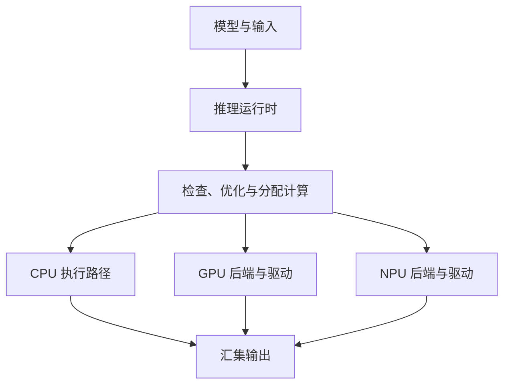

# 手机明明有 NPU，为什么 AI 还在 CPU 上跑？

> **端侧推理加速 · 第四篇**
>
> 芯片有加速器，只是第一步。模型的计算能否被接过去，数据是否需要反复转换，以及应用是否真的更快，要分别确认。
>
> 本文面向非 AI 专业读者，延续门口摄像头的场景，同时解释手机端的同类问题。场景、耗时与数据规模均为教学假设，不是产品实测或性能承诺。
>
> 资料核对日期：2026 年 10 月 15 日。

<!-- more -->

## 01｜手机有 NPU，AI 为什么还跑在 CPU 上？

手机发布会上，NPU 的算力数字很漂亮。

可工程师把人体检测模型部署上去后，发现 CPU 仍然忙得不可开交。

他检查配置：硬件加速已经打开。他再看运行结果：识别没有报错。可模型就是没有明显变快。他甚至一度怀疑：难道芯片上的 NPU 只是个摆设？

后来他打开计算图，发现模型虽然有一部分交给了加速器，中间却有几段计算仍由 CPU 完成。每次跨过去，除了计算，还可能发生格式转换、等待和同步。

问题可能不是“NPU 算得慢”，而是**整条执行路径没有组织好**。

前三篇，我们已经给门口摄像头做了三件事：把识别搬到本地，选择更合适的小模型，再理解如何用 INT8 降低数值表示的成本。现在，轮到第四个问题：模型怎样通过软件，真正到达那块硬件？

### 先纠正一个最常见的误判

“CPU 很忙”，能不能说明模型跑在 CPU 上？

**不能。**

即使 NPU 正常工作，CPU 也可能同时在忙着：视频解码、图像缩放与颜色格式转换；推理请求的准备与提交；缓冲区管理、同步与事件处理；检测框筛选与业务规则；网络传输、消息推送，以及应用的其他线程。

所以要把几种证据分开看：


| 观察现象          | 能说明什么        | 不能说明什么          |
| ------------- | ------------ | --------------- |
| CPU 使用率很高     | CPU 工作繁忙     | 模型一定在 CPU 执行    |
| NPU 有活动       | 有任务在使用 NPU   | 整个模型都在 NPU 上    |
| 配置了 NPU 后端    | 应用请求使用 NPU   | 计算图已成功完成 NPU 分配 |
| 后端日志显示 NPU 子图 | 至少部分计算被接管    | 这部分计算一定比 CPU 快  |
| 端到端延迟降低       | 当前测试条件下有性能收益 | 功耗、稳定性和精度必然更好   |


一句话记住它：**CPU 使用率告诉你 CPU 忙不忙；执行分配信息，才告诉你模型究竟在哪里计算。**

“硬件存在”“应用能够访问”“模型适合执行”，是三个不同的条件。这正是本篇要拆开的三件事。

## 02｜CPU、GPU、NPU，不是同一种机器换了三个名字

先认识这三类处理器。


| 处理器 | 可以怎样理解         | 在端侧应用里可能做什么         |
| --- | -------------- | ------------------- |
| CPU | 灵活的通用处理器       | 控制流程、业务逻辑，也可以执行模型计算 |
| GPU | 适合大量并行计算的处理器   | 批量处理适合并行的张量运算       |
| NPU | 面向神经网络计算设计的加速器 | 高效执行其支持的神经网络计算与数据格式 |


这只是分工直觉，不是固定规则。

CPU 并不等于“慢速兜底”。优化良好的 CPU 内核处理小模型，可能比需要额外启动、转换和同步的加速器路径更划算。

GPU 也不只用于显示画面。神经网络中的许多计算能并行展开，它可以承担这些工作。

不同厂商的 NPU 在架构、支持算子、精度、内存和软件接口上都有差别，不能把“NPU”当成一份统一的能力清单。

还要留意一个规格：**TOPS**，通常用于描述每秒万亿次运算的理论能力。比较这类数字，要看采用什么精度、是否使用稀疏计算、怎样计数，以及在什么运行条件下测量。它没有包含应用所有的取帧、排队、搬运和后处理时间。

就像仓库标着“每小时可分拣十万件”，你仍然要问：送来的是哪种包裹？输送带跟不跟得上？取走货物要多久？

**峰值算力说明潜力，不直接等于某个模型每秒能识别多少帧。**

## 03｜模型想用 NPU，中间还隔着什么？

我们平时说“加载模型”，听起来像打开一张照片。实际发生的事情要更复杂。

一个模型通常包含参数，以及这些参数参与计算的结构。把计算之间的关系画出来，就是**计算图**；其中的加法、卷积、激活、缩放等基本操作，叫**算子**。

执行模型时，需要软件知道：输入是什么形状、什么数据类型；哪一步依赖前一步的输出；怎样分配与复用内存；用哪种实现执行每项计算；什么时候可以读取结果。

负责组织这些工作的软件，通常称为**推理运行时**。它再通过后端、驱动等软件层，连接实际处理器。



这是逻辑关系图，不表示所有运行时都采用相同层次，也不表示三个处理器一定同时参与。

各套工具的名字不一样：LiteRT 的相关路线里会看到 Delegate 和 CompiledModel；ONNX Runtime 把接入不同计算后端的机制称为 **Execution Provider（EP，执行提供者）**；TensorRT 则提供面向 NVIDIA 推理部署的优化与执行能力。它们不完全等价。

那运行时究竟是**怎样决定**哪一段交给哪块硬件的？可以抽象成四个动作：

1. **能力查询**：向每个可用后端（EP / Delegate）询问——“这部分的算子、精度、形状，你能不能执行？”
2. **子图划分**：把能连续执行的节点合并成子图，交给对应后端；其余留在别的路径。
3. **编译或准备**：为目标后端准备可执行形式，可能涉及初始化、后端编译和缓冲区规划。
4. **执行与校验**：按依赖关系运行各子图，处理跨后端的取值与同步，并核对结果。

ONNX Runtime 的架构文档就描述了这样的机制：它通过能力查询，取得每个执行提供者能执行的节点与子图，再按提供者的优先级进行划分。[1]

> **模型需要经过一条适配的软件执行路径，才能利用某项硬件能力。**

这条路径处理得好不好，直接决定了 NPU 是“帮上忙”还是“白忙一场”。下面用一个具体模型来看。

## 04｜一个不支持的算子，为什么可能拖慢整张图？

设想摄像头里有一个简化的检测网络。把计算图拆开，大约有 12 个节点：卷积、激活、形状变换以及其他操作，彼此有前后依赖。

假设目标 NPU 后端能接管其中大部分连续节点，但其中一步——也许是一个形状相关的操作——因为数据类型或参数配置不满足要求，无法由该后端执行。


这张图的教学价值在于：**一个“不支持的步骤”，不一定只增加它自己的 CPU 计算时间，还可能引入前后执行边界的额外成本。**

为什么会“不支持”？原因可能不只是“算子名字不认识”：

- 这个版本或这组参数不支持；
- 数据类型、量化参数或布局不符合要求；
- 输入形状不满足限制；
- 需要的插件、驱动或厂商运行库没有就绪。

### 回退以“子图”为单位，不是逐个算子切换

在支持异构划分的运行时与配置中，软件会把模型切成子图：能交给加速器的交过去，其余留在 CPU。这种退回其他执行路径的行为，通常称为**回退**。

要纠正一个常见说法：**执行分配通常以“可执行子图”为单位，而不是每遇到一个不支持算子就来回切换一次。** 更不该仅凭计算图上的边数，就推断实际的跨后端同步与内存复制次数——那要看运行时的真实轨迹。

还要特别说明：**回退不是所有工具都会自动完成的保证。**

有些配置允许部分计算留在 CPU；有些会直接报告编译或加载失败；有些需要应用捕获失败后重新选择后端。不能把一种运行时的行为套给所有工具。例如，独立使用 TensorRT 构建引擎失败，并不意味着它会自动改用 CPU 完成剩余模型。

## 05｜NPU 明明更快，为什么完成任务反而更晚？

先看一个简化、串行的教学算例。

同一模型，如果全部在 CPU 上运行，总耗时 24 ms。

假设改为某种部分加速方案后：


| 环节                | 假设耗时      |
| ----------------- | ---------: |
| 第一段加速器计算          | 4 ms      |
| 第一次边界处理：转换、搬运或同步等 | 6 ms      |
| 中间 CPU 计算         | 7 ms      |
| 第二次边界处理           | 6 ms      |
| 后一段加速器计算          | 4 ms      |
| **总计**            | **27 ms** |


加速器确实参与了计算，但整个模型更慢。

如果另一种适配良好的方案能把主要计算连续交给加速器，假设计算用 8 ms、输入输出相关开销用 3 ms，总共只需 11 ms，才产生明显收益。

这里的数值并非典型设备参数，只为说明两类成本：**节省的计算时间，必须大于新增的调度、转换、搬运与同步时间。**

### 任务越小，越不划算

为什么同样有 4 ms 的边界开销，有时值得、有时不值得？看两组虚构数值：


| 阶段       | 小任务     | 大任务    |
| -------- | -------: | ------: |
| CPU 完整执行 | 3 ms    | 60 ms  |
| 加速器纯计算   | 1 ms    | 10 ms  |
| 提交、转换与同步 | 4 ms    | 4 ms   |
| 加速器路径合计  | 5 ms    | 14 ms  |
| 是否值得加速   | **不值得** | **值得** |


同样是 4 ms 的额外开销：对只需 3 ms 的任务很显眼，对原本需要 60 ms 的任务则容易被更大的计算收益抵消。

把它写成一个简单的判断条件。设 T_C 是 CPU 执行时间，T_A 是加速器计算时间，T_B 是额外的边界、转换与同步成本：

```text
当且仅当  T_A + T_B < T_C  时，
加速器方案才比 CPU 更快。
```

实际执行可能存在流水线重叠、排队和共享资源争用，不能把每个阶段都简单相加；但这个条件很适合建立判断直觉。

一句话总结：

> **NPU 的计算很快，但把任务交给 NPU，不是免费的。**

所以“只要回退就一定更慢”也不成立：如果加速部分足够大、边界成本较低，仍然可能受益。Google 的 LiteRT GPU Delegate 文档也提醒，不支持的算子导致 CPU/GPU 分段执行时，同步成本可能让它比全 CPU 执行还慢。[2]

我们要找的，不是图上有没有 CPU，而是**整条路径是否划算**。

## 06｜都是同一台设备，为什么还要“搬数据”？

很多人听到 CPU、GPU 之间搬运，想到的是两块独立显存之间的拷贝。但在手机等采用共享内存的设备上，事情也没有自动消失。

**共享一片物理内存，不等于各处理器能在任何时刻、以任何格式直接使用同一份内容。** 这里先把三件事分开：


| 类型   | 指什么           | 是否一定发生      |
| ---- | ------------- | ----------- |
| 逻辑转换 | 换格式、换布局、换数据类型 | 只要格式不一致就可能有 |
| 物理复制 | 真正搬运字节        | 视缓冲区和实现而定   |
| 同步   | 等待对方写完、保证数据可见 | 跨处理器交接时通常需要 |


实际路径可能仍需：把相机输出的图像格式转成模型需要的格式；调整通道顺序和内存布局；把浮点换成整数，或反过来；创建或导入后端能访问的缓冲区；等待前一个处理器完成写入并保证数据可见。

不是每种实现都包含全部步骤，也不是每个边界都会发生物理复制。但转换与同步都可能有成本。

举个只看数据量的例子。一张 1920×1080 的 RGB 图像，每个通道用 1 字节保存：

```text
1920 × 1080 × 3 × 1 字节 ≈ 6.22 MB
```

如果按同样形状展开为 FP32：

```text
1920 × 1080 × 3 × 4 字节 ≈ 24.88 MB
```

这不是说真实摄像头一定这样处理（相机常提供其他格式，模型也常用更小的输入尺寸）。它说明的是：**一次不必要的展开或复制，也可能涉及不小的数据量。**

“零拷贝”就是在合适条件下，让相关环节共享可用缓冲区，减少额外复制。

但要再说一次：**零拷贝不等于零计算，也不等于零同步。** 原始相机格式如果不符合模型要求，必要的转换仍要完成。

## 07｜INT8 模型交给 GPU/NPU，就一定在做整数计算吗？

第三篇留下的问题，现在可以回答了。

**不一定。** “文件采用怎样的数值表示”和“后端怎样执行”，需要分别检查。

以 Google 文档描述的一条 LiteRT GPU Delegate 路线为例，它可以接收量化模型，但会通过浮点视图执行；常量权重可在初始化时反量化，整数输入输出也可能带来逐次转换。[2]

这是一条具体实现路径，不能扩大成“所有移动 GPU 都只支持浮点”，更不能套给所有版本的 CompiledModel 后端。它给出的是一条普遍原则：

> 看到 INT8 文件，不能就认定实际采用了 INT8 算术；看到 NPU 配置，也不能就认定整张图都在那里执行。

同样，有些 NPU 对量化格式与模型形状有明确要求。它需要的不只是“一个比较小的文件”，而是一份符合其执行约束的模型。这也是为什么量化应结合部署后端设计，而不是模型转换结束后再随便选一块硬件。

## 08｜LiteRT、ONNX Runtime 如何把模型接到不同芯片？

这些条件听起来不少，但开发者并不需要手写每一层驱动。现代运行时正把更多适配工作封装起来。

### 从“手动选择”到“运行时辅助选择”

过去一个典型思路是：模型 → 开发者指定后端 → Delegate / 驱动 → 执行。现在，运行时开始承担更多判断：

```text
模型 + 运行需求
      ↓
运行时检查可用后端
      ↓
选择并准备执行路径
      ↓
配置缓冲区与同步
      ↓
执行与性能验证
```

Google 当前把 LiteRT 的 **CompiledModel** 作为推荐的端侧推理接口，重点支持 GPU/NPU 加速、自动后端选择、输入输出缓冲区管理与异步执行，同时保留 Interpreter 兼容路线。[3]

这里“编译”可以先理解为：根据目标执行环境，把模型准备成适合运行的形式，可能涉及初始化、子图准备或后端编译，具体过程因平台而异。

但要强调两点：

- **自动选择不等于一定选到全局最优后端。** 运行时的选择依赖内部策略、设备能力和支持范围，实际性能仍需测试。
- **接口统一不等于能力统一。** CompiledModel 不能自动解决所有算子兼容问题；软件接口一致，不代表不同厂商 NPU 的能力一致。

ONNX Runtime 则通过不同 EP 接入计算后端。提供者优先顺序会影响执行分配，但一个 EP 出现在配置里，不代表每个节点都由它处理。[1][4]

### 一张表看清“配置意图”与“实际收益”的距离


| 信息             | 能证明什么      | 还不能证明什么     |
| -------------- | ---------- | ----------- |
| 芯片规格列出 NPU     | 硬件具备相关单元   | 当前应用有可用访问路径 |
| 程序配置请求 NPU/GPU | 应用表达了执行意图  | 模型已完整交给它    |
| 模型成功加载并返回结果    | 一条执行路径跑通   | 没有回退、没有转换开销 |
| 分析工具显示加速器活动    | 有任务在该硬件上执行 | 这些任务让整体更快   |
| 同条件端到端测量更快     | 应用得到速度收益   | 功耗和准确率也一定达标 |


**从配置意图到实际收益，中间需要证据。**

### 对照：同样是推理加速，Jetson 为什么要走另一条路？

我们的摄像头还有另一种部署方式：画面送到附近的 NVIDIA Jetson 边缘设备处理。这时更合适的是 TensorRT 路线，而不是把手机 NPU 的部署方法照搬过去。


| 部署对象              | 典型软件路线                        | 主要关注点             |
| ----------------- | ----------------------------- | ----------------- |
| Android 手机        | LiteRT、ONNX Runtime + 适用后端    | NPU/GPU 能力、设备厂商适配 |
| iPhone / Apple 平台 | Core ML 及相关端侧框架               | Apple 硬件与系统集成     |
| NVIDIA Jetson     | TensorRT + JetPack 软件栈        | GPU/DLA 适配、引擎构建   |
| 通用 CPU            | ONNX Runtime CPU EP、XNNPACK 等 | CPU 算子实现、线程和内存效率  |


这些是常见路线，并不表示各平台只能选择表中所列工具。

TensorRT 的一般流程是：准备并导出兼容的模型表示 → 解析计算图、检查支持情况 → 在目标软硬件约束下构建优化引擎 → 加载引擎、准备执行内存 → 执行并验证。构建时可以做一些图优化与融合，生成的 engine 是优化后的执行产物，不是通用模型文件。[5]

实际部署要遵守软件栈兼容要求。尤其注意：截至本文核对时，NVIDIA 文档提示 Jetson 应使用其 JetPack 支持的 TensorRT 版本，不能默认采用最新桌面版本；TensorRT engine 也不应默认视为可跨 GPU、跨系统、跨版本移植。TensorRT 的普通 GPU 推理与 DLA 执行应分别讨论，不能把 DLA 等同于所有平台的 NPU。[6]

**TensorRT 用来解释 NVIDIA 部署路线，不能当作手机 NPU 的通用工具。** 本篇不展开 Engine Builder、Optimization Profile 或 Plugin，以免偏离主线。

这类“让硬件更好用”的适配工作，如今也在服务端侧大模型：ExecuTorch、高通 QNN、MLC-LLM 等运行时，正把 LLM 的算子、量化格式与内存管理逐个接到手机 NPU 和 GPU 上。原理和本文一样——硬件存在不等于用得上，差别只是 LLM 的算子更多、内存账本更紧。

## 09｜怎样证明模型真的跑上了 NPU？

不需要从几万行驱动代码开始。可以按“四层证据链”逐层确认。

**第一层 · 设备层：NPU 是否存在并可访问？**

检查系统是否识别、驱动与厂商运行时是否就绪、所需精度与算子配置是否支持。

**第二层 · 计算图层：哪些子图被分配给了 NPU？**

查看分区信息、不支持的节点、CPU 回退与编译结果。这一层回答“**打算怎么执行**”。

**第三层 · 执行层：计算真的在哪个处理器上完成？**

用运行时 Profiling 和设备厂商分析工具，观察执行事件、同步与转换。这一层回答“**实际在哪里执行**”。

**第四层 · 业务层：用户感受到的结果是否改善？**

比较模型延迟、端到端 P95、持续 FPS、功耗与检测效果。

具体操作上，可以先建立 **CPU 基线**（不要拿刻意关闭优化的 CPU 去夸大收益），再核对实际配置（后端是否安装、驱动是否满足、精度与形状是否支持），然后查看图分配与日志（编译报告、委派日志、节点分配、不支持算子提示），最后看性能轨迹。

ONNX Runtime 可以在创建会话时指定提供者，并在运行前开启 profiling。下面是一段示意代码：

```python
import onnxruntime as ort

# providers 只表示“注册了哪些执行提供者”，不表示“哪些算子一定被接管”
session = ort.InferenceSession(
    "detector.onnx",
    providers=[
        "SomeSupportedAcceleratorEP",   # 示意的加速器 EP，需替换为设备实际可用的 EP
        "CPUExecutionProvider",
    ],
)

print(session.get_providers())
```

`SomeSupportedAcceleratorEP` 是示意占位名，不能直接运行；正式使用要替换为目标设备上实际可用、已安装的 EP（例如适用环境的 QNN EP、CoreML EP 等）。

更要记住：`get_providers()` 只说明会话**注册**了哪些执行提供者，**不足以证明所有算子已被 NPU 接管**。想看“谁真正执行了什么”，要看图分配与 profiling 报告。

### 一次公平的对照实验


| 实验  | 配置               | 主要验证         |
| --- | ---------------- | ------------ |
| A   | 仅 CPU            | 建立基线         |
| B   | NPU 优先，允许 CPU 回退 | 判断异构执行是否有收益  |
| C   | NPU 优先，严格检查回退    | 判断模型能否完整适配   |
| D   | 优化不支持的节点与缓冲区路径   | 判断减少边界开销是否有效 |


这里的“严格检查回退”，要通过支持的日志、配置或模型分配检查来实现，不能假设所有框架都有同一个“禁止回退”开关。这里也不提供一个号称适用于所有手机的“NPU 开关”，正确操作依赖具体平台、模型和版本。

CPU 使用率本身无法说明模型在哪里：它可能仍在取帧、预处理、提交任务或完成业务逻辑。**从配置意图到实际收益，中间需要证据。**

## 10｜模型快四倍，应用为什么只快一点？

最后算一笔端到端账。

假设摄像头某项任务的串行耗时如下：


| 阶段        | CPU 方案    | 优化后的加速方案  |
| --------- | ---------: | ---------: |
| 取帧与预处理    | 12 ms     | 12 ms     |
| 模型执行      | 24 ms     | 6 ms      |
| 新增边界与同步开销 | 0 ms      | 4 ms      |
| 后处理与动作    | 4 ms      | 4 ms      |
| **合计**    | **40 ms** | **26 ms** |


模型执行从 24 ms 降到 6 ms，确实快了四倍。但应用整体从 40 ms 降到 26 ms，加速比约为 1.54，而不是四倍。

原因很直接：其他部分没有一起快四倍，还增加了边界开销。这是一种常见的整体优化约束：**优化一部分的收益，会受到其原先占比以及新增成本的限制。**

### 别只量到“任务发出去了”

有些加速器接口是异步的。CPU 调用提交函数后可以先返回，硬件还在执行。若只测函数返回前后的时间，测到的可能只是提交开销——就像给打印机发送文件，只测到“发送成功”，却声称整本书已经打印完。

```text
CPU 提交任务 ────────────► 返回
                │
                └────► NPU 实际执行 ─────► 完成事件
                                              │
                                              ▼
                                         安全读取结果
```

所以，比较耗时必须使用相同的计时边界。至少区分三种时间：


| 时间      | 包括什么              |
| ------- | ----------------- |
| 初始化与冷启动 | 加载、编译、分配资源及首次执行等  |
| 稳态模型执行  | 预热后，按明确边界测量的执行成本  |
| 端到端完成时间 | 从采集或选定输入，到结果和动作完成 |


异步执行的测量，必须在相应的完成事件、同步点或平台计时机制下确认任务结束。也不要在 CPU 与 GPU 对比时，一边包含输入输出转换、另一边把转换排除——可以分别测不同边界，但标签必须清楚。

### 也别忘了功耗

若更快意味着设备更早进入休眠，可能降低每次任务的能耗；但瞬时功率、执行频率与系统其他负载都会影响结果。因此不能只凭“耗时短”就宣布“功耗低”。最好同时测量持续功率或单次任务能耗，并注明测试边界。

## 11｜真正该选择的，是整条执行路径

回到最初那个疑问：“设备有 NPU，为什么 CPU 还这么忙？”

现在你知道，答案可能有多种：模型没接到对应后端；某些配置不受支持；部分计算回退；CPU 正在承担前后处理；或者加速器已经工作，只是瓶颈在别处。

正确的问题会变得更具体：

> **哪一段计算在哪里执行？跨边界花了多少时间？结果是否更早完成？**

如果读完本篇你能回答三个问题，这一篇的目标就达到了：

1. 为什么有 NPU 却不一定用得上？
2. 为什么 NPU 参与了计算，仍可能更慢？
3. 怎样证明模型真正运行在指定硬件上？

**CPU 使用率告诉你 CPU 忙不忙；执行分配信息，才告诉你模型究竟在哪里计算。** 我们的目标，是为任务找到合适的模型、数值格式、运行时与硬件组合——当这条路径接通并得到验证，芯片上的算力才会变成用户感受到的速度。

下一篇，事情会再复杂一点：

**一个模型已经跑得很快，为什么“认人、看包裹、听声音”一起运行，就开始排队、发热和迟到？**

---

## 资料来源与口径

文中图示、数据量与延迟账本均为教学推演。软件能力会随版本、平台和后端变化，部署时需固定可复现版本并查对应文档。

[1] **ONNX Runtime：Architecture**。执行提供者、能力查询与计算图划分。  
https://onnxruntime.ai/docs/reference/high-level-design.html

[2] **Google AI Edge：GPU delegates for LiteRT**。GPU 算子支持、CPU/GPU 分段成本与该 Delegate 路线对量化模型的执行方式。文中相关行为只指该文档描述的实现。  
https://developers.google.com/edge/litert/performance/gpu

[3] **Google AI Edge：On-device Inference with LiteRT**。CompiledModel、缓冲区与硬件加速路线。  
https://developers.google.com/edge/litert/inference

[4] **ONNX Runtime：Python API Overview**。提供者配置、会话、profiling 与执行接口。  
https://onnxruntime.ai/docs/api/python/api_summary.html

[5] **NVIDIA：How TensorRT Works**。引擎构建、图优化与执行产物。  
https://docs.nvidia.com/deeplearning/tensorrt/latest/architecture/how-trt-works.html

[6] **NVIDIA TensorRT Documentation**。平台与版本入口，含 Jetson/JetPack 的适用版本提示。  
https://docs.nvidia.com/deeplearning/tensorrt/latest/

## 系列阅读路线

| 篇次 | 核心问题 |
| --- | --- |
| 第一篇 | 为什么把推理放在本地？ |
| 第二篇 | 怎样让模型更小，并理解运行内存？ |
| 第三篇 | INT8 量化为什么可能加速，又如何产生误差？ |
| 第四篇 · 本文 | 模型怎样真正用上 GPU、NPU 等硬件？ |
| 第五篇 | 多个模型怎样持续、稳定地满足实时要求？ |
