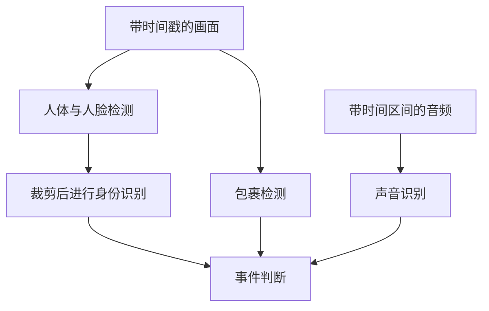
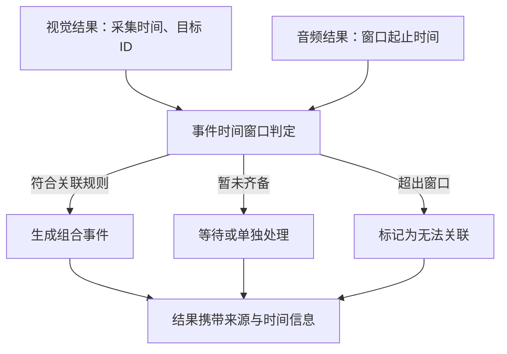
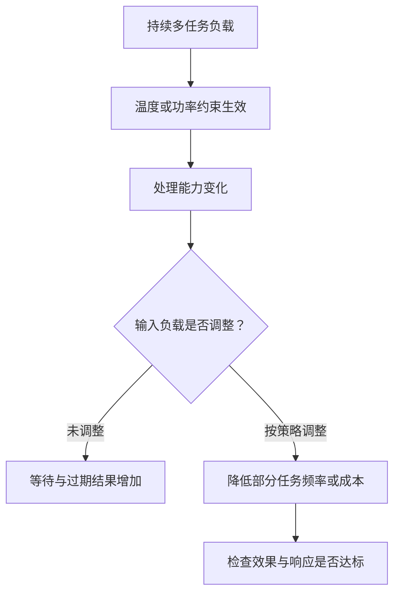
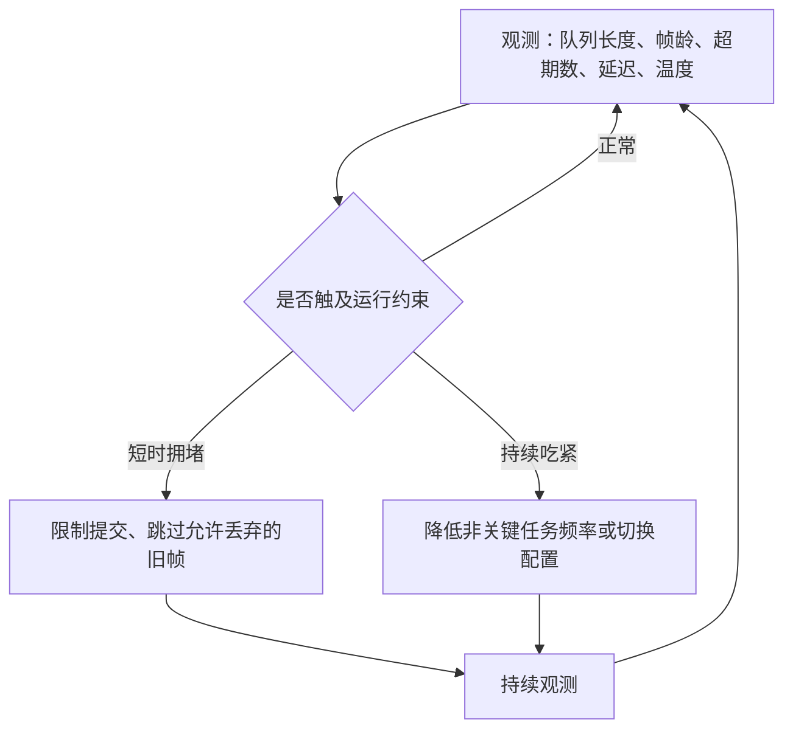

# 三个模型都很快，摄像头为什么还在看两秒前的画面？

<!-- 原图是一处本地截图（orca-paste-1792058781063….png），未随文章入库；正文不依赖它。 -->

> **端侧推理加速 · 第五篇 / 系列收官**
>
> 实时 AI 的目标，是让有用的结果在期限内到达。多开几个线程，并不能自动实现这个目标。
>
> 本文面向非 AI 专业读者，延续“门口摄像头认人、看包裹、听声音”的场景。全部模型耗时、频率与预算均为教学设定；代码是确定性的队列模拟，不是设备性能测试。
>
> 资料核对日期：2026 年 10 月 15 日。

<!-- more -->

## 01｜人已经离开，AI 为什么还在看两秒前的画面？

前四篇，我们给门口摄像头做了不少优化：把识别放到本地、缩小模型、理解 INT8 量化，再打通 GPU 或 NPU 执行路径。

单独测试时，每个模型都挺快。

可当“检测行人”“判断包裹”“识别异常声音”一起开启，奇怪的事情出现了：预览画面很流畅，识别框却慢了半拍。程序没有崩溃，处理计数还在增长，但人已经离开门口，通知才说“检测到行人”。运行一段时间后，设备还开始发热。

工程师又加了几个线程，结果有时更好，有时更差。

问题在哪里？

**我们优化了每位工人的动作，却还没安排整条生产线。**

要看清这件事，先把标题里的“两秒”算出来。它不是一个夸张的数字，而是**输入速度持续超过处理能力**的必然结果。

### 两秒积压账本

假设门口摄像头有一路视觉分析任务：

- 输入帧率：每秒 30 帧；
- 分析流程的处理能力：每秒 20 帧；
- 每帧平均执行耗时：50 ms；
- 系统要求逐帧处理，不允许丢帧；
- 忽略启动开销与执行时间波动。

输入与处理能力之间，每秒差：

```text
30 - 20 = 10 帧/秒
```

这意味着每秒都多积压约 10 帧。持续运行下去：

```text
4 秒后排队帧数  Q = 10 × 4 = 40 帧
清空这些排队工作所需时间 T = 40 ÷ 20 = 2 秒
```

也就是说，新到达的画面，可能要等约 **2 秒**才轮到模型处理。


| 运行时间 | 预计排队帧数 | 预计排队等待 |
| ---- | ------: | ------: |
| 1 秒  | 10     | 0.5 秒  |
| 2 秒  | 20     | 1.0 秒  |
| 3 秒  | 30     | 1.5 秒  |
| 4 秒  | 40     | 2.0 秒  |
| 5 秒  | 50     | 2.5 秒  |


（全部为确定性教学推演，队列按无限、不丢帧处理。）

要精确区分两点：

- 这里的“2 秒”是**排队等待**，还没有计入该帧自身的推理耗时；
- 它也不是每帧固定的“2 秒”，而是**随过载持续增长**。只要输入一直快过处理，等待只会越来越长。

还有一点要说清：这个模型默认只有**一个串行工作者**。三个模型并不必然只能做到 20 FPS——实际吞吐取决于依赖关系和计算资源。这里描述的，是多任务组合形成的一条受限分析流水线。

所以，四秒前摄像头和 AI 还配合得不错；四秒后，程序已经欠下 40 帧没处理的画面。模型本身没变慢，它依然平均 50 毫秒处理一帧。可新画面到达时，前面还有 40 帧等着它。

> **AI 并不是在慢慢看画面，而是在认真地看过去。**
>
> 这才是实时系统里更危险的情况：计算一直在继续，结果却越来越过时。

## 02｜三个模型一起跑，哪些能并行，哪些必须等待？

要让“迟到”讲得清楚，先把任务画出来。

本文把视觉任务分为三步：

- 检测模型：找到人或人脸区域；
- 身份模型：对合适的人脸裁剪图进行识别；
- 包裹模型：独立判断指定区域是否有包裹。

声音模型使用麦克风的音频窗口，单独执行。

真实项目也可能用一个多任务模型完成部分视觉工作。



图里有两类关系。

**第一类，必须等待。** 身份模型需要检测结果给出的裁剪区域，对同一张画面，它不能在裁剪区域产生之前完成识别。

**第二类，可以独立推进。** 包裹模型可以读取画面独立工作，声音模型也不需要等待人脸检测。

但图上都连到“事件判断”，不意味着所有告警都必须等四条分支齐全。有人进入区域，可以先触发一条独立事件；需要结合声音的规则，再消费相应结果。

这张图叫**任务依赖图**。先看依赖，再谈并行，比先开线程更有效。

### 并发、并行、流水线，先分清楚


| 词   | 可以怎样理解         | 摄像头里的例子               |
| --- | -------------- | --------------------- |
| 并发  | 多项任务在一段时间内交替推进 | CPU 轮流准备不同模型输入        |
| 并行  | 不同任务在同一时刻实际执行  | 某些 GPU 计算与 CPU 工作发生重叠 |
| 流水线 | 不同阶段处理不同数据项    | 检测第 2 帧时，识别第 1 帧的人脸   |


并发不保证硬件同时计算，流水线也不能取消同一数据项上的依赖。这里讨论的是多个端侧任务如何协作，而不是“把一个大模型拆到多张卡”的模型并行。

再做一个教学算例：检测 12 ms、检测后的人脸身份识别 8 ms、独立包裹检测 10 ms。假设同一帧的三项任务都需要完成。

全部串行时：

```text
12 + 8 + 10 = 30 ms
```

如果资源充足、两条分支可以理想并行，又忽略额外开销：

```text
人体分支：12 + 8 = 20 ms
包裹分支：10 ms
总时间 = max(20, 10) = 20 ms
```

不能直接取 max(12, 8, 10) = 12 ms，因为身份识别依赖检测。最长的那条依赖链，就是这里的**关键路径**。

### 关键路径还不够：结果最晚什么时候必须开始？

关键路径告诉我们“这一帧最快多久算完”，但实时系统还关心另一件事：**为了赶上期限，任务最晚什么时候必须开始。**

假设这一帧必须在采集后的 100 ms 内得到身份识别结果。检测 + 身份识别这条关键路径需要 20 ms，那么：

```text
检测链最迟开始时间 = 100 - 20 = 80 ms
```

也就是说，如果检测在采帧后 80 ms 才启动，即使它跑得再快，也赶不上 100 ms 的期限。用公式表达：

```text
t_最晚开始 = t_截止时间 - T_关键路径剩余量
```

这是使用**已知固定耗时**的简化分析。真实系统还要为执行波动、队列竞争和数据准备预留预算；两条分支也可能争同一块 GPU 或带宽，耗时会变化。但它点出了一个更深的结论：

> **调度器不仅要知道任务需要多少计算，还要知道结果最晚什么时候必须完成。**

> **工程深度｜验证状态：** L2–L3 工程｜概念验证（端到端新鲜度需真机测量）
## 03｜多开线程，为什么不等于多出一份算力？

线程可以帮助应用组织任务，但不能创造算力和带宽。

假设一个模型已经把设备的大部分计算资源占满，再启动另一个模型，设备通常需要分时处理，或让两者共享资源。于是可能出现：两个模型完成得更多，但每个请求等待更久；单独很快的模型在共享带宽后变慢；多个 CPU 线程池互相争核心、调度开销增加；并发缓冲区和中间结果让内存吃紧。

NVIDIA TensorRT 的优化文档指出，跨推理多 Stream 会让并发工作共享计算资源；单模型独占设备时选出的实现，不一定在并发环境中仍然最合适。[1] 这里的 **CUDA Stream** 可理解为一条有序的 GPU 工作队列：多个 Stream 为重叠执行提供条件，却不保证计算一定重叠。实践中通常为并发推理准备各自的执行上下文、Stream 与安全缓冲区，避免复用仍在使用的数据。[1][2]

这套约束不是手机 NPU 的通用接口；CPU 侧同理，ONNX Runtime 也提供线程管理与全局线程池，并讨论了多会话线程池间的资源竞争。[3]

因此，要比较的不是“开了多少线程”，而是：**并发度从 1 增到 2、再到 4 时，有效吞吐、尾延迟和内存分别发生了什么。** 并发度是此处允许同时处于执行过程中的任务数量，对端侧设备是需要测量的参数，不是越大越好的指标。

## 04｜模型只算了 20 ms，为什么结果迟到了 500 ms？

上一节说的是“同时跑会不会互相拖慢”。还有一个更隐蔽的问题：**即使每个模型都很快，结果也可能很久之后才出来**——因为模型开始之前，可能先等了 500 ms。先定义两个容易混淆的指标：

**吞吐量**：每秒完成多少工作。

**结果帧龄**：结果完成时，它对应的画面距离采集时刻已经过去多久。

```text
结果帧龄 = 本次结果完成时间 - 对应画面采集时间
```

它包含采集后直到结果完成的等待与处理，不等于单次模型执行时间——模型只算了 20 ms、画面却排队等了 500 ms，结果也已经老了约 520 ms。

### 队列：短时能缓冲，长期救不了

增加队列长度，只能吸收某些短时波动，不能解决长期输入速度高于处理能力的问题。甚至在平均输入略低于处理能力时，突发流量与执行波动也可能带来较长等待——所以不能把平均负载刚好接近满额，当成稳定实时的保障。

### 结果帧龄，离“信息年龄”还有一步

严格的信息新鲜度研究里，有一个更完整的概念叫**信息年龄（Age of Information，AoI）**。它刻画的是“观察端掌握的最新信息，随时间变化的年龄过程”。

这里要区分清楚：

- 本文的**结果帧龄**，是某个结果完成时，距离它对应画面采集时刻的时长；
- **AoI** 还研究在任意时刻，观察者手里“最新一份信息”有多旧。

两者相关，但不是一回事。所以不能把“已完成结果的平均帧龄”直接叫做“平均 AoI”——本文只用到前者，不展开后者的随机过程理论。

### 只看帧龄，会掩盖丢帧

**只看已完成结果的帧龄，也可能掩盖大量丢帧。** 一台设备可以只挑极少数画面迅速完成，看起来帧龄很漂亮，却错过关键瞬间。所以系统需要同时观察处理频率、丢弃比例和事件漏检，目标是：**在任务可接受的采样与覆盖条件下，让结果足够及时。**

## 05｜来不及处理时，应该等、挡，还是丢？

这就是**背压**要处理的问题：下游来不及时，上游和队列应该怎样应对。

常见策略有几种：


| 策略            | 适合考虑的场景          | 代价          |
| ------------- | ---------------- | ----------- |
| 有界队列，满了就拒绝或丢弃 | 限制内存与等待          | 必须明确丢谁、怎样统计 |
| 只保留最新待处理帧     | 更关心当前状态的视觉分析     | 可能跳过短暂事件    |
| 阻塞或减慢生产者      | 上游可以降速，或短时波动需要缓冲 | 可能影响共享采集与预览 |
| 降低分析频率        | 任务不需要逐帧判断        | 采样间隔增大      |
| 降低单次工作量       | 有经过验证的低成本配置      | 精度与细节可能下降   |


Android CameraX 就提供了“只保留最新图像”（`STRATEGY_KEEP_ONLY_LATEST`）和“阻塞生产者”（`STRATEGY_BLOCK_PRODUCER`）等背压策略。官方文档还提醒，阻塞可能影响同一相机上的其他绑定用途，例如预览。[4]

但不能把一个策略用到所有数据上。**视觉分析丢弃一帧，不等于录像也必须丢弃那一帧**——它们可以有不同的消费路径，但仍共享一定资源，需要整体验证。

**音频更不能随意用“最新一帧”覆盖。** 声音模型往往依赖一段连续音频，随意断开会破坏窗口。应使用有界环形缓冲区等机制，并记录缺口、窗口范围和超时。

对需要保留完整证据的场景，还应设计独立的存储或补偿路径。

### 一个不用 AI 框架的小实验：不改模型，也能减少迟到

下面用 Python 标准库模拟一个有限的画面突发：

- 共 10 帧，在 0、20、40……180 ms 到达；
- 每帧处理固定需要 30 ms；
- 单个工作者，不能中断正在执行的任务；
- 输入结束后，继续处理直到队列排空。

比较两种策略：FIFO（先到先处理，不丢帧）；latest（每次空闲时只取已到达、尚未处理的最新帧，跳过更旧的等待帧）。

```python
def simulate(latest=False):
    arrivals = list(range(0, 200, 20))  # 10 帧的采集时刻
    now = 0
    ages = []
    dropped = 0

    while arrivals:
        now = max(now, arrivals[0])
        ready = [t for t in arrivals if t <= now]

        if latest:
            chosen = ready[-1]        # 选择最新的待处理帧
            dropped += len(ready) - 1
            arrivals = arrivals[len(ready):]
        else:
            chosen = arrivals.pop(0)  # FIFO 保留每一帧

        now += 30                     # 模拟固定处理耗时
        ages.append(now - chosen)     # 完成时减去采集时刻

    return len(ages), dropped, sum(ages) / len(ages), max(ages)


for name, latest in (("FIFO", False), ("latest", True)):
    done, dropped, mean_age, max_age = simulate(latest)
    print(
        f"{name}: 完成={done}, 丢弃={dropped}, "
        f"平均帧龄={mean_age:.1f} ms, 最大帧龄={max_age} ms"
    )
```

运行结果：

```text
FIFO: 完成=10, 丢弃=0, 平均帧龄=75.0 ms, 最大帧龄=120 ms
latest: 完成=7, 丢弃=3, 平均帧龄=34.3 ms, 最大帧龄=40 ms
```

模型执行一次仍然需要 30 ms，一点没变。变化来自：**少等旧任务，把有限处理能力用于较新的画面。**

把它摊开到时间轴上，会更直观。10 帧输入，单工作者每帧处理 30 ms：

```text
输入帧号 : 0  1  2  3  4  5  6  7  8  9

FIFO 处理 : 0→1→2→3→4→5→6→7→8→9      （全部处理）
latest处理: 0→1    3→4    6→7    9    （跳过 2、5、8）
              ↑  跳过2   ↑  跳过5  ↑ 跳过8
```

这是等待队列的选择策略，不是摄像头采集或录像的丢帧机制。

代价很明确：3 帧没有被分析，丢弃比例 30%。如果重要事件只出现在这些画面里，就可能漏掉。

再加上业务时限的视角：假设截止时间设为 60 ms，


| 指标              | FIFO    | latest  |
| --------------- | -------: | -------: |
| 完成帧数            | 10      | 7       |
| 丢弃帧数            | 0       | 3       |
| 平均帧龄            | 75.0 ms | 34.3 ms |
| 超期帧数（>60 ms） | 6       | 0       |
| 丢弃比例            | 0%      | 30%     |


这里必须提醒：latest 的平均帧龄只统计已完成的 7 帧，不能直接与 FIFO 的 10 帧视为业务等价。放宽处理耗时也能观察临界点——例如每帧 10、20、30、40 ms、输入间隔固定 20 ms，队列会从“追得上”逐步滑向“开始积压”。

这只是有限输入的模拟，不能据此得出设备稳态 FPS。它要说明的只有一件事：

> **任务怎样进入模型，与模型执行多快，一样会影响提醒是否及时。**

## 06｜谁先执行？实时告警与后台分析不能排同一条队

到现在为止，我们都在讨论“同一条队列”怎么排。但门口的实际情况是：**不同任务的紧迫程度并不一样。**

### 先给任务定一个期限

同一个摄像头可能同时运行三类任务：


| 任务       | 教学假设的目标时限 | 业务含义        |
| -------- | --------- | ----------- |
| 人员进入区域告警 | 200 ms    | 尽快触发本地基础提醒  |
| 人脸身份补充识别 | 800 ms    | 可以在基础告警之后补充 |
| 包裹状态更新   | 2,000 ms  | 允许较低更新频率    |


这些不是行业标准，只用于解释不同任务的时效性要求。

现在看两个结果：人员告警 A 用了 80 ms 完成；身份识别 B 用了 600 ms 完成。虽然 B 更慢，但它仍然满足业务需求。反过来，另一个人员告警用了 250 ms 才完成，即使比 B 快，也已经超过其业务时限。

> **实时不一定意味着绝对时间最短，而是任务能否在自己的时限内完成。**

有了期限，就能定义**超期比例**：

```text
R_超期 = N_超期 / N_应评价
```

其中 `N_超期` 是超过业务截止时间的任务数，`N_应评价` 是约定统计范围内应被评价的任务数。

要特别说明：被丢弃或未完成的任务，是否计入违约，必须由业务验收口径定义，不能只统计成功返回的请求。例如 100 次应被评价的告警里，90 次准时、5 次超期、5 次被丢弃——如果后两类都算违约，达标率就是 90%，而不是只从成功结果里统计出的约 94.7%。

### FIFO 与 EDF：先到先得，还是先到期先得？

不同调度策略会直接改变“谁超期”。引入一个简单的截止时间调度方法：**EDF（Earliest Deadline First，最早截止时间优先）**。不用推导实时调度理论的全部条件，只记住直觉：

> **FIFO 先处理谁先到；EDF 优先处理谁最先到期。**

假设同一个不可抢占的执行器，在 0 ms 时已有三个任务待处理：


| 任务     | 处理耗时  | 绝对截止时间 |
| ------ | -----: | ------: |
| A：包裹状态 | 35 ms | 100 ms |
| B：人员告警 | 20 ms | 30 ms  |
| C：身份补充 | 25 ms | 70 ms  |


若按到达顺序 A、B、C 执行：

```text
FIFO：
0        35       55         80 ms
|---- A ----|--- B ---|---- C ----|

A：35 ms 完成，准时
B：55 ms 完成，超期（>30）
C：80 ms 完成，超期（>70）
```

若改按截止时间 B、C、A 排列：

```text
EDF：
0      20          45            80 ms
|--- B ---|---- C ----|------ A -----|

B：20 ms 完成，准时
C：45 ms 完成，准时
A：80 ms 完成，准时
```

同样三个任务、同样的总耗时，只是换了顺序，就从两个超期变成全部准时。

这里必须保留两个技术边界：

**第一，EDF 不是万能算法。** 这个例子是所有任务同时就绪、耗时已知、单执行器、且开始执行前可以排序的理想场景。

**第二，GPU/NPU 上已提交的工作未必能被随意抢占。** 如果低优先级任务已经开始执行，EDF 并不意味着可以立刻打断它。

所以真正的控制，往往发生在**提交之前**：限制并发任务数、把低优先级任务切小、为关键任务预留执行容量，避免堆积大量来不及撤回的请求。

高优先级也不能让其他任务永远得不到执行：应给出最低更新频率或最大等待时间并记录违反情况，否则后台任务会**饥饿**——系统在跑，却没有真正服务谁。

### 从“静态优先级”到“按业务目标调度”

到了这一步，“谁先跑”已经不再是一个固定数字能回答的问题。更贴近实际的调度决策，会同时权衡：

```text
调度决策 = f(截止时间余量, 剩余工作量, 资源占用, 任务价值)
```

这是抽象的设计表达，不代表某个现成算法。例如有人刚进入门口，告警期限还有 100 ms；而另一项已经等了很久的任务，余量只剩 20 ms——调度器需要在保障关键告警的同时，避免普通任务长期挨饿。至此，我们也从“静态优先级”走到了“**按业务目标调度**”。

## 07｜认人、看包裹、听声音，需要同样的频率吗？

很多系统一开始就给所有模型喂每一帧。但任务需求可能不同。

“有没有人走近”通常需要比较及时的更新；“包裹是否仍在门口”可能允许较低频率；身份识别则可以在出现质量合格的人脸时触发。

下面是一组教学配置：


| 任务   | 假设执行策略            | 必须验证的风险        |
| ---- | ----------------- | -------------- |
| 行人检测 | 每秒分析 15 帧         | 快速经过是否漏检       |
| 身份识别 | 合格人脸出现时触发，并设速率上限  | 质量差或遮挡时怎样处理    |
| 包裹检测 | 每秒分析 5 帧          | 短暂出现或被取走能否及时发现 |
| 声音识别 | 连续采集，按模型所需窗口与步长分析 | 音频连续性与事件覆盖     |


音频窗口长度和输出步长不是一回事。例如一个模型需要较长上下文，即使计算只要几毫秒，也可能必须先等足够音频。因此声音告警还要计算“等数据”的时间。

可以先做一笔粗略计算预算。假设检测每次 12 ms、包裹每次 8 ms、身份每次 6 ms 且最多每秒触发 5 次：

```text
检测：12 × 15 = 180 ms/秒
包裹： 8 ×  5 =  40 ms/秒
身份： 6 ×  5 =  30 ms/秒
合计：          250 ms/秒
```

如果把它们视为占用同一个串行工作者、执行成本固定且没有其他开销，这部分需求相当于其每秒处理时间的约 25%。真实系统还要加上音频、预处理、同步与峰值触发。这张预算的意义，是先问“**每秒究竟要做多少工作**”，再讨论开多少线程。

## 08｜别把“刚才的人”和“现在的声音”拼在一起

还有一种不显眼的错误：人体检测结果来自两秒前，包裹结果来自半秒前，声音结果刚刚完成。程序把它们放进同一条规则，得出“有人在拿走包裹，并发出异常声音”。这些结果都可能各自正确，但组合起来却不成立。

问题出在一个经常被忽略的区分：**事件时间**和**处理时间**。

- **事件时间（Event Time）**：传感器实际采集到数据的时间；
- **处理时间（Processing Time）**：模型计算完成、系统拿到结果的时间。

这两个时间不是一回事，例如：

```text
摄像头帧 A：采集于 10:00:01.000，结果完成 10:00:01.500
声音窗口 B：采集区间 10:00:01.200～10:00:01.700，结果完成 10:00:01.750
```

两个模型的完成时间只差 0.25 秒，看起来很接近。但 A 描述的是 1.000 秒那一刻的画面，B 描述的是 1.200～1.700 秒的一段声音。**不能仅凭“完成时间相近”，就断定它们描述同一个瞬间。**

### 用事件时间窗来融合

一份可靠的多模型输出，除了类别和分数，还应带有：对应帧或任务标识；输入采集时间（音频标记窗口起止）；结果完成时间；必要的目标标识与有效期。

融合规则要基于**事件时间**来判断。例如，业务规定：只有当人员检测与异常音频的**事件时间**落在允许的窗口内，才触发组合告警。



但也别走另一个极端：**同一时间段，并不自动证明两个事件存在因果联系。** 声音可能来自其他人或环境。时间窗只是“允许关联”的必要条件，不是充分条件。

同一设备测耗时宜使用适合的单调时钟；跨设备还要考虑时钟对齐和误差。同一帧依赖链中，身份识别也要使用与检测结果匹配的裁剪区域——不能检测用了旧帧，裁剪却偷偷取了最新帧。

> **流水线允许不同帧同时在不同阶段前进，但每份结果必须知道自己属于哪一帧。**

### 迟到结果，不一定只能丢

最后一个容易被忽略的点：过期结果不应该总是被静默丢弃。

对实时告警，它可能已经失去触发即时动作的价值；但对事后取证，它仍然可能需要保存。所以可以按用途分三类：

- **仍可用于即时告警**：还在有效期内；
- **已超过即时期限，但可用于历史事件补充**：进入追溯存储；
- **已过期且无保留价值**：按策略丢弃。

这比“一律删除过期结果”更符合真实视频系统。

## 09｜为什么刚启动很流畅，十分钟后却慢了？

短时测试时，设备可能温度较低，还有一定性能余量。持续同时运行视频采集、多个模型、编码、预览与网络后，功耗和温度会逐渐变化；在热或功率约束下，系统可能降低频率。

NVIDIA Jetson 的平台文档明确包含电源、温度与性能管理机制；具体控制策略与限制需要按设备和软件版本确认。[5] 不同设备的实现各异，没有通用的“到某温度必然降频”数值。

但可能形成这样的链条：



这也是为什么“平均一次只要几毫秒”不能证明设备能长期实时。应在实际机壳、散热、供电与环境条件下持续运行，直到性能与温度进入有代表性的状态，并覆盖合理的负载变化。测试时长取决于设备和场景，十分钟并非通用合格标准。

## 10｜设备忙不过来，怎样自动减负？

不必等到应用崩溃，才决定降级。

可以预先设计几档经过验证的运行配置。例如：


| 状态        | 可考虑的动作              | 需要守住什么           |
| --------- | ------------------- | ---------------- |
| 正常        | 按目标频率执行             | 及时性、准确率与覆盖       |
| 短时拥堵      | 丢弃允许跳过的过期视觉任务，限制新提交 | 不破坏数据归属与缓冲区安全    |
| 持续吃紧      | 降低低优先级任务频率或切换已验证配置  | 保留核心告警能力并显式记录降级  |
| 关键目标仍无法满足 | 报告能力不足，调整需求、设备或部署方式 | 不能把迟到结果伪装成正常实时输出 |


但它不该是一张“静态对照表”，而应该是一个**闭环控制**：



也就是：**观测指标 → 判断约束 → 选择策略 → 反馈验证 → 继续观测**。少了最后一步“验证”，降级就可能悄无声息地把效果一起降掉。

这里有三条工程边界要守住：

- **不能只靠温度阈值切换**：队列增长和结果超期，可能远早于明显的热约束出现；
- **需要滞回、防抖或最小驻留时间**：设置不同的进入与退出阈值、要求状态持续一段时间再切换，防止运行配置反复抖动；
- **关键任务的最低覆盖与效果要求，不能因降级而悄悄失效**。

Jetson 官方确实提供功率模式、频率、散热及硬件热保护等机制，但不能把 Jetson 的具体限制套用到所有手机或摄像头。[5]

具体阈值需来自实测与需求，不能照搬示例数字；若切换输入尺寸或模型版本，还要同步验证预处理、缓冲区、后处理与精度，不能在使用中的数据上随意更改配置。

> 自适应调度不是让系统“自动变聪明”，而是提前定义负载不足时的可接受行为。

## 11｜怎样证明整个系统真的“实时”？

对门口摄像头，先写出具体目标（这就是一套简化的 **SLO，Service Level Objective，服务等级目标**）：

> 从指定事件出现，到本地基础告警完成，应在业务可接受的期限内；持续负载下也要保持足够事件覆盖。

期限要按业务定义，不能套用通用数字。然后同时测这几类指标：


| 维度   | 建议记录                    |
| ---- | ----------------------- |
| 时效   | 端到端延迟、结果帧龄、P95/P99、超期比例 |
| 完整性  | 处理频率、丢帧、音频缺口、事件漏检       |
| 资源   | 峰值内存、队列长度、并发任务数、处理器负载   |
| 持续性能 | 温度、频率、功率或能耗、不同时间段表现     |
| 结果关联 | 帧标识、音频时间区间、融合输入年龄       |


P95/P99 描述大部分样本中的较慢情况，但不是最大时延保证。本系列主要讨论常见视觉与交互应用的及时性，不提供安全关键场景所需的硬实时证明。

### 从“吞吐量”到“有效吞吐量”

只统计“每秒完成多少”还不够。真正有意义的是**有效吞吐量（Goodput）**——它关注每秒完成多少**对业务仍然有效**的工作：

```text
G = 业务期限内完成且符合有效性要求的结果数 / 观测时间
```

还要补充一点：实时视频检测不能只统计已经完成的结果。被采样或丢弃的帧里也可能包含事件，所以最终仍应通过**事件级**的召回率、误报和覆盖率来验收。

> **GPU 忙不忙，不等于 AI 是否真正帮到了用户。**

### 四种对照，定位问题

做完指标，再做四种对照实验：

1. 单模型独立运行；
2. 所有模型串行运行；
3. 所有模型按目标并发度运行；
4. 完整应用持续运行，含采集、预览、编码与网络。

如果前三种正常、第四种变慢，就要查系统共享资源与完整数据链路；若并发度提高后吞吐略增、尾延迟大涨，较低并发度反而可能更符合目标。若主要问题是输入过载，先修队列和提交策略；若主要问题是算力不足，再考虑模型、硬件或任务需求。**优化要对应证据。**

## 12｜五篇之后，我们真正优化的是什么？

回头看这台摄像头：

第一篇，理解为什么计算能靠近现场，也知道本地不保证无条件更快。

第二篇，把模型文件、运行内存和计算成本分开，理解轻量结构、剪枝与蒸馏。

第三篇，为数字换刻度，理解量化收益与误差。

第四篇，把模型接到真实硬件，检查回退、转换与同步成本。

第五篇，才把这些能力安排成一套能持续工作的系统。

**端侧 AI 的完成标准，是在有限资源里，持续提供足够及时、足够可靠的结果。**

当门口有人走近时，设备既没有执着地补看旧画面，也没有因为忙着更新包裹状态而耽误基础告警；需要进一步分析的结果可以随后补充，并且知道自己对应哪个时刻。

如果这一篇只能留下一句话，那就是：

> **单模型优化，关注“一次计算要多久”；多模型系统优化，关注“有限资源下，哪些结果值得优先计算，以及它们能否及时、持续、可靠地到达”。**

从“一个模型算得快”，走到“整个应用来得及”，这才是端侧推理加速最后的一步。

---

## 资料来源与口径

本文任务图、调度配置、预算与队列实验为教学设计，不是某款设备的部署方案。实际接口与并发约束需按所用版本核对。

[1] **NVIDIA TensorRT 10.x：Optimizing TensorRT Performance**。跨推理多 Stream、资源共享与并发执行的优化边界。引用 10.x 路线便于衔接 JetPack 支持的软件栈，不表示任意 Jetson 都支持全部特性。  
https://docs.nvidia.com/deeplearning/tensorrt/10.x.x/performance/optimization.html

[2] **NVIDIA TensorRT 10.x：How TensorRT Works**。运行时对象、执行上下文与线程安全要求。  
https://docs.nvidia.com/deeplearning/tensorrt/10.x.x/architecture/how-trt-works.html

[3] **ONNX Runtime：Thread management**。单次算子与算子间线程管理、多会话竞争及共享线程池。  
https://onnxruntime.ai/docs/performance/tune-performance/threading.html

[4] **Android Developers：CameraX Image analysis**。保留最新图像、阻塞生产者、分析队列与资源释放。本文的队列实验只演示相近策略思想，不模拟 CameraX 全部行为。  
https://developer.android.com/media/camera/camerax/analyze

[5] **NVIDIA Jetson Linux Developer Guide：Platform Power and Performance，r36.4.4**。功率、温度与性能管理。具体设备的控制行为需阅读对应子章节与版本文档。  
https://docs.nvidia.com/jetson/archives/r36.4.4/DeveloperGuide/SD/PlatformPowerAndPerformance.html

## 系列阅读路线

| 篇次 | 核心问题 |
| --- | --- |
| 第一篇 | 为什么把推理放在本地？ |
| 第二篇 | 怎样让模型更小，并理解运行内存？ |
| 第三篇 | INT8 量化为什么可能加速，又如何产生误差？ |
| 第四篇 | 模型怎样真正用上 GPU、NPU 等硬件？ |
| 第五篇 · 本文 | 多个模型怎样持续、稳定地满足实时要求？ |
