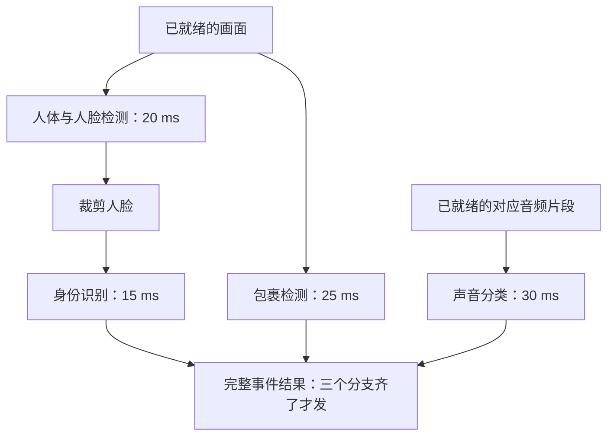
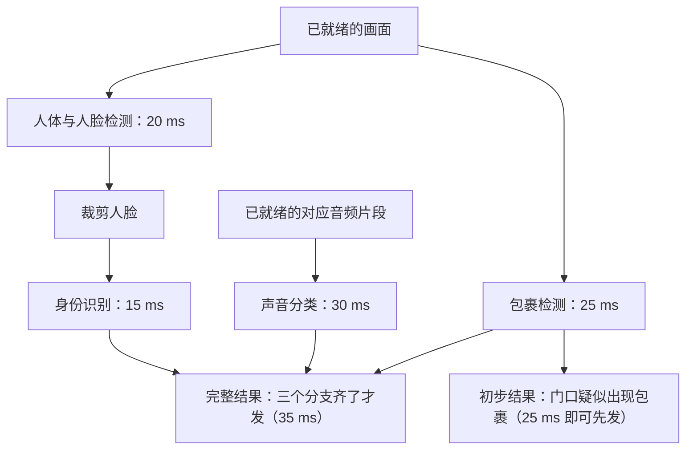

# 四个 AI 一起干活，为什么不能快四倍？

> **AI 并行计算入门 · 第一篇**
>
> 门口有人、地上有包裹、麦克风里传来响动。四个 AI 模型已经准备就绪，你把它们一起启动，提醒就能提前四倍发出吗？
>
> 本文用一个门口摄像头的场景，讲清多模型并行、任务依赖、关键路径，以及它们与数据并行、模型切分的区别。
>
> **口径说明：本文场景、耗时和资源配置均为教学假设，不是产品实测或性能承诺。配套代码只模拟等待与调度，不执行真实模型。资料核对日期：2026 年 10 月 16 日。**

> **工程深度｜验证状态：** L2 工程｜概念验证（理论推导为主）
<!-- more -->

> **路线图位置**
> **上一站**：第 36–40 篇（端侧系列）讲单设备上多模型的部署与「为什么迟到」；本篇起进入并行主线。
> **这一站**：多模型协作的两个约束——任务依赖（谁必须等谁）与关键路径（哪条链决定完成时间）。
> **不解决**：线程与 Stream 的机制细节（下一篇 42），多卡并行与模型切分（44 篇起）。
> **前置**：无需并行知识，会读 Python 即可（第 06 节实验可本机运行）。
> **下一个动作**：跑一遍第 06 节的模拟实验，观察两处提交顺序。

## 01｜摄像头看见了人，提醒却还没来

晚上八点，快递员走到门口。

摄像头拍下画面，麦克风也收到了声音。你希望系统回答三个问题：来的是谁？有没有放下包裹？有没有异常响动？

你原以为，四个模型一起跑，提醒就能快四倍。可把依赖关系画出来之后会发现：哪怕硬件足够，90 毫秒也只能理想地缩到 35 毫秒。

于是，你准备了四个模型：

| 模型 | 负责什么 | 教学假设耗时 |
|---|---|---:|
| 人体与人脸检测 | 找到人和人脸的位置 | 20 毫秒 |
| 身份识别 | 根据裁剪的人脸判断身份 | 15 毫秒 |
| 包裹检测 | 判断画面中有没有包裹 | 25 毫秒 |
| 声音分类 | 判断音频片段中的声音类别 | 30 毫秒 |

最容易想到的写法，是一个接一个调用：

```python
boxes = detect(frame)
identity = recognize(crop_face(frame, boxes))
package = detect_package(frame)
sound = classify_sound(audio)
```

只计算表中的四次模型执行，共需要：

\[
20+15+25+30=90\text{ 毫秒}
\]

这时，一个很自然的想法出现了：

**既然有四个模型，何不让它们同时跑？**

问题在于，这四件事并没有站在同一条起跑线上。

## 02｜身份识别不能提前交卷，因为它还没拿到人脸

包裹检测拿到画面就能开始。声音分类拿到对应音频片段，也能开始。

身份识别却需要一张裁剪好的人脸。检测模型还没告诉它人脸在哪里，它就没有合适的输入。

把模型之间的关系画出来，执行顺序便清楚了：



箭头表示“下一步需要上一步的数据”。没有直接依赖的分支，有机会同时推进。

这类关系图称为**有向无环图，简称 DAG**：箭头有方向，图中没有绕回起点的依赖环。对这里的一次事件处理而言，它描述了哪些步骤必须先完成。

读图时先找一条最长的链：**画面 → 人体与人脸检测 → 裁剪人脸 → 身份识别 → 完整事件结果**。第三节会算出，正是这条「关键路径」给出了完成时间的下界。

> **这张图在真实系统里长什么样？**  
> 推理服务可以把模型之间的输入输出关系配置成数据流：上游结果就绪，下游任务才具备启动条件；至于什么时候真正拿到执行资源，还取决于组件模型的调度和设备负载。[1]

注意，图中的“汇总”不一定是第五个 AI 模型，也可以是一段业务规则。例如：画面中出现包裹，就先生成一条待人工确认的事件。

**第一条原则：先画数据依赖，再考虑同时启动。**

## 03｜90 毫秒能变成多少？先找最长的那条路

先把硬件竞争暂时拿开，做一次理想计算。

假设三个分支都有足够的执行资源，输入已经准备好；裁剪、数据传输、调度和最终汇总的开销暂时忽略。

从同一个起点开始：

| 分支 | 执行过程 | 完成时刻 |
|---|---|---:|
| 身份分支 | 检测 20 ms，再识别 15 ms | 35 ms |
| 包裹分支 | 包裹检测 25 ms | 25 ms |
| 声音分支 | 声音分类 30 ms | 30 ms |

本例规定：完整事件结果必须等待三个分支。

25 毫秒时，包裹结果已经回来；30 毫秒时，声音结果也回来了。系统还得再等 5 毫秒，身份分支才结束。

因此，理想完成时间是：

\[
T_{\text{理想}}=\max(20+15,\ 25,\ 30)=35\text{ 毫秒}
\]

对应的理想加速比为：

\[
S=\frac{90}{35}\approx2.57
\]

这里的 2.57 倍，是节点耗时固定、依赖关系与输出要求都不变时，仅靠并发调度能达到的理想上界——它并不排除更换模型、量化或优化算子之后获得更高加速。

四个模型参与，结果仍然不是四倍。

决定这次完成时间的“检测 → 识别”这条链，叫作**关键路径**。在资源充足、任务耗时固定的假设下，它给出了这张任务图的完成时间下界。

更实用的问题是：接下来该优化谁？

| 你做的改动 | 完整结果提前了吗？ | 原因 |
|---|---|---|
| 包裹检测从 25 ms 缩到 10 ms | 没有，仍是 35 ms | 身份分支仍需 20+15=35 ms |
| 身份识别从 15 ms 缩到 5 ms | 提前到 30 ms | 原关键路径变短后，声音分支成了新的最长路径 |

第一种改动让一个模型快了很多，完整事件却没有提前。第二种改动缩短了原关键路径，但声音分支随后成了新的关键路径。

**优化要盯着决定完成时间的路径，并在每次改动后重新判断。**

## 04｜只有一张 GPU，35 毫秒还能兑现吗？

刚才的算例里，藏着一个条件：各分支有足够资源，能够按照假设速度同时推进。

如果四个模型都挤在同一张 GPU 上，情况就复杂了。

可以把 GPU 想成一间共享厨房：不同厨师能同时备菜，但灶台、操作台和水槽都是有限的。再多来一位厨师，也不会凭空多出一口锅。

回到硬件，模型会竞争：

- **计算资源**：不同核函数需要占用执行单元。
- **显存带宽**：多个模型可能同时读取大量权重和中间数据。
- **显存容量**：权重之外，还有激活、工作区和运行时开销。

模型 A 单独执行需要 20 毫秒，与模型 B 同时执行时，可能因为资源竞争而变慢。因此，不能把单独测得的耗时直接当成共同运行时的耗时。

开线程、建 Stream，只是**组织和表达**任务的手段，它们本身都不能直接证明提速。是否真的更快，要看相同输入、输出和工作量下，端到端完成时间是否缩短；至于缩短来自计算重叠、传输重叠，还是减少了提交等待，需要结合时间线判断。线程与 Stream 的详细区别和验证方法，下一篇会专门展开。

CUDA 官方文档说明，同一 Stream 内的操作按顺序执行；不同 Stream 为并发执行提供机会，实际能否并发仍取决于资源和硬件能力。[2]

所以，**线程数、Stream 数、模型数，都不能直接换算成加速倍数。**

35 毫秒是特定假设下的理想值。真实完成时间可能更长；在同一输入、输出和工作量口径下，也可能因为争抢和额外开销，接近甚至超过原来的串行时间。

## 05｜“更早提醒”和“接住更多摄像头”，是两道题

前面讨论的是：一次事件多久完成。

现在把问题换成：一百路摄像头持续发来数据，系统每秒能处理多少次事件？

前一个问题关注**延迟**，后一个问题关注**吞吐量**。

| 指标 | 问的是什么 | 例子 |
|---|---|---|
| 延迟 | 从约定的请求或事件起点，到约定结果可用，经过多久？ | 本例起点为“所需输入已就绪”，一次事件分析用 35 ms |
| 吞吐量 | 一段时间完成多少次处理？ | 每秒完成 30 次事件分析 |

在输入能够及时供应、共享环节没有成为瓶颈的前提下，增加一套独立推理资源，可以让两次事件各自用 35 毫秒并行完成。单次事件仍需要 35 毫秒，但系统有机会在相同时间内完成更多事件。

因此，“吞吐翻倍”不能直接写成“每次响应快一倍”。

反过来，当请求不断排队时，扩充处理能力又可能通过缩短排队时间，改善用户感受到的响应时间。

摄像头系统还要区分另一条时间边界：

**90 毫秒和 35 毫秒，计算的只是输入就绪后的模型执行部分。**

用户真正等待的时间，还包括画面采集、音频窗口形成、解码预处理、排队、数据传输、结果汇总以及通知发送。部分步骤可以重叠，应沿实际依赖链计时，不能把所有局部耗时机械相加。

例如声音模型需要一段时间的音频才能判断，模型本身算得再快，也无法提前拿到尚未录制的声音。

## 06｜做个小实验：亲眼看见依赖怎样影响完成时间

下面的代码不需要 GPU，使用 Python 标准库即可运行。

我们用 `sleep()` 模拟任务耗时，并把前面的时间统一放大十倍，方便观察：20 毫秒变成 0.20 秒，15 毫秒变成 0.15 秒。

**它验证的是调度逻辑，不是 GPU 算力。**`sleep()` 允许线程在等待期间交错推进，不能据此推断 Python 线程能够加速任意 CPU 密集计算。

```python
from concurrent.futures import ThreadPoolExecutor
from time import perf_counter, sleep


def detect():
    sleep(0.20)  # 模拟检测；实际应返回人脸框。
    return "人脸框"


def recognize(face_box):
    sleep(0.15)  # 必须拿到检测结果后再执行。
    return f"根据{face_box}得到身份结果"


def detect_package():
    sleep(0.25)
    return "包裹结果"


def classify_sound():
    sleep(0.30)
    return "声音结果"


def serial():
    identity = recognize(detect())
    package = detect_package()
    sound = classify_sound()
    return identity, package, sound


def parallel():
    with ThreadPoolExecutor(max_workers=3) as pool:
        # 三个独立起点先提交，避免无意间串行等待。
        detection = pool.submit(detect)
        package = pool.submit(detect_package)
        sound = pool.submit(classify_sound)

        # 主线程等待检测完成，再提交依赖它的识别任务。
        face_box = detection.result()
        identity = pool.submit(recognize, face_box)
        return identity.result(), package.result(), sound.result()


if __name__ == "__main__":
    for name, run in [("串行", serial), ("按依赖并发", parallel)]:
        start = perf_counter()
        result = run()
        elapsed = perf_counter() - start
        print(f"{name}：{elapsed:.3f} 秒，结果：{result}")
```

按代码设置，不计额外开销时，串行等待总量为 0.90 秒，按依赖并发的理想完成时间为 0.35 秒。线程创建、操作系统调度和运行环境负载都会引入额外开销；`sleep()` 的实际等待也可能更长，因此实测可能明显偏离这两个值。请观察调度关系，不要把一次模拟测得的加速比当成硬件性能结论。

这里最值得看的，是两处顺序：

1. 包裹检测和声音分类先提交，它们不必等待人脸检测。
2. 身份识别在检测完成后才提交，它没有越过业务依赖。

还要警惕一种“看上去用了线程池”的串行写法：

```python
package = pool.submit(detect_package).result()
sound = pool.submit(classify_sound).result()
```

第一行提交后立刻等待，第二个任务此时还没提交。线程池存在，并不代表这两个任务发生了重叠。

你还可以把 `max_workers=3` 改为 `1`。任务依赖图没有变化，但执行资源不足，原本独立的任务也要排队。

这恰好说明：**任务图告诉我们哪些事情可以一起做，资源约束决定它们实际何时做。**

## 07｜后续阅读地图：从“多模型并发”到“数据并行与模型切分”

到这里，我们讨论的是四个不同模型怎样协作，通常称为多模型并发或多模型推理编排。往后，并行会沿着不同对象展开，先用下面这张表定位：

| 方式 | 分开了什么？ | 本质区别 |
|---|---|---|
| 多模型协作 | 检测、识别、包裹、声音等不同任务 | 模型不同，部分任务有依赖 |
| 同模型多副本推理 | 不同请求交给相同模型的不同副本 | 通常每个副本可独立完成请求 |
| 数据并行训练 DP | 不同样本交给不同模型副本或副本组 | 需要协调梯度与参数更新 |
| 张量并行 TP | 一层内部的张量和计算 | 多卡协作完成同一个模型的计算 |
| 流水线并行 PP | 同一个模型的不同层或阶段 | 阶段之间传递中间结果 |

需要留意：很多资料里的“模型并行”是个伞形词，笼统指“把同一个模型拆到多张卡上”。本文往后会把它拆成两条更清楚的轴——**张量并行（TP）**管“一层内部怎么分”，**流水线并行（PP）**管“不同层或阶段怎么排”。

这里只做一句话预告：把 DP、TP、PP 三条轴组合起来，就是经典的 **3D 并行**；FSDP、ZeRO 则进一步处理参数、梯度、优化器状态的存储分摊[4]——它们的细节，留到理解训练显存组成之后再展开。这类并行在 vLLM 等推理框架中也已有对应支持：选择时应看模型容量和设备组织，而不是看到多张卡就默认全部拆分。[3]

同一模型一旦拆到多张卡，设备之间就要交换张量：数据并行要协调梯度，张量并行要收集或合并分片结果，流水线并行要把中间结果传给下一阶段。这类通信由 NCCL 这类 GPU 通信库承担——它是通信机制，不是自动拆模型、自动调度请求的完整框架。[5]

可以先记住一个四层关系，自上而下依次回答四个不同的问题：**并行策略**决定谁负责哪部分工作；**框架与执行引擎**决定计算、通信按什么顺序发生；**通信机制（如 NCCL）**决定数据如何传递、收集或归约；**硬件互连**决定数据实际走什么通路。排查“拆了却没变快”时，先确认自己站在哪一层。

> **看到“并行”，先问：分的是请求、样本、模型阶段，还是一层内部的计算？**

## 08｜回到门口：你到底想让哪件事更早发生？

前面一直在算“完整事件多久完成”。但更接近用户的问题其实是：

**每一种提醒，都必须等三个分支全部回来吗？**

如果产品要求同时给出包裹检测、身份识别和声音分类结果，那就得等三个分支都完成——这正是 35 毫秒的由来。

但如果产品允许先发一条“门口疑似出现包裹”，这条在包裹分支完成时就已经证据齐全。同一张任务图，只是多了一个更早的出口：



这里没有把完整结果从 35 毫秒优化到 25 毫秒，而是定义了两个不同输出：

- **初步结果**：先交付已经具备证据的部分。
- **完整结果**：等待全部必要分支后再交付。

两者必须分别计时、明确标注，不能把少算或少等一部分工作包装成同等结果的性能提升。

不过要注意：单帧的包裹检测，只能说明“画面里有包裹”，还不足以断定“谁放下了包裹”——后者往往还需要跨帧变化、对象关联等时序信息。本文只讨论四个模型结果的就绪时间，暂不展开时序关联。

实际系统还必须把结果与正确的画面、音频区间对应起来。上一位访客的人脸结果，不能与下一位访客的包裹结果拼成一次事件。任务标识、时间戳、超时和缺失结果处理，都是正确性的组成部分。

这样再看“并行推理”，问题就具体了：

**哪些输入已经准备好？哪些任务必须等待？哪些资源会争抢？用户需要的结果到底包含什么？**

回答清楚之后，再去增加线程、Stream、GPU，才知道这次增加的资源能够减少哪一段等待。

四个 AI 一起干活，真正值得追求的，是让需要的结果更早、正确地到达。

> **阅读提示**：本篇只做一件事——用依赖图算出加速比的上界，据此决定下一次优化该动谁。这是后面多线程、多卡、数据并行、模型切分各篇共同的出发点。

---

## 下一篇

**《开了四个线程，GPU 就会同时跑吗？》**

从 CPU 提交任务到 GPU 实际执行，继续讲清异步、CUDA Stream 和事件依赖，并解释为什么计时前后的同步会改变你的性能结论。

## 参考资料

以下为官方资料。本文的场景、数值、算例和模拟代码由作者为教学构造，不是下列资料的性能测试结果。

1. [NVIDIA Triton：Ensemble Models](https://docs.nvidia.com/deeplearning/triton-inference-server/user-guide/docs/user_guide/ensemble_models.html)：多模型数据流、输入就绪后的调度。
2. [NVIDIA CUDA Programming Guide：Asynchronous Execution](https://docs.nvidia.com/cuda/cuda-programming-guide/02-basics/asynchronous-execution.html)：异步执行、Stream 顺序与并发条件。
3. [vLLM：Parallelism and Scaling](https://docs.vllm.ai/en/stable/serving/parallelism_scaling/)：单模型分布式推理的 TP、PP 策略。
4. [DeepSpeed：Training your large model with DeepSpeed](https://www.deepspeed.ai/tutorials/large-models-w-deepspeed/)：经典 3D 并行及相关训练技术。
5. [NVIDIA：Overview of NCCL](https://docs.nvidia.com/deeplearning/nccl/user-guide/docs/overview.html)：NCCL 的通信职责与支持的通信原语。
