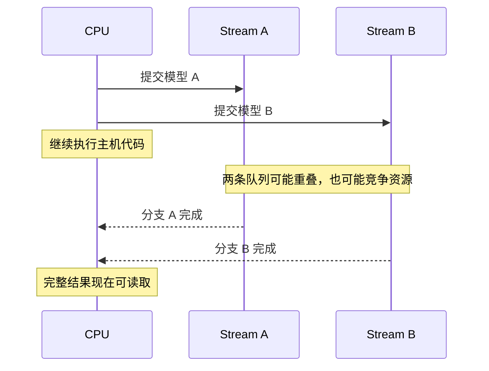
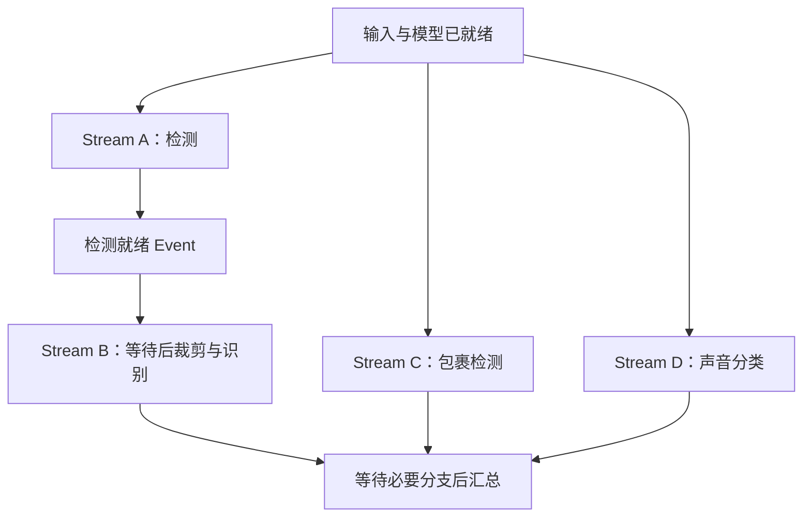

# 开了四个线程，GPU 就会同时跑吗？

> **AI 并行计算入门 · 第二篇**
>
> 代码里四个任务都启动了，GPU 上却可能仍在排队。更容易误判的是：计时器已经停下，计算还没有结束。
>
> 本文延续门口摄像头的场景，用任务队列和交接凭证，讲清异步提交、CUDA Stream、CUDA Event，以及多模型推理怎样正确计时。
>
> **口径说明：场景与示意时间均为教学构造。完整示例需要支持 CUDA 的 PyTorch 与 NVIDIA GPU；本文制作环境未安装 PyTorch，代码已做语法和静态逻辑检查，未进行 CUDA 实测，不提供性能承诺。资料核对日期：2026 年 10 月 16 日。**

> **工程深度｜验证状态：** L2 工程｜方法论验证（计时方法论最关键）
<!-- more -->

## 01｜线程都开了，为什么提醒还是来得晚？

你给门口摄像头加了线程池，三个模型几乎同时接到任务：找人脸、看包裹、辨声音；身份识别则要等人脸检测完成才能开始。

日志很热闹，提醒却没提前。更奇怪的是（教学示意）：计时器说模型只跑了 1 毫秒，GPU 时间线却显示，它还没算完。

原来，“任务已提交”和“结果已完成”，是两个时刻。本篇就沿用门口摄像头的场景，把这两个时刻之间发生的事讲清楚。

现在，你按照任务关系改好了代码，还加上了线程池：

```python
# 示意：假设各函数内部完成相应模型调用。
face_future = pool.submit(detect_face, frame)
package_future = pool.submit(detect_package, frame)
sound_future = pool.submit(classify_sound, audio)
```

三个任务已经提交，看起来一切就绪。

但打开 GPU 时间线，你可能发现：几段计算依然前后挨着，提醒并没有明显提前。

到底哪里出了问题？

**“Python 任务开始了”和“GPU 计算同时发生了”，中间还有几层执行机制。**

## 02｜模型调用返回，不代表 GPU 已经算完

想象一家餐厅：服务员把订单交给厨房，拿到回执，便可以去接下一桌。

回执到手，说明订单已经交出去了。菜什么时候做好，是另一件事。

很多 CUDA 操作也是这样：CPU 提交 GPU 工作后，可以继续执行后面的代码，不必一直站在原地等计算结束。NVIDIA 将这种机制称为异步执行。[1]

因此，这两行 Python 代码：

```python
# 示意：模型和输入均已在 GPU 上。
package = package_model(frame_gpu)
sound = sound_model(audio_gpu)
```

这里要消歧一句：**同一条 Stream 内，操作的执行先后是有保证的**（后提交的不会先执行）；上面代码的问题不在“乱序”，而在于“调用返回”这一刻，前一个模型的 GPU 工作**是否已经完成是未知的**。因此不能仅凭书写顺序断定 GPU 已经算完前一个模型，更不能据此断定两个模型发生了重叠。

这里需要分清三个时刻：

| 时刻 | 说明 |
|---|---|
| 调用开始 | CPU 开始执行模型调用 |
| 调用返回 | Python 获得返回的张量对象；相关 GPU 工作可能还未完成 |
| GPU 完成 | 生产结果的计算已经结束。CPU 读取必须等待；后续 GPU 操作则可以提前提交，通过同 Stream 顺序或跨 Stream 依赖保证安全使用 |

可以把提交与完成的关系画成一张时序图：



> 完成箭头表示概念上的完成通知，不代表代码使用了 CPU 回调；真实执行顺序以 GPU 时间线为准。

这正是全文要反复回到的结论：**可以提前提交，不能提前使用尚未就绪的数据。**

异步并不表示每一个调用都立即返回。内存分配、内部初始化、数据传输或显式同步等，都可能让 CPU 等待。

但只要存在异步执行，普通的“调用前打点、调用后打点”，就可能没有覆盖全部 GPU 工作。

## 03｜CUDA Stream：给操作排队，不是给模型分显卡

要理解 GPU 怎样安排任务，需要认识 **CUDA Stream**。

可以先把它理解为一条有顺序的任务队列。数据复制、矩阵乘法、激活函数等操作，都可以提交进去。

**同一条 Stream 里的操作，按照队列顺序执行。不同 Stream 中的操作，在没有依赖且资源允许时，有机会重叠。**[1]

例如，把两个模型的操作都提交到同一条 Stream：

| 队列位置 | 操作 |
|---|---|
| 1 | 包裹模型的第一层 |
| 2 | 包裹模型的后续层 |
| 3 | 声音模型的第一层 |
| 4 | 声音模型的后续层 |

即使它们来自不同 Python 线程，只要最终按这样的顺序进入同一条 Stream，队列内的顺序约束仍然存在。

换成两条 Stream，会得到两条可以独立推进的操作序列。但请注意：

- Stream 不是 GPU 的一块固定分区。
- 创建四条 Stream，不会给每条分到四分之一算力。
- 不同 Stream 不保证同时开始，也不保证相同进度。

多条队列只是给出并发的机会；GPU 上的计算与带宽资源是否够用，决定了机会能兑现多少——资源竞争的账留到下一篇细算。

**Stream 表达并发机会，硬件决定机会能兑现多少。**

为避免后文混淆，先固定两组对应：

| 技术概念 | 通俗理解 |
|---|---|
| Stream | 一条按顺序推进的任务队列 |
| Event | 队列推进到某个位置的标记 |

### 进阶说明：默认 Stream 不是“所有线程各有一条”

CUDA 存在 legacy 默认 Stream 与 per-thread 默认 Stream 等语义。legacy 默认 Stream 会与特定其他 Stream 产生隐式同步，不能把不同模式混为一谈。[2]

在 PyTorch 中做实验，直接使用显式创建的 Stream，并明确写出依赖，更容易看懂行为。不能仅凭“我开了多个 Python 线程”就推断每个模型获得了独立 CUDA 队列。

## 04｜一条 Python 线程，也能向两条 Stream 派活

假设包裹模型和声音模型已经就绪，输入也已准备好。

下面是执行结构的简化示意，尚未包含初始化依赖、计时和输出汇合：

```python
package_stream = torch.cuda.Stream()
sound_stream = torch.cuda.Stream()

with torch.cuda.stream(package_stream):
    package_result = package_model(frame_gpu)

with torch.cuda.stream(sound_stream):
    sound_result = sound_model(audio_gpu)
```

CPU 先向包裹 Stream 提交工作，再向声音 Stream 提交工作。只要前一次提交后没有不必要的等待，GPU 就可能在包裹计算仍在执行时，收到声音计算。

因此，GPU 并发并不要求一定先开多个 Python 线程。

这也不意味着线程没有价值。多线程可以帮助组织 I/O、请求处理或部分 CPU 工作；是否适合，还要看调用库和线程开销。它与 GPU 上的 Stream 调度，是不同层面的问题。

| 工具 | 主要解决什么？ |
|---|---|
| Python 线程或进程 | CPU 侧任务组织与并发执行 |
| CUDA Stream | GPU 操作的队列顺序 |
| CUDA Event | 标记队列进度，表达等待或计时 |

接下来，我们还要给有依赖的模型安排交接。

## 05｜人脸没检测完，身份识别凭什么开始？

包裹和声音可以独立计算，身份识别却必须拿到人脸数据。

如果把检测放在 Stream A，把裁剪和识别放在 Stream B，CPU 按顺序写下两个调用，并不能自动替我们建立正确的跨 Stream 依赖。

此时需要一张交接凭证：**CUDA Event**。

在检测操作之后记录 Event。只有 Stream A 推进到这个标记，相关检测操作才已经完成；Stream B 在使用检测结果前等待这个 Event。[1]



对应的核心写法如下。这里的 `detect`、`crop`、`recognize` 为接口示意；假设它们使用当前 Stream，且裁剪可直接消费 GPU 张量结果：

```python
ready = torch.cuda.Event()

with torch.cuda.stream(detect_stream):
    boxes = detect(frame_gpu)
    ready.record()  # 标记排在检测操作之后。

with torch.cuda.stream(recognize_stream):
    recognize_stream.wait_event(ready)
    face = crop(frame_gpu, boxes)
    identity = recognize(face)
```

`wait_event()` 的重点是：**让该 Stream 后续提交的工作等待，不要求 CPU 此刻停下来等检测完成。** CPU 仍可以向包裹、声音等分支提交独立工作。[3]

真实检测后处理如果需要把框坐标拿到 CPU，再决定如何裁剪，就会引入另一条同步与数据传输路径。不能假定所有现成模型接口都能直接套用上面这段 GPU 内部衔接。

### 进阶说明：两种正确性，别只顾一种

跨 Stream 还涉及张量的存活时间：

| 问题 | 要保证什么？ |
|---|---|
| 执行依赖 | 使用数据前，生产数据的工作已经完成 |
| 内存生命周期 | 使用数据时，底层存储尚未被回收复用 |

`wait_event()` 或 `wait_stream()` 主要表达执行先后；`record_stream()` 可以帮助 PyTorch 分配器跟踪张量在哪些 Stream 上使用，**它不能代替生产者与消费者之间的执行同步**。[3][4]

也可以通过明确保留引用，并在释放前完成必要同步来管理生命周期。后面的完整实验采用这种更容易检查的方式。

## 06｜测速只测到“交单”，会发生什么？

下面这段代码看起来很合理：

```python
start = time.perf_counter()
output = model(x_gpu)
elapsed = time.perf_counter() - start
```

但它测到的是这次主机调用所经过的时间，其中可能包含提交、框架处理或部分等待，**不能保证覆盖 GPU 完成全部计算的时间**。[3]

想象一次教学示意：CPU 花 1 毫秒交完任务，GPU 还要执行 10 毫秒。若计时器在调用返回后停止，报告的数字就没有覆盖后续尚未完成的工作。

比较两种方案时，如果它们实际等待的位置不同，错误口径还可能制造出并不存在的性能优势。

### 方法一：用墙钟，等工作真正完成

```python
# 示意：隔离的一张卡上，模型与输入已就绪。
torch.cuda.synchronize()
start = time.perf_counter()
output = model(x_gpu)
torch.cuda.synchronize()
elapsed = time.perf_counter() - start
```

开始前清掉既有工作，结束前等待本次工作。这种墙钟口径会包含主机提交和同步等待等开销。

设备级同步会等待该设备相关 Stream 上的工作，不适合不加区分地塞进生产热路径。在共享设备环境下，测量还可能受其他工作影响。

### 方法二：用 Event，但必须把两条支路都收进来

单条 Stream 可以用起止 Event 包围目标操作。多条 Stream 则需要先明确：结束 Event 到底代表哪些工作结束？

若结束标记只排在主 Stream，而分支尚未汇合，它就可能提前到达终点，漏算其他 Stream 的工作。

完整测量结构应当是：

1. 记录共同的开始 Event。
2. 两条分支等待开始 Event，再执行各自模型。
3. 每条分支记录自己的完成 Event。
4. 主 Stream 等两条分支完成，再记录结束 Event。
5. CPU 等结束 Event 后读取时间。

这个区间测的是从共同起点到分支汇合终点的设备时间跨度，包含其中的等待和可能的提交空隙，不是所有核函数耗时的简单求和。

## 07｜完整实验：两个小模型，一条队列与两条队列

下面使用两个随机初始化的小型前馈网络，代表两个独立推理分支。它们没有识别能力，目的只是构造真实 CUDA 计算。

先交代量级：这两个网络很小（两层全连接，批次 256），单次计算在微秒到毫秒量级，**主机提交和测量开销可能占据明显比例**。双 Stream 可能更快、接近，也可能更慢；具体结果需要在你的设备上测量，并结合时间线解释。

后续可以逐步调整 batch 和矩阵规模，观察计算时间、主机提交间隙与资源占用怎样变化：任务太小可能被提交开销影响；任务变大后，也可能因资源趋于饱和而缺少重叠收益。**更容易看清计算区间，不等于更容易获得加速。**

为聚焦 Stream，本实验让模型和输入提前驻留 GPU，不包含摄像头采集、预处理、CPU→GPU 输入复制及输出回传。虽然标题问的是线程，这里却不引入 Python 线程池：一条主机线程已经能够向不同 Stream 派发工作，加入线程池反而会把“线程组织”和“队列调度”两个变量混在一起。

运行条件：安装与本机驱动兼容、支持 CUDA 的 PyTorch，并有一张可用 NVIDIA GPU。将下面代码保存为 `streams_demo.py` 后执行 `python streams_demo.py`。建议在设备无其他负载时比较。

```python
"""开了四个线程，GPU 就会同时跑吗？（第5章 · 并行与分布式）。

本文件是对应博文代码块的实现/演示，直接运行可见效果；运行依赖：PyTorch。
"""
from statistics import median
from time import perf_counter

import torch
from torch import nn


def main():
    if not torch.cuda.is_available():
        raise SystemExit("需要支持 CUDA 的 PyTorch 和可用 NVIDIA GPU。")

    torch.manual_seed(7)
    torch.cuda.set_device(0)
    device = torch.device("cuda:0")
    main_stream = torch.cuda.current_stream(device)
    stream_a = torch.cuda.Stream(device=device)
    stream_b = torch.cuda.Stream(device=device)

    def make_model():
        return nn.Sequential(
            nn.Linear(512, 1024), nn.ReLU(), nn.Linear(1024, 512)
        ).to(device).eval()

    model_a, model_b = make_model(), make_model()
    x_a = torch.randn(256, 512, device=device)
    x_b = torch.randn(256, 512, device=device)

    # 排除初始化，并确保两条分支能安全使用权重与输入。
    torch.cuda.synchronize(device)

    # 测量用 Event 在 run() 外创建并复用：底层 CUDA Event 是延迟初始化的，
    # 每轮新建会让预热落空，也把事件创建开销混入小模型的对比。
    start = torch.cuda.Event(enable_timing=True)
    end = torch.cuda.Event(enable_timing=True)
    done_a = torch.cuda.Event()
    done_b = torch.cuda.Event()

    @torch.inference_mode()
    def run(use_two_streams):
        wall_start = perf_counter()
        start.record(main_stream)

        if use_two_streams:
            with torch.cuda.stream(stream_a):
                stream_a.wait_event(start)
                y_a = model_a(x_a)
                done_a.record(stream_a)
            with torch.cuda.stream(stream_b):
                stream_b.wait_event(start)
                y_b = model_b(x_b)
                done_b.record(stream_b)

            # 主队列先汇合两条分支，再打终点标记。
            main_stream.wait_event(done_a)
            main_stream.wait_event(done_b)
        else:
            with torch.cuda.stream(main_stream):
                y_a = model_a(x_a)
                y_b = model_b(x_b)

        end.record(main_stream)
        end.synchronize()  # CPU 等待终点，之后才读取时间。
        wall_ms = (perf_counter() - wall_start) * 1000
        gpu_ms = start.elapsed_time(end)
        return gpu_ms, wall_ms, (y_a, y_b)

    # 两种路径分别预热；预热真实走完计时与汇合路径，四个 Event 也随之完成初始化。
    # 每次 run 返回前均已完成目标工作，因此复用 Event 是安全的。
    for _ in range(5):
        run(False)
        run(True)

    samples = {False: [], True: []}
    for index in range(20):
        # 交替先后顺序，减轻固定顺序带来的偏差。
        order = (False, True) if index % 2 == 0 else (True, False)
        for mode in order:
            gpu_ms, wall_ms, outputs = run(mode)
            samples[mode].append((gpu_ms, wall_ms))

    serial_outputs = run(False)[2]
    multi_outputs = run(True)[2]
    for expected, actual in zip(serial_outputs, multi_outputs):
        torch.testing.assert_close(actual, expected, rtol=1e-4, atol=1e-5)

    print("GPU:", torch.cuda.get_device_name(device))
    print("PyTorch:", torch.__version__, "CUDA build:", torch.version.cuda)
    for mode, label in [(False, "单 Stream"), (True, "双 Stream")]:
        gpu_ms = median(row[0] for row in samples[mode])
        wall_ms = median(row[1] for row in samples[mode])
        print(f"{label}: Event 区间 {gpu_ms:.3f} ms; 墙钟 {wall_ms:.3f} ms")
    print("两种调度的输出校验通过。")


if __name__ == "__main__":
    main()
```

不必通读整份脚本，真正决定测量是否骗自己的只有三个位置：

```python
stream_a.wait_event(start)        # 分支从共同起点出发
main_stream.wait_event(done_a)    # 主队列汇合一条分支（done_b 也必须汇合）
end.synchronize()                 # CPU 等终点，才能读取时间
```

若只在主 Stream 打终点标记而不汇合分支，终点会提前到达，漏掉还在计算的另一条队列。

输入和权重在初始化后同步就绪，并一直保留引用；每次返回前，两条分支已经汇合完成。输出也保留到同步之后，因此本例没有额外调用 `record_stream()`。将代码改成持续异步请求服务时，不能照搬这个生命周期假设。

还需要说明口径：本实验比较的是**包含必要事件记录和分支汇合的执行方案**，不是纯核函数耗时之和；Event 区间与墙钟也各含不同开销，不能混在一起算加速比。

### 运行后应该看什么？

先确认输出校验通过，再比较两种调度的 Event 区间与墙钟中位数。

| 观察 | 可能的解释 |
|---|---|
| 双 Stream 更快 | 部分空隙被利用，或计算发生有益重叠 |
| 两者接近 | 模型过小、主机提交开销占比高，可重叠的 GPU 计算本就很少；也可能是资源已较饱和 |
| 双 Stream 更慢 | 调度开销、内存行为或资源竞争抵消收益 |
| Event 区间小于墙钟 | 主机提交、事件处理和等待返回等开销也进入了墙钟 |

本实验对比的是两个完整推理分支的单次完成时间，既没有展示训练，也没有将一个模型拆给多张卡。

**双 Stream 没有变快，也是有效结果。它说明这组模型、形状与设备下，这种调度未带来预期收益。**

## 08｜想证明真的重叠，请打开 GPU 时间线

耗时变短，是性能证据；核函数是否重叠，则需要看时间线。

NVIDIA Nsight Systems 可以采集 CUDA API、GPU 核函数及相关执行活动，帮助把 CPU 调用与 GPU 执行对应起来。[6]

如果已经安装并配置 Nsight Systems，可以尝试：

```bash
nsys profile --trace=cuda,nvtx,osrt -o streams_demo python streams_demo.py
```

采集工具自身会引入开销，分析时间线与无分析器运行的耗时应分别看待；命令是否可用取决于本机工具版本、平台与采集权限。

重点检查三件事：

- 不同 Stream 的核函数，在时间轴上是否确实重叠？
- GPU 空白处，CPU 是否还在提交工作或等待？
- 两个分支都完成之前，是否意外出现了设备级同步？

即使发现重叠，也要回到完整完成时间：重叠的核函数可能各自变慢，最终结果未必更早到达。

## 09｜三个最容易让并发失效的动作

### 1. 刚提交一个模型，就等待它全部结束

```python
# 示意：GPU 计算已经提交，但 CPU 立刻等完再提交下一分支。
with torch.cuda.stream(stream_a):
    y_a = model_a(x_a)
stream_a.synchronize()

with torch.cuda.stream(stream_b):
    y_b = model_b(x_b)
```

这让第二个分支失去了及时进入 GPU 的机会。若两者独立，应先提交，再在真正需要完整结果时汇合。

### 2. 每个模型后面都取一个 CPU 数字

对 GPU 标量张量调用 `.item()`，CPU 必须等相应结果可读。逐步打印 GPU 计算结果，也可能引入同步。[3]

例如 `score = y_a.sum().item()`，会把该结果链上的等待带回主机。不是不能读取，而是要把读取放在合适的边界。

### 3. 以为 `non_blocking=True` 能自动解决数据搬运

CPU 传输调用尽快返回，与复制和计算在设备上重叠，是不同目标。

要实现主机到 GPU 传输与计算的有效重叠，通常还涉及固定页内存、合适的 Stream 安排、设备复制能力与独立数据依赖。`non_blocking=True` 本身不是重叠保证。[5]

固定页内存也不是越多越好；临时执行 `pin_memory()` 自身有成本。异步传输期间，还必须保证相关缓冲区没有被提前修改或复用。

这正是下一篇需要继续算的账：数据在哪里、谁在读取、要搬多少，以及多个模型怎样争抢资源。

## 10｜回到摄像头：把等待放在真正需要它的地方

现在再看门口那四个模型，执行逻辑可以重新整理：

| 时机 | 合理安排 |
|---|---|
| 输入就绪 | 提交检测、包裹、声音三个起点 |
| 检测结果就绪 | 让裁剪和识别继续，保留必要依赖 |
| 独立分支仍在计算 | CPU 可以处理其他不依赖结果的工作 |
| 业务需要完整事件 | 汇合必要分支，再读取和发送结果 |

核心不是消灭所有等待。身份识别必须等待人脸数据，这个等待保护了正确性。

值得减少的是：明明可以独立推进，却因为主机过早同步、错误的队列安排或额外数据搬运而产生的等待。

上一篇解决“哪些任务可以一起做”；这一篇进一步回答“程序怎样表达这种机会”。

到真正判断加速时，把三个问题变成一张可保存的判断框架：

| 要证明什么 | 看什么证据 |
|---|---|
| GPU 工作已经完成 | 正确的同步或完成事件 |
| 两个分支实际重叠 | GPU 时间线 |
| 用户确实更早拿到结果 | 相同工作量、相同边界的完成时间 |

最后留一个前瞻：如果时间线显示 GPU 经常在等 CPU 提交，减少主机派发开销可能比继续增加 Stream 更值得研究，例如 CUDA Graphs——把重复执行的既定操作组织成图，降低逐条提交的开销；[1] 如果 GPU 已持续忙碌却没有提速，则应进一步检查计算和带宽竞争。不同工具解决不同瓶颈，先观察，再选择。

---

## 下一篇

**《模型都放进显存了，为什么反而更慢？》**

继续拆解显存容量、显存带宽与计算资源的区别，解释为什么两个单独运行很快的模型，放在一起反而互相拖慢。

## 参考资料

以下均为官方资料。文中示意场景与实验模型为教学构造，未引用任何官方性能数字作为本实验结果。

1. [NVIDIA CUDA Programming Guide：Asynchronous Execution](https://docs.nvidia.com/cuda/cuda-programming-guide/02-basics/asynchronous-execution.html)：异步提交、Stream 顺序、Event、并发条件与 CUDA Graphs。
2. [NVIDIA CUDA Runtime API：Stream synchronization behavior](https://docs.nvidia.com/cuda/cuda-runtime-api/stream-sync-behavior.html)：legacy 与 per-thread 默认 Stream 的语义。
3. [PyTorch：CUDA semantics](https://docs.pytorch.org/docs/stable/notes/cuda.html)：异步执行、计时、非默认 Stream 的同步责任。
4. [PyTorch：Tensor.record_stream](https://docs.pytorch.org/docs/stable/generated/torch.Tensor.record_stream.html)：缓存分配器与跨 Stream 张量生命周期。
5. [PyTorch：A guide on good usage of non_blocking and pin_memory](https://docs.pytorch.org/tutorials/intermediate/pinmem_nonblock.html)：异步传输、固定页内存及同步边界。
6. [NVIDIA Nsight Systems User Guide](https://docs.nvidia.com/nsight-systems/UserGuide/index.html)：CUDA 执行活动采集与时间线分析。
