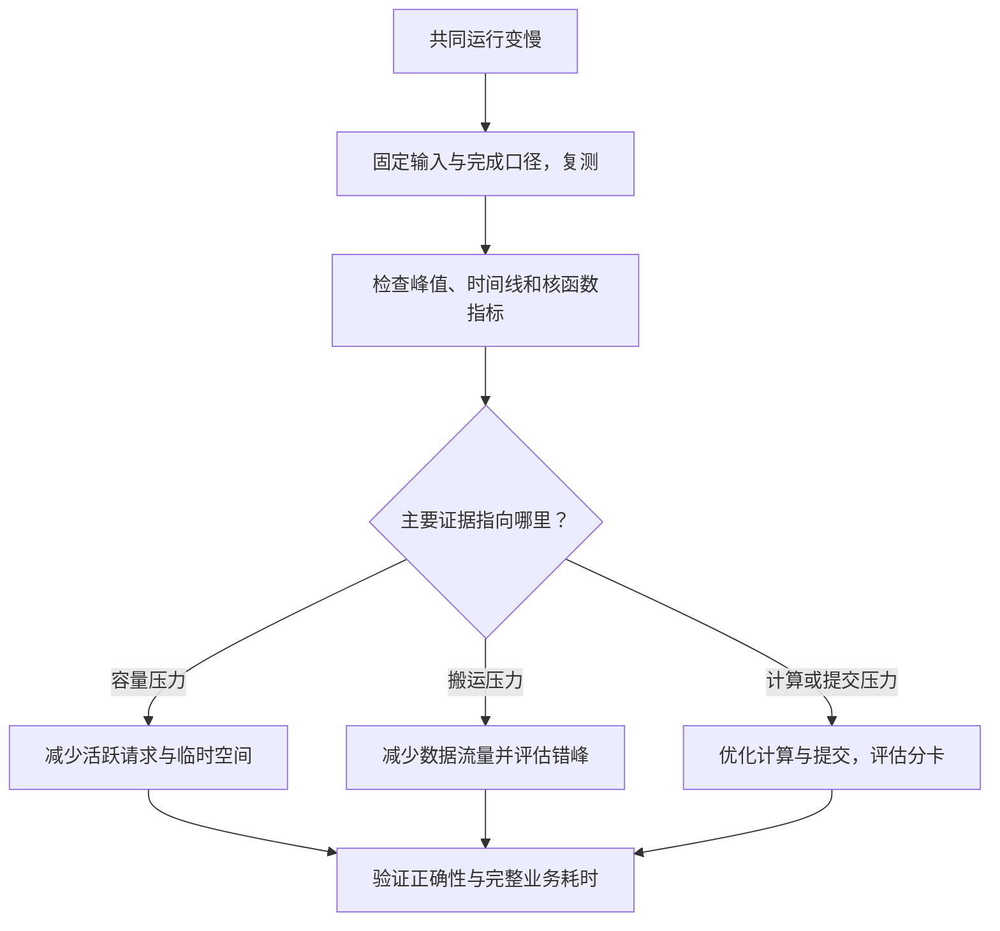

# 模型都放进显存了，为什么反而更慢？

> **AI 并行计算入门 · 第三篇**
>
> 显存还有余量，两个模型也确实同时跑了，提醒却比原来更晚。这时，你遇到的可能不是“装不下”，而是“搬不过来”或“算不过来”。
>
> 本文继续用门口摄像头的场景，讲清显存容量、显存带宽与计算能力，并用可计算的例子解释多模型资源竞争。
>
> **口径说明：场景、数值和资源配置均为教学假设，不是产品测试结果。文末 CUDA 实验已做语法与静态逻辑检查，制作环境未安装 PyTorch，未进行 GPU 实测。资料核对日期：2026 年 10 月 16 日。**

> **工程深度｜验证状态：** L2–L3 工程｜概念验证（配合 Nsight 理解更好）
<!-- more -->

## 01｜显存没满，为什么两个 AI 互相拖慢？

你给门口摄像头接上了包裹检测和声音分类。

单独运行时，包裹模型很快，声音模型也很快。两个模型的权重加起来，远没有塞满显存。

于是，你按照上一篇的方法，给它们安排了不同 CUDA Stream，正确设置依赖，等待两条分支都结束后再停止计时。

但结果有点反常：一起跑，完整结果反而来得更晚。

你再次确认：没有错误的同步，任务确实有重叠，显存也没有溢出。

问题究竟出在哪里？

**显存有空位，只能说明还有存储空间。它没有告诉你：通往这些数据的道路是否已经拥堵。**

## 02｜GPU 有三笔账，不能只看其中一笔

把 GPU 想成一套供水系统：模型权重是水库里的水，计算单元则是水厂。

| 资源 | 供水类比 | 实际在问什么？ | 常见单位 |
|---|---|---|---|
| 显存容量 | 水库能蓄多少水 | 权重、输入、激活和工作区能否容纳？ | GB、GiB |
| 显存带宽 | 输水管每秒能送多少水 | 数据能否及时到达计算单元？ | GB/s、TB/s |
| 计算能力 | 水厂每秒能处理多少水 | 数学运算是否来得及完成？ | FLOP/s |

水库没满，管道仍可能送不过来；水送得很快，水厂也可能已经处理不过来。

因此，要分别问：

1. **装得下吗？**
2. **数据供得上吗？**
3. **计算做得完吗？**

这三件事相关，却不能互相代替。

另外，显存带宽指 GPU 与其显存之间的数据吞吐能力，不等于 CPU→GPU 的 PCIe 传输带宽，也不等于多 GPU 之间的互连带宽。数据处在不同位置，要算不同的搬运账。

## 03｜“模型文件只有 2 GB”，为什么运行需要更多空间？

先看容量账。

模型文件大小不等于运行时显存占用。文件可能包含压缩、量化参数或额外元数据；加载后的表示也可能不同。

即使已知权重的实际显存大小，还要加上运行过程里的其他空间：

\[
M_{\text{运行}}\approx M_{\text{权重}}+M_{\text{活跃输入输出}}+M_{\text{中间激活}}+M_{\text{工作区}}+M_{\text{其他运行开销}}
\]

这是一张概念账单，不是适用于所有框架的精确求和公式。共享缓冲区、内存复用和分配器缓存，会改变实际峰值。

假设两个模型的权重各占 2 GiB，每个模型执行时还需要 3 GiB 临时空间。

在两个模型权重都常驻、临时空间能够有效复用的简化条件下：

| 调度方式 | 教学容量估算 |
|---|---:|
| 错峰执行 | 两份权重 4 GiB＋一份临时空间 3 GiB＝7 GiB |
| 同时执行 | 两份权重 4 GiB＋两份临时空间 6 GiB＝10 GiB |

这里暂未计入其他开销，也没有保证真实框架一定达到上述复用效果。

它揭示的是：**权重常驻所需空间，与并发执行峰值所需空间，是两回事。**

输入变大、批次增大、在途请求增多，都可能把临时空间和活跃结果一起推高。上线前要看目标并发下的峰值，不能只验证“模型加载成功”。

对生成式大模型，还应额外关注 KV Cache 等与请求和序列长度有关的状态。本篇的摄像头模型没有这笔账，不能据此推算大语言模型服务容量。

## 04｜更隐蔽的瓶颈：东西放得下，数据搬不过来

回到包裹模型与声音模型。

它们都已在显存里，为何还会“搬数据”？

因为计算单元不会直接在所有权重的存储位置完成运算。执行时，需要经由 GPU 的内存层级读取权重、激活等数据，再写回结果。数据可能被缓存和复用，也可能被多次读取。

所以，不能把“权重已加载进显存”理解成“之后再也不需要搬权重”。

> **存量与流量是两回事**：模型占用多少 GB，是**存量**；执行一次穿过显存接口多少 GB，是**流量**。两者不相等——同一份数据可能被缓存复用，也可能被多次读取，中间结果的读写还会增加流量。因此，不能拿模型文件大小直接代替 Roofline 中的 \(D\)。[1]

做一个刻意简化的教学假设（本节按十进制写作 4 GB、400 GB/s，与前文按 GiB 计算的容量账口径不同，量级演示不受影响）：

- 模型 A 的一次执行，需要经由显存系统搬运 4 GB 数据。
- 模型 B 同样需要搬运 4 GB。
- 把显存系统看成一条可共享的带宽通道，可持续提供 400 GB/s 的有效吞吐；这里忽略显存分区和访问分布的差异。
- 缓存效果和数据量在比较中保持不变，计算时间暂时忽略。

单独执行 A 的搬运时间下界是：

\[
T_A\ge\frac{4\text{ GB}}{400\text{ GB/s}}=0.01\text{ s}=10\text{ ms}
\]

单独执行 B 也是 10 毫秒。

如果两者一起执行，总共仍要搬运 8 GB：

\[
T_{\text{全部完成}}\ge\frac{8\text{ GB}}{400\text{ GB/s}}=20\text{ ms}
\]

增加 Stream 不会把这条通道变成两条。

在进一步假设两者平分带宽时，每个模型只能分到 200 GB/s，都要约 20 毫秒才能完成。相比各自独占资源时的 10 毫秒，**每个的耗时都翻了一倍（10 → 20 ms）**；而两个结果全部返回的时间，相比串行搬运并没有改善。

**注意：这个理想算例只能说明“没有加速”，尚不能证明“整体更慢”。**

若共同运行还降低了有效带宽，例如缓存干扰或访问效率变化使其降到 320 GB/s，那么全部搬运就至少需要 25 毫秒。此时才出现了完整结果比原来更晚的情况。

400 与 320 GB/s 都是教学设定；真实系统是否发生带宽竞争、有效吞吐下降多少，必须测量。

## 05｜怎样判断是“等数据”，还是“等计算”？

这里引入一个很有用的概念：**算术强度**。

它回答：每从某一级内存搬运 1 字节数据，完成多少次浮点运算？

\[
I=\frac{\text{浮点运算量 }F}{\text{相应内存层级的数据流量 }D}
\]

搬一次数据，能重复做很多计算，算术强度就高；频繁搬运、每次只做少量计算，算术强度就低。

NVIDIA 的性能指南用这种关系解释计算受限与内存带宽受限；也指出，小任务还可能因为启动延迟或并行度不足而无法充分利用硬件。[1]

因此，一个简化的时间下界是：

\[
T\ge\max\left(\frac{F}{P},\frac{D}{B}\right)
\]

其中，\(P\) 是与当前精度、计算路径相匹配的计算吞吐上限，\(B\) 是所分析内存通道的带宽上限。将计算和搬运充分重叠、资源充分利用时，才有机会接近这个下界；启动、依赖、调度等开销会让实际时间更长。

这就是 Roofline 性能模型的一种入门表达。先不用记名字，看一组数字就够了。

假设一张虚构 GPU 的计算上限为 20 TFLOP/s，显存带宽上限为 400 GB/s：

| 教学工作负载 | 运算量 | 显存流量 | 计算下界 | 搬运下界 | 优先怀疑 |
|---|---:|---:|---:|---:|---|
| 负载 X（偏搬运） | 20 GFLOP | 4 GB | 1 ms | 10 ms | 显存带宽 |
| 负载 Y（偏计算） | 200 GFLOP | 0.4 GB | 10 ms | 1 ms | 计算能力 |

本例统一采用十进制单位；浮点运算计数口径保持一致。

负载 X 的算术强度为 5 FLOP/Byte，负载 Y 为 500 FLOP/Byte；虚构 GPU 的计算与带宽比值为 50 FLOP/Byte。于是，X 更容易受搬运限制，Y 更容易受计算限制。

这个分界值也可以这样理解：这张虚构 GPU 每秒最多算 20 万亿次，每秒最多从显存取到 4000 亿字节。两者相除，相当于每送来 1 字节数据，要安排约 50 次浮点运算，才可能让计算与供数同时接近各自上限。如果只安排 5 次，计算单元可能一直在等数据；如果安排 500 次，计算能力反而可能先成为限制。

需要提醒的是，这些数字说明的是：在充分利用硬件的理想条件下，哪项资源会先形成限制；它们并没有证明真实程序已经接近这个限制。真实核函数的算术强度、缓存复用和实际流量，都要以测量为准。

### 这对多模型并发有什么启发？

两个都迫切需要显存带宽的阶段放在一起，更容易争抢同一资源。一个偏搬运、一个偏计算的阶段，则可能存在互补空间。

但“互补”仍不是保证：它们还共享 SM、寄存器、缓存等资源，带宽型核函数本身也需要执行资源。必须观察具体阶段，不能给整个模型贴上永久的“计算型”或“带宽型”标签。

同一模型的不同层、不同批次大小，瓶颈都可能变化。NVIDIA 关于模型与硬件协同设计的资料，也将形状、批次和算术强度联系起来讨论。[2]

## 06｜GPU 利用率 95%，算力就用了 95% 吗？

不一定。

`nvidia-smi` 常见的 GPU utilization，主要反映采样窗口内有核函数执行的时间比例，不等于峰值 FLOP/s 的使用比例。

它的 memory utilization 则反映全局显存读写活跃的时间比例，也不能直接当成已使用的显存带宽百分比。[3]

因此，下面几件事可以同时成立：

- GPU 几乎一直有任务在执行。
- 数学计算单元没有达到峰值吞吐。
- 任务主要卡在内存访问或其他依赖上。

| 想知道什么 | 更合适的观察 |
|---|---|
| 容量够不够 | 目标负载下的显存峰值，以及设备总占用 |
| 是否真的重叠 | Nsight Systems 的 Stream 与核函数时间线 |
| 核函数瓶颈在哪里 | Nsight Compute 的内存吞吐、计算吞吐与 Roofline 等分析 |
| 用户是否更早拿到结果 | 固定业务口径下的完成时间和尾延迟 |

分析工具的分工要分清：**Nsight Systems** 观察真实调度中的重叠与空隙，回答“两条分支到底有没有并行”；**Nsight Compute** 深入解释某个目标核函数，回答“它为什么慢”。后者在常见采集模式下会串行化核函数，因此采集到的单核指标不能直接当成并发竞争现场的完整证据。先用时间线定位，再用核函数分析辅助解释。[4]

## 07｜两个模型各自变慢，就一定不值得并发吗？

也不一定。要看优化目标。

这里换一组教学条件：两个任务各自都不构成持续的带宽瓶颈，共同运行时干扰较轻。它和第 04 节“两个任务都靠抢带宽”的算例不是同一组前提，请分开看。

| 方案 | 分支 A 执行耗时 | A 完成时刻 | 分支 B 执行耗时 | B 完成时刻 |
|---|---:|---:|---:|---:|
| 顺序执行 | 10 ms | 10 ms | 10 ms | 20 ms |
| 并发执行 | 15 ms | 15 ms | 15 ms | 15 ms |

注意表中两组数字的区别：A 和 B 各自都从 10 ms 变成 15 ms，执行变慢了；但 B 的完成时刻从第 20 ms 提前到第 15 ms，完整结果反而更早。**执行变慢与结果更晚，不是同一个判断。**

如果业务只关心 A，A 从第 10 毫秒返回变成第 15 毫秒返回，却可能是坏消息。

所以，评价应当分开：

- **干扰程度**：模型共同运行时，相对独占执行慢了多少？
- **整体收益**：同一份业务结果，是否更早完成？
- **优先任务**：重要分支的响应是否仍满足要求？

持续请求下，还要测排队和尾延迟。一次双模型实验，只能说明该输入和负载条件下的行为。

## 08｜做个对照实验，别直接猜瓶颈

**先说清楚这组实验能证明什么：它对照的是调度收益与额外分配，不是带宽瓶颈复现实验。** 是否真的发生显存带宽竞争，需要进一步观察实际流量和执行指标。

建议测四种条件，并让两个模型的权重始终常驻同一张卡：

1. 只有 A 执行。
2. 只有 B 执行。
3. A、B 在同一 Stream 顺序执行。
4. A、B 在不同 Stream 提交，等待两者全部完成。

“只有 A 执行”在这里表示 B 不参与计算，**不表示把 B 卸载**，这样才能让常驻权重条件保持可比。

下面用随机初始化的小网络构造真实 CUDA 工作。它们不具备检测能力，也不保证能重现带宽竞争；实验用于建立比较方法。

### 完整实验代码

需要支持 CUDA 的 PyTorch 和 NVIDIA GPU。保存为 `contention_demo.py`，执行 `python contention_demo.py`。模型与输入提前驻留 GPU，所有计时均为墙钟毫秒，包含本次提交和完成等待，不包含输入采集及传输。

```python
"""模型都放进显存了，为什么反而更慢？（第5章 · 并行与分布式）。

本文件是对应博文代码块的实现/演示，直接运行可见效果；运行依赖：PyTorch。
"""
from statistics import median
from time import perf_counter

import torch
from torch import nn


def main():
    if not torch.cuda.is_available():
        raise SystemExit("需要支持 CUDA 的 PyTorch 和可用 NVIDIA GPU。")
    torch.manual_seed(7)
    torch.cuda.set_device(0)
    device = torch.device("cuda:0")
    stream_a = torch.cuda.Stream(device=device)
    stream_b = torch.cuda.Stream(device=device)

    def make_model():
        return nn.Sequential(
            nn.Linear(1024, 2048), nn.ReLU(), nn.Linear(2048, 1024)
        ).to(device).eval()

    model_a, model_b = make_model(), make_model()
    x_a = torch.randn(128, 1024, device=device)
    x_b = torch.randn(128, 1024, device=device)
    torch.cuda.synchronize(device)  # 初始化就绪，输入和权重保持存活。

    def execute(mode):
        if mode == "A":
            return (model_a(x_a),)
        if mode == "B":
            return (model_b(x_b),)
        if mode == "serial":
            return model_a(x_a), model_b(x_b)
        if mode == "parallel":
            with torch.cuda.stream(stream_a):
                y_a = model_a(x_a)
            with torch.cuda.stream(stream_b):
                y_b = model_b(x_b)
            return y_a, y_b
        raise ValueError(mode)

    @torch.inference_mode()
    def measure(mode):
        torch.cuda.synchronize(device)
        baseline = torch.cuda.memory_allocated(device)
        torch.cuda.reset_peak_memory_stats(device)
        start = perf_counter()
        outputs = execute(mode)
        # 设备级等待包含两条分支；结果保留到等待结束之后。
        torch.cuda.synchronize(device)
        elapsed_ms = (perf_counter() - start) * 1000
        extra_peak = torch.cuda.max_memory_allocated(device) - baseline
        del outputs
        return elapsed_ms, extra_peak / (1024 ** 2)

    modes = ["A", "B", "serial", "parallel"]
    for _ in range(5):
        for mode in modes:
            measure(mode)

    samples = {mode: [] for mode in modes}
    for index in range(20):
        offset = index % len(modes)
        for mode in modes[offset:] + modes[:offset]:
            samples[mode].append(measure(mode))

    # 同样的模型和输入，两种调度的输出应在容差内一致。
    with torch.inference_mode():
        expected = execute("serial")
        actual = execute("parallel")
        torch.cuda.synchronize(device)
        for reference, result in zip(expected, actual):
            torch.testing.assert_close(result, reference, rtol=1e-4, atol=1e-5)
    del expected, actual

    print("GPU:", torch.cuda.get_device_name(device))
    print("PyTorch:", torch.__version__, "CUDA build:", torch.version.cuda)
    times = {}
    for mode in modes:
        times[mode] = median(row[0] for row in samples[mode])
        # 内存使用最差样本，与耗时中位数使用不同汇总口径。
        peak_mib = max(row[1] for row in samples[mode])
        print(f"{mode}: 墙钟中位数 {times[mode]:.3f} ms; "
              f"额外 allocated 峰值最大值 {peak_mib:.2f} MiB")
    print(f"顺序/并发完成时间比: {times['serial'] / times['parallel']:.3f}")
    print("两种调度的输出校验通过。")


if __name__ == "__main__":
    main()
```

代码用设备级同步确保计时覆盖全部目标工作，适合独占设备上的教学对照，不应直接作为生产请求的同步策略。输入和权重全程保留引用；返回值也保留到同步结束，避免跨 Stream 使用期间提前释放。

这里的额外峰值，是 **PyTorch 张量分配峰值减去本轮开始前的 allocated**，不是整卡总占用，也不是模型权重大小。采样中两份权重始终在场。

预热不会消灭所有波动；动态分配、频率、温度和其他进程仍可能影响结果。模型很小时，主机开销可能占据较大比例。

### 怎么读结果？

重点比较 `serial` 与 `parallel`：它们都完成 A、B 两项工作，业务工作量一致。比值大于 1 表示该实验中并发更快，小于 1 表示顺序更快。

不要直接把 A、B 的独立墙钟中位数相加，当成严格的顺序基线；它们分别经历了计时与同步，开销结构不同。代码已经提供直接测得的 `serial`。

本例没有测共同运行时每条分支各自的耗时，因此也不能只凭这四个数字，精确计算 A、B 各自受到多少干扰。需要时进一步使用分支 Event 或时间线，并保持相同计时口径。

**并发更慢只能证明这个安排的效果不好，不能仅凭耗时就断言瓶颈一定是显存带宽。**

> **选做**：逐步改变 batch 大小，记录顺序与并发的耗时，看看结论是否变化。注意 batch 变大不只增加工作量，还可能改变权重复用、算子选择和硬件利用率，不能只归因于“算得更多”。

## 09｜显存数字怎么看？别把缓存算两遍

PyTorch 中几个常见指标容易混淆：[5]

| 指标 | 含义 |
|---|---|
| `memory_allocated()` | 当前由张量占用的显存 |
| `max_memory_allocated()` | 统计窗口内的张量占用峰值 |
| `memory_reserved()` | 缓存分配器管理的显存总量 |
| `nvidia-smi` 显存占用 | 设备或进程层面的观察，口径不同，可能包含张量之外的开销 |

`reserved` 已经包含分配器管理范围内的活跃分配，不能再把 `allocated + reserved` 相加作为总量。

`empty_cache()` 释放的是未被使用的缓存，不会释放仍有活跃引用的模型和张量，也不会让显存带宽变大。

反复在每次推理之后清缓存，还可能失去分配复用的好处。遇到慢或 OOM，应先找分配与引用原因，而不是把清缓存当作通用加速开关。

## 10｜发现竞争之后，怎么改才有针对性？

先按证据选择动作，再回到完整业务链验证。

| 主要证据 | 可以优先尝试 | 需要一起检查 |
|---|---|---|
| 并发峰值过高 | 限制同时执行数、缩小批次、减少活跃中间结果 | 排队是否变长、是否仍满足时限 |
| 显存流量限制明显 | 减少中间张量读写、融合算子、改善复用 | 实际流量是否下降、数值是否正确 |
| 计算资源已充分占用 | 错峰、降低工作量，或评估分卡 | 总完成时间与资源成本 |
| 很多短核函数和空隙 | 优化提交路径，评估融合或 CUDA Graphs | 是否满足工具与执行形状的适用条件 |
| 关键分支被拖慢 | 控制其他分支的准入或并发，评估资源隔离 | 实际优先任务延迟是否达标 |

在“显存流量限制明显”这一类里，**算子融合**值得优先考虑：如果前一个算子把中间结果写回显存，后一个算子又立即读入，同一份中间数据就产生了一次写和一次读；适当融合后，可能让部分中间结果留在更近的存储中，从而减少显存流量。它改善的是带宽账，不是把显存容量或额定带宽变大。

量化或低精度也可能减少权重和数据流量，但收益取决于算子支持、转换开销和精度要求，不能把位宽减半直接写成速度翻倍。

控制并发是合理的工程手段。Triton 的 Rate Limiter 可以依据配置的资源和优先级推迟部分模型实例执行，以避免所有模型同时运行带来的过载。[6]

这里的“资源”是调度配置中的抽象配额，不代表它能自动识别真实带宽瓶颈，更不等于给模型硬性切出固定比例的显存带宽。



实际瓶颈可能交织，这张图表达排查顺序，不是要求每个模型只能归入一类。

## 11｜回到门口：你需要的是及时提醒，不是把 GPU 塞满

摄像头系统里，包裹检测、身份识别和声音分类的业务重要性可能不同。

如果身份分支正在决定关键结果是否能发出，后台声音任务又恰好争抢同一瓶颈资源，那么一味同时执行，可能得不偿失。

你可以评估限制后台并发、调整提交时机，或把部分任务放到另一张卡。若考虑降频处理视频帧，还要先确定业务允许漏掉哪些信息，不能悄悄降低输入工作量后宣布“性能提升”。

对结果时间戳、缺失分支和超时的处理，也仍要正确。更快地拼出错误事件，不是加速成功。

这一篇真正要建立的判断是：

**“放得下”回答存储问题；“并行跑”回答执行安排问题；“结果更早到达”才回答性能目标。**

把三笔资源账与业务完成口径放在一起，你才知道：该增加并发、减少搬运，还是把任务交给另一张卡。

---

## 下一篇

**《多加一张显卡，任务该交给谁？》**

从一张卡上的资源竞争，走向多张卡的模型放置、副本和请求调度：为什么“谁空闲就交给谁”，仍然可能做出错误选择？

## 参考资料

以下均为官方资料。本文的容量表、带宽算例与实验网络均为教学构造；没有将资料中的硬件峰值或案例结果当作本实验实测。

1. [NVIDIA：GPU Performance Background](https://docs.nvidia.com/deeplearning/performance/dl-performance-gpu-background/index.html)：算术强度、计算与内存瓶颈、小任务延迟限制。
2. [NVIDIA：AI Model Co-Design—Hardware-Friendly LLM Design](https://developer.nvidia.com/blog/ai-model-co-design-hardware-friendly-llm-design/)：Roofline、模型形状与算术强度的联系。
3. [NVIDIA：NVIDIA System Management Interface](https://docs.nvidia.com/deploy/nvidia-smi/index.html)：GPU utilization、memory utilization 等指标定义。
4. [NVIDIA：Nsight Compute Profiling Guide](https://docs.nvidia.com/nsight-compute/ProfilingGuide/index.html)：性能指标、Roofline 分析与采集机制。
5. [PyTorch：CUDA semantics—Memory management](https://docs.pytorch.org/docs/main/notes/cuda.html#cuda-memory-management)：allocated、reserved 与缓存分配器行为。
6. [NVIDIA Triton：Rate Limiter](https://docs.nvidia.com/deeplearning/triton-inference-server/user-guide/docs/user_guide/rate_limiter.html)：跨模型资源配额与执行调度。
