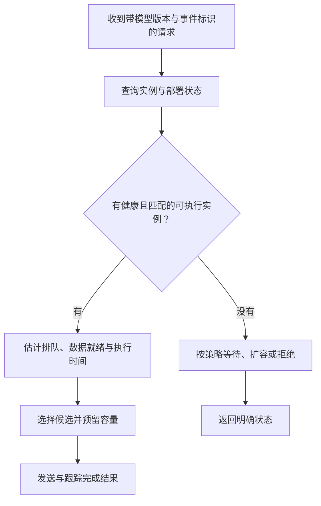

# 多加一张显卡，任务该交给谁？

> **AI 并行计算入门 · 第四篇**
>
> 一张 GPU 排着队，另一张 GPU 闲着。把请求交给空闲的那张，看上去再合理不过。可它可能没有模型，也可能离数据太远。
>
> 本文继续用门口摄像头的场景，讲清模型放置、副本与请求路由，解释为什么“最空闲”不一定等于“最早完成”。
>
> **口径说明：场景、时间与容量数字均为教学假设，不是硬件实测或性能承诺。配套 Python 代码只计算调度快照，不加载模型、不访问 GPU。资料核对日期：2026 年 10 月 16 日。**

> **工程深度｜验证状态：** L2–L3 工程｜概念验证
<!-- more -->

## 01｜第二张显卡装好了，第一张为什么还在排队？

前面三篇，我们给门口摄像头接上了检测、身份识别、包裹检测和声音分类。

我们已经知道：任务有依赖；多个 Stream 只提供并发机会；模型一起跑，还会争抢算力和显存带宽。

于是，你加了一张 GPU。

终于可以分工了。你打开监控：GPU 0 很忙，GPU 1 很闲。

一条身份识别请求到了，你决定把它交给 GPU 1。

结果，系统先找模型文件、创建运行实例、准备权重，再把输入送过去。等它终于开始计算，GPU 0 那边的队列可能早就消化完了。

多出来的硬件没有错，问题出在一个被省略的前提：

**空闲的 GPU，不一定已经具备执行这条请求的条件。**

换句话说，这一篇关注的是请求路由（routing）：**为这次请求选择哪个可执行实例**。选定实例后，请求何时开始、是否与其他请求合批，还涉及实例内部的调度；离线批任务分配则是另一类常见场景。路由发生在请求到达的那一刻，依赖的是那一刻的实例状态。

## 02｜先分清两件事：模型放哪里，请求交给谁

很多“多 GPU 调度”讨论，把两个问题混在一起。

| 决策 | 回答什么问题？ | 例子 |
|---|---|---|
| 放置 | 模型实例准备在哪里？ | 身份模型在 GPU 0、GPU 1 各准备一份 |
| 扩缩容 | 要准备多少个实例？ | 高峰期把身份实例从两个增加到三个 |
| 路由 | 本次请求交给哪个实例？ | 这次访客识别交给 GPU 1 上的实例 |

本篇重点是放置与路由；副本数量只在第三、第七节讨论基本权衡，不展开扩缩容策略。

模型放置像开设门店：选址、配置设备、备好原料。

请求路由像分配订单：在已经具备条件的门店之间，选择合适的一家。

如果服务允许按需加载，订单确实可以触发“临时备货”。但加载、初始化和预热都有成本，也需要额外容量与状态管理。

因此，模型放置不是只做一次的静态决策，路由也不是看到空位就能随便塞进去。两者工作在不同时间尺度，必须交换状态。

Ray Serve 的模型复用机制就体现了这个区别：路由会尝试匹配已经加载目标模型的副本，必要时再走按需加载路径。[1]

这不意味着所有业务都应该动态装卸模型。对门口提醒这类时延敏感任务，先准备好常用实例，往往更容易控制响应。

## 03｜“一张卡一个模型”，还是“两张卡各放一套”？

先看两种容易理解的部署方式。

### 方案 A：按模型职责分工

| GPU 0 | GPU 1 |
|---|---|
| 人体与人脸检测 | 包裹检测 |
| 身份识别 | 声音分类 |

检测与身份识别放在一起，便于就地衔接。包裹与声音分支放到另一张卡，分散资源竞争。

但它并不天然均衡。若每帧都要检测，而声音分类只偶尔触发，两张卡的负载仍可能相差很大。

应当估算“每秒来多少工作”，而不是只数“每张卡有几个模型”。模型数量相同，不代表工作量相同。

### 方案 B：两张卡各准备一套模型

| GPU 0 | GPU 1 |
|---|---|
| 检测、识别、包裹、声音实例 | 检测、识别、包裹、声音实例 |

一个事件尽量交给其中一张卡完成，另一张卡处理别的事件。

这种方式减少了单个事件跨卡传递的需要，但重复保存模型和运行状态，会消耗更多显存。某个事件内部的资源竞争，也没有因此自动消失。

### 更实际的做法：只给热点增加副本

假设人体检测是热点，可以考虑两张卡都准备检测实例；声音模型只保留一份；身份识别是否复制，则看访问量、数据位置和显存预算。

没有一种布局在所有输入和流量下都最好。合理的放置方案，要同时看业务依赖、请求频率、执行耗时、资源竞争与传输成本。

**副本的价值是增加可服务的选择，代价是占用资源。**

## 04｜为什么“谁队短，就交给谁”也会选错？

先看一个只数任务就会选错的例子：假设两张卡上都有同一版本的身份模型，输入也都已就绪。

| 设备 | 排在前面的任务数 | 预计还要忙多久 | 本次执行耗时 |
|---|---:|---:|---:|
| GPU 0 | 1 个 | 80 ms | 8 ms |
| GPU 1 | 4 个 | 24 ms | 8 ms |

只数任务，GPU 0 队列更短；看剩余工作量，GPU 1 反而能更早完成。

在这组教学假设下：

- 交给 GPU 0：约在第 88 毫秒完成。
- 交给 GPU 1：约在第 32 毫秒完成。

关键不是队伍里有几个人，而是前面的人还要办多久。

更复杂的现实是，同一个模型在不同 GPU 上的执行时间可能不同，输入大小、批次、精度和共同运行的任务也会改变耗时。

因此，“最短队列”可以作为低成本启发式，但它不是最早完成时间的保证。

## 05｜空闲的卡，可能离输入更远

现在让输入只在 GPU 0 上就绪。

两张卡都有相同版本的目标模型，但请求交给 GPU 1，需要额外的数据准备。

| 候选位置 | 计算资源何时可用 | 输入何时就绪 | 本次计算耗时 | 预计完成时刻 |
|---|---:|---:|---:|---:|
| GPU 0 | 12 ms | 0 ms | 8 ms | 20 ms |
| GPU 1 | 0 ms | 25 ms | 6 ms | 31 ms |

GPU 1 空闲、计算还更快，完整结果却更晚。

这里的 25 毫秒是刻意设置的教学成本，表示一条数据准备路径的总延迟，可能包括序列化、跨进程传递、复制与同步，不是对人脸裁剪传输耗时的估计。小张量直连复制可能远低于这个数字。

### 关键公式：先等条件齐，再算

在模型已经准备好、单个实例按队列顺序执行的简化条件下（本例每张 GPU 上只有一个目标模型实例、按单队列执行，因此暂时用 GPU 名称代表候选实例）：

\[
\widehat F_g=\max\left(A_g,\ R_g\right)+\widehat C_g
\]

一句话版本：**开工时刻，取决于“设备有空”和“材料到齐”中更晚的那个；完成时刻，再加上实际加工时间。**

其中：

- \(A_g\)：候选实例或其受控执行资源预计何时可用。注意它是**预计可用时刻**，不是 GPU 利用率——同一张卡上的其他模型在跑什么，也会改变这个估计。
- \(R_g\)：本次请求的输入预计何时在该位置可用。
- \(\widehat C_g\)：该位置的预计执行时间。
- \(\widehat F_g\)：预计完成时刻。各项必须使用同一时间原点。

为什么取最大值？因为排队与数据准备可能并行发生。若两者同时启动，不能把 12 毫秒等待和 25 毫秒传输简单相加。

如果数据准备本身要占用被前序任务锁住的资源，就必须重新建模其开始时刻；如果输出还需送回某处汇总，还要计入相应的返回路径。

这个公式是决策工具，不是对所有 GPU 并发执行的精确模拟。

### 数据在哪，不是永远的决定性因素

把上表里 GPU 1 的输入准备时间从 25 毫秒改成 5 毫秒，结论就会翻转：

| GPU 1 的输入准备时间 | GPU 1 预计完成 | 与 GPU 0 的 20 ms 比较 |
|---:|---:|---|
| 25 ms | 31 ms | 选择 GPU 0 |
| 5 ms | 11 ms | 选择 GPU 1 |

**数据局部性是影响决策的一项成本，不是绝对规则。** 队列长度、数据位置、执行速度会同时进入同一个公式，谁的权重更大，取决于当时的具体数字。

## 06｜跨卡并非零成本，两张卡也不会自动合成一个大显存

“都装在同一台服务器里”，不代表两张卡之间的数据来往可以忽略。

实际路径取决于设备能力、驱动和 PCIe、NVLink 等拓扑。CUDA 提供查询 P2P 能力的接口；支持并启用合适的路径时，设备间传输可以避免经由主机暂存，但不能假定任意两张卡都拥有同样的路径。[2]

尤其要区分两种跨卡数据：

| 数据 | 为什么要传？ | 需要评估什么？ |
|---|---|---|
| 原始画面或大特征图 | 把前处理或模型输出交给另一张卡 | 数据量、传输路径、同步与缓存生命周期 |
| 框、标签、分数等小结果 | 汇总不同分支 | 固定开销、序列化、事件对齐 |

因此，不要只根据模型耗时做放置。两个衔接紧密的阶段，分到不同卡上省下的计算竞争，可能又被中间结果搬运抵消。

同时，两张 24 GiB GPU 并不会自动变成一张可无条件分配 48 GiB 张量的设备。模型切分、分布式存储或远端访问，需要相应的软件和硬件机制。

本篇讨论的是完整模型实例放置与请求选择，不是在做张量并行或流水线模型切分。

## 07｜先筛“能接单的实例”，再比较谁更快

前面几节已经把主路径讲完了：**过滤 → 估计 → 选择**。下面再补一个真实服务必须处理的问题：多个请求可能同时选中同一个实例。

一个可执行的路由决策，应当先过滤候选项。



需要检查的条件包括：

- 模型标识、版本和输入契约是否匹配。
- 实例是否健康，是否已加载并就绪。
- 输入形状与执行配置是否受支持。
- 是否还有允许接纳的请求或执行容量。
- 数据是否能合法、可靠地到达该实例。

显存准入也不能只拿“空闲字节数”减去权重大小。前一篇的临时空间、工作区与活跃请求峰值，都需要进入预算。

如果选择支持冷加载的路线，则必须明确加载所需容量、时间、预热和并发保护。加载失败，不能悄悄换一个不匹配版本返回结果。

### 为什么“选完”还要“预留”？

两个请求同时到达，都看到 GPU 1 还空着，于是都预测自己 8 毫秒完成。第一个请求被接纳后，第二个请求看到的可用时刻就应该更新；否则两次预测都建立在同一个旧状态上，都会落空。在当前单队列模型里，这意味着接纳一个请求后就要把该实例的预计可用时间向后推；真实的多并发实例，则要更新相应的容量模型。

实现上需要在接纳请求时更新在途数或工作量估计，并使用适合部署结构的原子操作、锁或统一准入点。请求取消后，要确认任务是否尚未执行、已经停止，或仍在后台运行；**只有相关资源确实可以复用时，才释放执行容量**——客户端断开连接，并不等于 GPU 上的计算已经停下，过早归还容量会破坏准入预算。

单个 Python 进程中的锁，也不能自动协调多个独立路由进程。候选信息过期与多入口竞争，是生产调度需要处理的问题。

## 08｜用一个小实验，看见三个场景、两种策略

下面不需要 GPU，也不使用 `sleep()`。

它根据一张已知的状态快照，比较两种策略：

1. 在可执行实例中选排队任务数最少的。
2. 在可执行实例中选预计完成时刻最早的。

两种策略的核心选择逻辑其实只有两行（假设候选集合非空）：

```python
eligible = [c for c in candidates if c.ready and model in c.models]
selected = min(eligible, key=lambda c: c.finish_ms())
```

第一行回答“谁能接”，第二行回答“谁预计最早完成”。注意：两种策略都先检查模型与就绪条件，我们不会把“请求交给根本没有模型的实例”当成正常执行来比较速度。

### 完整 Python 代码

```python
"""多加一张显卡，任务该交给谁？（第5章 · 并行与分布式）。

本文件是对应博文代码块的实现/演示，直接运行可见效果；运行依赖：仅标准库。
"""
from dataclasses import dataclass


@dataclass(frozen=True)
class Candidate:
    name: str  # 实例标识：模型版本/设备/实例编号。
    models: frozenset[str]
    queued: int
    available_ms: float
    input_ready_ms: float
    compute_ms: float
    ready: bool = True  # 简化表示健康、配置匹配与准入预算满足。

    def finish_ms(self):
        return max(self.available_ms, self.input_ready_ms) + self.compute_ms


def choose(candidates, model, policy):
    eligible = [c for c in candidates if c.ready and model in c.models]
    if not eligible:
        return None
    if policy == "shortest_queue":
        return min(eligible, key=lambda c: (c.queued, c.name))
    if policy == "earliest_finish":
        return min(eligible, key=lambda c: (c.finish_ms(), c.name))
    raise ValueError(policy)


def main():
    model = "identity@v1"  # 模型版本属于候选匹配条件。
    loaded = frozenset({model})
    # 候选用实例标识而非裸 GPU 名，强调路由对象是可执行实例。
    g0 = "identity@v1/GPU0/instance0"
    g1 = "identity@v1/GPU1/instance0"
    cases = {
        "空闲但没加载目标模型": [
            Candidate(g0, loaded, 1, 12, 0, 8),
            Candidate(g1, frozenset(), 0, 0, 0, 6),
        ],
        "空闲但数据准备更慢": [
            Candidate(g0, loaded, 1, 12, 0, 8),
            Candidate(g1, loaded, 0, 0, 25, 6),
        ],
        "队伍短但前面的工作更重": [
            Candidate(g0, loaded, 1, 80, 0, 8),
            Candidate(g1, loaded, 4, 24, 0, 8),
        ],
    }
    for title, candidates in cases.items():
        print(f"\n{title}")
        for policy in ["shortest_queue", "earliest_finish"]:
            selected = choose(candidates, model, policy)
            if selected is None:
                print(policy, "无可执行实例")
            else:
                print(f"{policy}: {selected.name}, "
                      f"预计完成 {selected.finish_ms():.0f} ms")


if __name__ == "__main__":
    main()
```

按代码中的假设，输出为：

```text
空闲但没加载目标模型
shortest_queue: identity@v1/GPU0/instance0, 预计完成 20 ms
earliest_finish: identity@v1/GPU0/instance0, 预计完成 20 ms

空闲但数据准备更慢
shortest_queue: identity@v1/GPU1/instance0, 预计完成 31 ms
earliest_finish: identity@v1/GPU0/instance0, 预计完成 20 ms

队伍短但前面的工作更重
shortest_queue: identity@v1/GPU0/instance0, 预计完成 88 ms
earliest_finish: identity@v1/GPU1/instance0, 预计完成 32 ms
```

第一组两种策略选了同一个实例，这不是多余的一组：**它说明候选资格检查应先于速度比较**——第一组不是在比谁更聪明，而是在演示“最空闲的候选如果没有目标模型，两种策略都会把它排除”。

这个实验不证明某个路由算法在生产环境一定更优。它说明：**在已知这些信息的快照里，队列长度不足以表达完成成本。**

代码没有模拟多个请求竞争、批处理、传输通道争抢、模型装卸或准入预留，不能直接充当生产调度器。若拿它连续分配请求，需要先补上状态更新，否则每次都会根据旧快照做决定。

## 09｜预计时间从哪里来？不能只测一次写成常量

刚才的 8 毫秒、12 毫秒，都来自教学设定。

真实服务可以按模型版本、设备、精度、输入形状和批次，收集执行样本，建立初始估计，再用运行数据更新。

队列中还要考虑：正在执行的请求还剩多久，等待请求预计要做多少工作，以及它们是否会组成批次。

| 信息 | 不足时容易出现的问题 |
|---|---|
| 输入形状 | 把大图与小图当成同等工作量 |
| 批次 | 把合批执行当成逐个串行执行 |
| 并发干扰 | 用独占耗时预测共同运行的耗时 |
| 模型加载状态 | 把冷启动当成已就绪 |
| 数据位置 | 只算计算，漏掉搬运与准备 |

对尾延迟敏感的请求，可以考虑更保守的耗时估计或安全余量。只凭单阶段 P95，也不能保证整个事件链路一定达到 P95 时限。

估计本身需要成本。小规模服务可以从固定放置、少量副本和简单准入开始，再按真实瓶颈引入复杂路由。

**用足够的信息做可靠决策，比一开始就写一个庞大的“智能调度器”更实际。**

## 10｜落到现成框架：配置实例，不等于拆开模型

以 NVIDIA Triton 为例，`instance_group` 可以指定模型执行实例的数量和所在 GPU。[3]

在一个已经完整配置好后端、输入输出和模型文件的普通单 GPU 模型中，下面的片段表示：在两张可见 GPU 上，各创建一个执行实例。

```protobuf
# 模型 config.pbtxt 的片段，不是可独立运行的完整配置。
instance_group [
  {
    count: 1
    kind: KIND_GPU
    gpus: [0, 1]
  }
]
```

`count: 1` 配合两个 GPU 编号，是每张卡一个实例，不是两张卡合起来一个实例，也不是把模型的一半放到每张卡。

具体实例的显存开销及内部资源共享，取决于后端实现；不能机械地用实例数量乘模型文件大小预测总显存。

GPU 编号还要按服务进程实际可见的设备解释。容器可见设备和主机物理编号可能不同，部署时要核对。

这段配置只解决实例放置的一部分问题，不等于实现了本文的“预计完成最早”策略。需要自定义业务路由时，还要确认框架提供的控制边界，或把不同设备实例暴露为可区分的服务端点。

Ray Serve 则可以在部署层安排副本资源，在请求层路由到副本；其模型复用能力还会考虑模型驻留情况。[1][4] 需要自定义请求选择逻辑时，它也提供相应的扩展点。[6]

### 前沿一瞥：路由开始考虑缓存状态

本篇的公式只算了队列、数据就绪和执行时间。到了大模型服务，相同模型的不同副本还可能保留**不同的前缀缓存**：请求发给哪个副本，会影响它过去之后还要做多少计算。因此“模型相同”不代表“要做的工作相同”，路由需要在队列负载与缓存复用之间权衡。[5] 这是本文原理的现代延伸，不是当前教学公式已经覆盖的机制。

不要把框架的“副本”一律等同为一张 GPU：一个副本具体占用哪些资源、是否内部跨卡，要看它的配置与执行方式。

## 11｜什么时候才需要 NCCL 和模型切分？

本篇中，GPU 0 与 GPU 1 上的身份模型可以各自独立处理完整请求。应用负责把请求交给某个实例，并收集结果。

这与张量并行不同：张量并行要求多张卡协作完成同一个模型内部的计算，可能需要交换或归约中间结果。

| 问题 | 对应方向 |
|---|---|
| 请求太多，一个副本接不过来 | 评估增加副本与路由 |
| 不同模型共享一张卡干扰严重 | 评估调整放置与并发 |
| 一个模型本身装不下或需要协同计算 | 评估 TP、PP 等模型并行 |
| 多卡协作需要交换、收集或归约张量 | 选择适当通信机制，可能包括 NCCL |

两个独立推理实例之间，并不因为使用了两张 GPU，就必须执行 AllReduce。

反过来，模型已经跨卡切分时，请求路由通常需要面对一个协作的模型副本组，而不是把其中任意一张卡当成完整服务实例。

这些边界将在后续数据并行、NCCL、TP 与 PP 各篇中展开。

## 12｜回到门口：让事件更早完成，而不是让两张卡看起来一样忙

最后，假设身份识别分支还需 40 毫秒，包裹分支只需 20 毫秒。

你通过调整路由，把包裹分支缩到 15 毫秒。它确实变快了，但若完整提醒仍必须等待身份识别，事件完成时间可能没有改变。

第一篇的关键路径，在多卡系统里仍然有效。

只优化单个请求的最早完成，还可能占用紧缺资源，拖慢后面的高优先请求。因此，局部贪心要放进持续流量与业务优先级里验证，不能宣称是全局最优。

一套更合理的验收口径是：同样的模型版本、输入规模、结果要求和到达负载下，观察完整事件延迟、尾延迟、吞吐、失败率与资源成本。

两张卡不必每时每刻一样忙。有时多保留一个就绪副本，是为了突发请求；有时把紧密衔接的阶段放在一起，是为了减少搬运。

**选哪张卡，应该从“它现在忙不忙”，走向“它是否能接、数据何时到、需要等多久，以及结果何时回来”。**

这才是增加第二张显卡之后，真正需要补上的那套分工。

---

## 下一篇

**《请求一多，AI 为什么开始排长队？》**

当模型已放好、路由也合理，流量仍然可能把系统压垮。下一篇继续讲批处理、排队、背压和尾延迟，解释为什么单次测试很快，真实服务却不一定快。

## 参考资料

以下均为官方资料。本文的模型布局、路由算例与模拟输出为教学构造，不是下列系统的性能测试，也不表示它们默认实现本文的启发式策略。

1. [Ray Serve：Model Multiplexing](https://docs.ray.io/en/latest/serve/model-multiplexing.html)：模型驻留匹配、按需加载与复用。
2. [NVIDIA CUDA Programming Guide：Programming Systems with Multiple GPUs](https://docs.nvidia.com/cuda/cuda-programming-guide/03-advanced/multi-gpu-systems.html)：多 GPU 管理、数据分布、P2P 与拓扑条件。
3. [NVIDIA Triton：Model Configuration—Instance Groups](https://docs.nvidia.com/deeplearning/triton-inference-server/user-guide/docs/user_guide/model_configuration.html#instance-groups)：模型执行实例数量与 GPU 放置。
4. [Ray Serve：Replica scheduling](https://docs.ray.io/en/latest/serve/advanced-guides/replica-scheduling.html)：部署副本的资源与节点放置。
5. [Ray Serve：LLM Routing Policies](https://docs.ray.io/en/latest/serve/llm/architecture/routing-policies.html)：副本选择、Power of Two Choices 与前缀感知路由等方向。
6. [Ray Serve：Custom Request Router](https://docs.ray.io/en/latest/serve/advanced-guides/custom-request-router.html)：请求层自定义路由扩展点。
