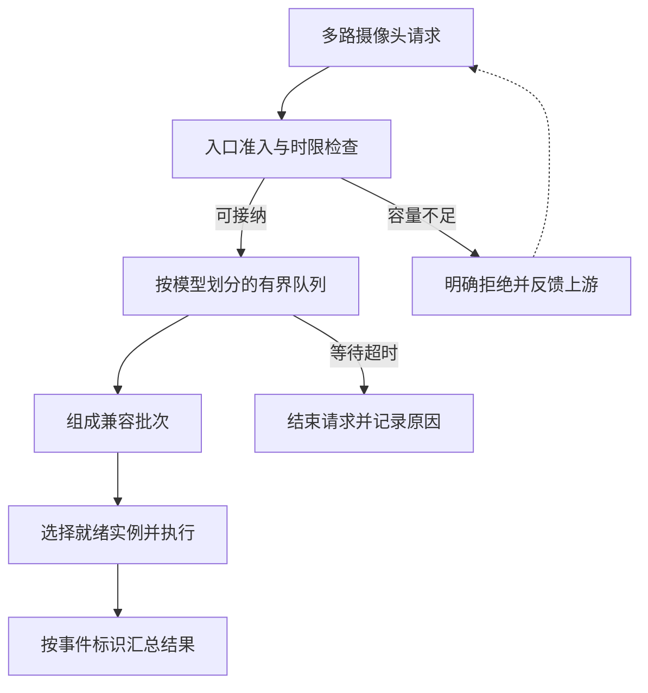

# 请求一多，AI 为什么开始排长队？

> **AI 并行计算入门 · 第五篇**
>
> 模型单次只算 8 毫秒，用户却等了半秒。问题可能不在它算得慢，而在它迟迟没有轮到。
>
> 本文延续门口摄像头的场景，把批处理、排队、背压和尾延迟串成一条完整的推理服务链。
>
> **口径说明：场景、耗时与流量均为教学假设。配套 Python 采用虚拟时间计算，输出是模拟结果，不是 GPU 实测，也不是 Triton 或其他框架的性能测试。资料核对日期：2026 年 10 月 16 日。**

> **工程深度｜验证状态：** L2–L3 工程｜概念验证 + 模拟说明（模拟器输出仅作教学）
<!-- more -->

## 01｜快递员已经走了，手机才收到提醒

晚上七点，快递集中送到。

前面四篇，我们已经把摄像头系统改造了一轮：独立模型并发执行，有依赖的模型正确衔接，减少同卡竞争，再把任务分给合适的 GPU。

单次测试很好看：某个检测模型，只需要 8 毫秒。

但接入更多摄像头之后，提醒越来越晚。画面里的人已经离开，手机才显示“门口发现访客”。

监控没有报错，模型计算耗时也没怎么变化。

发生变化的是计算之前的时间：**请求在排队。**

这就像食堂窗口做一份饭只要半分钟。排在前面的人从两个变成二十个，你拿到饭的时间依然会大幅增加。

模型执行时间，和用户等待时间，从来不是同一个数字。

## 02｜8 毫秒的模型，怎样让人等到半秒？

先抽出一个模型实例，假设它一次只处理一个请求，每个请求固定执行 8 毫秒。

忽略其他开销，它的处理能力是：

\[
\mu=\frac{1000}{8}=125\text{ 个请求/秒}
\]

如果请求每 5 毫秒来一个，到达速率就是 200 个/秒。

每处理完一个，队伍就又被拉长一点：

| 请求 | 到达时刻 | 开始计算 | 完成时刻 | 总等待与执行 |
|---|---:|---:|---:|---:|
| 1 | 0 ms | 0 ms | 8 ms | 8 ms |
| 2 | 5 ms | 8 ms | 16 ms | 11 ms |
| 3 | 10 ms | 16 ms | 24 ms | 14 ms |
| 4 | 15 ms | 24 ms | 32 ms | 17 ms |

模型一直只算 8 毫秒，但每个后来者都比前一个多等 3 毫秒。

持续处理到第 200 个请求时，它在第 995 毫秒到达，到第 1600 毫秒才完成，总共等了 605 毫秒。把这 605 毫秒拆开看：

| 第 200 个请求经历了什么 | 时间 |
|---|---:|
| 到达 | 995 ms |
| 等待轮到执行 | 597 ms |
| 模型计算 | 8 ms |
| 从到达到完成 | 605 ms |

真正拖慢它的是中间那 597 毫秒的等待，而不是 8 毫秒的计算。

**计算没有变慢，排队已经把实时服务变成了延迟回放。**

在这个单实例、固定执行时间的例子里，若没有扩容、提高处理能力或减少接纳量，队列不会自己恢复。把队列容量加大，只是允许更多请求留下来等待。

现实流量还会突发，模型耗时也会变化。长期平均到达速率低于平均服务能力，并不意味着每次请求都不会排队；平均值恰好相等，更不能作为稳定服务的设计目标。

## 03｜不要只看平均值，慢的那一小撮也会找上你

假设 100 次请求中：

- 94 次用了 10 毫秒。
- 6 次用了 1000 毫秒。

平均延迟为 69.4 毫秒，中位数只有 10 毫秒。但那 6 次请求的用户，都等了一整秒。

**尾延迟**关注的就是分布末端那些较慢的请求。

| 指标 | 看什么？ |
|---|---|
| 平均值 | 整体耗时水平，容易掩盖分布差异 |
| P50 | 大约一半请求在这个时间内完成 |
| P95 | 大约 95% 请求在这个时间内完成 |
| P99 | 大约 99% 请求在这个时间内完成 |

按最近秩分位数口径，上例 P95 与 P99 都为 1000 毫秒。不同工具的分位数算法可能有差异，比较时要统一口径。

摄像头系统还包含检测、识别、包裹、声音等多个分支。完整事件等待必要分支全部完成，某条分支的排队就可能拖住整件事。

不能把各阶段 P95 简单相加，当成完整事件的 P95。应当用同一个事件标识，从业务入口测到所需结果交付。

## 04｜批处理：一趟送四份，可能比跑四趟划算

如果模型和后端支持，可以把多个兼容请求组合成一个批次，一起执行。

把它想成电梯：每次启动都有固定开销，多载几个人，单位乘客分摊的成本可能下降。

用一个简化的教学函数表示批次执行时间：

\[
S(b)=6+2b\text{ 毫秒}
\]

其中 \(b\) 为批次内样本数。6 毫秒代表可被批次分摊的一部分成本，2 毫秒代表每增加一个样本的增量成本。注意它的起点：当 \(b=1\) 时 \(S(1)=8\) 毫秒，**正好等于前面那个“单请求 8 毫秒”的例子**——前后两处用的是同一套设定，只是这里把“固定成本 + 每样本增量”拆开了。这是人为设定的函数，不是 GPU 的通用规律。

| 批次大小 | 一批执行时间 | 平均每个样本分摊 | 持续满批时的理想吞吐 |
|---|---:|---:|---:|
| 1 | 8 ms | 8 ms | 125 个/秒 |
| 2 | 10 ms | 5 ms | 200 个/秒 |
| 4 | 14 ms | 3.5 ms | 约 286 个/秒 |

这里最容易发生一个误读：

**四个样本一起算 14 毫秒，不代表每个用户只等 3.5 毫秒。**

3.5 毫秒是单位样本的分摊成本。这个批次中，所有样本都要等批次执行完成；先到的样本还可能等其他请求到来。

批次更大，还可能增加显存峰值、改变算子效率，或超过服务时限。因此，批次大小必须沿用第三篇的容量、带宽与计算账一起评估。

## 05｜动态合批：不必凑满才走，也不必每次都等

**动态批处理**根据当时已有的请求组成批次，不要求所有请求在同一时刻到达。

可以先采用一种朴素策略：模型实例空出来时，能合多少兼容请求就合多少，上限为 4；没有更多请求就直接执行。

在高负载下，队列里通常已有请求，即使没有人为增加等待，也可能组成批次。

低负载时，请求很稀疏，想凑成大批次，就要让前面的请求再等一会儿。这时才需要考虑“最多等多久”。

Triton 的动态批处理支持设置合批等待。官方建议先评估默认配置，再在延迟预算允许时逐步调整；多数模型不必先指定偏好的批次大小。[1]

### 谁能合成一批？

摄像头的包裹模型，可以尝试合并来自多路摄像头的兼容输入。但不能把包裹检测和声音分类请求直接拼成一批，指望一个模型同时处理。

应当确认模型与版本、输入类型、形状或填充规则、执行配置等条件兼容。对带状态和顺序约束的模型，还需要适合它的序列调度机制。

**业务数据来自不同摄像头，不妨碍合批；计算契约不兼容，才是必须处理的边界。**

## 06｜跑个实验：多等 12 毫秒，真的更快吗？

下面使用与前面一致的教学模型：一批执行时间为 `6 + 2 × 批次大小` 毫秒，最大批次为 4。

分别比较：

1. 逐条执行。
2. 动态合批，不额外等新请求。
3. 动态合批，允许从最老请求到达起最多等 12 毫秒凑批。

执行实例忙碌时，请求仍会排队；“最多等 12 毫秒”仅表示本模拟的凑批规则，不是总排队时间上限。

采用两组流量，每组各 200 个请求：低流量每 50 毫秒到一个，高流量每 5 毫秒到一个。每个请求只包含一个样本，因此本实验里的“批次大小”也等于合并的请求数。所有请求输入兼容，最终全部处理，不丢弃任何一个。

下面实现的是本文定义的单实例合批策略，用于解释机制；它不保证逐项复现 Triton 的调度时序。

### 完整 Python 代码

只使用标准库，没有线程、真实等待或 GPU。保存为 `queue_demo.py` 后执行 `python queue_demo.py`。

读代码时只需抓住三个动作，其余都是实现细节：

1. 实例什么时候空闲？
2. 满批和等待期限，哪个先到？
3. 这一批请求什么时候一起完成？

```python
from bisect import bisect_right
from math import ceil
from statistics import mean


def percentile(values, q):
    ordered = sorted(values)
    return ordered[ceil(q * len(ordered)) - 1]  # 最近秩。


def simulate(arrivals, max_batch, wait_ms):
    # arrivals 是按时间升序排列的到达序列，单位毫秒。
    index, free_at = 0, 0.0
    latencies, waits, batch_sizes = [], [], []
    while index < len(arrivals):
        start = max(free_at, arrivals[index])
        # 事件时间跳转：满批或凑批期限，哪个先到就尝试发车。
        full_index = index + max_batch - 1
        full_at = (arrivals[full_index] if full_index < len(arrivals)
                   else float("inf"))
        deadline = arrivals[index] + wait_ms
        start = max(start, min(deadline, full_at))

        # 用二分找到“发车时已经到达”的请求边界，且不超过批次上限。
        stop = bisect_right(arrivals, start, index,
                            min(index + max_batch, len(arrivals)))
        size = stop - index
        finish = start + 6 + 2 * size
        for arrival in arrivals[index:stop]:
            waits.append(start - arrival)
            latencies.append(finish - arrival)
        batch_sizes.append(size)
        free_at, index = finish, stop
    return latencies, waits, batch_sizes


def main():
    policies = [("逐条执行", 1, 0),
                ("合批不额外等", 4, 0),
                ("合批最多等12ms", 4, 12)]
    for title, interval in [("低流量", 50), ("高流量", 5)]:
        arrivals = [i * interval for i in range(200)]
        print(title)
        for label, batch, delay in policies:
            latency, wait, sizes = simulate(arrivals, batch, delay)
            print(f"{label}: 平均 {mean(latency):.1f} ms; "
                  f"P95 {percentile(latency, 0.95):.1f} ms; "
                  f"最大排队 {max(wait):.1f} ms; "
                  f"平均批次 {mean(sizes):.2f}")


if __name__ == "__main__":
    main()
```

按这些固定输入，得到：

| 流量 | 策略 | 平均完成延迟 | P95 | 最大排队 | 平均批次 |
|---|---|---:|---:|---:|---:|
| 低 | 逐条执行 | 8.0 ms | 8.0 ms | 0.0 ms | 1.00 |
| 低 | 合批不额外等 | 8.0 ms | 8.0 ms | 0.0 ms | 1.00 |
| 低 | 合批最多等 12 ms | 20.0 ms | 20.0 ms | 12.0 ms | 1.00 |
| 高 | 逐条执行 | 306.5 ms | 575.0 ms | 597.0 ms | 1.00 |
| 高 | 合批不额外等 | 13.5 ms | 16.0 ms | 6.0 ms | 1.98 |
| 高 | 合批最多等 12 ms | 19.0 ms | 24.0 ms | 12.0 ms | 2.99 |

这组结果有三层意思：

**第一，低流量时，等也未必等得到同行者。** 50 毫秒才来一个请求，等 12 毫秒仍然只能单独执行，延迟从 8 毫秒变成 20 毫秒。

**第二，高流量时，队列中已有的请求就能帮助合批。** 不额外等待的策略，让先前积压的请求一起执行：高流量下平均完成延迟从逐条执行的 306.5 毫秒降到 13.5 毫秒，平均批次从 1.00 升到 1.98。

**第三，批次更大不代表延迟更小。** 等 12 毫秒的策略得到更大的平均批次，但这组实验里平均延迟和 P95 都更差。

这里说的“高流量”，是相对逐条执行能力而言的：200 请求/秒超过了逐条执行的 125 请求/秒，但没有超过持续满批的理想能力约 286 请求/秒。也就是说，这组流量会压垮逐条执行，却仍可能被合批接住——**合批改变的是有效处理能力，不只是队伍的形状。**

“等不到更多请求”和“等到了，但延迟收益不划算”，是两种不同的情况。本实验低流量每隔 50 毫秒来一个，等待窗口只有 12 毫秒，所以等不到同行者；但换成更密的间隔，等待就可能真的形成更大的批次。用同一模拟器对比：

| 请求间隔 | 不额外等待：平均批次 | 等待最多 12 ms：平均批次 |
|---|---:|---:|
| 10 ms | 1.00 | 2.00 |
| 50 ms | 1.00 | 1.00 |

可以看到，10 毫秒间隔下确实能合批，代价是本设定中平均延迟从 8 毫秒升到 17 毫秒。所以更准确的说法是：

> 队列已有兼容请求时，可以直接合批；请求不足时，短暂等待可能形成更大的批次，但需要付出延迟。是否值得，要看等待窗口内的到达情况、批次执行收益，以及业务允许的延迟预算。

这也符合 Triton 官方建议：先测默认动态批处理，再在延迟预算允许时评估增加合批等待。[1]

本实验使用固定间隔、固定批次耗时、单个执行实例和无限等待队列；没有网络、随机突发、形状差异、抢占或显存竞争。代码读取完整到达序列只是为了做离散事件时间跳转，发车条件仍是满批或期限到达，不是提前消费未来请求。

这张表描述的是有限请求序列在规则到达、固定耗时下的表现，**不代表随机突发、耗时波动或长期运行下仍有相同的尾延迟**。它验证的是机制，不是生产最佳参数，“不额外等”也不保证在其他流量下最优。

## 07｜队列不是容量，背压才会让上游知道“接不住了”

当持续到达量超过可处理量，排队只是暂存矛盾。

继续接收会增加内存、占用连接，也会让大量请求在结果失去价值后才轮到计算。

需要区分几种控制手段：

| 手段 | 控制什么？ |
|---|---|
| 并发限制 | 同时进入执行或在途阶段的工作量 |
| 有界队列 | 允许多少请求留下等待 |
| 限流 | 单位时间允许进入多少请求，可带突发额度 |
| 背压 | 把下游容量压力传递给上游，让其减慢或停止提交 |
| 负载丢弃 | 过载时明确拒绝或丢弃一部分工作 |

它们可以配合使用。返回“暂时接不住”可以成为背压信号，但如果调用方不减速、只会立即重试，压力不会因此消失。

Google SRE 将限制队列、负载丢弃和客户端节流作为过载处理的重要方法；重试还应避免进一步放大流量。[2]

一个简化的系统结构可以是：



真实系统中，队列可能分布在客户端、网关、路由器、模型服务与 GPU 执行层。只限制其中一处，其余地方仍可能偷偷积压。

## 08｜摄像头队列满了，是丢最新帧，还是丢最旧帧？

先问业务要什么。

对实时预览或强调当前状态的检测，等待中的旧帧可能不如新帧有价值。可以考虑每路摄像头只保留一个最新的待处理帧，替换尚未开始处理的旧帧。

但对要求逐帧审计、短暂事件捕捉或时序模型的任务，丢旧帧可能直接丢掉证据。这时应考虑持久化、扩容、离线补算，或明确协商采样策略。

| 任务 | 可能适合的过载处理 | 必须说明的代价 |
|---|---|---|
| 当前画面状态 | 合并或替换未处理旧帧 | 可能漏掉短时事件 |
| 时序识别 | 保持时间顺序，按业务规则处理缺帧 | 不能随意拼接不连续片段 |
| 完整留档分析 | 持久化与后续补算 | 完成时间可能变长 |
| 交互式请求 | 有限等待，过载时明确返回 | 有请求未被完成 |

替换待处理帧不等于撤销已在 GPU 上执行的计算。客户端超时，也不保证底层核函数会立刻停止；需要检查取消是否真正传递到相应层级。

如果减少了处理帧数，要同步报告采样覆盖与任务质量，不能只展示剩余请求的低延迟。

## 09｜超时要覆盖整条链，不能每一站重新领一张票

假设一条事件从入口开始，只有 100 毫秒总预算。

检测排队和执行已用掉 60 毫秒，识别与汇总就只剩 40 毫秒。不能把请求转到下一服务后，又给它一个全新的 100 毫秒。

应传递原始时限或剩余预算，并在合适的边界判断是否仍值得接纳和继续。

跨机器传递绝对时间涉及钟差；实现时需处理时钟同步或采用明确的剩余预算约定，不能直接比较不同机器的单调时钟读数。

同时要区分：

- **凑批等待**：为了组成批次，主动额外等多久。
- **排队超时**：请求在某个队列中允许停留多久。
- **执行时间**：模型实际工作多久。
- **端到端时限**：用户所需结果最晚何时交付。

四个数字不是同一个开关。凑批等待设为 2 毫秒，不能保证请求在队列里最多只待 2 毫秒；实例忙碌和其他等待仍可能占用时间。

## 10｜落到 Triton 与 Ray Serve，要留意配置的作用域

### Triton：合批等待与排队策略分开配置

以下是一个已经具备完整后端、输入输出与批处理支持的无状态模型配置片段，数字仅用于说明语义：[1]

```protobuf
# config.pbtxt 的片段，不是完整可运行的模型配置。
max_batch_size: 4
dynamic_batching {
  max_queue_delay_microseconds: 2000
  default_queue_policy {
    max_queue_size: 64
    timeout_action: REJECT
    default_timeout_microseconds: 20000
  }
}
```

它分别表达：批次上限为 4；允许为凑批设置 2 毫秒延迟；队列最多容纳 64 个请求；并为该队列设置默认超时策略。

这里的 20 毫秒是队列层面的超时策略，**不是保证在第 20 毫秒精确返回的业务时限，也不负责终止已经执行的 GPU 工作**；请求还可能在其他队列等待。

`default_queue_policy` 属于 `dynamic_batching` 的语义范围，只有当模型声明了批维度（`max_batch_size` 大于 0）、后端也支持批处理时才真正生效；给一个不支持批维度的模型加上这段配置，不会让它凭空变成可批处理模型。

### Ray Serve：调用方队列，不是集群唯一总队列

Ray Serve 提供 `max_ongoing_requests` 与 `max_queued_requests` 等控制。前者限制**每个副本**的在途请求数——这些请求可能正处于副本内部等待或执行状态，不等于同时运行的 GPU 核函数数量；后者约束各调用方（如代理或 DeploymentHandle）的排队量。[3]

因此，不能把 `max_queued_requests=64` 理解成整个部署、所有入口合起来永远只排 64 个请求。

超限后的异常或 HTTP 返回方式，应结合所用版本与配置核对；调用方需要识别过载信号，采用有上限的退避、抖动或减少提交，避免立即重试。

## 11｜大语言模型的“连续批处理”，是不是同一件事？

它们都在提高共享计算效率，但执行单位不同。

摄像头这类一次前向结束的模型，可以把若干兼容输入组成一批，执行完再返回。

自回归文本生成则要经过多步解码，不同请求生成长度也不同。支持连续批处理的执行引擎，可以在调度步之间调整参与的请求，让完成的请求退出、新请求加入，而不必让所有人始终等待最长的输出。[4]

这并没有消除资源预算。KV Cache、每步可处理的 token 数、预填充与解码安排，都会影响吞吐与延迟。文本服务还需要分开观察首 token 延迟与后续 token 间隔。

不能把摄像头实验中的“每秒请求数”，不加说明地换成大语言模型的“每秒 token 数”；更不能把更高 token 吞吐直接等同于更快的首字响应。

本篇先建立排队与批处理的共同逻辑；具体生成式调度，还要按执行引擎与负载展开。

## 12｜压测怎样才不骗自己？

如果客户端必须等上一条返回，才发送下一条，服务变慢时，它发请求的速度也会下降。

这适合模拟固定数量的交互用户，但可能掩盖外部请求持续涌入时的积压。

检验过载行为时，应当增加按目标到达速率发起请求的测试，并确认压测工具真的发出了该速率。客户端自身排队和调度迟到，也要计入或单独报告。

建议同时看这些数据：

| 数据 | 为什么需要？ |
|---|---|
| 提交、接纳、完成请求数 | 分清流量去了哪里 |
| 拒绝、超时、取消与丢弃数 | 防止只看成功请求造成选择偏差 |
| 完整延迟 P50/P95/P99 | 看用户实际等待 |
| 各阶段排队与执行时间 | 找到延迟增长位置 |
| 实际批次分布 | 判断是否真的形成有效批次 |
| 结果正确性与数据覆盖 | 防止靠漏算换取好看数字 |

尤其要警惕：开启拒绝后，成功请求 P95 降低了，却有一半请求失败。这可能是一种必要的过载保护，但不能称为“同等服务能力下全面提速”。

分位数也不能简单跨节点取平均。需要合适的直方图聚合或其他可解释的全局统计口径，并保留样本量与时间窗口。

扩容同样需要时间：启动副本、加载模型和预热，无法瞬间吃掉突发队列。容量余量、准入控制与扩容，要共同发挥作用。

## 13｜回到门口：处理更多，不等于提醒更及时

如果系统永远忠实地处理所有旧画面，却来不及看最新一帧，它可能算得很勤快，提醒却越来越没有价值。

但如果为了降低延迟，悄悄丢掉重要片段，系统也可能错过真正需要发现的事件。

所以，实时 AI 服务需要同时定义三件事：要处理哪些数据，结果最晚何时有价值，超出能力时怎样明确处置。

还有一个容易漏掉的指标：**结果新鲜度**。除了请求进入服务后的延迟，还应记录结果交付时，距原始画面采集已经过去多久。模型服务只排了 20 毫秒，不代表这帧画面只有 20 毫秒旧——它可能早已在上游队列里积压。把“多层队列”“旧帧替换”“端到端时限”连起来看，新鲜度往往比服务内部延迟更接近用户真正在意的东西。

前五篇到这里串成了一条链：

| 已解决的问题 | 对应能力 |
|---|---|
| 哪些任务能一起做 | 看懂依赖与关键路径 |
| GPU 怎样表达并发 | Stream、Event 与正确计时 |
| 一起跑为什么会争抢 | 容量、带宽与计算分析 |
| 多张卡怎样分工 | 模型放置、副本与路由 |
| 流量持续增加怎么办 | 批处理、排队与过载控制 |

如果要用一句话收束验收标准：**在相同输入覆盖与任务质量要求下，系统能完成多少请求、多少结果按时送达、送达时画面有多旧？**

**真正的实时性，要从“这次模型算了多久”，一直追问到“这条结果送达时，还来得及做什么”。**

---

## 下一篇

**《两张显卡各算一半数据，为什么还要对答案？》**

系列接下来从推理服务走向分布式计算基础：讲清样本切分与数据并行，解释训练为何需要协调梯度，而独立推理副本通常无需同步梯度。随后再进入 NCCL、张量并行、流水线并行、FSDP 与经典 3D 并行。

## 参考资料

以下均为官方资料。模拟中的批次函数、到达序列和延迟表是本文构造并运行的教学实验，不是以下框架的测试结果。

1. [NVIDIA Triton：Batchers](https://docs.nvidia.com/deeplearning/triton-inference-server/user-guide/docs/user_guide/batcher.html)：动态批处理、凑批等待、队列大小与超时策略。
2. [Google SRE：Handling Overload](https://sre.google/sre-book/handling-overload/)；[Addressing Cascading Failures](https://sre.google/sre-book/addressing-cascading-failures/)：过载、队列、负载丢弃与重试压力。
3. [Ray Serve：Best practices in production](https://docs.ray.io/en/latest/serve/production-guide/best-practices.html)；[deployment 参数说明](https://docs.ray.io/en/latest/serve/api/doc/ray.serve.deployment_decorator.html)：在途请求、调用方队列与背压。
4. [vLLM：Architecture Overview](https://docs.vllm.ai/en/stable/design/arch_overview/)：调度循环、请求执行与生成式服务组织。
