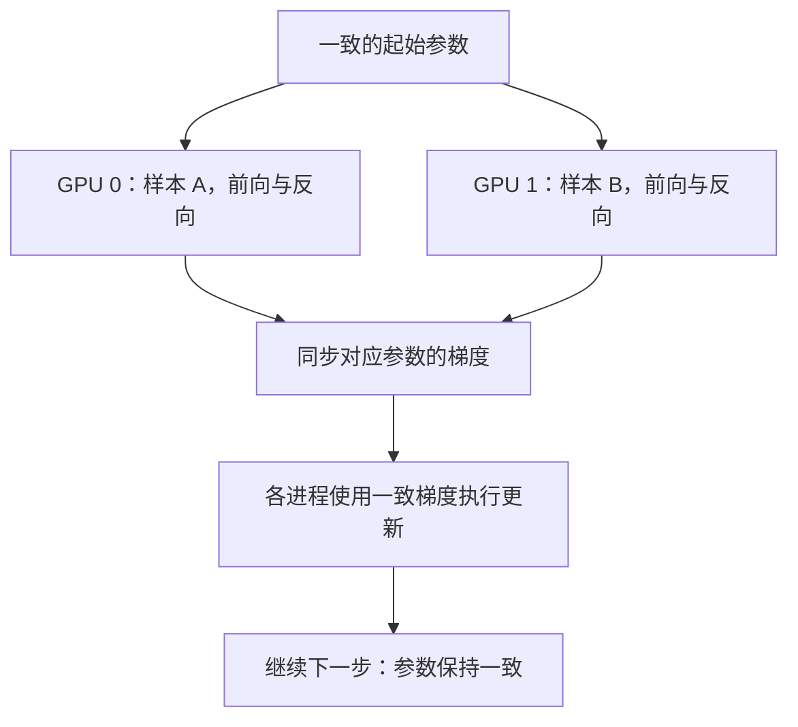

# 两张显卡各算一半数据，为什么还要对答案？

> **AI 并行计算入门 · 第六篇**
>
> 推理时，两张卡各接各的请求；训练时，两张卡看不同照片，却还要交换信息。这次交换的究竟是什么？
>
> 本文从“给门口摄像头训练包裹识别模型”出发，讲清数据切分、数据并行、梯度同步与全局批次，并用一个单参数模型把过程算出来。
>
> **口径说明：场景、数据与算例均为教学构造。标准库实验已实际运行；两卡 PyTorch DDP 示例仅做语法与静态逻辑检查，制作环境未安装 PyTorch，未做 CUDA 实测。资料核对日期：2026 年 10 月 16 日。**

> **工程深度｜验证状态：** L2–L3 工程｜理论推导（通信实测需多卡环境）
<!-- more -->

## 01｜识别模型要重新训练，两张卡怎样分工？

前五篇，我们一直在讨论同一套门口摄像头：找人脸、认身份、检测包裹、识别声音。

模型已经训练好，只需要拿来处理新请求。我们讨论的是推理服务。

现在换一个阶段：你发现模型总把黑色垃圾袋认成包裹，于是收集、标注了一批新照片，准备重新训练。

照片很多，你有两张 GPU。

一个很自然的想法是：第一张看前一半，第二张看后一半，各学各的，最后把成果合起来。

但第一张卡可能看到了更多纸箱，第二张卡可能看到了更多塑料袋。如果它们完全独立更新，就会走向不同的模型。

即使数据来自同一分布，不同小批次的梯度也通常不同——同步是为了执行约定的共同更新规则，不只是为了补救数据分布偏差。

你想训练的是一个共同模型，如何让两张卡分担数据，又沿着共同的方向学习？

先澄清标题里的“对答案”：两张卡交换的通常不是照片，也不是预测答案，而是这一步针对对应参数算出的**梯度**。

这就是**同步数据并行训练**要解决的问题。

## 02｜切的是照片，不是把每张照片切成两半

先从一个批次的 8 张照片开始：

| 设备    | 处理的样本  | 持有的模型  |
| ----- | ------ | ------ |
| GPU 0 | 照片 1—4 | 完整模型副本 |
| GPU 1 | 照片 5—8 | 完整模型副本 |

两张卡执行同样的网络结构，权重从一致的状态开始，只是输入样本不同。

这里切的是**样本维度，也就是批次维度**。通常不是把每张照片的左半边交给一张卡、右半边交给另一张卡。

也不是把前几层交给 GPU 0、后几层交给 GPU 1。按层切分属于另一类模型并行，我们会在后面的流水线并行篇展开。

| 常说的“数据切分”      | 实际目的              |
| -------------- | ----------------- |
| 训练集、验证集、测试集划分  | 区分学习、调参与最终评估的数据用途 |
| 一个训练批次分给多个工作进程 | 分摊本次训练工作量         |
| 一条长序列内部再分片     | 组织同一样本内部的协同计算     |

这三件事都能叫“切数据”，却不能互相替代。

**本篇讲的是：不同工作进程处理不同样本，共同训练一个模型。**

## 03｜为什么不能各自学完，再平均一下模型？

先看普通的一步训练：

1. 前向计算：模型给出预测。
2. 计算损失：根据标签衡量偏差。
3. 反向传播：计算损失对参数的梯度。
4. 优化器更新：根据梯度修改参数。

梯度可以先理解成“参数向某个方向变化时，损失会怎样变化”的局部信息。对最简单的梯度下降，更新沿梯度反方向进行。

如果两张卡不交换信息，各自执行完整的四步，它们的权重可能从第一步更新后就不同了。下一轮还会在不同权重位置继续计算，差异不断积累。

最后把两个模型权重平均，并不一般等于“每一步都一起学习”的结果。

特殊情况下，比如从相同起点做一步普通 SGD，参数平均可能与梯度平均得到相同结果；但不能把这个特例推广到多步独立训练或任意优化器。把第 04 节的数据和学习率多算一步就能看出区别（第二行假设两边始终独立训练，中间没有把平均值发回）：

| 方式 | 第一次更新后 | 第二次更新后 |
| --- | ---: | ---: |
| 每步同步梯度的共同模型 | 0.300 | 0.555 |
| 两边独立更新，展示其权重平均值 | 0.300 | 0.535 |

第一次平均恰好相同，不能保证沿不同轨迹训练之后，平均仍能还原共同学习的过程。

同步数据并行采用另一条路径：**先汇合这一步的梯度，再让各副本更新。**



这里标题中的“对答案”，准确地说是**协调学习方向**。DDP 通常不是收集各卡预测后投票，也不是每次更新之后把所有权重重新广播一遍。[1]

在参数、优化器初始状态和更新规则一致，且没有额外分歧的条件下，各副本用相同梯度更新，就可以保持参数一致。

## 04｜把大模型缩成一个参数，亲手算一次

真实包裹识别网络有很多参数，先用一个容易算的模型理解机制：

\[
\hat y=wx
\]

它只有一个参数 w，不含偏置。我们希望它学会 y=2x。这不是包裹分类器，而是一块专门用来理解梯度的教学放大镜。

本次数据为：

| 样本  | 输入 x | 目标 y | 交给谁   |
| --- | ----: | ----: | ----- |
| 1   | 1    | 2    | GPU 0 |
| 2   | 2    | 4    | GPU 0 |
| 3   | 3    | 6    | GPU 1 |
| 4   | 4    | 8    | GPU 1 |

采用每个样本平方误差的平均值：

\[
L(w)=\frac{1}{n}\sum_{i=1}^{n}(wx_i-y_i)^2
\]

它对 w 的梯度为：

\[
g(w)=\frac{1}{n}\sum_{i=1}^{n}2x_i(wx_i-y_i)
\]

如果暂时不熟悉求导，可以先将这个式子当成“根据当前权重计算学习方向”的配方。

起始 w=0，各个样本的梯度贡献分别为：

| 样本  | 梯度贡献 |
| --- | ----: |
| 1   | -4   |
| 2   | -16  |
| 3   | -36  |
| 4   | -64  |

于是 GPU 0 的局部平均梯度为：

\[
g_0=\frac{-4-16}{2}=-10
\]

GPU 1 的局部平均梯度为：

\[
g_1=\frac{-36-64}{2}=-50
\]

两张卡各看两个样本，将局部平均梯度再平均：

\[
g=\frac{g_0+g_1}{2}=-30
\]

如果一张卡一次看完四个样本，结果也是：

\[
g_{\text{整批}}=\frac{-4-16-36-64}{4}=-30
\]

现在取学习率 \(\eta=0.01\)，普通 SGD 更新为：

\[
w_{\text{新}}=w-\eta g=0-0.01\times(-30)=0.3
\]

两张卡都更新到 0.3。

直觉上可以这样读这个负梯度：目前模型预测偏小（w=0 时全部预测为 0），负梯度表示**在当前位置增大 w 能降低损失**；更新公式减去负数，因此 w 从 0 增加到 0.3，预测开始靠近目标。

如果完全不通信，第一张会更新到 0.1，第二张会更新到 0.5，它们已经开始训练不同的模型。

**数据分开算，更新方向合起来，这就是本例的数据并行。**

## 05｜“局部平均再平均”，有一个不能漏的条件

刚才能够直接平均，是因为两张卡的局部损失都按样本取平均，并且每张卡各有两个同等权重的样本。

如果 GPU 0 只有样本 1，GPU 1 有样本 2、3、4 呢？

- GPU 0 的局部平均梯度：-4。
- GPU 1 的局部平均梯度：约 -38.666667。
- 两个局部平均值直接平均：约 -21.333333。

这与四个样本的整批平均梯度 -30 不同。

正确的样本加权平均应当是：

\[
g=\frac{n_0g_0+n_1g_1}{n_0+n_1}
\]

其中 n_0,n_1 为相应样本数。

普通 DDP 的默认梯度归约语义，不会自动替你推断所有局部损失的正确权重。这不只是“样本数不等”的数学例外，而是现代大模型训练的真实问题：两张卡各处理两段文本，一边只有 100 个有效监督 token，另一边有 1000 个——如果训练目标是所有有效 token 的平均损失，两边的局部平均值就不能直接各占一半。按有效 token、非忽略标签或其他权重归一化时，需要按实际全局目标推导缩放。[2]

一种常见思路是：各进程计算本地损失之和，再按全局有效计数与数据并行规模正确缩放，使 DDP 平均后的梯度对应目标函数。不能只因为函数名字里有 `mean`，就默认已经得到正确的全局平均。

真实模型还会遇到 BatchNorm 批次统计、Dropout 和浮点归约顺序等差异。**参数保持一致，不代表所有缓冲区和局部统计都天然一致**——DDP 对参数的梯度同步与对缓冲区的同步是两套机制，BatchNorm 等状态需要按具体机制理解。因此，“数学上的整批梯度关系”不等于任何网络和实现都与单卡训练逐位一致。

## 06｜先用标准库验证，不需要 GPU

下面直接按刚才的解析公式计算梯度，不调用自动求导，也不进行真实分布式通信。

它对比的是同一批数据、同一起点和同一更新规则。

```python
from math import isclose

def gradient(w, samples):
    return sum(2 * x * (w * x - y) for x, y in samples) / len(samples)

def main():
    data = [(1.0, 2.0), (2.0, 4.0), (3.0, 6.0), (4.0, 8.0)]
    shards = [data[:2], data[2:]]
    w_full, replicas = 0.0, [0.0, 0.0]
    learning_rate = 0.01

    for step in range(1, 6):
        full_gradient = gradient(w_full, data)
        local_gradients = [gradient(w, shard)
                           for w, shard in zip(replicas, shards)]
        synced_gradient = sum(local_gradients) / len(local_gradients)
        assert isclose(full_gradient, synced_gradient, abs_tol=1e-10)

        w_full -= learning_rate * full_gradient
        replicas = [w - learning_rate * synced_gradient for w in replicas]
        assert all(isclose(w, w_full, abs_tol=1e-10) for w in replicas)
        print(f"step={step}: 整批={w_full:.6f}; "
              f"副本0={replicas[0]:.6f}; 副本1={replicas[1]:.6f}")

    independent = [-learning_rate * gradient(0.0, shard) for shard in shards]
    print(f"不做同步的首次更新: {independent[0]:.6f}, {independent[1]:.6f}")

    uneven = [data[:1], data[1:]]
    gradients = [gradient(0.0, shard) for shard in uneven]
    wrong = sum(gradients) / len(gradients)
    weighted = sum(len(shard) * g for shard, g in zip(uneven, gradients)) / len(data)
    assert isclose(weighted, gradient(0.0, data), abs_tol=1e-10)
    print(f"1+3 切分: 直接平均={wrong:.6f}; 样本加权={weighted:.6f}")

if __name__ == "__main__":
    main()
```

输出为：

```text
step=1: 整批=0.300000; 副本0=0.300000; 副本1=0.300000
step=2: 整批=0.555000; 副本0=0.555000; 副本1=0.555000
step=3: 整批=0.771750; 副本0=0.771750; 副本1=0.771750
step=4: 整批=0.955987; 副本0=0.955987; 副本1=0.955987
step=5: 整批=1.112589; 副本0=1.112589; 副本1=1.112589
不做同步的首次更新: 0.100000, 0.500000
1+3 切分: 直接平均=-21.333333; 样本加权=-30.000000
```

这验证了样本独立、损失口径正确时的梯度组合关系，没有证明多卡一定更快。

## 07｜DDP、rank、NCCL，各自站在哪一层？

将刚才的学习过程映射到 PyTorch：

| 名称         | 在本例中负责什么？             |
| ---------- | --------------------- |
| 一个工作进程     | 驱动一张 GPU，持有完整模型与本地数据  |
| rank       | 该进程在通信组中的编号           |
| local rank | 进程在本机的编号，常用于选择本机 GPU  |
| world size | 进程组规模；本例为两个进程         |
| DDP        | 包装模型，安排对应参数梯度的同步      |
| NCCL 后端    | 执行 NVIDIA GPU 之间的相应通信 |

rank 不等于永远固定的物理 GPU 编号。多节点部署中，global rank 与 local rank 的作用尤其需要区分。

PyTorch DDP 会在反向传播过程中通过梯度就绪钩子触发归约，并可按桶组织、与反向计算重叠。不能简单描述为“`optimizer.step()` 执行完后才同步梯度”。[1][3]

这里只需先记住一个最容易踩的语义差：**默认 DDP 的梯度同步，在本文条件下表现为跨进程平均**——可以先把它理解成“对应梯度求和，再按进程数归一化”。AllReduce 本身支持求和、最大值、最小值等不同归约操作，并不天然等于求和或平均；缩放怎样实现，要看框架与通信路径。[4] 至于 AllReduce 具体怎么求和、AllGather 与 ReduceScatter 又是什么，下一篇会用小数组专门讲，这一篇只负责说明它为什么会出现在数据并行里。

分布式训练还有参数服务器等组织方式。本文聚焦 PyTorch DDP 的梯度集合通信路径，不比较不同架构的适用范围。

## 08｜两卡最小 DDP：让真实框架得到同一个 0.3

下面仍然训练 \(\hat y=wx\)，让真实 DDP 负责自动求导后的梯度同步。

先抓住 DDP 训练循环最核心的三行：

```python
loss = loss_fn(ddp(x), y)
loss.backward()      # 默认 DDP 在反向过程中安排梯度同步。
optimizer.step()     # 各副本根据同步后的梯度更新。
```

完整脚本在下面。从第 09 节开始，采样、梯度累积与性能边界属于实践与进阶内容；如果只想抓住主线，记住这三行和“先同步梯度、再更新”即可。

这段代码需要单机两张可用 NVIDIA GPU、支持 CUDA 与 NCCL 的 PyTorch。保存为 `ddp_scalar.py`，使用：

```bash
torchrun --standalone --nproc_per_node=2 ddp_scalar.py
```

为便于对照，手动给 rank 0 分配前两个样本，rank 1 分配后两个。每步检查梯度与权重，不测试速度。

```python
import os

import torch
import torch.distributed as dist
from torch import nn
from torch.nn.parallel import DistributedDataParallel as DDP

def main():
    world_size = int(os.environ.get("WORLD_SIZE", "1"))
    local_rank = int(os.environ.get("LOCAL_RANK", "0"))
    if world_size != 2 or not torch.cuda.is_available():
        raise SystemExit("请用 torchrun 在单机两张 NVIDIA GPU 上启动两个进程。")
    if torch.cuda.device_count() < 2:
        raise SystemExit("本示例要求每个进程可见同样的两张 GPU。")

    torch.cuda.set_device(local_rank)
    device = torch.device("cuda", local_rank)
    dist.init_process_group(backend="nccl")
    try:
        rank = dist.get_rank()
        model = nn.Linear(1, 1, bias=False).to(device)
        with torch.no_grad():
            model.weight.zero_()
        ddp = DDP(model, device_ids=[local_rank])
        optimizer = torch.optim.SGD(ddp.parameters(), lr=0.01)

        # 相同模型，不同样本；每个 rank 的局部 batch 都为 2。
        values = [1.0, 2.0] if rank == 0 else [3.0, 4.0]
        x = torch.tensor(values, device=device).reshape(-1, 1)
        y = 2 * x
        reference_w = 0.0

        for step in range(1, 6):
            optimizer.zero_grad(set_to_none=True)
            loss = nn.functional.mse_loss(ddp(x), y, reduction="mean")
            loss.backward()  # DDP 在反向期间安排梯度同步。

            # 四个样本整批平均梯度为 15*w - 30。
            expected_g = 15 * reference_w - 30
            torch.testing.assert_close(
                model.weight.grad,
                torch.full_like(model.weight, expected_g),
                rtol=1e-5, atol=1e-5,
            )
            optimizer.step()
            reference_w -= 0.01 * expected_g
            torch.testing.assert_close(
                model.weight,
                torch.full_like(model.weight, reference_w),
                rtol=1e-5, atol=1e-5,
            )
            if rank == 0:
                print(f"step={step}: w={model.weight.item():.6f}")
    finally:
        dist.destroy_process_group()

if __name__ == "__main__":
    main()
```

这里没有手动 `all_reduce` 梯度，因为 DDP 已经负责同步；再加一次未推导的梯度归约，可能导致错误缩放或多余通信。

`item()` 和逐步校验会带来同步等开销，所以这是一份机制验证示例，不是性能基准。本例的递推关系是 \(w_{t+1}=w_t-0.01(15w_t-30)=0.85w_t+0.3\)：第一次更新得到 0.3，后续继续向目标值 2 靠近；前五步应与标准库结果在容差内一致。若在两张卡上运行，应看到类似输出（两进程校验均通过、无报错）：

```text
step=1: w=0.300000
step=2: w=0.555000
step=3: w=0.771750
step=4: w=0.955987
step=5: w=1.112589
```

本文没有在两卡环境执行，上述形态是按前文解析解推得的预期，不能称为 GPU 实测。

## 09｜换成真实数据集，DDP 不会替你自动分照片

DDP 管理模型相关的同步，输入怎样分给不同进程，需要调用方安排。[2]

实际训练通常使用 `DistributedSampler`。下面只展示数据接入片段，假设 `dataset`、`rank`、`world_size`、`epochs` 已就绪：

```python
sampler = torch.utils.data.distributed.DistributedSampler(
    dataset, num_replicas=world_size, rank=rank,
    shuffle=True, drop_last=True,
)
loader = torch.utils.data.DataLoader(
    dataset, batch_size=32, sampler=sampler, shuffle=False,
)

for epoch in range(epochs):
    sampler.set_epoch(epoch)
    for images, labels in loader:
        # 在这里接入训练步骤；images、labels 属于本进程的数据分片。
        pass
```

`set_epoch()` 用于让跨 epoch 的随机排列按预期变化。各进程的 sampler 应使用一致的全局打乱规则，再分别取分片，而不是各自随意打乱后声称没有重复。[5]

这里还有一个容易漏掉的边界：样本总数不一定能被进程数整除。

| 采样器设置             | 典型行为                           |
| ----------------- | ------------------------------ |
| `drop_last=True`  | 舍去使样本总数无法均匀分片的尾部               |
| `drop_last=False` | 可能补充索引，使各 rank 分到相同数量，因而出现重复样本 |

这是 `DistributedSampler` 的行为。`DataLoader` 自己的 `drop_last` 控制本进程不完整批次，二者作用不同。

所以，不应笼统写“使用分布式采样器，所有样本永远既不重复也不遗漏”。训练要说明采样口径，评估更要避免补齐样本被重复计数。[5]

这里要区分两类问题：第 05 节的样本加权，解决的是“同一次同步中每份数据该占多大权重”；本节的补齐与 `drop_last`，面对的是“各 rank 训练步数能否对齐”。**梯度加权不自动解决某个进程已经没有下一步数据的问题。** 普通同步训练需要各 rank 的集体通信按兼容顺序参与；某个 rank 提前结束，其他 rank 仍进入同步，可能导致等待。不均匀输入需要专门机制处理，不能靠省略同步随意解决。

## 10｜全局批次：加一张卡，可能也改变了训练方式

在局部样本数一致（各进程微批次等长、无不完整批次）、每次更新前累积相同数量微批次的条件下：

\[
B_{\text{有效全局}}=B_{\text{每进程微批次}}\times D\times K
\]

其中 D 是数据并行组的规模，K 是梯度累积次数。

| 每进程微批次 | 数据并行进程数 D | 累积次数 K | 有效全局批次 |
| ------: | ---------: | ------: | ------: |
| 32     | 1         | 1      | 32     |
| 32     | 2         | 1      | 64     |
| 16     | 2         | 1      | 32     |
| 16     | 2         | 4      | 128    |

这里的 D 不是任意多 GPU 系统的总卡数。后面组合 TP、PP 时，需要沿数据并行维度计算。

### 梯度累积的正确顺序

多个微批次分别前向、反向，让梯度累积起来，再执行一次优化器更新。常见且节省显存的实现，是**每个微批次完成前向后立即反向，将梯度累加进去**，等凑够 K 个微批次再更新一次参数。梯度累积的关键，是多次前向-反向对应一次更新，而不是必须采用唯一的前后向排列——保留多个前向图、汇总损失后再反向，在满足计算图与目标函数条件时也能实现累积，但通常更占激活显存。

等大小微批次的平均损失，常见做法是每个损失除以 K 后再反向；可结合 DDP 的 `no_sync()` 减少非最终微批次的通信，但前向也要放在相应上下文里，最后一次再同步。[2][6]

变长 token、掩码和不完整批次，仍需按全局目标推导归一化。

如果单卡每次更新看 32 个样本，双卡每卡仍看 32 个，总批次已经变成 64。即使每个 epoch 更快，更新次数和优化轨迹也可能改变。

学习率不应仅凭卡数机械翻倍；需要结合全局批次、优化器、调度和验证效果决定。

## 11｜训练有两份模型，推理副本为什么不用同步梯度？

回到前五篇的推理服务，两张卡上也可能各有一份相同模型。

区别在于：推理通常不执行反向传播和参数更新。

| 环节   | 同步数据并行训练    | 同模型多副本推理      |
| ---- | ----------- | ------------- |
| 输入   | 不同训练样本      | 不同服务请求        |
| 模型参数 | 一起学习、需要协调更新 | 通常固定，按版本部署    |
| 梯度   | 计算并按策略同步    | 通常没有训练梯度      |
| 核心目标 | 分担学习工作量     | 提高请求处理能力、减少排队 |

独立推理副本通常不需要为了每次请求执行梯度 AllReduce，但仍需处理版本一致性、状态管理和业务结果汇总。

如果推理模型内部采用 TP 或 PP，那么一个副本组内仍可能有计算通信。这与训练梯度同步，是不同的通信需求。

训练效果评估也必须使用训练得到的参数。重新创建一个同结构模型、忘记加载权重，就是在测试另一个模型。多卡训练成功结束，并不能替代正确的验证流程。

评估准确率时，应汇总正确样本数与有效样本总数，再做除法；不要在样本数不同或存在重复采样时，无条件平均各 rank 的准确率。

## 12｜数据分给两张卡，为什么仍然不一定快两倍？

数据并行带来计算分摊，也带来通信和协调。

需要继续检查：

- 梯度通信有多少能被反向计算隐藏，多少还留在关键路径上。
- 最慢 rank 是否因为读取、增强或输入大小不同而拖住同步进度。
- CPU、数据存储与网络是否能供给增加的工作进程。
- 每卡批次缩小后，GPU 执行效率是否下降。

不能把“本地计算时间减半”直接写成“训练时间减半”。通信与计算的重叠程度，需要看执行时间线。[1]

普通 DDP 也不会把训练状态按卡均摊：每个副本通常仍保存完整参数、梯度和本地优化器状态。对相同局部批次而言，增加卡数不会自动把这些状态占用减半。

如果为了固定全局批次而减小每卡批次，部分激活占用可能下降，但这不等于模型权重已经分片。

模型或训练状态本身装不下时，需要考虑 FSDP、ZeRO 或模型并行等其他技术。它们的切分对象与执行方式，会在后续分别讲清。

测加速时也要说明比较目标：同一全局批次的一步、同一数据量的一个 epoch，还是达到同一验证质量所需时间？三者回答的问题不同。

## 13｜回到摄像头：两张卡看不同照片，共同改同一个模型

现在再看“各算一半数据”，过程已经清楚：

两份一致的模型分别看不同样本，得到各自的梯度；按照共同训练目标同步梯度；再用一致的优化器规则更新。

切分数据负责把工作分出去，梯度同步负责把学习重新合起来。

完成训练后，再把经过验证的权重部署为推理副本，让它们处理新的摄像头请求。这时不再每次请求都共同学习，而是按同一版本各自完成服务。

**数据并行最值得记住的，不是“两张卡各拿一半”，而是“不同样本的学习信号，怎样合成同一个正确的更新”。**

---

## 下一篇

**《GPU 各算各的，结果怎么对齐？讲透 NCCL 通信》**

用两张卡上的小数组，解释 AllReduce、AllGather、ReduceScatter 与点对点传输，再看这些操作分别怎样服务于 DP、TP、PP 和训练状态分片。

## 参考资料

以下均为官方资料或框架设计说明。本文标量模型、数值和标准库实验是教学构造，不是实际视觉模型的训练效果或性能测试。

1. [PyTorch：Distributed Data Parallel Design](https://docs.pytorch.org/docs/main/notes/ddp.html)：梯度就绪、分桶与通信计算重叠。
2. [PyTorch：DistributedDataParallel](https://docs.pytorch.org/docs/stable/generated/torch.nn.parallel.DistributedDataParallel.html)：输入切分责任、梯度归约语义与 no_sync。
3. [PyTorch：Getting Started with Distributed Data Parallel](https://docs.pytorch.org/tutorials/intermediate/ddp_tutorial.html)：进程、设备、同步与训练流程。
4. [NVIDIA NCCL：Collective Operations](https://docs.nvidia.com/deeplearning/nccl/user-guide/docs/usage/collectives.html)：AllReduce 等操作的定义。
5. [PyTorch：torch.utils.data.DistributedSampler](https://docs.pytorch.org/docs/stable/data.html#torch.utils.data.DistributedSampler)：采样分片、补齐、drop_last 与 set_epoch。
6. [PyTorch：Automatic Mixed Precision Examples—Gradient accumulation](https://docs.pytorch.org/docs/stable/notes/amp_examples.html#gradient-accumulation)：微批次梯度累积与有效批次。

