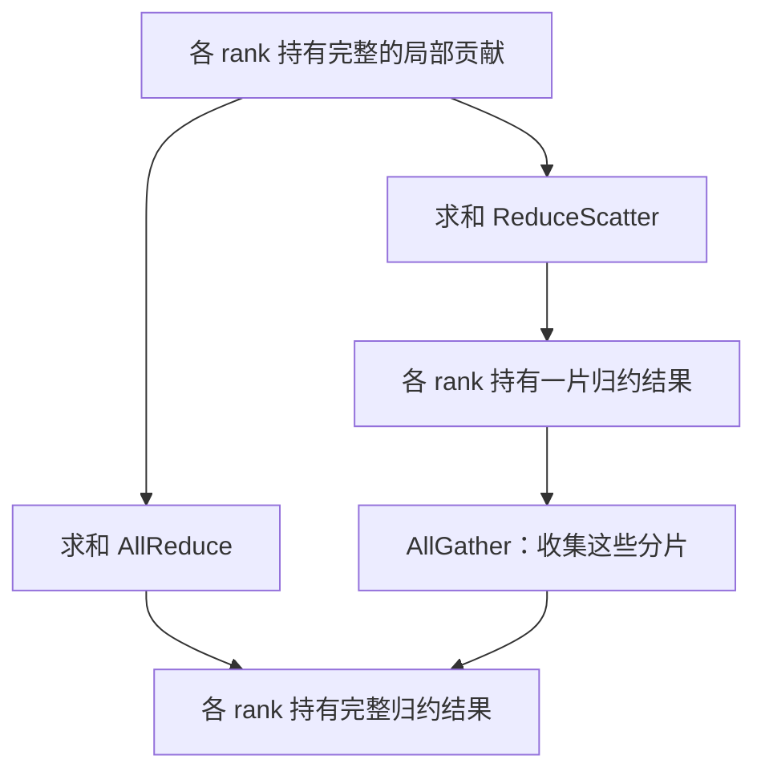

# GPU 各算各的，结果怎么对齐？讲透 NCCL 通信

> **AI 并行计算入门 · 第七篇**
>
> GPU 算得越来越快，多卡任务却不一定跟着变快。有时，真正卡住它们的，是“把结果交给谁，以及交付之前还得等谁”。
>
> 本文接着双卡训练摄像头模型的场景，用小数组讲清 AllReduce、AllGather、ReduceScatter，再解释通信怎样进入 DP、TP、PP 与 FSDP。重点放在三类核心通信语义与使用边界，不追求覆盖 NCCL 的全部实现细节。
>
> **口径说明：数组、耗时和带宽算例均为教学构造。标准库模拟已运行；两卡 CUDA 示例仅做语法与静态逻辑检查，制作环境未安装 PyTorch，未做 GPU 实测。资料核对日期：2026 年 10 月 16 日。**

<!-- more -->

## 01｜两张卡都算完了，为什么还不能更新模型？

上一篇，我们给门口摄像头训练包裹识别模型。

两张 GPU 持有一致的模型副本，分别处理不同照片。它们计算出不同的局部梯度，需要先按共同训练目标合起来，才能协调下一步更新。

为了便于理解，我们先假设“两张卡都把梯度算完，再统一通信”。真实训练里梯度是一部分一部分产生的，通信可以和剩余的反向计算重叠；这个顺序问题留到第 13 节再展开。

现在把问题再往下一层追问：

**“把梯度合起来”到底是什么操作？谁负责搬运，又怎样让两张卡都拿到结果？**

你当然可以想到一个办法：把两张卡的数据拷到 CPU，由 CPU 相加，再分别拷回去。

它表达了正确的数学目标，但未必是高效的数据路径。参与设备更多、梯度更大时，中转、复制和协调都可能成为负担。

NCCL 就是为 GPU 通信提供专门能力的一层。

先记住它的职责：**完成 GPU 之间的数据传递与归约，帮助上层并行策略落地。**[1]

## 02｜NCCL 负责通信，谁来决定怎样分工？

NCCL 是 NVIDIA 的 GPU 通信库，提供集体通信和点对点发送、接收能力。[1]

把多卡计算分成四层，更容易理解：

| 层次 | 决定什么？ | 例子 |
|---|---|---|
| 并行策略 | 谁负责哪些计算和数据 | 数据并行 DP、张量并行 TP、流水线并行 PP |
| 框架与执行引擎 | 什么时候发起计算与通信 | PyTorch、DeepSpeed 等 |
| 通信库 | 怎样交换、收集或归约张量 | NCCL |
| 硬件与传输路径 | 数据实际通过哪里 | PCIe、NVLink、节点间网络等 |

NCCL 不会自动决定把包裹模型放在哪张卡，也不替应用判断这次摄像头请求应该交给哪个服务实例。

它同样不会凭空增加物理带宽。它能做的是结合拓扑、算法和实现，更有效地使用可用通信路径。

所以，“我启用了 NCCL，为什么多卡没快起来”这个问题，还必须回到上层：通信了什么，为什么要通信，数据量多大，是否挡住了计算？

## 03｜先分清两个动作：相加，与拼接

很多读者第一次看到 AllReduce、AllGather，会觉得它们都在“汇总结果”。

但“汇总”太模糊了。

假设两张 GPU 各有一个数组：

| 参与者 | 本地数组 |
|---|---|
| rank 0 | `[1, 2, 3, 4]` |
| rank 1 | `[10, 20, 30, 40]` |

这里的 rank 是通信组中的参与者编号。本篇示例每个进程驱动一张 GPU，但 rank 不是永久固定的主机物理卡号。

现在看两种完全不同的需求：

- 如果数组表示同一组参数的梯度贡献，需要对相同位置进行运算。
- 如果数组表示不同片段，而下一步需要全部片段，就要把片段收集起来。

在这个训练例子里，第一个位置表示参数 θ₀ 的梯度贡献，第二个位置表示参数 θ₁，依此类推。**只有含义对应的位置才能相加；含义不同的分片，不能直接归约。**

前一种是“归约”，后一种是“收集”。

**归约要算，收集要保留；二者不能互相替换。**

## 04｜AllReduce：对应位置相加，每个参与者都有结果

对上面的两个数组执行求和 AllReduce：

```text
rank 0 输入：[ 1,  2,  3,  4]
rank 1 输入：[10, 20, 30, 40]

rank 0 输出：[11, 22, 33, 44]
rank 1 输出：[11, 22, 33, 44]
```

两个重点：相同位置参与运算；每个 rank 都得到完整归约结果。[2]

`Reduce` 与它的区别，是结果只交给指定的 root，而不是所有参与者。

### AllReduce 自动求平均吗？

不能根据名字这样判断。

本例明确使用的是求和操作。若目标是两个等权贡献的平均值，还要除以 2，得到：

```text
[5.5, 11.0, 16.5, 22.0]
```

NCCL 还支持其他归约与缩放形式，但这不改变一个原则：**具体算什么，要看操作和上层语义，AllReduce 这个名称本身不代表平均。**

上一篇 DDP 的默认平均梯度语义，由其实现安排。不能看见示例中调用 `all_reduce(..., SUM)`，就以为它已经等价于完整的 DDP 梯度平均。

**为什么需要它：** 下一步每个副本都要拿同一份完整梯度，去做相同的参数更新，所以归约结果要留在每个参与者手里。

## 05｜AllGather：全部收齐，按 rank 顺序排好

对同一组原始输入执行 AllGather：

```text
rank 0 输出：[1, 2, 3, 4, 10, 20, 30, 40]
rank 1 输出：[1, 2, 3, 4, 10, 20, 30, 40]
```

没有对应位置相加。不同 rank 的输入被收集，每个参与者都拿到全量内容；顺序与通信组中的 rank 对应。[2]

如果 rank 0 持有参数的前半片，rank 1 持有后半片，一次相应的 AllGather 就可以让各方获得所需的完整参数表示。

但需要检查下一步是否真的需要完整数据。若后续计算可以继续保持分片，过早收齐会引入不必要的通信和存储。

**数据原本分散，不等于必须立刻集中。要看下一步需要怎样的布局。**

**为什么需要它：** 下一步计算要用到其他参与者持有的片段，所以得把各方数据收集齐。

## 06｜ReduceScatter：先归约，结果各留一片

继续使用同样的原始输入。

求和 ReduceScatter 的逻辑结果是：

```text
对应位置求和的逻辑结果：[11, 22, 33, 44]

rank 0 最终保留：[11, 22]
rank 1 最终保留：[33, 44]
```

这里“先求和、再切片”描述的是数学语义，不表示实现一定先在每张卡上形成完整结果，再真的切开。[2]

与 AllReduce 相比，它少了一项要求：每个参与者不必都保留完整结果。

如果接下来每个 rank 只负责更新自己那片参数，这种输出布局就很合适。

**为什么需要它：** 下一步每个 rank 只更新自己负责的参数片段，所以不必人人都保留完整归约结果，一片就够。

### 再接一次 AllGather，会得到什么？

这一次收集的输入，已经不是原始数组，而是刚得到的归约分片：

```text
rank 0 提供：[11, 22]
rank 1 提供：[33, 44]

所有 rank 得到：[11, 22, 33, 44]
```

因此，在分片和排列等条件匹配时：

\[
\text{求和 ReduceScatter}\ +\ \text{AllGather}
\equiv\text{求和 AllReduce}
\]

这里等价的是结果语义，不保证执行路径、耗时或浮点结果逐位相同。若换成不同归约算子，也要保持一致的运算与布局定义。



这个关系会在 Ring AllReduce 和训练状态分片中再次出现。

## 07｜其余操作，按“给谁、算不算”来记

| 操作 | 是否做归约运算 | 输出放在哪里？ |
|---|---|---|
| Broadcast | 否 | 将 root 的数据复制给所有参与者 |
| Reduce | 是 | 将归约结果交给指定 root |
| AllReduce | 是 | 所有参与者得到完整归约结果 |
| AllGather | 否 | 所有参与者得到各方数据 |
| ReduceScatter | 是 | 各参与者得到归约结果的一片 |
| Send / Recv | 否 | 数据从指定发送方到指定接收方 |

点对点通信尤其适合表达“上一阶段把激活交给下一阶段”这类依赖。发送与接收需要匹配，尺寸、类型和调用安排也要正确。[3]

这里的“点对点通信模式”，不要与硬件层的 GPU P2P 直连能力混为一谈。前者描述谁与谁交互，后者涉及设备可达性和实际传输路径；能调用 Send/Recv，不代表机器上一定有 NVLink。

MoE 中还会遇到 AlltoAll 等交换模式：不同 rank 把不同分块发往不同目标。它的路由需求与 AllReduce 的“对应位置归约”不同，本篇先不展开专家并行。

## 08｜回到 DP、TP、PP：到底在传什么？

操作名称如果离开计算过程，很容易变成背单词。把它们放回任务里：

| 场景 | 为什么需要通信？ | 典型方式 |
|---|---|---|
| DP 数据并行训练 | 相同参数在不同样本上产生不同梯度贡献 | 梯度 AllReduce 等 |
| TP 张量并行 | 一层内部计算被分片，后续要协作使用结果 | 按布局使用 AllReduce、AllGather、ReduceScatter 等 |
| PP 流水线并行 | 不同阶段之间存在数据依赖 | 前向传激活，反向传激活梯度，常用点对点通信 |
| FSDP 等训练状态分片 | 参数按需收集，梯度归约后分片保存 | 典型包括参数 AllGather、梯度 ReduceScatter |
| 独立模型推理副本 | 不同副本各处理完整请求 | 通常无需为每次推理同步梯度 |

这张表描述典型做法，不是宣称每种并行只有一种固定通信配方。

例如 TP 的不同切分方向会产生不同的数据布局；FSDP 的具体参数收集与释放时机取决于策略。[4]后续各篇会从计算与存储需求推导操作，而不是先选一个通信名称硬套。

### 通信组：同一张 GPU，不是只属于一个“群”

假设四张卡组合 DP 与 TP：

- 第一份模型由 GPU 0、1 协作，形成一个 TP 组。
- 第二份模型由 GPU 2、3 协作，形成另一个 TP 组。
- GPU 0 与 2 负责对应参数分片，构成一个 DP 组。
- GPU 1 与 3 负责另一组对应分片，构成另一个 DP 组。

| GPU | TP 伙伴 | DP 伙伴 |
|---|---|---|
| 0 | 1 | 2 |
| 1 | 0 | 3 |
| 2 | 3 | 0 |
| 3 | 2 | 1 |

层内协作与梯度同步发生在不同组内。不是每次通信都让四张卡一起参加，也不能把不同参数分片不加区分地相加。

这正是后面理解经典 3D 并行的基础：**先明确组内每个 rank 持有什么，再确定这次通信的目标。**

还要分清一件容易混的事：通信组规定的是“谁参与这次操作”，它既不保证这些 GPU 在物理上直连，也不规定数据必须沿 rank 编号顺序传输。组是逻辑划分，数据走哪条链路由后面的算法与硬件拓扑决定。

## 09｜Ring AllReduce：为什么不必全部交给一张卡算？

一种常见的算法思路是把参与者组织为环，将大数组分成若干块。

它可以分为两阶段：

1. **ReduceScatter 阶段**：分块沿环传递并归约，最后各参与者掌握一部分完整归约结果。
2. **AllGather 阶段**：这些结果分片继续传递，让各参与者拿到完整结果。

对 p 个参与者，经典环形模型每个阶段通常需要 p−1 轮。数据分块让各段链路有机会同时工作，避免把全部工作都堆到一个固定中心。

但不要把它理解成“一个数组必须绕完整个环之后，下一个数组才能出发”。实际实现还可能使用分块流水、多通道等机制。

更不能说 NCCL 永远使用 Ring。它有多种算法选择，具体路径受消息大小、拓扑、版本与硬件能力影响，也可能涉及交换设备辅助等机制。[5]

学习 Ring，是为了理解分布式归约的一种组织方法，而不是给所有 NCCL 性能问题找一个固定答案。

> **通信目标不变，完成方式在演进。**
> 同样是 AllReduce，既可以由 GPU 之间传递并归约，也可能利用受支持的互连交换设备辅助完成。学习操作语义，是为了理解计算需要；学习算法与硬件，是为了理解这种需要怎样更高效地实现。

## 10｜多卡为什么仍然不快？看关键路径上剩多少通信

下面进入性能分析；只想先理解操作语义的读者，可以先跳到第 11 节的数组实验，需要调优时再回来。

一个经典单环模型下（**前提是单一环结构、单一瓶颈方向带宽**；实际 NCCL 会按拓扑选择 Tree/Ring/NVLS 等不同算法，并非固定用单环），若每个 rank 输入大小为 S 字节，p 个 rank 完成 AllReduce，每个 rank 的发送数据量约为：

\[
V_{\text{发送}}\approx2\frac{p-1}{p}S
\]

接收数据量同量级。这里没有把收发再相加后当成单向发送量。[6]

假设 p＝4、S＝120 MB，每个 rank 的发送量约为 180 MB。若瓶颈方向的有效吞吐为 20 GB/s，仅这个数据量对应的传输时间就约为 9 毫秒。

这是十进制单位下的简化估算，未计启动、归约执行和其他开销，也不是某型号 GPU 的结果。

小消息则可能先被启动延迟限制。一个简单的经典环形时间模型是：

\[
T_{\text{ring}}\approx2(p-1)\alpha+2\frac{p-1}{p}\frac{S}{B}
\]

其中 α 是每轮延迟的简化项，B 是按此模型定义的有效吞吐。它不描述所有拓扑、算法与重叠方式。

这解释了两个现象：大消息要关心有效带宽，小消息即使传输字节少，也可能被频繁启动和同步拖住。

### 通信总时间，不等于额外等待时间

假设一组教学条件：

- 单卡同等工作量需要 100 毫秒。
- 多卡后的本地计算关键路径为 55 毫秒。
- 通信共经历 30 毫秒，其中 20 毫秒与独立计算重叠。
- 另有 5 毫秒未重叠的调度开销。

在这些简化条件下，多卡完成约需：

\[
55+(30-20)+5=70\text{ 毫秒}
\]

关键是未被隐藏的那 10 毫秒，而不是看到通信耗时就把 30 毫秒全部再加一遍。

**判断通信对完成时间的影响，要看关键路径上暴露的通信等待，也要看通信竞争让计算额外变慢了多少。** 优化通信的顺序是：先消除不必要的通信，再评估减少数据量、合并小消息、改善传输路径，以及计算通信重叠；最终以完整任务是否更早完成为准。这也是后面 FSDP、TP 都拼命做“计算通信重叠”的原因。

通信也会使用 GPU 执行与内存资源，重叠后本地计算耗时可能改变。真实结论仍要回到联合运行的时间线与完整工作量对照。

## 11｜先用 Python 验证三个操作的区别

下面只模拟数据结果，不模拟网络、环形算法或时间。使用标准库即可运行。

```python
def all_reduce_sum(inputs):
    assert inputs, "至少需要一个参与者"
    width = len(inputs[0])
    assert all(len(row) == width for row in inputs), "输入长度必须一致"
    reduced = [sum(values) for values in zip(*inputs)]
    return [reduced.copy() for _ in inputs]


def all_gather(inputs):
    gathered = [value for part in inputs for value in part]
    return [gathered.copy() for _ in inputs]


def reduce_scatter_sum(inputs):
    world = len(inputs)
    width = len(inputs[0])
    assert all(len(row) == width for row in inputs)
    assert width % world == 0
    reduced = all_reduce_sum(inputs)[0]
    chunk = width // world
    return [reduced[i * chunk:(i + 1) * chunk] for i in range(world)]


def main():
    inputs = [[1, 2, 3, 4], [10, 20, 30, 40]]
    reduced = all_reduce_sum(inputs)
    gathered = all_gather(inputs)
    scattered = reduce_scatter_sum(inputs)
    rebuilt = all_gather(scattered)
    assert rebuilt == reduced
    assert gathered != reduced
    print("AllReduce:", reduced)
    print("原始输入 AllGather:", gathered)
    print("ReduceScatter:", scattered)
    print("分片再 AllGather:", rebuilt)
    print("求和后除以组大小:", [x / len(inputs) for x in reduced[0]])


if __name__ == "__main__":
    main()
```

输出：

```text
AllReduce: [[11, 22, 33, 44], [11, 22, 33, 44]]
原始输入 AllGather: [[1, 2, 3, 4, 10, 20, 30, 40], [1, 2, 3, 4, 10, 20, 30, 40]]
ReduceScatter: [[11, 22], [33, 44]]
分片再 AllGather: [[11, 22, 33, 44], [11, 22, 33, 44]]
求和后除以组大小: [5.5, 11.0, 16.5, 22.0]
```

代码中的 ReduceScatter 为便于理解，先调用了完整求和模拟再切片。这只是本地数学实现，不能拿它的内存或时间复杂度去推断 NCCL 的算法实现。

标准库的列表拼接本身接受长度不同的片段，但本文模拟的是固定等长分片；不能据此推断底层 NCCL 接口也支持任意不等长输入。

## 12｜两卡 NCCL 示例：把相同数组交给真实通信后端

需要单机两张可用 NVIDIA GPU、支持 CUDA 和 NCCL 的 PyTorch。保存为 `nccl_collectives.py`，运行：

```bash
torchrun --standalone --nproc_per_node=2 nccl_collectives.py
```

以下不包装 DDP，直接观察通信操作本身：

```python
"""GPU 各算各的，结果怎么对齐？讲透 NCCL 通信（第5章 · 并行与分布式）。

本文件是对应博文代码块的实现/演示，直接运行可见效果；运行依赖：PyTorch。
"""
import os

import torch
import torch.distributed as dist


def main():
    world = int(os.environ.get("WORLD_SIZE", "1"))
    local_rank = int(os.environ.get("LOCAL_RANK", "0"))
    if world != 2 or not torch.cuda.is_available():
        raise SystemExit("请在单机两张 NVIDIA GPU 上，用 torchrun 启动两个进程。")
    if torch.cuda.device_count() < 2:
        raise SystemExit("本示例要求每个进程可见同样的两张 GPU。")

    torch.cuda.set_device(local_rank)
    device = torch.device("cuda", local_rank)
    dist.init_process_group(backend="nccl")
    try:
        rank = dist.get_rank()
        values = [1, 2, 3, 4] if rank == 0 else [10, 20, 30, 40]
        source = torch.tensor(values, dtype=torch.float32, device=device)

        reduced = source.clone()
        dist.all_reduce(reduced, op=dist.ReduceOp.SUM)

        raw_parts = [torch.empty_like(source) for _ in range(world)]
        dist.all_gather(raw_parts, source)
        expected_raw = torch.tensor(
            [1, 2, 3, 4, 10, 20, 30, 40],
            dtype=source.dtype,
            device=device,
        )
        torch.testing.assert_close(torch.cat(raw_parts), expected_raw)

        # 输入长度4，每个 rank 接收归约结果中的2个元素。
        shard = torch.empty(2, dtype=source.dtype, device=device)
        dist.reduce_scatter_tensor(shard, source, op=dist.ReduceOp.SUM)

        result_parts = [torch.empty_like(shard) for _ in range(world)]
        dist.all_gather(result_parts, shard)
        reconstructed = torch.cat(result_parts)

        expected = torch.tensor([11, 22, 33, 44],
                                dtype=source.dtype, device=device)
        torch.testing.assert_close(reduced, expected)
        torch.testing.assert_close(reconstructed, expected)
        expected_shard = expected[rank * 2:(rank + 1) * 2]
        torch.testing.assert_close(shard, expected_shard)

        # 示例显式等目标设备完成，再读取到 CPU 展示。
        torch.cuda.synchronize(device)
        if rank == 0:
            print("AllReduce:", reduced.cpu().tolist())
            print("原始输入 AllGather:", torch.cat(raw_parts).cpu().tolist())
            print("ReduceScatter 后再 AllGather:", reconstructed.cpu().tolist())
            print("结果校验通过；本例不测试通信速度。")
    finally:
        dist.destroy_process_group()


if __name__ == "__main__":
    main()
```

两张卡都按相同顺序参与四次集体通信；只有展示日志放在 rank 0 的条件分支。

不要把 `all_reduce` 等集体通信也一起放进“仅 rank 0 执行”的分支，指望其他参与者自动收到结果。一次通信需要组内相应成员按要求参与。[2]

示例输入输出形状为固定设计。NCCL 与 PyTorch 各接口对计数、类型和布局的要求应分别核对；不能因为某个上层接口支持特殊形状，就推断所有底层通信都能随意使用不同长度。

顺带交代一个易被忽略的开关：这里的 `backend="nccl"` 指定用 NCCL 在 GPU 之间通信。PyTorch 还提供 Gloo 等通信后端。一般而言，CUDA GPU 分布式训练优先考虑 NCCL，CPU 集合通信常用 Gloo；具体支持还要核对设备、平台和接口。

这段示例未在本环境进行 CUDA 实测，因此没有附虚构的硬件耗时。

## 13｜异步通信：调用返回了，结果就能随便用吗？

第二篇讲过，GPU 提交与实际完成是两件事。通信也一样。

PyTorch 提供 `async_op=True` 返回工作句柄。但它不代表调用后可以立即修改通信缓冲区、释放它，或在任意 Stream 上读取结果。

需要按接口约定，通过工作句柄与 Stream 同步建立后续依赖。CUDA 场景下，`work.wait()` 涉及当前 Stream 对通信工作的等待关系，不能一概理解为 CPU 已等待 GPU 全部执行完毕；跨 Stream 使用结果仍要明确同步。[7]

若要读取 CPU 结果或测量完整完成时间，应采用对应的完成边界，例如同步目标事件或设备。不要把主机函数返回时间当成通信完成时间。

同样，异步只提供安排重叠的机会。下一步计算如果必须立即消费归约结果，还是要等待；没有独立工作可做，设置异步标志也不会自动加速。

## 14｜测速与排查：先把“算错”与“传得慢”分开

遇到多卡性能问题，建议按以下顺序推进：

| 步骤 | 先确认什么？ |
|---|---|
| 正确性 | 对应 rank、数组位置、计数、类型和归约目标是否匹配 |
| 参与关系 | 通信组与调用顺序是否正确，有无进程提前退出 |
| 数据路径 | 是否使用预期设备与互连，是否存在不必要中转 |
| 微基准 | 目标消息尺寸与 rank 数下的通信是否正常 |
| 应用时间线 | 通信何时开始，哪些部分挡住计算，是否发生资源争抢 |

NVIDIA 提供 `nccl-tests`。在已正确编译安装、两张 GPU 可见的前提下，可以用其 AllReduce 程序扫描消息大小：[8]

```bash
# 在 nccl-tests 的项目目录下；路径随安装方式调整。
./build/all_reduce_perf -b 8 -e 64M -f 2 -g 2
```

这是单进程管理两张 GPU 的一种测试方式，不等同于上一篇一进程一张卡的完整 DDP 训练。

看结果时，注意两个带宽口径：[6]

- `algbw`：按该操作定义的数据大小除以时间。
- `busbw`：按集体通信数据流量模型换算的归一化指标。

它们不是同一个数字，也不能不看操作与拓扑，就将 `busbw` 解释成某一根物理链路的实时读数。

小消息先看延迟，大消息再看有效带宽。一个尺寸正常，不代表所有训练梯度桶或推理通信尺寸都正常。

需要日志时，可以从官方支持的 `NCCL_DEBUG=INFO` 等设置入手；不要还没确认路径和版本，就批量复制环境变量，强制固定算法。配置会改变行为，也可能掩盖真正问题。[5]

微基准正常，只说明该通信条件下的基础能力。应用仍可能因为慢 rank、碎片化通信、数据读取不足或错误同步而变慢。

## 15｜回到摄像头：真正需要传递的，是下一步缺少的信息

双卡训练时，不同样本产生不同梯度贡献，我们需要按目标函数归约。

模型内部切分时，下一层可能需要完整结果，也可能只需要一个归约后的分片。

分阶段执行时，下一阶段需要上一步的激活，不需要所有卡对它做一次求和。

选择通信操作之前，可以先问：

1. 每个 rank 现在持有什么？
2. 下一步，每个 rank 缺少什么？
3. 要保留各片原始数据，还是对相同位置做运算？
4. 哪些参与者需要完整结果，哪些只需一片？

这些问题回答清楚，AllReduce、AllGather 和 ReduceScatter 就不再是三个相似的英文单词，而是三种不同的数据布局转换。

**并行策略决定怎样分工；通信把分开的计算重新连接起来。性能取决于这条连接是否必要、是否正确，以及它挡住了多少真正有价值的计算。**

---

## 下一篇

**《一层矩阵太大，怎样让多张 GPU 合力算？》**

进入张量并行 TP：从两种矩阵切分方向出发，推导为什么有时要拼接，有时要求和，以及怎样让下一层继续使用分片，避免不必要的搬运。

## 参考资料

以下均为官方文档或 NVIDIA 维护的源码资料。本文数组、数值、环形时间模型与实验均为教学用途，不是性能实测报告。

1. [NVIDIA：Overview of NCCL](https://docs.nvidia.com/deeplearning/nccl/user-guide/docs/overview.html)：GPU 通信库职责、传输能力与框架边界。
2. [NVIDIA NCCL：Collective Operations](https://docs.nvidia.com/deeplearning/nccl/user-guide/docs/usage/collectives.html)：集体通信操作、rank 顺序与参与约束。
3. [NVIDIA NCCL：Point-to-point communication](https://docs.nvidia.com/deeplearning/nccl/user-guide/docs/usage/p2p.html)：Send/Recv 与匹配安排。
4. [PyTorch：FSDP2 fully_shard](https://docs.pytorch.org/docs/stable/distributed.fsdp.fully_shard.html)：参数收集与梯度分片的训练应用。
5. [NVIDIA NCCL：Environment Variables](https://docs.nvidia.com/deeplearning/nccl/user-guide/docs/env.html)：算法配置、调试与版本相关选项。
6. [NVIDIA nccl-tests：Performance](https://github.com/NVIDIA/nccl-tests/blob/master/doc/PERFORMANCE.md)：AllReduce 数据量模型、algbw 与 busbw。
7. [PyTorch：Distributed communication package](https://docs.pytorch.org/docs/stable/distributed.html)：通信 API、异步操作与 CUDA Stream 语义。
8. [NVIDIA nccl-tests](https://github.com/NVIDIA/nccl-tests)：通信微基准及参数说明。
