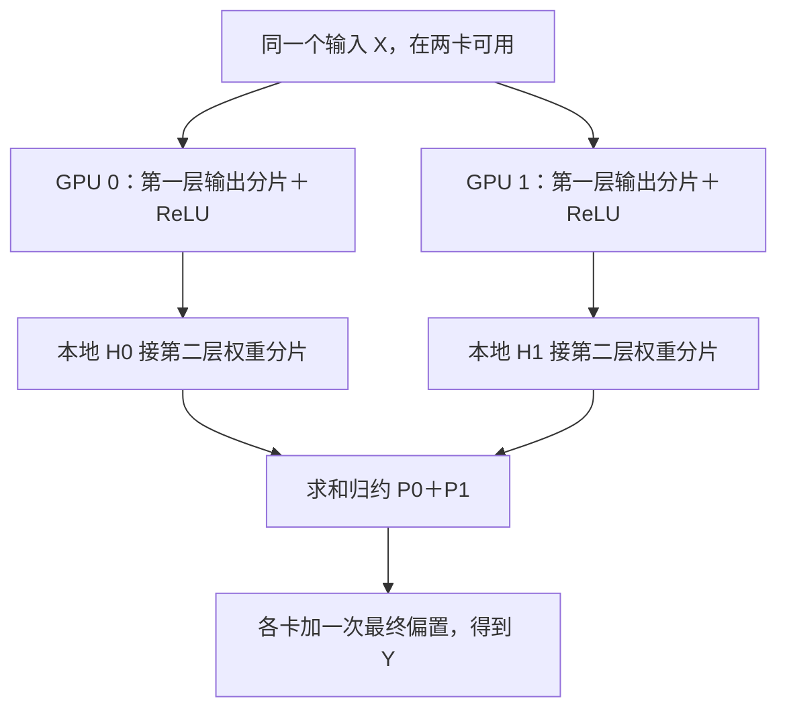

# 一层矩阵太大，怎样让多张 GPU 合力算？

> **AI 并行计算入门 · 第八篇**
>
> 两张卡各放一个完整模型，是增加副本；把同一个矩阵运算拆给两张卡，才开始进入张量并行。关键不只是“切开”，还有怎样把切开的计算正确接起来。
>
> 本文用摄像头模型中的两层小网络，讲清张量并行 TP 的两种切法，并解释为什么有时要拼接、有时要求和，有时还可以暂时不通信。
>
> **口径说明：场景、小矩阵与耗时均为教学构造。标准库实验已实际运行；两卡 CUDA 示例仅做语法与静态逻辑检查，制作环境未安装 PyTorch，未做 GPU 实测。资料核对日期：2026 年 10 月 16 日。**

> **工程深度｜验证状态：** L3 工程｜理论推导（TP 需多卡环境验证）
<!-- more -->

## 01｜两张卡都有，为什么还是装不下一个模型？

门口摄像头最初只需识别人、包裹和声音。现在你准备升级模型，让它结合更多上下文判断事件。

模型更大了。你想起第四篇的做法：再加一个副本，把请求分给两张卡。

但这次问题变了：完整模型的运行需求，已经超出单卡容量。

两份装不下的完整模型，不会因为换了两张卡就自动装下。

第六篇的数据并行也不直接解决这个问题。普通 DDP 通常在每张卡上持有完整模型副本，切的是不同样本。

现在需要问：**同一份模型内部的计算，能否让多张卡一起完成？**

一种重要方法，就是张量并行，Tensor Parallelism，简称 TP。

它可以分摊特定层的参数和计算，但并不表示任意模型只要“每卡一半”就一定跑通。完整显存账仍包括激活、工作区、未切分部分和通信缓冲区。

## 02｜先把一层网络看成一张计算表

摄像头前面的网络，已经把画面压成一串特征向量；最后的线性层，负责把这些特征组合成分类分数。我们先把这个分类头缩小，观察它怎样被拆给两张卡——这是数学示意，不代表完整视觉模型只有这几层。

很多网络层的核心，可以写成矩阵乘法：

\[
Y=XW
\]

其中：

| 张量 | 形状 | 表示什么？ |
|---|---|---|
| X | B×K | B 个输入向量，每个有 K 个特征 |
| W | K×N | 将 K 个输入特征映射到 N 个输出特征的权重 |
| Y | B×N | B 个样本的输出 |

为便于讲解，本篇始终采用行向量输入、右乘权重的记法 \(Y=XW\)，先按输入、输出特征理解切分；PyTorch 的存储维度稍后对照，不急着在这一节就记住转置关系。

先只看一个输入：

\[
X=[1,2,3,4]
\]

再用一张小权重表：

| 输入特征对应的行 | 输出 1 | 输出 2 | 输出 3 | 输出 4 |
|---|---:|---:|---:|---:|
| 第 1 行 | 1 | 0 | 2 | 0 |
| 第 2 行 | 0 | 1 | 0 | 2 |
| 第 3 行 | 1 | 1 | 0 | 0 |
| 第 4 行 | 0 | 0 | 1 | 1 |

矩阵乘法的输出是：

\[
Y=[4,5,6,8]
\]

例如输出 1 为 `1×1＋2×0＋3×1＋4×0＝4`。

接下来，同样这一次计算，有两种值得分清的切法。

## 03｜切法一：你算前两个输出，我算后两个输出

将 W 按输出特征，也就是本篇记法中的列，拆成两片：

\[
W=[W_0\ W_1]
\]

两张卡都拿到同一个完整输入 X：

\[
Y_0=XW_0,\qquad Y_1=XW_1
\]

这里的“同一个输入”不只是形状相同：两个 TP rank 必须对应同一批样本、同样的行顺序；不能像数据并行那样各拿不同样本，再把结果相加。

| 设备 | 持有的权重 | 本地结果 |
|---|---|---|
| GPU 0 | W 的前两列 | `[4, 5]` |
| GPU 1 | W 的后两列 | `[6, 8]` |

这两份结果代表不同输出位置，完整结果在逻辑上是：

\[
Y=[Y_0\ Y_1]=[4,5,6,8]
\]

**要重建完整输出，应沿输出特征维拼接，不能把这些分片相加。** `[4,5]＋[6,8]` 得到的 `[10,13]`，已经丢掉了原来的输出位置含义；若下一层能直接使用分片，则不必立即重建。

如果每张卡下一步都需要完整 Y，可以用合适的 AllGather 并按输出特征维度重建。但若下一步能消费分片，就可以不立即收集。[1]

这通常称为按输出维度的列并行线性层。记住物理含义，比背“列”字更重要。

### 对照 PyTorch 的权重存储方向

`nn.Linear` 的 `weight` 形状是 `[out_features, in_features]`，计算形式是 `X @ weight.T + bias`；本篇 W 则是 `[in_features, out_features]`。[2] 两种记法的对应关系如下：

| 切分含义 | 本文 W 的维度 | `nn.Linear.weight` 的维度 |
|---|---|---|
| 按输出特征切 | 第 1 维（列） | 第 0 维 |
| 按输入特征切 | 第 0 维（行） | 第 1 维 |

不能只看“列并行”三个字，就不加判断地把 PyTorch 权重沿第 1 维切开。

## 04｜切法二：你算前两项贡献，我算后两项贡献

第二种切法沿输入特征进行。

把输入和权重的对应维度一起拆开：

\[
X=[X_0\ X_1],\qquad
W=\begin{bmatrix}W_0\\W_1\end{bmatrix}
\]

那么：

\[
Y=X_0W_0+X_1W_1
\]

这一次，设备分工变成：

| 设备 | 输入 | 权重 | 本地部分结果 |
|---|---|---|---|
| GPU 0 | `[1, 2]` | W 的前两行 | `[1, 2, 2, 4]` |
| GPU 1 | `[3, 4]` | W 的后两行 | `[3, 3, 4, 4]` |

两张卡的输出形状都已经是四个数，但每个数都只是对应输出的一部分贡献。

将它们相加：

\[
[1,2,2,4]+[3,3,4,4]=[4,5,6,8]
\]

**这里要求和，不能拼接，更不能平均。**

如果需要每张卡都获得完整 Y，可以进行求和 AllReduce。若后续希望保留归约结果的某种分片，也可能选择合适的 ReduceScatter，但要重新明确输出布局。

这通常称为按输入维度的行并行线性层。[1]

| 对照 | 按输出特征切 | 按输入特征切 |
|---|---|---|
| 本地输出代表什么？ | 一部分完整输出特征 | 所有输出特征的一部分贡献 |
| 单看输出形状够不够？ | 不够，要知道对应位置 | 不够，形状完整也可能数值未归约 |
| 怎样形成完整结果？ | 按特征维度拼接 | 对相同位置求和 |

**看到一份局部张量，先问：它是“不同位置的一部分”，还是“相同位置的一部分贡献”？**

上一篇的通信词汇，到这里有了明确的数学来源。

## 05｜两层连起来：为什么可以少搬一次数据？

只讲单层，很容易让读者留下一个印象：每切一次，就要收齐一次。

真正有用的技巧，是让相邻层的分片方式相互匹配。

考虑一个带逐元素激活的两层网络：

\[
H=\operatorname{ReLU}(XW_a+b_a)
\]

\[
Y=HW_b+b_b
\]

第一层按输出特征切，得到 H 的两片；第二层按输入特征切，恰好接住这两片。

令：

\[
W_a=[W_{a0}\ W_{a1}],\quad
W_b=\begin{bmatrix}W_{b0}\\W_{b1}\end{bmatrix}
\]

每张卡可以各自在本地计算：

\[
H_i=\operatorname{ReLU}(XW_{ai}+b_{ai})
\]

\[
P_i=H_iW_{bi}
\]

最后再汇合：

\[
Y=P_0+P_1+b_b
\]

中间不用先把 H 收齐，再立刻切给第二层。



Megatron-LM 的经典 MLP 张量并行，采用了这样的相邻矩阵切分思路：第一层按列、逐元素非线性在本地计算、第二层按行，随后归约。[3]

注意，这描述的是该结构的前向区域，不代表整个模型只需要一次通信，也不包括所有反向传播、输入布局转换或其他算子的通信。

把整条链路的形状摆成一张表，会更清楚（假设输入 4 个特征、隐藏层 6 个特征、最终输出 2 个特征，TP＝2）：

| 张量或参数 | 完整形状 | 每卡形状 |
|---|---|---|
| 输入 X | B×4 | B×4，复制 |
| 第一层权重 | 4×6 | 4×3 |
| 隐藏激活 H | B×6 | B×3，逐元素激活本地执行 |
| 第二层权重 | 6×2 | 3×2 |
| 第二层部分结果 P | B×2 | B×2，尚需求和 |
| 最终输出 Y | B×2 | B×2，归约后复制 |

这张表同时解释了三件事：第一层的输入不切；中间激活可以直接交接；最后两边都是 B×2，却还没有完整结果。本文假设相应特征维度可以均匀分片；真实框架的 TP 规模，还受维度整除、注意力头配置和算子支持等约束。

**减少通信，不一定靠更快地搬；也可以让下一步直接接住当前分片。**

## 06｜三个会让“切分后结果一致”失效的细节

### 1. 部分和不是平均梯度

第六篇 DP 中，等量样本的局部平均梯度还需要平均。

本篇行并行中的 P0、P1，则是同一次乘法不可缺少的部分和。求和后再除以卡数，会把模型输出缩小。

通信都可能用 AllReduce，但数学目标不同。

### 2. 最终偏置不能被重复归约

正确的第二层输出为：

\[
Y=P_0+P_1+b_b
\]

若两张卡各先加一遍完整偏置，再求和，就变成：

\[
(P_0+b_b)+(P_1+b_b)=P_0+P_1+2b_b
\]

因此，本例在归约之后，每张卡对自己的完整结果各加一次偏置。第一层偏置则按输出特征与权重一起分片。

### 3. ReLU 放错位置，会改变模型

第一层按输出特征切，各卡拿到的是对应位置的完整值，所以 ReLU 可以分别执行。

但对尚未求和的部分结果，一般有：

\[
\operatorname{ReLU}(P_0+P_1)\ne
\operatorname{ReLU}(P_0)+\operatorname{ReLU}(P_1)
\]

只看两个数：P0＝−2，P1＝3。先求和再 ReLU 得到 1；先各自 ReLU 再求和得到 3。

同样，“逐元素激活可本地执行”不能推广到所有算子。若 Softmax 或归一化需要沿被切开的特征维度计算全局统计，就需要相应的分布式算法或布局转换。

## 07｜不用 GPU，先把两种切法与两层交接算对

下面使用标准库，直接验证代数关系。

我们继续使用前面那张 4×4 权重表，并为两层网络加入偏置。输入只有四个特征，输出两个数，可视为摄像头分类头的极简数学示意；它不具备真实识别能力。

```python
"""一层矩阵太大，怎样让多张 GPU 合力算？（第5章 · 并行与分布式）。

本文件是对应博文代码块的实现/演示，直接运行可见效果；运行依赖：仅标准库。
"""
def linear(x, weight):
    # weight 按 [输入特征, 输出特征] 存放；先校验维度，避免 zip 静默截断。
    assert weight and weight[0], "权重不能为空"
    assert len(x) == len(weight), "输入特征数必须等于权重行数"
    assert all(len(row) == len(weight[0]) for row in weight), "权重各行列数必须一致"
    return [sum(a * b for a, b in zip(x, column))
            for column in zip(*weight)]


def add(a, b):
    assert len(a) == len(b), "相加的两份张量长度必须一致"
    return [x + y for x, y in zip(a, b)]


def relu(values):
    return [max(0, value) for value in values]


def main():
    x = [1, 2, 3, 4]
    wa = [[1, 0, 2, 0], [0, 1, 0, 2],
          [1, 1, 0, 0], [0, 0, 1, 1]]
    ba = [0, -6, 1, -10]
    wb = [[1, 0], [0, 1], [1, 1], [-1, 2]]
    bb = [1, -1]

    full = linear(x, wa)
    columns = [linear(x, [row[:2] for row in wa]),
               linear(x, [row[2:] for row in wa])]
    rows = [linear(x[:2], wa[:2]), linear(x[2:], wa[2:])]
    assert columns[0] + columns[1] == full
    assert add(rows[0], rows[1]) == full

    reference = add(linear(relu(add(full, ba)), wb), bb)
    h0 = relu(add(columns[0], ba[:2]))
    h1 = relu(add(columns[1], ba[2:]))
    p0, p1 = linear(h0, wb[:2]), linear(h1, wb[2:])
    tp_result = add(add(p0, p1), bb)
    assert tp_result == reference
    assert relu(add([-2], [3])) != add(relu([-2]), relu([3]))

    # B=2 对照：确认批次维与特征维没有混淆——每个样本独立过同一组权重。
    x2 = [[1, 2, 3, 4], [0, 1, 0, 1]]
    batch_ref = [add(linear(relu(add(linear(row, wa), ba)), wb), bb)
                 for row in x2]
    batch_tp = []
    for row in x2:
        c0, c1 = linear(row, [r[:2] for r in wa]), linear(row, [r[2:] for r in wa])
        q0, q1 = linear(relu(add(c0, ba[:2])), wb[:2]), linear(relu(add(c1, ba[2:])), wb[2:])
        batch_tp.append(add(add(q0, q1), bb))
    assert batch_tp == batch_ref

    print("单层完整结果:", full)
    print("按输出切，本地结果:", columns)
    print("按输入切，本地部分和:", rows)
    print("第一层激活分片:", [h0, h1])
    print("第二层部分和:", [p0, p1])
    print("完整两层结果:", reference)
    print("TP 两层结果:", tp_result)
    print("B=2 批次结果:", batch_tp)


if __name__ == "__main__":
    main()
```

输出：

```text
单层完整结果: [4, 5, 6, 8]
按输出切，本地结果: [[4, 5], [6, 8]]
按输入切，本地部分和: [[1, 2, 2, 4], [3, 3, 4, 4]]
第一层激活分片: [[4, 0], [7, 0]]
第二层部分和: [[4, 0], [7, 7]]
完整两层结果: [12, 6]
TP 两层结果: [12, 6]
B=2 批次结果: [[12, 6], [3, 1]]
```

这份代码在一台 CPU 上依次模拟两份计算，不是在模拟 GPU 并发，也不能据此报告 TP 加速。

它先回答更基本的问题：**切分之后，我们是否仍在计算同一个函数？**

## 08｜两卡示例：中间不 AllGather，最后只求和

下面将同样的小网络放到真实两卡通信结构中：每卡只把相应的权重分片搬到 GPU，输入 X 则在两卡各保留一份。

为方便验证，完整小权重仍在每个进程的 CPU 上构造。真实大模型应采用适合其检查点与布局的分片加载，不能先要求每卡都装下完整 GPU 模型，再声称解决了装不下的问题。

运行条件：单机两张可用 NVIDIA GPU，支持 CUDA 和 NCCL 的 PyTorch。保存为 `tp_mlp.py` 后运行：

```bash
torchrun --standalone --nproc_per_node=2 tp_mlp.py
```

```python
"""一层矩阵太大，怎样让多张 GPU 合力算？（第5章 · 并行与分布式）。

本文件是对应博文代码块的实现/演示，直接运行可见效果；运行依赖：PyTorch。
"""
import os

import torch
import torch.distributed as dist


@torch.inference_mode()
def main():
    world = int(os.environ.get("WORLD_SIZE", "1"))
    local_rank = int(os.environ.get("LOCAL_RANK", "0"))
    if world != 2 or not torch.cuda.is_available():
        raise SystemExit("请在单机两张 NVIDIA GPU 上启动两个进程。")
    if torch.cuda.device_count() < 2:
        raise SystemExit("本示例要求各进程可见同样的两张 GPU。")

    torch.cuda.set_device(local_rank)
    device = torch.device("cuda", local_rank)
    dist.init_process_group(backend="nccl")
    try:
        rank = dist.get_rank()
        x_cpu = torch.tensor([[1., 2., 3., 4.]])
        wa_cpu = torch.tensor([[1., 0., 2., 0.], [0., 1., 0., 2.],
                               [1., 1., 0., 0.], [0., 0., 1., 1.]])
        ba_cpu = torch.tensor([0., -6., 1., -10.])
        wb_cpu = torch.tensor([[1., 0.], [0., 1.], [1., 1.], [-1., 2.]])
        bb_cpu = torch.tensor([1., -1.])
        start, stop = rank * 2, (rank + 1) * 2

        x = x_cpu.to(device)  # 同一个样本，在两个 TP rank 上可用。
        wa = wa_cpu[:, start:stop].contiguous().to(device)
        ba = ba_cpu[start:stop].contiguous().to(device)
        wb = wb_cpu[start:stop, :].contiguous().to(device)
        bb = bb_cpu.to(device)

        h_local = torch.relu(x @ wa + ba)
        partial = h_local @ wb  # 两层之间没有 AllGather。
        dist.all_reduce(partial, op=dist.ReduceOp.SUM)
        output = partial + bb  # 最终偏置在求和后加一次，不除以卡数。

        expected_cpu = torch.relu(x_cpu @ wa_cpu + ba_cpu) @ wb_cpu + bb_cpu
        torch.testing.assert_close(output, expected_cpu.to(device))
        torch.cuda.synchronize(device)
        if rank == 0:
            print("TP 前向输出:", output.cpu().tolist())
            print("与完整网络输出一致；本例不测试速度。")
    finally:
        dist.destroy_process_group()


if __name__ == "__main__":
    main()
```

这里使用 `inference_mode()`，只验证前向计算。不要直接删掉它、调用 `backward()`，就认为训练也已经实现：原始通信调用的自动求导语义、反向归约与布局，都需要专门处理。

示例只做了一次前向求和，但真实训练会产生额外的梯度通信。真实数值还受精度与运算顺序影响，应在合理容差内验证。

本文未进行双卡 CUDA 实测，因此没有提供虚构的运行耗时。

## 09｜训练时，分片权重的梯度也要“全相加”吗？

不一定。仍然先看每份数据的含义。

对按输出特征切分的层：

\[
Y_i=XW_i
\]

每张卡的 \(W_i\) 是不同参数分片。它们各自的权重梯度不应因为“都叫梯度”就直接相加。

但完整输入 X 收到的梯度贡献来自各个输出分片：

\[
\frac{\partial L}{\partial X}
=\sum_i\frac{\partial L}{\partial Y_i}W_i^T
\]

在采用复制输入的相应布局时，输入梯度需要组合这些贡献。

如果再叠加 DP，多份模型副本里“相同参数分片”的梯度，才需要沿 DP 组协调。

| 对象 | 在 TP 组里是什么关系？ |
|---|---|
| 权重分片 W0、W1 | 不同参数，合起来构成一层 |
| 第二层前向部分和 P0、P1 | 同一输出的不同贡献，需要求和 |
| 第一层传给 X 的梯度贡献 | 同一输入梯度的不同贡献，需要组合 |

所以，TP 通信不能照搬 DDP 的“把参数梯度平均”解释。Megatron 的经典两层 MLP 在前向与反向分别安排对应的归约；完整模型还会有其他通信边界。[3]

训练实现建议使用具有正确自动求导与布局语义的框架能力，而不是只在 Python 中插入几个未经推导的 `all_reduce`。

## 10｜框架怎样表达这种布局？

PyTorch 提供基于 DTensor 的原生 TP 接口，包括 `ColwiseParallel`、`RowwiseParallel` 与布局配置。[4] 现代框架不只是记录张量的形状，还要知道它在设备间代表什么。本文出现过的局部张量，正好对应 DTensor 的三种状态：

| 状态 | 含义 | 本文中的例子 |
|---|---|---|
| Replicate（复制） | 各 rank 持有相同内容 | 两卡持有相同输入 X |
| Shard（分片） | 不同位置的完整片段 | 两卡分别持有隐藏特征 H₀、H₁ |
| Partial（待归约贡献） | 形状完整但数值未收齐 | 两卡分别持有部分和 P₀、P₁ |

对于一个 `Linear → ReLU → Linear` 的 `nn.Sequential`，核心计划可以写成下面的形式。这里仅展示配置意图，进程组、设备网格、初始化和完整运行流程需另行准备：

```python
from torch.distributed.tensor.parallel import (
    ColwiseParallel, RowwiseParallel, parallelize_module,
)

# mlp 的第0层与第2层分别为两个 nn.Linear。
tp_mlp = parallelize_module(
    mlp, tp_mesh,
    {"0": ColwiseParallel(), "2": RowwiseParallel()},
)
```

默认配置与具体输入输出布局，应以使用版本的接口说明为准。把两种策略名字放进计划，并不能替代对激活形状、后续算子和检查点加载的核对。

Megatron Core 的列并行层也提供 `gather_output` 选项，说明“输出是否立即收齐”本来就是需要明确的执行决策。[1]

### 与 FSDP 的区别

FSDP 也可能分片保存参数，但其典型执行方式会按需收集参数供相应单元计算；本篇 TP 则是让不同设备协作完成一次层内矩阵运算。

二者都涉及分片，不代表它们切分与执行的对象相同。它们也可以组合：TP 组内部拆计算，数据并行维度再组织训练状态分片。[4]

## 11｜两张卡算同一层，就会快两倍吗？

不保证。

假设一层单卡执行 10 毫秒。切成两份后，每卡计算降到 6 毫秒，但必须等待的通信又占 5 毫秒，另有 1 毫秒开销。在这些无额外重叠的教学条件下，总共是 12 毫秒，反而更慢。

TP 可能首先解决的是容量问题。若模型本来不能在单卡运行，“能完成同一个模型”已经是一项收益，但还不能由此宣称延迟下降。

需要继续检查：

- 切小后的矩阵形状是否仍然高效。
- 所需通信发生在多快的互连上。
- 哪些通信挡住下一步，哪些可以重叠。
- 每个 rank 的负载是否均衡。
- 输入、输出和其他未分片状态是否仍占较大空间。

PyTorch 的 TP 教程强调快速通信通道的重要性；常见部署会优先把频繁协作的 TP rank 放在快速互连范围内，再结合其他并行维度扩展。[4]

但“同机”也不等于一定有 NVLink。实际拓扑、设备能力与传输性能，需要核实。

对推理服务，如果模型可以单卡高效运行，又有大量独立请求，增加完整副本也值得与 TP 对照。vLLM 提供 TP、PP 等策略，其部署指导同样从模型容量与设备组织出发。[5]

没有“多卡一定拆模型”这条规则。

## 12｜从两层小网络，走向 Transformer

Transformer 的前馈网络含有较大的线性变换，因此“第一层输出分片接第二层输入分片”的思路非常重要。

注意力中也有可利用的头维度分工。经典 Megatron 方案会让部分注意力头的相关投影与计算在本地完成，再通过输出投影连接。[3]

但不能据此写成“所有注意力都能随意按头均分”：头数、分组查询注意力、KV 头配置与框架支持，都会影响可选的 TP 规模。

现代实现还会结合序列维度上的分片，改变部分激活、归一化与通信布局。因此，不应把某个经典结构的固定 AllReduce 次数，当成所有 Transformer 和所有执行引擎的永恒定律。

判断 TP 是否正确，先检查分片计算及必要通信，**能否还原原模型的数学结果**——参数是否对应、求和与偏置是否正确、激活位置是否合理，训练时还要检查反向传播。判断通信是否高效，再看**下一层能否直接消费当前布局**，避免不必要的重分布：能接住，就省一次收集；接不住才需要通信，但这不影响前一层计算本身的正确性。

如果缺少其他输出位置，需要沿特征维收集分片；如果持有的是对应位置的部分贡献，需要归约求和。具体操作取决于张量的含义与目标布局——AllGather 与 AllReduce 语义不同，不能互相替代。这才是 TP 的核心判断，而不是“切了就不管了”。

## 13｜回到摄像头：我们没有造出两个小模型

现在，两张卡各持有部分权重，也都参与同一个输入的前向过程。

它们不是两个可以独立交付完整答案的小模型。缺少任何一份必要分片，原来的网络计算都不完整。

这与前面的两个概念形成对照：

| 方式 | 两张卡主要在做什么？ |
|---|---|
| 多模型协作 | 分别执行检测、识别、声音等不同模型 |
| 数据并行或推理副本 | 用完整模型或副本组处理不同样本、请求 |
| 张量并行 TP | 用参数与计算分片协作完成同一模型的层内计算 |

第一层切出不同输出，第二层接住这些输出，最后再将部分贡献相加。整个过程里最有价值的设计，是避免把刚收齐的东西马上又切开。

**张量并行真正要讲清楚的，不只是矩阵怎么切，而是切完以后，数据怎样沿着网络继续走。**

---

## 下一篇

**《模型分成几段，为什么显卡还会等着没活干？》**

进入流水线并行 PP：模型按层分阶段之后，单个请求为什么仍要依次前进？微批次怎样填满流水线？启动、排空与最慢阶段又会浪费多少时间？

## 参考资料

以下均为官方文档或原始研究资料。本文小矩阵、标量耗时与模拟输出为教学构造，不是框架性能测试。

1. [NVIDIA Megatron Core：Tensor Parallel Layers](https://docs.nvidia.com/megatron-core/developer-guide/latest/apidocs/core/core.tensor_parallel.layers.html)：列并行、行并行及 gather_output。
2. [PyTorch：nn.Linear](https://docs.pytorch.org/docs/stable/generated/torch.nn.Linear.html)：权重存储形状与线性运算定义。
3. [NVIDIA ADLR：MegatronLM](https://research.nvidia.com/labs/adlr/MegatronLM/)；[Megatron-LM 原始论文](https://arxiv.org/abs/1909.08053)：两层 MLP 与注意力的经典模型并行组织。
4. [PyTorch：Tensor Parallel Tutorial](https://docs.pytorch.org/tutorials/intermediate/TP_tutorial.html)；[Tensor Parallel API](https://docs.pytorch.org/docs/stable/distributed.tensor.parallel)：DTensor 布局、并行计划及 TP 与 FSDP 组合。
5. [vLLM：Parallelism and Scaling](https://docs.vllm.ai/en/stable/serving/parallelism_scaling/)：模型容量、TP、PP 与设备组织。
