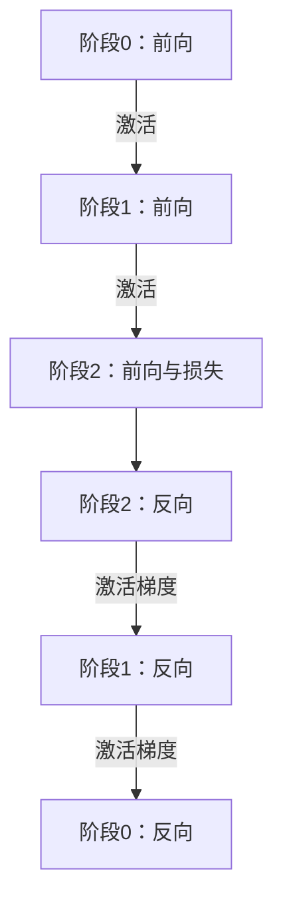

# 模型分成几段，为什么显卡还会等着没活干？

> **AI 并行计算入门 · 第九篇**
>
> 第一张卡算前几层，第二张算中间层，第三张算后几层。模型终于放下了，但一次请求跑起来，后两张卡却在等。分工已经完成，为什么还没并行？
>
> 本文用摄像头模型升级的场景，讲清流水线并行 PP、微批次、气泡与负载均衡，再解释训练中的 GPipe、1F1B 和 Zero Bubble。
>
> **口径说明：场景、阶段耗时和数值均为教学假设。配套代码采用虚拟时间模拟，已实际运行；它不访问 GPU，不代表真实模型、框架或硬件的性能。资料核对日期：2026 年 10 月 16 日。**

> **工程深度｜验证状态：** L3 工程｜理论推导 + 概览（PP 需多卡环境验证）
<!-- more -->

## 01｜模型放下了，显卡却没有一起忙起来

门口摄像头的模型越换越大。现在，它需要结合更复杂的视觉特征与上下文来判断事件。

上一篇，我们讨论了张量并行：把一层内部的矩阵计算拆给多张卡。

这次换一种切法：整个模型有许多连续的层，能否让不同卡各负责一段？

你把模型分成三个阶段：

| 设备 | 负责的模型部分 |
|---|---|
| GPU 0 | 前部层：提取初步特征 |
| GPU 1 | 中部层：继续变换特征 |
| GPU 2 | 后部层：得到最终输出 |

这就是流水线并行，Pipeline Parallelism，简称 PP 的基本思路。[1]

模型权重分散到不同设备，容量压力得到缓解。可第一份输入到来时，GPU 1 不能直接开始，因为它还没有前一阶段的特征；GPU 2 更要继续等。

**模型切开，解决了“由谁负责”；能否同时工作，还取决于有多少份数据正在不同阶段流动。**

这里讨论的是同一个模型内部的阶段。第一篇“人脸检测模型 → 身份识别模型”的业务处理链，也能画成流水线，但其切分对象与训练关系不同。

## 02｜先只送一份数据：三张卡，仍然要走三站

暂时只看前向推理，设三个阶段各执行 10 毫秒，传输与调度开销忽略。

输入经过的顺序是：

**GPU 0 用 10 毫秒 → GPU 1 用 10 毫秒 → GPU 2 用 10 毫秒。**

这份输入在第 30 毫秒完成。

假设原来同样三个阶段在一张卡上也各耗时 10 毫秒，那么拆到三张卡之后，单份数据仍然需要 30 毫秒。若再增加跨卡传输，甚至可能更久。

这里没有矛盾：

- 按阶段拆分，可以帮助容纳更大的模型。
- 单份输入的依赖链，仍然存在。
- 还没有其他数据填补空位时，其他设备只能等待。

这像一条三工位生产线：第一件产品还没加工完第一道工序，后面的工位就没有东西可做。

想让三张卡真正一起忙，需要让更多独立的数据单元进入流水线。

## 03｜微批次：让前一份往后走，后一份及时跟上

把一个批次拆成几个更小的批次，称为微批次，micro-batch。

例如，一批 64 个样本可以拆成四个微批次，每个 16 个样本。拆的是批次维度，不是把每张图裁成四块，也不是把文本随意切成互不关联的片段。

仍用每阶段每微批次 10 毫秒的示意，让 M1、M2、M3、M4 依次进入：

| 时间区间 | GPU 0 | GPU 1 | GPU 2 |
|---|---|---|---|
| 0—10 ms | M1 | 空闲 | 空闲 |
| 10—20 ms | M2 | M1 | 空闲 |
| 20—30 ms | M3 | M2 | M1 |
| 30—40 ms | M4 | M3 | M2 |
| 40—50 ms | 空闲 | M4 | M3 |
| 50—60 ms | 空闲 | 空闲 | M4 |

20—40 毫秒期间，三张卡确实都在工作，但它们处理的是不同微批次。

第一份 M1 仍在第 30 毫秒完成。四份全部完成，则是第 60 毫秒。

如果一次只允许一份走完整条链，四份需要 120 毫秒。在相同微批次工作量与阶段耗时的假设下，流水推进把它缩到了 60 毫秒。

**提高的是多份工作的交错执行能力，不是把同一份输入的所有依赖同时消除了。**

GPipe 的原始研究就利用微批次，让分布在不同加速器上的模型阶段协作推进。[1]

## 04｜时间表里的空白，就是流水线气泡

刚才的表里，启动时后面的 GPU 等待，收尾时前面的 GPU 空闲。

这些因为调度和依赖而没有有用计算的时段，通常称为流水线气泡，pipeline bubble。

在三个等速阶段、四个微批次的前向算例中：

- 有用计算占用：3 张卡 × 4 份 × 10 毫秒＝120 卡毫秒。
- 整体时间窗口：3 张卡 × 60 毫秒＝180 卡毫秒。
- 理想计算槽位利用率：120÷180＝约 66.7%。

这里的利用率，是我们根据时间表定义的“有用阶段计算占比”，不是 `nvidia-smi` 的 GPU utilization，也不是峰值 FLOP/s 使用率。

把这三个阶段、四个微批次铺在时间轴上，空白在哪一目了然（每格 10 毫秒，从 0 到 60 毫秒）：

```text
时间（每格 10 ms）→  0    10   20   30   40   50   60
阶段 0              ■    ■    ■    ■    ·    ·    │
阶段 1              ·    ■    ■    ■    ■    ·    │
阶段 2              ·    ·    ■    ■    ■    ■    │
                    └─启动气泡─┘   稳态计算    └─排空气泡─┘
                    ■ = 有用计算，· = 气泡（在等上游或无事可做）
```

按槽位数量数更直接：3 张卡 × 6 个时间格 = 18 个槽位，其中 12 格在做有用计算，其余 6 格是气泡——启动和排空各占 3 格，合起来约 33.3%。

从左往右读：开头阶段 1、2 在等上游把数据送过来（左侧三角状的启动气泡），结尾阶段 0 已经算完、在等后面收尾（右侧三角状的排空气泡）。中间那一段，三张卡才同时都在做有用功。**气泡不是显卡“坏了”，而是依赖关系让它在等——这也解释了为什么阶段数 p 越大、微批次数 m 越少，空白占比越高。**

### 一个只适用于这些假设的公式

若 p 个阶段耗时均为 t，m 个等大小微批次在起点已准备好，每阶段同一时刻只处理一个，且不计通信与额外开销，则：

\[
T_{\text{前向}}=(m+p-1)t
\]

相应的理想槽位利用率为：

\[
U=\frac{m}{m+p-1}
\]

| 阶段数 p | 微批次数 m | 每阶段耗时 t | 全部完成时间 | 理想槽位利用率 |
|---:|---:|---:|---:|---:|
| 3 | 1 | 10 ms | 30 ms | 33.3% |
| 3 | 4 | 10 ms | 60 ms | 66.7% |
| 3 | 8 | 10 ms | 100 ms | 80.0% |
| 3 | 16 | 10 ms | 180 ms | 88.9% |

这张表固定的是微批次大小及其耗时。m 增加，总工作量也在增加；不能拿 16 份工作与 1 份工作的完成时间，直接比较同一任务的加速比。

也不能把这个前向公式不加修改地套在所有训练调度上。训练还有反向、激活存活和参数更新边界。

它还有一个隐含前提：每个阶段都有独立的执行资源。交错调度里，一张 GPU 可能承载多个虚拟阶段，此时虚拟阶段数不能直接代进上面的公式。

## 05｜64 个样本固定不变，为什么也不能无限细分？

如果总样本量固定为 64，微批次越多，每份就越小。阶段耗时不应再假定不变。

构造一个新的教学模型：每阶段处理 b 个样本，耗时为：

\[
t(b)=1+0.25b\text{ 毫秒}
\]

1 毫秒表示一部分固定启动与处理成本；增量项随样本数变化。它只是教学函数，不是 GPU 的通用性能规律。

三个阶段均使用该函数，仍忽略通信：

| 总样本量 | 微批次数 m | 每份样本数 b | 每阶段微批耗时 | 全部完成时间 |
|---:|---:|---:|---:|---:|
| 64 | 1 | 64 | 17 ms | 51 ms |
| 64 | 4 | 16 | 5 ms | 30 ms |
| 64 | 8 | 8 | 3 ms | 30 ms |
| 64 | 16 | 4 | 2 ms | 36 ms |
| 64 | 32 | 2 | 1.5 ms | 51 ms |

微批次增多，让启动和排空气泡更容易摊薄；但每份都要付出固定成本。矩阵太小，还可能降低计算效率，增加通信次数。

因此，**微批次应当足够多，才能让流水线流动；又要足够大，才能让每次工作值得。**

训练时的激活空间也与调度、微批次大小、同时存活的微批次数有关。不能笼统断言“切得越细越省显存”。

## 06｜阶段不均衡：按层数平分，不等于按耗时平分

假设每张卡分到的层数相同，但阶段耗时是：

```text
前段：8 ms    中段：20 ms    后段：8 ms
```

中间工位成了瓶颈。前面送得再快，后面也只能按中间的节奏等待。

在固定阶段耗时、先进先出、缓冲充足且忽略通信的前向模型下：

\[
T_{\text{前向}}=\sum_jt_j+(m-1)\max_jt_j
\]

四份微批次需要：

\[
8+20+8+3\times20=96\text{ 毫秒}
\]

如果能在不增加总计算量和其他开销的理想条件下，重新分成 12、12、12 毫秒，四份只需：

\[
36+3\times12=72\text{ 毫秒}
\]

两种分法的阶段耗时总和都是 36 毫秒，改变的是最长阶段。

真实模型未必能够任意搬层后恰好均衡。不同 GPU、输入长度、工作区、共享参数与边界张量大小，都会约束切分。

DeepSpeed 的流水线文档也专门讨论阶段负载均衡。参数量可以提供一种划分线索，但实际瓶颈最终要结合测得的时间与资源需求判断。[2]

## 07｜先用标准库，把前向时间线算出来

下面不创建线程、不调用 GPU。它用一个递推规则计算每个阶段何时开工：

**当前设备空闲，且当前微批次的上游结果已经完成，两者都满足才开始。**

它模拟的是所有微批次都在起点就绪、阶段串行处理、阶段之间缓冲充足、通信耗时为零的前向流水线。

```python
def simulate(stage_ms, microbatches):
    assert microbatches > 0 and stage_ms and all(t > 0 for t in stage_ms)
    free_at = [0.0] * len(stage_ms)
    timeline = []
    for _ in range(microbatches):
        ready_at = 0.0
        row = []
        for stage, duration in enumerate(stage_ms):
            start = max(free_at[stage], ready_at)
            finish = start + duration
            row.append((start, finish))
            free_at[stage] = finish
            ready_at = finish
        timeline.append(row)

    total = timeline[-1][-1][1]
    first = timeline[0][-1][1]
    useful = microbatches * sum(stage_ms)
    utilization = useful / (len(stage_ms) * total)
    return total, first, utilization, timeline


def main():
    cases = [("均衡，1份", [10, 10, 10], 1),
             ("均衡，4份", [10, 10, 10], 4),
             ("均衡，8份", [10, 10, 10], 8),
             ("不均衡，4份", [8, 20, 8], 4),
             ("重新均衡，4份", [12, 12, 12], 4)]
    for label, stages, count in cases:
        total, first, utilization, _ = simulate(stages, count)
        assert total == sum(stages) + (count - 1) * max(stages)
        print(f"{label}: 全部 {total:.1f} ms; 第一份 {first:.1f} ms; "
              f"槽位利用率 {utilization:.1%}")

    print("固定64个样本：")
    for count in [1, 4, 8, 16, 32]:
        batch = 64 // count
        duration = 1 + 0.25 * batch
        total, _, _, _ = simulate([duration] * 3, count)
        print(f"m={count}, b={batch}: 全部 {total:.1f} ms")


if __name__ == "__main__":
    main()
```

输出：

```text
均衡，1份: 全部 30.0 ms; 第一份 30.0 ms; 槽位利用率 33.3%
均衡，4份: 全部 60.0 ms; 第一份 30.0 ms; 槽位利用率 66.7%
均衡，8份: 全部 100.0 ms; 第一份 30.0 ms; 槽位利用率 80.0%
不均衡，4份: 全部 96.0 ms; 第一份 36.0 ms; 槽位利用率 50.0%
重新均衡，4份: 全部 72.0 ms; 第一份 36.0 ms; 槽位利用率 66.7%
固定64个样本：
m=1, b=64: 全部 51.0 ms
m=4, b=16: 全部 30.0 ms
m=8, b=8: 全部 30.0 ms
m=16, b=4: 全部 36.0 ms
m=32, b=2: 全部 51.0 ms
```

模拟中的跨阶段等待已经计入时间表，但没有有限缓冲区、网络争抢、前向之外的工作或 GPU 内部细节。它帮助看懂依赖，不是生产调度器，也不是多卡加速基准。

它的作用范围只到前向：模拟里没有反向、激活存活或参数更新。下一节的 GPipe、1F1B 属于训练调度，不在这个实验的验证范围内。

## 08｜一旦加入训练，流水线还要倒着走一遍

前面只看了前向。训练还需要计算梯度：



每个阶段保存所需状态，负责自己那部分参数的梯度。后面的阶段将“损失对边界激活的梯度”传回来，前面的阶段才能继续反向。[2]

这不是所有阶段把参数梯度直接求平均：不同阶段持有不同参数。如果还叠加 DP，才在各阶段对应的数据并行伙伴之间协调相同参数的梯度。

训练调度还必须回答：

- 何时保存和释放前向激活？
- 当前阶段先做下一个微批次的前向，还是先做已有微批次的反向？
- 本次参数更新使用哪些微批次的梯度？
- 各阶段使用的参数版本是否一致？

这就是 GPipe、1F1B 等调度要处理的问题。

## 09｜GPipe 与 1F1B：主要区别在“何时做反向”

### GPipe 式 fill-drain：先把前向推进，再安排反向

经典 GPipe 式调度会先完成一组微批次的前向，再执行相应反向，最终按一次更新的语义处理累积梯度。[1][3]

好处是流程清楚；代价是早期微批次的激活可能需要保留较久，或者结合激活重计算来换取空间。

重计算不是免费省显存，它会再次执行部分前向。

### 1F1B：稳态里交替做前向和反向

1F1B 是 one forward, one backward 的缩写。它通常有预热、稳态与排空阶段；在稳态中，一个阶段交替执行微批次前向和反向。[3]

“一前一后”不代表同一个微批次刚做完本阶段前向，就能立刻在这里反向：反向仍须等待下游返回激活梯度，因此交替的可能是不同微批次。它也不表示同一张 GPU 在同一时刻既做前向又做反向——交替调度与实际计算重叠是两件事。

以 p＝3、m＝4 的 1F1B 示意为例，阶段 1 在稳态里的执行顺序可能是：

```text
阶段 1 执行顺序：F1 → F2 → F3 → B1 → F4 → B2 → B3 → B4
                          ▲          ▲
                       刚做完 F3   先做的是 B1
```

F1 表示微批次 1 的前向，B1 表示微批次 1 的反向。可以看到，F3 之后紧接着安排的是 B1，而不是 B3——微批次 3 的反向，要等它下游阶段的激活梯度先传回来。这就是“交替的可能是不同微批次”的具体含义。

| 对照 | GPipe 式 fill-drain | 同步 1F1B 的典型安排 |
|---|---|---|
| 前向与反向顺序 | 一组前向之后再安排反向 | 稳态中交替推进 |
| 激活存活 | 较早微批次可能等待更久 | 通常能更早完成部分反向并释放激活 |
| 启动/排空气泡 | 有 | 在上述理想比较条件下，可具有相同的气泡开销 |
| 重点收益 | 简洁的微批流水组织 | 主要收益是**降低激活峰值占用** |

这里最容易误解的一点：**在相同的阶段数 p、微批次数 m 和等速阶段假设下，1F1B 与 GPipe 式调度具有相同的气泡开销**——都约为 (p−1)/m。

不过要分清两种“气泡比例”，它们分母不同，不能混用：

| 口径 | 公式 | 第 04 节 p＝3、m＝4 的值 |
|---|---|---|
| 气泡开销相对有效计算 | (p−1)/m | 2/4 = 50% |
| 气泡占总时间的比例 | (p−1)/(m+p−1) | 2/6 ≈ 33.3% |

上一段那个 (p−1)/m 是**气泡相对有效计算的比值**，不是一个“占总时间的百分比”。气泡占总时间的比例，正好对应第 04 节表里“1 − 利用率”的那一项（p＝3、m＝4 时是 33.3%，利用率为 66.7%）。

流水线两头的空白，是“第一个微批次还没填满、最后一个微批次还在排空”造成的结构性开销，两种调度都躲不掉。

那 1F1B 到底省了什么？省的是**激活显存峰值**。GPipe 式调度通常需要为更多微批次保留反向所需的状态；采用激活重计算时，保存的可能是边界激活等必要状态，而非全部中间激活。1F1B 在稳态里交错推进，下游梯度返回后就可以安排相应微批次的反向，当反向不再需要这些保存的激活时再释放相关存储——相比等整组前向结束，这通常减少了同时存活的激活数量。所以 1F1B 的价值在“更省显存、能塞下更大模型或更大微批次”，而不是“把气泡清零”。

固定微批次大小时，两者的激活占用差异，取决于同时存活多少份激活与重计算策略。固定总批次再改变微批次数时，则要重新分析，不能混用比较口径。

**1F1B 不等于零气泡，也不保证在每种硬件和模型上更快。**

## 10｜微批次不是每份都更新一次参数

假设一个 DP 副本组的一次更新，分成 m 个微批次，每份 b 个样本，并有 D 个数据并行组成员。

在这些等大小微批次覆盖一次完整累积周期的简单同步设置下：

\[
B_{\text{有效全局}}=b\times m\times D
\]

PP 阶段数 p 不应再乘进去。一个样本经过三个阶段，仍然是同一个样本，不是看到了三份训练数据。

各阶段会为这次更新累积自己参数的梯度，在所选同步调度规定的更新边界执行优化器步骤。不能某个阶段处理完一个微批次就随意更新，后续阶段还使用另一版参数，却声称与原同步训练等价。

损失归一化也要统一。框架可能已经按微批次数缩放梯度，调用方再额外除一次，就可能缩小更新；若有效样本或 token 数不同，还需要按真实目标加权。[3]

在这些数学口径之外，BatchNorm、Dropout 和运算顺序仍可能让微批训练与完整大批次存在差异。正确性验证要比较损失与梯度，并明确容差和模型状态。

## 11｜模型怎么切，比“每卡几层”更重要

选择阶段边界时，至少要看四笔账：

| 账目 | 要检查什么？ |
|---|---|
| 时间 | 前向、反向、重计算与通信，哪个阶段拖住稳态？ |
| 显存 | 参数、梯度、优化器状态、活跃激活与缓冲区峰值 |
| 边界数据 | 激活大小、传输路径、跨阶段频率 |
| 模型语义 | 残差、多输入输出、共享参数和状态是否被正确处理？ |

残差连接可能跨过多个阶段；共享嵌入与输出权重，也可能让不同阶段需要协调同一参数的使用与更新。不能只把网络层列表切成等长几份，就认为全部依赖已经解决。

跨阶段张量的形状、类型与通信顺序必须匹配。直接 `send` 一块数据、另一进程 `recv` 到它，并不会自动保留跨进程自动求导图；反向传递需要由流水线运行时或相应实现处理。

PyTorch 的流水线能力将模型切分与分布式运行时分开，运行时负责微批次、调度、通信与梯度传播。[3]

## 12｜“零气泡”已经出现，是不是可以不学前面的了？

恰恰相反。更先进的调度，仍在利用这些依赖关系。

Zero Bubble 研究的一项关键思路，是把反向中“计算输入梯度”和“计算参数梯度”的工作区分开：前者影响上游阶段能否继续，部分后者可以在依赖允许时安排到空隙里。[4]

它不是删除反向计算，而是调整细粒度工作的执行时机。原始研究还处理了优化器步骤中的同步问题；也就是说，拆开两类反向工作是关键思路，但仅做这一步，并不会自动带来端到端的零气泡。

交错流水线则可能让每张 GPU 持有多个虚拟阶段或模型块，通过更细的安排改善气泡，但也增加通信与调度复杂度。

截至资料核对时，PyTorch 文档已列出 GPipe、1F1B、交错调度、Zero Bubble 变体与 DualPipeV 等实现。[3]

但名称中的“Zero Bubble”不是“任意模型、任意硬件、任意流量下都没有空闲”的保证。例如，PyTorch 的 ZBV Zero Bubble 调度要求每个 rank 恰好有两个阶段；它的理想零气泡性质，还依赖前向、输入梯度与权重梯度三类计算的耗时满足特定关系——真实模型未必满足这种等时假设。所以“零气泡”是特定调度与资源条件下的性质，不能直接翻译成任何设备上都没有等待。

前沿性的重点，是理解调度正在从整块前向、反向，走向更细的依赖与资源协同。具体选哪种，应看目标模型、框架版本和验证结果。

## 13｜推理也能用 PP，但一个请求的下一个 token 不能凭空提前

对前向推理，只要有足够独立输入，可以让它们在不同阶段交错推进。这些工作单元不必都来自同一个预先凑好的大批次——推理服务里多个独立请求，同样可以提供可交错的工作。

但对自回归文本生成，同一请求的后续解码步骤存在依赖。通常不能把同一请求尚未产生的下一个 token，当作已经就绪的独立输入，拿来填满流水线。

多个并发请求、连续批处理、预填充与解码调度，可以创造不同的工作组织机会，但不会取消原模型的依赖关系。

所以要分别观察：

- 模型是否因为分阶段而能够部署。
- 多请求吞吐是否提高。
- 单请求首结果和后续输出间隔是否达标。

对只有很少请求的低延迟服务，PP 未必是加速首选。vLLM 的分布式推理指导提供 TP、PP 等部署选择，仍需结合容量与设备互连评估。[5]

## 14｜怎样验证流水线真的有效？

先验证计算，再验证时间。

| 验证层次 | 建议检查 |
|---|---|
| 前向正确性 | 相同权重与输入下，完整模型和阶段模型输出是否在容差内一致 |
| 训练正确性 | 梯度、损失缩放、参数更新边界与状态是否符合目标 |
| 单个输入 | 从实际到达到最终完成的延迟 |
| 整批或窗口 | 相同样本量与输入规模的总完成时间和吞吐 |
| 各阶段时间线 | 谁在等输入、谁在等反向、谁在等通信或缓冲区 |
| 资源 | 阶段显存峰值、在途激活与传输开销 |

每个微批次之后都做全局 barrier，可能把本来能交错的工作重新串行化；但取消必要依赖，又会算错或读到未就绪的数据。

测试全流水线完成时间，要以所有目标输出或训练工作完成为边界，不能只测第一阶段提交多久。

持续服务还要看队列与尾延迟。把流水线填满所需的等待，也属于业务响应的一部分。

## 15｜回到摄像头：让不同数据在不同工位前进

TP 是多张卡一起分担一层内部的计算；PP 是把模型分阶段，让不同微批次在不同阶段交错。

两者可以组合：一个流水线阶段，本身再由一个 TP 组协作。再增加 DP，处理不同训练样本，就逐渐走向经典 3D 并行。

但在组合之前，需要先看清这张时间表：第一份数据何时到达后面的阶段，最后一份何时离开，最慢阶段怎样决定节奏，反向又如何回来。

**模型分段只是流水线的骨架；微批次、依赖与调度，才让它真正流动。**

---

## 下一篇

**《模型参数没多大，训练为什么还是爆显存？》**

进入 ZeRO 与 FSDP：权重之外，梯度、优化器状态和激活各占多少？哪些东西可以分片保存？为什么参数分片不等于张量并行？

## 参考资料

以下均为原始研究或官方文档。本文时间表、阶段公式与模拟是明确假设下的教学推演，不是任何框架的性能报告。

1. [Google Research：GPipe](https://research.google/pubs/gpipe-efficient-training-of-giant-neural-networks-using-pipeline-parallelism/)：原始流水线与微批次训练研究。
2. [DeepSpeed：Pipeline Parallelism](https://www.deepspeed.ai/tutorials/pipeline/)：阶段模型、微批次、激活与梯度传递、负载均衡。
3. [PyTorch：Pipeline Parallelism](https://docs.pytorch.org/docs/2.14/distributed.pipelining.html)；[Introduction to Distributed Pipeline Parallelism](https://docs.pytorch.org/tutorials/intermediate/pipelining_tutorial.html)：运行时、调度类别与梯度缩放等接口语义。
4. [Zero Bubble Pipeline Parallelism](https://arxiv.org/abs/2401.10241)：细分反向计算与气泡调度的原始研究。
5. [vLLM：Parallelism and Scaling](https://docs.vllm.ai/en/stable/serving/parallelism_scaling/)：分布式推理的 TP、PP 与部署指导。
