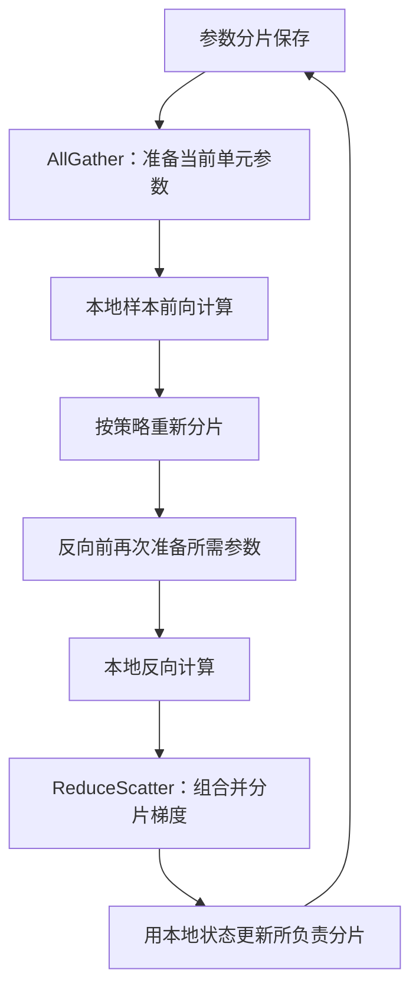

# 模型参数没多大，训练为什么还是爆显存？

> **AI 并行计算入门 · 第十篇**
>
> 一份低精度权重只有几 GB，训练却要几十 GB。加了多张卡，显存仍然不够——因为模型之外，还跟着一整套学习资料。
>
> 本文接着摄像头模型训练的场景，拆开权重、梯度、优化器状态与激活的显存账，再讲 ZeRO、FSDP 和张量并行的区别。
>
> **口径说明：容量与数组算例均为教学构造，不是硬件实测。标准库实验已运行；两卡 FSDP2 示例仅做语法与静态逻辑检查，制作环境未安装 PyTorch，未进行 CUDA 实测。资料核对日期：2026 年 10 月 16 日。**

> **工程深度｜验证状态：** L3 工程｜文档/API 核对（示例以可跑的小模型为主）
<!-- more -->

## 01｜权重能放进去，为什么一训练就崩？

门口摄像头的模型升级后，你准备重新训练，让它区分纸箱、塑料袋和其他容易混淆的目标。

你估算了一下：十亿个参数，如果每个参数用 2 字节保存，权重约 2 GB。

显卡空间看起来很充足。模型加载成功，前向也能执行。

可刚开始训练，显存突然升高。有时倒在反向传播，有时却倒在第一次优化器更新。

你又加了几张卡，用普通 DDP 训练。每张卡都忙起来了，但单卡显存并没有像期待的那样变成原来的四分之一。

原因是：**加载模型，只带了课本；训练模型，还要带草稿、修改方向和优化器的历史记录。**

## 02｜训练显存里，到底放了哪些东西？

| 内容 | 作用 | 是否等于模型权重？ |
|---|---|---|
| 参数或权重 | 决定模型怎样计算 | 是模型本体的一部分 |
| 参数梯度 | 记录当前损失对参数的变化方向 | 否 |
| 优化器状态 | 例如 Adam 的一阶、二阶矩估计 | 否 |
| 激活与保存的张量 | 为反向传播保留计算所需信息 | 否 |
| 临时缓冲区 | 算子工作区、通信、预取等 | 否 |
| 运行时与分配器相关开销 | 上下文、缓存、碎片等 | 否 |

如果使用特定混合精度训练方案，还可能保留 FP32 主权重。它与用于部分计算的低精度权重，是两份不同的表示。

但不是所有 FP16、BF16 或 FSDP 实现都同时维护同样的两份权重。实际参数、梯度和优化器状态采用什么精度，要看训练配置与实现。

下面先固定一套明确的账单，避免把不同方案的数字拼到一起。

## 03｜“每个参数 16 字节”，到底怎么算出来？

设有 P 个可训练参数，采用一套经典混合精度 Adam 教学配置：

| 状态 | 每参数字节数 |
|---|---:|
| 低精度参数 | 2 |
| 低精度梯度 | 2 |
| FP32 主权重 | 4 |
| Adam 一阶矩 | 4 |
| Adam 二阶矩 | 4 |
| 合计 | 16 |

为了与后面的 ZeRO 分片口径一致，把 FP32 主权重及两个矩估计合称为这里的“优化器相关状态”，共 12 字节。[1]

于是，这套配置的模型训练状态预算为：

\[
M_{\text{状态}}=16P\text{ 字节}
\]

十亿个参数，低精度权重约 2 GB，但这组训练状态合计约 16 GB。

这里统一采用十进制 GB：1 GB＝10⁹ 字节。16 GB 约为 14.90 GiB。

**这还没有计入激活、通信缓冲区和算子工作区，也不表示这些状态在每个时刻都以同样方式同时存活。**

这也解释了开头那个悬念：Adam 的部分状态可能在第一次更新时才创建。所以“前向能跑、反向能跑”，并不保证第一次 `step()` 也能跑过——账单里有些项目，是到那一步才真正出现的。

### 别把这个数字当成所有模型的公式

如果梯度采用 FP32，账单会变化。如果参数本来以 FP32 保存，也不能在没有实际副本时，额外再加一份“FP32 主权重”。不同优化器、低比特状态和冻结参数，也会改变结果。

例如另一种普通 FP32 参数、FP32 梯度、FP32 Adam 两矩的方案，同样可能得到 16 字节，但组成是 4＋4＋8，并不是上表的 2＋2＋12。

数值相同，不代表实现相同，更不能将两套组成重复相加。

## 04｜DDP 为什么不把这份账单除以卡数？

回到第六篇的数据并行。

四个工作进程各看不同训练样本，但普通 DDP 通常在每个副本上保存完整参数、参数梯度和本地优化器状态。

在上面的教学口径中：

| 位置 | 模型训练状态预算 |
|---|---:|
| GPU 0 | 16P |
| GPU 1 | 16P |
| GPU 2 | 16P |
| GPU 3 | 16P |

数据并行分摊了样本处理工作，却没有自动消除训练状态的重复保存。

如果固定全局批次，增加卡数后每卡批次变小，部分激活占用可能下降。但这不能说明权重和优化器状态已经被分片。

ZeRO 的核心问题正好是：**既然大家在训练同一个模型，这些重复的状态，能否分开保存、协作使用？**

## 05｜ZeRO 的三个阶段：先分历史记录，再分梯度，最后分权重

ZeRO 是 Zero Redundancy Optimizer 的缩写。它通过在数据并行参与者之间分片训练状态，减少冗余保存。[1][2]

可以把它想成一个学习小组：不必每个人都随身携带所有历史记录，但需要时要能得到正确的信息。

| 方式 | 低精度参数 | 梯度 | 优化器相关状态 |
|---|---|---|---|
| 未分片基线 | 不分片 | 不分片 | 不分片 |
| ZeRO-1 | 不分片 | 不分片 | 分片 |
| ZeRO-2 | 不分片 | 分片 | 分片 |
| ZeRO-3 | 分片 | 分片 | 分片 |

用一句话概括这张表的递进关系：**ZeRO-1 先分最占地方、却只在更新时用一次的优化器状态；ZeRO-2 再把梯度也分掉；ZeRO-3 连参数也分片常驻，需要计算时再按策略准备所需完整表示。** 越往下，常驻状态省得更多，但需要协调的地方也更多。

**分片会改变状态的归属与通信安排，但不意味着每增加一种分片，就固定多一次通信。** 参数也分片后，计算前通常需要准备相应参数，其通信代价还取决于收集粒度、缓存、重分片和预取策略；梯度归约与更新后参数同步，也可以由不同的集合通信组合来承担，而不是机械地逐级叠加次数。

这个表描述的是分片目标与规划口径，不是承诺任意时刻都只存在表内那一小片。梯度产生、通信与参数收集仍有瞬时空间。

### ZeRO-1：优化器状态不必人人都存全部

每个进程维护、更新自己负责参数的优化器状态。更新完成后，需要让各方用于后续计算的参数表示保持一致。

所以它不是“只有保存方式变化，完全没有数据协调”。

### ZeRO-2：归约后的梯度，也只保留负责的一片

不同样本的梯度先按共同目标组合，再把归约结果分片给负责更新的进程。

第七篇的 ReduceScatter，在这里就有了用途：算过，再各留一片。

### ZeRO-3：连参数也分片，计算时再取所需部分

参数在不用时分片保存。轮到某个计算单元，需要协调取得该单元的参数，计算后按策略重新分片或释放额外表示。[1]

**省掉的是反复常驻的完整副本，不是让计算永远只需要本地那一点参数。**

## 06｜同一个十亿参数模型，四卡能省多少？

继续沿用 2 字节参数、2 字节梯度、12 字节优化器相关状态的假设，令 D 为参与分片的数据并行组规模。

只计算理想模型训练状态，不计额外峰值：

\[
M_0=16P
\]

\[
M_1=4P+\frac{12P}{D}
\]

\[
M_2=2P+\frac{14P}{D}
\]

\[
M_3=\frac{16P}{D}
\]

当 P＝10⁹、D＝4：

| 方式 | 每卡理想状态预算 | 折算 GiB |
|---|---:|---:|
| 未分片基线 | 16.0 GB | 14.90 GiB |
| ZeRO-1 | 7.0 GB | 6.52 GiB |
| ZeRO-2 | 5.5 GB | 5.12 GiB |
| ZeRO-3 | 4.0 GB | 3.73 GiB |

这里的 D 是分片组规模，不是任意混合并行作业的全部 GPU 数。若参数已经沿 TP、PP 切分，还要根据具体参数所在组与分片方式重新记账。

表格说明了方向，但不能据此给出“4 GB 显卡一定能训练这个模型”的结论。

真正决定能否运行的是峰值。

## 07｜已经分片了，为什么 AllGather 时仍然爆显存？

想象每个人平时只保管一本资料的几页。讨论某一章时，大家把这一章收齐，放在桌上。讨论结束，再把多余的完整表示收起来。

FSDP 的一种典型完整分片训练过程，也有类似的参数生命周期：[3]



图中明确采用前向后重新分片的策略。其他配置可能保留部分完整参数，以减少之后的通信，代价是更多存储。

关键问题是：当前计算单元收齐参数时，还同时留着多少激活、梯度、预取和临时缓冲区？

假设某个时刻，一份已经按实际存储去重的账单为：

- 分片训练状态：4 GB。
- 当前活跃激活：3 GB。
- 参数收集额外增加的存储：1 GB。
- 其他临时与运行开销：2 GB。

这一时刻就是 10 GB，而不是表格里的 4 GB。

这些是明确假设的互不重叠项目；真实统计时要避免把别名、复用缓冲区和已计入的参数存储再算一次。

更严格的思路是：**逐时刻统计实际存活、去重后的各项，再取最大值。** 不能把各项在不同时间出现的独立峰值随意相加，也不能只看常态分片大小。

把一次完整的参数生命周期拆开看，每个时刻同时在场的东西并不相同：

| 时刻 | 可能同时存活的主要内容 | 排查时可先看 |
|---|---|---|
| 计算前／初始化加载 | 参数分片、已有训练状态、本批输入 | 是否先生成了完整副本、是否使用分片加载 |
| 当前单元前向 | 当前收集的完整参数、部分激活、算子工作区 | 单元是否过大、预取是否过多、输入与微批次形状 |
| 反向期间 | 为反向保存的激活、当前完整参数、梯度及通信缓冲 | 保存激活、参数重新收集与归约缓冲 |
| 首次优化器更新 | 参数与梯度分片，以及刚刚创建的优化器状态 | 优化器状态延迟创建、临时更新缓冲 |
| 保存检查点 | 待保存状态，以及可能出现的临时收集表示 | 是否临时把完整状态收齐到某设备或进程 |

**显存峰值来自“哪些东西同时在场”，不是把所有状态名字列出来后直接相加。** 后面排查 OOM 时，也是先问它出现在这张表的哪一行。

## 08｜FSDP 与 ZeRO-3：同类目标，不是同一个实现

FSDP 是 Fully Sharded Data Parallel，完全分片数据并行。

它与 ZeRO-3 在“参数、梯度与优化器状态分片”这一层有相近目标，但不代表实现、配置项和检查点格式完全相同。[2][3]

当前 PyTorch 官方文档提供 FSDP2 的 `fully_shard` 接口。FSDP2 使用基于 DTensor 的按参数分片表示；相对于 FSDP1 的扁平参数表示，它更方便表达和管理单个参数的分片。[3]

**按参数表示分片，不等于每个参数必须各自发起一次通信。** 哪些参数组成一次收集与释放的单元，还与 `fully_shard` 的应用位置有关。

### 收集单元太大，峰值可能高；切得太碎，通信可能多

一个收集单元包含的参数太多，收集时要同时准备的完整参数就可能占用较大空间；单元过小，又会产生更多小消息与调度开销。

如果按合理的 block 自底向上应用分片，可以让参数沿执行顺序逐步准备和释放。

要在参数收集粒度、预取、内存峰值和计算通信重叠之间权衡。

`reshard_after_forward` 也表达这样的取舍：前向后重新分片通常有利于释放参数空间；保留完整表示可能减少反向再次收集，但占用更多内存。具体默认与根模块行为，要以所用版本为准。[3]

### 存储精度与计算精度，未必是同一个值

混合精度不一定意味着常驻参数就是 BF16。某些 FSDP2 配置中，分片参数保留 FP32，收集用于计算的参数采用 BF16，梯度归约精度还可以单独配置。[3]

因此，显存账要按**实际存储表示和存活时刻**计算，不能只看“开启了 BF16”这个开关——这也是经典 16 字节公式不能直接套到所有 FSDP2 配置上的原因。

## 09｜同样分片参数，它与 TP 到底差在哪？

这是最容易混淆的一点。

| 对照 | 本篇典型 FSDP 方式 | 第八篇张量并行 TP |
|---|---|---|
| 平时保存什么 | 参数等训练状态分片 | 模型参数与计算分片 |
| 一层怎样计算 | 按需收集相应单元参数，处理本地样本 | 多个 rank 协作完成同一层的分片计算 |
| 主要数据关系 | 不同数据并行 rank 处理不同样本 | TP rank 通常参与同一样本的层内协作 |
| 典型通信 | 参数收集、梯度归约分片 | 由层内布局决定的收集或归约 |

两者的核心区别不是“有没有分片”，而是**分片之后，一次计算由谁完成，需要什么数据布局**。

如果某个计算单元在收集后仍然装不下，单纯增加 FSDP 分片卡数也未必能解决该单元的峰值。可能需要更细的计算组织、TP、内存分块或其他方案。

FSDP 也可以与 TP、PP 组合，分别处理不同维度的资源问题。下一篇会把这些关系放回一张 3D 并行地图。

## 10｜标准库实验：分片保存，仍然更新同一个模型

下面先做两件事：计算前面的显存预算；模拟参数收集、平均梯度分片和本地 SGD 更新。

这里使用预先给定的梯度贡献，不执行前向、自动求导或 Adam。SGD 只是为了把“谁负责更新哪一片”看得更清楚。

```python
from math import isclose


def state_bytes(parameters, ranks):
    return {
        "未分片": 16 * parameters,
        "ZeRO-1": (4 + 12 / ranks) * parameters,
        "ZeRO-2": (2 + 14 / ranks) * parameters,
        "ZeRO-3": 16 * parameters / ranks,
    }


def main():
    for name, size in state_bytes(10**9, 4).items():
        print(f"{name}: {size / 10**9:.1f} GB, {size / 1024**3:.2f} GiB")

    parameter_shards = [[1.0, 2.0], [3.0, 4.0]]
    # AllGather 的语义：每个 rank 可以得到当前所需的完整参数。
    full = [value for shard in parameter_shards for value in shard]
    print("本次收集的参数:", full)

    # 两个等权数据分片的局部梯度，已由外部给定。
    local_gradients = [[0.1, 0.2, 0.3, 0.4],
                       [0.5, 0.6, 0.7, 0.8]]
    averaged = [sum(values) / 2 for values in zip(*local_gradients)]
    gradient_shards = [averaged[:2], averaged[2:]]
    print("平均梯度分片:", [[round(v, 3) for v in s] for s in gradient_shards])

    # 各 rank 只更新自己负责的参数分片。
    updated_shards = [[w - 0.1 * g for w, g in zip(weights, gradients)]
                      for weights, gradients in zip(parameter_shards, gradient_shards)]
    rebuilt = [value for shard in updated_shards for value in shard]
    reference = [w - 0.1 * g for w, g in zip(full, averaged)]
    assert all(isclose(a, b, abs_tol=1e-12) for a, b in zip(rebuilt, reference))
    print("更新后重新收集:", [round(v, 3) for v in rebuilt])
    print("与完整参数使用同一平均梯度更新一致。")


if __name__ == "__main__":
    main()
```

输出：

```text
未分片: 16.0 GB, 14.90 GiB
ZeRO-1: 7.0 GB, 6.52 GiB
ZeRO-2: 5.5 GB, 5.12 GiB
ZeRO-3: 4.0 GB, 3.73 GiB
本次收集的参数: [1.0, 2.0, 3.0, 4.0]
平均梯度分片: [[0.3, 0.4], [0.5, 0.6]]
更新后重新收集: [0.97, 1.96, 2.95, 3.94]
与完整参数使用同一平均梯度更新一致。
```

模拟为方便理解，在 CPU 上直接形成完整平均梯度再切片；这不表示真实 ReduceScatter 一定用同样的内存与执行路径。

它验证的是数学分工，不是 FSDP 性能，也没有证明真实 Adam 的全部状态和通信已被实现。

## 11｜一个最小 FSDP2 训练示例

下面展示自底向上应用 `fully_shard`，然后创建优化器的基本顺序。[3]

需要支持 FSDP2 `fully_shard` 接口的 PyTorch、CUDA、NCCL，以及单机两张可见 NVIDIA GPU。保存为 `fsdp2_demo.py` 后运行：

```bash
torchrun --standalone --nproc_per_node=2 fsdp2_demo.py
```

示例使用很小的 FP32 网络和 AdamW，不采用前面 2＋2＋12 的混合精度账单。它只用于说明 API 组织，不是节省显存的实测证明。

```python
import os

import torch
import torch.distributed as dist
from torch import nn
from torch.distributed.device_mesh import init_device_mesh
from torch.distributed.fsdp import fully_shard


def main():
    world = int(os.environ.get("WORLD_SIZE", "1"))
    local_rank = int(os.environ.get("LOCAL_RANK", "0"))
    if world != 2 or not torch.cuda.is_available():
        raise SystemExit("请在单机两张 NVIDIA GPU 上启动两个进程。")
    if torch.cuda.device_count() < 2:
        raise SystemExit("本示例要求各进程可见同样的两张 GPU。")

    torch.cuda.set_device(local_rank)
    device = torch.device("cuda", local_rank)
    dist.init_process_group(backend="nccl")
    try:
        rank = dist.get_rank()
        mesh = init_device_mesh("cuda", (world,))
        torch.manual_seed(7)  # 各 rank 从相同模型参数开始。
        model = nn.Sequential(nn.Linear(8, 16), nn.ReLU(), nn.Linear(16, 2))
        model = model.to(device)

        # 先子模块，再根模块；显式选择前向后重新分片。
        for index in [0, 2]:
            fully_shard(model[index], mesh=mesh, reshard_after_forward=True)
        fully_shard(model, mesh=mesh, reshard_after_forward=True)
        optimizer = torch.optim.AdamW(model.parameters(), lr=1e-3, foreach=False)

        # 分片后，参数的逻辑全局形状与本 rank 的本地分片形状并不相同。
        for name, parameter in model.named_parameters():
            local = parameter.to_local() if hasattr(parameter, "to_local") else parameter
            if rank == 0:
                print(f"{name}: 全局形状={tuple(parameter.shape)}, "
                      f"本地形状={tuple(local.shape)}")

        torch.manual_seed(100 + rank)  # 各 rank 使用不同训练样本。
        x = torch.randn(32, 8, device=device)
        target = torch.randn(32, 2, device=device)
        for step in range(3):
            optimizer.zero_grad(set_to_none=True)
            loss = nn.functional.mse_loss(model(x), target)
            loss.backward()
            optimizer.step()
            if rank == 0:
                print(f"step={step + 1}: rank0 本地损失={loss.item():.6f}")
        torch.cuda.synchronize(device)
    finally:
        dist.destroy_process_group()


if __name__ == "__main__":
    main()
```

优化器必须在应用相应分片后创建，才能引用正确的参数表示。查看分片信息时，应在参数处于分片表示的边界检查，用本地分片形状（`to_local()`）判断占用，**不要拿逻辑全局元素数直接当作本地存储量**。日志中的本地损失不是全局平均损失；需要全局指标时，应按实际样本和归一化口径汇总。

这个小例子先将完整模型搬上 GPU，再分片。真实大模型可能在这一步就 OOM，需要使用框架支持的 meta 初始化、分片物化与检查点加载流程。不能把这个教学初始化顺序，原样当成超大模型部署方案。

如果它在两卡上跑通，预期的行为是：三个 step 都顺利完成、进程结束时无报错；rank 0 会打印参数分片形状，以及三条随 step 变化的本地损失（具体值取决于随机种子与实现，不作承诺）。参数在重分片后以分片形式保存，执行当前计算单元时会暂时出现所需的完整参数表示——**“只持有分片”说的是常驻状态，不是全程状态**。这个例子展示分片参数与优化器的组织方式，不保证如此小的网络在实际显存统计上低于 DDP；是否节省峰值显存，需要在明确统计口径和相同负载下测量。**最该观察的，是“程序能跑通且各 rank 各自持有分片”，而不是损失曲线本身。**

另外要记住：三个 step 跑通，证明的是示例能够执行；本地 loss 有变化，本身不足以证明分片训练与参考训练在数学上等价——那需要一次更新与未分片全局 batch 参考的对照，本篇不展开。

示例未做双卡运行，因此不附“节省百分比”或虚构的训练输出。接口与行为应以所用 PyTorch 版本为准。

## 12｜激活占满了，为什么 ZeRO-3 也救不了？

ZeRO 三阶段主要针对模型训练状态冗余。激活没有因此自动按同一比例全部缩小。

长序列、大图像、大微批次、多份在途流水线工作，都可能让激活成为主要占用。

这时可评估激活检查点，也称激活重计算：少保存部分前向中间结果，反向时重新计算它们，以更多计算换取较低存储。[4]

这里的 checkpoint，与写到磁盘、用于故障恢复的训练检查点，是不同概念。

| 技术 | 主要改变哪笔账？ |
|---|---|
| ZeRO / FSDP | 参数、梯度、优化器相关状态的保存与通信 |
| 激活重计算 | 前向中间结果的保存时长与数量 |
| 更小微批次＋梯度累积 | 每次处理的活跃样本量与更新组织 |
| TP、序列相关分片 | 部分计算、参数或激活的数据布局 |
| PP | 不同阶段模型与状态的设备分布 |

这些方法可以组合，但要确认组合的框架支持、数学语义和资源峰值。技术名词越多，不代表效果越好。

## 13｜CPU、NVMe 卸载：换个地方放，不等于不用搬

如果 GPU 空间仍不足，还可以把部分状态放到 CPU，某些方案进一步利用 NVMe。[1][5]

例如优化器状态和计算卸载到 CPU，可以降低 GPU 侧压力。但它会消耗主机内存、CPU 算力与数据传输能力。

NVMe 容量更大，访问路径与延迟又不同，不能当成与显存等速的扩展。

需要看：哪些数据在什么时候搬入、搬出；计算能否隐藏搬运；CPU 与存储是否也成了瓶颈。

所以，卸载可能帮助“训练能够进行”，但不能据此宣称“一定更快”。预取与重叠策略也会占用额外缓冲空间。

## 14｜排查 OOM，先看它发生在哪一步

第 07 节的参数生命周期表已经把“时刻、同时存活内容、排查方向”对应起来，这里直接沿用，不再单列一张。定位思路是：先判断 OOM 落在哪一行——初始化加载、前向、反向、首次优化器更新，还是保存检查点，再对照那一行可能同时在场的东西。

发生时机只是线索，不是诊断结论。还需结合显存快照、分配统计和执行时间线确认。

PyTorch 的 `allocated` 与 `reserved` 口径不同，不能相加作为总占用；释放缓存也不会删除仍被引用的训练状态。第三篇已经解释过这层区别。

训练检查点还应包含恢复所需的优化器、调度与其他状态，并明确使用分片保存还是完整收集。rank 0 的一片参数，不自动等于可直接部署的完整模型。[3]

## 15｜回到摄像头：先算对账，再决定分什么

看到一份 2 GB 权重，不能直接推断训练只需要 2 GB。

看到模型状态已经分到四张卡，也不能直接推断实际显存峰值只剩四分之一。

更有效的路径是：先明确精度和优化器，列出状态组成，再判断冗余来自哪里；随后看参数收集、激活存活与临时空间，最后验证峰值和训练质量。

ZeRO 与 FSDP 让同一训练任务不必在每个数据并行参与者上反复保存所有资料；TP 与 PP 则进一步改变计算怎样分工。

**省显存的关键，不是把所有东西都“除以卡数”，而是让正确的数据，在需要的时刻，出现在需要的位置。**

---

## 下一篇

**《八张显卡，怎样同时分数据、分层、分矩阵？》**

用一个 DP＝2、PP＝2、TP＝2 的具体配置，串起模型分片、微批次、通信组与一次参数更新，完整解释经典 3D 并行训练。

## 参考资料

以下均为原始研究或官方文档。16 字节账单与阶段容量表采用文中明确的精度假设，不能直接作为所有 FSDP、BF16 或 Adam 实现的峰值估算。

1. [DeepSpeed：Zero Redundancy Optimizer](https://www.deepspeed.ai/tutorials/zero/)：ZeRO 阶段、状态组成、按需参数收集与卸载。
2. [ZeRO 原始论文](https://arxiv.org/abs/1910.02054)：数据并行冗余与分片训练状态。
3. [PyTorch：Getting Started with FSDP2](https://docs.pytorch.org/tutorials/intermediate/FSDP_tutorial.html)；[fully_shard API](https://docs.pytorch.org/docs/stable/distributed.fsdp.fully_shard.html)：DTensor、收集与重分片、应用粒度、优化器与状态字典。
4. [PyTorch：torch.utils.checkpoint](https://docs.pytorch.org/docs/stable/checkpoint.html)：激活重计算及其语义。
5. [DeepSpeed：ZeRO-Offload](https://www.deepspeed.ai/tutorials/zero-offload/)：优化器状态与计算的主机卸载。
