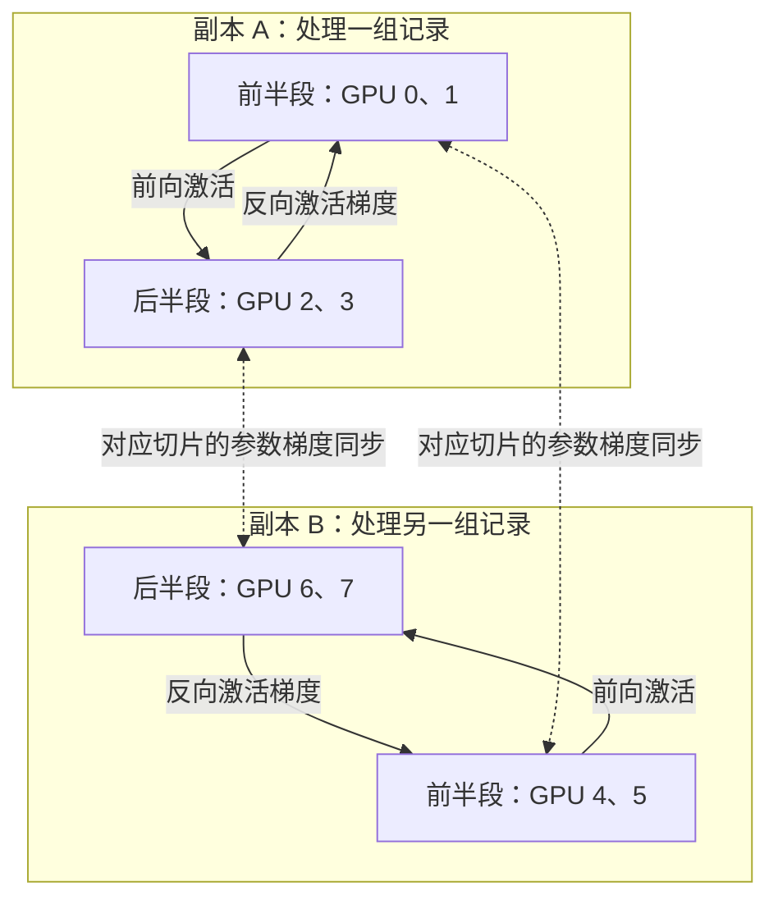

# 八张显卡，怎样同时分数据、分层、分矩阵？

> **AI 并行计算入门 · 第十一篇**
>
> 一个八卡训练现场，讲清 DP、PP、TP 怎样组成经典 3D 并行。
>
> 单看每一种并行都懂了，凑到一起却总有几个数字对不上：八张卡到底在训练几个模型？一条样本走过几张卡？全局 batch 又该乘以几？
>
> **口径说明：本文算例为教学设定，代码为 CPU 数学模拟，不代表八卡实测性能；部分容量数字按单一场景估算，不构成通用基准。资料核对日期：2026 年 10 月 16 日。**

> **工程深度｜验证状态：** L3 工程｜概览（需多卡环境验证）
<!-- more -->

周一上午，你接到一个任务：训练一位能读懂设备维修记录的 AI 助手。

机器有八张 GPU。模型已经选好了，问题也接踵而至：整套训练状态放进一张卡太挤，某些大矩阵算起来也吃力；训练记录还很多，希望多张卡同时读。

同事说：“把数据切开，把模型分段，再把大矩阵拆开，做 3D 并行。”

听起来很合理。可真正打开配置文件，三个数字就能把人绕晕：

```text
DP = 2
PP = 2
TP = 2
```

八张卡，是在训练八个模型吗？一条记录会经过几张卡？梯度最后交给谁？第七篇讲的 NCCL，到底在哪一步出场？第十篇的 FSDP，还能放进来吗？

今天我们只追踪一次参数更新，把这些问题串起来。

读完后，你应该能亲手画出八张卡的分工，并解释一个很容易算错的结果：

**用了八张卡，这个例子的全局 batch，却只需要乘以 2。**

## 01｜先把“三种切法”放到同一个训练任务里

先约定：本文讨论的是**同一个模型的同步训练**。系列开头讨论过多个独立模型怎样同时服务；这里已经进入另一类问题：多张 GPU 怎样共同训练一个逻辑模型。

设想我们把维修助手的网络按深度分成前、后两段。每段内部，再把适合切分的线性层矩阵分给两张卡；这样的四卡组合复制两份，分别读取不同的训练记录。

这就是本文使用的经典定义：

| 缩写 | 中文 | 本例怎么分工 | 没有改变什么 |
|---|---|---|---|
| DP | 数据并行（Data Parallel） | 两个模型副本处理不同记录 | 两边要学习同一组逻辑参数 |
| PP | 流水线并行（Pipeline Parallel） | 每个副本分成前、后两个阶段 | 一条样本仍须走完完整网络 |
| TP | 张量并行（Tensor Parallel） | 每个阶段用两张卡合算部分层 | 被拆开的运算仍须还原原来的数学结果 |

这种把多种切法组合起来的做法，就是常说的**混合并行（Hybrid Parallel）**——既可以只用其中一两条轴，也可以三条一起上。DeepSpeed 把张量切分、流水线并行、数据并行或 ZeRO 数据并行的组合称为 3D 并行。[1]

这里的“三维”，说的是三个分工方向。它不是空间里的三维模型，也不是要求显卡摆成立方体。

为了先讲清主干，本文假设：稠密网络、两个顺序阶段、每卡一个进程、没有跨阶段共享参数；暂不引入专家并行和上下文并行。复杂网络还可能需要额外通信，后面会说明边界。

## 02｜八张卡，其实组成了两个四卡副本

给每个进程三个坐标：

\[
(d,p,t)
\]

其中，\(d\) 表示数据副本，\(p\) 表示流水线阶段，\(t\) 表示张量切片位置。三个坐标都从 0 开始，每个只能取 0 或 1。

为了方便查表，本文规定（把本例的 2 记作一般维度数，就得到通用式）：

\[
\mathrm{rank}=((d\times P)+p)\times T+t
\]

本例 \(D=P=T=2\)，代回即得 \(((d\times 2)+p)\times 2+t\)。这也是后文为什么强调“逻辑坐标描述谁和谁协作”：坐标怎么排、rank 怎么编，只是记账约定。

rank 是进程编号。本文把 rank 0 简写成 GPU 0；跨机器部署时，它不一定等于机器上显示的本地 GPU 编号。

| GPU / rank | 坐标 \((d,p,t)\) | 属于哪个副本 | 负责哪里 |
|---|---|---|---|
| 0 | (0,0,0) | A | 前半段，切片 0 |
| 1 | (0,0,1) | A | 前半段，切片 1 |
| 2 | (0,1,0) | A | 后半段，切片 0 |
| 3 | (0,1,1) | A | 后半段，切片 1 |
| 4 | (1,0,0) | B | 前半段，切片 0 |
| 5 | (1,0,1) | B | 前半段，切片 1 |
| 6 | (1,1,0) | B | 后半段，切片 0 |
| 7 | (1,1,1) | B | 后半段，切片 1 |

先看四个“小组”，比盯着八张卡容易得多：



图中每个框内部，还有两张卡之间的 TP 协作。

**GPU 0、1、2、3 合起来，才组成副本 A 的完整计算路径。** 单独的 GPU 0 并没有一整个维修助手。

因此，这里有两个数据副本，每个副本占四张卡：

\[
N_{\mathrm{GPU}}=D\times P\times T=2\times2\times2=8
\]

这个乘法用于本文三个独立轴组成的布局。遇到 MoE 等复杂系统，要先看框架如何定义和复用并行组，不能把看到的所有 degree 不加判断地相乘。

另外，**rank 排列只是本文的一种编号方案**。实际框架可以按其他顺序展开坐标；数字不同，不代表并行原理不同。

## 03｜一张卡有三种“同事”，别把通信组建错

拿 GPU 0 来说，它有三位职责不同的搭档：

| 搭档 | 对应关系 | 为什么需要通信 |
|---|---|---|
| GPU 1 | 同副本、同阶段，TP 位置不同 | 合作完成被切分的层 |
| GPU 2 | 同副本、同 TP 位置，阶段不同 | 传递阶段边界的激活及其梯度 |
| GPU 4 | 同阶段、同 TP 位置，副本不同 | 合并不同数据算出的对应参数梯度 |

按这个规则，所有小组就能列出来：

| 组类型 | 固定哪些坐标 | 本文全部组 |
|---|---|---|
| TP 组 | 固定 \(d,p\)，变化 \(t\) | {0,1}、{2,3}、{4,5}、{6,7} |
| PP 组 | 固定 \(d,t\)，变化 \(p\) | {0,2}、{1,3}、{4,6}、{5,7} |
| DP 组 | 固定 \(p,t\)，变化 \(d\) | {0,4}、{1,5}、{2,6}、{3,7} |

PP 组这一列，采用阶段边界两侧 TP 布局一致、对应切片直接传递的设定。如果前后阶段布局不同，边界可能需要重分布，不能机械地认为永远是一对一发送。

最关键的一条纪律是：

**DP 同步的，是同一个逻辑参数切片在不同数据副本上的梯度。**

GPU 0 和 GPU 4 负责相同位置的参数，所以可以同步。GPU 0 和 GPU 2 负责网络的不同阶段，不能因为“都是 GPU”就把参数梯度平均到一起。

训练程序里，进程组定义错了，有时会直接挂住；有时张量形状恰巧对得上，却把错误的量合并了。后者更难发现。

## 04｜跟着 16 条记录，走完一次更新

现在给维修助手准备 16 条训练记录，编号为 1～16。为了看清计数，假设每条记录权重相同，序列长度和有效监督 token 数也相同。

我们设置：

- 每个数据副本的一份微批次（microbatch）有 2 条记录，记作 \(b=2\)。
- 每次更新，每个副本处理 4 份微批次，记作 \(m=4\)。
- 数据副本数为 \(D=2\)。

于是：

\[
B_{\mathrm{global}}=b\times m\times D=2\times4\times2=16
\]

分配表如下：

| 微批次 | 副本 A，GPU 0～3 共同处理 | 副本 B，GPU 4～7 共同处理 |
|---|---|---|
| 1 | 记录 1、2 | 记录 9、10 |
| 2 | 记录 3、4 | 记录 11、12 |
| 3 | 记录 5、6 | 记录 13、14 |
| 4 | 记录 7、8 | 记录 15、16 |

GPU 0、1 合作处理记录 1、2 的前半段；GPU 2、3 接着处理这两条记录的后半段。

两张 TP 卡没有多读两条独立记录，两个 PP 阶段也没有多创造两条独立记录。因此不能再乘 TP 和 PP。

如果错误地计算成 \(2\times4\times8=64\)，你就把同一份数据经历的协作，误算成了额外数据。

实际工程里的“每卡 batch”容易有歧义。TP/PP 开启后，优先确认它指的是**每个数据副本的微批次**，还是框架里的其他统计口径。

### 第一步：两组数据进入两个副本

副本 A 的入口取得记录 1、2；副本 B 的入口取得记录 9、10。

同一个副本内部，TP 参与者需要获得与其输入布局匹配的数据。后续 PP 阶段接收的是上游中间结果，不必重新独立读取一组训练样本。标签则必须与最后算 loss 的样本对齐。

具体由谁读盘、谁广播输入，是框架的数据管线实现问题。**不要给八个 rank 各配一份互不相干的数据，再期待模型自己拼回来。**

### 第二步：阶段内部合算，阶段之间接力

前半段开始计算。遇到 TP 切分的线性层，两张卡各算自己的部分，按该层的布局执行必要通信。

第八篇讲过两个典型动作：输出特征切分后可能需要拼接，输入特征切分得到的部分和需要相加。现代实现也可能保留分片，使用 Reduce-Scatter、All-Gather 等布局变换，避免过早汇总。

前半段完成一个微批次后，把边界激活交给后半段。后半段开始处理它时，前半段就可能接着处理下一份微批次。

所以，PP 的并行来自不同阶段在处理**不同微批次**。同一份数据的后半段，仍然要等待它的前半段结果。

### 第三步：反向传播，把两类“梯度”分开

最后一段计算 loss，然后反向。

这里至少有两类梯度：

| 梯度 | 例子 | 去哪里 |
|---|---|---|
| 对激活的梯度 | \(\partial L/\partial H\) | 沿 PP 边界发回前一阶段，让反向继续 |
| 对参数的梯度 | \(\partial L/\partial W\) | 留在相应参数位置累积，再沿 DP 方向同步 |

“把梯度发给上一张卡”，通常指前一行；“把不同副本的梯度对齐”，指后一行。

两个动作都与梯度有关，目的却不同。把它们混为一谈，就很难理解完整训练过程。

### 第四步：累积完成，合并对应切片

每个副本处理完本次更新的 4 个微批次后，都得到自己那 8 条记录对应的梯度。

在本文等量数据、平均 loss 的约定下，对任一参数切片 \(\theta\)：

\[
g_A=\frac{1}{8}\sum_{i=1}^{8}\nabla_\theta\ell_i,
\qquad
g_B=\frac{1}{8}\sum_{i=9}^{16}\nabla_\theta\ell_i
\]

沿 DP 方向平均：

\[
g=\frac{g_A+g_B}{2}
=\frac{1}{16}\sum_{i=1}^{16}\nabla_\theta\ell_i
\]

GPU 0 与 4 对齐自己的切片，1 与 5 对齐另一个切片；后半段的 2 与 6、3 与 7 也各自对齐。

这是数学上的完整过程。工程实现可以按 bucket 提前启动归约，与反向计算重叠；不要求所有通信都等最后一个反向操作结束后才开始。[2]

### 第五步：各自更新自己的参数

所有必需的梯度同步和归一化完成后，各进程更新自己负责的参数。

普通 DP 中，相同切片的副本使用一致的初始参数、梯度和优化器状态，便能保持一致。一次更新完成，两个四卡副本仍对应同一个逻辑模型。

本文用同步更新语义：本轮微批次的梯度来自同一版本参数。不要擅自让某个阶段“算完就先改权重”，那会改变训练语义。

## 05｜NCCL 终于出场：同样是通信，数学目的差很远

NCCL 提供 GPU 集合通信和点对点通信能力。框架根据并行策略组织这些操作；NCCL 本身并不知道“这是一条维修记录”，也不会自动决定哪一层该切给谁。[3][4]

把上面的过程翻译成通信语言：

| 场景 | 需要完成的数学或数据动作 | 可能使用的操作 |
|---|---|---|
| TP 的矩阵部分结果 | 将部分和加成完整结果 | All-Reduce SUM，或 Reduce-Scatter 等 |
| TP 的分片布局变换 | 收集需要的特征分片 | All-Gather 等 |
| PP 的阶段交接 | 传递激活或激活梯度 | Send / Recv |
| 普通 DP 的梯度同步 | 合并不同数据副本的对应梯度 | All-Reduce，再按约定归一化 |
| FSDP 的参数取用 | 按需收集 DP 方向的参数分片 | All-Gather |
| FSDP 的梯度处理 | 归约后让各 rank 留下负责的分片 | Reduce-Scatter，并按约定归一化 |

这里最容易犯的错误，是看到 All-Reduce 就说“求平均”。

**操作名只告诉你怎样通信，不能替你确定这个张量应该怎样计算。**

TP 中，假如两张卡算出 \(u_0\) 与 \(u_1\)，原运算要求：

\[
y=u_0+u_1
\]

你若除以 2，原来的层就变了。

DP 中，两份等量数据的平均梯度则需要：

\[
g=(g_A+g_B)/2
\]

至于这个除法是在 loss 缩放、框架归约路径还是别处完成，要检查具体实现，不能多除一次。

同样，调用了异步通信，也不意味着耗时已经被完全隐藏。消费者要用数据，仍须满足通信完成的依赖。

## 06｜不用八张 GPU，也能核对这套分工的数学

概念讲到这里，不妨拿一个只有四个参数的小网络来验算。

把真实维修助手暂时缩成两个线性阶段，不加偏置和非线性。它没有语言理解能力，只保留我们要观察的分工。

前半段有两个隐藏特征：

\[
h_0=a_0x,\qquad h_1=a_1x
\]

后半段把两路结果相加：

\[
\hat y=v_0h_0+v_1h_1
\]

令：

\[
(a_0,a_1)=(1,2),\quad(v_0,v_1)=(3,4),\quad y=2x
\]

所以更新前，\(\hat y=11x\)。训练目标是让预测靠近 \(2x\)，loss 使用均方误差，不额外乘 \(1/2\)。

参数归属为：

| 参数 | 副本 A | 副本 B |
|---|---|---|
| \(a_0\) | GPU 0 | GPU 4 |
| \(a_1\) | GPU 1 | GPU 5 |
| \(v_0\) | GPU 2 | GPU 6 |
| \(v_1\) | GPU 3 | GPU 7 |

前半段按隐藏特征切分，后半段按输入特征切分。前后阶段之间，对应 TP 位置传自己的 \(h_t\)；后半段再把两路 \(v_th_t\) 相加。这是一个能精确还原原网络的切法。

对一个副本的一份微批次，若它在本地更新中占 \(1/m\)，则每条样本的反向起点为：

\[
\delta=\frac{2(\hat y-y)}{bm}
\]

后半段计算：

\[
\frac{\partial L}{\partial v_t}\mathrel{+}=\delta h_t,
\qquad
\frac{\partial L}{\partial h_t}=\delta v_t
\]

将 \(\delta v_t\) 传回前半段，得到：

\[
\frac{\partial L}{\partial a_t}\mathrel{+}=\delta v_tx
\]

再沿 DP 方向对对应参数梯度取平均。

下面的代码只用 Python 标准库，模拟八个 rank 的分工和一次 SGD 更新。它按顺序执行，**验证计算与梯度归一化，不模拟真实 GPU 并发、流水线时序或 NCCL 性能**。

```python
"""八张显卡，怎样同时分数据、分层、分矩阵？（第5章 · 并行与分布式）。

本文件是对应博文代码块的实现/演示，直接运行可见效果；运行依赖：仅标准库。
"""
from math import isclose

D, P, T = 2, 2, 2
b, m = 2, 4
world_size = D * P * T

def rank(d, p, t):
    return (d * P + p) * T + t

tp_groups = [[rank(d, p, t) for t in range(T)]
             for d in range(D) for p in range(P)]
pp_groups = [[rank(d, p, t) for p in range(P)]
             for d in range(D) for t in range(T)]
dp_groups = [[rank(d, p, t) for d in range(D)]
             for p in range(P) for t in range(T)]

for groups in (tp_groups, pp_groups, dp_groups):
    assert sorted(r for group in groups for r in group) == list(range(world_size))

a = [1.0, 2.0]
v = [3.0, 4.0]
samples = list(range(1, b * m * D + 1))
local_data = [samples[d * b * m:(d + 1) * b * m] for d in range(D)]
assert len(set(local_data[0]) & set(local_data[1])) == 0

# 每个 rank 只有一个参数的梯度；先用本副本的 8 条样本归一化。
grad = [0.0] * world_size
local_loss = [0.0] * D
for d in range(D):
    for j in range(m):
        microbatch = local_data[d][j * b:(j + 1) * b]
        for x in microbatch:
            # PP 前半段，两张 TP 卡各生成一个隐藏特征。
            h = [a[t] * x for t in range(T)]
            # PP 传 h[t] 给对应的后半段 TP 卡。
            partial = [v[t] * h[t] for t in range(T)]
            prediction = sum(partial)  # TP SUM，不能除以 T。
            error = prediction - 2.0 * x
            # 同一预测即使复制到 TP 卡，也只计一次逻辑 loss。
            local_loss[d] += error ** 2 / (b * m)
            delta = 2.0 * error / (b * m)
            for t in range(T):
                grad[rank(d, 1, t)] += delta * h[t]
                dh = delta * v[t]  # PP 反向传回的激活梯度。
                grad[rank(d, 0, t)] += dh * x

# 普通 DP：同一参数的两个副本梯度平均。
synced = grad.copy()
for group in dp_groups:
    mean_grad = sum(grad[r] for r in group) / D
    for r in group:
        synced[r] = mean_grad

# 未切分的完整网络，直接对全部 16 条样本求解析梯度。
reference = [0.0] * (P * T)
reference_loss = 0.0
for x in samples:
    prediction = x * sum(a[t] * v[t] for t in range(T))
    error = prediction - 2.0 * x
    reference_loss += error ** 2 / len(samples)
    delta = 2.0 * error / len(samples)
    for t in range(T):
        reference[t] += delta * v[t] * x
        reference[T + t] += delta * a[t] * x

for d in range(D):
    for p in range(P):
        for t in range(T):
            assert isclose(synced[rank(d, p, t)], reference[p * T + t],
                           rel_tol=1e-12, abs_tol=1e-12)
assert isclose(sum(local_loss) / D, reference_loss)

# 同步完成后才更新；所有梯度都来自更新前的同一版本参数。
lr = 1e-5
initial = [a[t] if p == 0 else v[t]
           for d in range(D) for p in range(P) for t in range(T)]
updated = [initial[r] - lr * synced[r] for r in range(world_size)]
for group in dp_groups:
    assert all(isclose(updated[r], updated[group[0]]) for r in group)

print("TP groups:", tp_groups)
print("PP groups:", pp_groups)
print("DP groups:", dp_groups)
print("Global batch:", len(samples))
print("Loss:", f"{reference_loss:.6f}")
print("Gradient [a0, a1, v0, v1]:", reference)
print("Updated replica A:", [round(x, 5) for x in updated[:4]])
print("PASS: split gradients match the full-model reference")
```

运行结果：

```text
TP groups: [[0, 1], [2, 3], [4, 5], [6, 7]]
PP groups: [[0, 2], [1, 3], [4, 6], [5, 7]]
DP groups: [[0, 4], [1, 5], [2, 6], [3, 7]]
Global batch: 16
Loss: 7573.500000
Gradient [a0, a1, v0, v1]: [5049.0, 6732.0, 1683.0, 3366.0]
Updated replica A: [0.94951, 1.93268, 2.98317, 3.96634]
PASS: split gradients match the full-model reference
```

这个实验回答了三个问题：参数切开后能不能还原原运算？微批次累积有没有改变平均梯度？不同数据副本同步后是否等于完整 batch 的结果？

三个答案都由断言核对。

但这不意味着任意神经网络都能不加处理地获得同样的结果。BatchNorm 等依赖 batch 统计的操作、随机数、混合精度和浮点归约顺序，都需要单独考虑。真实分布式训练通常用合理容差比较 loss 和梯度，不能默认逐位一致。

还有一个语言模型中特别常见的细节：**有效 token 数不等时，不能直接平均各微批次的平均 loss。** 应按目标函数对应的有效 token 总数或权重归一化。本文的 \(b\times m\times D\) 计算的是样本数，并不自动等于监督 token 数。

## 07｜第十篇的 FSDP，可以接在哪个方向？

看 DP 组 {0,4}：在普通 DP 中，它们保存同一逻辑参数切片的两份副本。

如果这份冗余让显存吃紧，可以在这个 DP 方向进一步分片训练状态。采用全分片方案时，参数在不使用时分片存放，需要计算时按粒度收集；梯度归约后分片，优化器状态也按负责的参数分片保存。

顺序可以这样理解：

1. PP 先决定“哪一段网络归我”。
2. TP 再决定“这一段里，哪些矩阵部分归我计算”。
3. DP 方向上的 FSDP 再决定“对应参数部分的训练状态，平时由谁保存”。

这里的收集范围很重要：**GPU 0 在 DP 方向收集的是自己负责的 TP 切片所需参数，不是把八张卡上整个模型一次收回来。**

FSDP 因此可以与 TP、PP 组合，但需要框架明确支持对应的布局、调度和参数管理。[2]

不要把它理解成“额外再切一个计算方向，八卡布局自动变成 4D”。FSDP 主要改变训练状态的存储和取用方式，并没有把一层矩阵运算再按一个新方向拆成部分和。

混合分片方案还可能把 DP 方向细分为分片和复制子维度。此时要重新核对 mesh 与数据副本数，不能继续套用本文四个两人 DP 组的具体分片布局。

也别把“可以组合”理解成“所有框架、所有版本、所有 ZeRO 阶段都支持”。例如，一个训练引擎支持 PP，并不自动保证它支持你计划采用的全分片组合。

## 08｜八张卡分好了，为什么还可能更慢？

正确的数学，是起点；高效的执行，是另一道题。

先设一个容易检查的理想模型：网络可均匀分成两个 PP 阶段，每个阶段又恰好有一半可均匀 TP 切分的参数。

如果总参数量为 \(N\)，普通 DP 的每卡参数存量大致是：

\[
N/(P T)=N/4
\]

不是 \(N/8\)。因为 DP 复制了模型计算路径，没有进一步分掉普通 DP 的参数存储。

若再沿 DP 方向全分片，静态参数分片量在这个均匀假设下可到约 \(N/8\)。但激活、通信缓存、暂时收集的参数和工作区仍然占显存，峰值不能直接拿总显存除以八来估计。

现实里，参数也未必均匀：有些参数沿 TP 复制，词嵌入可能很大，最后阶段还要计算输出和 loss。层数各一半，不保证耗时各一半。

速度方面，本例至少有四笔账：

| 成本 | 为什么会发生 | 先观察什么 |
|---|---|---|
| TP 通信 | 层内部分结果需要合并或重分布 | 小算子是否被频繁通信淹没 |
| PP 气泡 | 流水线需要填充、排空，且存在依赖 | 微批次数与阶段耗时是否匹配 |
| DP 通信 | 对应参数梯度需要同步 | 有多少通信暴露在关键路径上 |
| 状态取用 | 全分片时要收集参数等 | 峰值显存、收集时机与重叠情况 |

如果只考虑两个等时阶段、4 个微批次的简单填充排空模型，忽略通信，前向流水线的利用率是：

\[
\frac{m}{m+P-1}=\frac{4}{5}=80\%
\]

它只用于说明有限微批次带来的填充排空损失。**它不是本例实际训练的 GPU 利用率，也不是所有 1F1B、交错流水线或其他调度的通用效率公式。**

增加微批次数可以摊薄部分气泡，但也会影响全局 batch、梯度累积或激活管理。不能只看气泡变小，就认定训练整体一定更好。

大规模训练研究很早就把 TP、PP、DP 的组合看作显存、计算和通信之间的权衡问题，而非度数越大越好。[5]

### 如果八张卡分布在两台机器上呢？

假设每台有四卡，机内互联比机间互联快。一个候选方案是：副本 A 在第一台，副本 B 在第二台。

于是本例的 TP 和 PP 都留在机内，DP 需要跨机器。这样安排的动机，是把较频繁、依赖紧的层内协作放在较快互联上。

但它不是必然最优。

你也可以把前半段的两个副本放一台，后半段的两个副本放另一台：TP 和 DP 留在机内，PP 跨机器。哪种好，要看梯度与边界激活的大小、微批次数、状态分片通信、重叠能力及实际网络。

**逻辑坐标描述谁和谁协作；物理拓扑决定这些协作要走多远。** 两张图都要画。

## 09｜前沿正在改变什么：把“张量在哪里”说得更明确

理解经典 3D，并不意味着把所有现代训练都塞进三个标签。

长上下文训练会涉及 CP，即上下文并行；MoE 会涉及 EP，即专家并行。不同文档使用“3D”时，也可能指不同的三种组合。因此看到术语，先确认作者到底在数哪几个轴。[2]

另一个值得关注的方向，是更明确地描述每个张量的布局：

- 它在这个方向是复制的，还是分片的？
- 这个局部结果已经完整，还是仍需要归约的部分和？
- 进入下一层、下一阶段时，布局是否匹配？

PyTorch 于 2026 年 8 月 17 日发布的 TorchTitan 技术日志，介绍了配置驱动的分片和 full DTensor 路径：把更多并行轴的布局显式写入描述，同时区分参数的存储布局与计算布局。[6]

这项工作的教学意义很直接：**只说“我用了 TP”，还不够；还要说明某个张量沿 TP 轴是什么布局。**

该日志也记录了多轴布局及编译组合中的未解决问题，并描述了向 `spmd_types` 方向演进的计划。因此，它适合帮助理解工程趋势，不应当被当成所有模型、所有版本都已通用可用的承诺。

回头看本文：为什么要写出三个坐标、十二个小组、每一种通信的对象？因为这些信息，正是实际系统必须明确表达和维护的东西。

## 10｜上机之前，先回答这六个问题

如果你准备把八卡布局落实为真正训练任务，先做一次纸上检查：

| 问题 | 本文的答案 | 答错的后果 |
|---|---|---|
| 有几个独立数据副本？ | 2 个，每个用 4 张卡 | 全局 batch 和数据分配算错 |
| GPU 0 和谁合算被拆的层？ | GPU 1 | TP 的结果无法正确还原 |
| GPU 0 的阶段边界交给谁？ | 本例为 GPU 2 | 激活与梯度接错路径 |
| GPU 0 的参数梯度和谁同步？ | GPU 4 | 不同参数梯度被错误混合 |
| 哪些地方相加，哪些地方平均？ | TP 部分和相加；等量 DP 平均梯度按约定归一化 | loss 或梯度缩放错误 |
| 参数什么时候更新？ | 本轮必需的累积、同步完成后 | 不同微批次使用了不一致版本 |

然后再做真实框架中的小规模验证：用同一组初始参数和确定的数据，对照未切分参考，检查 loss、各参数梯度和一次更新结果；验证通过，再测吞吐和峰值显存。

共享词嵌入、跨阶段参数复用、全局梯度裁剪、混合精度溢出处理、随机数管理和分布式 checkpoint，还需要额外的正确性设计。本文的最小网络没有覆盖它们，不能把小实验直接替换成生产训练循环。

现在，再看开头那三个数字：

```text
DP = 2：两组记录，同时学习同一套逻辑参数。
PP = 2：每组记录，都走完前后两个阶段。
TP = 2：每个阶段，部分层由两张卡合力完成。
```

八张卡终于有了清楚的分工。

那位维修助手只是在学习一个模型，但这一次，数据、网络深度和矩阵计算，都找到了各自可以协作的方向。

**把一条样本的去向、一个参数的归属、一次梯度的合并讲明白，3D 并行就从三个缩写，变成了一条能追踪的计算路径。**

### 走完十一篇，这条路径的每一段都已出现过

回过头看，「AI 并行计算入门」这一组文章其实一直在追同一条主线：**一次训练里，数据、参数、梯度、激活，各自被切了几刀、又被哪次通信重新接上。**

- 单机内的并发与调度（第一篇到第五篇）：同一张卡上放多个模型为什么不会快四倍、多条 CUDA 流怎样真正并行、显存没满为什么两个模型会互相拖慢、多卡任务该分给谁、请求一多为什么会排队成批。
- 数据并行与梯度同步（第六、七篇）：同一模型喂不同数据，代价是每次更新都要把梯度对齐——于是引出 NCCL 的 AllReduce。
- 张量并行（第八篇）：一层矩阵太大，按行/列切开，何时该拼接、何时该求和。
- 流水线并行（第九篇）：模型按层分段，气泡来自填充与排空，1F1B 省的是激活峰值而非气泡。
- ZeRO / FSDP（第十篇）：参数、梯度、优化器状态也能分片，省显存但要用通信换。
- 三维合一（本篇）：把 DP、PP、TP 叠成坐标，才知道每条通信到底在连谁。

所以本篇不是又一个新概念，而是把前四类切分放进同一个坐标系里对齐。**只要你能画出任意一张卡的三个坐标，就说明这条主线的每一段都已经接上了。**

---

### 参考资料与阅读指引

以下为官方文档、项目技术日志和原始论文。编号对应正文引用；八卡编号、16 条记录和四参数实验均为本文独立构造的教学算例。

1. [DeepSpeed：Training your large model with DeepSpeed](https://www.deepspeed.ai/tutorials/large-models-w-deepspeed/)：核对经典 3D 并行的组成及其适用权衡。
2. [NVIDIA Megatron Core：Parallelism Strategies Guide](https://docs.nvidia.com/megatron-core/developer-guide/latest/user-guide/parallelism-guide.html)：核对 DP、TP、PP、CP、EP、FSDP 的分工，以及通信重叠等工程机制。
3. [NVIDIA NCCL：Collective Operations](https://docs.nvidia.com/deeplearning/nccl/user-guide/docs/usage/collectives.html)：核对 All-Reduce、All-Gather、Reduce-Scatter 的操作语义。
4. [NVIDIA NCCL：Point-to-point communication](https://docs.nvidia.com/deeplearning/nccl/user-guide/docs/usage/p2p.html)：核对 Send/Recv 等点对点通信。
5. [Narayanan 等：Efficient Large-Scale Language Model Training on GPU Clusters Using Megatron-LM，2021](https://arxiv.org/abs/2104.04473)：理解组合并行背后的系统权衡。
6. [PyTorch DevLog：Config-Based Sharding and Full DTensor Adoption in TorchTitan，2026-08-17](https://docs.pytorch.org/devlogs/distributed/2026-08-17-config-based-sharding-full-dtensor/)：了解显式多轴布局、存储与计算布局区分，以及该技术日志所记录的局限与演进计划。
7. [DeepSpeed：Pipeline Parallelism](https://www.deepspeed.ai/tutorials/pipeline/)：延伸阅读微批次、阶段边界通信、梯度累积，以及共享层的额外处理。
8. [PyTorch：Introduction to Distributed Pipeline Parallelism](https://docs.pytorch.org/tutorials/intermediate/pipelining_tutorial.html)：延伸阅读真实框架中的模型分段和流水线调度。

> 实验说明：文中 Python 标准库实验已经实际执行，输出与文中一致；未进行八卡 GPU 训练或 NCCL 性能测试。文中参数量与流水线利用率公式均注明了成立假设，不构成硬件配置或加速比保证。
