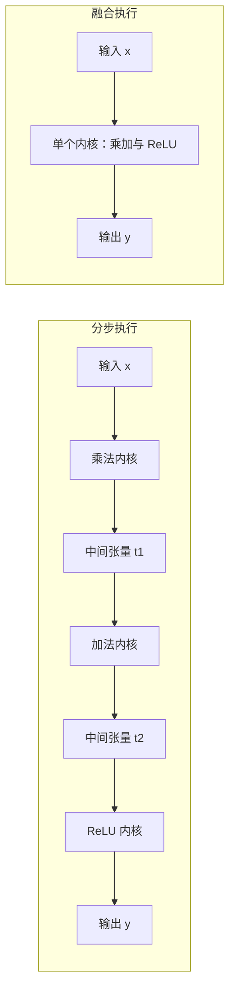

# PyTorch 已经会用 GPU，为什么还要自定义算子？

> **自定义算子 · 第一篇**
>
> 模型已经放到 GPU 上，并不意味着每一段计算都采用了最适合它的执行方式。理解自定义算子，要先看清：框架已经替我们做了什么，我们又准备改变什么。
>
> 本文面向会一点 Python、对 AI 计算感兴趣的读者。摄像头场景与内存流量计算均用于教学；代码未在本文环境运行，性能以目标环境测试为准。资料核对日期：2026 年 10 月 19 日。

<!-- more -->

前面一组「AI 并行计算入门」讲的是横向的切分：一次训练里，数据、参数、梯度、激活各被切成几份，又由哪次通信重新接上。

从这里开始，主线转向纵向的一层，把镜头拉近到**单个算子**。接下来八篇会追着一段很小的计算问到底：它怎样被框架调用、怎样注册、怎样接到自动微分、怎样做性能比较，最后又怎样换用别的框架与语言。

## 01｜三步小计算，值得自己写 CUDA 吗？

设想你在开发一台门口摄像头。画面进入检测模型之前，要先经过视觉链路中的一段简化特征变换：把数值乘上一个系数，加上偏移，再把负值变成零。

用 PyTorch 写出来，只有一行：

```python
y = torch.relu(x * scale + bias)
```

这里的 `x` 是张量，可以先把它理解为装着一批数字的多维数组；`scale` 和 `bias` 分别控制缩放和偏移。ReLU 则保留正数，把负数置为零。

假设 `scale=2`、`bias=-1`，输入和输出就是：

| 输入 x | 乘以 2 | 减去 1 | ReLU 输出 |
| --- | --- | --- | --- |
| 0 | 0 | −1 | 0 |
| 0.25 | 0.5 | −0.5 | 0 |
| 0.75 | 1.5 | 0.5 | 0.5 |
| 1 | 2 | 1 | 1 |

这只是一个用于观察计算链的教学公式，不是摄像头或视觉模型的通用预处理标准。真实模型需要什么变换，应以训练和部署约定为准。

只要 `x` 已在 CUDA GPU 上，这段表达式中的张量运算就可以使用对应的 GPU 实现。你不需要先写 CUDA，才能使用 GPU。

一个具体决定摆在面前：这段变换已经跑在 GPU 上，工程师仍想把乘法、加法和 ReLU 合成一个自定义算子，继续压缩其中一段的耗时。同事问了一句：**PyTorch 本来就在调用 GPU，这次手写到底准备省掉什么？**

这就是本文要回答的问题：**既然框架已经会算，自己写算子究竟是在补什么？**

答案通常有两类：一种是接入框架尚不了解的计算，另一种是为特定工作负载寻找更合适的执行方式。先把这两件事分清，才不会把“自定义”误解成“必然更快”。

## 02｜算子与内核：一个说算什么，一个负责怎样执行

在框架层面，算子描述一项计算的含义，以及输入输出等接口约定，例如加法、矩阵乘法、ReLU。

CUDA 内核（kernel）则是在 GPU 上执行的函数。它规定线程怎样找到数据、完成计算，并写出结果。

在上面的例子里，如果我们决定把三步合成一个计算单元，可以定义：

$$
\operatorname{affine\_relu}(x,s,b)_i=\max(sx_i+b,0)
$$

`i` 表示第几个元素，`s` 和 `b` 是标量参数。这是“算什么”。

接着，可以让每个 GPU 线程处理一个元素：读取 `x[i]`，依次乘、加、判断，最后写出 `y[i]`。这是“怎样执行”。

但计算函数还需要接入框架：谁检查输入？谁分配输出？训练时梯度怎么得到？这些属于接口与框架适配的工作。

| 层次 | 主要职责 | 本例中的含义 |
| --- | --- | --- |
| 算子定义 | 规定计算语义与接口约定 | 输入 x、s、b，输出形状与 x 相同 |
| 框架适配 | 校验、分配、选择实现并接入框架机制 | 接收张量，调用对应设备实现 |
| GPU 内核 | 安排线程和内存访问，执行计算 | 每个线程完成一个元素的三步变换 |

**算子与内核不是一一对应关系**：一个算子可能启动多个内核，多个算子也可能融合执行。因此，不能按 Python 函数的数量直接推断实际 GPU 内核数量。

“自定义”也不限定语言或设备。PyTorch 提供 Python 和 C++ 两类注册接口，用于把外部计算接入框架；具体采用哪条路线，取决于实现语言和需要配合的框架能力，后续文章会分别展开。CUDA 是 NVIDIA GPU 上的一条实现路线。官方文档同时强调，直接绑定一个外部函数，与让它正确配合自动微分、编译等框架机制，是不同层次的工作。[1][2]

## 先分清：接入一项计算，还是优化一项计算

开头提出的两类动机，后文不能只讲一类。先补上“接入”这一类的样子。

团队已经有一套经过验证的 CUDA 图像处理库，希望把它接进模型。即使这套库不存在“比 PyTorch 慢”的问题，也仍要解决：张量怎样传入、输出怎样返回、框架怎样理解这次调用。这些与性能无关，却必须先回答。

由此可以建立两个独立判断：

> **功能接入回答“怎样让框架使用这项计算”，性能优化回答“怎样让这项计算更高效”。**

第二条线更常被误解，下面从它说起：即使数据一直都在 GPU 上，分步执行也可能产生额外开销。

## 03｜数字一直在 GPU 上，为什么还会搬来搬去？

回到那行代码。一个容易忽略的细节是：**没有发生 CPU 与 GPU 之间的传输，不等于没有内存读写开销。**

当乘法、加法和 ReLU 分别执行、且中间结果落成张量时，数据会在多个内核之间来回搬运；如果把它们合成一个内核，同一份数据读完就能算完。两条路径可以并排对比：



左侧每一步都要把结果写回内存，再由下一个内核读回来；右侧只在最开始读一次、最后写一次。乘法写出的结果，要被加法读取；加法写出的结果，又要被 ReLU 读取。每一步算术很简单，读取、写出以及启动内核却都有成本。

PyTorch 官方调优指南将逐元素运算融合列为优化方法：把若干操作放进一个内核，有机会减少内存访问与内核启动开销。[3]

融合后的思路，就是让线程拿到一个元素后，连续完成后续步骤。中间数值尽量留在线程使用的寄存器（register）中——寄存器可理解为线程计算时使用的高速存储位置——最后只写出最终结果。

这类融合值得研究的收益，主要来自减少启动与中间读写，而不是乘法或加法本身。

### 算一笔账，但不要把它当跑分

假设有 N 个 float32 元素，每个元素 4 字节，三个步骤分别执行。忽略标量参数读取、缓存、分配及其他开销：

| 执行方式 | 每个元素的逻辑读取与写入 | 合计 |
| --- | --- | --- |
| 三步分别执行 | 每步读 4 字节、写 4 字节，共三步 | 24N 字节 |
| 理想的单内核融合 | 读一次输入，写一次输出 | 8N 字节 |

当 N 为 100 万时，分别约为 24 MB 与 8 MB，这里 MB 按十进制计算。

这是按照上述假设推导出的**逻辑内存流量**，并非硬件测得的显存访问量。缓存会影响实际流量，编译器也可能已经融合计算。

因此，不能进一步宣称“流量变成三分之一，速度就提升三倍”。运行时间还受启动、调度、内存带宽、实现方式等影响。

这个例子能支持的判断是：**如果中间结果的反复读写构成重要开销，融合就有研究价值。**

## 04｜这是否意味着，现在就该手写？

还不需要。

这段表达式本来就能用 PyTorch 原生算子准确表达。官方自定义算子指南建议，这类情况先写普通 Python 函数组合已有算子；调用框架不理解的外部实现时，再考虑自定义算子注册。[1]

而且，减少中间计算开销也可以由编译器完成。

`torch.compile` 能尝试捕获函数中的计算，并交给编译后端优化。在适合的 GPU 运算链上，TorchInductor 可以进行内核融合；具体优化结果取决于版本、后端与输入等条件。[3]

最小用法是：

```python
def preprocess(x, scale, bias):
    return torch.relu(x * scale + bias)

compiled_preprocess = torch.compile(preprocess)
```

你仍然描述原来的数学计算，让框架尝试改变执行方式。

这就给出了一个合理顺序：先有正确的原生实现，再观察瓶颈，尝试编译优化，最后判断手写是否值得。

真正值得继续研究自定义实现的情况，例如：

- 已有一段专用 C++／CUDA 库，需要把它接入模型。
- 某项操作难以用现有算子高效表达，组合实现产生了明显开销。
- 对固定形状、布局或业务约束，有可验证的专用优化机会。

“能组合表达”与“组合后性能合适”仍需分别判断。只是，不能在没有基线和证据时，把手写当成默认答案。

## 05｜先做一个小实验：编译前后，差在哪里？

本篇先建立性能基线。后续写出自定义实现后，才能在同样条件下比较。

实验面向安装了支持 CUDA 的 PyTorch 2.x、具备兼容 NVIDIA GPU 与驱动的环境；`torch.compile` 默认后端还需要与平台及版本匹配的编译依赖。完整计时脚本、环境记录与测量边界放在文末附录，正文只保留计算定义和对比方式。

**验证状态：创作环境未安装 PyTorch，以下代码未运行验证，性能以目标环境测试为准。**

先把计算和预期结果固定下来，再让编译器接上同一段计算：

```python
import torch

if not torch.cuda.is_available():
    raise RuntimeError("本实验需要可用的 CUDA GPU")

def preprocess(x, scale=2.0, bias=-1.0):
    return torch.relu(x * scale + bias)

with torch.inference_mode():
    sample = torch.tensor([0., 0.25, 0.75, 1.], device="cuda")
    expected = torch.tensor([0., 0., 0.5, 1.], device="cuda")
    torch.testing.assert_close(preprocess(sample), expected)

compiled_preprocess = torch.compile(preprocess, fullgraph=True)
```

先用四个能手算的数确认公式含义，再谈速度。`inference_mode()` 关闭本实验不需要的梯度记录，本篇比较的是前向计算。

`fullgraph=True` 让无法被完整捕获的写法直接报错，而不是悄悄退回分步执行；它不保证最终只生成一个 GPU 内核。

按附录脚本对每个输入规模分别记录默认分步执行（eager）与编译后的稳态耗时。读完数字，先回答三个问题：

1. 相同结果下，编译前后耗时是否变化？
2. 不同输入规模是否表现不同？
3. 这些差异是否值得继续调查？

如果要继续深挖，完整的计时脚本与测量口径见附录；测试顺序、波动、缓存与公平基线会留在后续文章展开。

## 06｜数字出来以后，先别急着宣布加速

附录里的这组测量可以回答：在这台机器上、这些输入规模下，两种实现的稳态调用耗时分别是多少。

它还不能单独回答：

- GPU 到底启动了几个内核？需要用 profiler 或时间线进一步观察。
- 瓶颈究竟是启动开销还是内存访问？需要更细的性能分析。
- 手写内核是否更快？本篇尚未实现，必须等待同条件比较。
- 摄像头最终快多少？需要重新测量完整业务链路。

最后一点尤其容易被忽略。

假设某应用一次处理需要 20 ms，其中这段计算占 1 ms；即使把它缩短到 0.5 ms，其他环节不变，总耗时也只是从 20 ms 降到 19.5 ms，降幅为 2.5%。

这是教学假设，但它揭示了一个实际判断方法：局部优化的价值，要看这部分原本占了多少时间。

因此，自定义算子的决策可以落到下面这张表上：

| 当前情况 | 更合理的下一步 |
| --- | --- |
| 原生组合能表达，性能没有问题 | 保持原生实现，并保留必要测试 |
| 性能不理想，尚未定位原因 | 先测量完整链路，定位热点 |
| 热点是一串可组合的运算 | 尝试 `torch.compile`，检查是否已有专用实现 |
| 已有外部计算库需要接入 | 设计接口并完成框架注册 |
| 现有路径仍无法满足目标 | 评估 Triton 或 CUDA C++ 专用实现，并计入开发与维护成本 |

## 07｜动手之前，先写下四个答案

如果你准备实现第一个自定义算子，先确认：

1. **算什么？**用一个公式和一组能手算的输入输出定义它。
2. **支持什么？**设备、数据类型、形状和内存布局分别有哪些约束？
3. **为什么要写？**接入外部功能，还是优化已测得的热点？
4. **怎样验收？**正确性与性能分别和谁比较，是否还需要梯度支持？

这四个答案，会决定后面的 CUDA 代码、框架接口与测试该怎样设计。

下一篇从最小的平方运算开始：让一个线程处理一个元素，把 GPU 内核、编译、Python 调用和结果验证连成一条清楚的路径。先让它正确地工作，再讨论它是否值得优化。

---

## 附录：完整基准脚本与测量边界

以下脚本把定义、计时与比较串成一条可运行路径。其中有三处刻意调整：同步时显式指定输入所在设备（`torch.cuda.synchronize(x.device)`），便于脚本复用到非默认设备；原生实现只保留一次统一比较，避免重复计时；`torch.version.cuda` 表示 PyTorch 构建时所使用的 CUDA 版本，不等同于本地驱动或完整工具链版本。

```python
import statistics
import time
import torch

if not torch.cuda.is_available():
    raise RuntimeError("本实验需要可用的 CUDA GPU")

print("PyTorch:", torch.__version__)
print("PyTorch 构建使用的 CUDA 版本:", torch.version.cuda)
print("GPU:", torch.cuda.get_device_name(0))
torch.manual_seed(0)

def preprocess(x, scale=2.0, bias=-1.0):
    return torch.relu(x * scale + bias)

@torch.inference_mode()
def measure_ms(fn, x, warmup=20, repeats=100, rounds=5):
    for _ in range(warmup):
        fn(x)
    torch.cuda.synchronize(x.device)          # 显式同步输入所在设备，便于复用

    timings = []
    for _ in range(rounds):
        torch.cuda.synchronize(x.device)
        start = time.perf_counter()
        for _ in range(repeats):
            fn(x)
        torch.cuda.synchronize(x.device)
        timings.append((time.perf_counter() - start) * 1000 / repeats)
    return statistics.median(timings)

compiled_preprocess = torch.compile(preprocess, fullgraph=True)

with torch.inference_mode():
    inputs = [torch.rand(n, device="cuda", dtype=torch.float32)
              for n in (1_024, 1_000_000, 8_000_000)]
    for x in inputs:
        # 每个形状先真实调用并核对输出，把首次编译排除在稳态计时之外
        reference = preprocess(x)
        actual = compiled_preprocess(x)
        torch.testing.assert_close(actual, reference, rtol=1e-5, atol=1e-6)

        eager_ms = measure_ms(preprocess, x)
        compiled_ms = measure_ms(compiled_preprocess, x)
        print(f"N={x.numel():>9}  eager={eager_ms:.6f} ms  "
              f"compiled={compiled_ms:.6f} ms")
```

测量边界：

- GPU 操作通常异步提交。Python 函数返回时，GPU 不一定已经完成计算；若不等待，主机时钟测到的可能主要是提交任务的时间。PyTorch 官方文档建议使用同步或 CUDA Event 正确计时。[4]
- 每组计时前后同步，重复调用后先算单次平均值，再取五组结果的中位数，以减弱偶发波动。
- 它测量的是**输入已驻留 GPU 时，Python 调用到该组 GPU 工作完成的平均墙钟耗时**，包含调用、调度、输出与中间张量分配等影响；不是纯内核耗时，也不是单次请求的尾延迟。
- 输入生成、主机到设备传输、摄像头解码和整个模型均不计入，测得的毫秒数不能直接当成摄像头响应时间。
- 融合可能改变浮点舍入过程，因此用容差比较，而非要求逐位完全相同；这仍不能代替后续的边界输入与梯度测试。
- 实际部署还应单独评估冷启动与可能发生的重新编译。运行时建议保持 GPU 空闲，并记录驱动、PyTorch 版本与完整参数。若编译失败，应先检查对应版本的支持条件，不应悄悄退回分步执行后仍标成“编译结果”。

---

## 参考资料

以下为本文采用的官方资料，核对日期为 2026 年 10 月 19 日。在线文档可能更新，实际开发请匹配本地安装版本。

1. [PyTorch Custom Operators](https://docs.pytorch.org/tutorials/advanced/custom_ops_landing_page.html)：自定义算子的适用场景、原生组合与外部实现的区别、框架注册的作用。
2. [Custom C++ and CUDA Operators](https://docs.pytorch.org/tutorials/advanced/cpp_custom_ops.html)：C++／CUDA 实现、算子定义与设备实现注册，以及框架能力的接入。
3. [Performance Tuning Guide — Fuse operations](https://docs.pytorch.org/tutorials/recipes/recipes/tuning_guide.html#fuse-operations)：逐元素操作的融合、内存访问与启动开销、TorchInductor 优化。
4. [CUDA semantics — Asynchronous execution](https://docs.pytorch.org/docs/stable/notes/cuda.html#asynchronous-execution)：CUDA 异步执行与计时同步要求。
