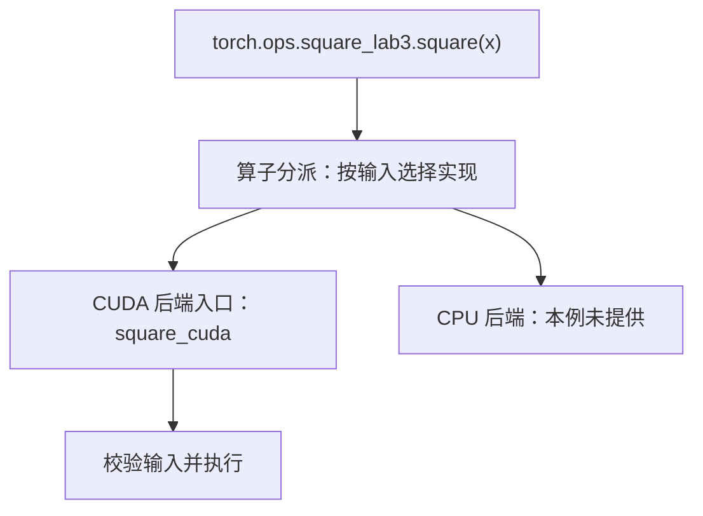

# CUDA 代码跑通了，为什么还没真正接入 PyTorch？

> **自定义算子 · 第三篇**
>
> Python 已经能调用你写的平方函数，输出也正确。接下来，要让它成为框架能够识别和分派的算子，还需要补上定义、注册与输入约定。这一步不改变平方公式，却改变了它与 PyTorch 协作的方式。
>
> 本文面向具备基础 Python 知识的 AI 兴趣者。提供独立的四文件教学工程；创作环境未安装 PyTorch，代码未经过 C++／CUDA 编译或 GPU 运行验证，不提供性能数据。资料核对日期：2026 年 10 月 19 日。

<!-- more -->

## 01｜同样是平方，为什么要换一个入口？

平方函数已经能从 Python 调用了，输出也正确。现在团队想给它增加 CPU 实现、接入训练或放进编译流程，却发现这些能力并没有随着绑定一起出现。第一步，是给框架一份正式的算子定义。

在 Python 中调用：

```python
y = ext.square(x)
```

输入 `[1, -2, 3, -4]`，结果是 `[1, 4, 9, 16]`。数学上没有问题。

这一刻，你完成的是一条调用路径：Python 通过绑定接口调用 C++，C++ 启动 CUDA 内核。

但 PyTorch 还需要知道：这项计算叫什么？接收哪些参数？是否修改输入？CUDA 张量应该走哪个实现？

直接绑定给出了一个可调用函数，正式算子注册则把这项计算纳入框架的算子体系。官方指南将两者明确区分，并提供 Python 与 C++ 注册方式。[1]

打个比方：pybind 绑定像把电话直接装进车间，你能打通，活也确实干了；正式注册则是把名字登记进查号台。关键在于——查号台不只是听到名字就派单：名字用于**定位算子**，输入携带的分派信息（设备、dtype、布局等）和当前框架状态共同**参与实现选择**，它不是只按函数名查一次表。

本篇把调用改成：

```python
y = torch.ops.square_lab3.square(x)
```

名字变长不是重点。重点是：**框架获得了一个明确的算子定义，以及与设备实现的对应关系。**

平方仍是教学练习；正式注册也不意味着结果突然更快。本篇解决的是接入与正确调用。

## 02｜两份信息：它是什么，交给谁执行

可以把注册理解为给框架提供两份信息，但不要把它想成添加一个名称就自动获得全部能力。

第一份是算子定义：

```cpp
m.def("square(Tensor input) -> Tensor");
```

这段描述叫**接口描述（schema）**，也就是接口契约的一部分。它说明输入是张量，返回一个张量。这份 schema 没有声明输入修改，也没有声明输入输出之间的别名关系。本例因此返回新分配的结果，不修改输入，也不让输出共享输入存储。

这里不必扩大到“任何视图都不能返回”：在**新分配存储**上返回某个视图，和**返回输入的视图**是两回事，本例只是用 `empty_like` 采取了更简单的做法。

第二份是设备实现注册：

```cpp
m.impl("square", &square_cuda);
```

结合 CUDA 注册块，它告诉框架：需要 CUDA 后端实现时，使用 `square_cuda`。

接收调用并根据分派信息选择实现的机制，叫**分派器（dispatcher）**，可以理解为框架的**算子分派层**。实际分派还涉及自动微分等分派键；本篇先聚焦普通 CUDA 张量的后端路径。

注意区分两个层次：**框架选择调用哪个实现**（分派层）与 **GPU 怎样安排线程执行**（内核），是两件不同的事。后者不经过分派器。



需要区分三件事：

| 工作 | 解决的问题 | 不会自动完成的事 |
| --- | --- | --- |
| 定义 schema | 框架知道参数和返回类型等契约 | 不会检查所有形状、dtype 和业务约束 |
| 注册 CUDA 实现 | 提供 CUDA 后端执行入口 | 不会自动生成 CPU 实现或搬运输入 |
| 编写运行时校验 | 拒绝实现不支持的输入 | 不会自动补出梯度与编译支持 |

因此，“注册成功”是接入的一步，不能当作训练、导出和编译等能力都已完成的证明。

## 03｜为什么 dtype、布局和设备不能混为一谈？

假设送来两个张量，它们都在 GPU 上，形状也相同：

- 一个是 float32；
- 另一个是 float16。

框架可能将它们都送往本例的 CUDA 后端入口，但这个入口只接受 float32。**注册了 CUDA，不代表已经支持 CUDA 上的所有数据类型。**

同样，形状相同的两个张量，内存布局也可能不同。转置后的张量通常通过步长（stride）描述新的访问方式；若内核仍把它当成标准连续数组，逻辑位置与物理位置就可能对不上。

第二篇已经在最小实现里加入设备、类型与布局检查。本篇保留这些保护，进一步明确它们各自负责什么，并增加正式注册和执行流测试。

| 本版接口约定 | 具体含义 |
| --- | --- |
| 计算 | 每个输出元素等于对应输入元素的平方 |
| 输入 | CUDA 上的普通稠密张量，标准连续布局，float32 |
| 形状 | 支持标量、多维张量和空张量 |
| 数量上限 | 不超过 2³¹−1 个元素，作为教学实现的限制 |
| 输出 | 与输入形状、dtype、设备一致；新分配，不修改输入 |
| 梯度 | 本篇不支持，主动拒绝 `requires_grad=True` |
| CPU／其他后端 | 未提供实现，不承诺自动回退 |

一个直观的对照实验，能同时看清「注册到底增加了什么」。对三种输入分别调用同一个 `square`：

| 输入 | 会发生什么 |
| --- | --- |
| CUDA float32 连续张量 | 分派层找到 CUDA 入口，进入 `square_cuda`，正常执行 |
| CUDA float16 张量 | 同样找到 CUDA 入口，但被实现内部的 dtype 检查拒绝 |
| CPU 张量 | 没有注册对应 CPU 实现，通常在后端分派阶段就失败 |

前两行都进入了 **CUDA 后端入口**，区别在入口内部的校验；第三行则在**更早的分派阶段**就找不到落点。可见**后端分派与输入校验不是同一层工作**。

也就是说：本例按 CUDA 后端注册了**一个入口**，并没有为每种 dtype 分别注册实现，float32 限制由入口内部检查。真实开发应匹配已安装的 PyTorch 与 CUDA 版本，具体错误措辞也可能随版本变化。

如果希望支持非连续输入，可以复制成连续张量，也可以按 stride 改写内核；两种方式都有成本。本篇选择显式拒绝，避免把额外复制隐藏在实现里。

## 04｜当前设备与执行流（stream），分别在管什么？

这两个概念很容易混淆。

**设备决定在哪张 GPU 上工作。**如果输入在 GPU 1，而调用所在的主机线程当前 CUDA 设备是 GPU 0，不能硬编码使用 GPU 0 来启动内核。`CUDAGuard` 在函数作用域中选择输入设备，退出时恢复之前的设备选择。

**执行流（stream）决定任务排进哪条队列。**同一条执行流中的任务按提交顺序执行；不同执行流之间**不能假定存在所需顺序**，需要显式建立依赖。PyTorch 官方 CUDA 语义文档解释了这些顺序与同步关系。[3]

设想应用在一条非默认执行流中依次提交：

1. 把输入填成 3；
2. 调用平方；
3. 把平方结果加 1。

期望结果是 10。如果平方内核擅自跑到另一条没有建立依赖的执行流，可能读到尚未准备好的输入，或者下游提前读取尚未写完的输出。

正确做法是：选好输入设备，再取得该设备当前的执行流，将内核提交到那里。官方 C++／CUDA 教程也采用当前执行流启动内核。[4]

这不是要求每次计算后都全设备同步。相反，正确接入执行流，正是为了在保留异步执行的同时满足顺序约束。

## 05｜完整工程：保留内核，替换注册方式

本篇新增的核心其实只有三处。先看它们，再看完整工程。

**一、定义算子**——给框架一份明确的接口描述：

```cpp
TORCH_LIBRARY(square_lab3, m) {
    m.def("square(Tensor input) -> Tensor");
}
```

**二、关联 CUDA 实现**——告诉框架 CUDA 后端走哪个函数：

```cpp
TORCH_LIBRARY_IMPL(square_lab3, CUDA, m) {
    m.impl("square", &square_cuda);
}
```

**三、加载库并触发注册**——按普通动态库加载，加载时执行注册：

```python
load(..., is_python_module=False)
```

**平方计算与设备保护沿用第二篇，本篇新增的只是注册与加载方式。** 下面建立一个新目录，放入四个文件；它是独立工程，不需要先编译第二篇的扩展。

| 文件 | 职责 |
| --- | --- |
| `square_op.cpp` | 定义算子，注册 CUDA 后端实现 |
| `square_kernel.cu` | 校验输入、管理设备和输出、启动内核 |
| `load_square.py` | 构建并加载动态库，暴露 Python 调用入口 |
| `test_square.py` | 验证数值、输入边界、执行流和可选双卡场景 |

### 文件一：`square_op.cpp`

```cpp
#include <ATen/ATen.h>
#include <torch/library.h>

at::Tensor square_cuda(const at::Tensor& input);

// 定义算子名称和接口契约。
TORCH_LIBRARY(square_lab3, m) {
    m.def("square(Tensor input) -> Tensor");
}

// 为这个算子提供 CUDA 后端实现。
TORCH_LIBRARY_IMPL(square_lab3, CUDA, m) {
    m.impl("square", &square_cuda);
}
```

`square_lab3` 是命名空间，用于组织算子并减少命名冲突。`square` 是算子名。

`TORCH_LIBRARY` 与 `TORCH_LIBRARY_IMPL` 分别承担定义和实现注册；这是官方教程介绍的常规 C++ 注册方式。[2][4]

这里没有 `PYBIND11_MODULE`。下一步会把它当作普通动态库加载，加载时执行注册逻辑，调用入口由 `torch.ops` 提供。

### 文件二：`square_kernel.cu`

```cpp
#include <ATen/ATen.h>
#include <ATen/cuda/CUDAContext.h>
#include <c10/cuda/CUDAGuard.h>
#include <c10/cuda/CUDAException.h>
#include <cuda_runtime.h>
#include <cstdint>
#include <limits>

__global__ void square_kernel(
    const float* input, float* output, int64_t n) {
    const int64_t i = static_cast<int64_t>(blockIdx.x)
                      * blockDim.x + threadIdx.x;
    if (i < n) {
        const float value = input[i];
        output[i] = value * value;
    }
}

at::Tensor square_cuda(const at::Tensor& input) {
    TORCH_CHECK(input.is_cuda(), "input must be CUDA");
    TORCH_CHECK(input.layout() == c10::kStrided,
                "input must have strided layout");
    TORCH_CHECK(input.scalar_type() == at::kFloat,
                "input must be float32");
    TORCH_CHECK(input.is_contiguous(), "input must be contiguous");
    TORCH_CHECK(!input.requires_grad(),
                "square_lab3 does not support autograd yet");
    TORCH_CHECK(input.numel() <= std::numeric_limits<int>::max(),
                "too many elements for this tutorial implementation");

    const c10::cuda::CUDAGuard guard(input.device());
    auto output = at::empty_like(input);
    const int64_t n = input.numel();
    if (n == 0) {
        return output;
    }
    constexpr int threads = 256;
    const int blocks = static_cast<int>((n + threads - 1) / threads);
    cudaStream_t stream = at::cuda::getCurrentCUDAStream();
    square_kernel<<<blocks, threads, 0, stream>>>(
        input.data_ptr<float>(), output.data_ptr<float>(), n);
    C10_CUDA_KERNEL_LAUNCH_CHECK();
    return output;
}
```

计算部分与第二篇一致。三个关键细节值得再确认：

- 先检查类型，再使用 `data_ptr<float>()`，避免错误解释数据。
- 空输入直接返回独立输出，避免启动零个线程块。
- `empty_like` 分配输出，所有有效元素随后被写入；没有原地修改，也没有返回输入视图。

launch check 检查启动后的错误状态，但不负责等待整个内核完成。测试会在适当位置同步，不把同步塞进每次算子调用中。

### 文件三：`load_square.py`

```python
from pathlib import Path
import torch
from torch.utils.cpp_extension import load

if not torch.cuda.is_available():
    raise RuntimeError("本教学工程需要可用的 CUDA GPU")

root = Path(__file__).resolve().parent
load(
    name="square_lab3_ext",
    sources=[str(root / "square_op.cpp"),
             str(root / "square_kernel.cu")],
    extra_cflags=["-O2"],
    extra_cuda_cflags=["-O2"],
    is_python_module=False,
    verbose=True,
)

square = torch.ops.square_lab3.square.default
```

`is_python_module=False` 很关键：加载普通动态库，不寻找 Python 模块初始化入口。官方扩展工具文档说明了这种加载方式。[5]

注册完成后，通过 `torch.ops.square_lab3.square` 可以访问算子；这里显式选择 `.default` 这个默认重载。构建模块名 `square_lab3_ext`、命名空间 `square_lab3` 和算子名 `square` 各有用途，不要求写成同一个名字。

不要把第二篇的 `PYBIND11_MODULE` 机械复制进来，也不要在不同文件中反复定义同一个命名空间的 `TORCH_LIBRARY`。本例只定义一次，再注册实现。

## 06｜验收：结果正确，还要调用方式正确

下面三个代码块按顺序组成完整的 `test_square.py`。

### 先验证数值和输入约束

```python
import torch
from load_square import square

torch.manual_seed(0)
print("PyTorch:", torch.__version__, "CUDA runtime:", torch.version.cuda)
print("GPU:", torch.cuda.get_device_name(0))

for shape in [(0,), (1,), (255,), (256,), (257,), (1000,), (2, 3, 5), ()]:
    x = torch.randn(shape, device="cuda:0", dtype=torch.float32)
    before = x.clone()
    y = square(x)
    torch.cuda.synchronize(x.device)
    torch.testing.assert_close(y, x.square(), rtol=1e-6, atol=1e-7)
    torch.testing.assert_close(x, before)
    assert (y.shape, y.dtype, y.device) == (x.shape, x.dtype, x.device)
    if x.numel() > 0:
        assert y.data_ptr() != x.data_ptr()
    print("PASS shape:", shape)

def expect_error(x, keyword):
    try:
        square(x)
    except (RuntimeError, NotImplementedError) as error:
        assert keyword.lower() in str(error).lower(), str(error)
    else:
        raise AssertionError("该输入本应被拒绝")

expect_error(torch.ones(4), "CPU")
expect_error(torch.ones(4, device="cuda:0", dtype=torch.float16), "float32")
expect_error(torch.ones(2, 3, device="cuda:0").t(), "contiguous")
expect_error(torch.ones(4, device="cuda:0", requires_grad=True), "autograd")
print("PASS rejected inputs")
```

这四个用例正好落在第 03 节的两层上：CPU 输入在后端分派阶段就失败，不进入 `square_cuda`；float16、非连续和带梯度的输入会进入 CUDA 入口，再由入口内部检查拒绝。两者的错误措辞都可能随版本变化，测试只校验关键字。

指针检查只是配合本例新分配逻辑的基础验证，不是通用的别名检测算法；空张量也没有可借此比较的有效数据区域。

### 再验证非默认执行流中的连续计算

```python
with torch.cuda.device(0):
    stream = torch.cuda.Stream()
    stream.wait_stream(torch.cuda.current_stream())
    with torch.cuda.stream(stream):
        x = torch.empty(65_537, device="cuda:0")
        x.fill_(3.0)
        y = square(x)
        z = y + 1.0
    stream.synchronize()
    torch.testing.assert_close(z, torch.full_like(z, 10.0))
    print("PASS non-default stream")
```

这段测试把“分配与准备输入—平方—使用输出”放进同一条执行流，中间不插入全设备同步；最后等待这条执行流完成，再检查结果。把分配也放进来，能让“分配、准备、计算、消费”的叙述保持一致，减少额外解释内存生命周期的需要。

如果每个小步骤之后都先全设备同步，一些错误的执行流使用方式反而可能被掩盖。这里保留依赖链，以增加发现顺序问题的机会。

测试过程中保留了 `x`、`y`、`z`，直到这条执行流完成。更一般的跨流交接还需考虑 `wait_stream`、`record_stream` 与内存生命周期等问题，不应只靠一个上下文管理器推断所有场景都安全。[3]

一次通过不能穷尽证明并发正确性，仍要结合实现检查。尤其不要通过添加“每次都同步”来掩盖错误后，再宣称保留了原有异步行为。

### 有两张 GPU 时，检查设备选择与恢复

```python
if torch.cuda.device_count() >= 2:
    with torch.cuda.device(0):
        x1 = torch.randn(257, device="cuda:1")
        previous_device = torch.cuda.current_device()
        y1 = square(x1)
        assert torch.cuda.current_device() == previous_device
        assert y1.device == x1.device
        torch.cuda.synchronize(x1.device)
        torch.testing.assert_close(y1, x1.square())
    print("PASS device selection and restoration")
else:
    print("SKIP two-GPU test: fewer than two GPUs")
```

这个场景故意让当前设备为 GPU 0，输入却位于 GPU 1。它检查两件事：输出是否在输入设备上，以及调用后是否恢复原先的设备选择。

没有双卡就明确跳过，不能将跳过写成验证通过。

## 07｜怎样运行，怎样理解结果？

环境需要支持 CUDA 的 PyTorch、兼容 NVIDIA 驱动、本地 CUDA Toolkit、C++ 编译器和 Ninja。仅能运行 GPU 张量运算，不代表本地已经安装 `nvcc`。

先检查工具链并安装 Ninja：

```bash
python -c "import torch; print(torch.__version__, torch.version.cuda, torch.cuda.is_available())"
nvcc --version
c++ --version
python -m pip install ninja
```

在四个文件所在目录运行：

```bash
python test_square.py
```

构建资源紧张时，可使用 `MAX_JOBS=1 python test_square.py`。找不到 Toolkit 时，需要根据真实安装位置配置 `CUDA_HOME`。[5]

**本文未实际执行这些命令。**预期验收条件是：形状测试、非法输入测试和非默认 stream 测试通过；双卡测试按真实设备数量执行或跳过。首次编译的耗时不属于算子运行耗时，本篇没有做性能比较。

排查问题时，可以先按发生阶段分类：

| 现象 | 优先判断 |
| --- | --- |
| 编译找不到 nvcc 或头文件 | 本地开发工具链与版本匹配 |
| 加载提示缺少 `PyInit_...` | 是否仍按 Python 模块加载，却没有绑定入口 |
| `torch.ops` 找不到算子 | 动态库是否成功加载、命名空间与名字是否一致 |
| 提示 CPU 后端不可用 | 本例没有注册 CPU 实现，输入设备是否符合约定 |
| dtype 或 contiguous 报错 | 输入不符合显式约束 |
| GPU 非法访问或结果不稳定 | 索引、设备、stream、布局及生命周期 |

真实开发应匹配已安装的 PyTorch 与 CUDA 版本。本例采用常规 ATen／LibTorch 接口，不承诺编译产物能跨 PyTorch 版本直接复用。

## 08｜这次接入，到底完成到哪一步？

一个常见误解是：“算子已经注册，那训练和编译应该自动可用了。”

实际上，它们还需要各自的规则和验证。PyTorch 的官方教程分别讨论后端实现、FakeTensor 和自动微分等能力；不能用其中一项替代全部能力。[4][6]

下表区分“已提供代码”和“已运行验证”——前者只说明代码写出来了，不等于已经在 GPU 上跑通。

| 能力 | 本篇状态 |
| --- | --- |
| 正式名称和 schema | 已提供代码 |
| CUDA 后端实现 | 已提供代码 |
| 非法输入拒绝与设备／执行流使用 | 已提供实现与测试方法，尚未 GPU 验证 |
| CPU 或其他设备后端 | 未实现 |
| 自动微分 | 未实现，主动拒绝需要梯度的输入 |
| FakeTensor、`torch.compile`、`vmap` 等 | 未配置或验证，不作支持承诺 |

先分清两个维度，避免把它们混成互斥的“多条路线”。**实现方式**和**部署目标**是两件事，各自都要逐项验证：

- **实现方式**：本篇用 C++ 注册加 CUDA 内核。Triton 提供了另一种 GPU 内核编写方式，它可以直接配合部分编译场景；当需要更完整的算子接口和框架协作时，再采用对应的注册与包装方式，后续单独展开。
- **部署目标**：若要面向无 Python 推理环境（例如配合 AOTInductor），官方把“计划配合 AOTInductor 使用”列为考虑 C++ 注册方式的理由之一；但这是部署目标，不是与实现方式并列的第三条路线。[1]

换路线的判断依据是：自动微分、编译、导出和运行环境需要哪些能力，就逐项验证哪些。本篇先完成常规 C++ 注册与 CUDA 后端执行。

不要删除梯度检查，然后把“前向没报错”当成训练已经正确；也不要随意 `detach()` 来消除错误，那可能切断模型需要的梯度路径。

下一篇将从这个断点继续：**自定义计算的前向结果正确，框架怎样知道该把梯度传回哪里？**我们会用带参数的激活函数，分别解释输入梯度与参数梯度，并用参照计算验证它们。

对于本篇，值得保留的一条实践习惯是：每增加一种框架能力，就写清约定、提供实现、补上相应验证。这样，一个“小小的 CUDA 函数”才能逐步成为可靠使用的组件。

---

## 参考资料

以下为官方资料，核对日期为 2026 年 10 月 19 日。在线内容可能更新，实际开发应匹配本地安装版本。

1. [PyTorch Custom Operators](https://docs.pytorch.org/tutorials/advanced/custom_ops_landing_page.html)：外部函数绑定、正式算子注册与框架能力的区别。
2. [Registering a Dispatched Operator in C++](https://docs.pytorch.org/tutorials/advanced/dispatcher.html)：schema、dispatcher 与后端实现注册。
3. [CUDA semantics](https://docs.pytorch.org/docs/stable/notes/cuda.html)：设备、当前 stream、跨流同步和内存生命周期。
4. [Custom C++ and CUDA Operators](https://docs.pytorch.org/tutorials/advanced/cpp_custom_ops.html)：常规 C++ 注册、CUDA 实现与当前 stream，以及后续框架能力的接入。
5. [torch.utils.cpp_extension](https://docs.pytorch.org/docs/stable/cpp_extension.html)：`load`、`is_python_module=False`、Ninja、Toolkit 与构建参数。
6. [torch.library](https://docs.pytorch.org/docs/stable/library.html)：算子定义及自动微分、FakeTensor 等注册接口。
