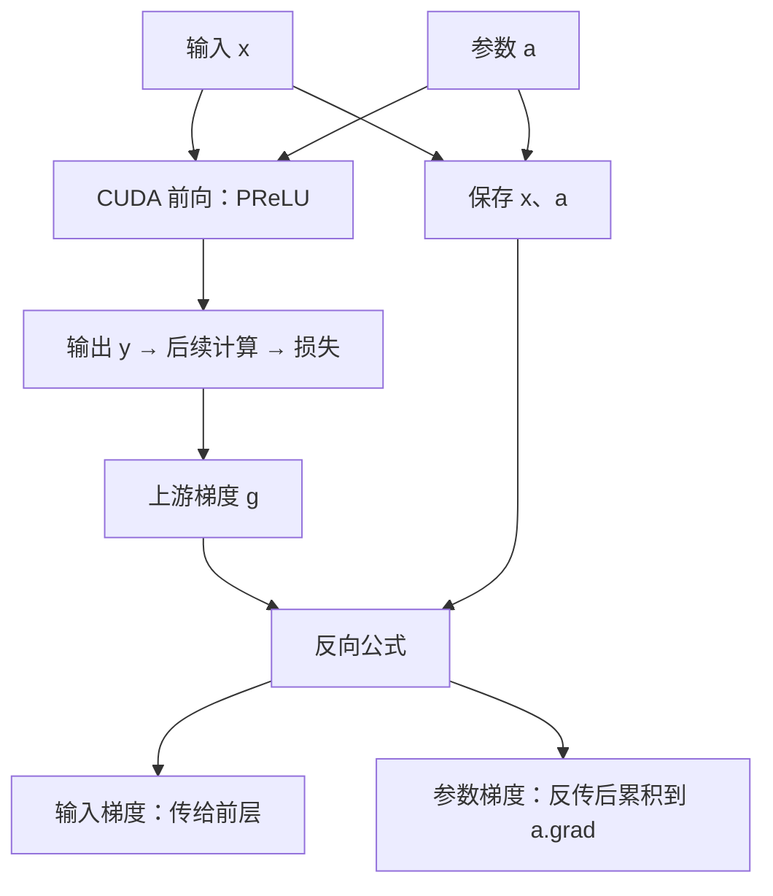

# 自定义算子算对了，模型为什么还是学不会？

> **自定义算子 · 第四篇**
>
> 前向计算告诉模型“结果是多少”，反向传播告诉模型“该往哪里调整”。训练支持缺失时，程序可能在反向阶段直接报错，也可能只给出一句让人摸不着头脑的提示。当然，“模型学不会”还可能由数据、损失、优化器等其他环节造成，本文只聚焦算子这一环：用一个只有一个可学习参数的激活函数，把输入梯度、参数梯度，以及它们与 CUDA 代码的连接讲清楚。
>
> 本文面向具备基础 Python 知识的 AI 兴趣者。提供完整四文件教学工程；创作环境未安装 PyTorch，代码未经过 C++／CUDA 编译或 GPU 运行验证。手算数值均为数学推导，不是实测日志。资料核对日期：2026 年 10 月 19 日。

<!-- more -->

## 01｜输出对了，为什么训练还没接通？

设想一个摄像头视觉模型。中间的特征经过某个激活函数，再交给后面的网络判断画面内容。

你把激活函数换成自己的 CUDA 实现。相同输入下，输出和参照实现一致。可是准备训练时，问题出现了：这段外部计算该怎样把梯度传回前面的网络？它自己的参数又该怎样更新？

先划清适用范围：如果你的计算完全由 PyTorch 已知算子组合而成，通常可以直接利用自动微分，不必手动写反向；本文接入的是框架无法直接分析内部计算的 CUDA 实现，因此需要提供反向公式。**不要把“写一个新函数就必须手写 backward”当成普遍规则。**

前两篇已经走通 CUDA 调用，第三篇又把计算注册进 PyTorch。但正式注册只是让框架知道这项计算的接口和设备实现；**框架不会因为读过算子名字，就自动推导任意外部 CUDA 内核的梯度。**

对本文这种已注册的 C++／CUDA 自定义算子，PyTorch 官方教程推荐通过 `torch.library.register_autograd` 添加训练支持，并允许用框架已有算子表达反向计算。[1]

本篇实现一个参数化 ReLU，简称 PReLU。它的负半轴斜率可以学习。这个场景用于解释模型内部计算，不表示摄像头模型一定需要更换激活函数，也不承诺训练精度提升。

## 02｜只增加一个参数，计算就有了两条梯度路径

普通 ReLU 把负数变成零。PReLU 允许负数保留一部分：

$$
y_i=
\begin{cases}
x_i,&x_i>0\\
a x_i,&x_i\le 0
\end{cases}
$$

$x_i$ 是第 $i$ 个输入，`a` 是所有元素共享的一个可学习参数。PyTorch 原生 PReLU 支持共享参数或按通道参数，本篇只实现共享的一个参数。[2]

当 `a=0.25` 时：

| 输入 x | 输出 y | 原因 |
| --- | --- | --- |
| −2 | −0.5 | 负数乘上 a |
| 0 | 0 | a × 0 |
| 3 | 3 | 正数保持不变 |

训练时，影响输出的既有输入 `x`，也有参数 `a`。因此反向传播需要回答两个不同问题：

- 输入变一点，损失会怎样变化？这决定梯度如何传给前面的网络。
- 参数 a 变一点，损失会怎样变化？这决定这个参数如何更新。

不要把“算子没有权重”和“算子不需要反向传播”混为一谈。即使是没有可学习参数的计算，只要前面的网络需要学习，通常仍要把梯度传回输入。

## 03｜梯度不是重新计算输出，而是传递变化的影响

先把这件事和“把输出重算一遍”区分开：反向传播更像一次成本分摊。最终账目差了 1 元，不是把整本账重做，而是沿原路往回问每个环节——它该为这 1 元的偏差负多少责任。

设最终损失为 L，后面的网络已经传来：

$$
g_i=\frac{\partial L}{\partial y_i}
$$

`g_i` 表示输出 `y_i` 的微小变化对损失的局部影响。在代码里，这个上游梯度通常叫 `grad_output`。

我们不需要重新推导后面整个模型，只需把这份影响穿过当前算子。这就是链式法则。

### 第一条：输入梯度为什么乘上 a？

当输入为正，输出就是输入，局部斜率为 1；当输入为负，输出是 a 倍输入，局部斜率为 a。

所以：

$$
\frac{\partial L}{\partial x_i}=
\begin{cases}
g_i,&x_i>0\\
a g_i,&x_i<0
\end{cases}
$$

注意是 **a 乘以上游梯度**。如果把 a 传错，前向仍可能正确，输入梯度却已经错误。

在 `x=0` 且 `a≠1` 时，两侧斜率不同，不存在通常意义上的唯一导数。实现必须约定零点的反向行为。本篇选择负分支，即输入梯度为 `a × g`；零点将单独按这一约定测试，不用跨越零点的数值差分判断对错。

### 第二条：参数梯度为什么要把贡献加起来？

正数分支不用 a，对它的梯度贡献为零。负数分支为 `a × x_i`，对 a 的局部导数是 `x_i`。

所有元素共享同一个参数，贡献需要求和：

$$
\frac{\partial L}{\partial a}
=\sum_{x_i\le0}g_i x_i
$$

求和不是额外的平均操作。若损失函数已经使用均值，它的缩放已经包含在 g 中；这里不能再随意除以元素数量。

### 手算一次，别让公式悬在空中

令 `x=[−2, 0, 3]`、`a=0.25`，并设上游梯度 `g=[2, 3, 4]`。

可以构造一个简单损失 `L=2y₀+3y₁+4y₂`，使输出对应的梯度恰好为这组数。

| 位置 | x | g | 输入梯度 | 对 a 的梯度贡献 |
| --- | --- | --- | --- | --- |
| 0 | −2 | 2 | 0.25 × 2 = 0.5 | 2 × (−2) = −4 |
| 1 | 0 | 3 | 按约定：0.25 × 3 = 0.75 | 3 × 0 = 0 |
| 2 | 3 | 4 | 4 | 0 |

因此输入梯度为 `[0.5, 0.75, 4]`，参数梯度为 `−4`。后面的测试将直接检查这两个结果。

## 04｜用 PyTorch 算子表达并注册反向

公式有了，先让它和代码对上号，再谈工程接线。反向的四个数学动作与实现位置一一对应：

| 数学含义 | 实现位置 |
| --- | --- |
| 正分支斜率为 1，负分支斜率为 a | `slope = torch.where(positive, ...)` |
| 输入梯度＝上游梯度 × 局部斜率 | `grad_input = grad_output * slope` |
| 每个非正输入贡献 `g × x` | `contributions = torch.where(positive, ..., grad_output * input)` |
| 所有共享位置的贡献相加 | `contributions.sum().reshape_as(a)` |

反向阶段需要前向用过的原始输入 x 和参数 a。下面这段就是反向的全部核心：

```python
def setup_context(ctx, inputs, output):
    input, a = inputs
    ctx.save_for_backward(input, a)      # 把反向要用的张量交给框架保存

def backward(ctx, grad_output):
    input, a = ctx.saved_tensors         # 取回前向保存的 x 和 a
    positive = input > 0                 # 与前向同一套分支条件
    grad_input, grad_a = None, None
    if ctx.needs_input_grad[0]:          # 只有需要时才计算输入梯度
        slope = torch.where(positive, torch.ones_like(input), a.reshape(()))
        grad_input = grad_output * slope # 上游梯度 × 局部斜率
    if ctx.needs_input_grad[1]:
        contributions = torch.where(
            positive, torch.zeros_like(input), grad_output * input
        )
        grad_a = contributions.sum().reshape_as(a)  # 汇总共享参数的贡献
    return grad_input, grad_a

torch.library.register_autograd(
    "prelu_lab4::prelu", backward, setup_context=setup_context
)
```

`setup_context` 保存反向需要的张量，`backward` 接收上游梯度，并按输入顺序返回两个梯度。某个输入不需要梯度时，返回 `None`。注册之后，框架在反向时才会调用这段代码。[3]

`torch.where` 的意思是按条件选择：正数位置取一种表达式，其他位置取另一种。`a.reshape(())` 把单元素参数视为标量参与广播，避免标量输入与 `(1,)` 形状参数广播时多出一个维度，保证梯度形状与输入一致。参数梯度则收回到原来的 `(1,)` 形状。



按上图走一遍：`backward` 只负责**算出并返回**两份梯度；输入梯度交给前层网络，参数梯度在 `loss.backward()` 时被累加到 `a.grad`，随后由优化器读取 `a.grad` 完成参数更新——这三步是分开的动作，下一节会用一张表把它们对齐。

`a` 与 `grad_a` 必须分清：前者是当前参数，后者是损失对参数的梯度。不能从初始为零的 `grad_a` 中“读出 a”，也不能把梯度缓冲区当成参数内存。

参数还是张量，需要保留正确的设备、类型与形状。本例把共享参数 a 定义为形状 `(1,)`；反向返回的参数梯度也必须是 `(1,)`，因此归约后会使用 `reshape_as(a)`。

两个工程要点：

- 与第三篇不同，`a` 必须作为张量输入，而不是在 Python 中调用 `a.item()` 转成普通数字。否则这个参数与自动微分的连接会被切断。
- 实际文件 `prelu.py` 里，**动态库加载段在前、注册段在后**——算子定义必须先存在，之后才能注册梯度；完整文件顺序见附录 A。这里先展示注册段，因为它才是本篇的教学核心。

本篇采用 **CUDA 前向＋原生 PyTorch 反向公式**。这是为了先把数学和接线讲清，而不是一次加入第二套 CUDA 内核、原子操作与归约调优。原生反向张量运算仍可在 GPU 上执行，不代表把数据搬回 CPU。[1]

## 05｜用四层检查验证实现

“代码跑通”不等于“训练接通”。本篇把验收拆成四层，每层回答一类不同的怀疑，缺一层就可能漏掉一类错误：

| 验证层次 | 解决什么问题 |
| --- | --- |
| 手算样例 | 检查公式与代码是否一致 |
| 原生 PReLU 对照 | 减少自己与自己互相验证的问题 |
| 数值梯度检查 | 从扰动角度检查解析梯度 |
| 一次优化器更新 | 检查训练更新链路（下一节展开） |

动手前还要分清四个容易混淆的调用。它们正好串起“数学公式 → 框架调用 → 参数变化”这条线：

| 操作 | 本文中的作用 |
| --- | --- |
| 自定义 `backward` | 计算并返回各输入对应的梯度 |
| `torch.autograd.grad` | 直接取得梯度，用于检查 |
| `loss.backward()` | 将梯度累积到需要梯度的叶张量 `.grad` 中 |
| `optimizer.step()` | 使用参数梯度更新参数 |

注意一个初学者最容易踩的点：`torch.autograd.grad` 返回的梯度**不会**自动写进任何 `.grad`，它把结果直接交给你；`loss.backward()` 才会把梯度累加到 `.grad`。所以前三层检查用 `autograd.grad` 取值比对，不会污染 `.grad`；第四层训练接线才换成 `loss.backward()`。[6]

正文第 05–06 节的各段，加上附录 A 的批量参照矩阵，共同组成 `test_prelu.py`。先看前三层检查：

### 检查一：手算对照，连同边界参数

先检查第 03 节的手算结果，包括零点约定：

```python
import torch
import torch.nn.functional as F
from prelu import prelu

print("PyTorch:", torch.__version__, "built with CUDA:", torch.version.cuda)
print("GPU:", torch.cuda.get_device_name(0))
torch.manual_seed(0)

x = torch.tensor([-2., 0., 3.], device="cuda", requires_grad=True)
a = torch.tensor([0.25], device="cuda", requires_grad=True)
g = torch.tensor([2., 3., 4.], device="cuda")
y = prelu(x, a)
gx, ga = torch.autograd.grad(y, (x, a), grad_outputs=g)
torch.testing.assert_close(y, torch.tensor([-0.5, 0., 3.], device="cuda"))
torch.testing.assert_close(gx, torch.tensor([0.5, 0.75, 4.], device="cuda"))
torch.testing.assert_close(ga, torch.tensor([-4.], device="cuda"))
print("PASS hand-derived forward and gradients")
```

使用非全 1 的上游梯度，有助于发现反向代码漏乘 `grad_output` 的错误。单纯检查 `y.sum().backward()`，覆盖不了同样多的问题。

再补两组有明确含义的边界输入。第一组把 a 换成三个特殊值：`a=0` 时 PReLU 应表现得像 ReLU，`a=1` 时应表现得像恒等函数，负斜率则检验分支条件没有写反。三组的参数梯度都应是 `−4`——它只由负分支的 `g × x` 决定，与 a 的取值无关。

```python
for av in (0.0, 1.0, -0.3):
    x_b = torch.tensor([-2., 0., 3.], device="cuda", requires_grad=True)
    a_b = torch.tensor([av], device="cuda", requires_grad=True)
    y_b = prelu(x_b, a_b)
    gx_b, ga_b = torch.autograd.grad(y_b, (x_b, a_b), grad_outputs=g)
    torch.testing.assert_close(gx_b, torch.tensor([2 * av, 3 * av, 4.], device="cuda"))
    torch.testing.assert_close(ga_b, torch.tensor([-4.], device="cuda"))

# 第二组：全正输入完全不用 a，参数梯度必须为零
x_pos = torch.tensor([1., 2., 3.], device="cuda", requires_grad=True)
a_pos = torch.tensor([0.25], device="cuda", requires_grad=True)
y_pos = prelu(x_pos, a_pos)
gx_pos, ga_pos = torch.autograd.grad(y_pos, (x_pos, a_pos), grad_outputs=g)
torch.testing.assert_close(gx_pos, g)
torch.testing.assert_close(ga_pos, torch.zeros(1, device="cuda"))
print("PASS boundary values of a and all-positive inputs")
```

零点行为已由手算用例单独固定；不能从前向分段函数的等号写法，直接推断某个实现的反向约定。

### 检查二：与原生 PReLU 对照

在远离零点的输入上，与 PyTorch 自带的 PReLU 比较前向和两条梯度，避免只和自己的公式互相验证：

```python
x = torch.tensor([-2., -0.5, 1., 3.], device="cuda", requires_grad=True)
a = torch.tensor([0.25], device="cuda", requires_grad=True)
xr = x.detach().clone().requires_grad_(True)
ar = a.detach().clone().requires_grad_(True)
y, yr = prelu(x, a), F.prelu(xr, ar)
g = torch.tensor([2., -1., 0.5, 3.], device="cuda")
grads = torch.autograd.grad(y, (x, a), grad_outputs=g)
refs = torch.autograd.grad(yr, (xr, ar), grad_outputs=g)
torch.testing.assert_close(y, yr)
for actual, target in zip(grads, refs):
    torch.testing.assert_close(actual, target)
print("PASS native PReLU comparison away from zero")
```

在两个 dtype、多种形状、不同“哪个输入需要梯度”的组合下，与原生算子组成的同语义参照批量比对，放在附录 A，供复现时一并执行。

### 检查三：用微小扰动检查反向公式

参照实现也可能写错，因此还要换一种思路：把输入或参数增加、减少一个很小的量，观察输出变化，再与注册的反向公式比较。

这种有限差分检查由 `torch.autograd.gradcheck` 提供。它有数值精度和可微性前提，官方文档解释了背后的雅可比矩阵与差分比较机制。[4]

```python
x = torch.tensor([-1.5, -0.7, 0.4, 2.0], device="cuda",
                 dtype=torch.float64, requires_grad=True)
a = torch.tensor([0.25], device="cuda", dtype=torch.float64,
                 requires_grad=True)
assert torch.autograd.gradcheck(
    prelu, (x, a), eps=1e-6, atol=1e-5, rtol=1e-3
)
print("PASS numerical gradcheck on the custom CUDA operator")
```

为什么使用 float64？差分会做相近数值的相减，容易受到舍入误差影响；官方文档也说明默认检查参数面向双精度。[4]

为什么避开零点？扰动跨越分支时，测到的差分不再对应某一侧的局部导数。这类检查失败，未必表示实现违反了已约定的零点行为。

本篇把**零点约定与光滑区域数值检查分开验证**：非光滑点用手算固定约定，光滑区域用 `gradcheck` 检查数值梯度，两类问题不混在一次检查里。

`gradcheck` 也不是性能测试，适合小规模输入。通过有限样本不代表已经验证所有形状、精度或运行模式。

## 06｜看一次参数更新，再说明支持边界

最后一层检查，是让梯度真正驱动一次参数变化。做一个只有两个样本的教学拟合：输入为 `[-2, 1]`，希望输出为 `[-1, 1]`。合适的共享参数是 `a=0.5`，从 `0.25` 开始尝试一次更新。

```python
x = torch.tensor([-2., 1.], device="cuda")
target = torch.tensor([-1., 1.], device="cuda")
a = torch.nn.Parameter(torch.tensor([0.25], device="cuda"))
optimizer = torch.optim.SGD([a], lr=0.1)

optimizer.zero_grad(set_to_none=True)
loss = (prelu(x, a) - target).square().mean()
before = loss.detach().item()
loss.backward()                       # 梯度累积到 a.grad
torch.testing.assert_close(a.grad, torch.tensor([-1.], device="cuda"))
optimizer.step()                      # 优化器读取 a.grad 更新参数

with torch.no_grad():
    after = (prelu(x, a) - target).square().mean().item()
torch.testing.assert_close(a.detach(), torch.tensor([0.35], device="cuda"))
assert after < before
print("PASS optimizer step:", "loss", before, "->", after)
```

数学上，初始均方误差为 0.125，参数梯度为 −1；学习率为 0.1 时，更新为 `a=0.35`，新误差为 0.045。实际执行会受浮点舍入影响，代码采用近似比较。

**梯度为什么是负数，a 反而增大了？** 梯度为负表示：在当前位置小幅增大 a，有望降低损失。SGD 执行 `a ← a − 学习率 × 梯度`，代入 `−1` 后“减去负数”变成加，于是 a 从 0.25 走到 0.35。注意这只对当前点附近的小步成立——再继续增大是否仍有好处，要由下一次的梯度回答，不能推广成“参数越大越好”。

这里用 `nn.Parameter` 表示待优化参数，并将它显式交给优化器。需要说明的是，拿到梯度的前提是张量参与计算且 `requires_grad=True`，不是只有 `nn.Parameter` 才能求梯度；`nn.Parameter` 的作用是让优化器能统一识别和管理模型参数。注册的反向公式给出梯度，优化器根据梯度更新数值。**反向函数负责返回梯度，不应在内部直接修改参数。**

这只能验证一次更新的接线与方向，不能证明真实视觉任务的精度、收敛速度或训练性能。

### 怎样运行，怎样确认验证状态？

准备支持 `torch.library.register_autograd` 的 PyTorch 版本、兼容的 NVIDIA 驱动、本地 CUDA Toolkit、C++ 编译器与 Ninja。对本文这种已注册的 C++／CUDA 自定义算子，官方教程推荐通过 `torch.library.register_autograd` 添加训练支持；具体版本下限以官方文档为准。实际工具链组合应匹配本地 PyTorch；本文代码未做跨版本兼容验证。

```bash
python -c "import torch; print(torch.__version__, torch.version.cuda, torch.cuda.is_available())"
nvcc --version
c++ --version
python -m pip install ninja
python test_prelu.py
```

四个文件放在同一个目录（完整内容见附录 A）。首次执行会构建扩展；构建资源紧张时，可用 `MAX_JOBS=1 python test_prelu.py` 降低并行编译任务数。加载机制与第三篇一致。[5]

**上述用例是交付给读者的验证方法，并非已经在本文环境执行完成。**本篇没有生成训练日志、性能对比或准确率数字。验收时应分别确认手算对照、边界参数、参照梯度、gradcheck 和优化器更新通过；补充实际运行记录后，才能把代码描述为“已验证”。

如果要补充部署前的检查，还应沿用第三篇对非法输入、同设备约束、非默认 stream 等路径的测试。本篇集中讲梯度，并未穷尽这些运行组合。

### 两个容易混淆的“检查”

| 检查 | 主要回答的问题 |
| --- | --- |
| `gradcheck` 与梯度参照测试 | 反向公式在所测输入上是否符合数学语义 |
| `torch.library.opcheck` | 算子注册与相应框架交互是否符合要求 |

官方教程明确指出，`opcheck` 不验证梯度的数学正确性。[1] 本例暂未配置 FakeTensor 等能力，因此不把完整 `opcheck` 或 `torch.compile` 通过列为本篇成果；第六篇再补齐相关接入与验证。

### 如果下一步要手写 CUDA 反向，该先想清什么？

输入梯度比较直接：每个线程写一个位置。参数梯度不同：很多线程都要为同一个 a 贡献数值。

如果大家都直接执行 `grad_a[0] += contribution`，就可能发生并发写入丢失。需要原子加法，或先分块归约、再汇总。原子更新还涉及浮点累加顺序和确定性等问题，不能仅凭一次输出相近就宣布实现可靠。

但本篇不需要提前解决这些优化问题：原生 `sum()` 已经表达了归约语义。等数学、接口与验证站稳，再讨论手写反向是否有实际收益。

继续开发时，先保留这四条判断：

1. 输出正确，与输入梯度正确，是两项不同的验收。
2. 可学习参数的梯度要汇总所有共享位置的贡献，形状必须匹配。
3. 注册反向公式，让梯度返回输入；参数更新交给优化器。
4. 小样本拟合成功，只能证明相应路径工作，不能替代完整训练评估。

下一篇回到性能：手写 CUDA 是不是一定更快？我们把原生、手写融合与编译后三条路径放到同一张表上比较，研究内核启动、中间张量与融合，再判断一次优化是否值得。

最后留一个开放问题：**你的场景里，反向是自己写 CUDA，还是先用原生算子拼出来？**欢迎在评论区写下你的取舍，以及实际踩过的坑。

---

## 附录 A｜完整工程四文件

正文按教学顺序先讲数学、再展示关键反向代码；本附录给出可直接复现的完整工程。建立一个新目录，放入下列四个文件。它独立于第三篇工程运行，使用新的命名空间。

| 文件 | 职责 |
| --- | --- |
| `prelu_op.cpp` | 定义算子与 CUDA 后端注册 |
| `prelu_kernel.cu` | 前向内核、输入校验、设备和 stream 管理 |
| `prelu.py` | 加载动态库（第一段），保存上下文并注册反向公式（第二段，见正文第 04 节） |
| `test_prelu.py` | 手算对照、边界参数、原生对照、数值梯度检查与一次更新（正文第 05–06 节），外加下方批量参照矩阵 |

接口范围：x、a 必须在同一 CUDA 设备，均为标准连续稠密张量，dtype 相同且为 float32 或 float64；a 的形状固定为 `(1,)`；x 允许空张量、标量和多维张量，元素数不超过 2³¹−1。输出新分配，不修改输入。本篇验证有限数值上的一阶反向，不覆盖混合精度、逐通道参数、高阶梯度、编译或导出。

### 文件一：`prelu_op.cpp`

```cpp
#include <ATen/ATen.h>
#include <torch/library.h>

at::Tensor prelu_cuda(const at::Tensor& input, const at::Tensor& a);

TORCH_LIBRARY(prelu_lab4, m) {
    m.def("prelu(Tensor input, Tensor a) -> Tensor");
}

TORCH_LIBRARY_IMPL(prelu_lab4, CUDA, m) {
    m.impl("prelu", &prelu_cuda);
}
```

### 文件二：`prelu_kernel.cu`

下面两段按顺序组成同一个文件。先定义模板内核：

```cpp
#include <ATen/ATen.h>
#include <ATen/Dispatch.h>
#include <ATen/cuda/CUDAContext.h>
#include <c10/cuda/CUDAGuard.h>
#include <c10/cuda/CUDAException.h>
#include <cuda_runtime.h>
#include <cstdint>
#include <limits>

template <typename scalar_t>
__global__ void prelu_kernel(const scalar_t* input, const scalar_t* a,
                             scalar_t* output, int64_t n) {
    const int64_t i = static_cast<int64_t>(blockIdx.x)
                      * blockDim.x + threadIdx.x;
    if (i < n) {
        const scalar_t value = input[i];
        output[i] = value > scalar_t(0) ? value : a[0] * value;
    }
}
```

再添加校验和启动函数：

```cpp
at::Tensor prelu_cuda(const at::Tensor& input, const at::Tensor& a) {
    TORCH_CHECK(input.is_cuda() && a.is_cuda(), "both inputs must be CUDA");
    TORCH_CHECK(input.device() == a.device(), "inputs must share device");
    TORCH_CHECK(input.layout() == c10::kStrided && a.layout() == c10::kStrided,
                "inputs must have strided layout");
    TORCH_CHECK(input.is_contiguous() && a.is_contiguous(),
                "inputs must be contiguous");
    TORCH_CHECK(a.dim() == 1 && a.numel() == 1, "a must have shape (1,)");
    TORCH_CHECK(input.scalar_type() == a.scalar_type(), "dtype must match");
    TORCH_CHECK(input.scalar_type() == at::kFloat ||
                input.scalar_type() == at::kDouble, "use float32 or float64");
    TORCH_CHECK(input.numel() <= std::numeric_limits<int>::max(),
                "too many elements for this tutorial");

    const c10::cuda::CUDAGuard guard(input.device());
    auto output = at::empty_like(input);
    const int64_t n = input.numel();
    if (n == 0) return output;
    constexpr int threads = 256;
    const int blocks = static_cast<int>((n + threads - 1) / threads);
    cudaStream_t stream = at::cuda::getCurrentCUDAStream();
    AT_DISPATCH_FLOATING_TYPES(input.scalar_type(), "prelu_lab4_forward", [&] {
        prelu_kernel<scalar_t><<<blocks, threads, 0, stream>>>(
            input.data_ptr<scalar_t>(), a.data_ptr<scalar_t>(),
            output.data_ptr<scalar_t>(), n);
    });
    C10_CUDA_KERNEL_LAUNCH_CHECK();
    return output;
}
```

这里不再拒绝 `requires_grad=True`，因为 `prelu.py` 会为算子注册反向公式。`AT_DISPATCH_FLOATING_TYPES` 根据 dtype 选择 `float` 或 `double` 的内核实例；支持 float64 的目的，是让数值梯度检查能直接检查**真实自定义前向**，而不是只检查另写的数学替身。

### 文件三：`prelu.py` 的加载段

第一段负责加载（第二段是正文第 04 节展示的梯度注册，按顺序保存到同一文件，注册必须在加载之后执行）：

```python
from pathlib import Path
import torch
from torch.utils.cpp_extension import load

if not torch.cuda.is_available():
    raise RuntimeError("本工程需要可用的 CUDA GPU")
if not hasattr(torch.library, "register_autograd"):
    raise RuntimeError("请使用提供 torch.library.register_autograd 的 PyTorch 版本")

root = Path(__file__).resolve().parent
load(
    name="prelu_lab4_ext",
    sources=[str(root / "prelu_op.cpp"), str(root / "prelu_kernel.cu")],
    extra_cflags=["-O2"],
    extra_cuda_cflags=["-O2"],
    is_python_module=False,
    verbose=True,
)
```

### `test_prelu.py` 的批量参照矩阵

正文第 05 节的检查一之后，插入下面这段：在 float32 和 float64 下，与原生算子组成的同语义参照比较，覆盖空输入、标量、分块边界，以及只有一个输入需要梯度的情况：

```python
def reference(x, a):
    return torch.where(x > 0, x, a.reshape(()) * x)

for dtype in (torch.float32, torch.float64):
    for shape in [(0,), (), (1,), (257,), (2, 3, 5)]:
        for need_x, need_a in [(True, True), (True, False), (False, True)]:
            x = torch.randn(shape, device="cuda", dtype=dtype).requires_grad_(need_x)
            a = torch.tensor([0.25], device="cuda", dtype=dtype,
                             requires_grad=need_a)
            xr = x.detach().clone().requires_grad_(need_x)
            ar = a.detach().clone().requires_grad_(need_a)
            y, yr = prelu(x, a), reference(xr, ar)
            g = torch.randn_like(y)
            inputs = tuple(t for t in (x, a) if t.requires_grad)
            refs = tuple(t for t in (xr, ar) if t.requires_grad)
            grads = torch.autograd.grad(y, inputs, grad_outputs=g)
            expected = torch.autograd.grad(yr, refs, grad_outputs=g)
            torch.testing.assert_close(y, yr)
            for actual, target in zip(grads, expected):
                torch.testing.assert_close(actual, target)
print("PASS reference comparisons")
```

---

## 参考资料

以下为官方资料，核对日期为 2026 年 10 月 19 日。使用时应匹配本地安装版本。

1. [Custom C++ and CUDA Operators — Training support and testing](https://docs.pytorch.org/tutorials/advanced/cpp_custom_ops.html#adding-training-autograd-support-for-an-operator)：反向公式注册、使用原生算子表达反向，以及 opcheck 与梯度测试的区别。
2. [PyTorch — PReLU](https://docs.pytorch.org/docs/stable/generated/torch.nn.PReLU.html)：PReLU 定义、共享参数与逐通道参数。
3. [torch.library — register_autograd](https://docs.pytorch.org/docs/stable/library.html#torch.library.register_autograd)：`setup_context`、保存张量与反向回调接口。
4. [Gradcheck mechanics](https://docs.pytorch.org/docs/stable/notes/gradcheck.html)：解析梯度与有限差分的比较原理、双精度检查前提。
5. [torch.utils.cpp_extension](https://docs.pytorch.org/docs/stable/cpp_extension.html)：动态扩展构建、加载与构建参数。
6. [torch.autograd.grad](https://docs.pytorch.org/docs/stable/generated/torch.autograd.grad.html)：直接取回梯度、不写入 `.grad` 的接口语义。
